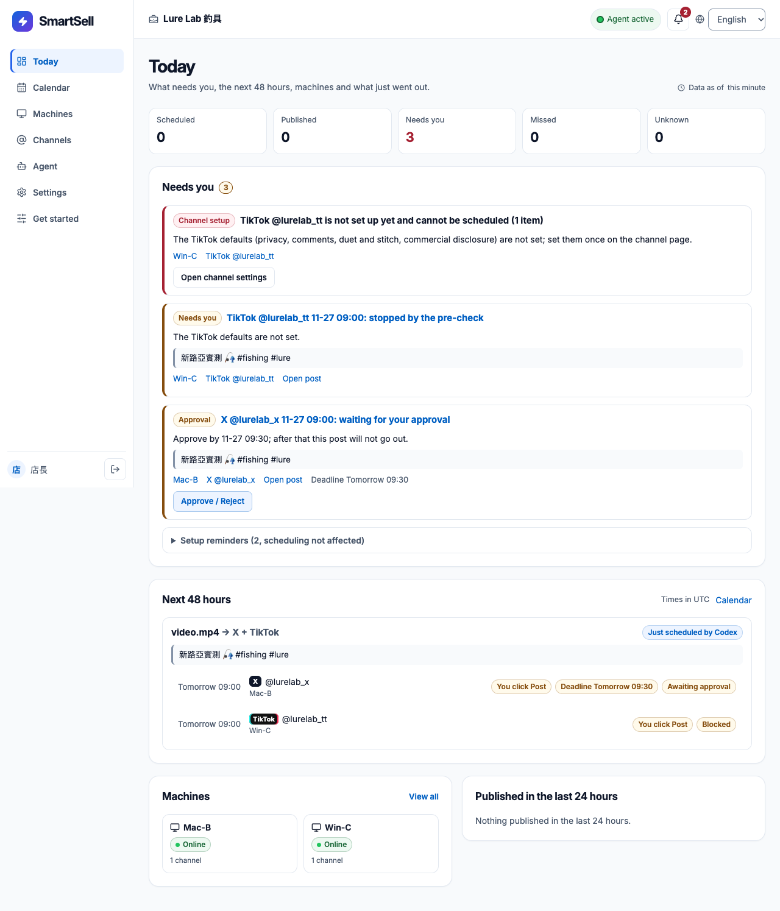

# SmartSell

[繁體中文](README.md)

SmartSell lets the AI assistant on your own computer (Codex, Claude Code or WorkBuddy) direct several of your computers to post on social media **inside your own, already signed-in Chrome**, and report the results back. A web dashboard shows what needs you today, every machine and account, the calendar and the outcome of every post.

**Who it is for:** solo sellers and creators (and small teams) with several social accounts spread over several computers, who want to say "post ~/Movies/video.mp4 tomorrow at 9:00 to X on Mac-B and TikTok on Win-C" instead of uploading by hand in each dashboard.



## What it does

- **Scheduled posts**: video posts to X and TikTok, published on time by the machine each account is bound to, inside your own Chrome, with the post URL read back. Media goes up through the API in checked, resumable chunks and never passes through the model.
- **You decide what to see first**: per account, "post what the Agent schedules" or "I approve on the web"; the Worker clicks "Post" only after you accept that risk for the account, otherwise it prepares the post and waits for you.
- **It stops instead of guessing**: sign-in prompts, captchas and two-factor checks always stop and notify you (web, laptop, phone push); a post whose result is unknown is never re-posted, and a missed time is never made up without you.
- **Remote control** (off by default, per machine): once you turn it on and list the allowed sites or apps, the assistant can look at and operate that machine's Chrome or a plugged-in Android phone step by step — a store backend, say.

```
Laptop: Codex / Claude Code / WorkBuddy ──MCP──▶ Hub (an always-on computer at home, over Tailscale)
                                                  │ each account is bound to one machine
                                 ┌────────────────┴────────────────┐
                         SmartSell Worker on Mac-B          SmartSell Worker on Win-C
                         posts to X in your Chrome          posts to TikTok in your Chrome
```

> **Know the platform rules.** X's automation rules forbid scripting the website and TikTok's terms restrict automation; accounts can be limited or suspended. SmartSell never spoofs fingerprints, evades detection or solves captchas, and before the Worker may click "Post" for an account you confirm that risk for that account in the web app; otherwise the Worker prepares the post and waits for you to click. Whether and where to use it is your decision.

**License:** free for noncommercial use ([PolyForm Noncommercial 1.0.0](LICENSE.md)). Running accounts or a shop that make money, or operating accounts for clients, is commercial use and needs a separate commercial license; see [License](#license) below.

## Quick start

The step-by-step manual with screenshots is [docs/user-guide.md](docs/user-guide.md) (Traditional Chinese). There are no prebuilt installers yet: the hub and the Worker installers are built from source (Node.js 24); the install script does it for you.

1. **Install the hub** on an always-on Mac or Windows computer with Tailscale:

   ```bash
   git clone https://github.com/dp0304/smartsell.git ~/smartsell   # or the Gitee mirror https://gitee.com/yueshutech/smartsell.git
   cd ~/smartsell && bash scripts/install-hub.sh
   ```

   Open the printed setup URL from a browser on your tailnet and create the owner account; the web app's setup wizard guides the rest. Details: [docs/hub-setup.md](docs/hub-setup.md).
2. **Pair each posting machine**: download the Worker from the setup wizard, install it, paste the hub address, name the machine (e.g. Mac-B) and authorize it in the browser. The installers are not code-signed yet.
3. **Use your own Chrome**: click "use my own Chrome" in the Worker and load the SmartSell extension as the App shows (about a minute). See [the Worker README](apps/connector-desktop/README.md).
4. **Add accounts** in the Worker (X or TikTok), then finish each account's checklist in the web app: approval mode, the click-Post risk confirmation, TikTok defaults, a dry run.
5. **Connect your AI assistant**: the laptop mode of the same App, or the Node relay commands on the web app's Agent page (Codex, Claude Code and WorkBuddy all work).
6. **Ask** it to post: "post ~/Movies/video.mp4 tomorrow at 9:00 to X on Mac-B and TikTok on Win-C". It reports each post's local time, machine, status and URL; approvals, risk confirmations, resuming and confirming results stay with you in the web app.

## Tools the assistant sees

11 posting tools (`smartsell_overview`, `machines_list`, `channels_list`, `channel_check`, `media_upload`, `post_schedule`, `post_update`, `posts_list`, `post_get`, `task_get`, `publishing_pause`) and 3 remote-control tools (`browser_open`, `browser_act`, `phone_act`) that work only on a machine where you turned remote control on. Through the relay, media is uploaded in SHA-256-checked, resumable chunks; a client that talks HTTP to the hub directly gets a single-use upload URL from `media_upload` and runs one `curl`.

## Documentation (Traditional Chinese)

- [Owner's manual](docs/user-guide.md): install, daily use, remote control, troubleshooting, with screenshots
- [Hub setup and maintenance](docs/hub-setup.md): every command, expected output and error; service, backups, updates, Worker installers
- [SmartSell Worker](apps/connector-desktop/README.md): the Worker App, your own Chrome and the extension
- [Owner's acceptance checklist](docs/restructure/phase1-owner-checklist.md): step-by-step checks on real machines and accounts
- [Agent guide](docs/agent-guide.md): rules for the AI assistant

## Develop

```sh
pnpm install --frozen-lockfile
pnpm exec playwright install chromium
pnpm dev        # API on 127.0.0.1:3401, web on 127.0.0.1:5173
pnpm verify     # the same checks as CI
```

See [CONTRIBUTING.md](CONTRIBUTING.md) and, for security reports, [SECURITY.md](SECURITY.md). The design of record is [docs/restructure/phase1-design.md](docs/restructure/phase1-design.md) (Traditional Chinese).

## License

SmartSell's source is public under the [PolyForm Noncommercial License 1.0.0](LICENSE.md); it is not an OSI open-source license. This summary is not the license; [the terms](LICENSE.md) govern.

- **Free:** any noncommercial purpose — personal study, research and testing, hobby projects with no commercial application, and use by charities, schools, public research organizations and government institutions. You may change and share it if you pass on the terms (or their URL) and the `Required Notice:` line.
- **Commercial license needed:** running accounts, a shop or a brand that make money, operating accounts for clients, or offering it (or a changed version) as a paid service. Open an issue on GitHub or Gitee titled "Commercial license" (no details needed) and we will contact you.
- Third-party packages keep their own licenses.
