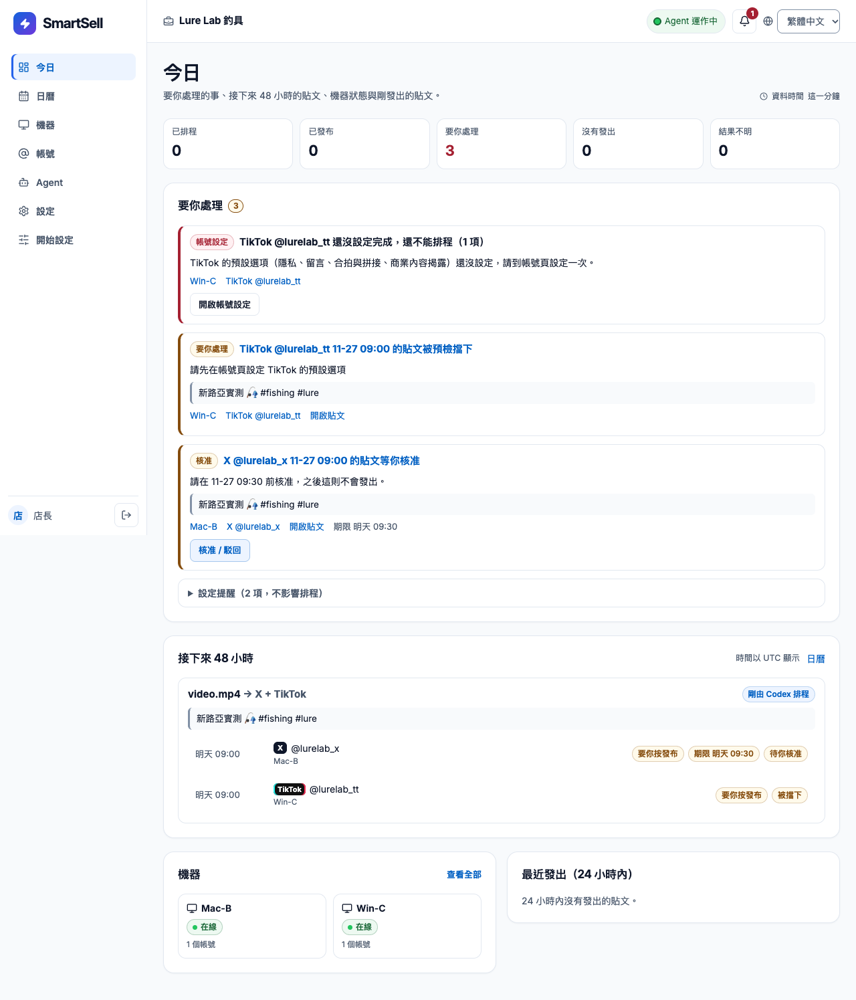

# SmartSell

[English](README.en.md)

讓你自己電腦上的 AI 助手（Codex、Claude Code、WorkBuddy）指揮你的好幾台電腦，**在你自己平常用、已經登入的 Chrome 裡**替你發社群貼文，結果自動回報。網頁讓你看現況、做決定：今天要你處理什麼、每台機器與每個帳號的狀態、日曆與每則貼文的結果。

**給誰用：**一個人或小團隊經營的跨境賣家與創作者，有好幾個社群帳號、分散在好幾台電腦上，想用一句話交代「把這支影片明天 9:00 發到 Mac-B 的 X 和 Win-C 的 TikTok」，而不是一個一個後台手動上傳。



## 能做什麼

- **排程發文**：X 與 TikTok 的影片貼文，到點由帳號綁定的那台電腦在你的 Chrome 裡發出，貼文網址自動讀回來。影片一律走 API 分段上傳，不經過模型。
- **你決定要不要先看**：每個帳號可選「Agent 說要發就直接發」或「要我在網頁按核准」；代按發布前要你單獨確認風險，否則 Worker 準備好後停在「發布」前等你按。
- **出事就停、絕不亂補**：沒登入、驗證碼、二次驗證一律停下來通知你（網頁、筆電、手機推播）；結果不明的貼文絕不自動重發，錯過時間也不會在你不知情時補發。
- **遙控**（每台機器預設關閉）：你開啟並列出允許的網站或 App 後，AI 助手可以在那台電腦的 Chrome 或插著的 Android 手機上看畫面、一步一步操作，例如到電商後台改庫存。

```
你的筆電：Codex／Claude Code／WorkBuddy ──MCP──▶ 中樞（家裡常開的電腦，經 Tailscale）
                                                   │  帳號綁哪台機器就派給哪台
                                  ┌────────────────┴────────────────┐
                           Mac-B 的 SmartSell Worker          Win-C 的 SmartSell Worker
                           在你的 Chrome 裡發 X                在你的 Chrome 裡發 TikTok
```

> **請先了解平台規則。** X 的自動化規則禁止以腳本操作網站，TikTok 條款也限制自動化；帳號可能因此受限或停權。SmartSell 不偽造指紋、不規避偵測、不解驗證碼，代按發布前每個帳號都要你在網頁單獨確認風險；沒確認的帳號，Worker 會準備好貼文，停在「發布」前請你自己按。是否使用、用在哪些帳號，由你自行判斷並承擔。

**授權：**非商業用途免費（[PolyForm Noncommercial 1.0.0](LICENSE.md)）。用來經營會賺錢的帳號或店鋪、替客戶代操，屬於商業用途，要另外取得商用授權，見文末〈[授權](#授權)〉。

## 快速開始

完整步驟與截圖在 **[操作手冊](docs/user-guide.md)**。目前沒有預先建置好的安裝包：中樞與 Worker 安裝包都從原始碼建置（需要 Node.js 24），安裝腳本會一併處理。

1. **安裝中樞**（一台常開的 Mac 或 Windows 電腦，裝好 Tailscale）：

   ```bash
   git clone https://github.com/dp0304/smartsell.git ~/smartsell   # 中國大陸可用 https://gitee.com/yueshutech/smartsell.git（內容相同）
   cd ~/smartsell && bash scripts/install-hub.sh
   ```

   在已加入 tailnet 的瀏覽器打開它印出的網址，建立擁有者帳號。網頁的「開始設定」會帶你走完其餘步驟。細節見 [中樞安裝與維護](docs/hub-setup.md)。
2. **配對每台發文的電腦**：從「開始設定 → 下載 SmartSell Worker」下載並安裝，貼上中樞位址、取名（例如 Mac-B），在瀏覽器按「授權並返回桌面程式」。（[手冊第 4 節](docs/user-guide.md#4-每台發文的電腦安裝並配對-worker)）
3. **用你自己的 Chrome**：在 Worker 按「改用我自己的 Chrome」，照 App 的步驟載入 SmartSell 擴充功能（約 1 分鐘）。（[第 5 節](docs/user-guide.md#5-讓-worker-用你自己的-chrome)）
4. **新增帳號**：在 Worker 按「新增帳號」，再到網頁的帳號頁完成就緒清單：核准方式、代按發布的風險、TikTok 預設、試跑。（[第 6 節](docs/user-guide.md#6-新增帳號完成就緒清單)）
5. **連接 AI 助手**：筆電裝同一個 App 選「這台是我的筆電」，或照網頁 Agent 頁的命令加入 Node relay（Codex、Claude Code、WorkBuddy 都可以）。（[第 7 節](docs/user-guide.md#7-連接你的-ai-助手)）
6. **直接交代**：「把 ~/Movies/video.mp4 明天 9:00 發到 Mac-B 的 X 和 Win-C 的 TikTok，文案：『新路亞實測』」。它會回報每則的時間、機器、狀態與網址；核准、風險確認、恢復暫停與確認結果留給你在網頁做。（[第 8 節](docs/user-guide.md#8-每天怎麼用)）

## AI 助手看得到的工具

| 類別 | 工具 |
|---|---|
| 發文（11 個） | `smartsell_overview`、`machines_list`、`channels_list`、`channel_check`、`media_upload`、`post_schedule`、`post_update`、`posts_list`、`post_get`、`task_get`、`publishing_pause` |
| 遙控（3 個，你為某台機器開啟後才能用） | `browser_open`、`browser_act`、`phone_act` |

媒體上傳：經 relay 時由本機的 relay 分段上傳（SHA-256 校驗、可續傳）；用戶端直接以 HTTP 連中樞時，`media_upload` 換一個單次有效的上傳網址，由 AI 助手在本機執行一行 `curl`。不需要修改 `AGENTS.md`；想把規則放進專案時，見 [Agent 工作指南](docs/agent-guide.md)。

## 文件

| 文件 | 給誰 | 內容 |
|---|---|---|
| [操作手冊](docs/user-guide.md) | 使用者 | 從安裝到每天使用、遙控、常見問題，附截圖 |
| [中樞安裝與維護](docs/hub-setup.md) | 架中樞的人 | 每個命令、預期輸出與錯誤處理；服務、備份、更新、Worker 安裝包 |
| [SmartSell Worker](apps/connector-desktop/README.md) | 使用者、開發者 | Worker App、你自己的 Chrome 與擴充功能 |
| [主人實機驗收檢查表](docs/restructure/phase1-owner-checklist.md) | 上線前驗收 | 在真實機器與帳號上逐項確認 |
| [Agent 工作指南](docs/agent-guide.md) | AI 助手 | 工具怎麼用、什麼要先問主人 |
| [第 1 階段設計](docs/restructure/phase1-design.md) | 開發者 | 流程、資料模型、MCP 工具、驗收（附錄 E 的決定優先） |
| [核心技術方案](docs/restructure/core-automation-proposal.md) | 開發者 | 主人自己的 Chrome、遠端遙控、手機 |
| [舊版部署與工作台](docs/legacy.md) | 既有使用者 | 第 2 階段之前保留的舊功能 |
| [參與開發](CONTRIBUTING.md)、[回報安全問題](SECURITY.md) | 開發者、資安研究者 | |

## 開發

```sh
pnpm install --frozen-lockfile
pnpm exec playwright install chromium
pnpm dev        # API 127.0.0.1:3401，Web 127.0.0.1:5173
pnpm verify     # 和 CI 相同：需求檢查、建置、全部測試
```

需要 Node.js 24 與 pnpm 10。本機首次設定、測試指令與提交規則見 [CONTRIBUTING.md](CONTRIBUTING.md)。

## 授權

SmartSell 的原始碼公開，以 [PolyForm Noncommercial License 1.0.0](LICENSE.md) 授權；這不是 OSI 定義的開源授權。以下是白話說明，以[條款原文](LICENSE.md)為準。

- **免費使用：**任何非商業用途，例如個人學習、研究與測試、沒有營利打算的興趣專案，以及慈善團體、學校、公共研究機構、政府機關使用。可以修改、轉發，但要附上條款（或它的網址）和 `Required Notice:` 那一行。
- **要商用授權：**用來經營會賺錢的帳號、店鋪或品牌，替客戶代操，或拿它（或改過的版本）提供付費服務。請在 GitHub 或 Gitee 開一個標題寫「商用授權」的 issue，不必寫細節，我們會聯絡你。
- 第三方套件各自依它們的授權條款。
