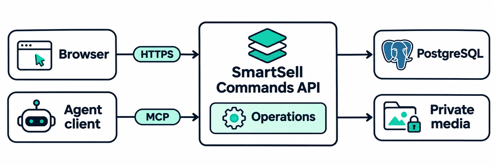

# SmartSell

English · [简体中文](README.zh-CN.md) · [繁體中文](README.zh-TW.md)

SmartSell is a social commerce workspace for brand teams. Trace a post from the product and market price it quotes to the revision a reviewer approved and the results recorded after publication. A local agent such as Claude Code or Codex can prepare the work through MCP. Operators use the dashboard to check inventory, review the calendar and decide what goes live.

**The project owner promises that all SmartSell features will remain permanently open source. The paid offering is deployment assistance.** This commitment describes the owner's product policy. Consult the applicable license terms for permissions.

[Illustrated user manual](docs/manual/en.md) · [Deployment runbook](infra/README.md) · [Development log](docs/devlog.md)


## A first campaign

1. Register the brand's social account and identify the store and market. Import product variants and inspect the price and stock observations for the market you intend to promote.
2. Give the agent a campaign brief with a goal, timezone, dates and products. It can draft platform variants, commit revisions and submit scheduled posts for review. The advanced workbench also supports manual entry.
3. Review the target account, revision and timing in **Decisions**. After publication, record the platform post and import its daily metrics. **Social** shows which periods have observations.

## Try it locally

From the repository root use Node.js 24 and pnpm 10.11.0. With no production database settings, local development uses SQLite at `.local/smartsell.sqlite`.

```sh
pnpm install --frozen-lockfile
pnpm dev
```

Open `http://127.0.0.1:5173` and create the first owner on the setup screen. The API listens on loopback port 3401. For a built preview, stop the development server, run `pnpm build` and then `pnpm preview`. Open `http://127.0.0.1:4173`.

For a populated demo, use an empty disposable workspace. `pnpm setup:local` can create an email-based owner before starting the server. With development running, supply that owner's password through `SMARTSELL_SEED_PASSWORD` in a second terminal and run the following with the corresponding email.

```sh
pnpm seed:demo --origin http://127.0.0.1:5173 --email owner@example.test
```

Look for **Glow Lab 光研** in Products and Plans. The seed exercises both the agent and human paths. Its resumable checkpoint under `.local/seed-demo.*.json` contains a connection token and belongs in private local storage.

## Deploy on a host



Run PostgreSQL 17 in Compose and the API on the host. Prepare persistent storage and a TLS reverse proxy. The host needs the installed workspace, including its TypeScript sources. Before running the commands below, configure the environment using the [deployment runbook](infra/README.md).

- Generate separate hex passwords with `openssl rand -hex 32` for `POSTGRES_PASSWORD`, `SMARTSELL_MIGRATION_PASSWORD`, `SMARTSELL_RUNTIME_PASSWORD` and `SMARTSELL_BACKGROUND_PASSWORD`.
- Point `MIGRATION_DATABASE_URL` at `app_owner` for the migration job. Give the API `DATABASE_URL` for `app_rw` and `BACKGROUND_DATABASE_URL` for `app_background` in the default all-roles deployment.
- Give the API an HTTPS `PUBLIC_ORIGIN`, persistent `APP_SECRET`, private writable `MEDIA_DIRECTORY` and a separately generated first-run `SETUP_TOKEN`.

```sh
pnpm install --frozen-lockfile
pnpm build
docker compose --project-name smartsell -f infra/compose.yaml up --detach --wait postgres
pnpm db:migrate
NODE_ENV=production pnpm start
```

In a second terminal, check `curl --fail --show-error http://127.0.0.1:3401/readyz`. Serve `apps/web/dist` at the public HTTPS origin. Follow the runbook's proxy rules for `/api`, `/mcp`, OAuth discovery and redirects, and use the SPA fallback for web routes. Create the first owner over HTTPS, remove `SETUP_TOKEN` and restart the API. Back up PostgreSQL and private media together.

### Deploy the full stack with Compose

Set the four database passwords, `PUBLIC_ORIGIN`, `APP_SECRET` and the first-run `SETUP_TOKEN` as described in the [Compose runbook](infra/README.md#run-the-api-in-compose). For a portal, also set `PORTAL_ORIGIN` and follow the runbook's routing instructions.

```sh
docker compose --project-name smartsell -f infra/compose.yaml --profile server up --detach --build --wait
curl --fail --show-error http://127.0.0.1:3401/readyz
```

Compose runs migrations before starting Commands and the Web service. Route the public HTTPS origin to the Web service on loopback port 8080 by default. After first setup, remove `SETUP_TOKEN` and recreate `server`. Back up the database and media volumes together.

The connector CLI and snapshot script accept `SMARTSELL_CLI_LANGUAGE=en`, `zh-Hans` or `zh-Hant` for help and selected terminal messages. For example, run `SMARTSELL_CLI_LANGUAGE=zh-Hans pnpm --filter @smartsell/connector start --help` or `SMARTSELL_CLI_LANGUAGE=zh-Hans bash infra/ops-snapshot.sh --help`.

## Further reading

- [Operator manual](docs/manual/en.md) and [agent operation guide](docs/agent-guide.md) for campaign work, imports and troubleshooting.
- [Agent-first design](docs/agent-first-design.md), [identity and authentication](docs/identity-operation.md) and [desktop connector](apps/connector-desktop/README.md) for integration and access.
- [Acceptance scenarios](docs/acceptance/scenarios.md) and [development log](docs/devlog.md) for implementation history. Run `pnpm typecheck` for TypeScript checks or `pnpm verify` for the repository verification suite.
