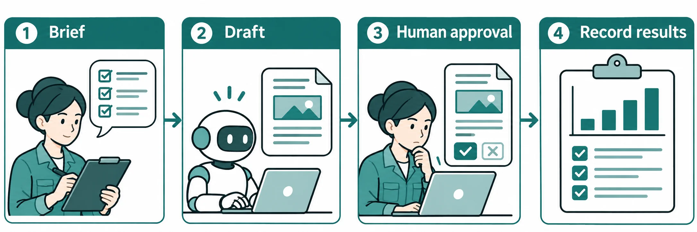
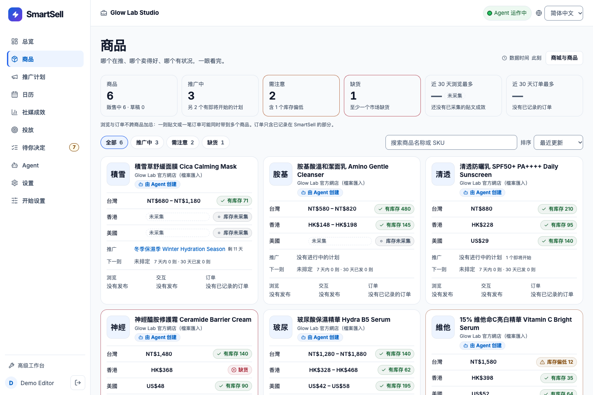
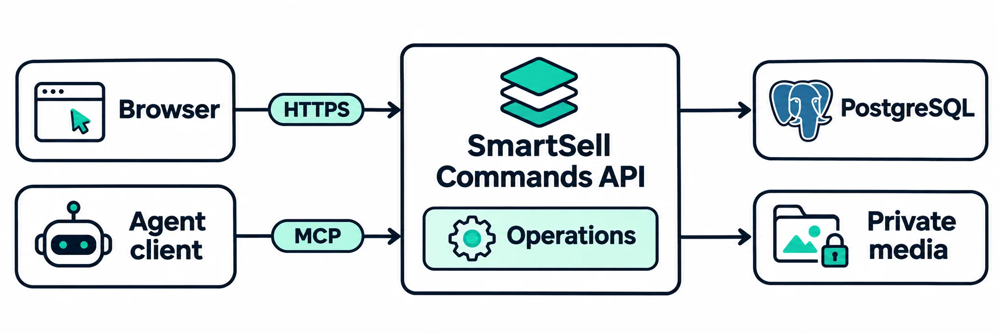

# SmartSell

[English](README.md) · 简体中文 · [繁體中文](README.zh-TW.md)

SmartSell 是品牌团队的社交电商运营工作区。查看一篇帖子时，你可以查到它引用了哪个市场的商品价格、审核人批准了哪一版文案，以及发布后的表现。Claude Code 或 Codex 等本地 Agent 可通过 MCP 准备数据与草稿，运营人员则在看板核对库存、检查排期并决定是否发布。

**项目所有者承诺，SmartSell 的所有功能都将永久开源。付费提供的是部署服务。** 这项承诺说明项目的产品政策，使用权限请以适用的授权条款为准。

[图解使用手册](docs/manual/zh-CN.md) · [部署指南](infra/README.md) · [开发日志](docs/devlog.md)





## 从第一个推广计划开始

1. 登记品牌自有的社交账号，确认店铺与市场。导入商品规格后，在「商品」查看目标市场的价格与库存记录。
2. 把目标、时区、起止日期与商品交给 Agent。它可以按平台撰写草稿、建立修订并排期送审。需要手动录入时，也能使用高级工作台。
3. 在「待你决定」核对账号、文案版本和时间。发布后登记平台帖子，再导入每日数据，到「社媒成效」查看哪些日期已有观测记录。

## 在本地试用

在项目根目录使用 Node.js 24 和 pnpm 10.11.0。未设置生产数据库时，本地开发数据存储在 SQLite 文件 `.local/smartsell.sqlite`。

```sh
pnpm install --frozen-lockfile
pnpm dev
```

打开 `http://127.0.0.1:5173`，在首次设置页建立第一位所有者。API 的本地端口是 3401。如果要预览构建结果，先停止开发服务器，依次执行 `pnpm build` 和 `pnpm preview`，再打开 `http://127.0.0.1:4173`。

想直接看有数据的画面，请使用空白的测试工作区。启动服务器前可执行 `pnpm setup:local`，用邮箱创建所有者账号。开发服务器启动后，在另一个终端通过 `SMARTSELL_SEED_PASSWORD` 提供密码，再将以下命令的邮箱换成该账号。

```sh
pnpm seed:demo --origin http://127.0.0.1:5173 --email owner@example.test
```

在「商品」及「推广计划」可以看到演示品牌 **Glow Lab 光研**。脚本会执行 Agent 提交与人工决策流程，并在 `.local/seed-demo.*.json` 保存进度，以便中断后继续。该文件包含连接令牌，请留在本地私有存储空间。

## 部署到服务器



通过 Compose 启动 PostgreSQL 17，在主机上运行 API。先准备持久化存储和 TLS 反向代理，主机上需要保留工作区源代码和已安装的依赖。运行以下命令前，请按[部署指南](infra/README.md)配置环境。

- 分别用 `openssl rand -hex 32` 为 `POSTGRES_PASSWORD`、`SMARTSELL_MIGRATION_PASSWORD`、`SMARTSELL_RUNTIME_PASSWORD` 和 `SMARTSELL_BACKGROUND_PASSWORD` 生成独立密码。
- 迁移任务使用 `MIGRATION_DATABASE_URL` 连接 `app_owner`。默认运行全部角色时，API 的 `DATABASE_URL` 连接 `app_rw`，`BACKGROUND_DATABASE_URL` 连接 `app_background`。
- 为 API 设置 HTTPS 的 `PUBLIC_ORIGIN`、持久保存的 `APP_SECRET`、私有可写的 `MEDIA_DIRECTORY`，以及单独生成、仅供首次设置使用的 `SETUP_TOKEN`。

```sh
pnpm install --frozen-lockfile
pnpm build
docker compose --project-name smartsell -f infra/compose.yaml up --detach --wait postgres
pnpm db:migrate
NODE_ENV=production pnpm start
```

在另一个终端运行 `curl --fail --show-error http://127.0.0.1:3401/readyz` 检查服务是否就绪。通过 HTTPS 站点提供 `apps/web/dist`，按指南将 `/api`、`/mcp`、OAuth 发现和重定向路径转发给 API，网页路径则使用单页应用的回退规则。通过 HTTPS 创建首个所有者账号后，移除 `SETUP_TOKEN` 并重启 API。请同时备份 PostgreSQL 和私有媒体文件。

### 使用 Compose 部署全套服务

按 [Compose 部署指南](infra/README.md#run-the-api-in-compose)设置四个数据库密码、`PUBLIC_ORIGIN`、`APP_SECRET` 和首次设置用的 `SETUP_TOKEN`。如需启用门户，还要设置 `PORTAL_ORIGIN` 并按指南配置路由。

```sh
docker compose --project-name smartsell -f infra/compose.yaml --profile server up --detach --build --wait
curl --fail --show-error http://127.0.0.1:3401/readyz
```

Compose 先运行数据库迁移，再启动 Commands API 和 Web 服务。反向代理将公开的 HTTPS 站点转发到 Web 服务，默认监听回环地址的 8080 端口。完成首次设置后，移除 `SETUP_TOKEN` 并重建 `server` 容器。请一并备份数据库与媒体卷。

连接器命令行和快照脚本支持通过 `SMARTSELL_CLI_LANGUAGE` 设置帮助和部分终端消息的语言，可选 `en`、`zh-Hans` 或 `zh-Hant`。例如，运行 `SMARTSELL_CLI_LANGUAGE=zh-Hans pnpm --filter @smartsell/connector start --help` 或 `SMARTSELL_CLI_LANGUAGE=zh-Hans bash infra/ops-snapshot.sh --help`。

## 延伸阅读

- [使用手册](docs/manual/zh-CN.md)与 [Agent 操作指南](docs/agent-guide.md)涵盖活动、导入与常见错误。
- [Agent 优先设计](docs/agent-first-design.md)、[身份验证](docs/identity-operation.md)与[桌面连接器](apps/connector-desktop/README.md)说明整合方式与权限。
- [验收场景](docs/acceptance/scenarios.md)与[开发日志](docs/devlog.md)记录了各项功能的实现情况。`pnpm typecheck` 检查 TypeScript，`pnpm verify` 运行项目验证套件。
