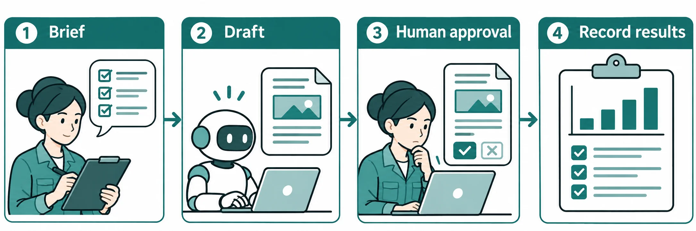
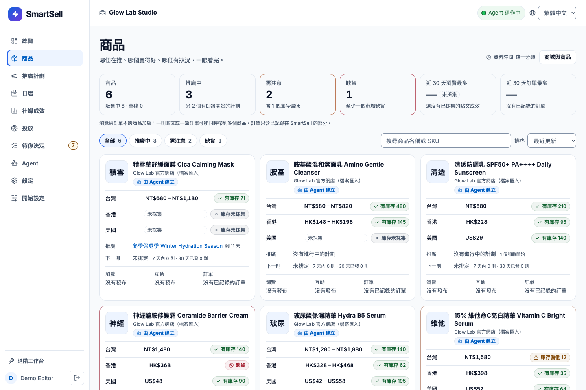
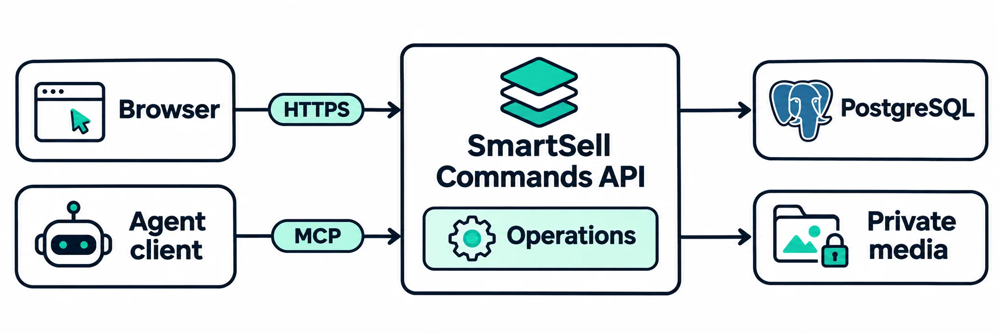

# SmartSell

[English](README.md) · [简体中文](README.zh-CN.md) · 繁體中文

SmartSell 是品牌團隊的社群電商營運工作區。從一則貼文，可以追溯它引用哪個市場的商品價格、審核人核准哪一版文案，以及發布後收到了哪些成效數據。Claude Code 或 Codex 等本機 Agent 可透過 MCP 準備資料與草稿，營運人員則在看板核對庫存、檢查排程並決定是否發布。

**專案擁有者承諾，SmartSell 的所有功能都將永久開源。付費提供的是部署服務。** 這項承諾說明專案的產品政策，使用權限請以適用的授權條款為準。

[圖解使用手冊](docs/manual/zh-TW.md) · [部署指南](infra/README.md) · [開發日誌](docs/devlog.md)





## 從第一個推廣計劃開始

1. 登記品牌自有的社群帳號，確認店鋪與市場。匯入商品規格後，在「商品」查看目標市場的價格與庫存紀錄。
2. 把目標、時區、起訖日期與商品交給 Agent。它可以按平台撰寫草稿、建立修訂並排期送審。需要手動錄入時，也能使用進階工作台。
3. 在「待你決定」核對帳號、文案版本和時間。發布後登記平台貼文，再匯入每日數據，到「社媒成效」查看哪些日期已有觀測紀錄。

## 管理單一商品的跨平台發布

按商品和目標市場整理各社群渠道的文案與素材版本。為每則貼文選定發布帳號和排程時區，將指定版本與排程送審，由營運人員核准。

抖音和小紅書的影片目前可透過人工交接流程送審。核准後，由接手的營運人員到平台創作者後台核對帳號與核准版本，發布後登記 HTTPS 作品連結，以及平台提供的貼文 ID（如有）。Facebook、Instagram、YouTube 等平台可由已啟用的官方整合提交，前提是帳號已授權、內容格式符合該平台整合的要求。

平台受理或已排程後，仍須到平台確認作品已上線，才能記為已發布。若提交時斷線、結果不明，先沿用原任務核對平台狀態，確認原提交未發布且不會再發布後才重試。詳見[發布執行與結果核對](apps/server/src/modules/execution/README.md)。

## 在本機試用

在專案根目錄使用 Node.js 24 和 pnpm 10.11.0。未設定正式資料庫時，本機開發資料儲存在 SQLite 檔案 `.local/smartsell.sqlite`。

```sh
pnpm install --frozen-lockfile
pnpm dev
```

開啟 `http://127.0.0.1:5173`，在首次設定頁建立第一位擁有者。API 的本機連接埠是 3401。若要預覽建置成果，先停止開發伺服器，依序執行 `pnpm build` 和 `pnpm preview`，再開啟 `http://127.0.0.1:4173`。

想直接看有資料的畫面，請使用空白的測試工作區。啟動伺服器前可執行 `pnpm setup:local`，以電子郵件建立擁有者。開發伺服器啟動後，在另一個終端透過 `SMARTSELL_SEED_PASSWORD` 提供密碼，再將下列指令的信箱換成該帳號。

```sh
pnpm seed:demo --origin http://127.0.0.1:5173 --email owner@example.test
```

在「商品」及「推廣計劃」可以看到示範品牌 **Glow Lab 光研**。腳本會實際走過 Agent 送件與人工決策流程，並在 `.local/seed-demo.*.json` 儲存續跑進度。此檔含連線權杖，請留在本機私有儲存空間。

## 部署到伺服器



以下方式由 Compose 啟動 PostgreSQL 17，API 則直接在主機執行。先備妥持久化儲存與 TLS 反向代理，主機上需保留工作區原始碼及已安裝的依賴。執行指令前，依[部署指南](infra/README.md)設定環境。

- 分別以 `openssl rand -hex 32` 為 `POSTGRES_PASSWORD`、`SMARTSELL_MIGRATION_PASSWORD`、`SMARTSELL_RUNTIME_PASSWORD` 與 `SMARTSELL_BACKGROUND_PASSWORD` 產生獨立密碼。
- 遷移工作透過 `MIGRATION_DATABASE_URL` 使用 `app_owner`。預設執行全部角色時，API 的 `DATABASE_URL` 使用 `app_rw`，`BACKGROUND_DATABASE_URL` 使用 `app_background`。
- 為 API 設定 HTTPS 的 `PUBLIC_ORIGIN`、持久保存的 `APP_SECRET`、私有可寫的 `MEDIA_DIRECTORY`，以及獨立產生、僅供首次設定的 `SETUP_TOKEN`。

```sh
pnpm install --frozen-lockfile
pnpm build
docker compose --project-name smartsell -f infra/compose.yaml up --detach --wait postgres
pnpm db:migrate
NODE_ENV=production pnpm start
```

在另一個終端執行 `curl --fail --show-error http://127.0.0.1:3401/readyz` 確認就緒。由 HTTPS 站台提供 `apps/web/dist`，依指南將 `/api`、`/mcp`、OAuth 探索與轉址路徑交給 API，網頁路徑則使用單頁應用程式的回退規則。透過 HTTPS 建立第一位擁有者後，移除 `SETUP_TOKEN` 並重新啟動 API。請一併備份 PostgreSQL 和私有媒體。

### 使用 Compose 部署完整服務

依照 [Compose 部署指南](infra/README.md#run-the-api-in-compose)設定四個資料庫密碼、`PUBLIC_ORIGIN`、`APP_SECRET` 與首次設定用的 `SETUP_TOKEN`。若要啟用入口網站，也請設定 `PORTAL_ORIGIN` 並依指南配置路由。

```sh
docker compose --project-name smartsell -f infra/compose.yaml --profile server up --detach --build --wait
curl --fail --show-error http://127.0.0.1:3401/readyz
```

Compose 先執行資料庫遷移，再啟動 Commands API 與 Web 服務。反向代理將公開的 HTTPS 站台轉送至 Web 服務，預設使用回送位址的 8080 連接埠。完成首次設定後，移除 `SETUP_TOKEN` 並重建 `server` 容器。請一併備份資料庫與媒體磁碟區。

連接器命令列與快照指令碼支援透過 `SMARTSELL_CLI_LANGUAGE` 設定說明和部分終端機訊息的語言，可選 `en`、`zh-Hans` 或 `zh-Hant`。例如，執行 `SMARTSELL_CLI_LANGUAGE=zh-Hant pnpm --filter @smartsell/connector start --help` 或 `SMARTSELL_CLI_LANGUAGE=zh-Hant bash infra/ops-snapshot.sh --help`。

## 延伸閱讀

- [使用手冊](docs/manual/zh-TW.md)與 [Agent 操作指南](docs/agent-guide.md)涵蓋活動、匯入與常見錯誤。
- [Agent 優先設計](docs/agent-first-design.md)、[身分驗證](docs/identity-operation.md)與[桌面連接器](apps/connector-desktop/README.md)說明整合方式與權限。
- [驗收情境](docs/acceptance/scenarios.md)與[開發日誌](docs/devlog.md)可供追溯實作。`pnpm typecheck` 檢查 TypeScript，`pnpm verify` 執行專案驗證套件。
