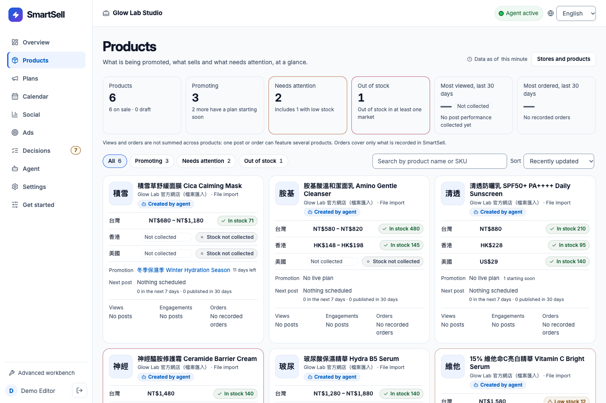
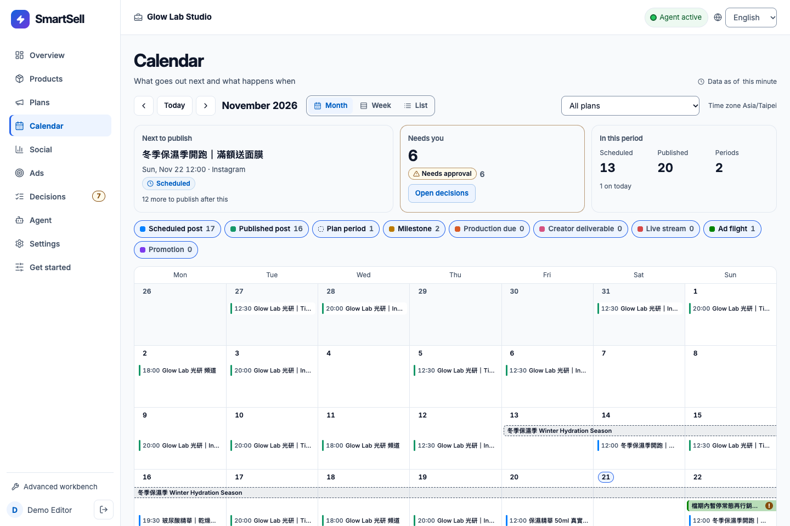
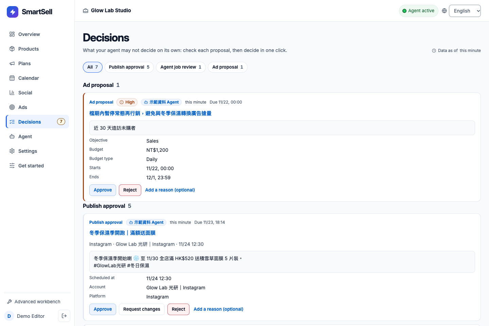
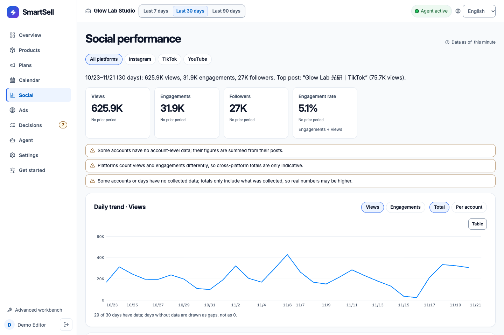

# SmartSell operator manual

[Project home](../../README.md) · English · [简体中文](zh-CN.md) · [繁體中文](zh-TW.md)

Use this walkthrough to take one market-specific promotion from a catalog observation to a reviewed post and a daily report. The screenshots show **Glow Lab 光研**, a synthetic brand created by `pnpm seed:demo`. Its product names and campaign copy stay in their original language when you switch interface languages.

On the sign-in page, use **Interface language** to switch among English, Simplified Chinese and Traditional Chinese. In the signed-in dashboard, use **Language** in the top bar. The dashboard and advanced workbench share the browser’s saved preference.

## 1. Open the workspace and connect your agent

Sign in at the address provided by your administrator. For a disposable workspace on your computer, follow the [local setup and demo instructions](../../README.md). On the dashboard (`/app/:ws`), start with **Get started**. An owner or administrator can set up the main agent, a desktop worker, social accounts and stores. You can return to Overview and finish setup later.

| Who | What to do here |
| --- | --- |
| Operator in the web app | Register the brand's own account, assign a worker, review submissions and decide whether to pause or resume publishing. |
| Main agent on your computer | Connect over `/mcp`, read the brand context, import products, prepare drafts, schedule revisions and submit work for review. |
| Desktop worker | Handle assigned account checks and store exports on the designated computer. Verify the actual merchant store ID before returning an export. |

In **Agent**, generate a connection token. Copy the connection instructions while the token is visible, then set `SMARTSELL_TOKEN` privately in the environment of your local client. For Codex, the MCP server entry in `~/.codex/config.toml` has this form (replace the example origin).

```toml
[mcp_servers.smartsell]
url = "https://smartsell.example.com/mcp"
bearer_token_env_var = "SMARTSELL_TOKEN"
```

Ask the agent to list the workspace brands and markets before asking it to write anything. Check its activity in **Agent**. A token is bound to one workspace and can be revoked there. If you need to enter records yourself, open **Advanced workbench** (`/w/:ws`). Available actions depend on your role and the workspace catalog. [Agent guide](../agent-guide.md) · [Desktop worker guide](../../apps/connector-desktop/README.md)

## 2. Check a product before promising a price

Open **Products**. In the example, six products are on sale, two need attention and one is out of stock in at least one market. Search by product name or SKU, or select **Needs attention**. Open the product and compare the relevant variant, market, currency and stock observation. A stockout in Hong Kong can coexist with available inventory in Taiwan.



*Read across markets on a single card. An uncollected price or stock observation leaves the offer unverified for that market.*

If a store has a new export, ask the agent to use the `product_list` import template. Identify the store, external product and variant IDs, SKU, market and currency. Inspect the row preview before confirming the import. Fix column mappings or invalid rows in the preview. A large import can return a checkpoint; continue confirming the same batch until it finishes. For a worker-assisted export, the operator can open the preview in **Get started** and confirm it there.

## 3. Turn the brief into a reviewable post

For the demo's *Winter Hydration Season*, a useful brief is “Draft one Instagram post for Taiwan next week. Use the current Taiwan price for the serum. Show me the revision and scheduled time before publication.” Add the intended account, timezone and campaign goal. If the budget or date is undecided, leave it open for the operator.

1. Ask the agent to find the existing plan in **Plans** or create a campaign draft with the brand, markets, products, start and end dates. Have it return the campaign ID so you can reopen the same plan.
2. Have it create a content item and a platform/language variant. Attach the relevant listing snapshot or approved product fact so the post can be traced to its source. Commit the finished draft as a revision.
3. Register the brand's social account if it is missing. Ask the agent to schedule that **revision** for the account at a time with an explicit timezone offset, then submit the target for approval. Ask for the target ID.



*In Calendar, filter to the plan and check the timezone above the schedule. Month, Week and List are different views of the same events. Open an entry to check what is due.*

## 4. Decide what may go live

Open **Decisions** and filter to **Publish approval**. Read the actual revision and confirm the destination account, market claim and scheduled time. Approve when ready. If the copy needs work, request changes with a reason that identifies the line or price to correct. Ask for the revised item to be submitted again.



*The ad card includes its budget, type and flight dates. The publication card identifies the post and account. Read the fields on the card you are acting on.*

If the pre-publish check blocks approval, resolve the listed issue first. If the deadline expired, ask the agent to resubmit. If another reviewer changed the item, reload and compare the latest version before deciding. During an incident, use the publishing pause in **Settings** and have an authorized operator review the reason before resuming. Approval records a decision. Confirm the publication outcome separately before counting the post as live.

## 5. Record the outcome and read the report

For a post published outside SmartSell, register the existing HTTPS permalink, account, platform post ID if available and actual publication time. When importing a `social_post_report`, match the account and external post ID. Use the workspace timezone for `report_date`; specify `day` for that day's results or `lifetime` for cumulative results. Preview and confirm the batch. For account-level follower totals use `social_account_report`.



*Select the period and platform first. Read the coverage notices above Daily trend before comparing views, engagements or followers. A gap means there is no observation for that day.*

If a report has no value for a metric, omit that row or use `not_collected` with an empty value. Enter zero only for an observed zero. Product-level reporting also needs the product reference on the content variant. If a popular post appears in Social but a product has no linked results, check that reference before importing the same report again.

## When work stops

| What you see | What to check next |
| --- | --- |
| `HUMAN_REQUIRED` | Open the human decision queue. The agent can submit a proposal; spending approval and publication decisions belong to an authorized operator. |
| `VERSION_CONFLICT` | Read the latest record and compare changes. Submit against its current version. |
| A request times out during import or scheduling | Read the batch or target first. Retry an identical write using its original idempotency key on the same connection. After reconnecting with a new token, check what was saved before retrying. |
| A scheduled item has an unknown outcome | Check the platform and the recorded receipt or permalink before scheduling another attempt. |
| The agent's assignment shows `LEASE_LOST` | Stop that assignment. Check whether the connection was revoked or the task reassigned before accepting more work. |

[Deployment and recovery](../../infra/README.md) · [Acceptance scenarios](../acceptance/scenarios.md) · [Development log](../devlog.md)
