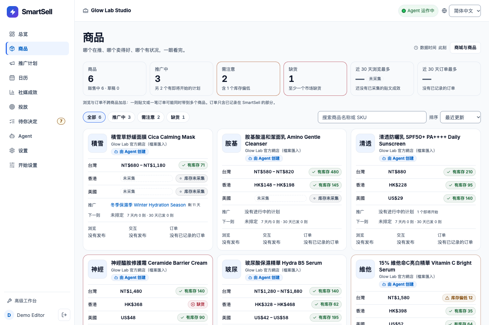
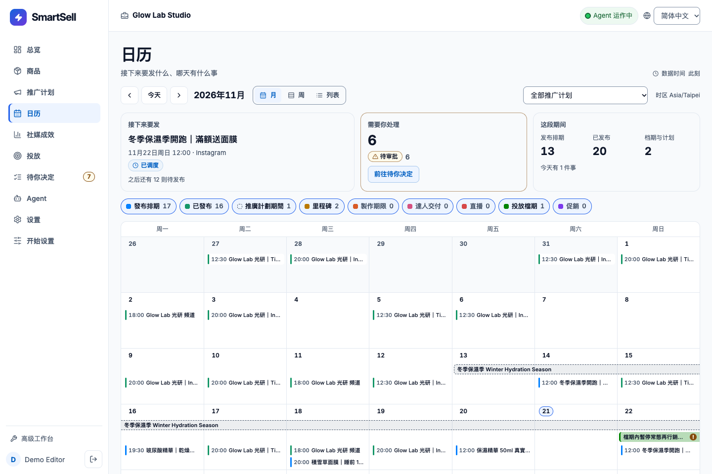
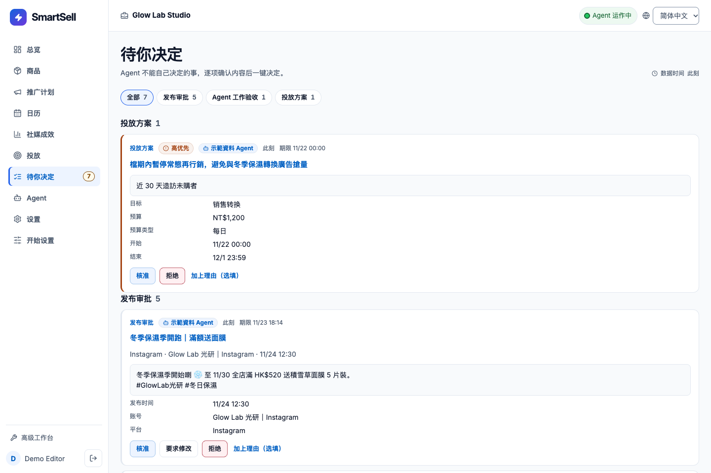
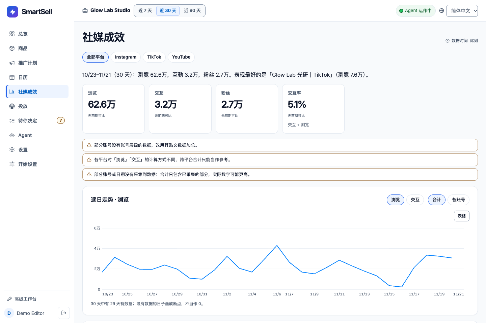

# SmartSell 运营人员使用手册

[项目首页](../../README.zh-CN.md) · [English](en.md) · 简体中文 · [繁體中文](zh-TW.md)

这份手册以一次护肤品推广为例，从确认市场售价开始，带你完成排期、人工审核与成效导入。画面取自 `pnpm seed:demo` 建立的虚构品牌 **Glow Lab 光研**。切换界面语言时，品牌自行填写的商品名称与文案会保留原文。

## 1. 进入工作区，连接 Agent

通过管理员提供的地址登录。如果要在自己的电脑上练习，先按[本地启动与演示数据说明](../../README.zh-CN.md)建立测试工作区。进入看板（`/app/:ws`）后，所有者或管理员可从「开始设置」依次连接主 Agent、桌面 Worker、社交账号及店铺。还没准备好的步骤可以稍后继续。

| 角色 | 负责的工作 |
| --- | --- |
| 网页上的运营人员 | 登记品牌自有账号、指定 Worker、审核待办事项，并在必要时暂停或恢复发布。 |
| 你电脑上的主 Agent | 经由 `/mcp` 读取品牌数据、导入商品、写草稿、为修订版排期并送审。 |
| 指定电脑上的桌面 Worker | 核对分派的账号，或从商家后台导出商品。送回文件前，先核对实际店铺 ID。 |

到「Agent」生成连接令牌。令牌只显示一次，请复制页面上的连接说明，在本地客户端通过环境变量设置 `SMARTSELL_TOKEN`。使用 Codex 时，可在 `~/.codex/config.toml` 加入下列设置，将示例域名换成你的 SmartSell 地址。

```toml
[mcp_servers.smartsell]
url = "https://smartsell.example.com/mcp"
bearer_token_env_var = "SMARTSELL_TOKEN"
```

先请 Agent 列出工作区内的品牌与市场，再到「Agent」查看活动记录。每个令牌仅连到一个工作区，可在该页撤销。需要人工录入时，打开「高级工作台」（`/w/:ws`）；可用操作取决于角色与工作区操作目录。[Agent 操作指南](../agent-guide.md) · [桌面 Worker 说明](../../apps/connector-desktop/README.md)

## 2. 报价前，先确认商品在哪里有货

进入「商品」。示例有六个在售商品，两个需要注意，其中一个在至少一个市场缺货。可搜索商品名称或 SKU，也可点「需注意」缩小范围。打开商品后，逐一核对规格、市场、币种和库存记录。同一款乳霜可能在香港缺货，在台湾仍有库存。



*看同一张卡片上不同市场的记录。遇到尚未采集的价格或库存，先补齐观测，再决定是否写入广告文案。*

收到店铺导出文件后，请 Agent 使用 `product_list` 模板，确认店铺、外部商品与规格 ID、SKU、市场和币种。先查看逐行预览，修正字段映射或有误的数据行，再确认导入。大批次可能分段处理，请沿用同一批次，直到进度显示完成。若由 Worker 导出商品，操作者也可在「开始设置」打开该批次预览并确认。

## 3. 为活动准备一篇待审帖子

以「冬季保湿季」为例，可以这样交办：「帮我写一篇下周给台湾市场的 Instagram 帖子，引用保湿精华在台湾的最新售价。发布前把修订版和预定时间交给我审。」补上要使用的账号、时区与活动目标。预算或日期还没定案时，请 Agent 留待确认。

1. 请 Agent 在「推广计划」找出既有活动，或以品牌、市场、商品和起止日期建立活动草稿。请它返回活动 ID，方便回到同一个计划。
2. 建立内容项目及对应平台与语言的变体。引用该市场的价格快照或已批准的商品事实，日后才能从文案追溯来源。定稿后，将草稿存成修订版。
3. 若缺少品牌自有的社交账号，先由人登记。请 Agent 指定该账号、**修订版**和含时区的发布时间，建立排期并送审，最后返回排期 ID。



*在「日历」筛选活动，确认上方显示的时区。月、周和列表视图共用同一份排期，点开项目即可核对即将到期的工作。*

## 4. 决定是否发布

到「待你决定」，筛选「发布审批」。阅读本次修订，核对发布账号、文案中的市场售价及排期时间。确认妥当即可批准。若需修改，指出文案哪一句或哪个价格有误，要求修正并重新送审。



*投放卡列出预算、预算类型与投放时段；发布卡则列出帖子和账号。先确认卡片所指的对象，再做决定。*

发布前检查若拦下批准，先按画面列出的原因处理。超过审批期限时，请 Agent 重新送审。若其他审核人已变更内容，刷新并比对最新版。发生事故时，可到「设置」暂停发布，由有权限的人确认原因后再恢复。批准后仍须查验实际发布结果，才能把这则帖子计入已发布数量。

## 5. 登记帖子，读懂成效

若帖子已直接在平台发布，先登记对应账号、HTTPS 永久链接、实际发布时间，以及可获取的平台帖子 ID。导入 `social_post_report` 时，以账号与外部帖子 ID 对应；`report_date` 按工作区时区填写。当日数字填 `day`，累计数字填 `lifetime`，确认预览后再导入。粉丝数等账号层级指标请用 `social_account_report`。



*先选期间与平台，再阅读「每日趋势」上方的数据提示。趋势中断的日期代表当日没有观测记录。*

来源未提供某项指标时，可跳过该行，或标为 `not_collected` 并留空数值。只有实际观测为零才填零。商品页的成效也依赖内容变体上的商品引用。若帖子在「社媒成效」有浏览，商品页却找不到关联，请先检查文案是否引用了正确商品，再考虑重新导入。

## 遇到问题时

| 画面或回应 | 接下来怎么处理 |
| --- | --- |
| `HUMAN_REQUIRED` | 到「待你决定」处理。Agent 可以提交方案，花费与发布须由有权限的人批准。 |
| `VERSION_CONFLICT` | 重新读取、比对他人变更，再用最新版本提交。 |
| 导入或排期请求超时 | 先查原批次或排期。在同一连接中重试相同内容时，沿用原幂等键。若已换发令牌，先确认先前的写入是否成功。 |
| 发布结果待核实 | 到平台查看是否已有帖子，并核对回执或永久链接，再决定是否重试。 |
| Agent 任务返回 `LEASE_LOST` | 停止处理该任务，检查连接是否已撤销或任务已改派。 |

[部署与恢复](../../infra/README.md) · [验收场景](../acceptance/scenarios.md) · [开发日志](../devlog.md)
