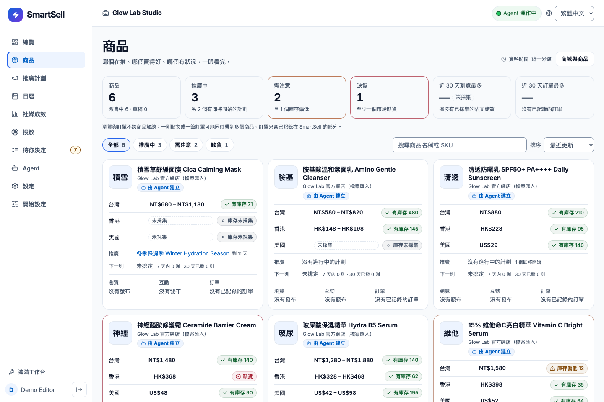
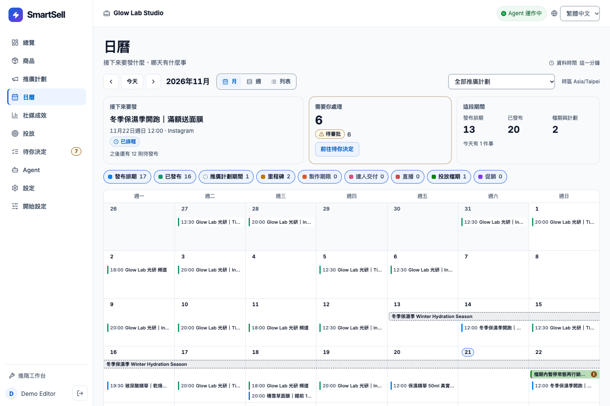
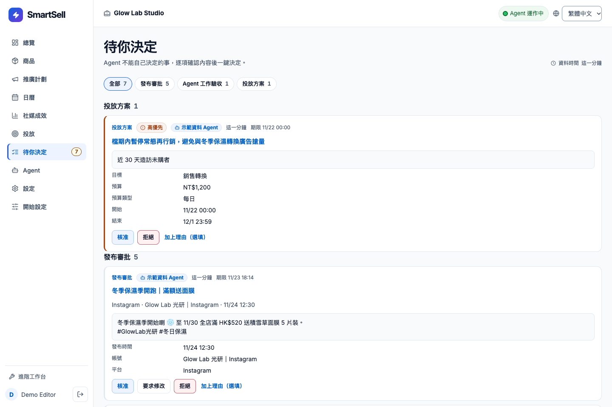
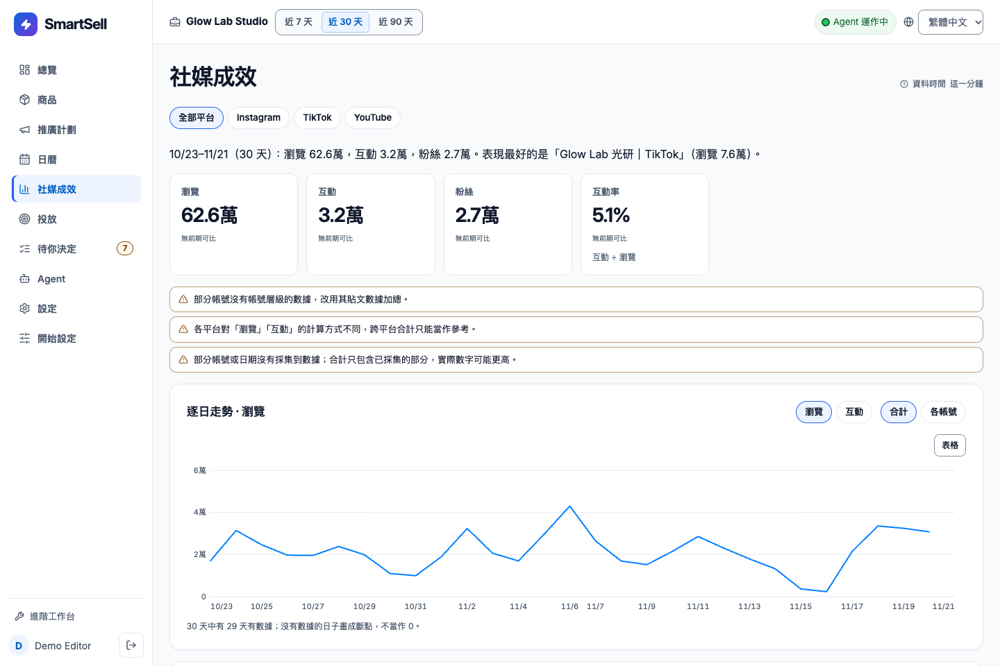

# SmartSell 營運人員使用手冊

[專案首頁](../../README.zh-TW.md) · [English](en.md) · [简体中文](zh-CN.md) · 繁體中文

這份手冊以一次保養品推廣為例，從確認市場售價開始，帶你完成排期、人工審核與成效匯入。畫面取自 `pnpm seed:demo` 建立的虛構品牌 **Glow Lab 光研**。切換介面語言時，品牌自行填寫的商品名稱與文案會保留原文。

在登入頁使用「介面語言」切換英文、簡體中文和繁體中文。登入看板後，可以在頂部列使用「語言」切換。看板與進階工作台共用目前瀏覽器儲存的語言偏好。

## 1. 進入工作區，連接 Agent

透過管理員提供的網址登入。若要在自己的電腦上練習，先依[本機啟動與示範資料說明](../../README.zh-TW.md)建立測試工作區。進入看板（`/app/:ws`）後，擁有者或管理員可從「開始設定」依序連接主 Agent、桌面 Worker、社群帳號及店鋪。尚未備妥的步驟可稍後再做。

| 角色 | 負責的工作 |
| --- | --- |
| 網頁上的營運人員 | 登記品牌自有帳號、指定 Worker、審核送件，並在必要時暫停或恢復發布。 |
| 你電腦上的主 Agent | 經由 `/mcp` 讀取品牌資料、匯入商品、寫草稿、為修訂版排期並送審。 |
| 指定電腦上的桌面 Worker | 核對分派的帳號，或從商家後台匯出商品。送回檔案前，先核對實際店鋪 ID。 |

到「Agent」產生連線權杖。權杖只顯示一次，請當場複製連線說明，在本機用戶端的環境中私下設定 `SMARTSELL_TOKEN`。使用 Codex 時，可在 `~/.codex/config.toml` 加入下列設定，將範例網域換成你的 SmartSell 網址。

```toml
[mcp_servers.smartsell]
url = "https://smartsell.example.com/mcp"
bearer_token_env_var = "SMARTSELL_TOKEN"
```

先請 Agent 列出工作區內的品牌與市場，再到「Agent」查看活動紀錄。每個權杖僅連到一個工作區，可在該頁撤銷。需要人工錄入時，開啟「進階工作台」（`/w/:ws`）；可用操作取決於角色與工作區目錄。[Agent 操作指南](../agent-guide.md) · [桌面 Worker 說明](../../apps/connector-desktop/README.md)

## 2. 報價前，先確認商品在哪裡有貨

進入「商品」。範例有六個販售中的商品，兩個需要注意，其中一個在至少一個市場缺貨。可搜尋商品名稱或 SKU，也可點「需注意」縮小範圍。打開商品後，逐一核對規格、市場、幣別和庫存紀錄。同一款乳霜可能在香港缺貨，在台灣仍有庫存。



*看同一張卡片上不同市場的紀錄。遇到尚未採集的價格或庫存，先補齊觀測，再決定是否寫入廣告文案。*

收到店鋪匯出檔後，請 Agent 使用 `product_list` 範本，確認店鋪、外部商品與規格 ID、SKU、市場和幣別。先查看逐列預覽，修正欄位對應或錯誤列，再確認匯入。大批次可能分段處理，請沿用同一批次，直到進度顯示完成。若由 Worker 匯出商品，操作者也可在「開始設定」開啟該批次預覽並確認。

## 3. 為活動準備一則待審貼文

以「冬季保濕季」為例，可以這樣交辦：「幫我寫一則下週給台灣市場的 Instagram 貼文，引用保濕精華在台灣的最新售價。發布前把修訂版和預定時間交給我審。」補上要使用的帳號、時區與活動目標。預算或日期還沒定案時，請 Agent 留待確認。

1. 請 Agent 在「推廣計劃」找出既有活動，或以品牌、市場、商品和起訖日期建立活動草稿。請它回報活動 ID，方便回到同一筆計劃。
2. 建立內容項目及對應平台與語言的變體。引用該市場的價格快照或已核准的商品事實，日後才能從文案追溯來源。定稿後，將草稿存成修訂版。
3. 若缺少品牌自有的社群帳號，先由人登記。請 Agent 指定該帳號、**修訂版**和含時區的發布時間，建立排期並送審，最後回報排期 ID。



*在「日曆」篩選活動，確認上方顯示的時區。月、週和列表檢視共用同一份排程，點開項目即可核對即將到期的工作。*

## 4. 決定是否發布

到「待你決定」，篩選「發布審批」。閱讀本次修訂，核對目的帳號、文案中的市場售價及排程時間。確認妥當即可核准。若需修改，指出文案哪一句或哪個價格有誤，要求修正並重新送審。



*投放卡列出預算、預算類型與檔期；發布卡則列出貼文和帳號。先確認卡片所指的對象，再做決定。*

發布前檢查若攔下核准，先依畫面列出的原因處理。超過審批期限時，請 Agent 重新送審。若其他審核人已變更內容，重新整理並比對最新版。發生事故時，可到「設定」暫停發布，由有權限的人確認原因後再恢復。核准後仍須查驗實際發布結果，才能把這則貼文計入已發布數量。

## 5. 登記貼文，讀懂成效

若貼文已直接在平台發布，先登記對應帳號、HTTPS 永久連結、實際發布時間，以及可取得的平台貼文 ID。匯入 `social_post_report` 時，以帳號與外部貼文 ID 對應；`report_date` 採工作區時區。當日數字填 `day`，累計數字填 `lifetime`，確認預覽後再匯入。粉絲數等帳號層級指標請用 `social_account_report`。



*先選期間與平台，再閱讀「每日趨勢」上方的資料提示。趨勢中斷的日期代表當日沒有觀測紀錄。*

來源未提供某項指標時，可略過該列，或標為 `not_collected` 並留空數值。只有實際觀測為零才填零。商品頁的成效也依賴內容變體上的商品引用。若貼文在「社媒成效」有瀏覽，商品頁卻找不到關聯，請先檢查文案是否引用了正確商品，再考慮重新匯入。

## 遇到問題時

| 畫面或回應 | 接下來怎麼處理 |
| --- | --- |
| `HUMAN_REQUIRED` | 到「待你決定」處理。Agent 可以提交方案，花費與發布須由有權限的人核准。 |
| `VERSION_CONFLICT` | 重新讀取、比對他人變更，再用目前的版本送出。 |
| 匯入或排期請求逾時 | 先查原批次或排期。在同一連線中重試相同內容時，沿用原冪等鍵。若已換發權杖，先確認先前的寫入是否成功。 |
| 發布結果待核實 | 到平台查看是否已有貼文，並核對回執或永久連結，再決定是否重試。 |
| Agent 任務回傳 `LEASE_LOST` | 停止處理該任務，檢查連線是否已撤銷或任務已改派。 |

[部署與復原](../../infra/README.md) · [驗收情境](../acceptance/scenarios.md) · [開發日誌](../devlog.md)
