# SmartSell 操作手冊

這份手冊給**使用 SmartSell 的人**：從第一次安裝，到每天交代 AI 助手發文、在網頁處理要你決定的事，以及出問題時怎麼辦。每一步都寫明在哪台電腦做、畫面上按什麼。

- 只想裝中樞、要看每個命令與錯誤訊息的細節：[中樞安裝與維護](hub-setup.md)
- 要在真實機器上逐項驗收：[主人實機驗收檢查表](restructure/phase1-owner-checklist.md)
- 給 AI 助手讀的規則：[Agent 工作指南](agent-guide.md)

> 截圖用的是虛構資料（Mac-B、Win-C、`@lurelab_x`）。要更新截圖：`SMARTSELL_DOCS_SCREENSHOTS=1 pnpm exec playwright test tests/web-e2e/docs-screenshots.spec.mjs`。

## 目錄

1. [先認識四個部分](#1-先認識四個部分)
2. [開始前要準備什麼](#2-開始前要準備什麼)
3. [安裝中樞（只做一次）](#3-安裝中樞只做一次)
4. [每台發文的電腦：安裝並配對 Worker](#4-每台發文的電腦安裝並配對-worker)
5. [讓 Worker 用你自己的 Chrome](#5-讓-worker-用你自己的-chrome)
6. [新增帳號，完成就緒清單](#6-新增帳號完成就緒清單)
7. [連接你的 AI 助手](#7-連接你的-ai-助手)
8. [每天怎麼用](#8-每天怎麼用)
9. [遙控：讓 AI 助手操作網站或手機](#9-遙控讓-ai-助手操作網站或手機)
10. [更新](#10-更新)
11. [常見問題](#11-常見問題)
12. [安全與隱私](#12-安全與隱私)
13. [目前的限制](#13-目前的限制)
14. [附錄：在專案安裝 Agent Skills](#14-附錄在專案安裝-agent-skills)

---

## 1. 先認識四個部分

| 部分 | 裝在哪 | 做什麼 |
|---|---|---|
| **中樞（hub）** | 一台常開的電腦（家裡的 Mac mini 或 Windows 電腦） | 存排程、帳號設定與結果，派工給各台電腦，提供網頁。只在你的 Tailscale 私人網路（tailnet）裡連得到。 |
| **SmartSell Worker** | 每台要發文的電腦（例如 Mac-B、Win-C） | 到點時在那台電腦的 Chrome 裡替帳號發文，把貼文網址讀回中樞。 |
| **你的 AI 助手** | 你的筆電：Codex、Claude Code 或 WorkBuddy | 你用一句話交代工作，它透過 MCP 呼叫 SmartSell 的工具排程、查詢、上傳影片。 |
| **網頁** | 任何在 tailnet 裡的瀏覽器（筆電、手機） | 看今天要你處理什麼、每台機器與帳號的狀態、日曆與每則貼文；核准、確認風險、恢復暫停都在這裡做。 |

```
你的筆電：AI 助手 ──MCP──▶ 中樞 ──派工──▶ Mac-B 的 Worker（在你的 Chrome 發 X）
                              └──派工──▶ Win-C 的 Worker（在你的 Chrome 發 TikTok）
```

**AI 助手能做的**：排程、改時間、改文案、取消、上傳影片、查狀態、暫停發布；在你開啟遙控的機器上一步一步操作網站或 Android 手機。

**只有你能做的**（AI 助手做不到，網頁會要求你本人操作）：核准貼文、同意代按發布的風險、恢復暫停、確認結果不明的貼文、開關遙控、撤銷機器或 Agent 連線。

## 2. 開始前要準備什麼

- **Tailscale 帳號**：中樞、每台發文的電腦、你的筆電與手機都登入同一個 tailnet（免費方案即可）。
- **中樞那台電腦**：macOS 或 Windows，常開不睡眠；裝好 git、Node.js 24、ffmpeg 與 Tailscale（安裝命令見 [中樞安裝與維護 第 1 節](hub-setup.md#1-一鍵安裝在中樞上)）。
- **每台發文的電腦**：Google Chrome，並且已經登入要發文的 X 或 TikTok 帳號（也可以之後再登入）。
- **你的筆電**：Codex、Claude Code 或 WorkBuddy 其中一個；沒有 SmartSell App 時要有 Node.js 24。
- 先讀 README 的〈請先了解平台規則〉：X 與 TikTok 的條款限制自動化，帳號可能因此受限。

## 3. 安裝中樞（只做一次）

**在中樞那台電腦：**

```bash
git clone https://github.com/dp0304/smartsell.git ~/smartsell     # 中國大陸可改用 https://gitee.com/yueshutech/smartsell.git
cd ~/smartsell
bash scripts/install-hub.sh --check-only    # 先檢查缺什麼，不做任何變更
bash scripts/install-hub.sh                 # 安裝、設定 Tailscale、建置、安裝成開機自動執行的服務
```

Windows 用系統管理員 PowerShell：`powershell -ExecutionPolicy Bypass -File scripts\install-hub.ps1 -Mode boot`。

安裝腳本最後會印出一個網址，例如 `https://hub.tail1234.ts.net/setup#setup-token=…`。**在任何已加入 tailnet 的瀏覽器打開它**，建立擁有者帳號（這個網址用過一次就失效）。

安裝過程會問要不要建置 Worker 安裝包，選「是」（在 Mac 中樞上會建置兩種 Mac 的安裝包；Windows 的安裝包要在一台 Windows 電腦上建置一次，見 [中樞安裝與維護 第 4a 節](hub-setup.md#4a-windows-安裝包在-win-c-建置一次)）。Tailscale 管理後台要做的一次性設定（MagicDNS、HTTPS 憑證、關閉金鑰到期）與每一種錯誤訊息的處理，見 [中樞安裝與維護](hub-setup.md)。

登入網頁後，左側的 **開始設定** 會帶你走完五步：工作區時區 → 連接機器 → 新增帳號 → 通知 → 連接 AI 助手。每一步都可以「稍後再設定」。

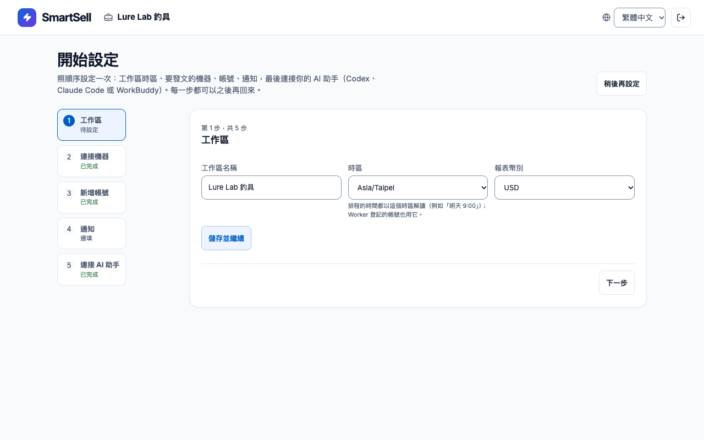

## 4. 每台發文的電腦：安裝並配對 Worker

**在每台要發文的電腦（Mac-B、Win-C…）：**

1. 安裝 Tailscale，登入同一個 tailnet。不要設定 exit node；到 Tailscale 管理後台對這台電腦選 **Disable key expiry**。
2. 用這台電腦的瀏覽器開中樞網頁，到 **開始設定 → 連接機器 → 下載 SmartSell Worker**，下載並安裝。
   - macOS：拖進「應用程式」，第一次對 App 按右鍵 →「打開」（安裝包還沒有 Apple 簽章）。
   - Windows：SmartScreen 顯示「Windows 已保護您的電腦」時，按「其他資訊」→「仍要執行」。
3. 打開 SmartSell Worker，選 **「發文的機器（Worker）」**。

   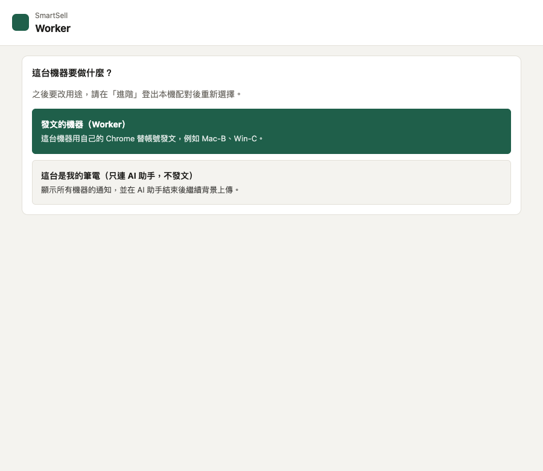

4. 貼上中樞位址（例如 `https://hub.tail1234.ts.net`），替機器取一個你平常叫它的名字（AI 助手會用這個名字找機器），勾選「這台機器是我的…」，按 **配對**。

   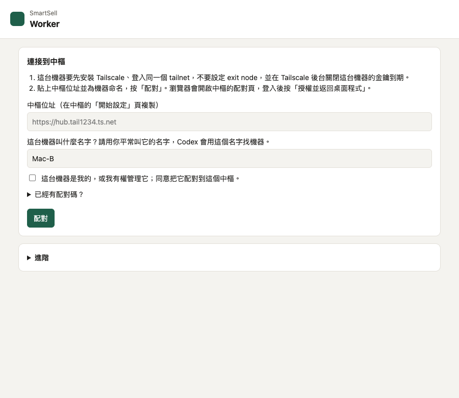

5. 瀏覽器會開啟中樞的配對頁：登入後按 **「授權並返回桌面程式」**。
6. 在 Worker 的 **進階** 打開「登入電腦時自動啟動 SmartSell」，重開機後才會自動上線。
7. macOS 第一次（以及每次更新後）若跳出鑰匙圈提示，**按「永遠允許」**；按「拒絕」的話 Worker 無法連線。

完成後，網頁的 **機器** 頁會看到這台電腦「在線」。機器頁的「設定與警告」會提醒會讓貼文錯過的設定（會睡眠、沒有自動登入、時鐘不準），照提示處理即可。

## 5. 讓 Worker 用你自己的 Chrome

Worker 有兩種發文方式，在 App 的 **用哪個 Chrome 發文** 切換：

| 方式 | 說明 |
|---|---|
| **你自己的 Chrome（建議）** | 在你平常用、已經登入的 Chrome 裡操作，不用再登入一次。SmartSell 只在它自己開的「SmartSell」視窗裡做事，不碰你正在看的分頁。 |
| 每個帳號一個獨立的 Chrome | Worker 為每個帳號開一個獨立的 Chrome 設定檔，你要在那個視窗另外登入一次。 |

**改用你自己的 Chrome（約 1 分鐘）：**

1. 在 Worker 按 **改用我自己的 Chrome（建議）**。
2. 在 Chrome 網址列輸入 `chrome://extensions`，打開右上角的 **開發人員模式**。
3. 按 **載入未封裝項目**，選 App 顯示的資料夾（按「打開資料夾」可以直接看到；位置在「文件／SmartSell Worker／chrome-extension」）。
4. 在 SmartSell Worker 擴充功能按 **詳細資料**，開啟 **允許存取檔案網址**（上傳影片需要）。
5. App 顯示「已連上你的 Chrome」就完成了。

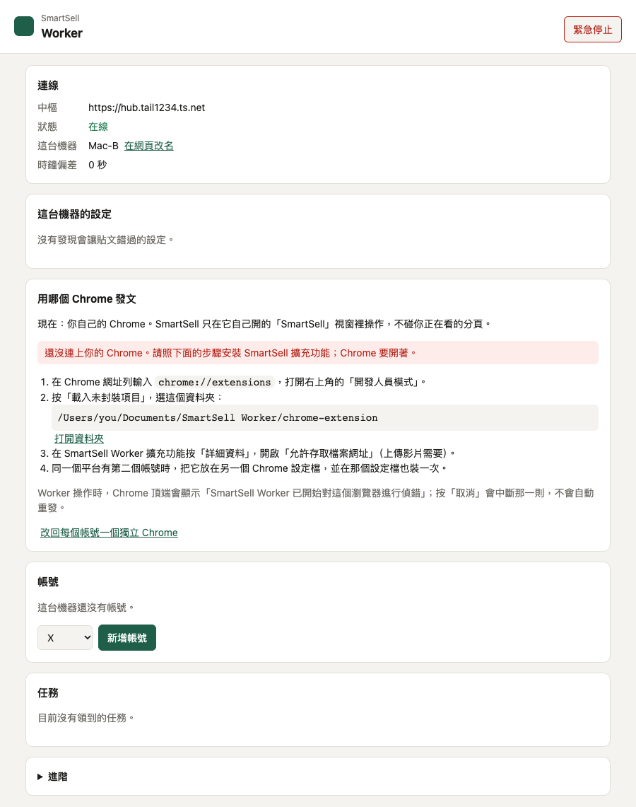

要知道的事：

- **Chrome 要開著**，Worker 才能發文。到點時 Chrome 沒連上，那則會停下並通知你；打開 Chrome 後會自動繼續（在遲到上限之前）。
- Worker 操作時，Chrome 頂端會顯示「SmartSell Worker 已開始對這個瀏覽器進行偵錯」。這是 Chrome 的固定提示；**按「取消」會中斷那一則**，不會自動重發，要繼續請在貼文頁按「恢復」。
- 同一個平台有第二個帳號時，把它放在另一個 Chrome 設定檔，並在那個設定檔也裝一次擴充功能；App 會請你為每個帳號選一個設定檔。
- App 會顯示「檢查過：SmartSell 操作時，網頁看到的 navigator.webdriver 是 false」。如果顯示的是 true，代表這個 Chrome 是用除錯參數啟動的，請改用一般方式打開 Chrome 並回報給我們。

連上之後，Worker 的畫面大致如下：連線狀態、Chrome、帳號與已領到的任務。

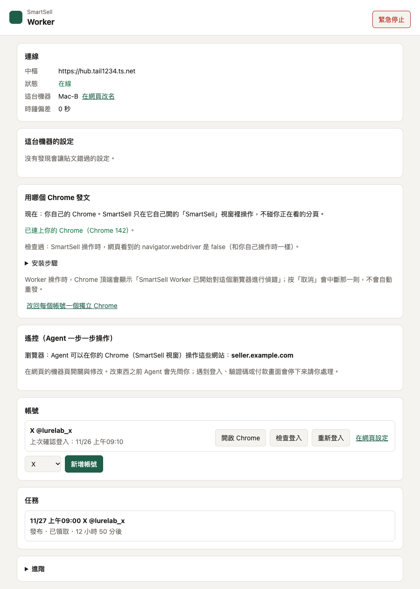

## 6. 新增帳號，完成就緒清單

**在帳號所在的那台電腦（Worker App）：**

1. 在 **帳號** 選 X 或 TikTok，按 **新增帳號**。
2. 已經登入的帳號會馬上偵測到；沒登入就在 SmartSell 視窗裡自己登入（驗證碼與二次驗證都由你完成）。
3. App 問「偵測到 X @…，加入 SmartSell？」：讀過上面的自動化告知後按 **加入**。

**接著到網頁「帳號」→ 點進這個帳號**，把 **就緒清單** 做完：

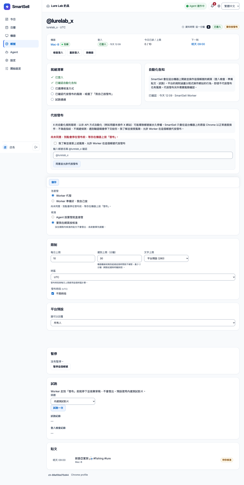

| 清單項目 | 在哪裡設定 | 說明 |
|---|---|---|
| 已登入 | 自動 | 「檢查登入」或「重新登入」可以隨時重試。 |
| 已確認自動化告知 | Worker 按「加入」時 | |
| 已選擇核准方式 | **怎麼發 → 核准** | 「Agent 說要發就直接發」，或「要我在網頁按核准」（預設，較安全）。 |
| 已確認代按發布的風險，或選了「我自己按發布」 | **代按發布** | 勾選「我了解並接受上述風險…」、輸入帳號名稱、按「同意並允許代按發布」，Worker 才會替你按發布。沒同意的帳號，到點時 Worker 會準備好貼文、停在「發布」前，等你在那台電腦按。隨時可以「撤回同意」。 |
| TikTok 預設選項已設定（只有 TikTok） | **平台預設** | 隱私、留言、合拍與拼接、商業內容揭露。第一次真實發布建議先設「只有我」。 |
| 試跑通過 | **試跑 → 試跑一次** | Worker 走到「發布」前停下並捨棄草稿，**不會發出**。用來確認這台電腦、這個帳號一切正常。 |

**限制** 區塊可以設定每日上限（預設 10 則）、遲到上限（機器離線或晚到超過這個時間就不補發，預設 30 分鐘）、時區與允許發布的時段。

## 7. 連接你的 AI 助手

任選一種，在 **你的筆電** 上做。

### 方式一（建議）：筆電上的 SmartSell App

1. 在筆電安裝同一個 SmartSell Worker App，首次開啟選 **「這台是我的筆電（只連 AI 助手，不發文）」**。
2. 填中樞位址，按 **連接 Codex** 或 **連接 Claude Code**。
3. 瀏覽器開啟中樞的連線頁，登入後按 **「授權並返回 SmartSell App」**。App 會自己寫好設定。

App 也會顯示所有機器的通知，並在 AI 助手結束後接手還沒傳完的影片上傳。

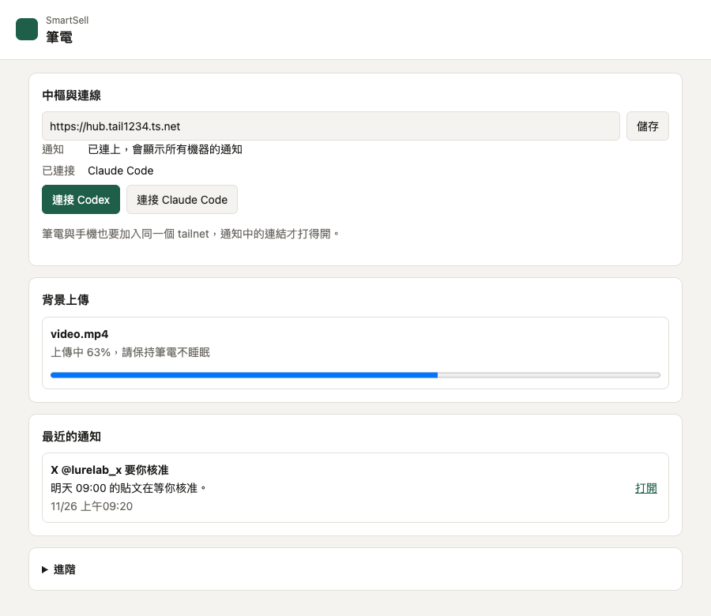

### 方式二：Node relay（Windows 筆電、WorkBuddy，或不想裝 App）

在網頁 **Agent** 頁的「方式二」按 **建立連線並下載權杖檔**，然後照頁面上的命令做。頁面已經填好你的中樞位址，按「複製」即可：

```bash
mkdir -p ~/.smartsell && curl -fsSL https://<中樞>/agent/relay.mjs -o ~/.smartsell/relay.mjs
mv ~/Downloads/token ~/.smartsell/token && chmod 600 ~/.smartsell/token
codex mcp add smartsell -- node ~/.smartsell/relay.mjs --hub https://<中樞> --token-file ~/.smartsell/token
# Claude Code：claude mcp add --scope user smartsell -- node ~/.smartsell/relay.mjs --hub https://<中樞> --token-file ~/.smartsell/token
```

**WorkBuddy**：在「聯結器 → 自定義聯結器 → 新增 MCP」加入一個 stdio 項目，`command` 為 `node`，`args` 照 Agent 頁顯示的 JSON 填（把「你的使用者名稱」換成你的家目錄），儲存後按「信任」。

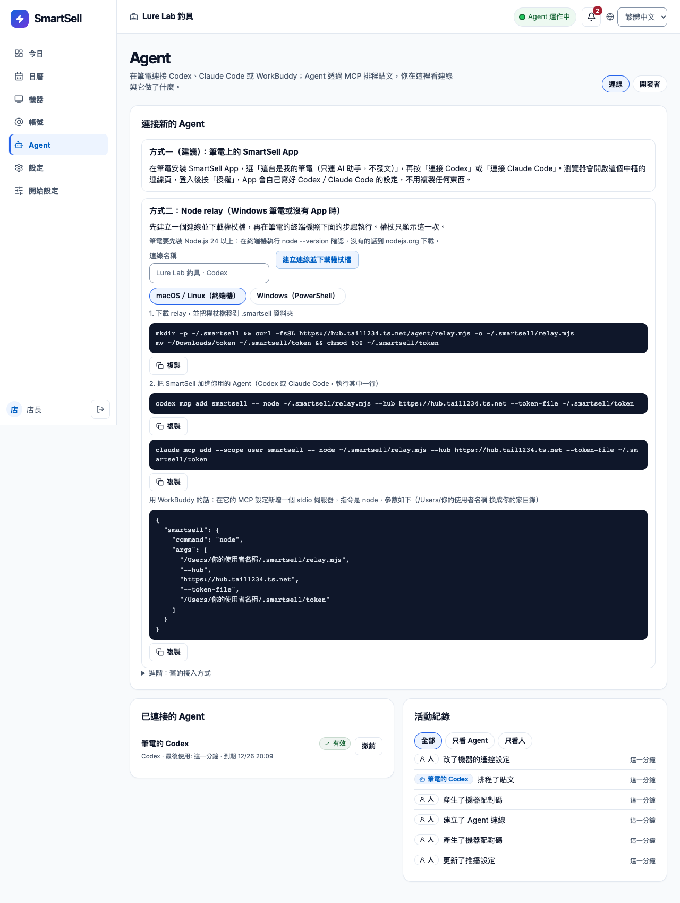

### 確認連上

**完整重開** AI 助手，請它「呼叫一次 SmartSell 的 smartsell_overview」。回到網頁，開始設定的最後一步會顯示「已有 Agent 透過 MCP 呼叫過 SmartSell。」，Agent 頁的活動紀錄也會出現它做的事。

## 8. 每天怎麼用

### 8.1 直接交代 AI 助手

用平常說話的方式，講清楚**哪個影片、哪台機器的哪個帳號、什麼時候、文案**：

- 「把 ~/Movies/lure.mp4 明天早上 9:00 發到 Mac-B 的 X 和 Win-C 的 TikTok，文案：『新路亞實測 🎣』，加上 #fishing #lure。」
- 「明天 9 點那則改到 10:30。」／「TikTok 那則的文案改成『夜釣實測』。」／「取消週五的貼文。」
- 「今天有哪些貼文要我處理？」／「昨天發的貼文網址給我。」
- 「先暫停 Win-C 的所有發文。」

AI 助手會回報每則貼文的當地時間、機器、狀態，發出後附上網址。你沒給文案時，它會先問你要不要不帶文字直接發。影片一律走 API 上傳（分段、校驗、可續傳），不會經過模型。

### 8.2 今日頁：今天要你處理什麼

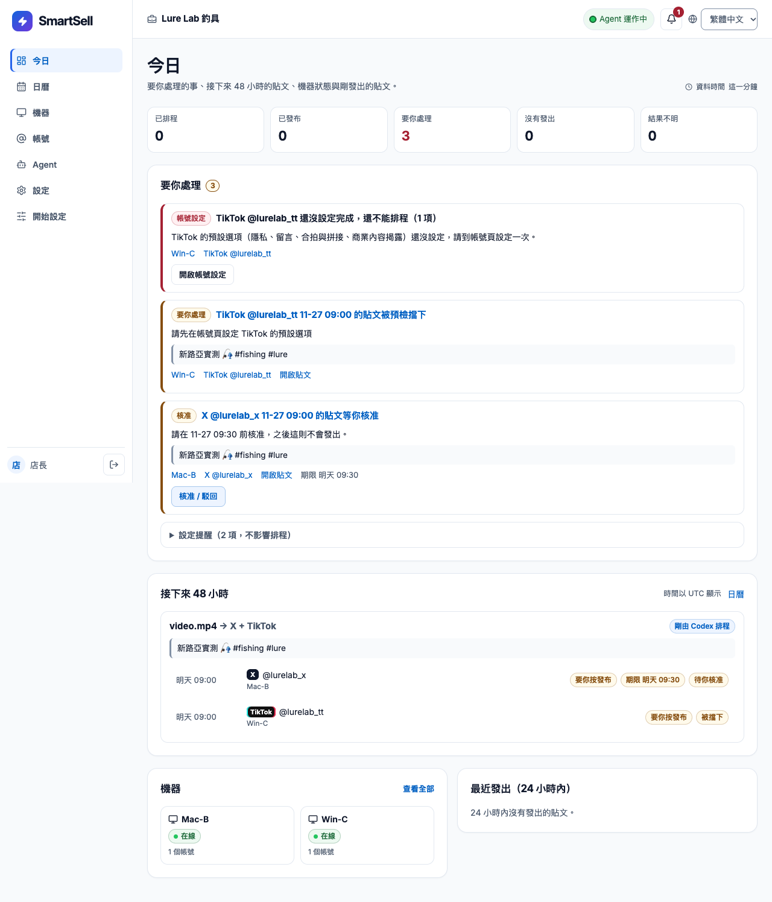

最上面的數字是今天的概況；**要你處理** 列出需要你的事，每一項都有直接處理的按鈕或連結：

| 標籤 | 意思 | 怎麼處理 |
|---|---|---|
| 核准 | 帳號設成「要我在網頁按核准」，這則在等你 | 按「核准／駁回」。過了期限沒核准的貼文不會發出。 |
| 帳號設定 | 就緒清單還沒完成，貼文排不進去 | 按「開啟帳號設定」補完。補完後被擋下的貼文會自動重新送出。 |
| 要你處理 | 這則被擋下（例如沒登入、遇到驗證碼、TikTok 預設沒設） | 照說明處理；需要到那台電腦時，Worker App 的任務會有「開啟該 Chrome 處理」。 |
| 結果不明 | 按了發布，但讀不回結果 | 見 8.4。 |
| 沒有發出 | 機器離線或晚到超過遲到上限 | 請 AI 助手改期，或在貼文頁「改到…」。 |

**接下來 48 小時** 列出即將發出的貼文與它們的狀態；**機器** 與 **最近發出** 在頁面下方。

### 8.3 貼文頁：核准、改期、取消

從今日、日曆、機器或帳號頁點進任何一則貼文：

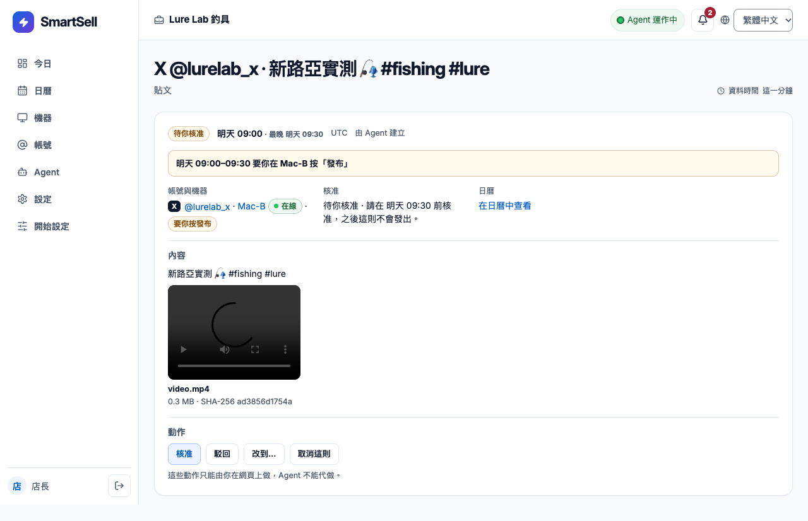

- **核准／駁回**：只有你能按，AI 助手不能代做。
- **改到…**：改時間；**取消這則**：不發了。
- 沒有同意代按發布的帳號，貼文頁會寫「明天 09:00–09:30 要你在 Mac-B 按『發布』」：到點時到那台電腦，Worker 已經準備好，你看過內容後自己按「發布」。

### 8.4 結果不明時

Worker 按了發布，但沒讀回貼文網址（網路中斷、平台變慢），貼文會標成 **結果不明**。SmartSell **絕不自動重發**，以免重複貼文。請到平台上看一眼：

- 有發出：在貼文頁按 **貼上網址（確認已發出）**，貼上那則貼文的網址。
- 沒發出：按 **確認沒發出**，之後可以改期重發。

### 8.5 日曆

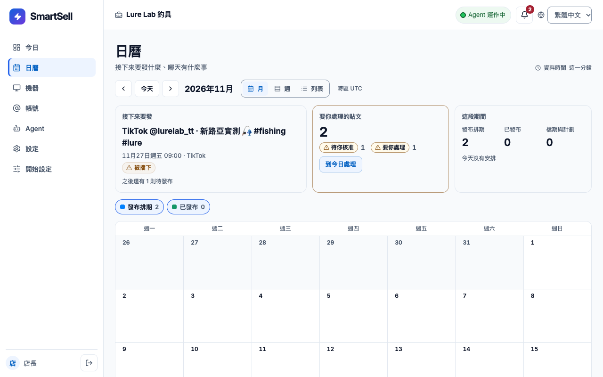

月、週、列表三種檢視。上方會告訴你接下來要發什麼、這段期間有幾則要你處理（「到今日處理」直接跳到今日頁）。

### 8.6 暫停

| 範圍 | 在哪裡 | 說明 |
|---|---|---|
| 一個帳號 | 帳號頁 **暫停 → 暫停這個帳號** | |
| 一台機器 | 機器頁 **暫停這台機器** | 這台機器上所有帳號都不會發文。 |
| 全部 | **設定 → 緊急暫停發布** | 可以選擇是否同時取消已排程的貼文。 |
| 立刻停手 | 那台電腦的 Worker App 右上角 **緊急停止** | 只影響這台電腦，按「解除緊急停止」恢復。 |

AI 助手也能暫停（例如你說「先暫停 Win-C」），但**恢復只能由你在網頁做**。暫停期間排的貼文，恢復後照常發出。

### 8.7 通知

要你處理的事（驗證碼、登入過期、要你按發布、沒有發出、結果不明）會送到：

- 網頁右上角的鈴鐺；
- 筆電的 SmartSell App（筆電模式）；
- **手機推播**（建議設定）：在 **開始設定 → 通知**，或 **設定 → 推播設定**，加入 ntfy、Bark 或 Telegram，按「傳一則測試」。推播只含機器、帳號、時間與一句說明，不含文案與媒體。手機也要加入 tailnet，通知裡的連結才打得開。

## 9. 遙控：讓 AI 助手操作網站或手機

沒有專用工具的工作（例如到電商後台改庫存、看訂單），可以讓 AI 助手在某台電腦上**看畫面、一步一步操作**。每台機器預設關閉，只有你能開。

**開啟（在網頁「機器」→ 點進那台機器 → 遙控）：**

1. 勾選 **允許操作這台機器的 Chrome**，在「允許的網站」每行填一個網域（例如 `seller.shopee.tw`；也包含它的子網域）。這台機器的 Worker 要用「你自己的 Chrome」。
2. 要操作 Android 手機時，勾選 **允許操作插在這台機器的 Android 手機**，在「允許的 App」每行填一個套件名稱（例如 `com.xingin.xhs`）。
3. 按 **儲存**。這台機器的 Worker 會在半分鐘內套用，App 裡會出現「遙控」卡片列出允許的範圍。

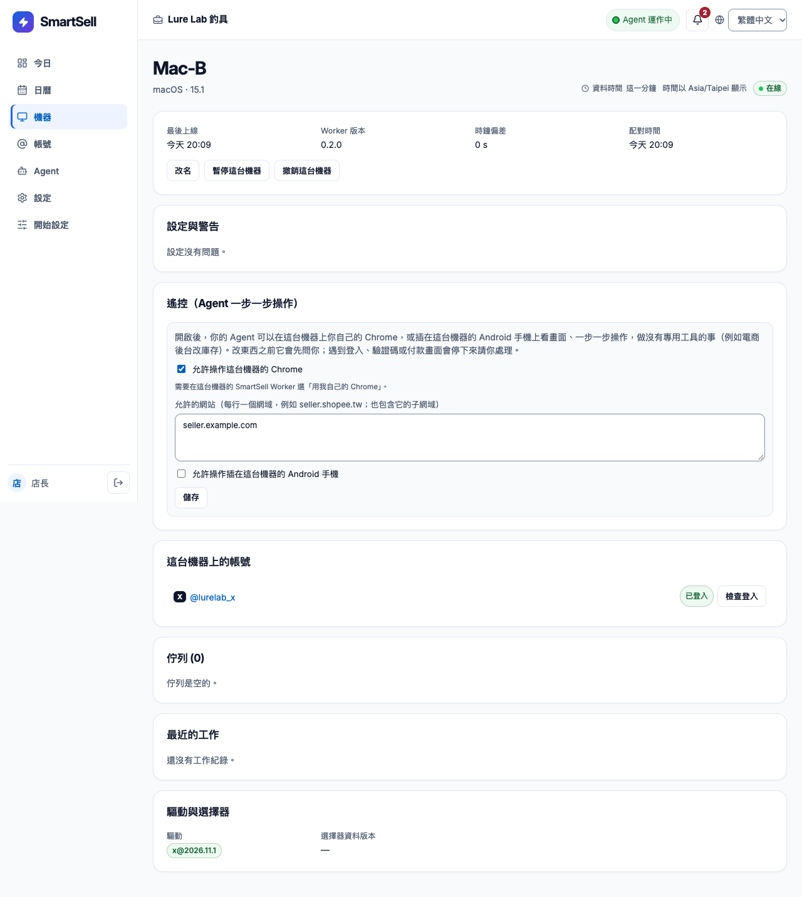

**然後直接交代 AI 助手**，例如：「到 Mac-B 的蝦皮賣家中心，把 Lure 7cm 的庫存改成 42，改完確認一下。」

規則：

- AI 助手只能在你列出的網站或 App 裡操作；連結或轉址離開範圍，Worker 會停下。
- 改任何東西之前，你沒有明確交代的，它要先問你。
- 遇到登入、驗證碼、二次驗證或付款畫面，它會停下來請你處理（手機上受保護的畫面截圖是黑的，Worker 會直接交還給你）。
- 隨時可以在機器頁取消勾選，或在 Worker 按「緊急停止」。

**Android 手機要準備：**

1. 在那台電腦安裝 adb：macOS `brew install android-platform-tools`；Windows `winget install Google.PlatformTools`。
2. 手機開啟「開發人員選項 → USB 偵錯」，用 USB 接上那台電腦，手機跳出「允許 USB 偵錯嗎？」時按「允許」（建議勾「一律允許」）。
3. 目前只能輸入英文、數字與符號；需要輸入中文時，AI 助手會請你在手機上自己打。

## 10. 更新

**中樞（在中樞那台電腦）：**

```bash
cd ~/smartsell && pnpm hub:update
```

它會先備份資料、更新原始碼、建置並檢查新版本，確認能啟動才換上；任何一步失敗都會自動回到更新前的版本。詳見 [中樞安裝與維護 第 6 節](hub-setup.md#6-更新pnpm-hubupdate在中樞上)。

**Worker：**中樞有新版安裝包時，每台電腦的 Worker App 會出現「SmartSell Worker x.y.z 可更新（發行簽章已驗證）」，在那台電腦前按 **更新**。有貼文正在發布時會等它結束。macOS 更新後若跳出鑰匙圈提示，按「永遠允許」。

## 11. 常見問題

| 狀況 | 原因 | 怎麼辦 |
|---|---|---|
| Worker 顯示「還沒連上你的 Chrome」 | 擴充功能沒裝，或 Chrome 沒開 | 照第 5 節安裝；確認 Chrome 開著。仍然不行就結束並重開 SmartSell Worker（啟動時會重新向 Chrome 登記）。 |
| 上傳影片失敗，Worker 提到「允許存取檔案網址」 | 擴充功能沒有檔案權限 | `chrome://extensions` → SmartSell Worker → 詳細資料 → 開啟「允許存取檔案網址」。 |
| 帳號顯示沒登入或登入過期 | 平台登出了 | 帳號頁或 Worker 按「重新登入」，到那台電腦的 Chrome 登入，再按「檢查登入」。 |
| 「Chrome 登入的是 @A，不是這個帳號」 | 那個 Chrome 登入了別的帳號 | 在那個 Chrome 切回正確的帳號；同平台的第二個帳號放在另一個 Chrome 設定檔。 |
| 遇到驗證碼或二次驗證 | 平台要求本人確認 | Worker 會停下並通知你，到那台電腦按 Worker 任務的「開啟該 Chrome 處理」，完成後它會繼續。SmartSell 不會自動解驗證碼。 |
| 機器頁顯示離線 | 電腦睡眠、關機、Tailscale 斷線，或鑰匙圈提示被拒絕 | 叫醒或開機；確認 Tailscale 已連線；macOS 打開 Worker，鑰匙圈提示按「永遠允許」。 |
| 貼文「沒有發出」 | 機器離線或晚到超過遲到上限 | SmartSell 不會在你不知情時補發。請 AI 助手改期，或在貼文頁「改到…」。 |
| 貼文「結果不明」 | 按了發布但讀不回結果 | 見 8.4：貼上網址，或確認沒發出。 |
| 按了 Chrome 頂端的「取消」 | 中斷了 Worker 的操作 | 那一則會停下並通知你，不會自動重發；要繼續在貼文頁按「恢復」，或請 AI 助手改期。 |
| AI 助手說找不到 SmartSell 工具 | MCP 設定改了但助手沒重開 | 完整結束 AI 助手再開；Codex／Claude Code 可以用 `codex mcp list`／`claude mcp list` 確認有 smartsell。 |
| AI 助手說「這台機器沒有開啟遙控」 | 遙控預設關閉 | 在網頁的機器頁開啟並列出允許的網站或 App（第 9 節）。 |
| 手機遙控說找不到 adb | 那台電腦沒有 Android platform-tools | 照第 9 節安裝 adb，裝好後重試即可。 |
| 手機遙控說手機未授權 | 手機沒按「允許 USB 偵錯」 | 拔掉重插，在手機上按「允許」。 |
| 更新後 Worker 一直離線（macOS） | 鑰匙圈提示被拒絕 | 到那台電腦打開 Worker，提示出現時按「永遠允許」。 |
| 中樞網址打不開 | 這台裝置不在 tailnet，或中樞沒在執行 | 確認 Tailscale 已連線；在中樞執行 `pnpm hub:doctor`，照輸出處理。 |

回報問題時請附：網頁貼文頁的網址與時間軸截圖、Worker App 的畫面、中樞的 `pnpm hub:doctor` 輸出。**不要附** `hub.env`、權杖檔或任何密碼。安全問題請照 [SECURITY.md](../SECURITY.md) 私下回報。

## 12. 安全與隱私

- **資料都在你自己的中樞**：排程、文案、影片、帳號設定只存在中樞那台電腦，不經過 SmartSell 的伺服器（沒有這種伺服器）。
- **只在 tailnet 內**：不要對中樞開 Tailscale Funnel；中樞偵測到 Funnel 時會警告。
- **帳號密碼不交給 SmartSell**：登入一律由你在 Chrome 裡完成，SmartSell 不保存平台密碼。
- **AI 助手的權限**：每個 Agent 連線有自己的權杖，可以在 Agent 頁撤銷；核准、風險、恢復、遙控開關只有人能做。
- **SmartSell 不做的事**：不偽造瀏覽器指紋、不改 `navigator.webdriver`、不規避平台偵測、不解驗證碼、不批量註冊或養帳號。
- 更新有發行簽章：Worker 只安裝簽章驗證通過的版本。

## 13. 目前的限制

- **發文平台**：X 與 TikTok 的影片貼文。其他平台與成效數據還沒有。
- **瀏覽器**：Google Chrome（建議用你自己的 Chrome；也可以每個帳號一個獨立 Chrome 設定檔）。
- **手機**：只有遙控（Android，透過 adb），只能輸入英數；排程發到手機 App、iPhone 都還沒有。
- **安裝包**：沒有 Apple Developer ID 與 Windows 程式碼簽章，第一次打開時系統會提醒（照第 4 節處理）。
- **部署**：每個人或每個團隊自己架一台中樞；沒有雲端代管版本。
- **平台改版**：X 或 TikTok 改版時，試跑可能停在「頁面可能改版」。更新 SmartSell（`pnpm hub:update`）後 Worker 會在下一次心跳拿到新的頁面設定，不必重裝。

## 14. 附錄：在專案安裝 Agent Skills

Worker 安裝包附有三份 Skills，讓 AI 助手在你的營運專案裡更熟悉 SmartSell：`smartsell-video-publish`（上傳、排程、查回）、`smartsell-data-collection`（帳號狀態與 SmartSell 的貼文）、`smartsell-product-listing`（說明第 1 階段不管理商品與店鋪）。在 SmartSell 原始碼根目錄執行：

```sh
pnpm --filter @smartsell/connector-desktop build
node apps/connector-desktop/dist/smartsell-install-skills.mjs /path/to/your-project
```

會裝到該專案的 `.claude/skills/` 與 `.agents/skills/`；同名的既有 Skills 會保留。已安裝 Worker 的人也可以直接執行安裝包內的 `resources/app.asar.unpacked/dist/smartsell-install-skills.mjs`（macOS 在 `.app/Contents/Resources`）。
