# SmartSell 社媒與跨境電商營運系統：系統設計方案

> **文件：plan.md｜設計版本 D0.3｜日期：2026-11-19｜語言：繁體中文**
>
> 修訂紀錄：
>
> - D0.3：依 2026-11-19 第三輪確認更新；新決策 D12–D21 與受影響章節對照見 0.5（0.4 與 0.5 共同為權威表），決策原問題見 10.2。
> - D0.2：依 2026-11-19 第二輪確認更新；決策與受影響章節對照見 0.4，決策原問題見 10.2。
>
> 依據：《社媒運營系統_完整功能方案_繁體.md》V0.2（以下稱「構思文件」）。
>
> 性質：系統設計，涵蓋架構、模組邊界、資料模型、狀態機、Web API、MCP 工具、事件、背景任務、前台頁面與分期落地。本文件不含程式實作；第三方平台能力仍以接入驗證結果為準。
>
> 產品正式名稱：SmartSell。

## 目錄

- [0. 文件說明與本次決策](#0-文件說明與本次決策)
- [1. 設計原則](#1-設計原則)
- [2. 技術選型](#2-技術選型)
- [3. 系統架構](#3-系統架構)
- [4. 共用基礎（Shared Kernel）](#4-共用基礎shared-kernel)
- [5. 模組設計（19 個模組）](#5-模組設計19-個模組)
  - 5.1 WS 工作區與營運工作台｜5.2 AC 帳號授權與本地裝置｜5.3 DS 數據採集與品質｜5.4 PC 店鋪商品與跨境市場｜5.5 CA 活動目標與預算
  - 5.6 LI 監測競品與選品｜5.7 CO 選題內容與本地化｜5.8 AS 素材品牌知識與授權｜5.9 PL 日曆排期與審批｜5.10 EX 發布執行與恢復
  - 5.11 IN 統一收件箱｜5.12 CR 達人合作與聯盟｜5.13 LP 導流頁短鏈與線索｜5.14 AD 付費廣告｜5.15 EM 分群與生命週期
  - 5.16 AN 分析歸因與報告｜5.17 AI 助手 MCP 與工作流｜5.18 TE 團隊代理商與門戶｜5.19 OP 私有部署整合與管理
- [6. 首批平台接入設計](#6-首批平台接入設計)
- [7. 端到端流程設計](#7-端到端流程設計)
- [8. 實施路線與里程碑](#8-實施路線與里程碑)
- [9. 測試、品質與驗收策略](#9-測試品質與驗收策略)
- [10. 風險與待確認事項](#10-風險與待確認事項)
- [附錄](#附錄)

---

## 0. 文件說明與本次決策

### 0.1 本次確認的決策

| 決策 | 結論 | 對設計的影響 |
|---|---|---|
| 技術棧 | **TypeScript 全棧** | Web、Portal、公開頁、後端 API、MCP 服務、Worker、本地連接器共用 `contracts`（zod 契約）與 `domain`（純業務規則）套件；一份 schema 同時產生 REST OpenAPI、MCP 工具 JSON Schema 與前端型別 |
| 部署模型 | **同一套程式碼兼顧 SaaS 多租戶與私有部署** | 所有資料列帶 `tenant_id`（工作區級資料再帶 `workspace_id`），以應用層授權為主、Postgres RLS 為縱深防禦；私有部署即「只有一個租戶的實例」；外部依賴（Redis、搜尋引擎、KMS）皆為可選 |
| 首批平台 | **Instagram／Facebook、TikTok（含 TikTok Shop）、YouTube、抖音／小紅書**；店鋪平台見 0.4 D2 與 0.5 D14、D16–D19 | 適配器框架與能力登錄在 P0 即需支援「官方 API／本地連接器／人工」三種執行路徑；本地連接器由構思文件的 P1 提前至 P0，並分電腦瀏覽器與手機 App 兩種通道（4.15、4.16；D21） |
| 詳細度 | **全模組設計＋P0 細到表／API** | 19 個模組皆有邊界、模型、狀態機、介面、事件與頁面；P0 範圍的資料表以 DDL 呈現，P1／P2 只列表名、用途與關鍵欄位 |

### 0.2 因首批平台選擇而調整的分期

| 項目 | 構思文件 | 本設計 | 原因 |
|---|---|---|---|
| 本地連接器（AC04／AC05／AC06／EX04／EX08 的連接器部分） | P0 預留契約，P1 提供 | **P0b 提供輔助與自動兩種一級模式**（自動模式控制見下一列與 4.16）；連接器只裝在 Windows／macOS 電腦上（D20） | 小紅書未核實通用創作者發布 API；抖音開放平台能力取決於資質與審核，需要本機工作階段與人工路徑兜底 |
| 連接器自動模式 | 未單列 | **P0b 隨連接器提供**；只以帳號為單位由工作區管理員開啟並做風險確認（不設工作區層的允許／不允許開關），含頻率／每日上限、時段窗、緊急停止與自動停止（4.16）；同時涵蓋電腦瀏覽器與手機 App 的自動操作（D21）；風險確認條款要點見 4.16（D15） | 客戶需要全自動模式（D4）；提交後仍走 EX 結果核實 |
| 手機 App 自動操作（連接器經 USB 或同網段控制客戶自有實體手機） | 未單列 | **Android P0b 隨連接器提供；iPhone P1**（只能由 macOS 上的連接器控制，需 Apple 開發者帳號與裝置簽章）；覆蓋 TikTok（App 內完成收件匣草稿與發布）、抖音、小紅書、Instagram／Facebook（官方 API 不足時的備援）；沿用 D4 自動模式規則與硬性邊界（4.16） | 客戶需要由電腦控制手機完成發布（D21）；不做手機 App（D20） |
| TikTok Shop 商品目錄 | 未單列（P0 匯入、P1 Shopify） | **P0a 檔案匯入商品；P0b 以 Partner API 唯讀同步商品目錄**；Affiliate、訂單 P1 | 首批平台含 TikTok Shop，P0 需要「商品與活動的最小關聯」 |
| Shopify 商品目錄 | P1 | **P0a 檔案匯入商品；P0b 商品目錄唯讀自動同步**；只用 custom app，每客戶一個（SaaS 由我方 Partner 組織以 custom distribution 產生安裝連結；私有部署客戶可在自家商家組織建 app），暫不上架 App Store（D16） | 首批客戶店鋪含 Shopify（D2）；custom distribution 安裝到組織外店鋪需 IP 白名單，SaaS 與私有部署都要有固定出口 IP（3.2） |
| Amazon（SP-API）／Shopee | 未單列 | **P0a 檔案匯入商品；P1 商品同步**（訂單／退款見下一列），實作順序 Amazon 先、Shopee 後（D14）；provider 鍵 `amazon_sp`、`shopee`；Amazon 只申請非受限角色、不保存買家個資（D19）；Shopee 走 ISV＋ERP System app，在 Shopify／TikTok Shop 整合上線後申請（D18） | 首批客戶店鋪含這兩個平台（D2）；接入設計見 6.11 |
| Lazada | 未單列 | **延後到 P2**（D17）：檔案匯入、商品同步與訂單／退款都在 P2，開發者路線屆時再定；provider 鍵 `lazada` 保留 | 第三輪確認延後（D17）；夥伴類型與分發方式未定，不在 P1 範圍 |
| 店鋪訂單／退款同步 | P1 | **P1，四平台**（TikTok Shop、Shopify、Amazon、Shopee；Lazada 見上一列）；API 同步與訂單／退款報表匯入範本一律 P1，P0a 只匯入商品 | 首批客戶店鋪分布在這些平台（D2） |
| TikTok 發布 | 首批驗證 | **P0a 用「上傳到創作者收件匣」模式**（創作者在 App 內完成發布）；**P0b 通過稽核後開放 Direct Post**；連接器控制手機時可在 TikTok App 內完成收件匣草稿與發布（Android P0b、iPhone P1，D21） | 未通過稽核的應用只能私人可見發布（第 6 章） |
| 抖音發布 API | 視客戶需求 | **P1（且僅在取得書面授權時）**；P0a 人工任務、P0b 連接器（電腦瀏覽器或手機 App；輔助或逐帳號開啟的自動模式） | 現行能力頁限定申請主體，授權不確定（第 6 章） |
| P0 範圍 | 單一里程碑 | **拆為 P0a／P0b**（第 8 章） | TikTok Direct Post 稽核、TikTok 資料 API 申請、YouTube 上傳配額稽核屬外部時程，不應阻塞主鏈 |

### 0.3 閱讀方式與文件約定

- 功能編號沿用構思文件（WS01 … OP10）。本文**不重述構思文件的「前台操作」原文**，只寫系統設計；需要時以編號引用。
- 第 5 章模組編號 5.1–5.19 與構思文件 6.1–6.19 一一對應，每個模組使用相同的 12 節結構（見 5.0）。
- P0／P1／P2 定義沿用構思文件第 6 章；P0a／P0b 見第 8 章。
- 【待確認】標記需要你或接入驗證階段決定的事項，彙整於 10.3。

### 0.4 第二輪確認的決策

2026-11-19 第二輪確認，對應 10.2 的 Q1–Q11。本表與 0.5 共同為決策與受影響章節對照的權威表：10.2 只保留「決策｜對設計的影響」，受影響章節一律見 0.4、0.5 的「主要章節」欄；與其他章節敘述衝突時以 0.4、0.5 為準；本表各列仍有效，與 0.5 衝突之處以 0.5 為準。

| 決策 | 對設計的影響 | 主要章節 |
|---|---|---|
| D1 中國區：只做海外單一區域部署 | 不做中國區獨立部署；保留 `core.tenant.data_region` 作為日後分區擴充點；中國平台資料只保存營運必要欄位；中國資料法規風險降級為「日後出現大陸主體客戶再評估」 | 3.2、4.1、4.17、5.3、5.19、6.7、6.8、10.1（R6） |
| D2 店鋪平台：TikTok Shop、Shopify、Shopee／Lazada、Amazon 都接 | P0a 全平台檔案匯入商品（P0a 只匯入商品）；P0b TikTok Shop、Shopify 商品目錄唯讀自動同步；P1 Shopee、Lazada、Amazon（SP-API）商品同步，以及四平台訂單／退款（API 同步與報表匯入範本一律 P1）；provider 新增 `shopee`、`lazada`、`amazon_sp`（Lazada 已由 D17 改為 P2；P1 順序與各平台接入方式見 D14、D16、D18、D19） | 0.2、3.3、4.15、5.2、5.3、5.4、5.9、5.12、5.13、5.15、5.16、5.19、6.11、7.1、8.1、8.2、8.4、8.5、9.1、9.4、10.1（R1、R15、R16）、10.2（D14） |
| D3 團隊約 8–12 人 | 維持 8.6 配置，里程碑可並行；第一版目標時間在 V0 接入驗證結束後再估算（D12） | 8.3、8.6、10.2（D12） |
| D4 本地連接器需要全自動模式 | 輔助與自動兩種一級模式（`connector_mode`：`assist`｜`auto`）；自動模式 P0b 提供，只以帳號為單位由工作區管理員開啟並做風險確認（確認人、時間、條款版本寫入審計），不設工作區層的允許／不允許開關；頻率上限與每日上限（遵守平台限制、降低平台負載）、時段窗；自動提交前向 EX 申請提交許可，結果分三種：許可、延後（未達最小間隔或達每小時上限：不降級，到 `retry_at` 再申請，超過寬限依 EX03 遲到策略）、拒絕（時段窗外、達每日上限、緊急停止、自動模式已停止、條款版本過期：本次降為輔助），見 5.10.11；輔助模式等待人員提交逾時（預設 30 分鐘）轉人工；緊急停止分 OP 全域（全部或指定工作區）、工作區與帳號級，皆為疊加旗標，不改寫帳號的 `connector_mode`，解除後回到原設定；連續失敗達門檻（只計 `submitted_by=auto` 的嘗試）、驗證碼或風控、身分不符時自動停止（建立阻塞、發 `account.binding.auto_stopped`）並降回輔助／人工，須管理員重新開啟；提交後仍走結果核實；硬性邊界：不做指紋偽裝、不規避平台偵測、不破解或代解驗證碼、不模擬人類行為躲避風控（手機 App 自動操作沿用本列規則並加列手機邊界，見 D21；條款要點見 D15） | 0.2、4.16、5.1、5.2、5.9、5.10、5.17、5.19、6.9、6.10、7.4、7.8、8.1、8.2、8.4、9.1、9.4、10.1（R2）、10.2（D15） |
| D5 介面語言：P0 只做繁體中文（預設）與英文 | P0 只提供 `zh-Hant`（預設）與 `en`，已確認；欄位為 `iam.user.ui_locale`（可為空，空時沿用 `workspace.default_ui_locale`）；簡體中文、日文不排期，有客戶要求再加（D13）；只限介面語言，內容多語不受影響 | 2、4.2、4.4、5.1、10.2（D13） |
| D6 企業 SSO 只在 SaaS 提供（P2） | OIDC／SAML＋SCIM 僅 SaaS；私有部署不提供 SSO（帳密＋P1 TOTP）；SaaS 未來主要按席位收費 | 2、3.2、4.4、5.18、5.19、8.1、8.5 |
| D7 私有部署只提供單機 Docker | Docker Compose（可 `ROLE=all`）；不對客戶交付 Helm／Kubernetes；不做高可用，以備份還原保障；灰度更新等只限 SaaS 自營環境；SaaS 自營基礎設施（容器平台、Terraform）屬內部營運 | 2、3.1、3.2、3.3、5.19、6.11、8.1、8.2、8.3、8.5 |
| D8 計費維度 | 計量品牌數、社媒帳號數、使用席位、用量（儲存、採集量／頻率、AI 用量）；AI 用量自 P1 起計量（後端模型呼叫隨 AI07 於 P1 提供）；SaaS 以席位為主要計費維度，其餘為方案額度或加購；私有部署以離線授權檔記載額度 | 3.2、3.4、4.1、4.11、5.1、5.2、5.3、5.8、5.17、5.18、5.19、8.5 |
| D9 後端 AI 預設使用客戶自有閘道／私有模型 | 系統不內建也不預設任何模型、翻譯引擎或模型供應商；所有 AI 能力（翻譯、摘要、分類、嵌入）只能來自客戶在 AI07 配置的用途路由，未配置時隱藏對應入口、AI 功能關閉（核心流程不受影響）；接入層支援 OpenAI 相容與 Anthropic Messages 相容兩種協定；Anthropic 直連即 Anthropic Messages 相容適配器的一種端點設定，可由客戶自選但非預設；Bedrock、Vertex、Foundry 需要額外的鑑權層（P2），實作前經客戶自有閘道接入；路由由客戶配置，文件只給用途分級建議；後端模型呼叫與 AI 用量計量自 P1 起；P1 伺服器端 Runner 為自建、供應商無關的工具呼叫迴圈；外部 Codex／Claude 經 MCP 接入不受影響 | 1、2、3.2、4.12、5.1、5.4、5.6、5.11、5.17、8.5、10.1（R8） |
| D10 保留期預設 | 平台原始回應 90 天、MCP 工具呼叫日誌 180 天、操作審計 2 年、執行證據截圖跟隨作品生命週期；皆可由工作區調整 | 4.5、4.17、5.3、5.17、5.19 |
| D11 產品名稱 | SmartSell 為正式名稱 | 標頭、4.13 |

### 0.5 第三輪確認的決策

2026-11-19 第三輪確認，對應 10.2 的 Q12–Q16，另加店鋪平台（D17–D19）、PC 端（D20）與手機控制（D21）的新決策。本表與 0.4 共同為決策與受影響章節對照的權威表，規則同 0.4；本表取代 0.4 中與之衝突的部分（D2 的 Lazada 分期、D3 的目標時間、D5 的簡體中文與日文排期）。

| 決策 | 對設計的影響 | 主要章節 |
|---|---|---|
| D12 工期：P0a 目標時間在 V0 接入驗證結束、平台權限確定後再估算 | 本版不給 P0a／P0b 日期；第 8 章寫成決策點：V0 結束時依各平台審核結果（TikTok Direct Post 稽核、TikTok 資料 API、YouTube 上傳配額、店鋪平台開發者資格）、P0 範圍是否裁減與 8.6 的並行程度估算 | 8（開頭）、8.1、8.3、8.6、10.2、10.3（Q12） |
| D13 介面語言：簡體中文、日文不排期，有客戶要求再加；i18n 架構先備好 | P0 介面仍為 `zh-Hant`（預設）＋`en`；介面字串全部外部化為語系檔（CI 檢查缺鍵），日期、數字、幣別以 `Intl` 格式化，通知模板按語系分檔，版面預留字串伸縮；新增語系要加語系檔，擴充 `iam.user.ui_locale`／`workspace.default_ui_locale` 與 `ops.auto_terms.locale` 的 check，並由法務提供該語言的自動模式風險條款全文（D15；OP 5.19.11 (6) 要求每個條款版本具備全部介面語言的全文）後才能開放，不改程式邏輯；內容多語不受影響 | 2、4.2、4.14、5.1、5.18、5.19、10.2 |
| D14 店鋪順序：P1 Amazon 先、Shopee 後 | P1 的店鋪商品同步與訂單／退款依 Amazon → Shopee 實作（Lazada 見 D17）；順序不取決於首個簽約客戶（尚未確定）；P0b 仍先做 TikTok Shop、Shopify | 0.2、5.2、5.3、5.4、5.9、5.12、5.16、5.19、6.1、6.11、7.1、8.1、8.5、9.4、10.2 |
| D15 自動模式風險確認條款 | 文件先列出條款必含要點（4.16「自動模式風險確認條款要點」），法務依此定稿；條款有版本，隨連接器版本發布；新條款發布到 AC `account.auto_terms_recheck` 完成前，提交許可回 `denied(terms_version_outdated)`，本次降為輔助；完成後，已開啟自動模式（含手機自動操作）但未重新確認的帳號 `connector_mode` 降回 `assist`（`auto_stop_reason=terms_outdated`，發 `account.binding.auto_stopped`，不開阻塞），須工作區管理員確認新條款後重新開啟 | 0.2、4.16、5.1、5.2、5.10、5.11、5.19、6.9、6.10、8.1、8.4、10.1（R17）、10.2、10.3（Q15） |
| D16 Shopify：先只用 custom app | 每客戶一個 custom app：SaaS 由我方 Partner 組織以 custom distribution 產生安裝連結，私有部署客戶可在自家商家組織建 app；暫不上架 App Store；日後要做多商家 SaaS 須另建 public app（分發方式不可變更）；custom distribution 安裝到組織外店鋪需 IP 白名單，所以 SaaS 與私有部署都要有固定出口 IP（部署前置檢查歸 OP01） | 0.2、3.2、5.2、5.3、5.4、5.19、6.10、6.11、8.1、8.4、10.1（R15、R16、R20）、10.2 |
| D17 Lazada 延後到 P2 | 檔案匯入、商品同步、訂單／退款與推播都移到 P2；開發者路線（夥伴類型、分發方式）屆時再定；provider 鍵 `lazada` 保留 | 0.2、3.3、4.15、5.2、5.3、5.4、5.9、5.12、5.13、5.15、5.16、5.19、6.1、6.10、6.11、7.1、8.1、8.2、8.3（M1）、8.5、9.4、10.1（R15、R16）、10.2 |
| D18 Shopee：ISV＋ERP System app | 在 SmartSell 已有上線的 Shopify／TikTok Shop 整合後提出申請，以提高通過率；ISV 可建的 app 類型中只有 ERP System 能用 Returns API | 0.2、5.2、5.3、5.4、5.19、6.10、6.11、7.1、8.1、8.5、10.1（R1、R15）、10.2 |
| D19 Amazon：SP-API 只申請非受限角色 | 不取得、不保存買家個資（不申請 BUYER／RECIPIENT 等受限資料，入庫前剔除 `postalCode` 等個資）；歸因與佣金只用訂單號與金額；誤存的個資依規定期限刪除（6.11） | 0.2、4.17、5.2、5.3、5.4、5.12、5.15、5.16、5.19、6.10、6.11、7.1、8.1、8.5、9.4、10.1（R15、R16）、10.2 |
| D20 只做 PC 端 | 不做手機 App、PWA 與手機推播；Web 工作台與客戶門戶只做桌面版版面（最低支援寬度 1280px；支援的桌面瀏覽器與低於最低寬度時的處理見 5.1.10）；`public` 角色的消費者公開頁仍適配手機；本地連接器只裝在 Windows／macOS 電腦上 | 0.2、2、3.1、4.14、4.16、5.1、5.2、5.13、5.18、5.19、8.1、8.4、8.6、9.1、10.2 |
| D21 電腦遠程控制手機 | 本地連接器經 USB 或同網段控制客戶自有實體手機，自動操作手機 App 完成發布（含發布流程中必要的 App 內互動）；Android P0b 隨連接器提供，iPhone P1（只能由 macOS 上的連接器控制，需 Apple 開發者帳號與裝置簽章）；覆蓋 TikTok（App 內完成收件匣草稿與發布）、抖音、小紅書、Instagram／Facebook（官方 API 不足時的備援）；執行器 `connector` 細分 `browser`／`mobile` 通道（4.15）；沿用 D4 自動模式規則：帳號級由工作區管理員開啟並做風險確認、頻率／每日上限（遵守平台限制、降低平台負載）、時段窗、全域與帳號級緊急停止、連續失敗或驗證碼／風控／身分不符時自動停止並轉人工、提交後走 EX 結果核實；每支手機每個 App 綁定一個客戶自有帳號，提交前在 App 內核對登入身分；硬性邊界：不做瀏覽器或裝置指紋偽裝、不修改裝置識別碼、不以模擬器／雲手機冒充實體裝置、不 root／越獄來隱藏自動化、不規避平台偵測、不破解或代解驗證碼、不模擬人類行為以躲避風控、不做帳號農場（手機只操作已綁定的客戶自有帳號）；遇驗證碼、風控、身分不符一律停止並轉人工；P1【需評估】：抖音、小紅書留言的讀取與回覆，只限綁定帳號自己作品下的留言、不含私訊，屬 D21「必要時互動」的延伸，帳號須已開啟自動模式並沿用本列規則與硬性邊界，評估通過前不開放（5.11.11 第 11 條、5.3.11 第 12 點、R21）；D21 是否涵蓋留言互動待使用者確認（10.3 Q23） | 0.2、2、3.1、3.2、3.3、4.5、4.8、4.15、4.16、4.17、5.1、5.2、5.3、5.9、5.10、5.11、5.17、5.19、6.1–6.4、6.7、6.8、6.9、6.10、6.12、7、8.1、8.2、8.4、8.5、8.6、9.1、9.2、9.4、10.1（R2、R9、R12、R13、R17–R19、R21）、10.2、10.3（Q22、Q23） |

---

## 1. 設計原則

以下規則是從構思文件第 7、8、10、11 章提煉出的硬約束，所有模組設計都必須滿足。

| # | 原則 | 落地機制 | 構思依據 |
|---|---|---|---|
| 1 | **後端是唯一業務事實**；Web、MCP、自動化、連接器都只是入口 | 所有寫入經過各模組的 Application Service；MCP 與 Controller 層禁止直接存取 Repository（以 dependency-cruiser 規則在 CI 擋下） | 5.1、7.2 |
| 2 | **意圖、嘗試、結果三分** | `publish_target`（意圖）→ `execution_task`／`execution_attempt`（嘗試）→ `platform_post`（結果）；回覆、廣告、寄樣、付款等對外動作沿用同一模式 | 8.1、8.2 |
| 3 | **版本不可變，批准綁定版本** | 可被批准的對象一律有 `*_revision` 表與 `content_hash`；審批請求綁定 hash，變更時依容忍規則判定是否失效 | PL05、8.2 |
| 4 | **未知 ≠ 零 ≠ 失敗** | 指標使用 `availability` 列舉；執行使用 `outcome_unknown` 狀態；前端有獨立空狀態元件 | 8.3、4.2 |
| 5 | **能力先查後做** | 能力登錄在編輯（CO03）、預檢（PL04）、執行（EX04）三處檢查，執行前再查一次 | 10.1、AC03 |
| 6 | **對外副作用可核實** | 冪等鍵＋fencing token＋結果核實；結果未知時禁止換路徑重發 | 8.2 |
| 7 | **權限分層** | read／draft／plan／approve／execute／spend／export／admin 八級動作，加上長期授權（standing grant） | 7.2 |
| 8 | **事實、估算、推論分層** | 統一的 `source` 結構帶 `method`、`estimate`、`confidence`；AI 產出帶 `ai_generated` 標記 | 8.3 |
| 9 | **外部主帳只存快照與引用** | 價格、庫存、訂單、投放等以 `*_snapshot` 表保存觀測值與 `observed_at`，不在本系統改主帳值 | 第 3 章 |
| 10 | **每條自動路徑都有人工路徑** | `manual` 執行器、匯入、深層連結、人工回填證據 | 6、9 |
| 11 | **資料外送顯式** | 外送政策（egress policy）在模型、資料商、Webhook 呼叫前檢查；未配置時不自動切換供應商；系統不內建也不預設模型、翻譯引擎或模型供應商，所有 AI 能力（翻譯、摘要、分類、嵌入）只經客戶在 AI07 配置的用途路由，未配置時隱藏入口、AI 功能關閉、核心流程不受影響（D9） | 10.2 |
| 12 | **先 Web 完整，再 Agent 加速** | 每個 MCP 寫入工具都必須有對應的 Web 操作入口與相同的後端規則 | 11.2 |

---

## 2. 技術選型

| 層 | 選型 | 理由 | 可替換點 |
|---|---|---|---|
| 語言與執行環境 | TypeScript 5.x（strict）、Node.js 24 LTS | 全棧共用型別與契約；MCP 官方 SDK 以 TS 為主 | — |
| Monorepo | pnpm workspaces＋Turborepo | 多 app、多 package 的增量建置與快取 | Nx |
| Web 工作台 | React 19＋Vite（SPA）、TanStack Router／Query／Table、Tailwind CSS＋shadcn/ui（Radix）、react-hook-form＋zod、i18next；工作台與客戶門戶只做桌面版版面：最低支援寬度 1280px，低於時不重排為手機版；支援的桌面瀏覽器見 5.1.10；不做手機 App、PWA 與手機版版面 | 純靜態產物即可託管（構思 5.3：「前端可以靜態託管」）；大量表格、看板、日曆需要成熟的 headless 元件；只做 PC 端（D20） | — |
| 介面語言（i18n） | i18next；P0 介面只提供 `zh-Hant`（預設）與 `en` 兩套語系檔（已確認）；個人設定 `iam.user.ui_locale`、工作區預設 `workspace.default_ui_locale`；簡體中文、日文不排期，有客戶要求再加（D13）；i18n 架構先備好：介面字串全部外部化（CI 檢查缺鍵）、`Intl` 格式化日期／數字／幣別、版面預留字串伸縮 | D5、D13；只限介面語言，內容多語（如日本市場的日文貼文）由 CO／PC 的本地化處理，不受影響 | 新增語系：加語系檔，擴充 `iam.user.ui_locale`／`workspace.default_ui_locale` 與 `ops.auto_terms.locale` 的 check，並由法務提供該語言的自動模式風險條款全文（D15）後才能開放 |
| 富文本與內容編輯 | TipTap（ProseMirror），文件以 JSON 儲存，另產生各平台純文字版本 | 需要批註錨點、版本比對、欄位插入（商品事實、連結） | Lexical |
| 日曆與看板 | 自建日曆格線（月／週／清單）＋dnd-kit 拖放 | 需要同時呈現計畫、製作期限、實際結果三種標記，現成套件的資源時間軸多為付費授權 | FullCalendar Premium |
| 圖表 | ECharts | 大資料量、時間序列、漏斗、熱力圖 | Recharts |
| 公開頁服務 | Fastify＋React SSR（頁面 JSON → HTML），互動元件局部 hydrate | 導流頁、短鏈跳轉、表單需要獨立網域、快取與低延遲；與內部管理面隔離（簽名連結的審閱與投稿頁由門戶 SPA `/s/:shareId` 提供，見 5.18.10） | Astro |
| 後端框架 | NestJS 11（Fastify adapter） | 模組化 DI 天然對應「模組化單體」的領域邊界；同一程式碼以不同角色啟動 | 純 Fastify＋awilix |
| 契約 | zod 4 → OpenAPI 3.1（zod-openapi）、JSON Schema（MCP 工具輸入）、前端 TS client 自動產生 | 一份 schema 三處使用，避免 Web 與 MCP 規則漂移 | — |
| 資料庫 | PostgreSQL 17+（擴充：pgcrypto、pg_trgm、btree_gist；P2 可選 pgvector） | 交易一致性、RLS、JSONB、分區表、LISTEN/NOTIFY、可靠的任務佇列 | — |
| 資料存取 | Drizzle ORM（schema 與遷移）＋Kysely／原生 SQL（報表與複雜查詢） | SQL 優先、易於配合 RLS 與分區 | Prisma |
| 任務佇列 | graphile-worker（Postgres 原生；可在同一交易內 `add_job`，支援 job key 去重與 crontab） | 交易內入列，天然解決「資料寫入成功、任務入列失敗」；私有部署少一個元件 | BullMQ＋Redis（規模化時） |
| 快取／即時推播 | P0：Postgres LISTEN/NOTIFY＋程序內快取；多實例時引入 Redis／Valkey | 私有部署最小依賴 | — |
| 物件儲存 | S3 相容 API（AWS S3、Cloudflare R2、MinIO） | 素材、衍生檔、證據、匯出 | — |
| 媒體處理 | ffmpeg／ffprobe、sharp；獨立 `media` 角色 | CPU 密集，需與 API 隔離 | 雲端轉碼服務 |
| 搜尋 | P0：Postgres 全文＋pg_trgm，中日韓文字在應用層做 bigram 切分後寫入 `tsvector('simple')`；P2：Meilisearch／OpenSearch＋pgvector 語義搜尋（向量只由客戶在 AI07 配置的嵌入用途路由產生，未配置時不提供語義搜尋，全文搜尋不受影響；D9） | 早期不增加元件 | — |
| 身分認證 | Web：httpOnly Session Cookie（帳密，argon2id）；API／MCP：OAuth 2.1（授權碼＋PKCE）與個人存取權杖（PAT）；P1：TOTP 雙因素；P2（僅 SaaS）：企業 SSO（OIDC／SAML）＋SCIM；私有部署不提供 SSO，使用帳密＋P1 TOTP | MCP 遠端授權規範採 OAuth 2.1；SSO 只在 SaaS 提供（D6） | SaaS 外部 IdP（Keycloak 等） |
| 秘密保管 | 信封加密（AES-256-GCM），KEK 來自環境變數／KMS／Vault | 私有部署可用檔案金鑰，企業可接 KMS | — |
| MCP | `@modelcontextprotocol/sdk`（TS），Streamable HTTP 傳輸；以 2025-11-25 版規範及之後的穩定版為基線 | 一個總 MCP 服務（AI02）；外部 Codex／Claude 等宿主經 MCP 接入，與後端模型配置無關 | — |
| 模型接入 | 預設接客戶自有模型閘道／私有模型；接入層只實作兩種協定適配器：OpenAI 相容與 Anthropic Messages 相容；系統不內建、不預設任何模型、翻譯引擎或模型供應商，翻譯、摘要、分類、嵌入等 AI 能力只經客戶在 AI07 配置的用途路由，未配置時隱藏入口、AI 功能關閉（核心流程不受影響）；Anthropic 直連即 Anthropic Messages 相容適配器的一種端點設定（固定端點、API 金鑰），可由客戶自選，非預設；Bedrock、Vertex、Foundry 需額外鑑權層（P2），實作前經客戶自有閘道接入；後端模型呼叫與 AI 用量計量自 P1 起；路由由客戶配置，文件只給用途分級建議；P1 伺服器端 Runner 為自建、供應商無關的工具呼叫迴圈 | D9；資料外送由客戶掌控，避免綁定單一供應商 | 新協定以新增適配器擴充 |
| 本地連接器 | Electron（系統匣常駐，只裝在 Windows／macOS 電腦上，D20）＋Playwright（Chromium 持久化設定檔）；electron-updater 簽章更新。**手機控制**（D21，見 4.16）：Appium 4 以獨立的 Node 24 LTS（≥24.15.0）子程序執行，不依賴 Electron 內建的 Node（Appium 4 為 ESM-only、提高 Node 版本要求）；driver 與 platform-tools 版本隨連接器鎖定，升級前跑相容驗證（官方只支援最新版）。Android（P0b）：內附固定版本 platform-tools（≥37.0.0）並使用自有 adb server 埠，ADB＋UiAutomator2 driver 9.x（需 JDK 與 Android SDK build-tools；手機最低 Android 8，無線連線需 Android 11 以上）。iPhone（P1）：只在 macOS 連接器上以 XCUITest driver 13.x＋WebDriverAgent（WDA）控制；WDA 須以 Xcode 建置，並以客戶自己的 Apple 開發者帳號與裝置簽章；最低 iOS 18 | 與後端共用 TS 契約；每帳號獨立瀏覽器設定檔；手機端使用平台官方的 UI 測試框架（UiAutomator2、XCUITest），不需 root／越獄；Windows 控制 iPhone 只有受限模式（須預裝 WDA、以管理員權限常駐 RemoteXPC tunnel），且首次建置簽章仍需 Mac，所以不提供 | Tauri＋Node sidecar；手機：直接呼叫 UiAutomator2 server／WDA（不經 Appium） |
| 可觀測性 | OpenTelemetry（trace／metric）、pino 結構化日誌、Prometheus 指標、可選 Sentry | 一條 trace 串起 Web → API → Job → Adapter → Connector | — |
| 測試 | Vitest、Testcontainers（Postgres）、Playwright E2E、MSW、適配器錄製回放測試 | 見第 9 章 | — |
| 交付 | 單一 server 映像多角色啟動；私有部署只交付單機 Docker（Docker Compose，可 `ROLE=all`），不對客戶交付 Helm／Kubernetes，不做高可用、以備份還原保障；SaaS 自營環境的基礎設施（容器平台、Terraform）屬內部營運，不對客戶交付；GitHub Actions CI | D7；見 3.2、OP01 | — |

---

## 3. 系統架構

### 3.1 部署單元（程序角色）

同一個 `server` 映像以 `ROLE` 環境變數決定啟動哪些角色。私有部署以單機 Docker Compose 交付，可用 `ROLE=all` 單容器運行全部角色，或在同一台主機以多個容器分開角色；下表的「擴展方式」只適用於 SaaS 自營環境（D7）。

| 角色 | 內容 | 擴展方式 | 是否需對外可達 |
|---|---|---|---|
| `api` | Web API（REST）、Session 認證、SSE 推播、檔案預簽名 | 無狀態水平擴展 | 是（內部使用者） |
| `mcp` | MCP Streamable HTTP 端點、OAuth 2.1 授權伺服器端點 | 無狀態水平擴展 | 是（MCP 宿主） |
| `worker` | graphile-worker 消費者：採集、同步、發布、核實、匯入匯出、通知、Outbox 分發 | 依佇列分組擴展 | 否（只需對外連出） |
| `media` | 轉碼、縮圖、抽幀、字幕燒錄、檔案掃描 | CPU 節點擴展 | 否 |
| `scheduler` | crontab、到期發布目標掃描、租約回收、Outbox 補償 | 單例（Postgres advisory lock 選主） | 否 |
| `ingress` | 平台 Webhook 接收、本地連接器 WSS 閘道 | 水平擴展（連接器以 device_id 黏著） | 是（平台回呼與連接器） |
| `public` | 導流頁、Link in Bio、短鏈跳轉、表單 | 水平擴展＋CDN | 是（公眾） |
| `web`／`portal` | 靜態 SPA 產物（`portal` 含簽名連結的審閱與投稿頁 `/s/:shareId`；兩者只做桌面版，D20） | CDN／Nginx | 是 |
| `connector` | 使用者 Windows／macOS 電腦上的 Electron 應用（D20）：操作電腦上的專用瀏覽器設定檔，並經 USB 或同網段控制已綁定的客戶自有實體手機上的平台 App（Android P0b；iPhone P1，只限 macOS 連接器；D21） | 每台電腦一個；每台電腦可控制的手機數依實測訂定（4.16） | 只需連出；手機只與本機連接器通訊，不直接連後端 |

### 3.2 部署拓撲

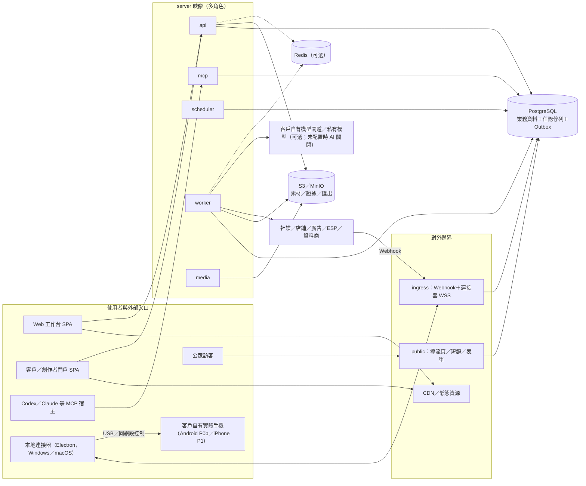

| 拓撲 | 組成 | 差異設定 |
|---|---|---|
| SaaS 共享 | 多租戶共用資料庫（RLS）、共用物件儲存（租戶前綴）；只做海外單一區域部署 | 不做中國區獨立部署；`core.tenant.data_region` 保留為日後分區擴充點（目前全部租戶同一區域，見 4.1）；大型客戶可升級為專屬資料庫（`tenant → dsn` 路由）；自營基礎設施（容器平台、Terraform）屬內部營運；SaaS 以席位為主要計費維度（D8）；對外呼叫經 NAT 閘道的固定出口 IP，登記到每個客戶 Shopify custom app 的 IP allowlist 與其他店鋪平台的 IP 白名單（D16，5.19.11 (10)） |
| 私有部署 | 同映像；一個租戶；單機 Docker（Docker Compose，可 `ROLE=all`） | 不交付 Helm／Kubernetes；不做高可用，以備份還原保障（OP07）；灰度更新只限 SaaS 自營環境（OP09）；不提供 SSO（帳密＋P1 TOTP）；授權與額度以離線授權檔驗證（OP10）；外部依賴皆可替換為客戶自有；客戶須提供固定出口 IP 供店鋪平台登記 IP allowlist／白名單，未提供時 Shopify 部署前置檢查不通過、店鋪維持檔案匯入（D16，5.19.11 (10)） |
| 混合部署 | 私有／SaaS＋指定 Windows／macOS 電腦的本地連接器（可再經 USB 或同網段控制已綁定的客戶自有實體手機，D21） | 連接器只連出到 `ingress`，不開放任何入站埠；手機只與本機連接器通訊，不直接連後端；手機控制用的 adb server 與 Appium 只綁定 127.0.0.1 |
| 受限內網（私有部署變體） | 單機 Docker 置於內網，對外經核准出口代理 | Webhook 無法到達時改用輪詢補採（DS04）；公開頁採既有外部頁面整合，或由同一台主機上的 `public` 角色經客戶 DMZ 的反向代理對外（仍為單機 Docker 部署，不增加主機，不屬高可用配置）；模型只接客戶內網閘道（D9 預設即為客戶自有閘道）；Instagram 等要求平台從公開 URL 拉取媒體的發布，需配置「公開媒體中繼」（DMZ 中的短時效預簽名 URL），否則該平台只能走人工路徑（第 6 章） |

### 3.3 Monorepo 結構

```text
smartsell/
├─ apps/
│  ├─ web/             內部工作台 SPA（路由對應第 4.14 節導航）
│  ├─ portal/          客戶審閱（含簽名連結審閱與投稿）與創作者交付門戶 SPA（獨立 bundle，不含內部程式碼）
│  ├─ public/          公開頁、短鏈、表單（Fastify SSR）
│  ├─ server/          NestJS：api／mcp／worker／media／scheduler／ingress 多角色入口
│  │  └─ src/modules/<module>/   每個業務模組一個資料夾（見下）
│  └─ connector/       Electron 本地連接器（含手機控制子程序：Appium、adb／WDA 管理，D21）
├─ packages/
│  ├─ contracts/       zod schema：API DTO、MCP 工具輸入輸出、事件 payload、錯誤碼、列舉
│  ├─ domain/          純業務規則（狀態機、校驗、計算），不含 IO，可在前後端與連接器共用
│  ├─ db/              Drizzle schema、遷移、RLS policy、種子資料
│  ├─ adapters/        平台適配器 SDK 與實作：meta-instagram、meta-facebook、tiktok、
│  │                   tiktok-shop、youtube、douyin、xiaohongshu、shopify、shopee、
│  │                   lazada（P2，D17）、amazon-sp（provider 鍵 amazon_sp）、file-import
│  ├─ connector-tasks/ 連接器可執行的任務定義（白名單、schema、頁面腳本與手機 App 操作腳本）
│  ├─ ui/              共用元件與設計 tokens
│  ├─ sdk/             TypeScript API client（web／portal／connector／外部整合共用）
│  └─ config/          eslint、tsconfig、dependency-cruiser 規則
├─ infra/              Dockerfile、compose（私有部署交付物）、terraform（SaaS 內部營運，不對客戶交付）
└─ docs/adr/           架構決策紀錄
```

每個後端模組資料夾的固定結構：

```text
modules/<module>/
├─ api/        REST controller（只做驗證、授權呼叫、DTO 轉換）
├─ mcp/        MCP 工具定義（薄層，呼叫 app/）
├─ app/        Application Service：command／query handler、交易邊界、發事件
├─ domain/     聚合、狀態機、規則（多數邏輯放在 packages/domain 以便共用）
├─ infra/      repository、外部 adapter 呼叫、查詢物件
├─ jobs/       背景任務 handler
├─ events/     發出事件定義與訂閱者
└─ index.ts    模組門面（Facade）：其他模組只能 import 這裡
```

### 3.4 模組分層與依賴方向

後端模組名稱即 Postgres schema 名稱。下層模組不得同步呼叫上層模組；向上通知一律透過領域事件。

| 層 | 模組（代碼 → 模組鍵／schema） |
|---|---|
| L0 共用核心 | `core`（租戶、審計、Outbox、長任務、檔案、證據、秘密、審批引擎、匯率）、`iam`（使用者、成員、角色、權杖、長期授權） |
| L1 基礎 | WS → `workspace`、TE → `team`、OP → `ops`、AC → `account`、DS → `ingest` |
| L2 主資料 | PC → `commerce`、AS → `asset`、CA → `campaign` |
| L3 生產 | CO → `content`、LI → `intel` |
| L4 發布 | PL → `planning`、EX → `execution` |
| L5 互動與商務 | IN → `inbox`、CR → `creator`、LP → `traffic`、AD → `ads`、EM → `lifecycle` |
| L6 洞察 | AN → `analytics` |
| 橫切 | AI → `agent`（透過工具登錄呼叫所有模組 Facade；其他模組只透過事件或 `agent_job_id` 引用它） |

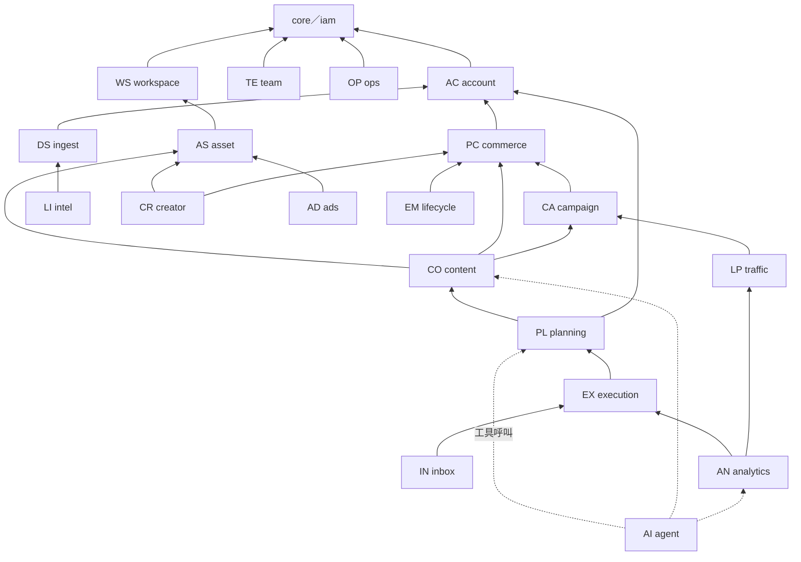

跨模組資料規則：

1. 允許跨 schema 外鍵指向「穩定身分表」（如 `account.social_account`、`commerce.product_variant`），但**寫入只能由擁有模組執行**。唯一例外是 OP 的只新增計量表 `ops.usage_event`：core 檔案服務（`storage_bytes`，見 4.11）與 DS 同步執行（`sync_calls`）在同一交易直接新增計量列；AI 的 `model_tokens`（P1 起）不逐次寫入，由 `agent.rollup_usage` 每小時彙總 `agent.ai_usage` 後寫入（以 `usage:<hour>` 冪等，見 5.17.9）。三者皆依 OP 定義的計量契約（5.19、OP10）直接新增計量列，只新增、不更新或刪除。
2. 讀取側可在查詢層做跨 schema join（報表、總覽、搜尋），寫入路徑禁止。
3. 一個交易只寫一個模組的聚合；需要跨模組一致時，以 Outbox 事件＋冪等訂閱達成最終一致，或由上層 Application Service 依序呼叫並以補償處理失敗。

### 3.5 跨模組的歸屬裁決

構思文件中有若干概念被多個功能提及，本設計指定唯一擁有者，避免重複建模：

| 概念 | 擁有者 | 其他模組如何使用 |
|---|---|---|
| 外部連接（OAuth、API Key、連接器工作階段，涵蓋社媒、店鋪、廣告、ESP、資料商） | AC `account.connection` | PC01、AD01、DS01、EM 透過 AC Facade 建立與刷新連接 |
| 秘密（權杖、API Key） | core `core.secret` | 只有 AC 與 OP 可解密；其他模組只拿 `secret_id` |
| 平台作品（已存在於平台的貼文，含系統發布、原生發布、人工登記） | EX `execution.platform_post` | DS 同步原生作品時呼叫 EX Facade 寫入；PL07 對帳、AN 指標、IN 評論、AD 推廣都引用它 |
| 指標定義與指標觀測 | AN `analytics.metric_definition`／`metric_observation` | DS 負責採集管線並寫入 AN；WS05 儀表板讀 AN |
| 原始回應、採集批次、欄位映射、資料品質 | DS `ingest.*` | 各模組以 `source.batch_id` 回溯 |
| 訂單、退款、交易、優惠使用、店鋪客戶 | PC `commerce.*` | AN05／AN07、CR08／CR09、LP 讀取 |
| 統一客戶檔案、渠道身份、同意紀錄 | EM `lifecycle.customer`／`customer_identity`／`consent_record` | IN07 關聯對話參與者；LP04 線索寫入同意 |
| 工作項目（待辦、製作任務、里程碑）與通知 | WS `workspace.work_item`／`notification` | CO02 看板、CA02 里程碑、TE02 工作量都是 work_item 的視圖 |
| 審批引擎 | core `core.approval_*` | PL05 內容審批、AD05 投放、CR09 佣金、CA04 預算共用；各模組定義自己的政策與容忍規則 |
| 留言串、批註、內外可見性 | TE `team.comment_thread`／`comment` | CO07 校稿、PL06 客戶審閱、TE04 協作共用 |
| 對外分享與門戶可見範圍 | TE `team.share` | AS06 素材分享、PL06 審閱、AN09 報告分享 |
| 素材使用授權 | AS `asset.rights_grant` | CR06 只引用；PL04／EX02／AD03 檢查 |
| 品牌知識與規則 | AS `asset.knowledge_entry` | AI03 以資源與工具提供給 Agent |
| 短鏈、UTM、點擊與站內事件 | LP `traffic.*` | CA05 產生活動連結；AN03／AN04 歸因讀取 |
| 實驗登記 | AN `analytics.experiment` | LP06、AD06 以 `experiment_id` 引用 |
| 全域搜尋索引 | WS `workspace.search_document` | 各模組以事件更新索引 |

### 3.6 請求路徑

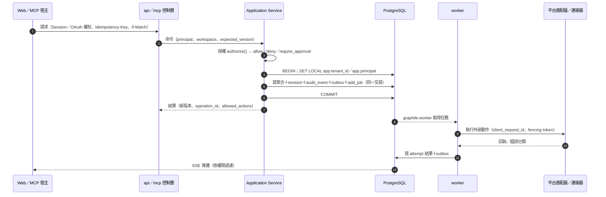

---

## 4. 共用基礎（Shared Kernel）

### 4.1 租戶層級與資料隔離

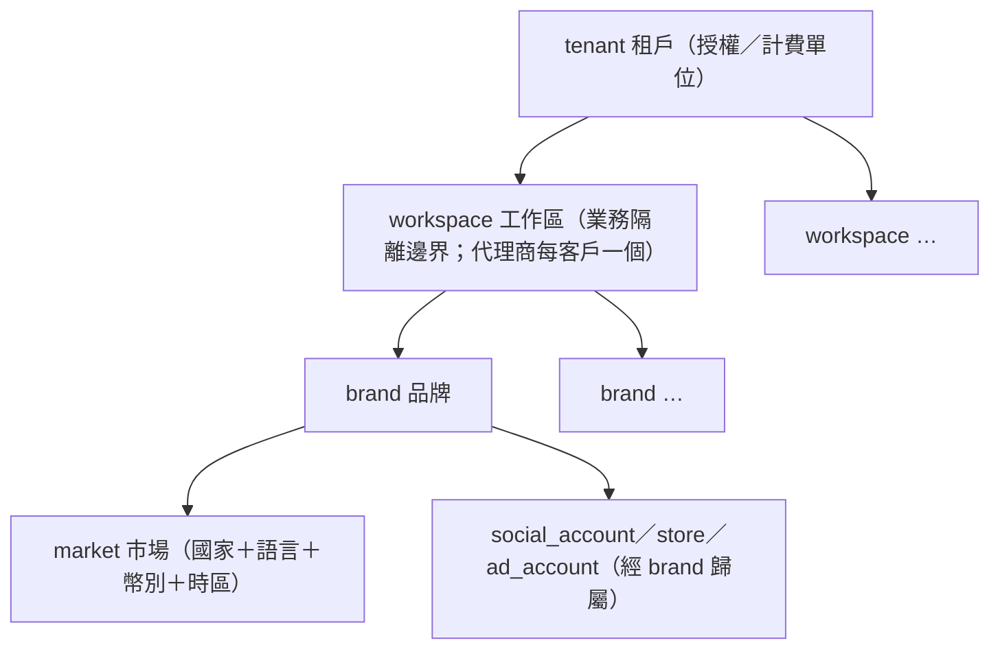

- **tenant**：SaaS 中一個客戶組織；私有部署通常只有一個。授權、模組開關、額度與計量（品牌數、社媒帳號數、使用席位、儲存／採集量與頻率／AI 用量；AI 用量自 P1 起計量）掛在 tenant；SaaS 以席位為主要計費維度，其餘為方案額度或加購，私有部署以離線授權檔記載額度（D8、OP10）。`data_region` 標記租戶資料所在區域：目前只做海外單一區域，所有租戶同值；欄位保留為日後分區擴充點（D1）。
- **workspace**：業務資料的隔離邊界。成員資格、角色、資源範圍以 workspace 為單位授予。代理商為每個客戶建立一個 workspace。
- **brand**：workspace 內的品牌；社媒帳號、店鋪、素材、知識、活動都歸屬品牌。
- **market**：品牌的目標市場，由國家、主要語言（可多個）、幣別、預設時區組成；同一語言可服務多市場。

**隔離實作**

1. 所有業務表帶 `tenant_id`；工作區級資料表再帶 `workspace_id`。
2. 每個交易開始時設定 `SET LOCAL app.tenant_id`、`app.workspace_ids`（主體可存取的工作區清單）、`app.principal`。
3. RLS policy：`tenant_id = current_setting('app.tenant_id')::uuid AND (workspace_id IS NULL OR workspace_id = ANY(current_setting('app.workspace_ids')::uuid[]))`。
4. 應用連線角色 `app_rw` 強制 RLS；遷移用 `app_owner`；少數跨租戶維運任務（如計量彙總）使用具 `BYPASSRLS` 的 `app_maint`，且只在指定 job 中使用並寫審計。
5. 物件儲存鍵前綴：`t/{tenant_id}/w/{workspace_id}/...`；預簽名 URL 由 API 依權限簽發，有效期 ≤ 15 分鐘。
6. 搜尋結果、匯出、SSE 推播、通知摘要都在輸出前**重新套用權限**（構思 WS03、TE04）。

```sql
create table core.tenant (                  -- 租戶本身（不套 @std：本表即租戶）
  id uuid primary key,
  name text not null,
  deployment_kind text not null,            -- saas|private
  data_region text not null,                -- 資料區域代碼；目前只有海外單一區域，與 ops.deployment_setting 的 data_region 一致；保留為日後分區擴充點（D1）
  status text not null,                     -- active|suspended
  @ver,
  created_at timestamptz not null default now(),
  updated_at timestamptz not null default now()
);
```

### 4.2 識別碼、時間、金額與語言

| 項目 | 約定 |
|---|---|
| 主鍵 | `uuid`，應用端產生 UUIDv7（時間有序，利於索引） |
| 外部識別碼 | 一律以命名空間組合唯一：`(connection_id, external_id)` 或 `(provider, external_account_id, external_id)`；SKU 必須加店鋪命名空間（構思 7.1） |
| 時間 | `timestamptz` 一律存 UTC；需要「當地時間語義」的欄位另存 `tz`（IANA 名稱）與 `local_time`／`local_date`（PL02 週期排期、IN08 營業時間） |
| 金額 | `amount_minor bigint`＋`currency char(3)`（ISO 4217）；換算另存 `fx_rate_id`；禁止以浮點數存金額 |
| 匯率 | `core.fx_rate(date, base, quote, rate numeric(20,10), source)`；報表換算必須記錄使用的匯率列 |
| 語言與地區 | BCP 47（`zh-Hant-TW`、`ja-JP`、`en-US`）；國家 ISO 3166-1 alpha-2。介面語言（`iam.user.ui_locale`，可為空、未設定時沿用 `workspace.default_ui_locale`）P0 只接受 `zh-Hant`（預設）與 `en`（已確認），簡體中文、日文不排期，有客戶要求再加（D13）；內容語言（市場、內容變體、商品事實）不受此限（D5） |
| 富文本 | ProseMirror JSON 為正本；各平台輸出的純文字與實體（標籤、提及、連結）另存為 `rendered` 欄位 |
| 雜湊 | `content_hash = sha256(canonical_json(revision_payload))`，用於批准綁定、去重與快取 |

**統一的來源結構（`source jsonb`）**

```json
{
  "method": "platform_api | webhook | import | manual | connector | vendor | agent | derived",
  "connection_id": "uuid|null",
  "provider": "meta_instagram|tiktok|…|null",
  "external_id": "string|null",
  "batch_id": "uuid|null",
  "observed_at": "2026-11-19T08:00:00Z",
  "estimate": false,
  "confidence": null,
  "evidence_ids": ["uuid"]
}
```

### 4.3 版本與並發控制

| 機制 | 用途 | 規則 |
|---|---|---|
| 樂觀鎖 `version integer` | 所有可修改聚合 | API 更新必須帶 `If-Match: <version>`（MCP 帶 `expected_version`）；不符回 `409 VERSION_CONFLICT`，回應附目前版本與差異摘要 |
| 不可變修訂 `*_revision` | 內容變體、簡報、商品事實、授權、審批政策、報告 | 只新增不修改；`revision_no` 遞增；`content_hash` 去重；「恢復舊稿」也建立新修訂（CO07） |
| 快照 `*_snapshot` | 外部事實的觀測值（價格、庫存、指標） | 帶 `observed_at` 與 `source`；新觀測新增一列，不覆寫 |
| 工作租約 | 執行權（發布嘗試、對話占用、Agent 工作、連接器任務） | 見 4.7；版本檢查解決「編輯衝突」，租約解決「誰在執行」，兩者都需要（構思 8.2） |

### 4.4 身分與權限模型

**主體類型（principal）**

| 類型 | 說明 | 認證 |
|---|---|---|
| `user` | 內部成員 | Session／PAT／OAuth |
| `agent_client` | 代表某位使用者行事的 MCP 宿主或外部 Agent | OAuth 2.1（委派）或 PAT；權限 = 使用者權限 ∩ 權杖 scope ∩ 工具白名單 |
| `service_account` | 自動化規則、整合帳號 | 服務權杖；權限只來自明確授予 |
| `device` | 本地連接器裝置 | 裝置金鑰簽章＋短期權杖；只能領取指派給它的任務 |
| `portal_user` | 客戶審閱者、創作者 | Session（獨立網域）；只能存取 `team.share` 明確分享的物件 |
| `public` | 匿名訪客 | 簽名連結（審閱、投稿；頁面由門戶 SPA `/s/:shareId` 提供，以 TE `share` 判定）或公開頁（`public` 角色） |
| `system` | 系統內部任務 | 由 job 上下文帶入，寫審計時標記觸發來源 |

**動作分級**（構思 7.2）：

| 等級 | 含義 | 例 |
|---|---|---|
| `read` | 讀取 | 查看內容、報表 |
| `draft` | 建立或修改草稿，不影響對外 | 撰稿、建立回覆草稿、建立廣告提案 |
| `plan` | 建立或修改計畫 | 排期、設定佇列、指派 |
| `approve` | 批准 | 內容審批、佣金核准、預算批准 |
| `execute` | 對外產生副作用 | 發布、回覆、刪除貼文、寄送邀約 |
| `spend` | 產生費用 | 啟動廣告、提高預算、建立付款 |
| `export` | 資料離開系統 | 匯出、分享報告、送資料至模型 |
| `admin` | 管理設定 | 連接、成員、部署 |

**權限字串**：`<模組鍵>.<資源>.<動作>`，例如 `content.variant.draft`、`planning.target.approve`、`execution.target.execute`、`ads.campaign.spend`、`analytics.report.export`。各模組在 5.x.5 列出自己的權限。

**系統預設角色**（對應構思 1.3，可複製後自訂）

| 角色鍵 | 對應使用者 | 摘要 |
|---|---|---|
| `owner`／`admin` | 系統管理員 | 全部；`admin` 不含帳單 |
| `brand_lead` | 品牌／行銷負責人 | 讀全部、活動與預算 plan／approve、報告 export |
| `social_ops` | 社媒營運 | 內容 draft、排期 plan、收件箱 execute、發布 execute（受審批政策約束） |
| `producer` | 設計／剪輯／文案 | 內容與素材 draft、看板 plan（只限被指派） |
| `approver` | 審核人 | 內容 approve |
| `commerce_ops` | 電商營運 | 商品、價格快照、促銷 plan |
| `creator_manager` | 達人經理 | 創作者、合作、寄樣 plan／execute、佣金 draft |
| `support` | 客服 | 收件箱 execute、案件 plan |
| `analyst` | 分析 | 讀全部數據、報告 draft／export |
| `client_reviewer`（portal） | 代理商客戶 | 只讀分享物件、回饋、在被授權時 approve |
| `creator_portal`（portal） | 創作者 | 只讀自己的合作、提交交付物 |

**資源範圍**：成員的角色可附加範圍 `{brand_ids, social_account_ids, campaign_ids}`，`null` 表示工作區內全部。

**長期授權（standing grant）**：讓人員或 Agent 在明確範圍內連續執行而不逐筆送審（構思 7.2 末段）。例：「Agent X 可對帳號 A、B 排期活動 C 的內容，每日最多 6 則，預檢必須全部通過，有效至 12/31」。超出範圍時，授權結果為 `require_approval`，系統建立審批請求而不是直接拒絕。

**授權函式**

```ts
authorize(principal, action: PermissionKey, resource: ResourceRef, ctx): 
  | { effect: 'allow', via: 'role' | 'standing_grant', grant_id?: string }
  | { effect: 'deny', reason: DenyReason }
  | { effect: 'require_approval', policy_id: string }
```

**iam 發出的事件**：`iam.user.disabled`、`iam.session.revoked`、`iam.api_token.created`、`iam.api_token.revoked`、`iam.oauth_grant.created`、`iam.oauth_grant.revoked`、`iam.standing_grant.created`、`iam.standing_grant.revoked`（成員加入、移除與角色變更由 TE 發出 `team.member.*`）。

**硬規則**：`agent_client` 與 `service_account` 永遠不能以人的名義寫入審批決定；長期授權只能讓某些動作「不需要審批」，並以 `approved_by_policy` 與 `grant_id` 記錄（構思 PL05）。

**`iam` P0 資料表**

```sql
-- 共用欄位縮寫（本文所有 DDL 通用）：
--   @std    = id uuid primary key, tenant_id uuid not null,
--             created_at timestamptz not null default now(), updated_at timestamptz not null default now()
--   @ws     = workspace_id uuid not null references workspace.workspace(id)
--   @actor  = created_by_type text not null, created_by_id uuid      -- actor_type: user|agent_client|service_account|device|portal_user|system
--   @ver    = version integer not null default 1
--   列舉一律以 text + check 約束實作，註解中以 a|b|c 表示

create table iam.user (
  id uuid primary key,
  email citext not null unique,
  display_name text not null,
  ui_locale text check (ui_locale in ('zh-Hant','en')), -- 介面語言（D5）；null＝沿用 workspace.default_ui_locale
  timezone text not null default 'Asia/Taipei',
  password_hash text,                       -- argon2id；SaaS 的 SSO 使用者（P2）可為空（私有部署不提供 SSO）
  mfa jsonb,                                -- P1：TOTP 設定（加密）
  kind text not null,                       -- staff|portal_client|portal_creator
  status text not null,                     -- invited|active|disabled
  last_login_at timestamptz,
  created_at timestamptz not null default now(),
  updated_at timestamptz not null default now()
);

create table iam.tenant_membership (
  @std,
  user_id uuid not null references iam.user(id),
  tenant_role text not null,                -- owner|admin|member|guest
  status text not null,                     -- invited|active|removed
  unique (tenant_id, user_id)
);

create table iam.workspace_membership (
  @std, @ws,
  user_id uuid not null references iam.user(id),
  status text not null,                     -- invited|active|suspended|removed
  invited_by uuid, joined_at timestamptz, removed_at timestamptz,
  handover_to_user_id uuid,                 -- 移除時的交接對象（TE01）
  unique (workspace_id, user_id)
);

create table iam.role (
  id uuid primary key,
  tenant_id uuid,                           -- null = 系統預設角色
  key text not null, name text not null,
  permissions text[] not null,              -- 權限字串，支援 'content.*.draft' 萬用
  is_system boolean not null default false,
  @ver,
  unique (tenant_id, key)
);

create table iam.membership_role (
  @std,
  workspace_membership_id uuid not null references iam.workspace_membership(id),
  role_id uuid not null references iam.role(id),
  scope jsonb,                              -- {brand_ids:[],social_account_ids:[],campaign_ids:[]}；null=全部
  unique (workspace_membership_id, role_id)
);

create table iam.session (
  id uuid primary key, user_id uuid not null, tenant_id uuid,
  created_at timestamptz not null default now(), expires_at timestamptz not null,
  ip inet, user_agent text, revoked_at timestamptz
);

create table iam.api_token (                -- 個人存取權杖（PAT）與服務權杖
  @std,
  owner_type text not null,                 -- user|service_account
  owner_id uuid not null,
  name text not null,
  token_hash bytea not null unique,         -- 只存雜湊；明文只在建立時顯示一次
  scopes text[] not null,                   -- 權限字串子集
  workspace_ids uuid[] not null,
  tool_allowlist text[],                    -- MCP 工具白名單；null=依 scope
  expires_at timestamptz, last_used_at timestamptz, revoked_at timestamptz
);

create table iam.oauth_client (             -- MCP 宿主與整合（支援動態註冊 DCR）
  id uuid primary key, tenant_id uuid,      -- null = 全域公開客戶端
  client_id text not null unique,
  name text not null, kind text not null,   -- mcp_host|integration
  redirect_uris text[] not null,
  registered_via text not null,             -- admin|dcr|cimd
  status text not null,                     -- active|blocked
  created_at timestamptz not null default now()
);

create table iam.oauth_grant (              -- 使用者對某客戶端的同意
  @std,
  user_id uuid not null, client_id uuid not null references iam.oauth_client(id),
  scopes text[] not null, workspace_ids uuid[] not null,
  tool_allowlist text[],
  refresh_token_hash bytea, expires_at timestamptz, revoked_at timestamptz,
  last_used_at timestamptz
);

create table iam.service_account (
  @std, @ws, @actor,
  name text not null, purpose text, status text not null   -- active|disabled
);

create table iam.standing_grant (
  @std, @ws, @actor, @ver,
  grantee_type text not null,               -- user|agent_client|service_account
  grantee_id uuid not null,
  actions text[] not null,                  -- 例：{'planning.target.plan','execution.target.execute'}
  resource_scope jsonb not null,            -- {brand_ids,social_account_ids,campaign_ids,content_types}
  constraints jsonb not null,               -- {max_per_day, time_window, require_precheck:'pass', max_spend_minor, currency}
  valid_from timestamptz not null, valid_until timestamptz,
  revoked_at timestamptz, revoked_by uuid,
  reason text not null
);
```

### 4.5 審計與證據鏈

```sql
create table core.audit_event (             -- 只新增；按月分區；保留期依 OP05（預設 2 年，D10）
  id uuid not null, tenant_id uuid not null, workspace_id uuid,
  occurred_at timestamptz not null,
  actor_type text not null, actor_id uuid,
  on_behalf_of_user_id uuid,                -- agent_client／device 代表的使用者
  via text not null,                        -- web|portal|mcp|api|automation|connector|webhook|system
  action text not null,                     -- 權限字串或系統動作
  resource_type text not null, resource_id uuid, resource_version integer,
  outcome text not null,                    -- success|denied|failed|require_approval
  reason text,
  diff jsonb,                               -- 遮罩後的變更摘要
  request_id text, trace_id text, idempotency_key text,
  agent_job_id uuid, tool_name text,        -- MCP 工具呼叫鏈（AI08）
  ip inet, user_agent text,
  primary key (id, occurred_at)
) partition by range (occurred_at);

create table core.evidence (                -- 執行證據、原始回應、截圖、人工憑證
  @std, @ws, @actor,
  kind text not null,                       -- api_response|screenshot|url|file|manual_note|webhook_payload|ui_hierarchy|screen_recording
                                            -- ui_hierarchy、screen_recording 為連接器手機通道證據（4.16，D21）
  file_object_id uuid references core.file_object(id),
  url text, note text,
  content_hash text,
  captured_at timestamptz not null,
  capture_context jsonb,                    -- 連接器證據：{device_id, channel:'browser'|'mobile', mobile_device_id, social_account_id}；其他來源為 null
  masked boolean not null default false,
  retention_until timestamptz,              -- 執行證據截圖預設跟隨作品生命週期（D10；OP05 可由工作區調整）
  linked_resource_type text not null, linked_resource_id uuid not null
);
```

審計鏈要求：人員、Agent、工具、任務、外部回執能以 `trace_id`／`agent_job_id`／`resource_id` 串成一條（OP06、AI08）。

### 4.6 領域事件、Outbox 與任務系統

**事件命名**：`<模組鍵>.<聚合>.<過去式動詞>`，例如 `content.revision.created`、`planning.target.ready`、`execution.attempt.outcome_unknown`、`commerce.listing.changed`。

```sql
create table core.outbox (
  id uuid primary key, tenant_id uuid not null, workspace_id uuid,
  type text not null,
  aggregate_type text not null, aggregate_id uuid not null, aggregate_version integer,
  payload jsonb not null,                   -- 只放識別碼與必要摘要，不放敏感全文
  occurred_at timestamptz not null default now(),
  dispatched_at timestamptz,
  trace_id text
);
create index on core.outbox (dispatched_at) where dispatched_at is null;

create table core.event_consumption (       -- 訂閱者冪等
  subscriber text not null, event_id uuid not null,
  consumed_at timestamptz not null default now(),
  primary key (subscriber, event_id)
);
```

**分發流程**：`scheduler` 定期與 LISTEN/NOTIFY 喚醒 `outbox.dispatch` 任務 → 以 `FOR UPDATE SKIP LOCKED` 批次讀取 → 為每個訂閱者建立一個 graphile-worker job（job key = `sub:<subscriber>:<event_id>`）→ 標記 `dispatched_at`。訂閱者處理前先寫 `event_consumption`，重複事件直接略過。

**直接任務**：需要在寫入後立即執行的工作（如上傳素材、建立執行任務）在同一交易內呼叫 `graphile_worker.add_job()`，job key 帶業務識別碼避免重複，例如 `exec:attempt:<attempt_id>`。

**佇列與併發**

| 佇列 | 用途 | 預設併發 |
|---|---|---|
| `default` | 一般業務任務、事件訂閱 | 20 |
| `sync:<provider>` | 各平台採集與同步（受平台限流約束） | 依 provider |
| `publish` | 發布嘗試、核實、取消 | 10 |
| `media` | 轉碼、縮圖、掃描（`media` 角色消費） | 依 CPU |
| `export` | 匯入、匯出、報告產生 | 4 |
| `agent` | Runner 型 Agent 任務（P1） | 4 |
| `notify` | 郵件、外部通知、Webhook 外送 | 10 |

**長任務（使用者與 MCP 可見）**

```sql
create table core.operation (
  @std, @ws, @actor, @ver,
  kind text not null,                       -- ingest.backfill|planning.batch_schedule|analytics.report_export|…
  status text not null,                     -- queued|running|succeeded|partially_succeeded|failed|cancel_requested|cancelled
  progress jsonb not null default '{}',     -- {done, total, unit}
  input jsonb not null,
  result_ref jsonb,                         -- {resource_type, resource_id} 或 {file_object_id}
  error jsonb,
  cancel_requested_at timestamptz,
  started_at timestamptz, finished_at timestamptz,
  agent_job_id uuid
);

create table core.operation_item (          -- 批次逐筆結果（構思 4.2）
  operation_id uuid not null references core.operation(id),
  seq integer not null,
  target_ref jsonb not null,
  status text not null,                     -- pending|succeeded|failed|skipped
  reason_code text, message text,
  result_ref jsonb,
  primary key (operation_id, seq)
);
```

連線關閉不等於取消；取消只能透過 `cancel_requested` 並由執行者確認（構思 AI05）。

### 4.7 冪等、租約與互斥

**API 冪等**

```sql
create table core.idempotency_record (
  tenant_id uuid not null, principal_id uuid not null, key text not null,
  request_hash text not null, status text not null,  -- in_progress|completed
  response_status integer, response_body jsonb,
  created_at timestamptz not null default now(), expires_at timestamptz not null,
  primary key (tenant_id, principal_id, key)
);
```

所有「建立」或「觸發對外動作」的 POST 接受 `Idempotency-Key`；同 key 不同請求內容回 `422 IDEMPOTENCY_MISMATCH`；同 key 相同內容回傳原結果（構思 PL03）。

**通用租約欄位**（發布嘗試、對話占用、Agent 工作、連接器任務共用的模式）

| 欄位 | 說明 |
|---|---|
| `lease_owner_type`、`lease_owner_id` | 持有者（worker 實例、device、user、agent_client） |
| `lease_expires_at` | 到期時間；持有者需續期 |
| `fencing_token bigint` | 每次取得租約遞增；對外呼叫與回寫都帶此值，資料庫拒絕舊 token 的回寫 |

**租約到期 ≠ 可以重做**：到期後狀態轉為「待核實」，由核實流程決定後續（構思 EX06、AI04）。

**同帳號寫入互斥**：同一 `social_account` 的對外寫入（發布、刪除、回覆）在執行層取得 `execution.account_write_slot`（見 5.10），連接器路徑另加裝置端互斥。

### 4.8 能力登錄（Capability Registry）

能力登錄由 AC 擁有（`account.capability`），是編輯、預檢、執行、收件箱判斷「能不能做」的唯一依據（構思 10.1 末段要求的欄位全部保存）。

| 層 | 來源 | 說明 |
|---|---|---|
| 靜態矩陣 | 適配器程式碼內宣告 | 該平台在理論上支援哪些操作、格式、限制 |
| 動態探測 | 授權後查詢帳號類型、已授 scope、地區、稽核狀態 | 例如 TikTok 未通過稽核的應用只能以私人可見發布 |
| 執行期降級 | 實際錯誤回饋 | 連續權限錯誤時降為 `needs_authorization`，並寫 `failure_reason` |

能力狀態列舉（前台徽章）：`available`（可執行）、`read_only`（唯讀）、`needs_authorization`（需授權）、`manual_only`（需人工）、`unsupported`（不支援）、`unverified`（尚未核實）。

能力另記可用執行器 `executors`（`api`｜`connector`｜`manual`，見 4.15），以及執行器含 `connector` 時可用的通道 `connector_channels`（`browser`｜`mobile`；`mobile` 自 Android P0b、iPhone P1，D21；欄位見 5.2.4）；EX04 依此路由（`resolveExecutors`，5.2.11）。裝置或手機離線、手機前置條件失效或 iPhone 簽章到期都不改能力狀態，只影響 EX 路由（同 AC 5.2.11）。

### 4.9 指標值語義：未知與零分開

所有指標觀測帶 `availability`：

| 值 | 含義 | 前台呈現 |
|---|---|---|
| `observed` | 已觀測（數值可為 0） | 數值 |
| `not_collected` | 尚未採集 | 「尚未採集」 |
| `no_permission` | 缺少權限 | 「無權限」＋授權入口 |
| `not_applicable` | 此格式／平台不適用 | 「不適用」 |
| `sync_failed` | 同步失敗 | 「同步失敗」＋重試 |
| `source_not_provided` | 來源不提供 | 「來源未提供」 |
| `estimated` | 估算值 | 數值＋估算標記 |

聚合規則：只有 `observed` 參與加總；彙總結果同時回傳 `coverage`（被涵蓋物件數／總數）；跨平台不同定義的指標不得直接相加（構思 8.3）。

### 4.10 審批引擎（core）

```sql
create table core.approval_policy (
  @std, @ws, @actor, @ver,
  name text not null,
  resource_type text not null,              -- planning.publish_target|ads.proposal|creator.commission_batch|campaign.budget
  conditions jsonb not null,                -- 適用條件：brand、account、campaign、內容類型、金額門檻
  steps jsonb not null,                     -- [{order, approvers:{roles?,user_ids?}, min_approvals, due_hours}]
  change_tolerance jsonb not null,          -- 哪些變更不使批准失效，例：{"keep":["schedule_shift_minutes<=60"],"invalidate":["body","media","account","product_ref"]}
  mode text not null,                       -- required|optional
  active boolean not null default true
);

create table core.approval_request (
  @std, @ws, @actor, @ver,
  resource_type text not null, resource_id uuid not null,
  resource_hash text not null,              -- 綁定被批准的確定版本
  policy_id uuid references core.approval_policy(id), policy_version integer,
  status text not null,                     -- pending|approved|rejected|changes_requested|cancelled|invalidated|expired
  current_step integer not null default 1,
  approved_via text,                        -- human|policy（standing grant）
  standing_grant_id uuid,
  due_at timestamptz, decided_at timestamptz,
  invalidated_reason text,
  context jsonb                             -- 審批當下的預檢結果、商品快照 id 等
);
create index on core.approval_request (resource_type, resource_id, status);

create table core.approval_decision (
  @std, @ws,
  request_id uuid not null references core.approval_request(id),
  step_no integer not null,
  decision text not null,                   -- approve|reject|request_changes
  decided_by_user_id uuid not null,         -- 只能是人（user 或 portal_user）
  decided_via text not null,                -- web|portal|mcp（人透過 MCP 宿主操作，仍須使用者本人權杖）
  comment text,
  decided_at timestamptz not null
);
```

失效判定：被批准對象產生新修訂時，引擎以 `change_tolerance` 比對新舊修訂差異，決定保留批准（寫審計）或將請求轉為 `invalidated` 並建立新請求（構思 PL05、8.2 第一列）。

審批引擎發出的事件（各模組訂閱後推進自己的狀態）：`core.approval_request.created`、`core.approval_request.step_advanced`、`core.approval_request.approved`、`core.approval_request.rejected`、`core.approval_request.changes_requested`、`core.approval_request.invalidated`、`core.approval_request.expired`、`core.approval_request.cancelled`。

審批引擎的 Facade：`requestApproval(resource_ref, resource_hash, context)`、`decide(request_id, step_no, decision)`、`evaluateRevision(resource_ref, old_hash, new_hash, diff)`（回傳 keep／invalidate）、`getEffectiveApproval(resource_ref, resource_hash)`。

### 4.11 檔案、秘密與匯率

```sql
create table core.file_object (
  @std, workspace_id uuid, @actor,
  storage_key text not null unique,         -- t/{tenant}/w/{ws}/…
  bucket text not null,
  mime_type text not null, size_bytes bigint not null,
  sha256 text not null,
  original_filename text,
  scan_status text not null,                -- pending|clean|infected|skipped
  purpose text not null,                    -- asset|evidence|import|export|attachment|avatar
  retention_until timestamptz,
  deleted_at timestamptz
);
create index on core.file_object (tenant_id, sha256);
-- 計量（D8、OP10）：檔案服務在 file_object 建立與刪除（設定 deleted_at）的同一交易，直接新增一筆 ops.usage_event
--   （meter_key=storage_bytes，quantity=±size_bytes，source_ref 指向本列）；自 P0 起只記錄，額度阻擋 P1 起（見 3.4 第 1 點例外、5.19）

create table core.secret (                  -- 信封加密
  @std, workspace_id uuid, @actor,
  kind text not null,                       -- oauth_token|api_key|webhook_secret|model_key|signing_key
  ciphertext bytea not null, dek_wrapped bytea not null, kek_id text not null,
  expires_at timestamptz, rotated_from uuid, revoked_at timestamptz,
  last_used_at timestamptz
);

create table core.fx_rate (
  id uuid primary key,
  rate_date date not null, base char(3) not null, quote char(3) not null,
  rate numeric(20,10) not null, source text not null,
  unique (rate_date, base, quote, source)
);
```

### 4.12 Web API 規範

| 項目 | 約定 |
|---|---|
| 基底路徑 | `/api/v1`；工作區資源：`/api/v1/workspaces/{workspaceId}/…`；租戶管理：`/api/v1/admin/…`；門戶：`/api/v1/portal/…` |
| 資源命名 | 複數 kebab-case：`/campaigns`、`/content-items`、`/publish-targets` |
| 動作端點 | 狀態轉換以子路徑動詞表示：`POST /publish-targets/{id}/approve`、`/cancel`、`/reconcile` |
| 分頁 | 游標分頁：`?cursor=&limit=`（上限 200），回應 `{ data, next_cursor }` |
| 篩選 | 共用篩選參數：`brand_id`、`social_account_id`、`platform`、`market_id`、`campaign_id`、`owner_id`、`status`、`from`、`to`；保存檢視直接保存此查詢物件（WS03） |
| 並發 | 回應帶 `ETag: "<version>"`；修改須帶 `If-Match` |
| 冪等 | 建立與觸發類 POST 接受 `Idempotency-Key` |
| 批次 | `POST /…/batch`，內容 `{ dry_run: boolean, items: [...] }`；`dry_run=true` 回傳影響預覽，正式執行回 `202 { operation_id }`，逐筆結果見 `core.operation_item` |
| 長任務 | `202 Accepted`＋`operation_id`；`GET /operations/{id}`、`POST /operations/{id}/cancel` |
| 錯誤 | RFC 9457 `application/problem+json`，帶 `code`、`detail`、`request_id`、`details` |
| 允許動作 | 資源回應帶 `allowed_actions: string[]`，前端依此顯示按鈕，不在前端重寫權限邏輯 |
| 即時推播 | `GET /api/v1/workspaces/{ws}/stream`（SSE）；事件以 `type` 與資源識別碼通知前端失效重抓，不推送敏感全文 |
| 版本演進 | 只做相容性新增；破壞性變更走 `/api/v2`；棄用以 `Deprecation`／`Sunset` 標頭通知 |

**通用錯誤碼**

| code | HTTP | 含義 |
|---|---|---|
| `VALIDATION_FAILED` | 422 | 輸入不合法 |
| `PERMISSION_DENIED` | 403 | 無權限（`details.missing_permission`） |
| `APPROVAL_REQUIRED` | 409 | 需要審批（`details.approval_request_id`） |
| `VERSION_CONFLICT` | 409 | 版本衝突（附目前版本與差異） |
| `LEASE_HELD` | 409 | 已被他人占用（附占用者與到期時間） |
| `CAPABILITY_UNAVAILABLE` | 409 | 帳號能力不足（附能力狀態與原因） |
| `PRECHECK_BLOCKED` | 409 | 預檢阻擋（附阻擋項清單） |
| `OUTCOME_UNKNOWN` | 409 | 前次嘗試結果未知，禁止重發 |
| `IDEMPOTENCY_MISMATCH` | 422 | 冪等鍵重用但內容不同 |
| `RATE_LIMITED` | 429 | 本系統或平台限流（附 `retry_after`） |
| `LICENSE_LIMIT` | 402 | 授權額度或模組未啟用（OP10） |
| `EGRESS_BLOCKED` | 409 | 資料外送政策阻擋（AI07、OP03） |
| `AI_NOT_CONFIGURED` | 409 | 工作區未配置模型端點或對應用途路由，AI 功能關閉（D9、AI07）；核心流程不受影響 |
| `NOT_FOUND` | 404 | 不存在或不可見（不區分，以免洩漏存在性） |

### 4.13 MCP 規範

| 項目 | 約定 |
|---|---|
| 服務 | 一個總服務 `smartsell`，端點 `/mcp`（Streamable HTTP）；本機宿主可用官方 stdio→HTTP 代理 |
| 認證 | OAuth 2.1：提供 Protected Resource Metadata 與授權伺服器中介資料，支援動態客戶端註冊；退路為 PAT（Bearer） |
| 工具命名 | `<領域>_<動詞>[_<對象>]`，小寫底線，≤ 64 字元（相容 Claude／OpenAI 對工具名稱字元集 `^[a-zA-Z0-9_-]{1,64}$` 的限制）。構思 7.2 的 `content.create_draft` 在實作中寫作 `content_create_draft` |
| 必要輸入 | 所有工具帶 `workspace_id`；修改類帶 `expected_version`；對外副作用類帶 `idempotency_key` |
| 工具註解 | 依實際行為設定 `readOnlyHint`、`destructiveHint`、`idempotentHint`、`openWorldHint` |
| 輸出 | `structuredContent`（符合 outputSchema）＋精簡文字摘要；數據類輸出必帶 `as_of`、`source`、`estimate`、`coverage`；大結果回傳資源連結 `smartsell://…` |
| 工具清單 | `tools/list` 依權杖權限動態過濾；無權限的工具不出現 |
| 長任務 | 回傳 `operation_id`，以 `jobs_get` 查詢；宿主支援規範中的 Tasks 能力時再以相容方式提供（AI05） |
| 外部內容 | 回傳平台留言、網頁、匯入文本時包在 `untrusted_content` 欄位並標示來源，提示宿主不得將其視為指令（AI08） |
| 一致性 | MCP 工具只呼叫模組 Application Service；與 Web 走同一授權、審批、預檢與審計 |

### 4.14 前端架構與共用元件

**版面與語系（D20、D13）**：`web` 與 `portal` 只做桌面版版面（最低支援寬度 1280px，支援的桌面瀏覽器與低於最低寬度時的處理見 5.1.10），不做手機 App、PWA 與手機版版面；`public` 角色的消費者公開頁不受此限。介面字串一律經 i18next 語系檔，不寫死文字（見第 2 章「介面語言」）。

**路由與導航**（對應構思 4.1）

| 導航 | 路由前綴 | 主要模組 |
|---|---|---|
| 營運總覽 | `/w/:ws/home` | WS |
| 行銷活動 | `/w/:ws/campaigns` | CA |
| 內容工作台 | `/w/:ws/content` | CO、LI04 |
| 發布日曆 | `/w/:ws/calendar`、`/w/:ws/approvals` | PL、EX |
| 素材中心 | `/w/:ws/assets` | AS |
| 互動與客戶 | `/w/:ws/inbox` | IN、EM01 |
| 商品與市場 | `/w/:ws/commerce` | PC |
| 達人合作 | `/w/:ws/creators` | CR |
| 情報研究 | `/w/:ws/research` | LI |
| 導流與行銷 | `/w/:ws/traffic`、`/w/:ws/lifecycle` | LP、EM |
| 廣告 | `/w/:ws/ads` | AD |
| 數據與報告 | `/w/:ws/data`、`/w/:ws/reports` | DS、AN |
| AI 與自動化 | `/w/:ws/automation` | AI |
| 管理中心 | `/w/:ws/settings`、`/admin` | AC、TE、OP |

**共用元件**（`packages/ui`；各模組頁面必須使用，以保證構思 4.2 的一致行為）

| 元件 | 用途 |
|---|---|
| `EntityTable` | 標準篩選列（品牌、帳號、平台、市場、活動、負責人、日期）、欄位設定、保存檢視、批次選取 |
| `BatchActionDialog` | 先預覽影響範圍（dry run），執行後逐筆顯示成功／失敗／跳過理由 |
| `StatusTimeline` | 狀態時間線（誰、經由哪個入口、何時、從何到何） |
| `RelatedObjects` | 相關對象晶片：活動、商品、素材、發布目標、作品、對話 |
| `ProvenanceDrawer` | 來源、批次、原始快照、估算標記、證據檔案 |
| `MetricValue` | 依 `availability` 呈現數值或狀態，附口徑說明 |
| `CapabilityBadge` | 能力狀態徽章與原因 |
| `EmptyState` | 未連接／無權限／未同步／不支援／真的為零 五種空狀態 |
| `DiffViewer` | 文字與欄位差異、版本比對、AI 擬修改預覽 |
| `ApprovalPanel` | 審批步驟、綁定版本、失效原因、決定入口 |
| `CommentThread` | 內部／客戶／創作者可見性切換，錨定到文字或畫面座標 |
| `PlatformPreview` | 各平台近似預覽（明示為近似） |
| `AssetPicker`、`ProductFactPicker` | 素材與商品事實選取（含授權與版本提示） |
| `OperationProgress` | 長任務進度與取消 |
| `AiSuggestionCard` | AI 建議：來源、採納／修改／退回（AI01） |

**資料流**：TanStack Query 管伺服器狀態；SSE 事件只觸發失效重抓；樂觀更新只用於無對外副作用的操作（如拖動看板卡片）。

### 4.15 平台適配器框架

```ts
interface PlatformAdapter {
  provider: ProviderKey;                // meta_instagram | meta_facebook | tiktok | tiktok_shop | youtube | douyin | xiaohongshu
                                        // | shopify | shopee | lazada | amazon_sp | file_import（店鋪平台見 6.11；lazada 自 P2，D17）
  authStrategy: 'oauth2' | 'connector_session' | 'api_key' | 'none';

  staticMatrix(): CapabilityDecl[];                                 // 靜態能力矩陣
  probe(conn: ConnectionCtx): Promise<CapabilityReport>;            // 動態探測
  validate(op: OperationKey, input: unknown, caps: CapabilityReport): ValidationIssue[];

  execute(op: OperationKey, input: unknown, ctx: ExecCtx): Promise<ExecutionReceipt>;   // 對外副作用；ctx 帶 client_request_id、fencing_token
  observe(ref: ReceiptOrQuery, ctx: ExecCtx): Promise<OutcomeObservation>;             // 結果核實
  cancel?(ref: ExternalRef, ctx: ExecCtx): Promise<CancelReceipt>;

  sync(resource: SyncResource, cursor: Cursor | null, ctx: SyncCtx): AsyncIterable<SyncPage>;
  webhook?: { verify(req: RawRequest): boolean; parse(req: RawRequest): ExternalEvent[] };

  classifyError(err: unknown): { errorClass: ErrorClass; reason?: string };
  // ErrorClass: transient | rate_limited | auth_expired | permission_denied | invalid_input
  //           | platform_rejected | outcome_unknown | unsupported | quota_exhausted
  // reason：各模組定義的細分原因碼，可省略（例：ip_not_allowed，見 DS 5.3.11 第 11 點）
}
```

| 設計點 | 規則 |
|---|---|
| 執行器 | `api`（worker 直接呼叫）、`connector`（派送到本地連接器）、`manual`（產生人工任務）；同一 `OperationKey` 可有多個執行器，由 EX04 路由（官方 API 可用時優先 `api`） |
| 連接器通道 | `connector` 再分兩種通道（`connector_channel`）：`browser`（電腦上的專用 Chromium 設定檔，P0b）與 `mobile`（連接器經 USB 或同網段控制已綁定的客戶自有實體手機上的平台 App；Android P0b、iPhone P1，D21）。兩種通道共用 claim、有效模式判定、提交許可、緊急停止、自動停止與結果核實（4.16），差別只在任務類型、身分核對位置與證據擷取方式；任務類型宣告支援的通道，EX04 路由結果帶 `channel` 與（`mobile` 時）綁定手機 |
| 錯誤分類 | `outcome_unknown` 只在「請求可能已送達平台」時使用（逾時、連線中斷於送出後）；送出前失敗必須歸為其他類別；需要細分時以 `reason` 附帶原因碼（例：`permission_denied`＋`ip_not_allowed`，DS 5.3.11 第 11 點），`ErrorClass` 本身不擴充 |
| 限流 | 每個 `(provider, app, account)` 一個權杖桶；P0 存 Postgres，規模化改 Redis；尊重 `Retry-After` 與平台用量標頭 |
| 版本 | 適配器宣告 `api_version`；平台版本升級以新適配器版本上線並跑相容測試（OP09） |
| 測試 | 每個適配器有錄製回放測試與沙盒帳號冒煙測試（第 9 章） |

### 4.16 本地連接器架構

連接器只裝在 Windows／macOS 電腦上（D20），有兩種通道（4.15）：`browser` 操作電腦上的專用 Chromium 設定檔；`mobile` 經 USB 或同網段控制已綁定的客戶自有實體手機上的平台 App（D21，見下方「手機控制」）。下圖的 B 在 `mobile` 通道即為綁定手機上的 App，流程相同。

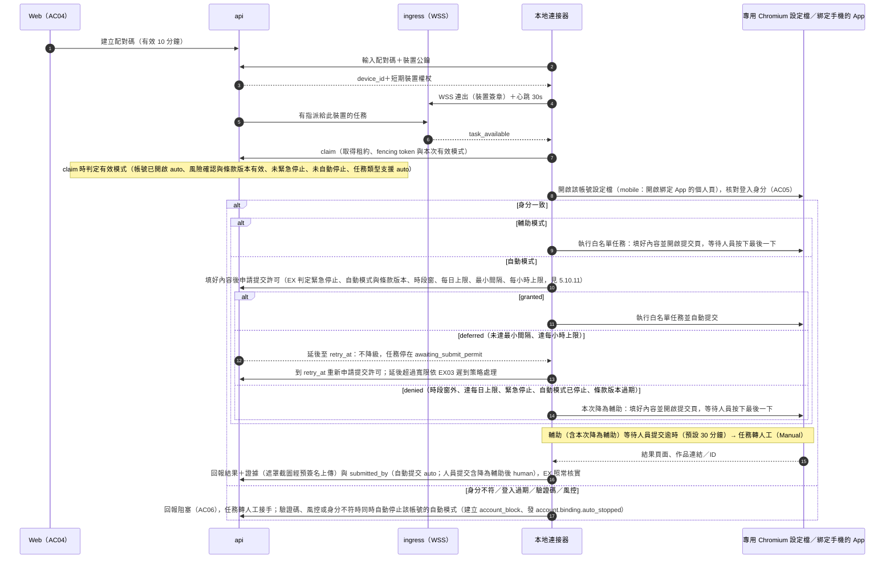

| 設計點 | 規則 |
|---|---|
| 連線方向 | 只連出；不開放任何入站埠；不暴露瀏覽器偵錯埠（構思 AC04）；手機控制用的 adb server 與 Appium 只綁定 127.0.0.1，不對區網開放 |
| 身分 | 裝置金鑰對（私鑰存 OS 鑰匙圈）；短期權杖由金鑰簽章換取；可在 Web 單獨撤銷（AC07） |
| 隔離 | 每個平台帳號一個 Chromium 持久化設定檔；Cookie 與登入狀態不離開本機、不送模型（構思 7.1）；`mobile` 通道每支手機每個 App 只綁定一個客戶自有帳號（見「手機控制」） |
| 任務白名單 | 只執行 `packages/connector-tasks` 定義、schema 驗證過的任務類型；不接受任意腳本或命令 |
| 執行模式 | 兩種一級模式（`connector_mode`）：**輔助**（`assist`，預設）：系統填好內容並開啟提交頁，最後一下由人員點擊，連接器擷取結果；**自動**（`auto`）：連接器在白名單任務內自動提交。每次任務的有效模式在 claim 時由後端判定，自動模式提交前另向 EX 申請提交許可（5.10.11），結果為許可（granted）、延後（deferred）或拒絕（denied），見「頻率與時段」；只會往輔助方向降級；輔助模式（含本次降為輔助）等待人員提交逾時（預設 30 分鐘，可設定）時任務轉人工（Manual）；實際提交方式記於 `execution_attempt` 與 `platform_post` 的 `submitted_by`（自動提交為 `auto`，人員提交含降為輔助後的提交為 `human`；`connector_mode` 不改寫） |
| 自動模式開啟 | P0b 隨連接器提供；只以平台帳號為單位，由工作區管理員開啟（設定歸 AC，`account_execution_binding.connector_mode`：`assist`｜`auto`，見 5.2），不設工作區層的允許／不允許開關；開啟時須完成風險確認：平台條款與封號風險由客戶承擔，確認人、時間、條款版本寫入 `core.audit_event`，條款版本更新後須重新確認（條款必含要點見下方「自動模式風險確認條款要點」，D15）；同一個開關同時涵蓋 `browser` 與 `mobile` 通道，不另設手機專用開關（D21）；Agent 不能經 MCP 開啟、放寬或略過 |
| 頻率與時段 | 每個帳號設定頻率上限與每日上限、允許時段窗（帳號時區）；目的：遵守平台限制、降低平台負載，不加入任何擬人化操作。提交許可判定（5.10.11；預檢見 5.9）：未達最小間隔或達每小時上限 → 延後（deferred），不降級，任務停在 `awaiting_submit_permit`，到 `retry_at` 再申請，延後超過寬限依 EX03 遲到策略；時段窗外、達每日上限、緊急停止（含 OP 全域停止）、自動模式已停止、條款版本過期（新條款發布到 `account.auto_terms_recheck` 完成之間）→ 拒絕（denied），本次降為輔助 |
| 緊急停止 | 三個來源：OP 全域（租戶內全部或指定工作區，見 5.19.11 (8)；OP 的範圍逐工作區落地為 AC `connector_auto_policy.halted`，來源另記）、工作區管理員自行啟動的工作區全域停止（同一旗標），以及帳號級（`auto_halted`）；皆為疊加在 `auto` 上的旗標，不改寫 `account_execution_binding.connector_mode` 與風險確認紀錄，所有停止來源解除後各帳號回到原設定；生效期間 EX 拒絕自動提交許可，未提交的任務本次降為輔助；已提交者照常核實 |
| 自動停止 | 連續失敗（含結果未知）達門檻（預設 3 次；只計 `submitted_by=auto` 的嘗試，降為輔助後由人員提交者既不累加也不歸零）、遇到驗證碼或風控、登入身分不符時：立即停止該帳號的自動模式（`account.binding.auto_stopped`）、建立阻塞 `account_block`（AC06）並通知，任務降回輔助／人工；不自動恢復，須由工作區管理員重新開啟（條款版本已更新時須重新確認）。條款版本更新（`auto_stop_reason=terms_outdated`）：AC `account.auto_terms_recheck` 把未重新確認新條款的帳號降回 `assist`，同樣發 `account.binding.auto_stopped`，但不建立阻塞，只通知工作區管理員重新確認條款；確認後重新開啟 |
| 結果核實 | 自動提交後仍走 EX 結果核實（EX06）；結果未知時禁止重發或換路徑 |
| 合規（硬性邊界） | 兩種模式、兩種通道皆適用（D4、D21）：不做瀏覽器或裝置指紋偽裝、不修改裝置識別碼、不以模擬器／雲手機冒充實體裝置、不 root／越獄來隱藏自動化、不規避平台偵測、不破解或代解驗證碼、不模擬人類行為以躲避風控、不做帳號農場（手機只操作已綁定的客戶自有帳號）；遇到驗證碼、風控或身分不符一律停止並轉人工 |
| 證據 | 結果 URL、平台作品 ID、遮罩截圖；上傳走預簽名 URL；`mobile` 通道另有 UI 階層與錄影（見「手機控制」） |
| 更新 | 簽章自動更新；啟動時回報版本，後端依相容表決定可派送的任務類型（OP09）；手機子程序（Appium、driver、platform-tools）版本隨連接器鎖定發布，心跳另回報配對手機的系統、驅動與目標 App 版本，不符相容表者不派送到該手機（5.19.11 (11)） |
| 離線 | 心跳逾時 90 秒標記離線；已領取任務的租約到期後進入「待核實」，不自動派給其他裝置（構思 AC07、8.2）；配對手機斷線（拔除 USB、離開同網段）時只標記該手機離線，已領取的手機任務同樣不自動改派 |

#### 手機控制（D21）

連接器經 USB 或同網段控制客戶自有的實體手機，自動操作平台 App 完成發布（含發布流程中必要的 App 內互動）。P1【需評估】：抖音、小紅書留言的讀取與回覆，只限綁定帳號自己作品下的留言、不含私訊，屬 D21「必要時互動」的延伸，帳號須已開啟自動模式並沿用本節規則與硬性邊界，評估通過前不開放（5.11.11 第 11 條、5.3.11 第 12 點、R21）；D21 是否涵蓋留言互動待使用者確認（10.3 Q23）。Android 自 P0b 隨連接器提供；iPhone 自 P1，只能由 macOS 上的連接器控制。手機不安裝 SmartSell App，只安裝自動化驅動所需元件（Android：UiAutomator2 server、io.appium.settings；iPhone：WDA 與照片輔助 App）。覆蓋 App：TikTok（在 App 內完成收件匣草稿與發布）、抖音、小紅書、Instagram／Facebook（官方 API 不足時的備援）。手機自動化的平台事實、條款摘要與來源見 6.9。

**任務流程**：claim（判定有效模式與通道）→ 檢查手機在線、前置設定與相容表 → 推送媒體並確認已入相簿 → 開啟 App 個人頁核對登入身分 → 填寫內容與發布設定 → 輔助：停在發布前，由人員在手機上核對後按發布；自動：向 EX 申請提交許可後按發布 → 擷取結果與證據 → 回報，EX 照常核實。

| 設計點 | Android（P0b） | iPhone（P1） |
|---|---|---|
| 主機與連線 | Windows／macOS 連接器；USB，或同網段的無線偵錯（手機需 Android 11 以上、與電腦在同一 Wi-Fi，以 QR code 或配對碼配對，同一台電腦配對一次）；Android 10 以下只用 USB（不使用 `adb tcpip` 舊式無線） | 只限 macOS 連接器（WDA 只能以 Xcode 在 Mac 上建置與簽章）；USB 或同網段（Xcode 網路配對，P1 驗證）；Windows 只有受限模式（須預裝 WDA、以管理員權限常駐 RemoteXPC tunnel），不提供 |
| 驅動與版本 | 內附固定版本 platform-tools（≥37.0.0；搭配 Android 17 可在信任網路自動重連，依賴 mDNS，企業或訪客網路可能阻擋，連接器提供 `adb mdns` 診斷），使用自有 adb server 埠，避免與客戶電腦上其他 adb／scrcpy 版本衝突；Appium 4＋UiAutomator2 9.x；手機最低 Android 8；經 ADB 安裝的驅動 APK 不受 Android 開發者驗證影響 | Appium 4＋XCUITest 13.x＋WDA；Xcode、iOS 與 driver 版本強耦合，只完整支援最新兩個主版本；iOS 18 以上經 RemoteXPC tunnel 通訊，最低 iOS 18（iOS 18 以下的 usbmux 備援依賴 Apple 預計移除的舊服務，不支援） |
| 手機前置設定（客戶在手機上操作，連接器逐項檢查並引導） | 開啟開發者選項（連點「版本號碼」7 次，各品牌路徑不同）與 USB 偵錯；首次連線時解鎖手機並同意 RSA 金鑰授權；部分機型（如小米）需另開「USB 偵錯（安全性設定）」並重開機才能注入輸入；Windows 可能需 OEM USB 驅動 | 首次連線按「信任這部電腦」；開啟 Developer Mode（iOS 16 起：設定 > 隱私權與安全性 > 開發者模式，重新開機後確認並輸入密碼；需先與 Mac 配對才會出現）；開啟「設定 > 開發者 > 啟用 UI 自動化」；在「設定 > 一般 > VPN 與裝置管理」信任開發者 |
| 簽章與帳號歸屬 | 不需 | 暫定（歸屬待確認，見 10.3 Q22、R19）：WDA 與照片輔助 App 以客戶自己的 Apple 開發者帳號（付費或免費 Personal Team）簽章；SmartSell 只提供建置與簽章精靈，不以 SmartSell 的團隊憑證替客戶手機簽章（授權協議要求註冊裝置由簽章方擁有或控制；每個團隊每產品系列每會員年度最多註冊 100 台，年中停用不釋出名額；Enterprise 計畫不得提供給客戶）；2021-06-06 之後建立的團隊，開發簽章 App 首次啟動須連到 ppq.apple.com 驗證 |
| 到期監控 | adb 授權可能逾時撤銷（第三方資料稱：Android 11 以上未停用「adb 授權逾時」時，7 天未重新連線即自動撤銷；未經官方查證）；失效時手機標記需重新授權，提示客戶到手機上同意 | 監控描述檔與憑證到期日：免費 Personal Team 描述檔 7 天過期（最多 3 台裝置、每台最多 3 個 App）；付費帳號開發憑證效期一年（描述檔到期日以檔案內的到期日為準）；到期前提醒重新簽章，到期或首次驗證失敗時不派送到該手機 |
| 手機識別 | adb 序號（`adb devices -l`）＋型號 | UDID |
| 配對與綁定（共同） | 客戶在 AC 選「新增手機」→ 連接器引導前置設定並偵測手機 → 客戶在手機上同意授權 → 連接器回報手機識別、型號、系統、驅動與目標 App 版本 → 工作區管理員在 AC 把「手機＋App」綁定到一個客戶自有社媒帳號（每支手機每個 App 一個帳號；同一 App 不在帳號間切換）→ 首次身分核對通過後生效；綁定、解綁、更換寫入審計，綁定記錄歸 AC（5.2） | 同左 |
| App 內身分核對 | 每次提交前讀取 App 個人頁的帳號名稱或 ID，與綁定記錄比對；不一致即中止、建立阻塞（`identity_mismatch`），並自動停止該帳號的自動模式。連接器不保存、不代填平台密碼，App 登入由客戶本人在手機上完成 | 同左 |
| 媒體推送 | 推送到 DCIM／Pictures 並寫入 MediaStore，再查詢媒體庫確認已入庫（Appium pushFile 的媒體掃描失敗只寫 log、不報錯）；未確認不進入發布步驟 | 沒有直接寫入「照片」的自動化 API：以同一簽章團隊簽署的照片輔助 App，用 PhotoKit add-only 權限寫入（免費帳號會占用每台 3 個 App 名額之一）；替代：客戶以 Finder 同步（開啟 iCloud 照片時無法同步） |
| 證據擷取 | 關鍵步驟以 `adb exec-out screencap -p` 截圖並保存 UI 階層；錄影每段 ≤180 秒、無音訊（screenrecord 上限） | WDA 截圖或 MJPEG 串流 |
| 證據（共同） | 每份證據帶時間戳、連接器裝置、手機 ID、綁定帳號與雜湊（`core.evidence.capture_context`、`content_hash`），並記錄發布後的作品 URL／ID；截圖可能拍到私訊、通知等個資，縮小擷取範圍並遮罩，保存期依 D10 | 同左 |
| 多手機並行 | 一支手機同時只有一個自動化 session；adb 指令一律以 `-s <序號>` 指定；埠位配置器為每支手機分配唯一的 `systemPort`（預設池 8200–8299）與 `mjpegServerPort` | 每支手機唯一的 `wdaLocalPort`（預設 8100）、`derivedDataPath` 與 `mjpegServerPort`（預設 9100） |
| 每台電腦可控制的手機數 | 官方沒有 adb 裝置數上限；依實測訂定並寫入相容表 | 依實測訂定；另受簽章所用 Apple 團隊（暫定為客戶自有，見 10.3 Q22）每年 100 台註冊上限約束 |
| 解綁與裝置安全 | 電腦端 adb RSA 私鑰即這台電腦的控制身分，以 OS 鑰匙圈加密保存；解綁時引導客戶在手機上「撤銷 USB 偵錯授權」或在無線偵錯頁「忘記」該電腦；不建議把公共或訪客網路設為信任網路 | 解綁時移除 WDA 與照片輔助 App，客戶可關閉 Developer Mode；Apple 明言 Developer Mode 會降低裝置安全性 |
| 與瀏覽器通道共用的控制 | 帳號級由工作區管理員開啟並做風險確認；頻率／每日上限與時段窗（目的：遵守平台限制、降低平台負載，不做擬人化操作）；提交許可（granted／deferred／denied，5.10.11）；OP 全域、工作區與帳號級緊急停止（生效時中止手機自動化並停在發布前，本次降為輔助，由人員在手機上按發布，逾時轉人工）；連續失敗、驗證碼、風控、App 內身分不符時自動停止並轉人工；提交後走 EX 結果核實；規則與上表相同 | 同左 |
| 官方 API 優先 | TikTok（Content Posting API）、Instagram（Content Publishing API，只限專業帳號）有官方發布管道，可用時 EX04 優先走 `api`；手機 App 自動操作只作客戶確認風險後的備援；隱私與可見範圍等發布設定由內容明確指定，系統不預設 | 同左 |

**手機的硬性邊界**（D4、D21；與上表「合規」相同並明列）：不做瀏覽器或裝置指紋偽裝、不修改裝置識別碼、不以模擬器／雲手機冒充實體裝置、不 root／越獄來隱藏自動化、不規避平台偵測、不破解或代解驗證碼、不模擬人類行為以躲避風控、不做帳號農場（手機只操作已綁定的客戶自有帳號）；遇驗證碼、風控、身分不符一律停止並轉人工。連接器與相容表不提供任何繞過上述邊界的設定。

#### 自動模式風險確認條款要點（D15）

法務依下列要點定稿；條款同時涵蓋電腦瀏覽器與手機 App 的自動操作。

| 要點 | 條款必須涵蓋的內容 |
|---|---|
| 平台條款與封號風險 | TikTok、Meta／Instagram、小紅書、抖音的條款都限制或禁止非官方自動化（摘要見 6.9）；即使只操作客戶自有帳號、不規避偵測，仍可能被限流、刪文、停權或永久關閉帳號；SmartSell 不保證平台不處置；有官方 API 時優先走官方 API |
| 責任歸屬 | 是否開啟由客戶自行決定，平台處置與損失由客戶承擔；SmartSell 的責任限於系統依客戶設定的上限、時段與停止規則運作並保存紀錄；發布內容、素材與授權的合法性由客戶負責 |
| 上限與自動停止機制 | 頻率／每日上限與時段窗（目的：遵守平台限制、降低平台負載）、提交許可的延後與拒絕、OP 全域／工作區／帳號級緊急停止、自動停止條件（連續失敗、驗證碼、風控、身分不符）與須由管理員重新開啟；說明這些機制只能降低、不能消除風險 |
| 只操作客戶自有帳號 | 只能綁定客戶自有帳號；每支手機每個 App 綁定一個帳號，提交前核對登入身分；不出借帳號、不做帳號農場；連接器不保存、不代填平台密碼，登入由客戶本人完成 |
| 硬性邊界 | 列出本節的硬性邊界全文；客戶不得要求或自行修改連接器以突破。違反時的處置限於下列手段：租戶 `owner`／`admin` 可啟動 OP 全域或工作區級緊急停止（5.19.11 (8)），停止期間不發出自動提交許可；SmartSell 不能代租戶觸發此停止。SaaS 下 SmartSell 可依服務條款暫停或終止該客戶的服務（合約層面的處置，不是系統內的自動模式停止機制）；私有部署下 SmartSell 無法存取客戶實例，手段限於授權與更新層面，例如終止授權、停止提供附自動模式的連接器版本 |
| 手機與裝置安全（手機通道） | 須在客戶自有實體手機上開啟 USB／無線偵錯（Android）或 Developer Mode 與 UI 自動化（iPhone），會降低裝置安全性；電腦端 adb 金鑰等同手機控制權；建議使用專供營運的手機；解綁與撤銷授權的方式 |
| Apple 開發者授權（iPhone） | 暫定（歸屬待確認，見 10.3 Q22、R19）：WDA 與輔助 App 以客戶自己的 Apple 開發者帳號簽章，定案後依實際歸屬改寫本要點；以開發描述檔長期在正式環境操作第三方 App，可能超出 Apple 授權協議的開發與測試範圍，導致憑證被撤銷或開發者帳號被終止，風險由客戶承擔；描述檔與憑證到期須重新簽章 |
| 審計與證據保存 | 確認人、時間、條款版本、開啟與停止紀錄寫入審計（預設保存 2 年）；每次提交保存截圖等證據（跟隨作品生命週期，D10）；證據可能含私訊、通知等個資，系統會遮罩並設保存期限；客戶可匯出 |
| 條款版本與重新確認 | 條款有版本，隨連接器版本發布；新條款發布到系統完成重新確認檢查（AC `account.auto_terms_recheck`）之前，自動提交許可一律拒絕、本次降為輔助；檢查完成後，未重新確認的帳號自動模式關閉、降回輔助（不建立阻塞），須由工作區管理員確認新條款後重新開啟 |
| 停用與退出 | 管理員可隨時關閉自動模式或啟動緊急停止；已送出的提交不撤回，照常走結果核實 |

### 4.17 可觀測性、安全與合規

| 面向 | 設計 |
|---|---|
| 追蹤 | `trace_id` 由入口產生，貫穿 job payload、適配器呼叫、連接器任務與審計 |
| 指標 | 每個佇列的延遲與失敗率、每個平台的錯誤分類分佈、排程準時率、核實延遲、同步新鮮度 |
| P0 服務目標（建議） | API 路徑排程發布：到期後 60 秒內開始執行；結果核實：95% 在 10 分鐘內得出確定狀態；同步新鮮度依 DS03 設定 |
| 應用安全 | 目標 OWASP ASVS L2；CSP；SSRF 防護（RSS、連結預覽、Webhook 外送只允許公網位址並封鎖內網網段）；上傳檔案型別白名單與掃描 |
| 個資 | Email、電話、地址欄位加密或遮罩；角色化欄位可見性（IN07、LP05）；P1 支援資料主體匯出與刪除請求；中國平台（抖音、小紅書）資料只保存營運必要欄位（D1）；Amazon SP-API 只申請非受限角色，不取得、不保存買家個資，歸因與佣金只用訂單號與金額，誤存者依規定期限刪除（D19，6.11）；連接器截圖與錄影證據縮小擷取範圍並遮罩私訊、通知等個資（4.16，D21） |
| 保留期預設 | 平台原始回應 90 天、MCP 工具呼叫日誌 180 天、操作審計 2 年、執行證據截圖跟隨作品生命週期；皆可由工作區調整（D10，OP05） |
| 資料外送 | `ops.egress_policy`：每個工作區設定資料類別（內容、客戶個資、訂單、素材）可送往哪些目的地（模型、資料商、Webhook）；呼叫前檢查，阻擋回 `EGRESS_BLOCKED` |
| 秘密 | 只在 worker 執行期解密；日誌與工具輸出自動遮罩（OP03） |


---

## 5. 模組設計（19 個模組）

### 5.0 模組章節結構與共用詞彙

每個模組章節使用相同結構：

| 節 | 內容 |
|---|---|
| x.1 職責與邊界 | 擁有什麼、不擁有什麼（引用哪個模組）、上下游 |
| x.2 領域模型 | 主要實體與關係（mermaid erDiagram 或表） |
| x.3 狀態機 | 關鍵聚合的狀態與轉換條件 |
| x.4 資料表 | P0 表以 DDL 呈現（縮寫見 4.4 開頭：`@std`、`@ws`、`@actor`、`@ver`）；P1／P2 表只列表名、用途與關鍵欄位 |
| x.5 權限 | 本模組權限字串與預設角色 |
| x.6 Web API | 端點、權限、階段 |
| x.7 MCP 工具 | 工具名、讀／寫／對外、輸入要點、階段 |
| x.8 事件 | 發出與訂閱 |
| x.9 背景任務 | 任務、觸發、佇列、冪等鍵 |
| x.10 前台頁面 | 路由、頁面、關鍵元件、階段 |
| x.11 關鍵規則與演算法 | 只寫本模組特有的規則 |
| x.12 功能分期與驗收 | 每個功能編號的 P0／P1／P2 落地點與驗收要點 |

**共用實體詞彙**（各模組必須使用同一名稱）

| 中文 | 實體／表名 | 擁有模組（schema） |
|---|---|---|
| 租戶 | `tenant` | core |
| 工作區、品牌、市場 | `workspace`、`brand`、`market` | WS（`workspace`） |
| 工作項目、通知、保存檢視、搜尋文件 | `work_item`、`notification`、`saved_view`、`search_document` | WS（`workspace`） |
| 外部連接、社媒帳號、能力、裝置、手機、手機 App 帳號綁定、瀏覽器工作階段 | `connection`、`social_account`、`capability`、`device`、`mobile_device`、`mobile_app_binding`、`browser_session` | AC（`account`） |
| 資料源、同步執行、匯入批次、原始紀錄 | `data_source`、`sync_run`、`import_batch`、`raw_record` | DS（`ingest`） |
| 店鋪、商品、變體、市場商品快照、商品事實、促銷、訂單、退款 | `store`、`product`、`product_variant`、`listing_snapshot`、`product_fact`、`promotion`、`order`、`refund` | PC（`commerce`） |
| 活動、目標、簡報、預算、費用 | `campaign`、`campaign_goal`、`brief`、`budget_line`、`cost_entry` | CA（`campaign`） |
| 監測對象、觀測快照、研究板、候選商品 | `watch_target`、`observation`、`research_board`、`product_candidate` | LI（`intel`） |
| 選題、內容項目（母稿）、內容變體（平台／語言版本）、內容修訂 | `idea`、`content_item`、`content_variant`、`content_revision` | CO（`content`） |
| 素材、衍生檔、使用授權、品牌知識、範本 | `asset`、`asset_rendition`、`rights_grant`、`knowledge_entry`、`template` | AS（`asset`） |
| 發布計畫、發布目標、發布佇列 | `publish_plan`、`publish_target`、`evergreen_queue` | PL（`planning`） |
| 執行任務、執行嘗試、平台作品 | `execution_task`、`execution_attempt`、`platform_post` | EX（`execution`） |
| 對話、訊息、案件 | `conversation`、`message`、`case` | IN（`inbox`） |
| 創作者、合作、交付物、寄樣單、佣金分錄 | `creator`、`collaboration`、`deliverable`、`sample_shipment`、`commission_entry` | CR（`creator`） |
| 短鏈、導流頁、表單、線索、觸點事件 | `short_link`、`landing_page`、`form`、`lead`、`touchpoint_event` | LP（`traffic`） |
| 廣告帳戶、廣告提案、廣告創意 | `ad_account`、`ad_proposal`、`ad_creative` | AD（`ads`） |
| 客戶、渠道身份、同意紀錄、分群 | `customer`、`customer_identity`、`consent_record`、`segment` | EM（`lifecycle`） |
| 指標定義、指標觀測、歸因紀錄、報告、實驗 | `metric_definition`、`metric_observation`、`attribution_record`、`report`、`experiment` | AN（`analytics`） |
| Agent 工作、自動化規則 | `agent_job`、`automation_rule` | AI（`agent`） |
| 留言串、留言、分享 | `comment_thread`、`comment`、`share` | TE（`team`） |
| 部署設定、外送政策、授權額度 | `deployment_setting`、`egress_policy`、`license_entitlement` | OP（`ops`） |
| 審批政策、審批請求、長任務、檔案、證據、秘密 | `approval_policy`、`approval_request`、`operation`、`file_object`、`evidence`、`secret` | core |


### 5.1 工作區與營運工作台（WS）｜模組鍵 `workspace`

#### 5.1.1 職責與邊界

| 類別 | 內容 |
|---|---|
| 擁有 | `workspace`、`brand`、`market`；通用工作項目 `work_item`（待辦、製作任務、里程碑、修復任務）及其依賴；`notification` 與投遞紀錄、通知偏好、關注 `subscription`；`saved_view`；全域搜尋索引 `search_document`；首次設定進度 `onboarding_progress`；儀表板卡片設定 `dashboard_layout` |
| 不擁有（引用） | 成員、角色、權杖（`iam`，工作區層由 TE 管理、租戶層由 OP 管理）；指標與口徑（AN）；社媒帳號與連接（AC）；店鋪與商品（PC）；留言與分享（TE）；審批請求（core） |
| 上游 | core／iam（租戶、授權）、TE（成員範圍） |
| 下游 | 幾乎所有模組：以 `brand_id`／`market_id` 歸屬資料；CO02、CA02、TE02 以 `work_item` 為底層；各模組透過「待處理項目提供者」介面餵給 WS02 |

設計要點：WS 不保存其他模組的業務狀態。今日總覽（WS02）與儀表板（WS05）是**讀取側聚合**，資料仍由擁有模組回答；WS 只負責排序、去重、權限再套用與呈現契約。

#### 5.1.2 領域模型

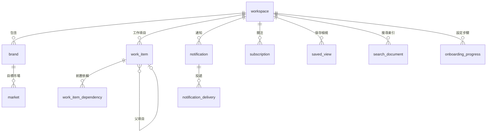

| 實體 | 說明 |
|---|---|
| `work_item` | 通用工作單位。`type` 區分 `todo`、`production_task`（CO02 看板卡）、`milestone`（CA02）、`review_task`、`fix_task`（由預檢、同步失敗、授權過期產生）、`followup`。以 `resource_type/resource_id` 關聯業務物件；以 `dedupe_key` 讓事件產生的待辦不重複 |
| `notification` | 「發生了某事」的投遞物；與 `work_item`「需要某人處理」分開。關閉通知不完成工作（構思 WS04） |
| `subscription` | 使用者對某資源的關注；指派、提及、建立時自動關注 |
| `search_document` | 各模組透過事件寫入的可搜尋摘要；只做候選召回，結果輸出前回到擁有模組重新判斷可讀性 |

#### 5.1.3 狀態機

**工作項目**

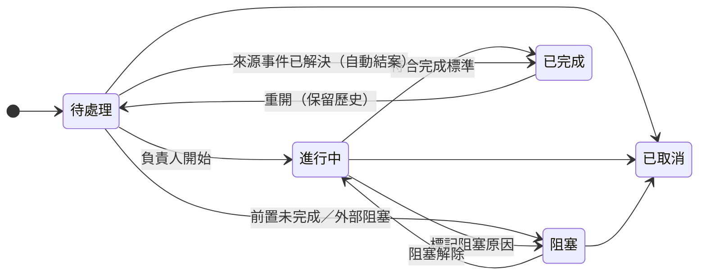

規則：`production_task` 進入 Done 只代表「內容已準備好可排期」，不代表已發布（構思 CO02、CA02）；由事件產生的待辦（例如審批請求、授權過期）在來源事件解決時自動轉 Done，並記錄 `completed_by_type = system`。

**通知**：投遞狀態（`pending → delivered | failed | suppressed`，逐渠道）與閱讀狀態（`read_at`、`archived_at`）是兩條獨立軸，均不影響對應 `work_item`。

**首次設定步驟**：`not_started → in_progress → done`，任一時刻可轉 `blocked`（附檢查結果）或 `skipped`（需填理由，影響範圍顯示在總覽）。

#### 5.1.4 資料表

**P0 DDL**

```sql
create table workspace.workspace (
  @std, @actor, @ver,
  slug text not null, name text not null,
  kind text not null,                       -- brand_team|agency_client|internal
  default_timezone text not null,
  default_ui_locale text not null default 'zh-Hant' check (default_ui_locale in ('zh-Hant','en')), -- 介面語言（D5、D13）；成員未設定個人介面語言時採用；不決定內容語言（見 5.1.11 第 7 點）；簡體中文、日文不排期，有客戶要求再加，屆時依 5.1.11 第 7 點擴充 check（含 OP `ops.auto_terms.locale`）
  reporting_currency char(3) not null,
  status text not null,                     -- active|archived|suspended
  settings jsonb not null default '{}',     -- 工作日、營業時間預設、編號規則等
  unique (tenant_id, slug)
);

create table workspace.brand (
  @std, @ws, @actor, @ver,
  name text not null, slug text not null,
  logo_file_id uuid references core.file_object(id),
  default_market_id uuid,
  status text not null,                     -- active|archived
  unique (workspace_id, slug)
);

create table workspace.market (
  @std, @ws, @actor, @ver,
  brand_id uuid not null references workspace.brand(id),
  name text not null,                       -- 例：「日本－日文」
  country_code char(2) not null,
  primary_language text not null,           -- BCP 47；內容語言，不受介面語言選項限制（例：ja-JP）
  languages text[] not null,                -- 含主要語言在內的全部服務（內容）語言
  currency char(3) not null,
  timezone text not null,
  sales_channels text[] not null default '{}', -- online_store|tiktok_shop|marketplace|…（PC03 篩選維度）
  status text not null,                     -- active|paused|archived
  unique (brand_id, country_code, primary_language)
);

create table workspace.work_item (
  @std, @ws, @actor, @ver,
  type text not null,                       -- todo|production_task|milestone|review_task|fix_task|followup
  title text not null, description jsonb,
  status text not null,                     -- open|in_progress|blocked|done|cancelled
  priority text not null default 'normal',  -- urgent|high|normal|low
  assignee_type text,                       -- user|agent_client|team_queue
  assignee_id uuid,
  due_at timestamptz,                       -- 工作期限；發布時間屬 PL，不放這裡
  board_key text, stage_key text,           -- 看板與欄位（CO02 製作看板、CA02 里程碑）
  sort_rank text,                           -- 字典序排序鍵（拖放）
  brand_id uuid references workspace.brand(id),
  campaign_id uuid,                         -- 引用 campaign.campaign
  resource_type text, resource_id uuid,     -- 關聯業務物件
  parent_id uuid references workspace.work_item(id),
  blocked_reason text,
  completion_criteria jsonb,                -- 檢查清單或完成條件
  source_type text not null,                -- manual|event|agent|automation|template
  source_ref jsonb,                         -- {event_id, rule_id, agent_job_id}
  dedupe_key text,                          -- 事件產生待辦的去重鍵
  completed_at timestamptz, completed_by_type text, completed_by_id uuid,
  unique (workspace_id, dedupe_key)
);
create index on workspace.work_item (workspace_id, assignee_id, status, due_at);
create index on workspace.work_item (workspace_id, resource_type, resource_id);

create table workspace.work_item_dependency (
  tenant_id uuid not null,
  work_item_id uuid not null references workspace.work_item(id),
  depends_on_id uuid not null references workspace.work_item(id),
  kind text not null default 'finish_to_start',
  primary key (work_item_id, depends_on_id),
  check (work_item_id <> depends_on_id)
);

create table workspace.work_item_event (    -- 指派、狀態、期限變更歷史（TE02 交接依據）
  @std, @ws, @actor,
  work_item_id uuid not null references workspace.work_item(id),
  kind text not null,                       -- assigned|status_changed|due_changed|handed_over|commented
  from_value jsonb, to_value jsonb, note text
);

create table workspace.notification (
  @std, workspace_id uuid,
  recipient_user_id uuid not null references iam.user(id),
  type text not null,                       -- approval_requested|mentioned|assigned|publish_failed|outcome_unknown|auth_expired|device_offline|sync_failed|auto_stopped|mode_downgraded|…（後兩者 P0b）
  title text not null, summary text,        -- 摘要在產生時已依收件人權限裁切
  resource_type text, resource_id uuid,
  work_item_id uuid references workspace.work_item(id),
  source_event_id uuid,
  dedupe_key text,
  read_at timestamptz, archived_at timestamptz,
  unique (recipient_user_id, dedupe_key)
);
create index on workspace.notification (recipient_user_id, read_at, created_at desc);

create table workspace.notification_delivery (
  @std,
  notification_id uuid not null references workspace.notification(id),
  channel text not null,                    -- in_app|email|chat_webhook；不做手機 App 推播（D20）
  status text not null,                     -- pending|delivered|failed|suppressed
  attempts integer not null default 0,
  last_error text, delivered_at timestamptz,
  unique (notification_id, channel)
);

create table workspace.notification_preference (
  @std,
  user_id uuid not null, workspace_id uuid, -- null = 全域預設
  type_pattern text not null,               -- 例：'publish_*'
  channels text[] not null,                 -- P0 只有 in_app
  quiet_hours jsonb,
  unique (user_id, workspace_id, type_pattern)
);

create table workspace.subscription (       -- 關注
  @std, @ws,
  user_id uuid not null,
  resource_type text not null, resource_id uuid not null,
  reason text not null,                     -- manual|assigned|mentioned|created|approver
  muted boolean not null default false,
  unique (user_id, resource_type, resource_id)
);

create table workspace.search_document (
  tenant_id uuid not null, @ws,
  resource_type text not null, resource_id uuid not null,
  brand_id uuid, campaign_id uuid, social_account_id uuid,  -- 權限預過濾維度
  title text not null, subtitle text, excerpt text,
  status text, owner_id uuid,
  tsv tsvector not null,                    -- simple 設定；中日韓以 bigram 切分後寫入
  trgm_text text not null,                  -- pg_trgm 用（標題＋識別碼）
  source_version integer not null,          -- 只接受較新版本覆寫
  updated_at timestamptz not null,
  primary key (resource_type, resource_id)
);
create index on workspace.search_document using gin (tsv);
create index on workspace.search_document using gin (trgm_text gin_trgm_ops);

create table workspace.onboarding_progress (
  @std, @ws,
  flow_key text not null,                   -- 例：'initial_setup_v1'
  step_key text not null,                   -- brand|market|social_account|connector_pairing|product_source|history_sync|test_draft|invite_team
                                            -- connector_pairing：連接器＋手機配對（P0b；手機 Android P0b、iPhone P1，D21），見 5.1.11 (6)
  status text not null,                     -- not_started|in_progress|blocked|done|skipped
  check_result jsonb,                       -- 最近一次自動檢查結果與影響範圍
  checked_at timestamptz,
  updated_by_id uuid, skip_reason text,
  unique (workspace_id, flow_key, step_key)
);
```

**P1／P2 表**

| 表 | 階段 | 用途與關鍵欄位 |
|---|---|---|
| `saved_view` | P1 | 保存的查詢物件：`page_key`、`owner_user_id`、`visibility`（private／team）、`query jsonb`（4.12 共用篩選）、`columns`、`sort`、`is_default`；只存條件，不存結果 |
| `dashboard_layout` | P1 | 個人／團隊首頁卡片：`owner`、`scope`（品牌、活動）、`cards jsonb`（卡片類型、AN 查詢參數、比較期間） |
| `work_item_template` | P1 | 里程碑與製作流程範本（CA02、CO02）：`steps jsonb`（相對天數、依賴、負責角色） |
| `semantic_index` | P2 | pgvector 語義搜尋：`resource_ref`、`embedding`、`model`、`content_hash`；向量只由客戶在 AI07 配置、支援嵌入的端點產生（`embed` 用途路由），系統不內建嵌入模型（D9）；需通過 egress 政策；未配置時停用語義搜尋，退回全文＋trgm |

#### 5.1.5 權限

| 權限字串 | 說明 | 預設角色 |
|---|---|---|
| `workspace.workspace.read`／`.admin` | 讀取／修改工作區設定 | 全體／`owner`、`admin` |
| `workspace.brand.read`／`.admin` | 品牌與市場維護 | 全體／`admin`、`brand_lead` |
| `workspace.work_item.read`／`.draft`／`.plan` | 讀、建立自己的待辦、指派他人與改期限 | 全體／全體內部／`brand_lead`、`social_ops`、`creator_manager` |
| `workspace.view.plan` | 建立團隊共享檢視（P1） | `brand_lead`、`social_ops`、`analyst` |
| `workspace.dashboard.read` | 總覽與儀表板 | 全體內部 |
| `workspace.onboarding.admin` | 執行首次設定 | `owner`、`admin`、`brand_lead` |

#### 5.1.6 Web API

| 方法 | 路徑（前綴 `/api/v1/workspaces/{ws}`，工作區建立除外） | 說明 | 權限 | 階段 |
|---|---|---|---|---|
| GET／POST | `/api/v1/workspaces` | 列出可存取工作區／建立工作區（租戶層） | 租戶 `admin` | P0 |
| GET／PATCH | `/`（工作區本身） | 讀取／修改設定 | `workspace.workspace.*` | P0 |
| GET／POST／PATCH | `/brands`、`/brands/{id}` | 品牌 CRUD；`POST /brands/{id}/archive` 先回傳引用影響；P1 起（OP10 啟用後）新增品牌超出 `brands` 額度時回 `402 LICENSE_LIMIT`；封存品牌釋放額度 | `workspace.brand.*` | P0 |
| GET／POST／PATCH | `/brands/{id}/markets`、`/markets/{id}` | 市場 CRUD | `workspace.brand.admin` | P0 |
| GET | `/overview/today` | 今日總覽聚合（見 5.1.11） | `workspace.dashboard.read` | P0 |
| GET | `/overview/summary?brand_id&campaign_id&from&to` | 營運概覽（WS05，委派 AN 查詢） | `workspace.dashboard.read` | P0 |
| GET／POST／PATCH | `/work-items`、`/work-items/{id}` | 工作項目；`POST /work-items/batch`（dry_run） | `workspace.work_item.*` | P0 |
| POST | `/work-items/{id}/complete`、`/reopen`、`/handover` | 狀態轉換；交接寫 `work_item_event` | 同上 | P0 |
| GET | `/me/inbox` | 個人待辦＋審批請求＋提及的合併清單（WS04） | 內部成員 | P0 |
| GET／POST | `/notifications`、`/notifications/read`、`/notifications/archive` | 通知列表與批次已讀 | 本人 | P0 |
| PUT | `/me/notification-preferences` | 偏好 | 本人 | P0（站內）／P1（郵件） |
| POST／DELETE | `/subscriptions` | 關注／取消關注 | 讀權限 | P0 |
| GET | `/search?q&types&brand_id…` | 全域搜尋 | 各資源讀權限 | P0 |
| GET／POST／PATCH | `/saved-views` | 保存檢視 | `workspace.view.plan`（共享） | P1 |
| GET／POST | `/onboarding/{flow}`、`/onboarding/{flow}/steps/{step}/check`、`/skip` | 首次設定與重新檢查 | `workspace.onboarding.admin` | P0 |
| GET／PUT | `/dashboards/{id}` | 自訂儀表板 | `workspace.dashboard.read` | P1 |

#### 5.1.7 MCP 工具

| 工具 | 類型 | 輸入要點 | 階段 |
|---|---|---|---|
| `workspace_get_context` | 讀 | `workspace_id`、可選 `brand_id`／`task_scope`；回傳品牌、市場、時區、幣別、可用帳號摘要、使用者角色；依角色裁切（構思 7.2） | P0 |
| `workspace_get_today` | 讀 | 今日總覽同一聚合結果，含各提供者可用狀態 | P0 |
| `tasks_list` | 讀 | 篩選：負責人、類型、狀態、到期、關聯資源 | P0 |
| `tasks_create`／`tasks_update` | 寫 | `expected_version`；Agent 建立的項目 `source_type=agent` 並帶 `agent_job_id` | P0 |
| `search_query` | 讀 | `q`、`types`；結果已重套權限 | P0 |

#### 5.1.8 事件

| 方向 | 事件 |
|---|---|
| 發出 | `workspace.workspace.created`、`workspace.brand.created`／`updated`／`archived`、`workspace.market.created`／`updated`、`workspace.work_item.created`／`assigned`／`status_changed`／`completed`／`overdue`、`workspace.notification.created`、`workspace.onboarding.step_completed` |
| 訂閱（產生待辦／通知） | `core.approval_request.created`／`approved`／`rejected`／`invalidated`、`team.comment.mentioned`、`planning.precheck.completed`、`execution.attempt.outcome_unknown`、`execution.task.manual_required`、`account.connection.expired`、`account.device.offline`、`ingest.sync_run.failed`、`inbox.conversation.assigned`（P0）；P0b 起加入 `account.mobile_device.offline`（通知該手機所屬連接器的管理員與受影響帳號負責人；對應 `online` 時自動結案）、`account.mobile_app_binding.identity_mismatch`（通知工作區管理員與帳號負責人：App 內登入身分與綁定帳號不符，該手機該 App 停止提交並轉人工；對應 `verified` 時自動結案）（D21：Android P0b、iPhone P1）、`account.binding.auto_stopped`（依 payload `reason` 分流：`reason=terms_outdated`（`block_id` 為空，D15）時，通知工作區管理員「自動模式風險條款已更新為新版本，請確認新條款後重新開啟」，並建立指派工作區管理員的 `work_item`，`dedupe_key=terms:<binding_id>:<terms_version>`（`terms_version` 為降級當時的現行條款版本，向 AC 讀取），收到同一綁定的 `account.binding.auto_enabled` 後自動結案；其他原因通知工作區管理員：該帳號自動模式已因連續失敗、驗證碼或風控、身分不符停止並降回輔助／人工，不會自動恢復，處理阻塞後須由管理員重新開啟）、`execution.attempt.mode_downgraded`（通知負責人在等待時限內按發布；逾時（預設 30 分鐘）轉人工時另由 `execution.task.manual_required` 建立待辦）；P1 起加入 `commerce.listing.changed`、`creator.deliverable.overdue`、`campaign.milestone.delayed` |
| 訂閱（搜尋索引） | 各模組可搜尋資源的 `*.created`／`*.updated`／`*.archived`（campaign、content_item、asset、product、conversation、customer、creator） |

#### 5.1.9 背景任務

| 任務 | 觸發 | 佇列 | 冪等鍵 |
|---|---|---|---|
| `workspace.upsert_search_document` | 資源事件 | `default` | `search:<resource_type>:<resource_id>:<version>` |
| `workspace.fanout_notification` | 事件訂閱 | `default` | `ntf:<event_id>:<recipient>` |
| `workspace.deliver_notification` | 通知建立 | `notify` | `ntfd:<notification_id>:<channel>` |
| `workspace.due_scan` | 每 5 分鐘 | `default` | `due:<work_item_id>:<due_at>` |
| `workspace.resolve_event_todos` | 來源解決事件 | `default` | `resolve:<dedupe_key>` |
| `workspace.onboarding_recheck` | 連接或同步事件、裝置事件（`account.device.paired`／`online`／`offline`／`revoked`）、手機事件（`account.mobile_device.registered`／`online`／`offline`／`updated`／`removed`）、手機 App 綁定事件（`account.mobile_app_binding.created`／`verified`／`identity_mismatch`／`login_required`／`removed`）（P0b；D21）、手動 | `default` | `onb:<workspace_id>:<step>` |
| `workspace.search_reindex` | 管理員觸發（`core.operation`） | `export` | `reindex:<workspace_id>` |

#### 5.1.10 前台頁面

| 路由 | 頁面 | 關鍵元件 | 階段 |
|---|---|---|---|
| `/w/:ws/home` | 今日總覽：待審、漏發、結果待核實、待回覆、連接異常、自動模式自動停止（含條款過期待重新確認）與緊急停止（P0b）、同步失敗、我的到期項目 | `EntityTable`、`StatusTimeline`、提供者降級提示 | P0 |
| `/w/:ws/home/summary` | 營運概覽：產出、準時率、互動、導流（WS05） | `MetricValue`（覆蓋率、口徑）、時間與比較期間 | P0 固定卡／P1 自訂 |
| `/w/:ws/me` | 個人待辦、提及、審核請求、關注 | 合併清單、快速處理抽屜 | P0 |
| 全域頂欄 | 工作區／品牌切換、全域搜尋、通知鈴 | 搜尋結果按類型分組 | P0 |
| `/w/:ws/settings/brands` | 品牌與市場 | 引用影響預覽 | P0 |
| `/w/:ws/setup` | 首次設定導引（含連接器＋手機配對步驟，P0b；iPhone P1） | 步驟卡、檢查結果、交給其他成員續做 | P0 |

**桌面版版面（D20）**：Web 工作台（含 `/admin/*`）與客戶門戶（TE）只做桌面版，不做手機 App 與手機版版面；首頁、總覽、通知、設定導引等全部頁面同此規格。不適用於 `public` 角色對消費者提供的公開頁面（LP 導流頁仍依 5.13 適配手機瀏覽）。

| 項目 | 規格 |
|---|---|
| 最低支援寬度 | 1280px（CSS 像素）；低於此寬度時不重排為手機版，維持桌面版面（可水平捲動）並提示改用電腦瀏覽器 |
| 支援的桌面瀏覽器 | Windows／macOS 上的 Chrome、Edge、Firefox 最新兩個主版本；macOS 上的 Safari 最新兩個主版本 |
| 不支援 | 手機與平板瀏覽器（可開啟但不保證版面與功能）；不做 PWA、手機 App 與手機推播 |

#### 5.1.11 關鍵規則與演算法

**(1) 今日總覽聚合契約（WS02）**

各模組在 Facade 註冊一個提供者：

```ts
interface PendingItemProvider {
  key: string;                                   // 'planning.approvals' | 'execution.unknown_outcomes' | …
  kinds: PendingKind[];
  list(ctx: {
    principal: Principal; workspaceId: string; brandIds?: string[];
    now: Date; limit: number;
  }): Promise<{ items: PendingItem[]; total: number; as_of: string }>;
}

type PendingItem = {
  provider: string; kind: PendingKind;
  severity: 'blocker' | 'high' | 'normal' | 'info';
  title: string; resource: ResourceRef;
  owner?: PrincipalRef; due_at?: string;
  impact?: { targets?: number; accounts?: number; campaign_id?: string };
  source_updated_at: string;                     // 來源物件更新時間（構思 WS02）
  action: { label: string; route: string };      // 點擊進入處理頁
};
```

| 提供者 | 階段 | 項目 |
|---|---|---|
| `planning.approvals`、`planning.missed` | P0 | 待我審批、錯過時段 |
| `execution.attention` | P0 | 失敗、結果待核實、需人工接手 |
| `account.health` | P0 | 授權過期、裝置離線、身分不符（含連接器配對手機離線與 App 內登入身分不符，依 `account.mobile_device.offline`／`online` 與 `account.mobile_app_binding.identity_mismatch`／`verified` 更新，D21：Android P0b、iPhone P1）；自動模式被自動停止的帳號（`account_block` kind=`auto_failure_streak`／`captcha`／`platform_restriction`／`identity_mismatch`，P0b；對應阻塞解決前持續顯示；不會自動恢復，阻塞解決後仍須管理員重新開啟）；條款過期待重新確認的帳號（`auto_stop_reason=terms_outdated`，無 `account_block`，P0b，D15；顯示「自動模式風險條款已更新，請確認新條款後重新開啟」，管理員重新開啟前持續顯示）；帳號級或工作區緊急停止生效中（`auto_halted`、`connector_auto_policy.halted`，P0b；疊加旗標，不改寫帳號 `connector_mode`，解除後回到原設定）（D4） |
| `ingest.health` | P0 | 同步失敗、資料延遲超標 |
| `inbox.queue` | P0 | 未分派、待我回覆 |
| `workspace.work_items` | P0 | 我的到期與逾期工作、缺素材 |
| `ops.connector_auto` | P0b | 租戶層全域或本工作區的自動模式緊急停止生效中（OP `job_pause_rule(scope='connector_auto')`）；OP 停止會落地為 AC `connector_auto_policy.halted`，WS 以工作區去重，與 `account.health` 的工作區緊急停止合併為一項並標示來源（OP 或本工作區）；同樣不改寫帳號 `connector_mode`，解除後各帳號回到原設定 |
| `commerce.risks`、`campaign.risks`、`creator.due` | P1 | 低庫存影響排程、里程碑延誤、交付到期 |

排序：`severity` → 到期接近度 → 影響數量 → 更新時間。每個提供者設 800 ms 逾時，逾時或錯誤以「此類資料暫不可用」呈現，**不得顯示成沒有待辦**（原則 4）。提供者在自身權限下執行，WS 只再過濾品牌範圍。

**(2) 事件待辦的生命週期**：事件訂閱者以 `dedupe_key`（如 `approval:<request_id>:<user_id>`）建立 `work_item`；來源解決事件（審批完成、授權恢復、核實成功、條款過期帳號經重新確認後重新開啟自動模式 `account.binding.auto_enabled`）觸發 `resolve_event_todos` 自動結案。重複事件只更新 `source_updated_at`。

**(3) 搜尋**：寫入時將標題與摘要中連續的中日韓字元切成重疊二字組（bigram），拉丁字詞轉小寫，合併寫入 `tsvector('simple')`；查詢使用相同切分組成 AND 查詢。單字查詢或識別碼片段改用 `pg_trgm` 相似度。召回時先以 `workspace_id` 與品牌範圍預過濾，取 3 倍候選，再呼叫各擁有模組 `canReadBatch()` 後過濾，不足時續取（構思 WS03：結果必須再次套用存取權限）。

**(4) 儀表板查詢契約（WS05）**：卡片只保存 `{metric_keys, dimensions, filters, period, compare_period}`，查詢委派 AN 的 `metrics.query`；回傳值帶 `availability`、`coverage`、`as_of`、`definition_version`。「執行效率」（準時率、核實延遲，來自 PL／EX）與「內容成效」（來自 AN）分卡呈現。

**(5) 品牌與市場封存**：封存前查詢各模組的引用（排程中目標、進行中活動、連接）；有未結束的排程時阻擋並列出，沒有則封存並保留歷史可讀。P0 不支援跨工作區搬移品牌。

**(6) 首次設定可恢復（WS06）**：每一步的完成以「檢查函式」判定（例如 `social_account` 步驟要求至少一個能力為 `available` 的帳號；`history_sync` 要求首次回補完成或明確略過），不是以按鈕點擊判定；進度存在工作區上，任何具 `workspace.onboarding.admin` 的成員可接續。

**連接器＋手機配對步驟 `connector_pairing`（P0b；D20、D21）**：工作區沒有帳號需要連接器執行時可略過（填理由）。配對與綁定操作在 AC 頁面完成（需 `account.device.admin`），WS 只讀 AC 狀態判定。

| 檢查項 | 通過條件 | 階段 |
|---|---|---|
| 連接器 | 至少一台 Windows／macOS 電腦上的本地連接器已配對且 `online`，版本未被相容表阻擋（OP09） | P0b |
| Android 手機 | 有帳號選擇以手機 App 發布時：至少一支客戶自有的實體 Android 手機經 USB 或同網段由連接器配對並在線；每支手機每個 App 綁定一個客戶自有帳號；App 內登入身分與綁定帳號核對一致；系統、自動化驅動、目標 App 版本符合相容表 | P0b |
| iPhone | 同上；只能由 macOS 上的連接器配對，需 Apple 開發者帳號與裝置簽章 | P1 |

本步驟只完成配對與綁定，**不開啟自動模式**；自動模式（含手機 App 自動操作）仍由工作區管理員在 AC 逐帳號開啟並完成風險確認，頻率與每日上限的目的為遵守平台限制、降低平台負載。硬性邊界（D4、D21）：不做瀏覽器或裝置指紋偽裝、不修改裝置識別碼、不以模擬器／雲手機冒充實體裝置、不 root／越獄來隱藏自動化、不規避平台偵測、不破解或代解驗證碼、不模擬人類行為以躲避風控、不做帳號農場（手機只操作已綁定的客戶自有帳號）；遇驗證碼、風控、身分不符一律停止並轉人工。

**(7) 介面語言與內容語言分離**

| 項目 | 介面語言 | 內容語言（市場） |
|---|---|---|
| 決定什麼 | 選單、按鈕、系統訊息、通知與郵件模板、日期與數字格式 | 貼文、商品文案、翻譯、回覆、報告內文等業務內容的語言 |
| 存放 | 個人：`iam.user.ui_locale`（可為 null）；工作區預設：`workspace.default_ui_locale`（個人為 null 時採用） | `workspace.market.primary_language`／`languages`；各內容變體自身的 `locale` |
| 可選值 | P0 只有 `zh-Hant`（預設）與 `en`（D5，已確認）；簡體中文、日文不排期，有客戶要求再加（D13） | 任意 BCP 47（例：日本市場 `ja-JP`），不受介面語言選項限制 |
| 規則 | 通知標題與摘要依收件人介面語言產生；缺字串時回退 `zh-Hant` | AI 與 Agent 產出內容依市場／變體 `locale`，不依操作者的介面語言 |
| i18n 架構（D13，先備好） | 全部介面字串外部化為 i18next 語系檔（無寫死文字，CI 檢查缺鍵）；日期、數字、幣別以 `Intl` 依介面語言格式化；通知與郵件模板按語系分檔；版面預留字串長度伸縮；新增語系：加語系檔、擴充 `iam.user.ui_locale`／`workspace.default_ui_locale` 與 OP `ops.auto_terms.locale` 的 check，並由法務提供該語言的自動模式風險條款全文（D15，見 5.19.11 (6)）後才能開放，不改程式邏輯 | — |

#### 5.1.12 功能分期與驗收

| 功能 | P0 | P1 | P2 | 驗收要點 |
|---|---|---|---|---|
| WS01 多品牌與市場工作區 | `workspace`／`brand`／`market` 表、切換器、RLS 與 `app.workspace_ids`；各模組資料帶 `brand_id`；介面語言 `zh-Hant`／`en`（工作區預設＋個人設定），i18n 架構先備好（簡體中文、日文不排期，D13）；桌面版版面（最低寬度 1280px，D20） | 多客戶切換、跨工作區授權彙總（租戶層總覽）；新增品牌檢查 `brands` 額度（OP10） | — | 切換品牌後清單只顯示該品牌資料；以他品牌 ID 呼叫 API／MCP 回 404；介面切換為 `en` 後任何內容變體與市場語言不變；（P1）品牌數達 `brands` 額度時新增品牌回 `402 LICENSE_LIMIT`，既有品牌照常可用，封存一個品牌後可再新增；在 1280px 寬的支援桌面瀏覽器中全部頁面不需水平捲動（D20） |
| WS02 今日工作與異常總覽 | 提供者介面＋6 個 P0 提供者；逾時降級提示；（P0b）連接器自動模式項目，資料由 AC 與 OP 提供：自動停止的帳號（`auto_failure_streak`、`captcha`、`platform_restriction`、`identity_mismatch`）、條款過期待重新確認的帳號（`terms_outdated`，D15）與帳號級／工作區緊急停止（`account.health`）、OP 全域或工作區緊急停止生效中（`ops.connector_auto`） | 商品、活動、達人風險提供者 | 依處理紀錄調整排序權重（統計規則，不內建模型，D9） | 授權過期後 1 個同步週期內出現在總覽；提供者故障時顯示「暫不可用」而非空白；帳號自動模式被自動停止或任一層緊急停止生效時出現在總覽，同一工作區的 OP 停止與工作區停止只顯示一項並標示來源，自動停止項目在對應阻塞解決前不消失（P0b）；（P0b，D15）發布新條款版本後未重新確認的自動模式帳號以「條款過期待重新確認」出現在總覽（無阻塞），工作區管理員收到要求確認新條款的通知與一筆待辦（不出現「處理阻塞」字樣），重複的 `auto_stopped` 事件不產生第二筆待辦；管理員確認新條款並重新開啟後，總覽項目消失、待辦自動結案 |
| WS03 全域搜尋與保存檢視 | `search_document`、bigram＋trgm、權限重套 | `saved_view` 保存與共享 | `semantic_index` 語義搜尋 | 無權限品牌的素材不出現在搜尋結果與計數；「新品」二字查詢可命中標題 |
| WS04 個人待辦與通知中心 | `work_item`、`notification`、站內投遞、關注、已讀與完成分離 | 郵件與協作工具投遞、免打擾 | 智慧摘要（只能使用客戶在 AI07 配置的用途路由並經外送檢查，系統不內建模型；未配置時隱藏入口，通知與待辦照常，D9） | 標記通知已讀後審批待辦仍在；審批完成後待辦自動結案 |
| WS05 營運概覽與個人儀表板 | 固定概覽卡；委派 AN；顯示覆蓋率與缺失 | `dashboard_layout` 自訂卡片、歷史比較、商品轉換視圖 | 跨品牌組合視圖 | 某帳號缺互動指標時卡片顯示覆蓋率而非 0 |
| WS06 首次設定與資料接入導引 | 可恢復步驟、檢查函式、單一社媒平台＋商品來源；（P0b）連接器＋手機配對步驟 `connector_pairing`（Android 手機） | 舊資料遷移、團隊邀請、設定範本（TE06）；`connector_pairing` 加入 iPhone（只限 macOS 連接器） | — | 中途離開後另一位管理員可從同一步驟續做；略過步驟在總覽顯示影響；（P0b）連接器在線但綁定手機的 App 內登入身分不符時，`connector_pairing` 顯示 `blocked` 與原因，完成配對不會開啟任何帳號的自動模式 |


### 5.2 帳號授權與本地裝置（AC）｜模組鍵 `account`

#### 5.2.1 職責與邊界

| 類別 | 內容 |
|---|---|
| 擁有 | 所有外部連接 `connection`（社媒、店鋪、廣告、ESP、資料商；授權方式含 OAuth、API Key、連接器工作階段）；租戶專屬平台應用登記 `platform_app`（P0b；Shopify 每客戶一個 custom app 的歸屬、client_id、client secret 參照、scope 版本、IP allowlist、bulk 啟用與安裝連結狀態，D16）；社媒帳號主檔 `social_account`；能力登錄 `capability`（4.8，含連接器的電腦瀏覽器與手機路徑）；本地裝置 `device`（Windows／macOS 電腦上的連接器，D20）與配對；連接器所控制的客戶自有實體手機 `mobile_device`（D21；Android P0b、iPhone P1）與手機 App 帳號綁定 `mobile_app_binding`（含 App 內身分核對結果）；瀏覽器工作階段控制狀態 `browser_session`；帳號執行位置 `account_execution_binding`（電腦瀏覽器或手機 App；含連接器輔助／自動模式設定、風險確認、上限、時段、帳號級緊急停止）；工作區自動模式預設值（預設上限、自動停止門檻；不設工作區層開關）與工作區全域緊急停止 `connector_auto_policy`（含 OP 租戶層或工作區級停止的落地）；阻塞事件 `account_block`；執行位置遷移 `binding_migration`（P1） |
| 不擁有 | 權杖與應用 client secret 密文（`core.secret`，AC 與 OP 可解密）；固定出口 IP `egress_ips`（OP `deployment_setting`）；品牌與市場（WS）；店鋪、商品、訂單（PC，店鋪連接由 PC 經 AC Facade 建立）；廣告帳戶（AD，經 AC 取得連接）；資料源設定（DS，引用 `connection_id`）；執行任務、平台作品、自動提交許可與用量計數（EX）；手機任務的執行與子狀態（EX）；手機自動操作相容表（OP `component_compat`）；Cookie 與登入狀態（只存在本地連接器的設定檔內，後端不保存）；手機 App 的登入狀態與平台密碼（只在客戶手機的 App 內，連接器與後端都不保存、不代填）；iPhone 簽章憑證與描述檔（暫定由客戶自有 Apple Developer 帳號簽章，見 10.3 Q22；只在 macOS 連接器本機；後端只記到期日） |
| 上游 | core（secret、audit、outbox）、iam（成員、權限）、WS（brand）、OP（`egress_ips`，比對 `platform_app` allowlist） |
| 下游 | PC01（店鋪連接：`tiktok_shop`、`shopify`、`shopee`、`amazon_sp`；`lazada` 延後到 P2，D17）、AD01、DS01、EM（建立與刷新連接）；CO03、PL04、EX04、IN01（查能力）；EX（查執行位置（電腦瀏覽器或手機 App）、連接器模式與自動模式旗標、身分核對結果、裝置與手機在線狀態）；WS06（`connector_pairing` 讀連接器與手機狀態）；OP（經 `AccountFacade.setConnectorAutoHalt` 落地連接器自動模式緊急停止，5.19.11 (8)） |

設計要點：**帳號身分、授權連接、執行位置三者分開**（構思 AC01）。一個 `connection`（例如一次 Facebook Login 授權）可以帶出多個 `social_account`（多個粉專與 IG 專業帳號）；一個 `social_account` 同時最多一個「有效寫入連接」，但可以有多個唯讀連接（例如資料商）。連接器的兩種一級模式（輔助：系統填好、人按最後一下；自動：連接器自動提交）屬執行位置設定：AC 擁有開啟、風險確認、上限、時段、緊急停止與自動停止；EX 在每次自動提交前向 AC 設定取得提交許可並計數（5.10.11）。連接器分兩種通道（`connector_channel`，4.15；D21）：**電腦瀏覽器** `browser`（連接器電腦上的專用設定檔）與**手機 App** `mobile`（連接器經 USB 或同網段控制的客戶自有實體手機）；手機掛在連接器之下，不直接連後端，每支手機每個 App 只綁定一個帳號，兩種位置共用同一套自動模式規則與硬性邊界。

#### 5.2.2 領域模型

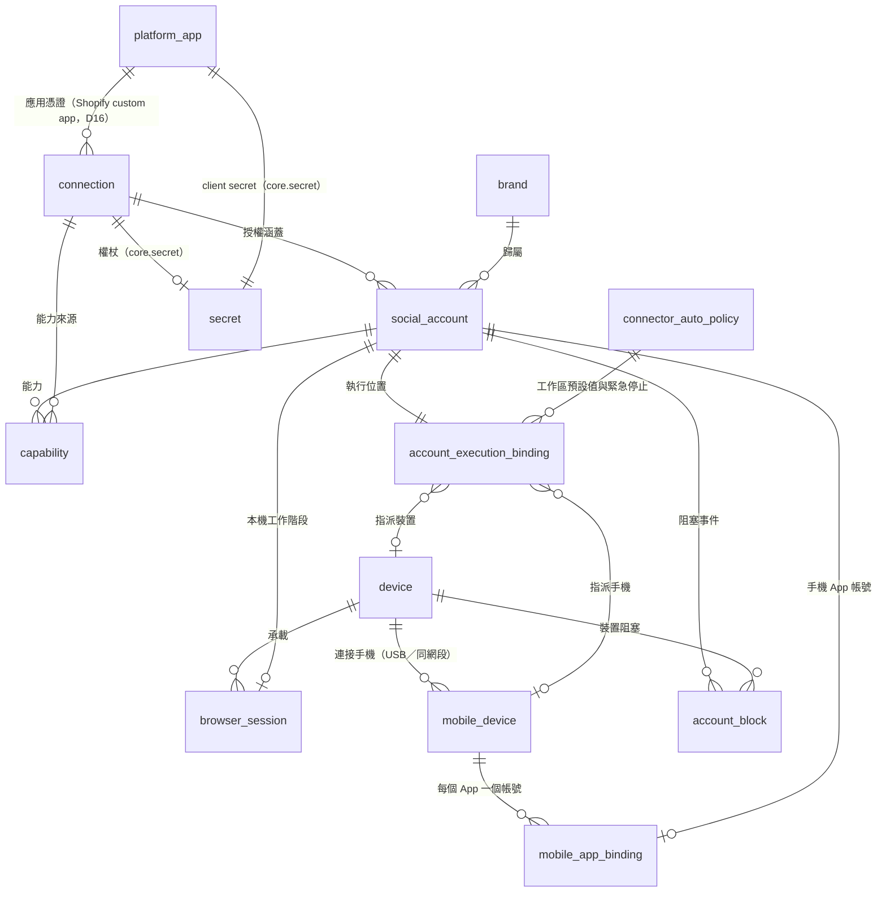

| 實體 | 關鍵屬性 | 說明 |
|---|---|---|
| `connection` | provider、auth_strategy、external_principal_id、granted_scopes、status、secret_id、expires_at | 一次授權的結果；provider 鍵沿用 4.15；`platform_app_id` 為空＝使用 SaaS 共用 app |
| `platform_app` | provider、ownership（partner_custom_distribution／merchant_org）、client_id、secret_id、scope_version、allowlist_enforced、bulk_enabled_at／bulk_last_used_at、install_link_status、status | 租戶專屬的平台應用（P0b，D16：Shopify 每客戶一個 custom app）；SaaS 共用 app 不登記於此（應用秘密屬 SaaS 部署設定，見 6.11） |
| `social_account` | provider、external_account_id（平台穩定 ID）、handle、account_type、brand_id、owner_user_id、status | 去重鍵為 `(tenant_id, provider, external_account_id)`；暱稱變更只更新顯示欄位 |
| `capability` | operation、content_format、status、granted_scopes、region、api_version、limits、verified_at、failure_reason、source | 4.8 定義；社媒能力以 `(social_account_id, operation, content_format)` 唯一；店鋪能力（`social_account_id` 為空）以 `(connection_id, operation, content_format)` 唯一 |
| `device` | name、owner_user_id、public_key、app_version、os（windows／macos）、mobile_platforms、status、last_heartbeat_at | 連接器裝置（電腦，D20） |
| `mobile_device` | device_id（所屬連接器）、platform（android／ios）、model、os_version、connection_type（usb／wifi）、status、driver_version、app_versions、signing_expires_at（iOS） | 連接器控制的客戶自有實體手機（D21）；只存控制狀態與版本，不存 App 登入狀態 |
| `mobile_app_binding` | mobile_device_id、app、social_account_id、confirmed_by、status、observed_platform_user_id、verified_at | 每支手機每個 App 只綁定一個帳號，綁定前人員確認；App 內身分核對結果 |
| `browser_session` | device_id、social_account_id、profile_ref、observed_platform_user_id、status、verified_at | 只存控制狀態與身分核對結果，不存 Cookie |
| `account_execution_binding` | mode（api／connector／manual／hybrid）、device_id、connector_channel（browser／mobile）、mobile_device_id、mobile_app、connector_mode（assist／auto）、auto 啟用者、風險確認（確認人、時間、條款版本）、頻率上限、每日上限、允許時段、帳號級緊急停止旗標、自動停止紀錄、priority | EX04 路由的輸入；auto 只能經自動模式 API 開啟 |
| `connector_auto_policy` | halted（工作區全域緊急停止，有效旗標）、停止來源（工作區管理員自行停止 `halted_by_workspace`、涵蓋本工作區的 OP 規則 `ops_halt_rule_ids`）、預設上限、自動停止門檻 | 每工作區一列；不設工作區層的允許／不允許開關，自動模式只以帳號為單位開啟（D4）；`halted` 是疊加旗標，不改寫各帳號 `connector_mode` |
| `account_block` | kind、severity、status、affected_task_count、assignee | AC06 的阻塞佇列 |

#### 5.2.3 狀態機

**連接 `connection.status`**

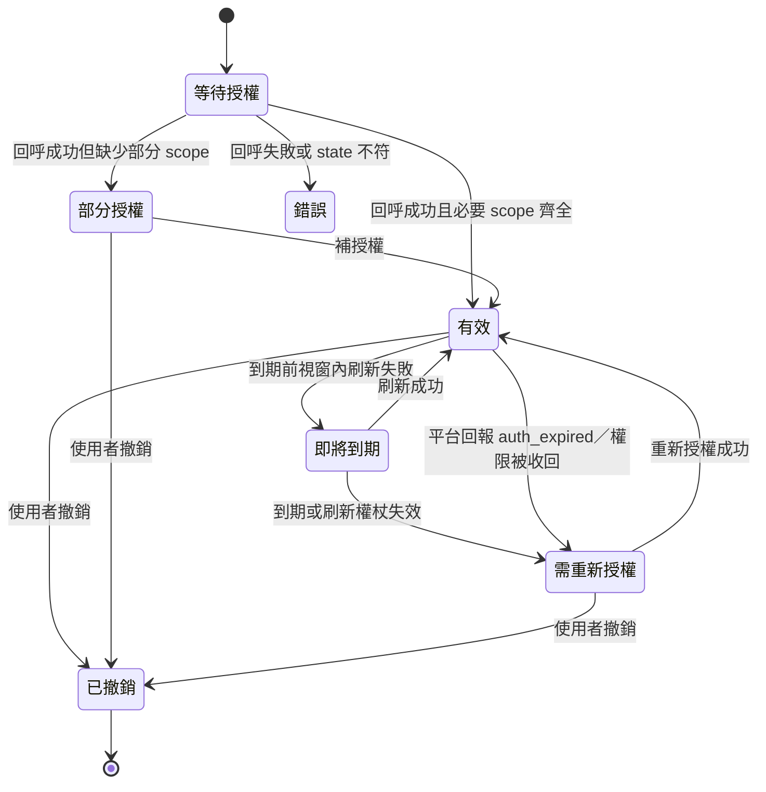

**裝置 `device.status`**：`pairing → online ⇄ offline → disabled → revoked`；`disabled` 可恢復，`revoked` 不可恢復（金鑰作廢）。

**瀏覽器工作階段 `browser_session.status`**：`unbound → login_required → verified ⇄ identity_mismatch`；任何狀態可進入 `blocked`（驗證碼、平台風控提示），人工處理後回到 `login_required` 重新核對。

**手機 `mobile_device.status`**（D21；Android P0b、iPhone P1）：`detected`（連接器偵測到，尚未納管）→ 人員在 Web 確認登錄 → `pending_setup`（前置條件未齊）→ `ready ⇄ offline`；`ready` 遇前置條件失效（偵錯授權被撤銷或逾期、Developer Mode 關閉、iOS 簽章到期）或相容表阻擋 → `needs_attention`，排除後回 `ready`；`disabled` 可恢復；`removed` 不可恢復（同時解除該手機全部 App 綁定）。只有 `ready` 的手機會被 `resolveExecutors` 回傳。

**手機 App 綁定 `mobile_app_binding.status`**：人員確認建立 → `login_required → verified ⇄ identity_mismatch`；任何狀態可進入 `blocked`（驗證碼、風控提示、App 跳出需人員處理的對話框），人工處理後回到 `login_required` 重新核對；`removed` 為終態。

**阻塞事件 `account_block.status`**：`open → assigned → resolving → resolved | dismissed`；`resolved` 前必須通過一次身分核對或權杖驗證（構思 AC06：「人工處理後須重新驗證身份及剩餘操作權限」）。

**連接器模式 `account_execution_binding.connector_mode`**（P0b，隨連接器提供；電腦瀏覽器與手機 App 兩種執行位置共用同一狀態機，手機 Android P0b、iPhone P1）

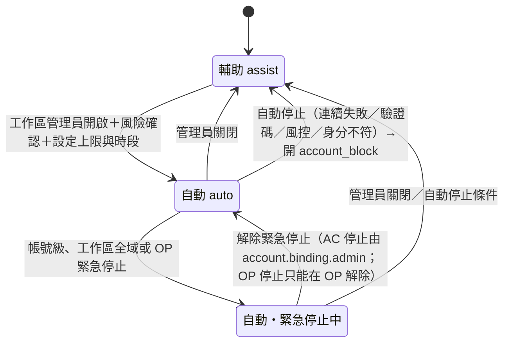

`Halted` 是疊加在 `auto` 上的旗標（`auto_halted` 或 `connector_auto_policy.halted`，後者含 OP 租戶層或工作區級停止的落地）：不改寫 `connector_mode` 與風險確認紀錄，設定保留，但 EX 不發出任何自動提交許可；所有停止來源都解除後各帳號回到原設定。自動停止後**不會自動恢復**，阻塞解決後仍需管理員重新開啟；條款版本已更新時須重新做風險確認。

#### 5.2.4 資料表

**P0 DDL**

```sql
create table account.platform_app (         -- 租戶專屬的平台應用（P0b；D16：Shopify 每客戶一個 custom app）；SaaS 共用 app 不登記於此
  @std, @actor, @ver,
  provider text not null check (provider in ('shopify')),   -- P0b 只有 shopify；私有部署客戶自建的其他店鋪平台應用日後沿用本表（擴充列舉）
  ownership text not null check (ownership in ('partner_custom_distribution','merchant_org')),
                                            -- partner_custom_distribution＝SmartSell Partner 組織以 custom distribution 為該客戶建立（SaaS 只用此種；私有部署也可用）
                                            -- merchant_org＝客戶在自家商家組織 Dev Dashboard 建立（只限私有部署，6.11.2.1 方案 A）
  name text not null,
  client_id text not null,
  secret_id uuid not null references core.secret(id),   -- client secret；輪替時寫新列並以 rotated_from 串接
  grant_type text not null check (grant_type in ('authorization_code','client_credentials')),   -- partner_custom_distribution＝authorization_code＋expiring=1；merchant_org＝client_credentials
  api_version text not null,                -- 請求固定的 API 版本（例：2026-10）
  scope_version text not null,              -- 已發布 app 版本的識別；新增 scope 須發新版本並由店主在每個店鋪核准
  scopes text[] not null default '{}',      -- 該版本宣告的 scope（P0b／P1 清單見 6.11.2.1）
  target_shop_domain text,                  -- custom distribution 安裝目標（單店，或同一 Plus 組織的店鋪）
  allowlist_enforced boolean not null default false,   -- Dev Dashboard IP allowlist 已登記 OP egress_ips、Run test 通過並 Enforce（merchant_org 平台不強制，本系統仍要求登記）
  allowlist_egress_digest bytea,            -- 登記當時 egress_ips 的摘要；與現行 egress_ips 不符即視同未登記
  allowlist_enforced_at timestamptz, allowlist_confirmed_by uuid,
  bulk_enabled_at timestamptz,              -- partner_custom_distribution 啟用 bulk queries 的時間（merchant_org 不需要）
  bulk_last_used_at timestamptz,            -- 由店鋪同步作業執行 bulk 後回寫；連續 31 天未使用須重新啟用（6.11.2.3）
  install_link_status text not null check (install_link_status in ('not_applicable','pending','issued','installed','revoked')),
                                            -- merchant_org＝not_applicable；pending＝尚未產生（allowlist 未就緒時一律停在此）
  install_link_url text,                    -- Partner Dashboard 產生的安裝連結，只在 issued 後經 AC Facade 交給 PC
  install_link_issued_at timestamptz,
  status text not null check (status in ('draft','active','suspended','retired')),
  status_reason text,                       -- allowlist_missing|allowlist_outdated|bulk_disabled|secret_rotation_due
  unique (provider, client_id),
  check ((ownership = 'merchant_org') = (install_link_status = 'not_applicable')),
  check (ownership <> 'partner_custom_distribution' or grant_type = 'authorization_code'),
  check (install_link_status not in ('issued','installed') or (allowlist_enforced and allowlist_egress_digest is not null))
);

create table account.connection (
  @std, @ws, @actor, @ver,
  provider text not null,                   -- meta_instagram|meta_facebook|tiktok|tiktok_shop|youtube|douyin|xiaohongshu|shopify|shopee|lazada|amazon_sp|file_import|vendor:<key>|esp:<key>|ads:<key>
  purpose text not null,                    -- social|store|ads|esp|data_vendor
  auth_strategy text not null,              -- oauth2|connector_session|api_key|none
  platform_app_id uuid references account.platform_app(id),   -- 使用的平台應用：null＝SaaS 共用 app；shopify 必填（每客戶一個 custom app，D16）
  external_principal_id text,               -- 授權者在平台上的 ID（FB user id、TikTok open_id、Google sub、shop_id）
  external_principal_name text,
  granted_scopes text[] not null default '{}',
  required_scopes text[] not null default '{}',
  status text not null,                     -- pending|active|partial|expiring|needs_reauth|revoked|error
  status_reason text,
  secret_id uuid references core.secret(id),   -- access/refresh token 或 API key
  access_expires_at timestamptz,
  refresh_expires_at timestamptz,
  last_refreshed_at timestamptz,
  last_verified_at timestamptz,
  revoked_at timestamptz, revoked_by uuid,
  meta jsonb not null default '{}',         -- provider 特有：api_version、region、shop_cipher、marketplace_ids（amazon_sp）等
  check (provider <> 'shopify' or platform_app_id is not null)
);
create index on account.connection (tenant_id, provider, external_principal_id);

create table account.oauth_flow (           -- 進行中的授權流程（短期）
  id uuid primary key, tenant_id uuid not null, workspace_id uuid not null,
  provider text not null, user_id uuid not null,
  state_hash bytea not null unique,         -- 防 CSRF
  pkce_verifier_secret_id uuid,             -- 需要 PKCE 的 provider
  requested_scopes text[] not null,
  reconnect_connection_id uuid,             -- 重新授權時指向既有連接
  brand_id uuid,
  return_to text not null,
  created_at timestamptz not null default now(),
  expires_at timestamptz not null,          -- 10 分鐘
  consumed_at timestamptz
);

create table account.social_account (
  @std, @ws, @actor, @ver,
  provider text not null,
  external_account_id text not null,        -- 平台穩定 ID（IG user id、Page id、TikTok open_id、YouTube channel id…）
  handle text, display_name text, avatar_file_id uuid,
  account_type text,                        -- business|creator|personal|page|channel（店鋪平台連接 purpose=store 不建立 social_account，店鋪見 PC commerce.store）
  brand_id uuid not null references workspace.brand(id),
  owner_user_id uuid,                       -- 帳號負責人
  default_timezone text,                    -- 受眾時區（PL02 預設）
  write_connection_id uuid references account.connection(id),   -- 目前用於寫入的連接
  status text not null,                     -- active|disabled|archived
  disabled_reason text,
  profile_observed_at timestamptz,
  unique (tenant_id, provider, external_account_id)
);

create table account.social_account_connection (   -- 帳號與連接多對多（同帳號可被多個連接涵蓋）
  tenant_id uuid not null,
  social_account_id uuid not null references account.social_account(id),
  connection_id uuid not null references account.connection(id),
  role text not null,                       -- write|read
  linked_at timestamptz not null default now(),
  primary key (social_account_id, connection_id)
);

create table account.capability (
  @std, @ws,
  social_account_id uuid references account.social_account(id),
  connection_id uuid references account.connection(id),
  operation text not null,                  -- publish|publish_schedule|edit_post|delete_post|comment_read|comment_reply|comment_hide|dm_read|dm_send|insights_read|product_read|order_read|refund_read|…
  content_format text not null default '*', -- image|carousel|reel|video|short|story|text|*
  status text not null,                     -- available|read_only|needs_authorization|manual_only|unsupported|unverified
  executors text[] not null default '{}',   -- 此能力可用的執行器：api|connector|manual
  connector_channels text[] not null default '{}',   -- executors 含 connector 時可用的通道（4.15）：browser|mobile（mobile＝連接器控制手機 App，D21；Android P0b、iOS P1）
  granted_scopes text[],
  region text,
  api_version text,
  limits jsonb not null default '{}',       -- {daily_quota, max_file_mb, max_duration_s, aspect_ratios, caption_max, rate}；手機路徑另有限制時放 limits.mobile
  source text not null,                     -- static_matrix|probe|runtime_error|manual_override
  verified_at timestamptz,
  failure_reason text,
  failure_count integer not null default 0,
  check ((social_account_id is not null) or (connection_id is not null))
);
create unique index on account.capability (social_account_id, operation, content_format) where social_account_id is not null;   -- 社媒能力
create unique index on account.capability (connection_id, operation, content_format) where social_account_id is null;          -- 店鋪能力（D2）

create table account.device (
  @std, @actor, @ver,
  workspace_id uuid,                        -- 裝置可服務同租戶的多個工作區；null=租戶級
  name text not null,
  owner_user_id uuid not null,
  public_key text not null,                 -- Ed25519 公鑰
  key_fingerprint text not null unique,
  app_version text,
  os text,                                  -- windows|macos（連接器只在電腦上，D20）
  supported_task_types text[] not null default '{}',   -- 含手機任務類型（D21）
  mobile_platforms text[] not null default '{}',       -- 此連接器可控制的手機平台：android（P0b）|ios（P1，只限 os=macos）
  max_mobile_devices integer,               -- 同時控制的手機上限（依實測設定；null 時套用相容表預設值）
  status text not null,                     -- pairing|online|offline|disabled|revoked
  last_heartbeat_at timestamptz,
  last_ip inet,
  revoked_at timestamptz, revoked_reason text
);

create table account.device_pairing_code (
  id uuid primary key, tenant_id uuid not null,
  code_hash bytea not null unique,
  created_by uuid not null, workspace_id uuid,
  expires_at timestamptz not null,          -- 10 分鐘
  consumed_device_id uuid, consumed_at timestamptz
);

create table account.browser_session (
  @std, @ws, @ver,
  device_id uuid not null references account.device(id),
  social_account_id uuid not null references account.social_account(id),
  profile_ref text not null,                -- 本機設定檔識別（非路徑全文，避免洩漏使用者目錄）
  status text not null,                     -- unbound|login_required|verified|identity_mismatch|blocked
  observed_platform_user_id text,           -- 最近一次在頁面上讀到的登入身分
  verified_at timestamptz,
  last_checked_at timestamptz,
  blocked_reason text,
  unique (device_id, social_account_id)
);

create table account.mobile_device (        -- 連接器控制的客戶自有實體手機（D21；Android P0b、iOS P1）；只存控制狀態與版本
  @std, @actor, @ver,
  workspace_id uuid,                        -- 同所屬 device.workspace_id
  device_id uuid not null references account.device(id),   -- 所屬連接器（電腦）；換電腦須先移除再登錄
  platform text not null check (platform in ('android','ios')),   -- ios 只能掛在 os=macos 的連接器（P1）
  manufacturer text, model text not null,
  os_version text not null,
  hardware_id_hash bytea not null,          -- adb 序號／iOS UDID 的雜湊：只用於辨識同一支實體手機；不修改、不偽裝任何裝置識別碼
  connection_type text not null check (connection_type in ('usb','wifi')),   -- wifi＝同網段（Android 為無線偵錯，見 6.9）
  display_name text,
  status text not null check (status in ('detected','pending_setup','ready','offline','needs_attention','disabled','removed')),
  status_reason text,                       -- debug_unauthorized|developer_mode_off|ui_automation_off|developer_untrusted|signing_expired|compat_blocked|driver_missing|media_helper_missing
  driver_version text,                      -- 自動化驅動版本（OP mobile_driver 相容判定）
  helper_app_version text,                  -- 手機端自動化輔助元件版本（Android 輔助 APK；iOS WDA 與相簿輔助 App）
  app_versions jsonb not null default '{}', -- {tiktok, douyin, xiaohongshu, instagram, facebook}：目標 App 版本（OP device_requirements 比對）
  prereq_checks jsonb not null default '{}',-- 前置條件逐項結果與檢查時間（Android：偵錯授權；iOS：信任電腦、Developer Mode、啟用 UI 自動化、信任開發者）
  signing_team_ref text,                    -- iOS：簽章所用的 Apple Developer 團隊識別（暫定為客戶自有，10.3 Q22；不存憑證）
  signing_expires_at timestamptz,           -- iOS：WDA／輔助 App 描述檔與憑證中較早的到期日
  approved_by uuid, approved_at timestamptz,-- 人員在 Web 確認登錄
  last_seen_at timestamptz,
  removed_at timestamptz, removed_reason text
);
create unique index on account.mobile_device (tenant_id, hardware_id_hash) where status <> 'removed';   -- 同一支手機同時只登錄在一個連接器

create table account.mobile_app_binding (   -- 手機上某個 App 綁定的客戶自有社媒帳號（D21）
  @std, @ws, @actor, @ver,
  mobile_device_id uuid not null references account.mobile_device(id),
  app text not null check (app in ('tiktok','douyin','xiaohongshu','instagram','facebook')),
  social_account_id uuid not null references account.social_account(id),
  confirmed_by uuid not null, confirmed_at timestamptz not null,   -- 綁定前人員確認（手機、App、帳號，且帳號為客戶自有），同寫 core.audit_event
  status text not null check (status in ('login_required','verified','identity_mismatch','blocked','removed')),
  observed_platform_user_id text, observed_handle text,   -- 最近一次在 App 個人頁讀到的登入身分
  verified_at timestamptz, last_checked_at timestamptz,
  blocked_reason text,
  removed_at timestamptz, removed_by uuid
);
create unique index on account.mobile_app_binding (mobile_device_id, app) where status <> 'removed';   -- 每支手機每個 App 只綁定一個帳號
create unique index on account.mobile_app_binding (social_account_id) where status <> 'removed';        -- 一個帳號只綁在一支手機

create table account.account_execution_binding (
  @std, @ws, @actor, @ver,
  social_account_id uuid not null unique references account.social_account(id),
  mode text not null,                       -- api|connector|manual|hybrid（hybrid=依操作能力分流）
  device_id uuid references account.device(id),
  connector_channel text not null default 'browser' check (connector_channel in ('browser','mobile')),   -- 連接器通道（4.15）：電腦瀏覽器｜手機 App（D21）
  mobile_device_id uuid references account.mobile_device(id),   -- connector_channel=mobile 時必填，且須掛在 device_id 之下
  mobile_app text,                          -- connector_channel=mobile 時必填：tiktok|douyin|xiaohongshu|instagram|facebook（須有該手機該 App 綁定本帳號）
  connector_mode text not null default 'assist',   -- assist|auto（auto 只能經自動模式 API 由工作區管理員開啟，見 5.2.11）
  allow_manual_fallback boolean not null default true,
  paused boolean not null default false,    -- 停用執行位置但保留帳號（AC07）
  note text,
  -- 自動模式（P0b）
  auto_enabled_by uuid, auto_enabled_at timestamptz,
  auto_ack_by uuid, auto_ack_at timestamptz,       -- 風險確認：確認人、時間（同時寫 core.audit_event）
  auto_ack_terms_version text,              -- 確認的風險條款版本（平台條款與封號風險由客戶承擔）
  auto_max_per_hour integer,                -- 頻率上限：每小時自動提交次數（目的：遵守平台限制與降低平台負載）
  auto_min_interval_seconds integer,        -- 頻率上限：兩次自動提交最小間隔
  auto_daily_cap integer,                   -- 每日上限（以 social_account.default_timezone 的日界計）
  auto_allowed_windows jsonb,               -- 允許時段 [{dow:[1..7], start:'09:00', end:'21:00'}]，帳號時區
  auto_halted boolean not null default false,      -- 帳號級緊急停止
  auto_halted_at timestamptz, auto_halted_by uuid, auto_halted_reason text,
  auto_consecutive_failures integer not null default 0,
  auto_stopped_at timestamptz,
  auto_stop_reason text,                    -- failure_streak|captcha|risk_control|identity_mismatch|terms_outdated
  auto_stop_block_id uuid,                  -- 對應 account.account_block
  check (connector_channel <> 'mobile' or (device_id is not null and mobile_device_id is not null and mobile_app is not null)),
  check (connector_mode <> 'auto' or (auto_ack_at is not null and auto_ack_terms_version is not null
         and auto_max_per_hour is not null and auto_min_interval_seconds is not null
         and auto_daily_cap is not null and auto_allowed_windows is not null))
);

create table account.connector_auto_policy (     -- 工作區自動模式預設值與工作區全域緊急停止（每工作區一列；無工作區層開關）
  @std, @ws, @actor, @ver,
  halted boolean not null default false,           -- 工作區全域緊急停止（有效旗標）：工作區內所有帳號停止自動提交；EX、PL、WS 一律讀此欄
  halted_by_workspace boolean not null default false,   -- 來源一：工作區管理員在 AC 自行啟動
  ops_halt_rule_ids uuid[] not null default '{}',  -- 來源二：涵蓋本工作區的 OP job_pause_rule(scope='connector_auto') id（經 AccountFacade.setConnectorAutoHalt 寫入）
  halted_at timestamptz, halted_by uuid, halted_reason text,
  default_max_per_hour integer not null,
  default_min_interval_seconds integer not null,
  default_daily_cap integer not null,
  failure_stop_threshold integer not null default 3,   -- 連續自動提交失敗（submitted_by=auto）幾次自動停止
  check (halted = (halted_by_workspace or cardinality(ops_halt_rule_ids) > 0)),
  unique (workspace_id)
);

create table account.account_block (
  @std, @ws, @actor, @ver,
  social_account_id uuid references account.social_account(id),
  connection_id uuid references account.connection(id),
  device_id uuid references account.device(id),
  mobile_device_id uuid references account.mobile_device(id),   -- 手機相關阻塞（D21）
  kind text not null,                       -- token_expired|scope_missing|login_required|captcha|identity_mismatch|device_offline|platform_restriction|connector_outdated|auto_failure_streak|mobile_offline|mobile_setup_required|signing_expired|app_prompt
                                            -- （platform_restriction 含風控提示；captcha／platform_restriction／identity_mismatch／login_required 同時適用手機 App；
                                            --   mobile_setup_required＝偵錯授權失效或前置條件缺失；signing_expired＝iOS 簽章到期（P1）；app_prompt＝App 跳出條款、權限、更新等須人員處理的對話框）
  severity text not null,                   -- blocking|degraded
  status text not null,                     -- open|assigned|resolving|resolved|dismissed
  detail jsonb not null default '{}',
  affected_task_count integer not null default 0,   -- 由 EX 回寫的影響數
  first_seen_at timestamptz not null, last_seen_at timestamptz not null,
  assignee_user_id uuid,
  resolved_at timestamptz, resolved_by uuid,
  resolution text,                          -- reauthorized|relogged_in|device_reassigned|mobile_restored|dismissed
  work_item_id uuid                         -- WS 待辦
);
create unique index on account.account_block (social_account_id, kind) where status in ('open','assigned','resolving');
create unique index on account.account_block (mobile_device_id, kind) where status in ('open','assigned','resolving') and social_account_id is null;   -- 手機層級阻塞
```

**P1／P2 表**

| 表 | 用途 | 關鍵欄位 | 階段 |
|---|---|---|---|
| `account.binding_migration` | 執行位置遷移與裝置、手機回收（AC07） | from_binding、to_device_id、to_connector_channel、to_mobile_device_id、status（planned／draining／verifying／completed／aborted）、affected_task_ids、unknown_outcome_count | P1 |
| `account.capability_check_run` | 批次巡檢與相容診斷紀錄 | scope、started_at、results、diff_from_previous | P2 |
| `account.device_group` | 裝置群組與部署管理 | name、device_ids、policy | P2 |
| `account.oncall_rotation` | 阻塞處理值班分派 | schedule、members、escalation | P2 |

#### 5.2.5 權限

| 權限 | 說明 | 預設角色 |
|---|---|---|
| `account.social_account.read` | 查看帳號、能力、狀態 | 全部內部角色 |
| `account.social_account.plan` | 變更品牌歸屬、負責人、分組 | `brand_lead`、`social_ops` |
| `account.connection.admin` | 建立、重新授權、撤銷連接 | `owner`、`admin`、`brand_lead` |
| `account.platform_app.admin` | 登記與更新租戶專屬平台應用（client secret、scope 版本、allowlist 確認、bulk 啟用、安裝連結）；SaaS 的 `partner_custom_distribution` 由 SmartSell 營運方以內部營運工具經同一 Facade 寫入，租戶角色只讀 | `owner`、`admin`（只限私有部署） |
| `account.device.admin` | 配對、停用、撤銷裝置；登錄、停用、移除手機；建立與解除手機 App 帳號綁定（建立前須在確認對話框核對）；指派執行位置（電腦瀏覽器或手機 App；不含開啟自動模式） | `owner`、`admin` |
| `account.binding.admin` | 開啟／關閉帳號自動模式（含風險確認）、設定頻率與每日上限、允許時段、工作區自動模式預設值、解除 AC 設定的緊急停止（OP 設定者不可在此解除） | `owner`、`admin`（工作區管理員） |
| `account.auto_halt.execute` | 啟動帳號級或工作區全域緊急停止（只會讓自動提交停止，不會放寬任何限制） | `owner`、`admin`、`brand_lead`、`social_ops` |
| `account.session.execute` | 在本機工作階段或手機 App 人工登入、接管、要求重新核對身分 | 被指派的帳號負責人、`social_ops` |
| `account.block.plan` | 指派、標記處理阻塞 | `social_ops`、`admin` |

#### 5.2.6 Web API

| 方法 | 路徑（前綴 `/api/v1/workspaces/{ws}`） | 說明 | 權限 | 階段 |
|---|---|---|---|---|
| GET | `/social-accounts` | 帳號目錄（篩選品牌、平台、狀態、能力） | social_account.read | P0 |
| GET／PATCH | `/social-accounts/{id}` | 詳情；修改品牌、負責人、時區 | read／plan | P0 |
| POST | `/social-accounts/{id}/disable`、`/enable` | 停用／啟用（停用時回傳受影響任務預覽；啟用時同樣檢查 `social_accounts` 額度，超出回 `402 LICENSE_LIMIT`（P1）） | plan | P0 |
| GET | `/social-accounts/{id}/capabilities` | 能力表（含原因與核實時間） | read | P0 |
| POST | `/social-accounts/{id}/capabilities/probe` | 立即重新探測（回 operation_id） | connection.admin | P0 |
| GET | `/connections` | 連接列表 | connection.admin | P0 |
| POST | `/connections/oauth/start` | 開始授權 `{provider, brand_id, scopes?, reconnect_connection_id?}` → `{authorize_url}`；Shopify 回傳該客戶 custom app 的安裝連結，`platform_app` 未就緒回 `409 PLATFORM_APP_NOT_READY`（原因清單，見 5.2.11「店鋪連接」） | connection.admin | P0 |
| GET | `/platform-apps` | 租戶專屬平台應用：歸屬、client_id、scope 版本、allowlist 狀態（與現行 `egress_ips` 比對結果）、bulk 啟用與最近使用、安裝連結狀態、status；client secret 只回遮罩 | connection.admin | P0b |
| POST／PATCH | `/platform-apps`、`/platform-apps/{id}` | 登記／更新（client secret 寫入 `core.secret`）；`install_link_status` 轉 `issued` 前檢查 allowlist，未就緒回 `409 PLATFORM_APP_NOT_READY` | platform_app.admin | P0b |
| GET | `/oauth/callback/{provider}`（全域路徑，不帶 ws） | 平台回呼，換權杖並導回 `return_to` | — | P0 |
| POST | `/connections/{id}/accounts/link` | 選擇此次授權涵蓋的哪些帳號要納管；P1 起（OP10 啟用後）超出 `social_accounts` 額度時回 `402 LICENSE_LIMIT`（既有帳號不受影響） | connection.admin | P0 |
| POST | `/connections/{id}/revoke` | 撤銷（回傳影響預覽；`dry_run` 支援） | connection.admin | P0 |
| POST | `/connections/api-key` | 以 API Key 建立連接（資料商、ESP） | connection.admin | P1 |
| GET／POST | `/devices`、`/devices/pairing-codes` | 裝置列表；產生配對碼 | device.admin | P0 |
| POST | `/devices/{id}/disable`、`/revoke` | 停用／撤銷裝置權杖（撤銷時其下手機一併轉 `disabled`） | device.admin | P0 |
| GET | `/mobile-devices`（篩選連接器、平台、狀態） | 手機列表：型號、系統版本、連接方式、所屬連接器、狀態與原因、前置條件、驅動與 App 版本、簽章到期日（iOS）、各 App 綁定帳號 | device.admin | P0b（iPhone P1） |
| POST | `/mobile-devices/{id}/approve` | 確認登錄連接器偵測到的手機（人員核對型號與序號末四碼）；平台不在該連接器 `mobile_platforms`、偵測為模擬器或雲手機時回 `422`；前置條件未齊時轉 `pending_setup` 並回缺項清單 | device.admin | P0b（iPhone P1） |
| POST | `/mobile-devices/{id}/disable`、`/enable`、`/remove` | 停用／啟用／移除（回傳受影響帳號與任務預覽）；移除時一併解除 App 綁定，並回傳在手機上撤銷偵錯授權的指引 | device.admin | P0b |
| POST | `/mobile-devices/{id}/app-bindings` | 建立 App 帳號綁定 `{app, social_account_id, owned_account_confirmed:true}`；App 與帳號 provider 不對應回 `422`；該手機該 App 已有綁定或帳號已綁在其他手機回 `409`；建立後推送 App 內身分核對 | device.admin | P0b |
| DELETE | `/mobile-app-bindings/{id}` | 解除綁定（回傳影響預覽；帳號執行位置為此手機時須先改執行位置） | device.admin | P0b |
| POST | `/mobile-app-bindings/{id}/verify` | 推送「在 App 內重新核對登入身分」到連接器 | session.execute | P0b |
| PUT | `/social-accounts/{id}/execution-binding` | 設定執行位置（回傳影響預覽）；`connector_channel=mobile` 時須帶 `mobile_device_id`、`mobile_app`，該手機須掛在 `device_id` 之下且該 App 已綁定本帳號並核對通過；不能經此把 `connector_mode` 設為 `auto` | device.admin | P0 |
| POST | `/social-accounts/{id}/execution-binding/auto-mode` | 開啟自動模式 `{terms_version, risk_acknowledged:true, max_per_hour, min_interval_seconds, daily_cap, allowed_windows}`；前置條件不符回 `409` 與原因清單 | binding.admin | P0b |
| PATCH／DELETE | `/social-accounts/{id}/execution-binding/auto-mode` | 調整上限與時段（不得高於平台限制；發 `account.binding.changed`）／關閉自動模式（降回 assist） | binding.admin | P0b |
| POST | `/social-accounts/{id}/execution-binding/auto-halt`、`/auto-halt/release` | 帳號級緊急停止／解除 | auto_halt.execute／binding.admin | P0b |
| GET／PUT | `/connector-auto-policy` | 工作區自動模式預設值（預設上限、自動停止門檻；不含允許／不允許開關）；GET 同時回傳目前風險條款版本與全文（來源 OP `component_compat.auto_terms_version`）及停止來源（工作區／OP 規則） | social_account.read／binding.admin | P0b |
| POST | `/connector-auto-policy/halt`、`/release` | 工作區全域緊急停止／解除；`release` 只清除工作區管理員自行設定的停止，仍有 OP 規則涵蓋時維持停止並回傳來源；只有 OP 停止時回 `409 HALTED_BY_OPS`（須在 OP `/admin/jobs` 解除） | auto_halt.execute／binding.admin | P0b |
| GET | `/browser-sessions` | 本機工作階段狀態 | social_account.read | P0 |
| POST | `/browser-sessions/{id}/request-login` | 推送「開啟設定檔並登入」到連接器 | session.execute | P0 |
| GET／PATCH | `/account-blocks`、`/account-blocks/{id}` | 阻塞佇列；指派、備註 | read／block.plan | P0 |
| POST | `/account-blocks/{id}/resolve` | 標記解決（後端先做身分或權杖核對） | block.plan | P0 |
| POST | `/binding-migrations`（`dry_run`） | 建立執行位置遷移計畫 | device.admin | P1 |
| — 裝置端（principal=device，前綴 `/api/v1/device`） | | | | |
| POST | `/pair` | 以配對碼＋公鑰完成配對 | 配對碼 | P0 |
| POST | `/token` | 以金鑰簽章換取短期權杖（15 分鐘） | 裝置簽章 | P0 |
| POST | `/heartbeat` | 心跳、版本、工作階段摘要、所控制手機的在線摘要 | device | P0 |
| POST | `/sessions/{id}/identity` | 回報頁面讀到的登入身分 | device | P0 |
| POST | `/mobile-devices/report` | 回報偵測到或狀態變更的手機（平台、型號、系統版本、連接方式、識別碼雜湊、前置條件、驅動與 App 版本、iOS 簽章到期日）；新手機建立為 `detected`，待 Web 確認才納管 | device | P0b（iPhone P1） |
| POST | `/mobile-app-bindings/{id}/identity` | 回報 App 個人頁讀到的登入身分 | device | P0b |
| POST | `/blocks` | 回報阻塞（登入過期、驗證碼、風控提示；手機另含手機離線、前置條件失效、App 對話框）；驗證碼或風控提示時，自動模式帳號同時觸發自動停止（5.2.11） | device | P0 |

#### 5.2.7 MCP 工具

| 工具 | 類型 | 輸入要點 | 階段 |
|---|---|---|---|
| `accounts_list` | 讀 | workspace_id、brand_id?、provider?、status? | P0 |
| `accounts_get_capabilities` | 讀 | social_account_id、operation?、content_format? → 狀態、原因、可用執行器 | P0 |
| `accounts_check_operation` | 讀 | social_account_id、operation、content_format → allow／需人工／不支援與修復入口；連接器路徑另回執行位置（電腦瀏覽器或手機 App，手機時含手機與 App、最近一次 App 內身分核對結果）、連接器模式（assist／auto）、是否緊急停止中（帳號級、工作區全域、OP 租戶層或工作區級）、自動停止狀態與原因（`auto_stop_reason`、`auto_stop_block_id`）、今日自動提交用量與每日上限；仍為唯讀 | P0 |
| `account_blocks_list` | 讀 | 狀態、帳號；回傳受影響任務數 | P0 |
| `devices_list` | 讀 | 在線狀態、版本；所控制的手機（平台、連接方式、狀態與不可用原因、各 App 綁定帳號；手機 Android P0b、iPhone P1） | P0 |

刻意不提供：發起 OAuth、登記平台應用、配對裝置、登錄或移除手機、建立或解除手機 App 帳號綁定、撤銷連接、解除阻塞、開啟／關閉自動模式（含手機 App 自動操作）、調整自動模式上限與時段、啟動或解除緊急停止的 MCP 寫入工具。授權、手機 App 帳號綁定確認與自動模式的風險確認必須由人在瀏覽器完成，敏感憑證不經過模型（構思 AC06）。

#### 5.2.8 事件

| 發出 | 時機 |
|---|---|
| `account.connection.authorized` | 授權完成（含 scope 清單） |
| `account.connection.scope_changed` | 重新授權或探測發現 scope 增減 |
| `account.connection.expiring`／`expired` | 刷新失敗進入視窗／到期 |
| `account.connection.revoked` | 撤銷 |
| `account.social_account.created`／`updated`／`disabled`／`enabled` | 帳號主檔變更 |
| `account.capability.changed` | 任一能力狀態變更（payload：帳號、operation、format、from、to、reason） |
| `account.device.paired`／`online`／`offline`／`revoked` | 裝置生命週期 |
| `account.mobile_device.detected`／`registered`／`online`／`offline`／`updated`／`removed` | 手機生命週期（D21）；`updated` 於系統、驅動、App 版本、前置條件、簽章到期日或 `needs_attention` 變更時發出（payload：changed_fields、before／after；OP 相容告警依此判定） |
| `account.mobile_device.signing_expiring`／`signing_expired` | iPhone 簽章到期前提醒（payload：signing_expires_at、days_left）／已到期（P1；PL 依此重新預檢 `mobile_signing`） |
| `account.session.verified`／`identity_mismatch`／`login_required` | 本機身分核對結果 |
| `account.mobile_app_binding.created`／`removed` | 手機 App 帳號綁定建立（payload：手機、App、帳號、確認人）／解除 |
| `account.mobile_app_binding.verified`／`identity_mismatch`／`login_required` | App 內身分核對結果 |
| `account.block.opened`／`resolved` | 阻塞事件 |
| `account.binding.changed` | 執行位置變更（含電腦瀏覽器與手機 App 之間切換、更換手機），含自動模式頻率上限、每日上限、允許時段的調整（payload：changed_fields、before／after） |
| `account.binding.auto_enabled`／`auto_disabled` | 自動模式開啟（payload：確認人、確認時間、條款版本、上限、時段）／管理員關閉 |
| `account.binding.auto_stopped` | 系統自動停止並降回 assist（payload：reason、block_id；`terms_outdated` 時 block_id 為空） |
| `account.binding.auto_halted`／`auto_resumed` | 帳號級緊急停止／解除 |
| `account.connector_auto_policy.halted`／`resumed` | 工作區全域緊急停止／解除；只在有效旗標 `halted` 變更時發出（payload：source=workspace／ops、ops_rule_id?、reason） |

| 訂閱 | 處理 |
|---|---|
| `execution.attempt.failed`（error_class=auth_expired／permission_denied） | 能力降級（`source=runtime_error`）、開阻塞事件、連接轉 `needs_reauth` |
| `execution.attempt.failed`／`outcome_unknown`（payload `submitted_by=auto`：實際由連接器自動提交） | `auto_consecutive_failures+1`；達 `failure_stop_threshold` → 自動停止（5.2.11）。降為輔助後由人員提交（`submitted_by=human`，`connector_mode` 仍為 auto）或未送出（`submitted_by` 為空）的嘗試不累加 |
| `execution.attempt.accepted`（payload `submitted_by=auto`） | `auto_consecutive_failures` 歸零；`submitted_by=human` 的嘗試不歸零 |
| `inbox.reply.failed`／`outcome_unknown`（payload `submitted_by=auto`，另含 `connector_channel`、`mobile_device_id`，見 IN 5.11.8；P1【需評估】，D21：手機 App 留言自動回覆，只限綁定帳號自己作品下的留言、不含私訊，評估通過前不開放） | 比照 execution 嘗試，與其共用該帳號的 `auto_consecutive_failures`：+1；達 `failure_stop_threshold` → 自動停止（5.2.11）。人員送出（`submitted_by=human`）或未送出（`submitted_by` 為空）的回覆不累加 |
| `inbox.reply.delivered`（payload `submitted_by=auto`；P1【需評估】，D21） | `auto_consecutive_failures` 歸零；`submitted_by=human` 的回覆不歸零 |
| `execution.task.blocked` | 回寫 `account_block.affected_task_count` |
| `workspace.brand.archived` | 提示歸屬帳號需重新指派 |
| `ops.setting.updated`（key=`egress_ips`） | 觸發 `account.platform_app_scan`（egress 模式，冪等鍵 `app-scan:egress:<digest>`）：比對各 `platform_app` 的 `allowlist_egress_digest`，不符者 `allowlist_enforced=false`、`status_reason=allowlist_outdated`（P0b，D16） |

#### 5.2.9 背景任務

| 任務 | 觸發 | 佇列 | 冪等鍵 |
|---|---|---|---|
| `account.refresh_token` | scheduler 每 5 分鐘掃描 `access_expires_at < now()+30min` | `default` | `refresh:<connection_id>:<access_expires_at>` |
| `account.probe_capabilities` | 授權完成、重新授權、每日巡檢、手動 | `sync:<provider>` | `probe:<social_account_id>:<date>` 或手動 operation_id |
| `account.discover_accounts` | 授權完成後列出可納管帳號 | `sync:<provider>` | `discover:<connection_id>:<version>` |
| `account.revocation_impact` | 撤銷、停用帳號 | `default` | `revoke-impact:<connection_id>` |
| `account.platform_app_scan` | scheduler 每日；OP `egress_ips` 變更後（訂閱 `ops.setting.updated`，P0b）：allowlist 摘要與現行 `egress_ips` 不符 → `allowlist_enforced=false`、`status_reason=allowlist_outdated`，未發出的安裝連結停在 `pending`；`bulk_last_used_at` 距今超過 24 天提醒、超過 31 天標 `bulk_disabled`；通知租戶 `owner`／`admin`（SaaS 另通知營運方） | `default` | `app-scan:<date>` 或 `app-scan:egress:<digest>` |
| `account.device_presence_sweep` | scheduler 每 30 秒；連接器心跳中缺席的手機同時標 `offline`（連接器離線時其下手機一併 `offline`） | `default` | 無（單例） |
| `account.session_health_check` | 每 6 小時；P2 發布前預檢；手機 App 綁定同樣排入（推送 App 內身分核對） | `default` | `session-check:<session_id>:<window>`、`mobile-check:<binding_id>:<window>` |
| `account.mobile_signing_expiry_scan` | scheduler 每日：iOS 手機 `signing_expires_at` 到期前 14／3 天通知工作區管理員並發 `account.mobile_device.signing_expiring`；到期 → `needs_attention(signing_expired)`、開 `account_block(kind=signing_expired)`、發 `signing_expired` | `default` | `signing-scan:<date>`（P1） |
| `account.auto_terms_recheck` | 自動模式風險條款發布新版本（隨連接器版本發布） | `default` | `terms-recheck:<terms_version>` |

#### 5.2.10 前台頁面

| 路由 | 頁面 | 關鍵元件 | 階段 |
|---|---|---|---|
| `/w/:ws/settings/accounts` | 帳號目錄（依品牌分組、連接方式、負責人、能力摘要） | `EntityTable`、`CapabilityBadge` | P0 |
| `/w/:ws/settings/accounts/:id` | 帳號詳情：基本資料、連接、能力矩陣、執行位置、本機工作階段、阻塞歷史 | 能力矩陣表、`StatusTimeline` | P0 |
| `/w/:ws/settings/connections` | 連接列表、授權精靈（選平台 → 跳轉 → 選納管帳號 → 能力探測結果） | 授權精靈、scope 差異提示 | P0 |
| `/w/:ws/settings/platform-apps` | 平台應用登記（Shopify custom app）：歸屬、client_id、client secret 遮罩輸入、scope 版本、allowlist 確認（顯示現行 `egress_ips` 供登記）、bulk 啟用與最近使用、安裝連結狀態；SaaS 唯讀 | 秘密遮罩輸入、檢查清單 | P0b |
| `/w/:ws/settings/devices` | 裝置列表、配對碼、版本與心跳、撤銷；每台連接器所控制的手機數與狀態 | 配對對話框 | P0 |
| `/w/:ws/settings/devices/:id/mobile` | 手機管理：該連接器下的手機列表與待確認的偵測結果、登錄精靈（Android：開啟開發者選項與 USB 偵錯或無線偵錯配對、在手機上同意此電腦的偵錯授權；iPhone：信任電腦、Developer Mode、啟用 UI 自動化、信任開發者、以客戶自有 Apple Developer 帳號簽章，帳號歸屬暫定見 10.3 Q22）、前置條件檢查結果、App 帳號綁定（確認對話框列出手機、App、帳號並勾選「此帳號為客戶自有」）、簽章到期（iOS）、移除與撤銷授權指引 | `BindConfirmDialog`、檢查清單 | P0b（iPhone P1） |
| `/w/:ws/settings/account-blocks` | 阻塞佇列（也出現在 WS02 總覽） | 影響任務清單、處理指引 | P0 |
| `/w/:ws/settings/accounts/:id/execution` | 執行位置與連接器模式：執行位置（API／電腦瀏覽器／手機 App，手機時選手機與 App）、輔助／自動切換、風險確認對話框（條款全文與版本、確認人、時間）、頻率與每日上限、允許時段、今日自動提交用量、帳號級緊急停止、自動停止紀錄 | `RiskAckDialog`、時段編輯器 | P0b |
| `/w/:ws/settings/connector-automation` | 工作區自動模式設定：工作區全域緊急停止（顯示停止來源；OP 設定者唯讀並提示到 OP 解除；同時涵蓋電腦瀏覽器與手機 App）、預設上限與自動停止門檻、自動模式帳號清單（執行位置、用量、最近停止原因）；不設工作區層的允許開關 | `EntityTable`、緊急停止按鈕 | P0b |
| `/w/:ws/settings/accounts/:id/migrate` | 執行位置遷移精靈 | `BatchActionDialog` | P1 |

#### 5.2.11 關鍵規則與演算法

**OAuth 授權流程**

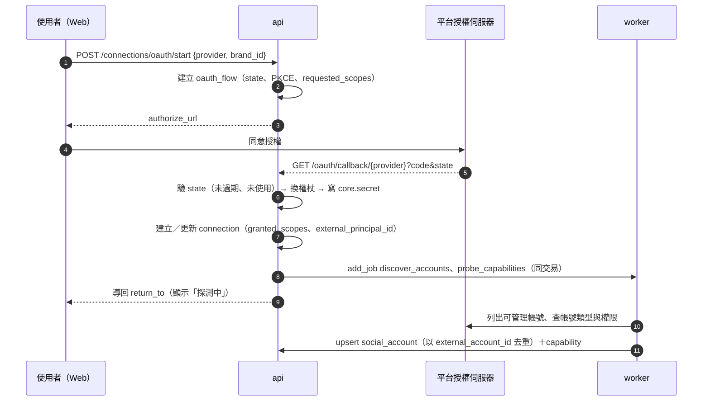

- 同一 `external_account_id` 已存在於本租戶：只新增 `social_account_connection` 關聯，不建立重複帳號（構思 AC01）。已存在於**其他工作區**時，要求使用者確認是否移轉（品牌歸屬是工作區級的業務決定）。
- `granted_scopes` 缺少 `required_scopes` 時連接為 `partial`，能力表逐項標示 `needs_authorization` 並提供補授權入口（P1 細化）。

**權杖刷新**：每個連接以 `pg_advisory_xact_lock(hash(connection_id))` 單一飛行刷新，避免並發刷新導致刷新權杖輪替後舊權杖失效；刷新成功寫新 secret 列並以 `rotated_from` 串接；連續 3 次失敗轉 `expiring`，到期轉 `needs_reauth` 並開阻塞事件。

**撤銷後任務阻擋**（構思 AC02）

1. 交易內將連接轉 `revoked`、刪除 secret 明文（保留紀錄）、相關能力轉 `needs_authorization`。
2. 發 `account.connection.revoked`；EX 訂閱後把該帳號 `scheduled`／`queued` 的執行任務轉 `blocked`（尚無副作用，安全）。
3. 對 `running`／`accepted`／`outcome_unknown` 的任務**不撤回、不假設已撤銷**，維持原狀態並繼續以其他可用唯讀途徑核實；無途徑時轉人工核實。
4. 呼叫平台撤銷端點（若有）；平台端失敗只記錄，不影響本地撤銷。

**能力計算**：`effective_status = min(static_matrix, probe, runtime)`，順序 `unsupported < needs_authorization < manual_only < read_only < unverified < available`。附加規則：

- `available` 必須同時滿足：平台理論支援、帳號類型符合、scope 已授、應用審核狀態允許（例如 TikTok 未稽核應用只能私人可見 → `publish` 以 `limits.visibility=['private']` 標示）、最近 `runtime_error` 未觸發降級。
- 連接器路徑：`executors` 含 `connector` 的前提是綁定裝置在線且 `supported_task_types` 包含該操作；裝置離線不改能力狀態，只影響 EX 路由（構思 AC04：「離線狀態與帳號授權分開」）。
- 手機路徑（D21）：`connector_channels` 含 `mobile` 的前提是靜態矩陣宣告該平台 App 有對應的手機任務類型（TikTok、抖音、小紅書、Instagram、Facebook，見 6.9）、帳號有 `verified` 的 `mobile_app_binding`、所屬連接器 `mobile_platforms` 含該手機平台；手機離線、前置條件失效或簽章到期同樣不改能力狀態，只影響 EX 路由。Instagram／Facebook 的手機路徑只作官方 API 不足時的備援（API 可用的操作 `executors` 先列 `api`）。
- 能力只在登入成功時被探測一次是不夠的：EX 執行前會呼叫 `AccountFacade.assertCapability()` 重新判斷（構思 AC03）。

**本機身分核對**（AC05）：連接器在每次執行任務前讀取頁面上的登入身分（平台使用者 ID 或可穩定辨識的帳號識別），回報 `observed_platform_user_id`；後端與 `social_account.external_account_id`（或該平台的對應欄位）比對。不一致 → `identity_mismatch`、開阻塞事件、通知 EX 暫停該帳號所有連接器任務；自動模式帳號同時自動停止自動模式。設定檔名稱、視窗標題都不作為身分證明。手機 App 路徑同一規則：每次任務在提交前於 App 個人頁讀取登入帳號的平台 ID（讀不到 ID 時用綁定時已核對過的 handle，見 6.9），回報到 `mobile_app_binding.observed_platform_user_id`；不一致的處理相同。手機名稱、App 內暱稱不作為身分證明。

**執行位置解析**（供 EX04）：`resolveExecutors(account, operation, format)` 回傳有序清單，例如 `[api]`、`[connector(device=X, channel=browser, mode=assist), manual]`、`[connector(device=X, channel=mobile, mobile_device=M, app=tiktok, mode=auto, auto_limits={…}), manual]`；回傳 `channel=mobile` 的條件：綁定 `connector_channel='mobile'`、能力 `connector_channels` 含 `mobile`、連接器在線、手機 `status=ready`、`mobile_app_binding.status=verified`、OP `component_compat` 的 `mobile_os`／`mobile_driver`／手機任務類型 `device_requirements` 都相容（OP 5.19.11 (11)）；任一不符就不回該手機（改下一個執行器或人工並附原因），不會改走同一帳號的電腦瀏覽器設定檔；`auto_limits` 包含 `auto_allowed_windows`、`auto_daily_cap`、`auto_min_interval_seconds`、`auto_max_per_hour`（供 PL `automation_limits` 預估）。`hybrid` 依能力表 `executors` 欄位逐操作分流（例：YouTube 上傳走 api，小紅書筆記走 connector）。回傳 `mode=auto` 的條件：`connector_mode='auto'`、帳號級與工作區全域都未緊急停止（`connector_auto_policy.halted` 已含 OP 停止的落地）、OP `job_pause_rule(scope='connector_auto')` 對該工作區或全部未生效、`auto_ack_terms_version` 為現行版本（OP `component_compat.auto_terms_version` 最新發布者）、該連接器任務類型版本的 OP `component_compat.supported_modes` 含 `auto` 且裝置版本相容；任一不符回 `mode=assist` 並附原因（不改寫 `connector_mode`）。頻率、每日上限與時段的計數由 EX 在提交許可時判定（5.10.11，結果見下表「提交許可」）。

**連接器自動模式**（D4；P0b 隨連接器提供；手機 App 自動操作同樣適用，D21：Android P0b、iPhone P1）

| 項目 | 規則 |
|---|---|
| 兩種一級模式 | `assist`（輔助，預設）：系統填好內容，人按最後一下提交（手機路徑由人員在手機上按發布）；`auto`（自動）：連接器在取得 EX 提交許可後自動提交。兩者都只執行白名單任務、都做提交前身分核對、都走 EX 結果核實。自動模式帳號的某次嘗試降為輔助後由人員提交，記 `submitted_by=human`（`execution_attempt`、`platform_post`），`connector_mode` 保留 auto |
| 開啟 | 以帳號為單位，只有 `account.binding.admin`（工作區管理員）可開啟。不設工作區層的允許／不允許開關。前置條件：工作區未全域緊急停止（`connector_auto_policy.halted=false`，含 OP 停止）；綁定 `mode` 為 connector／hybrid 且已指派裝置；該帳號無未解決的 blocking 阻塞；執行位置為電腦瀏覽器時 `browser_session.status=verified`，為手機 App 時 `mobile_device.status=ready` 且 `mobile_app_binding.status=verified` |
| 風險確認 | 開啟對話框顯示現行條款全文與版本：平台條款與封號風險由客戶承擔、自動提交仍可能被平台判定違規；條款同時涵蓋電腦瀏覽器與手機 App 自動操作（必含要點由文件列出、法務定稿，D15），條款更新後已開啟自動模式的帳號須重新確認（見「條款版本更新」）。管理員勾選確認後，交易內寫入 `auto_ack_by`、`auto_ack_at`、`auto_ack_terms_version`、上限與時段，並寫 `core.audit_event`（action=`account.binding.admin`，diff 含條款版本與上限）；發 `account.binding.auto_enabled` |
| 頻率與每日上限 | 每帳號必填：每小時次數＋最小間隔、每日上限（帳號 `default_timezone` 日界）。目的：遵守平台限制與降低平台負載。設定值不得高於能力表 `limits.rate`／`limits.daily_quota` 登記的平台限制；未登記時套用工作區預設值。未達最小間隔或達每小時上限 → 延後（不降級）；達每日上限 → 本次降為輔助（見「提交許可」） |
| 允許時段 | 每帳號必填時段窗；時段外 EX 不發自動提交許可（`denied`），該次降為輔助 |
| 提交許可（EX 判定，5.10.11） | 三種結果：`granted` → 連接器自動提交；`deferred`（`min_interval`、`hourly_cap`）→ 不降級，任務停在 `awaiting_submit_permit`，到 `retry_at` 再申請，延後超過寬限依 EX03 遲到策略處理；`denied`（`outside_window`、`daily_cap`、`emergency_halt`（含 OP 全域停止）、`auto_stopped`、`terms_version_outdated`）→ 本次降為輔助，由人員按下發布（`submitted_by=human`）；等待人員提交逾時（預設 30 分鐘）任務轉 Manual |
| 緊急停止 | 工作區全域（`connector_auto_policy.halted`，工作區內所有帳號）與帳號級（`auto_halted`）。啟動立即生效：EX 不再發出自動提交許可；未送出的自動嘗試在下一個步驟檢查點降為輔助；已送出者照常核實。兩者都是疊加旗標，不改寫 `connector_mode` 與風險確認紀錄。啟動門檻低（`auto_halt.execute`），解除需 `account.binding.admin` |
| OP 停止落地 | OP 租戶層（`all`）或工作區級停止（5.19.11 (8)）經 `AccountFacade.setConnectorAutoHalt({workspace_ids, halted, source:'ops', rule_id, reason, actor})` 落地：停止時把 `rule_id` 加入範圍內各工作區的 `ops_halt_rule_ids`，解除時移除；`halted` 一律依 `halted_by_workspace or ops_halt_rule_ids 非空` 重算，因此工作區管理員自行設定的停止不被 OP 解除清掉，工作區仍被其他 OP 規則涵蓋時維持停止。工作區管理員在 AC 只能清除 `halted_by_workspace`；只有 OP 停止時解除回 `409 HALTED_BY_OPS`。不改寫任何帳號的 `account_execution_binding.connector_mode`，解除後各帳號回到原設定 |
| 自動停止 | 電腦瀏覽器與手機 App 相同。觸發：連續 `failure_stop_threshold`（預設 3）次自動提交（`submitted_by=auto`）失敗或結果未知（降為輔助後由人員提交的嘗試不累加也不歸零）；連接器回報驗證碼（block kind=`captcha`）或風控提示（`platform_restriction`）；身分核對不符（`identity_mismatch`）。交易內：`connector_mode='assist'`、寫 `auto_stopped_at`／`auto_stop_reason`、開 `account_block`（連續失敗用 `auto_failure_streak`）並記 `auto_stop_block_id`、發 `account.binding.auto_stopped`。之後該帳號任務走輔助；連接器無法繼續（驗證碼、風控、身分不符）時任務停在 `blocked` 並轉人工 |
| 恢復 | 阻塞解決（通過身分核對）**不會**自動恢復 auto；需管理員重新開啟，條款版本已更新時須重新確認 |
| 條款版本更新 | `account.auto_terms_recheck`（OP 發布帶新 `component_compat.auto_terms_version` 的連接器版本時觸發）：`auto_ack_terms_version` 不是現行版本的帳號降回 assist（`auto_stop_reason=terms_outdated`，不開阻塞），發 `account.binding.auto_stopped`，通知工作區管理員重新確認；新條款發布到本任務完成之間，EX 提交許可即回 `denied(terms_version_outdated)` |
| 硬性邊界 | 電腦瀏覽器與手機 App 皆適用：不做瀏覽器或裝置指紋偽裝；不修改裝置識別碼；不以模擬器／雲手機冒充實體裝置；不 root／越獄來隱藏自動化；不規避平台偵測；不破解或代解驗證碼；不模擬人類行為以躲避風控（不做擬人化滑鼠軌跡、觸控軌跡、打字節奏或隨機停頓）；不做帳號農場（手機只操作已綁定的客戶自有帳號）。遇驗證碼、風控、身分不符一律停止並轉人工。頻率上限與時段只為遵守平台限制、降低平台負載 |

**手機通道與執行位置**（`connector_channel=mobile`；D21；Android P0b 隨連接器提供，iPhone P1；連接器任務與平台事實見 6.9，連接器架構見 4.16）

| 項目 | 規則 |
|---|---|
| 架構 | 手機不直接連後端，也不安裝 SmartSell 的 App（不做手機 App，D20）；由所屬連接器（Windows／macOS 電腦）經 USB 或同網段控制，後端只看到 `device` 之下的 `mobile_device`。Android：Windows 或 macOS 連接器皆可控制；USB 需 Android 8 以上，同網段（無線偵錯）需 Android 11 以上。iPhone：只能由 macOS 連接器控制，產品要求 iOS 18 以上（見 6.9） |
| 實體裝置 | 只接受連接器偵測到的客戶自有實體手機；模擬器、雲手機一律拒絕登錄。`hardware_id_hash` 只用於辨識同一支手機，不修改、不偽裝任何裝置識別碼 |
| 登錄 | 連接器偵測到手機 → 回報 `detected`（不自動納管）→ 人員在 Web 核對型號與序號末四碼後確認登錄 → 前置條件全部通過才轉 `ready`。前置條件由客戶在自己的手機上操作，連接器只檢查、不代為同意：Android 為開啟開發者選項與 USB 偵錯（或完成無線偵錯配對），並在手機上同意此電腦的偵錯授權；iPhone 為信任此電腦、開啟 Developer Mode、開啟「啟用 UI 自動化」、在「VPN 與裝置管理」信任開發者、WDA 簽章有效 |
| 一支手機一台電腦 | 同一支手機在租戶內同時只登錄在一個連接器（`hardware_id_hash` 唯一）；換電腦須先移除再登錄。每台連接器同時控制的手機數不超過 `max_mobile_devices`（依實測設定）；自動化驅動一支手機同時只有一個工作階段，EX 一支手機同時只執行一個嘗試（5.10.11） |
| App 帳號綁定 | 每支手機每個 App 只綁定一個帳號，一個帳號只綁在一支手機。App 與 provider 須對應：`tiktok`↔tiktok、`douyin`↔douyin、`xiaohongshu`↔xiaohongshu、`meta_instagram`↔instagram、`meta_facebook`↔facebook。建立前由 `account.device.admin` 在確認對話框核對手機、App、帳號，並確認帳號為客戶自有（確認人、時間寫入審計）；建立後推送 App 內身分核對，通過才轉 `verified`。不提供批次綁定，也不在同一 App 內切換多個帳號（不做帳號農場） |
| 執行位置 | 帳號執行位置設為手機時，`account_execution_binding` 記 `device_id`＋`mobile_device_id`＋`mobile_app`；手機須掛在該 `device_id` 之下、該 App 已綁定本帳號。改執行位置或更換手機走 `account.binding.changed`；結果未知的任務不隨之改派（AC07） |
| 登入與憑證 | 登入由客戶本人在手機 App 內完成；連接器與後端不保存、不代填平台密碼或驗證碼，App 登入狀態只留在手機上。連接器電腦上的偵錯金鑰視同裝置憑證，以 OS 鑰匙圈加密保存 |
| 自動模式 | 與電腦瀏覽器完全相同：帳號層級由工作區管理員開啟並做風險確認、頻率與每日上限、時段窗、帳號級與工作區全域緊急停止（含 OP 停止）、連續失敗或驗證碼／風控／身分不符時自動停止並轉人工、提交後走 EX 結果核實；開啟前置條件改為手機 `ready` 且 App 綁定 `verified`（見上表「開啟」） |
| iPhone 簽章（P1） | **暫定，見 10.3 Q22**（P1 iPhone 前定案）：WDA 與相簿輔助 App 以客戶自有的 Apple Developer 帳號簽章；SmartSell 只提供建置與簽章精靈，不以 SmartSell 的團隊替客戶手機簽章（授權協議限制裝置歸屬，且每年註冊裝置數有上限，見 6.9）。付費帳號或免費 Personal Team 皆可，但免費 Personal Team 描述檔 7 天到期、每台最多 3 個 App，需頻繁重簽。`signing_expires_at` 到期前提醒、到期轉 `needs_attention` 並開阻塞 |
| 前置條件失效 | 偵錯授權被撤銷或逾期、Developer Mode 關閉、簽章到期、相容表阻擋 → 手機 `needs_attention`、開 `account_block(kind=mobile_setup_required／signing_expired)`，指派到該手機的任務由 EX 轉 `blocked`；客戶在手機上重新授權並通過檢查後回 `ready`，再由 App 內身分核對解除阻塞 |
| 移除 | 移除手機時同時解除其 App 綁定，並提示客戶在手機上撤銷 USB 偵錯授權或在無線偵錯頁「忘記」此電腦；連接器刪除本機對應的自動化資料 |
| 硬性邊界 | 不做瀏覽器或裝置指紋偽裝、不修改裝置識別碼、不以模擬器／雲手機冒充實體裝置、不 root／越獄來隱藏自動化、不規避平台偵測、不破解或代解驗證碼、不模擬人類行為以躲避風控、不做帳號農場（手機只操作已綁定的客戶自有帳號）；遇驗證碼、風控、身分不符一律停止並轉人工。頻率與每日上限的目的是遵守平台限制、降低平台負載 |

**店鋪連接**（D2）：`purpose=store` 的連接由 PC 在店鋪設定流程經 AC Facade（`AccountFacade.startOAuth({provider, purpose:'store', return_to})`）發起；AC 負責 `oauth_flow`、權杖保存與單一飛行刷新、撤銷與影響預覽；**不建立 `social_account`**，授權完成發 `account.connection.authorized`（purpose=store），由 PC 建立或關聯 `store`；店鋪能力（`product_read`、`order_read`、`refund_read`）以 `connection_id` 登記在 `capability`（`social_account_id` 為空）。P0a 店鋪以檔案匯入商品（Lazada 的檔案匯入也延到 P2，D17；訂單／退款含匯入範本一律 P1）：PC 建立 `store` 時記實際平台鍵（`connection_id` 為 null、`status=import_only`），`file_import` 只用於非平台來源（ERP、自建站）。日後授權完成，`account.connection.authorized`（purpose=store）關聯既有 `store`（PC `POST /stores/{id}/connect`）。一個連接可對應多個 `store`（TikTok Shop 多店、Shopee 主帳號多店、Lazada 跨境多站點（P2））。API 接入順序（D14、D17）：P0b TikTok Shop、Shopify；P1 Amazon 先、Shopee 後（Shopee 依 D18 在 Shopify／TikTok Shop 整合上線後才提出 ISV 申請）；Lazada 延後到 P2。Amazon 只申請非受限角色，不取得、不保存買家個資，歸因與佣金只用訂單號與金額（D19）；其他店鋪平台的歸因不依賴買家個資，依據為訂單號、優惠碼、UTM 與短鏈（見 5.16、6.11）。

**Shopify 平台應用前置**（D16；P0b）：`AccountFacade.startOAuth({provider:'shopify', …})` 先找該租戶 `status=active` 的 `platform_app`，再檢查 `allowlist_enforced=true` 且 `allowlist_egress_digest` 與現行 OP `egress_ips` 相符。

| 情況 | 結果 |
|---|---|
| 未登記 app，或 allowlist 未登記、已過期 | 不產生、不回傳安裝連結：回 `409 PLATFORM_APP_NOT_READY`（`allowlist_missing`／`allowlist_outdated`／`app_not_registered`），PC 店鋪維持檔案匯入 |
| `partner_custom_distribution` 且就緒 | 回傳該 app 的安裝連結（`install_link_status` 由 `pending` 轉 `issued`），店主安裝並完成 authorization code 授權後轉 `installed`；新連接記 `platform_app_id` |
| `merchant_org` 且就緒 | 不需安裝連結，直接以 client credentials 取 token 建立連接 |

**首批平台的連接方式**

| provider | auth_strategy | 一次授權涵蓋 | 備註 |
|---|---|---|---|
| `meta_facebook`／`meta_instagram` | oauth2（Facebook Login 或 Instagram Login） | 多個粉專、多個 IG 專業帳號 | 兩種登入方式涵蓋的能力不同，由探測結果決定（第 6 章）；官方 API 不足時可用手機 App 路徑備援（D21，帳號另綁手機 App） |
| `tiktok` | oauth2 | 單一使用者（open_id） | 發布可見性受應用稽核狀態限制；收件匣草稿可由綁定的 Android 手機在 App 內自動完成（P0b，iPhone P1；`hybrid`：上傳走 api、完成走手機，見 5.10.11） |
| `tiktok_shop` | oauth2（商家授權） | 一或多個店鋪 | `purpose=store`，PC 經 AC Facade 建立；P0b 商品目錄唯讀同步，P1 訂單／退款 |
| `shopify` | oauth2：每客戶一個 custom app，不上架 App Store（D16）。SaaS：由 SmartSell 的 Partner 組織以 custom distribution 為該客戶建 app 並產生安裝連結，authorization code＋`expiring=1`（access 1 小時、refresh 90 天且每次輪替）；私有部署：可由客戶在自家商家組織建 app，client credentials（24 小時，重送續期） | 單一店鋪（custom distribution 只能安裝在單店或同一 Plus 組織的多店） | `purpose=store`，PC 經 AC Facade 建立；P0b 商品目錄唯讀同步，P1 訂單／退款；`platform_app_id` 指向該客戶在 `account.platform_app` 登記的 custom app；同一店鋪的取新 token 與 refresh 走單一飛行，不可並行。custom distribution 安裝到組織外店鋪須設 IP allowlist，SaaS 與私有部署都須有固定出口 IP（OP `deployment_setting.egress_ips`）；allowlist 未登記不產生安裝連結（見上「Shopify 平台應用前置」）。分發方式選定後不可變更，日後要做多商家 SaaS 須另建 public app（6.11.2） |
| `shopee` | oauth2（Shopee Open Platform 商家授權）；SaaS 以 ISV（Third-party Partner Platform）建 ERP System app（D18），在 SmartSell 已有上線的 Shopify／TikTok Shop 整合後提出申請，以提高通過率；私有部署可由品牌以 Registered Business Seller 建 Seller In-house app（6.11 私有部署表） | 主帳號可一次授權多店（子帳號不可） | `purpose=store`；P1（Amazon 之後，D14）商品同步與訂單／退款；每個 shop_id／merchant_id 分存 token：access 4 小時、refresh 30 天，單次授權最長 365 天；不申請買家個資存取（6.11.3） |
| `lazada` | oauth2（Lazada Open Platform 賣家授權）；開發者路線（Enterprises Commercial 或 Self-Developed）到 P2 再定（D17） | 各站點獨立 endpoint；跨境授權可涵蓋多站（`country_user_info`） | `purpose=store`；**P2**（D17：檔案匯入、商品同步、訂單／退款與推播都在 P2；provider 鍵保留）；refresh 不延長 refresh_token 效期；採 Enterprises Commercial（ASA）時，賣家須先在服務市場訂閱才能授權，且無法 refresh；效期以回傳的 `expires_in`／`refresh_expires_in` 為準（6.11.3） |
| `amazon_sp` | oauth2（SP-API 賣家授權，Login with Amazon） | 一個賣家帳號在一個區域內的多個市場（`meta.marketplace_ids`） | `purpose=store`；P1（店鋪 API 中最先實作，D14）商品同步與訂單／退款；只申請非受限角色，不取得、不保存買家個資（D19）：訂單不帶 BUYER／RECIPIENT、入庫前剔除 postalCode，歸因與佣金只用訂單號與金額；誤存的個資依 Amazon 規定於訂單送達後 30 天內刪除。以「賣家×區域」（NA／EU／FE）各存一組 refresh token；賣家每 365 天重新授權；LWA client secret 每 180 天輪替；上架 Appstore 前最多 25 個賣家授權（6.11.4） |
| `youtube` | oauth2（Google） | 一或多個頻道 | 上傳配額以應用為單位，納入 `limits` |
| `douyin` | oauth2（開放平台）或 connector_session | 單一使用者 | 依應用資質決定，未取得時退回連接器（電腦瀏覽器或手機 App，D21） |
| `xiaohongshu` | connector_session | 單一帳號 | 只走連接器（電腦瀏覽器或手機 App；輔助或自動模式）與人工路徑 |

#### 5.2.12 功能分期與驗收

| 功能 | P0 | P1 | P2 | 驗收要點 |
|---|---|---|---|---|
| AC01 帳號目錄與品牌歸屬 | `social_account` 主檔、外部 ID 去重、品牌分組、停用；首批平台授權後納管 | 多店鋪關聯、負責人交接（連 TE01） | 批次管理 | 同一帳號經兩次授權不產生重複主檔；改暱稱後歷史仍可關聯 |
| AC02 官方授權與撤銷 | `oauth_flow`、權杖加密保存、單一飛行刷新、撤銷後阻擋排程；店鋪連接 `tiktok_shop`、`shopify`（P0b，PC 經 AC Facade 發起；Shopify 為每客戶一個 custom app，登記於 `platform_app`，D16） | 部分授權與 scope 異動提示；店鋪連接 `amazon_sp`（先，只用非受限角色，D19）、`shopee`（後，ISV＋ERP System，D18）；TikTok Shop、Shopify、Amazon、Shopee 訂單／退款 scope（D14） | 企業集中授權（共用 app 管理）；店鋪連接 `lazada` 與其訂單／退款（D17） | 撤銷後 `queued` 任務轉 `blocked`；`accepted` 任務不被誤標為已撤回；店鋪連接不產生 `social_account`；Shopify 安裝連結只能裝在該客戶的店鋪；allowlist 未登記或與現行出口 IP 不符的 custom app 不產生安裝連結；Shopify 連接一律有 `platform_app_id`；Amazon 連接的訂單資料不含買家個資 |
| AC03 能力與接入診斷 | `capability` 三層計算、帳號詳情能力矩陣、發布前檢查呼叫；店鋪能力 `product_read`（`tiktok_shop`、`shopify`，P0b）；（P0b）能力的手機路徑 `connector_channels`（Android） | Amazon、Shopee 店鋪能力與 TikTok Shop、Shopify、Amazon、Shopee 的 `order_read`／`refund_read`；聯盟權限納入；手機路徑加入 iPhone | 跨版本相容診斷、批次巡檢（`capability_check_run`）；Lazada 店鋪能力（D17） | 未稽核 TikTok 應用只顯示私人可見發布；能力不足時 PL04 回 `CAPABILITY_UNAVAILABLE`；手機離線不改能力狀態，只影響路由 |
| AC04 本地裝置註冊與在線 | **（提前）** 配對碼、裝置金鑰、WSS 心跳、離線判定、撤銷；連接器輔助與自動模式（P0b，與連接器一起提供）：帳號級開啟與風險確認、頻率／每日上限、允許時段、工作區全域與帳號級緊急停止（含 OP 停止落地）、`connector_auto_policy`；（P0b）Android 手機登錄與前置條件檢查、手機 App 帳號綁定（綁定前人員確認）、執行位置可設為手機 App，自動模式規則同樣適用（D21） | 裝置自動更新相容表；iPhone（只限 macOS 連接器、客戶自有 Apple Developer 帳號簽章（暫定，見 10.3 Q22）、簽章到期監控 `mobile_signing_expiry_scan`） | 裝置群組與部署管理 | 撤銷裝置後舊權杖立即失效；離線不改帳號授權狀態；未完成風險確認無法開啟自動模式；確認人、時間、條款版本可在審計查到；緊急停止後不再有自動提交（電腦瀏覽器與手機 App 皆同），且不改寫 `connector_mode`；OP 設定的停止無法在 AC 解除，OP 解除後工作區管理員自行設定的停止仍保留；模擬器或雲手機無法登錄；未經人員確認的手機與綁定不生效；同一支手機同一 App 無法綁定第二個帳號；手機移除後不再派送任務到該手機 |
| AC05 瀏覽器會話與身分校對 | **（提前）** 官方 API 連接的身分核對；連接器每帳號獨立設定檔與提交前身分核對；（P0b）Android 手機 App 內提交前身分核對 | 多設定檔衝突偵測；iPhone App 內身分核對 | 人工操作衝突偵測 | 本機或手機 App 切換到其他帳號時任務停在 `identity_mismatch`，不提交 |
| AC06 登入維護與人工接管 | 阻塞佇列、權杖失效提示、連接器回報登入過期／驗證碼／風控轉人工、處理後重新核對；自動模式自動停止（連續失敗、驗證碼／風控、身分不符 → 開阻塞、降回 assist／人工，P0b）；（P0b）手機離線、前置條件失效、App 對話框阻塞與手機 App 自動操作的自動停止 | 本地登入接管指引強化；iPhone 簽章到期阻塞 | 預先健康檢查、值班分派 | 人工處理後未通過核對不得關閉阻塞；憑證、Cookie 與平台密碼不出現在任何 API／MCP 回應；自動模式（含手機 App）遇驗證碼不嘗試繞過，自動停止後須管理員重新開啟；連續失敗只計 `submitted_by=auto` 的嘗試，降為輔助後由人員提交的失敗不觸發自動停止 |
| AC07 執行位置遷移與回收 | 停用連接／帳號的影響預覽、裝置撤銷；（P0b）手機移除與 App 綁定解除的影響預覽 | `binding_migration`：排空、核對進行中任務、重新驗證新環境（含電腦瀏覽器與手機 App 之間、手機之間的遷移） | 批次交接與遷移演練 | 結果未知的任務不隨遷移重新派發；遷移完成前新任務不派到舊裝置或舊手機 |


### 5.3 數據採集與品質管理（DS）｜模組鍵 `ingest`

#### 5.3.1 職責與邊界

DS 是**採集管線**：決定從哪裡、以什麼頻率、在什麼權限與合約範圍內取得資料，保存原始證據與覆蓋邊界，再把正規化結果交給擁有該資料的模組。DS 本身**不擁有正規化後的業務資料**（見 3.5）。

| 類別 | 內容 |
|---|---|
| 擁有 | 資料源設定（`data_source`）、同步排程與執行（`sync_schedule`、`sync_run`、`sync_cursor`）、覆蓋區段（`coverage_segment`）、原始紀錄（`raw_record`）、Webhook 接收紀錄（`webhook_delivery`）、匯入批次（`import_batch`、`import_row`）、欄位映射（`field_mapping`）、資料缺口與品質問題（`data_gap`、`quality_issue`）、供應商用量與採集預算（P1） |
| 不擁有（引用） | 外部連接與權杖（AC `account.connection`）、能力登錄（AC `account.capability`）、平台作品（EX `execution.platform_post`）、指標定義與觀測（AN）、商品／訂單（PC）、對話與訊息（IN）、競品觀測（LI）、平台回呼端點與推播通道（OP `ops.callback_endpoint`，含 `channel`、`fallback_polling`）、用量計量（OP `ops.usage_event`） |
| 上游 | AC（連接、能力、限流權杖桶）、`packages/adapters` 的 `sync()`／`webhook` 介面、`ingress` 角色寫入的 Webhook（P1 含 Amazon SP-API 經 SQS／EventBridge 的通知，由 DS04 佇列消費者依 `ops.callback_endpoint` 讀取）、OP（`callback_endpoint.fallback_polling` 決定推播或輪詢，見 5.3.11 第 6 點）；P1【需評估】抖音、小紅書留言的手機 App 讀取：AC（執行位置、手機 App 綁定、自動模式與上限、時段）、EX（手機槽 `execution.mobile_device_slot`，EX 5.10.4 P1 表，`holder_kind=sync_run`）、本地連接器（唯讀手機任務），見 5.3.11 第 12 點 |
| 下游 | 各 sink 擁有模組（見 5.3.11 的 sink 契約）、WS05 總覽（同步健康）、AN01（資料品質）、DS07 被所有模組的 `ProvenanceDrawer` 使用、OP10（同步執行直接寫 `ops.usage_event` 的 `sync_calls`，自 P0 起，見 5.3.11 第 10 點） |

#### 5.3.2 領域模型

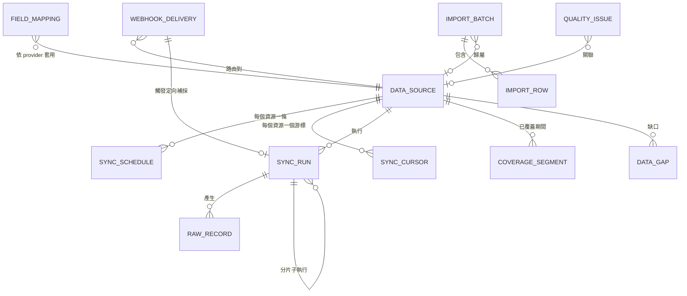

| 實體 | 說明 |
|---|---|
| `data_source` | 一個可採集的來源：某社媒帳號、某店鋪、某廣告帳戶、某 ESP、某資料供應商或純匯入。保存欄位覆蓋、可回溯範圍、允許用途與合約限制 |
| `sync_schedule` | 資料源 × 資源（如 `posts`、`post_metrics`、`comments`）的頻率與重疊時間窗 |
| `sync_cursor` | 每個資料源 × 資源的游標與「已確認完整」的高水位 |
| `sync_run` | 一次採集執行；回補時拆成多個分片子執行並掛在 `core.operation` 下 |
| `coverage_segment` | 已處理期間及其結果（完整／部分／超出保留期／無權限／失敗），是 DS02「已覆蓋日期、缺失區間」的唯一依據 |
| `raw_record` | 遮罩後的原始回應或檔案指標，供追溯（DS07）與重新正規化 |
| `webhook_delivery` | 平台事件的接收、驗簽、去重與路由紀錄 |
| `import_batch`／`import_row` | 檔案匯入的暫存、驗證、確認與合併 |
| `field_mapping` | 平台原始欄位 → 指標定義或實體欄位的版本化映射 |
| `data_gap`／`quality_issue` | 缺口與品質問題；只產生核對任務，**不改寫真實值** |

#### 5.3.3 狀態機

**同步執行 `sync_run`**

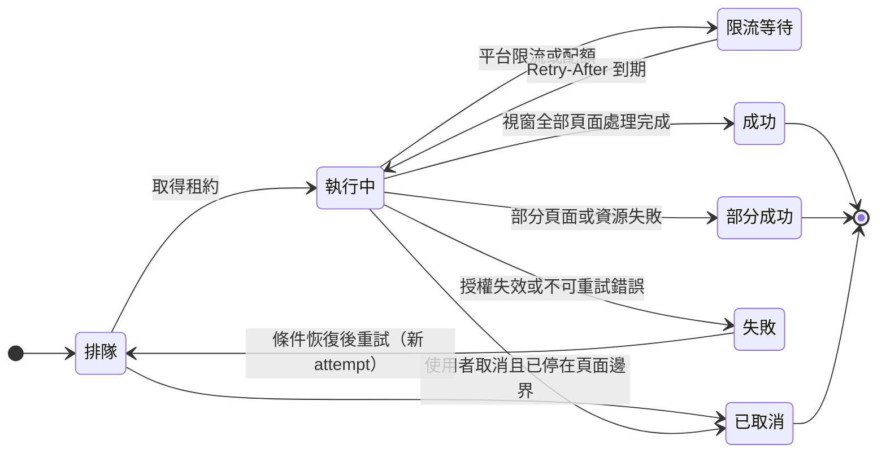

**匯入批次 `import_batch`**

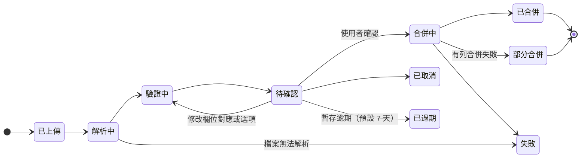

**資料缺口 `data_gap`**：`open → backfill_scheduled → resolved`；或 `open → unrecoverable`（超出平台保留期／無權限）；或 `open → accepted`（人工確認接受缺口並寫原因）。`unrecoverable` 與 `accepted` 的期間永遠不會被標為完整。

#### 5.3.4 資料表

**P0 資料表**

```sql
create table ingest.data_source (
  @std, @ws, @actor, @ver,
  name text not null,
  kind text not null,                 -- platform_account|store|ad_account|esp|vendor|file_import
  provider text not null,             -- meta_instagram|meta_facebook|tiktok|tiktok_shop|youtube|douyin|xiaohongshu|shopify|shopee|lazada|amazon_sp|file_import|vendor:<key>（lazada 自 P2，D17）
  connection_id uuid references account.connection(id),        -- 純匯入為 null
  social_account_id uuid references account.social_account(id),
  brand_id uuid references workspace.brand(id),
  resources text[] not null,          -- 啟用採集的資源鍵：{account_profile,posts,post_metrics,comments,products,…}
  field_coverage jsonb not null,      -- 依能力登錄計算：{resource:{status, fields:[…], missing:[{field,reason}]}}
  history_limit jsonb,                -- 來源可回溯範圍：{posts:'P2Y', post_metrics:'P90D'}（接入驗證後填寫）
  allowed_uses jsonb not null,        -- {display, team_share, export, public_display, model_processing, cache_days}
  contract_ref text,                  -- 合約／條款版本（供應商來源必填）
  status text not null,               -- active|paused|needs_authorization|degraded|disabled
  status_reason text,                 -- 例：ip_not_allowed（degraded；API 停派、退回檔案匯入，第 11 點）
  last_success_at timestamptz
);
create unique index on ingest.data_source (workspace_id, provider, connection_id, social_account_id)
  where status <> 'disabled';

create table ingest.sync_schedule (
  @std, @ws, @actor, @ver,
  data_source_id uuid not null references ingest.data_source(id),
  resource text not null,
  mode text not null,                 -- interval|cron|on_event|manual_only
  interval_seconds integer, cron text, tz text,
  overlap_seconds integer not null default 3600,   -- 重疊時間窗，處理延遲回補
  settle_seconds integer not null default 300,     -- 視窗終點保留的沉澱時間
  priority smallint not null default 5,
  adaptive jsonb,                     -- P1：{post_age_rules:[{max_age:'PT24H', interval:900}, …]}
  next_due_at timestamptz,
  paused_until timestamptz,
  unique (data_source_id, resource)
);
create index on ingest.sync_schedule (next_due_at) where paused_until is null;

create table ingest.sync_cursor (
  @std, @ws, @ver,
  data_source_id uuid not null references ingest.data_source(id),
  resource text not null,
  cursor jsonb,                       -- 平台游標或 since 參數
  high_watermark timestamptz,         -- 已確認完整的最新時間點
  last_run_id uuid,
  unique (data_source_id, resource)
);

create table ingest.sync_run (
  @std, @ws, @actor,
  data_source_id uuid not null references ingest.data_source(id),
  resource text not null,
  run_type text not null,             -- incremental|backfill|reconcile|manual_refresh|webhook_triggered
  status text not null,               -- queued|running|rate_limited|succeeded|partially_succeeded|failed|cancelled
  window_start timestamptz, window_end timestamptz,   -- 本次期間（含重疊）
  target_external_ids text[],         -- 定向補採（Webhook 觸發）時的對象
  cursor_in jsonb, cursor_out jsonb,
  counts jsonb not null default '{}', -- {pages, seen, new, changed, unchanged, rejected}
  request_count integer not null default 0,
  cost_units numeric not null default 0,
  error_class text,                   -- 4.15 ErrorClass
  error_reason text,                  -- 原因碼（細分 error_class，DS 定義）：ip_not_allowed（出口 IP 不在 allowlist／白名單，第 11 點）；手機 App 讀取停止原因 captcha|platform_restriction|identity_mismatch|auto_stopped|halted（第 12 點）
  error_detail jsonb,
  executor_ref jsonb,                 -- null＝worker 經適配器 sync()；手機 App 讀取（P1【需評估】，D21）：{channel:'mobile', device_id, mobile_device_id, app, task_type}
  operation_id uuid references core.operation(id),
  parent_run_id uuid references ingest.sync_run(id),
  trigger_ref jsonb not null,         -- {kind:'schedule'|'user'|'webhook'|'agent'|'event', id}
  attempt integer not null default 1,
  lease_owner_id text, lease_expires_at timestamptz, fencing_token bigint not null default 0,
  started_at timestamptz, finished_at timestamptz
);
create index on ingest.sync_run (data_source_id, resource, created_at desc);
create index on ingest.sync_run (status) where status in ('queued','running','rate_limited');

create table ingest.coverage_segment (   -- 需要 btree_gist
  @std, @ws,
  data_source_id uuid not null references ingest.data_source(id),
  resource text not null,
  period tstzrange not null,
  status text not null,               -- complete|partial|unavailable_out_of_retention|unavailable_no_permission|failed
  reason text,
  sync_run_id uuid,
  exclude using gist (data_source_id with =, resource with =, period with &&)
);                                    -- 寫入時合併相鄰同狀態區段，保持互不重疊

create table ingest.raw_record (
  id uuid not null, tenant_id uuid not null, workspace_id uuid not null,
  data_source_id uuid not null,
  sync_run_id uuid, webhook_delivery_id uuid, import_batch_id uuid,
  resource text not null,
  external_id text,
  fetched_at timestamptz not null,
  payload jsonb,                      -- 已遮罩；> 256 KB 改存 file_object
  payload_file_object_id uuid,
  payload_hash text not null,
  masked_fields text[] not null default '{}',
  transform_version text not null,    -- 正規化程式與 field_mapping 版本
  retention_until timestamptz not null,
  primary key (id, fetched_at)
) partition by range (fetched_at);    -- 按月分區；到期整分區刪除
create index on ingest.raw_record (data_source_id, resource, external_id, fetched_at desc);

create table ingest.webhook_delivery (
  id uuid not null,
  tenant_id uuid, workspace_id uuid,  -- 路由前可能未知
  provider text not null,
  endpoint_key text not null,
  received_at timestamptz not null,
  signature_status text not null,     -- valid|invalid|not_applicable
  dedupe_key text not null,           -- 平台事件 id；沒有時用 provider+payload_hash
  event_type text,
  event_occurred_at timestamptz,
  payload jsonb, payload_file_object_id uuid,
  status text not null,               -- received|rejected|duplicate|routed|processed|failed
  routed_data_source_id uuid,
  triggered_sync_run_id uuid,
  error jsonb,
  retention_until timestamptz not null, -- 歸入 OP05 raw_record（預設 90 天、工作區可調），見 5.3.11 第 8 點
  primary key (id, received_at)
) partition by range (received_at);   -- 按月分區；payload 寫入前遮罩，到期由 purge_expired 刪除

create table ingest.webhook_dedupe (   -- 跨分區去重
  provider text not null, dedupe_key text not null,
  first_delivery_id uuid not null, received_at timestamptz not null,
  primary key (provider, dedupe_key)
);                                    -- 每日清除 > 30 天

create table ingest.import_batch (
  @std, @ws, @actor, @ver,
  template_key text not null,         -- social_post_report|social_account_report|product_list|inventory_list|competitor_observation
                                      -- P1：order_list|refund_list|logistics|commission|ad_report|unit_cost
                                      -- 店鋪類模板依 data_source.provider 套用平台內建欄位對應（5.3.11 第 7 點）
  data_source_id uuid references ingest.data_source(id),
  file_object_id uuid not null references core.file_object(id),
  mapping jsonb not null,             -- 檔案欄 → 目標欄位
  options jsonb not null,             -- {timezone, currency, date_format, sheet, header_row, unit_overrides, dedupe_key}
  status text not null,               -- 見 5.3.3
  stats jsonb not null default '{}',  -- {rows, valid, invalid, dup_in_file, new, changed, unchanged}
  confirmed_by uuid, confirmed_at timestamptz, merged_at timestamptz,
  error_file_object_id uuid,          -- 失敗列下載（原欄位＋錯誤說明）
  supersedes_batch_id uuid,           -- 修正後重送的前一批
  operation_id uuid references core.operation(id),
  expires_at timestamptz not null
);

create table ingest.import_row (
  batch_id uuid not null references ingest.import_batch(id),
  row_no integer not null,
  tenant_id uuid not null,
  raw jsonb not null,
  normalized jsonb,
  dedupe_key text,
  status text not null,               -- valid|invalid|dup_in_file|new|changed|unchanged|merged|merge_failed|skipped
  issues jsonb,                       -- [{field, code, message}]
  target_ref jsonb,                   -- 合併後的目標 {module, resource_type, resource_id}
  primary key (batch_id, row_no)
);

create table ingest.field_mapping (
  id uuid primary key,
  tenant_id uuid,                     -- null = 系統內建，隨適配器版本發佈；P2 起允許租戶自訂
  provider text not null, resource text not null, api_version text not null,
  source_path text not null,          -- JSON Path 或匯入欄名
  target_kind text not null,          -- metric|entity_field
  metric_key text,                    -- analytics.metric_definition.key
  metric_definition_revision integer,
  entity_field text,                  -- 例：platform_post.caption
  transform jsonb,                    -- {unit:'ms_to_s', cumulative:true, tz_source:'utc'}
  revision integer not null,
  effective_from timestamptz not null, effective_to timestamptz
);
create unique index on ingest.field_mapping (coalesce(tenant_id,'00000000-0000-0000-0000-000000000000'), provider, resource, api_version, source_path, revision);

create table ingest.data_gap (
  @std, @ws,
  data_source_id uuid not null references ingest.data_source(id),
  resource text not null,
  period tstzrange not null,
  gap_type text not null,             -- missing_window|sync_failed|no_permission|out_of_retention|source_outage|webhook_missed|ip_not_allowed
  severity text not null,             -- info|warning|critical
  status text not null,               -- open|backfill_scheduled|resolved|unrecoverable|accepted
  detected_by text not null,          -- coverage_scan|quality_check|webhook_reconcile|manual
  backfill_run_id uuid,
  work_item_id uuid,                  -- WS 核對任務
  resolved_at timestamptz, resolution_note text
);

create table ingest.quality_rule (
  id uuid primary key, tenant_id uuid,   -- null = 系統規則
  key text not null,
  check_type text not null,           -- freshness|completeness|duplicate|anomaly_jump|negative_cumulative_delta|schema_drift|rate_limit_pressure
  scope jsonb not null,               -- {providers, resources, metric_keys}
  params jsonb not null,              -- 門檻
  severity text not null,
  active boolean not null default true
);

create table ingest.quality_issue (
  @std, @ws,
  rule_key text not null,
  data_source_id uuid, resource text,
  subject_ref jsonb,                  -- {resource_type, resource_id} 或 {external_id}
  observed jsonb not null,            -- 觸發值、基準、門檻
  fingerprint text not null,          -- 合併重複問題
  status text not null,               -- open|acknowledged|investigating|resolved|false_positive
  first_seen_at timestamptz not null, last_seen_at timestamptz not null,
  occurrences integer not null default 1,
  work_item_id uuid,
  resolved_by uuid, resolved_at timestamptz, resolution_note text
);
create unique index on ingest.quality_issue (workspace_id, fingerprint)
  where status in ('open','acknowledged','investigating');
```

**P1／P2 資料表**

| 表 | 階段 | 用途與關鍵欄位 |
|---|---|---|
| `ingest.vendor_usage` | P1 | 每資料源每小時用量：`requests`、`units`、`cost_minor`、`currency`、`quota_remaining` |
| `ingest.collection_budget` | P1 | 預算：`scope`（工作區／資料源）、`period`（月）、`cap_units`／`cap_minor`、`alert_thresholds`、`on_exceed`（alert_only\|reduce_frequency\|pause） |
| `ingest.response_cache` | P1 | 供應商回應快取：`request_hash`、`file_object_id`、`expires_at`（不得超過 `allowed_uses.cache_days`） |
| `ingest.import_mapping_preset` | P2 | 保存的欄位對應：`template_key`、`mapping`、`options`、`owner` |
| `ingest.lineage_edge` | P2 | 跨報表血緣：`from_ref` → `to_ref`、`transform_version` |

#### 5.3.5 權限

| 權限 | 說明 | 預設角色 |
|---|---|---|
| `ingest.source.read` | 查看資料源、同步狀態、覆蓋與缺口 | 全部內部角色 |
| `ingest.source.admin` | 建立／停用資料源、設定允許用途與合約 | `admin` |
| `ingest.sync.plan` | 調整頻率、手動刷新、發起回補與核對 | `social_ops`、`analyst`、`admin` |
| `ingest.import.draft` | 上傳、設定對應、預覽 | `social_ops`、`commerce_ops`、`analyst` |
| `ingest.import.plan` | 確認合併、取消批次 | 同上 |
| `ingest.raw.read` | 查看原始快照（遮罩後仍屬敏感） | `admin`、`analyst`（受資源範圍限制） |
| `ingest.quality.plan` | 處理品質問題與接受缺口 | `analyst`、`admin` |
| `ingest.budget.admin` | 採集預算（P1） | `admin` |

#### 5.3.6 Web API

前綴 `/api/v1/workspaces/{ws}`。

| 方法 | 路徑 | 說明 | 權限 | 階段 |
|---|---|---|---|---|
| GET | `/data-sources` | 清單（狀態、最後成功、覆蓋摘要） | source.read | P0 |
| POST | `/data-sources` | 建立（通常由 AC 連接完成時自動建立） | source.admin | P0 |
| GET／PATCH | `/data-sources/{id}` | 詳情／修改資源、允許用途 | source.read／admin | P0 |
| POST | `/data-sources/{id}/pause`、`/resume` | 暫停／恢復；`status_reason=ip_not_allowed` 的資料源以 `/resume` 做「重新檢查」，先送唯讀探測請求（5.3.11 第 11 點） | source.admin | P0 |
| GET | `/data-sources/{id}/coverage?resource=&from=&to=` | 覆蓋區段與缺口時間軸 | source.read | P0 |
| GET／PATCH | `/sync-schedules`、`/sync-schedules/{id}` | 頻率設定；間隔低於授權 `min_sync_interval_min` 回 `402 LICENSE_LIMIT`（P1） | sync.plan | P0 |
| POST | `/data-sources/{id}/refresh` | 手動刷新（`Idempotency-Key`）→ `202 {sync_run_id}`；距上次執行未達 `min_sync_interval_min` 或採集量達額度回 `402 LICENSE_LIMIT`（P1） | sync.plan | P0 |
| GET | `/sync-runs`、`/sync-runs/{id}` | 執行紀錄 | source.read | P0 |
| POST | `/backfills` | `{data_source_id, resources, from, to}` → `202 {operation_id}` | sync.plan | P0 |
| POST | `/data-sources/{id}/reconcile` | 指定期間重新核對 | sync.plan | P0 |
| GET | `/webhook-deliveries` | 接收紀錄、延遲、失敗 | source.admin | P0 |
| GET | `/import-templates` | 模板與欄位說明、範例檔 | import.draft | P0 |
| POST | `/imports` | `{template_key, file_object_id, data_source_id?}` | import.draft | P0 |
| GET／PATCH | `/imports/{id}` | 狀態與統計／修改對應與選項（觸發重新驗證） | import.draft | P0 |
| GET | `/imports/{id}/rows?status=` | 預覽列與問題 | import.draft | P0 |
| POST | `/imports/{id}/confirm`、`/cancel` | 確認合併／取消 | import.plan | P0 |
| GET | `/imports/{id}/error-file` | 下載失敗列 | import.draft | P0 |
| GET | `/provenance?resource_type=&resource_id=` | 來源鏈：資料源、批次、映射版本、原始紀錄 | source.read（原始內容需 raw.read） | P0 |
| GET | `/raw-records/{id}` | 原始快照（遮罩） | raw.read | P1 |
| GET | `/data-health` | 各資料源新鮮度、成功率、覆蓋率、開啟中的問題數 | source.read | P0 |
| GET／PATCH | `/data-quality/issues`、`/{id}` | 品質問題清單與處理 | quality.plan | P0 |
| GET | `/data-gaps` | 缺口清單 | source.read | P0 |
| POST | `/data-gaps/{id}/backfill`、`/accept` | 排回補／接受缺口 | sync.plan／quality.plan | P0 |
| GET | `/vendor-usage` | 用量 | source.read | P1 |
| GET／PUT | `/collection-budgets` | 預算 | budget.admin | P1 |

#### 5.3.7 MCP 工具

| 工具 | 類型 | 輸入要點 | 階段 |
|---|---|---|---|
| `data_sources_list` | 讀 | `workspace_id`、`brand_id?`、`provider?` → 狀態、覆蓋、允許用途 | P0 |
| `sync_status_get` | 讀 | `data_source_id`、`resource?` → 最後成功、下次執行、延遲、缺口 | P0 |
| `sync_refresh` | 寫（消耗配額） | `data_source_id`、`resources`、`idempotency_key` | P0 |
| `backfill_start` | 寫 | `data_source_id`、`resources`、`from`、`to` → `operation_id` | P0 |
| `data_gaps_list` | 讀 | 範圍、狀態 | P0 |
| `data_quality_list` | 讀 | 範圍、嚴重度 | P0 |
| `provenance_get` | 讀 | `resource_type`、`resource_id` → 來源鏈（不含原始內容，除非權杖有 `ingest.raw.read`） | P0 |
| `imports_get` | 讀 | `import_batch_id` → 狀態與問題摘要 | P0 |

匯入的上傳與確認只在 Web 提供（需要人工核對預覽）；Agent 可讀取問題摘要並協助修正檔案。

#### 5.3.8 事件

| 發出 | 時機 | 主要消費者 |
|---|---|---|
| `ingest.data_source.status_changed` | 狀態或欄位覆蓋變動（含 `status_reason`，例：`ip_not_allowed`） | WS02、AN01、PC（店鋪標示 IP 未登記、暫以檔案匯入，第 11 點） |
| `ingest.sync_run.completed` | 成功或部分成功（含 resource、window、counts） | AN（更新彙總）、LI、WS05 |
| `ingest.sync_run.failed` | 失敗（含 error_class、error_reason） | WS02、WS04、OP（告警訊號；`error_reason=ip_not_allowed` → `platform_ip_denied`，第 11 點） |
| `ingest.import_batch.awaiting_confirmation` | 驗證完成 | WS04（通知上傳者） |
| `ingest.import_batch.merged` | 合併完成（含部分合併） | 對應 sink 模組、WS04 |
| `ingest.data_gap.detected`／`resolved` | 缺口產生／解決 | AN（覆蓋標記）、LI（抑制誤警示）、WS02 |
| `ingest.quality_issue.opened`／`resolved` | 品質問題 | WS02、AN01 |
| `ingest.budget.threshold_reached` | 用量達門檻（P1） | WS04、OP |

| 訂閱 | 處理 |
|---|---|
| `account.connection.authorized` | 建立或啟用資料源，計算欄位覆蓋，建立預設排程；P0 預設回補最近 30 天（可在 WS06 導引調整） |
| `account.connection.revoked`／`account.capability.changed` | 重算 `field_coverage`；失去權限的資源暫停並產生 `no_permission` 缺口 |
| `execution.platform_post.observed` | P1：依作品年齡套用自適應指標同步頻率（DS03） |
| `ops.license.limit_reached` | P1：`sync_calls_month` 達額度時依 DS08 的 `on_exceed` 降頻或暫停排程同步，手動刷新回 `402 LICENSE_LIMIT`（5.3.11 第 10 點） |
| `account.binding.auto_stopped`／`auto_halted`／`auto_resumed`、`account.connector_auto_policy.halted`／`resumed`、`ops.connector_auto.stopped`／`resumed`、`account.mobile_app_binding.identity_mismatch`／`login_required`／`removed`／`verified`、`account.mobile_device.offline`／`online`／`removed`（P1【需評估】，D21） | 手機 App 留言讀取（5.3.11 第 12 點）：停止類事件 → 範圍內帳號的讀取排程停派，進行中的讀取停在頁面邊界；恢復類事件 → 重新判定，只恢復仍開啟自動模式、未緊急停止、綁定 `verified` 且手機在線的帳號 |

#### 5.3.9 背景任務

| 任務 | 觸發 | 佇列 | 冪等鍵 |
|---|---|---|---|
| `ingest.dispatch_due_syncs` | scheduler 每 30 秒 | `default` | `dispatch:<minute>` |
| `ingest.run_sync` | `sync_run` 建立 | `sync:<provider>` | `sync:<sync_run_id>:<attempt>` |
| `ingest.run_mobile_read` | `sync_run` 建立且 `executor_ref.channel=mobile`（P1【需評估】，D21）：派送唯讀手機任務、等待連接器逐頁回傳並呼叫 IN sink（5.3.11 第 12 點） | `sync:mobile` | `mread:<sync_run_id>:<attempt>` |
| `ingest.plan_backfill` | `POST /backfills` | `default` | `backfill:<operation_id>` |
| `ingest.process_webhook` | `ingress` 寫入 delivery（HTTPS 回呼；P1 另含 DS04 佇列消費者依 `ops.callback_endpoint` 讀取的 `amazon_sp` SQS／EventBridge 通知） | `default` | `wh:<delivery_id>` |
| `ingest.reconcile_window` | 每日、或缺口／手動觸發 | `sync:<provider>` | `reconcile:<source>:<resource>:<date>` |
| `ingest.parse_import`／`validate_import`／`merge_import` | 上傳、修改對應、確認 | `export` | `import:<step>:<batch_id>:<version>` |
| `ingest.scan_coverage` | 每小時 | `default` | `coverage:<ws>:<hour>` |
| `ingest.run_quality_checks` | 同步完成後＋每小時 | `default` | `qc:<source>:<resource>:<hour>` |
| `ingest.purge_expired` | 每日 | `default` | `purge:<date>` |
| `ingest.purge_misstored_pii` | 每日（P1，隨 Amazon 訂單同步，D19）：掃描 `amazon_sp` 的 `raw_record`、`webhook_delivery` payload 與匯入列（`import_row`），偵測到買家個資欄位即刪除或改寫為遮罩值並寫審計；期限依 OP 保留類別 `store_pii_amazon`（5.3.11 第 8 點） | `default` | `pii-purge:<date>` |
| `ingest.rollup_usage` | 每小時（P1） | `default` | `usage:<hour>` |

#### 5.3.10 前台頁面

| 路由 | 頁面 | 關鍵元件 | 階段 |
|---|---|---|---|
| `/w/:ws/data/sources` | 資料源清單 | `EntityTable`、`CapabilityBadge`、允許用途標籤 | P0 |
| `/w/:ws/data/sources/:id` | 資料源詳情：資源與排程、覆蓋時間軸、同步紀錄、Webhook | 覆蓋時間軸（完整／部分／不可得／失敗分色）、`StatusTimeline` | P0 |
| `/w/:ws/data/backfills` | 回補任務 | `OperationProgress` | P0 |
| `/w/:ws/data/imports/new` | 匯入精靈：上傳 → 對應 → 預覽 → 確認 | 欄位對應表、問題列篩選、統計摘要 | P0 |
| `/w/:ws/data/imports/:id` | 批次詳情與失敗列下載 | `EntityTable` | P0 |
| `/w/:ws/data/health` | 品質與缺口中心 | 新鮮度矩陣、問題清單、缺口清單 | P0 |
| `/w/:ws/data/usage` | 用量與預算 | ECharts 用量趨勢 | P1 |
| （全站） | 來源抽屜 | `ProvenanceDrawer` 呼叫 `/provenance` | P0 |

#### 5.3.11 關鍵規則與演算法

**1. Sink 契約**：DS 只負責「取得＋正規化」，寫入由擁有模組的 Facade 完成。所有 sink 必須冪等，並回傳 `SinkResult { created, changed, unchanged, rejected: [{key, reason}] }`，DS 據此填寫 `sync_run.counts`。

| 資料 | Sink（擁有模組 Facade） | 冪等鍵 | 階段 |
|---|---|---|---|
| 帳號資料（名稱、頭像、類型） | `account.applyObservedProfile(social_account_id, profile, source)` | `(social_account_id, payload_hash)` | P0 |
| 平台作品 | `execution.upsertObservedPost(ObservedPost)` → `{platform_post_id, created}`；EX 依 `(social_account_id, external_post_id)` 去重並負責與發布目標匹配 | `(social_account_id, external_post_id)` | P0 |
| 指標 | `analytics.recordObservations(ObservationBatch)` | `(subject, metric_key, period, dims_hash, observed_at)` | P0 |
| 留言、提及、私訊 | `inbox.ingestMessages(ExternalMessage[])` | `(connection_id, external_message_id)`；手機 App 讀取讀不到平台 ID 時 `external_message_id` 為 `syn:` 合成鍵（第 12 點） | P0（手機 App 讀取 P1【需評估】） |
| 商品、變體、市場快照 | `commerce.upsertCatalog(CatalogPage)`、`commerce.recordListingSnapshots(...)` | `(store_id, external_product_id／variant_id)` | P0 |
| 訂單、退款、交易 | `commerce.upsertOrders(...)`、`commerce.upsertRefunds(...)` | `(store_id, external_id, external_updated_at)` | P1 |
| 店鋪優惠／促銷（讀取） | `commerce.upsertPromotions(...)` | `(store_id, external_discount_id, external_updated_at)` | P1 |
| 競品觀測 | `intel.recordObservations(...)` | `(watch_target_id, external_id, observed_at)` | P1 |
| 廣告結構（帳戶、活動、廣告） | `ads.upsertAdEntities(...)`；支出等指標走 AN | `(ad_account_id, external_id)` | P1 |
| ESP 報表、抑制名單 | `lifecycle.applyEspSnapshot(...)` | `(connection_id, external_id, observed_at)` | P1 |

**2. 首批平台的採集資源**（社媒為 P0；店鋪平台依 D2 分 P0a／P0b／P1／P2：P1 Amazon 先、Shopee 後（D14），Lazada 延後到 P2（D17）；平台細節見 6.11）

| provider | 資源 | 方式 | 備註 |
|---|---|---|---|
| `meta_instagram` | `account_profile`、`posts`、`post_metrics`、`account_metrics`、`comments` | API 輪詢＋Webhook（留言） | 指標名稱與可用期間以第 6 章核實結果為準 |
| `meta_facebook` | `page_profile`、`posts`、`post_metrics`、`comments` | API 輪詢＋Webhook | 同上 |
| `tiktok` | `account_profile`、`videos`、`video_metrics` | API 輪詢 | 以授權 scope 決定可讀欄位 |
| `youtube` | `channel_profile`、`videos`、`video_metrics`、`comments` | Data API＋Analytics API 輪詢 | 指標有延遲，`settle_seconds` 需較長 |
| `douyin` | `account_profile`、`videos`、`video_metrics`；P1【需評估】：`comments` | 開放平台 API（取決於資質）；否則匯入；`comments` 優先走官方 API（6.7），API 不可用時評估由連接器經已綁定手機的抖音 App 讀取（唯讀任務 `douyin.app.comment_sync`，D21，第 12 點） | 不沿用 TikTok 適配器；手機 App 讀取只限已綁定帳號自己作品下的留言，依帳號頻率上限與時段窗排程，經 `InboxFacade.ingestMessages()` 寫入、`source.via=mobile_app`，讀不到平台 ID 時用合成去重鍵，自動停止或緊急停止時停止讀取，受手機互斥約束 |
| `xiaohongshu` | `notes`、`note_metrics`；P1【需評估】：`comments` | 匯入官方後台報表；連接器以唯讀白名單任務 `metrics.capture_snapshot` 讀取已登入的自有帳號頁面（P1，需逐平台評估，見 6.9）；`comments`（留言 API `unsupported`）評估由連接器經已綁定手機的小紅書 App 讀取（唯讀任務 `xhs.app.comment_sync`，D21，第 12 點） | 無已核實 API，介面標示「人工／匯入」；手機 App 讀取規則同 `douyin` |
| `tiktok_shop` | `products`、`variants`、`listings`；P1：`orders`、`refunds` | P0a 匯入（`product_list`）；P0b Partner API 唯讀輪詢＋商品 Webhook 定向補採；P1 訂單／退款 API | 唯讀；Affiliate 屬 CR（6.5） |
| `shopify` | `products`、`variants`、`listings`（含多市場價格、庫存）；P1：`orders`、`refunds`、`discounts` | P0a 匯入（product CSV＋inventory CSV；多地點庫存以 inventory CSV 為準）；P0b 經每客戶一個 custom app（D16）以 Admin API 輪詢＋Webhook（商品、庫存）＋每日核對；P1 訂單／退款／優惠 Webhook＋API | custom app 安裝到組織外店鋪須設 IP 白名單，請求須從固定出口 IP（OP `egress_ips`，5.19.11 (10)）發出，否則回 403：記 `error_reason=ip_not_allowed`，資料源標 IP 未登記、API 停派並以檔案匯入更新商品與庫存（訂單／退款無匯入範本，只記缺口、恢復後回補；OP 告警 `platform_ip_denied`，第 11 點）；訂單預設只能讀近期、更早需另申請權限；Webhook 不保證送達且連續失敗會被平台刪除，核對時一併檢查訂閱（見 6.11） |
| `amazon_sp` | `products`、`variants`、`listings`（各 marketplace）；P1：`orders`、`refunds` | P0a 匯入；P1（P1 店鋪中先實作，D14）SP-API 輪詢＋通知（SQS／EventBridge，無 HTTPS Webhook）定向補採；退款取財務交易 | 只申請非受限角色，訂單請求不帶買家／收件人資料，不保存買家個資（D19，第 8 點）；財務交易有延遲，退款視窗的 `settle_seconds` 需較長；授權以區域為單位（見 6.11） |
| `shopee` | `products`、`variants`、`listings`；P1：`orders`、`refunds`、`discounts`（選配） | P0a 匯入；P1（Amazon 之後，D14）Open Platform API 輪詢＋Push 推播定向補採；API 經 ISV＋ERP System app，於 Shopify／TikTok Shop 整合上線後申請（D18），核准前訂單／退款以報表匯入 | 推播可能重複、亂序或遺失，須每日核對並在可取回期限內補收；額度與呼叫成功率掛鉤；Returns API 需 ERP System 類 app（見 6.11）；IP 白名單不符（`source_ip_undeclared`）依第 11 點處理 |
| `lazada` | P2（D17）：`products`、`variants`、`listings`、`orders`、`refunds`、`discounts`（選配） | P2：匯入與 Open Platform API（各站點分別端點）輪詢＋推播（訂單、逆向訂單）；開發者路線屆時再定 | 退款推播不涵蓋全部狀態，退款以輪詢為準；大促降級期間 API 可能暫停，記 `source_outage` 缺口（見 6.11） |
| `file_import` | 匯入模板 | 檔案 | — |

**3. 增量同步**：視窗 = `[high_watermark − overlap_seconds, now − settle_seconds]`。逐頁取得 → 寫 `raw_record`（同一 `external_id` 若 `payload_hash` 與上次相同則只計 `unchanged`，不重複保存）→ 經 `field_mapping` 正規化 → 呼叫 sink。全部頁面成功才把 `high_watermark` 推進到視窗終點並寫入 `complete` 覆蓋區段；部分失敗保留原高水位、寫 `partial` 區段並建立缺口。**同步完成只代表「本系統已取得平台在該時刻提供的值」**，不代表平台原始資料已即時更新（構思 DS03）。每次 `sync_run` 結束時（含部分成功、失敗）由 DS 直接寫入 `ops.usage_event(meter_key='sync_calls')`（自 P0 起，見第 10 點 (a)）；排程間隔不得低於授權的 `min_sync_interval_min`（P1 起阻擋，回 `402 LICENSE_LIMIT`；見第 10 點）。

**4. 指標刷新與作品作用集**：累積型指標會持續變動，`post_metrics` 不依建立時間增量，而是對「作用集」（P0：最近 30 天發布的作品；P1：依作品年齡分層，例如 24 小時內每 15 分鐘、7 天內每 2 小時、28 天內每日）定期重抓，每次重抓都是一筆新的觀測。

**5. 回補（DS02）**：依資源把期間切成分片（預設 7 天），每片一個子 `sync_run`，掛在同一 `core.operation`；中斷後以分片游標續跑。超出 `history_limit` 或權限的期間直接寫 `unavailable_*` 區段與 `unrecoverable` 缺口，**不得標為完整**。

**6. Webhook（DS04）**：`ingress` 驗簽 → 寫 `webhook_delivery` → 以 `webhook_dedupe` 去重（重複者標 `duplicate`）→ 路由到資料源 → **建立定向補採**（`run_type=webhook_triggered`，只抓事件引用的對象），而不是直接套用事件內容；因此亂序事件不會讓資料倒退。寫入前比較 `external_updated_at`，舊值不覆蓋新值。每日 `reconcile_window` 以輪詢補採漏收事件，發現漏收寫 `webhook_missed` 缺口。推播通道以 OP 的 `ops.callback_endpoint` 為準：回呼不可達（OP08 可達性檢查 `ops.callback_probe`）、受限內網無法接收 Webhook，或缺回呼類前置條件（OP 5.19.11 (10)；不含固定出口 IP）時，OP 將該 provider 的端點標為 `fallback_polling=true`；DS 讀到此標記後，該 provider 的資料源不再等推播觸發，改為較高頻輪詢補採（間隔仍受第 10 點的 `min_sync_interval_min` 限制），並在資料源頁顯示原因；標記解除後恢復「推播定向補採＋每日核對」。固定出口 IP 未提供或不在 allowlist／白名單者不標 `fallback_polling`，依第 11 點處理（停派 API 同步、退回檔案匯入）。店鋪平台的推播不是 HTTPS 時（Amazon SP-API 通知只有 SQS／EventBridge），由 `ingress` 角色上的 DS04 佇列消費者讀取 `ops.callback_endpoint`（`provider=amazon_sp`、`channel=sqs|eventbridge`；`path` 為佇列或 destination 識別，存取憑證存 `core.secret`）取得通知，轉寫同一 `webhook_delivery`（`signature_status=not_applicable`），後續流程相同；客戶沒有 AWS 帳號等缺前置條件時該端點為 `fallback_polling=true`，佇列消費者不啟動，`amazon_sp` 只走 SP-API 輪詢。店鋪平台推播可能不保證送達、順序，或在連續失敗後被平台停用（見 6.11），因此店鋪資源一律保留每日核對，並檢查訂閱是否仍有效。

**7. 匯入驗證（DS05）**：時間欄位沒有時差時必須指定 `options.timezone`，否則整欄 invalid；幣別必須是 ISO 4217；數值解析失敗為 invalid，**不轉為零**；空白儲存格依模板定義為 `source_not_provided`。去重鍵由模板定義（例：貼文報表為 `(account, external_post_id, report_date)`）；檔案內重複標 `dup_in_file`；與既有資料比較得到 `new`／`changed`／`unchanged`。原檔與批次永久關聯，合併後的每筆資料 `source.batch_id = import_batch.id`。**店鋪商品匯入（P0a，D2）**：`product_list`（Shopify 另以 `inventory_list` 匯入庫存）依店鋪 `provider`（`tiktok_shop`、`shopify`、`amazon_sp`、`shopee`；`lazada` 自 P2，D17）套用該平台後台匯出檔的內建欄位對應（`field_mapping`，`tenant_id` 為 null），檔案若帶平台商品／變體 ID 一併保存，供日後升級為 API 同步時比對（5.4.11 第 9 條）。

| provider | P0a 商品匯入檔（見 6.11） | P1 訂單／退款匯入檔（`order_list`、`refund_list`；D2：訂單／退款含匯入範本一律 P1，P0a 只匯入商品） |
|---|---|---|
| `shopify` | 後台匯出 product CSV（`product_list`，含 `Price / International`）＋inventory CSV（`inventory_list`）；product CSV 的庫存欄只適用單一地點，多地點店鋪以 inventory CSV 為準 | —（P1 走 API） |
| `tiktok_shop` | 商品匯出檔 | —（P1 走 API） |
| `amazon_sp` | All Listings 報表（欄位比照 `GET_MERCHANT_LISTINGS_ALL_DATA`；解析時處理 UTF-8 BOM） | Seller Central 訂單報表、退款或付款報表（只取訂單號、金額、狀態等欄位，買家個資欄位寫入前丟棄，D19） |
| `shopee` | Seller Center 商品匯出檔 | Seller Center 訂單、退貨退款報表 |
| `lazada` | P2（D17）：Seller Center 商品匯出檔 | P2：Seller Center 訂單、退貨退款報表 |

**8. 原始資料保存與遮罩（DS07）**：寫入前依 provider 的遮罩規則移除 Email、電話、地址與私訊全文（私訊全文只存在 IN）；店鋪訂單的買家個資欄位（含平台列為個資的郵遞區號等，見 6.11）同樣在寫入前移除；`webhook_delivery.payload` 適用同一遮罩規則。**Amazon 不保存買家個資（D19）**：`amazon_sp` 只用非受限角色，訂單請求不帶買家／收件人資料，`raw_record`、`webhook_delivery` 與匯入列只保留歸因與佣金所需的訂單號、金額等欄位；若仍誤存買家個資，依規定期限（見 6.11.4.8）刪除，不等 `retention_until` 到期：背景任務 `ingest.purge_misstored_pii`（P1，隨 Amazon 訂單同步，5.3.9）每日掃描 `amazon_sp` 的 `raw_record`、`webhook_delivery` payload 與匯入列（`import_row`），偵測到 PII 欄位（例如非美國訂單的 `deliveryAddress.postalCode`）即刪除該欄位或改寫為遮罩值並寫審計；期限依 OP 保留類別 `store_pii_amazon`（訂單送達後 30 天，尚無送達時間時以收到時間起算；工作區只能縮短、不可放寬，見 OP 5.19.11 (4)、6.11.4.8），任務失敗計入 OP `job_failure_rate` 告警。**中國平台欄位最小化（D1）**：provider 為 `douyin`、`xiaohongshu` 時（含 API、匯入與連接器擷取），`raw_record`、`webhook_delivery` 與匯入列只保存 `field_mapping` 白名單中的營運必要欄位（作品 ID、連結、發布時間、指標、帳號識別等），其餘欄位在寫入前丟棄，不另存全文；白名單以該 provider 的內建 `field_mapping`（`tenant_id` 為 null）維護（見 4.17、6.7、6.8）。`retention_until = min(OP05 data_class raw_record 的有效保留期（工作區覆寫，否則租戶預設 90 天）, allowed_uses.cache_days)`，與 OP 5.19.11 (4) 一致；`webhook_delivery` 屬平台推播的原始資料，同樣歸入 `raw_record`（路由前工作區未知時取租戶預設，租戶也未知時取 90 天，路由後依工作區重算）。到期由 `purge_expired` 刪除，分區整體到期時直接 drop。供應商資料的展示、匯出、分享、送模型前呼叫 `ingest.checkUse(source_ids, use)`，與 OP 外送政策共同判定。

**9. 品質檢查（DS08）**：`freshness`（距上次成功超過預期頻率 × 2）、`completeness`（欄位覆蓋率低於門檻）、`duplicate`、`anomaly_jump`（期間增量超過近 14 日中位數 × N）、`negative_cumulative_delta`（累積值下降，常見於平台重算或刪除）、`schema_drift`（出現未映射欄位或欄位消失）、`rate_limit_pressure`。命中只建立 `quality_issue`（以 fingerprint 合併）並視嚴重度建立 WS 核對任務，**任何規則都不改寫觀測值**。

**10. 限流與預算**：排程派送前向 AC 的權杖桶取得許可；`rate_limited` 的執行依 `Retry-After` 延後。店鋪平台的限流與配額規則（含以呼叫成功率調整額度、跨應用共用計數者）見 6.11，本章不寫死數值，由適配器 `staticMatrix()` 與 AC 權杖桶設定；參數錯誤也會拖累成功率，適配器須在送出前自行驗證請求參數。P1 預算達 80% 通知、100% 依 `on_exceed` 降頻或暫停，並在資料源頁顯示原因。

授權額度（OP10，D8）：(a) 每個 `sync_run` 結束（含部分成功、失敗）時由 DS 直接寫 `ops.usage_event(meter_key='sync_calls', quantity=sync_run.request_count, source_ref={resource_type:'sync_run', resource_id})`，對應 `sync_calls_month`；不經事件訂閱，與 OP 5.19.8 的計量來源一致；(b) `sync_schedule.interval_seconds`（`cron` 以展開後最短間隔計）、P1 自適應頻率規則與手動刷新（含 MCP `sync_refresh`），間隔都不得低於授權的 `min_sync_interval_min`，設定或請求時違反回 `402 LICENSE_LIMIT`；(c) 收到 `ops.license.limit_reached`（`sync_calls_month`）時依 DS08 的 `on_exceed` 降頻或暫停排程同步，並在資料源頁顯示原因。OP10 在 P1 才阻擋，P0 只計量（(a) 自 P0 起寫入）。

**11. 出口 IP 拒絕（D16；OP 5.19.11 (10)）**：需 IP allowlist／白名單的店鋪平台，請求出口 IP 不在清單時會被拒。適配器 `classifyError` 回 `{ errorClass: 'permission_denied', reason: 'ip_not_allowed' }`（4.15：ErrorClass 不擴充，細分原因碼以 `reason` 附帶），DS 把 `reason` 記入 `sync_run.error_reason`（原因碼定義見本點與 5.3.4 `sync_run`）；訊號不明確的 403 不歸此原因碼，仍依原 ErrorClass 處理。

| provider | 判定訊號（見 6.11.2.5、6.11.3.5） | 階段 |
|---|---|---|
| `shopify` | Admin API 因 IP allowlist 回 403（與缺 scope 的 `ACCESS_DENIED`、店鋪被標記詐欺的 403、非過期 token 的 403 分開判定） | P0b |
| `shopee` | `source_ip_undeclared` | P1 |
| `lazada` | IP 白名單不符（錯誤碼【未核實】，接入時核實） | P2（D17） |

| 步驟 | 處理 |
|---|---|
| 記錄 | `sync_run` 轉 `failed`，`error_class=permission_denied`、`error_reason=ip_not_allowed`，`error_detail` 記實際出口 IP（OP `egress_ips`）與平台回應摘要；不重試 |
| 告警 | 發 `ingest.sync_run.failed`（含 `error_reason`），OP 據此觸發 `platform_ip_denied`（以 provider＋連接為 `scope_key`，5.19.11 (10)） |
| 資料源 | 該連接的資料源轉 `degraded`、`status_reason=ip_not_allowed`（發 `ingest.data_source.status_changed`，PC 店鋪標示「IP 未登記，暫以檔案匯入」）；`dispatch_due_syncs` 停派其 API 同步（含定向補採與每日核對）；Webhook 照常接收記錄 |
| 覆蓋 | 自首次拒絕起寫 `failed` 覆蓋區段與 `data_gap(gap_type=ip_not_allowed)`，不標 `unrecoverable` |
| 退回匯入 | 期間以檔案匯入更新商品與庫存（`product_list`／`inventory_list`），資料源頁直接提供匯入入口。訂單／退款只有具備報表範本的 provider 可以退回匯入（`order_list`／`refund_list`；P1：`shopee`；`lazada` 自 P2，D17）；`shopify` 沒有訂單／退款匯入範本（第 7 點，P1 走 API），拒絕期間其訂單／退款只記 `data_gap(gap_type=ip_not_allowed)`，恢復後依「恢復」列回補，超出 60 天且未取得 `read_all_orders` 的部分轉 `unrecoverable`（6.11） |
| 恢復 | 管理員把出口 IP 補登到平台清單後，在資料源頁按「重新檢查」（`POST /data-sources/{id}/resume`），DS 送一次唯讀探測請求：成功即恢復 `active` 與排程，並對 `ip_not_allowed` 缺口排回補（超出平台可回溯範圍者轉 `unrecoverable`）；仍被拒則維持原狀 |

**12. 手機 App 留言讀取（抖音、小紅書；P1【需評估】，D21；IN 5.11.11 第 11 條）**：抖音留言 API 不可用、小紅書留言 API `unsupported` 時，評估由本地連接器在客戶自有、已綁定的實體手機上自動操作 App 讀取留言。本項屬 D21「必要時互動」的延伸（0.5 D21、4.16），只限綁定帳號自己作品下的留言、不含私訊，評估通過前不開放；D21 是否涵蓋留言互動列入 10.3 待使用者確認。讀取屬自動操作，沿用 D4 的自動模式規則（4.16、5.2.11）；Android 與 iPhone（只能由 macOS 上的連接器控制）規則相同。

| 面向 | 規則 |
|---|---|
| 範圍 | 只讀已綁定帳號自己作品下的留言（作品作用集同第 4 點），不含私訊、他人作品、搜尋或推薦頁；資料源為該帳號的 `douyin`／`xiaohongshu` 資料源，資源 `comments` |
| 前提 | 派送前以 AC `resolveExecutors(account, 'comment_read')` 判定，只在回傳 `channel=mobile` 且 `mode=auto` 時派送（帳號已由工作區管理員開啟自動模式並完成現行版本風險確認（D15）、帳號／工作區／OP 均未緊急停止、手機 `ready`、App 綁定 `verified`、OP `component_compat` 允許該唯讀任務類型）；任一不符本次不讀取（讀取沒有人員按鈕環節，不降級為輔助），資料源頁顯示原因，IN 維持原文入口＋人工記錄 |
| 排程 | `sync_schedule(resource='comments')` 的 `next_due_at` 只落在帳號 `auto_allowed_windows` 內；間隔不低於 `auto_min_interval_seconds` 與授權 `min_sync_interval_min`（第 10 點），每小時不超過 `auto_max_per_hour`；讀取與發布、回覆是否共用 `auto_daily_cap`，依 IN 5.11.11 第 11 條評估項 (b) 定案。頻率上限的目的是遵守平台限制、降低平台負載 |
| 互斥 | 讀取任務與發布、回覆嘗試共用 EX 手機槽 `execution.mobile_device_slot`（EX 5.10.4 P1 表，以 `holder_kind=sync_run`、`holder_id=sync_run.id` 持有；一支手機同時只執行一個任務，5.10.11）；取不到時短延遲重排，不搶占進行中的提交 |
| 執行 | `sync_run.executor_ref={channel:'mobile', …}`，由 `ingest.run_mobile_read` 派送唯讀白名單任務 `douyin.app.comment_sync`／`xhs.app.comment_sync`（6.9）；連接器先以 `mobile.verify_app_identity` 在 App 內核對登入身分（AC05），再逐作品開啟留言串、逐頁回傳；任務不按送出、按讚、關注、刪除等任何寫入按鈕 |
| 寫入 | 每頁經 `InboxFacade.ingestMessages()` 寫入（第 1 點 sink），`source={via:'mobile_app', mobile_device_id, captured_at, sync_run_id}`；`raw_record` 依第 8 點中國平台欄位最小化只存白名單欄位（作品 ID、去重鍵、作者暱稱、正文雜湊、App 顯示時間原文、擷取時間），留言正文只交給 IN，不存截圖 |
| 去重 | 讀得到平台留言 ID 時以其為 `external_message_id`；讀不到時用合成去重鍵 `syn:`＋hash(作品 `external_post_id`、作者暱稱、正規化正文雜湊、時間近似（App 顯示時間換算到日）)；重讀同一留言只計 `unchanged`。相對時間在不同讀取時刻換算可能不一致，可靠性待驗證（IN 評估項 (a)） |
| 完整性 | 未讀到留言串底部或中途停止時 `sync_run` 記 `partially_succeeded`、寫 `partial` 覆蓋區段，不推進高水位；IN 據此將對話 `sync_state` 標 `partial`／`stale` |
| 停止 | 遇驗證碼、風控提示、身分不符：連接器立即停止並回報，`sync_run` 記 `failed`、`error_reason` 為 `captcha`／`platform_restriction`／`identity_mismatch`，AC 開阻塞事件並自動停止該帳號自動模式，讀取轉人工（IN 原文入口），不重試，直到阻塞解決且管理員重新開啟自動模式。帳號自動停止或帳號／工作區／OP 緊急停止生效（5.3.8 訂閱）：停派，進行中的讀取停在頁面邊界並記 `cancelled`、`error_reason` 為 `auto_stopped`／`halted`，已讀頁面保留；解除後只恢復仍開啟自動模式的帳號 |
| 硬性邊界 | 不做瀏覽器或裝置指紋偽裝、不修改裝置識別碼、不以模擬器／雲手機冒充實體裝置、不 root／越獄來隱藏自動化、不規避平台偵測、不破解或代解驗證碼、不模擬人類行為以躲避風控、不做帳號農場（手機只操作已綁定的客戶自有帳號）；遇驗證碼、風控、身分不符一律停止並轉人工 |
| 平台條款 | 抖音、小紅書用戶協議限制自動化程式或第三方軟體接入，封號風險由客戶在風險確認時承擔（6.9） |

#### 5.3.12 功能分期與驗收

| 功能 | P0 | P1 | P2 | 驗收要點 |
|---|---|---|---|---|
| DS01 數據源連接與使用範圍 | `data_source` 隨 AC 連接自動建立；欄位覆蓋與 `allowed_uses` 顯示；首批社媒平台＋檔案；店鋪：P0a 四平台（TikTok Shop、Shopify、Amazon、Shopee）商品檔案匯入，P0b TikTok Shop、Shopify 商品目錄唯讀同步 | Amazon（`amazon_sp`）、Shopee 商品資料源（Amazon 先、Shopee 後，D14）；四平台訂單／退款資料源；合約允許的情報供應商；`checkUse` 接入匯出與模型 | Lazada 資料源（D17）；供應商切換與並行比對 | 無權限欄位顯示原因而非空白；供應商資料匯出被條款阻擋時回 `EGRESS_BLOCKED`；出口 IP 不在 allowlist／白名單（403）時 `sync_run.error_reason=ip_not_allowed`、觸發 OP `platform_ip_denied`、資料源標 IP 未登記並停派 API 同步、商品與庫存可改用檔案匯入（訂單／退款只限有報表範本的 provider；Shopify 訂單／退款只記缺口），「重新檢查」成功後恢復並回補缺口（第 11 點） |
| DS02 歷史資料回補 | 有限期間回補（預設 30 天，可延長至來源上限），分片與進度 | 跨來源缺口清單、續跑 | 大量帳號分批與排隊策略 | 中斷後續跑不重複抓已完成分片；超出保留期顯示「不可得」 |
| DS03 增量同步與更新頻率 | 固定頻率、重疊視窗、手動刷新、作品作用集 | 依作品年齡自適應頻率；抖音、小紅書留言經手機 App 讀取【需評估】（D21，第 12 點） | 依成本、限流與熱度自動分配 | 顯示最後成功、下次更新、延遲；手動刷新受冪等保護；手機 App 讀取只在帳號自動模式開啟時、時段窗內、頻率上限內派送，與發布／回覆共用手機槽；自動停止或緊急停止後不再派送、進行中者停在頁面邊界；合成去重鍵重讀不產生重複訊息 |
| DS04 Webhook 去重與補採 | 驗簽、去重、定向補採、每日核對；P0b TikTok Shop、Shopify 商品／庫存事件；`ops.callback_endpoint.fallback_polling=true` 的 provider 改為較高頻輪詢 | 四平台訂單、退款推播（含 Amazon SQS／EventBridge 通知，佇列消費者依 `ops.callback_endpoint` 的 `channel=sqs\|eventbridge` 讀取；Shopee Push）；Amazon、Shopee 商品事件依平台提供範圍（見 6.11）；合作事件 | Lazada 推播（訂單、逆向訂單，D17）；事件重播、來源延遲分析 | 同一事件送兩次只處理一次；亂序事件不使資料倒退；`fallback_polling=true` 時改輪詢且資料源頁顯示原因 |
| DS05 CSV／Excel 與人工匯入 | 社媒報表、競品觀測模板；店鋪商品匯入（P0a）：Shopify product CSV＋inventory CSV（多地點庫存必須用後者）、TikTok Shop 商品匯出檔、Amazon All Listings 報表（UTF-8 BOM）、Shopee Seller Center 商品匯出檔；預覽、確認、失敗列下載 | 訂單、退款（含 Amazon 訂單與退款／付款報表、Shopee Seller Center 報表）、物流、佣金、單位成本模板 | Lazada 商品、訂單、退款匯入範本（D17）；保存映射、大檔分批 | 錯誤列不寫入；空白不變零；可重送修正檔並保留前批關聯 |
| DS06 指標口徑與缺失標記 | `field_mapping` 版本化；所有觀測帶 `availability`（與 AN01 共用定義） | 訂單退款與多幣種口徑（各店鋪平台金額單位與售價口徑差異在 `field_mapping` 轉換，見 6.11） | 自訂指標與定義版本 | 圖表可區分零、未採集、無權限、來源未提供 |
| DS07 原始證據與資料追溯 | `/provenance` 來源鏈、批次、映射版本 | 權限化原始快照檢視；`amazon_sp` 誤存個資每日清除（`ingest.purge_misstored_pii`，隨 Amazon 訂單同步，D19，第 8 點） | 跨報表血緣、保留策略管理 | 從報表數值可回到批次與原始紀錄；到期資料已清除時顯示「已依保留政策刪除」；`amazon_sp` 的 `raw_record`、`webhook_delivery` payload 或匯入列混入 `postalCode` 等個資欄位時，每日任務刪除或遮罩該欄位並寫審計，最遲不超過訂單送達後 30 天（OP `store_pii_amazon`），工作區覆寫無法放寬 |
| DS08 品質監控與採集預算 | 同步健康、缺口告警、品質規則 | 供應商用量、預算、快取、補採排程 | 品質規則自訂、成本預測 | 異常只產生問題與任務，不改值；預算超限依設定降頻或暫停 |


### 5.4 店鋪商品與跨境市場（PC）｜模組鍵 `commerce`

> schema 命名為 `commerce` 而非 `catalog`，因為本模組同時擁有店鋪來源的訂單、退款、交易等商務事實（見 3.5）。

#### 5.4.1 職責與邊界

| 類別 | 內容 |
|---|---|
| 擁有 | 店鋪登記（`store`）、店鋪與市場的價格來源設定、商品與變體（`product`、`product_variant`）、跨店對照（`variant_group`）、市場商品快照（`listing_snapshot`）、商品事實（`product_fact`＋修訂）、商品多語與區域版本（`product_localization`＋修訂）、重大變動紀錄（`change_event`）；P1 起擁有促銷（`promotion`）、訂單、退款、交易、優惠使用、店鋪客戶 |
| 不擁有（引用） | 外部連接與權杖（AC `account.connection`）；採集排程、游標、原始回應、匯入批次（DS `ingest.*`）；商品圖片與影片（AS `asset`，以 `asset_id` 引用）；受影響發布目標的判定與阻擋（PL 訂閱本模組事件後自行判定）；統一客戶與同意（EM `lifecycle.*`）；歸因與收益計算（AN） |
| 主帳原則 | 店鋪／ERP 是價格、庫存、交易的主帳；本模組只保存觀測快照、引用與營運用的事實補充，**不回寫主帳價格或庫存**（構思第 3 章）。P1 的寫回（多語、優惠）必須先讀回驗證 |
| 店鋪來源（D2、D14、D17） | 四個店鋪平台：TikTok Shop（`tiktok_shop`）、Shopify（`shopify`）、Amazon（`amazon_sp`）、Shopee（`shopee`）；Lazada（`lazada`）延後到 P2（D17，開發者路線屆時再定）。**P0a** 四平台以檔案匯入商品（Shopify 另以 inventory CSV 匯入多地點庫存）；**P0b** TikTok Shop、Shopify 商品目錄唯讀自動同步；**P1** Amazon、Shopee 商品同步（實作順序 Amazon 先、Shopee 後，D14），以及四平台訂單／退款同步。訂單／退款一律 P1，含 Amazon、Shopee 的訂單／退款報表匯入（DS `order_list`、`refund_list` 模板）；P0a 只匯入商品，不匯入訂單或退款。**P2** Lazada 商品匯入、商品同步與訂單／退款（含報表匯入）。不屬於上述平台的來源（ERP、自建站）用 `file_import`。各平台應用路線與資料邊界見 5.4.11 第 12 條；平台能力、授權與限制見 6.11 |
| 上游 | AC（店鋪連接：`tiktok_shop`、`shopify` 自 P0b；`amazon_sp`、`shopee` 自 P1（Amazon 先）；`lazada` 自 P2）、DS（同步管線與檔案匯入把原始頁交給本模組的正規化器）、WS（`market`） |
| 下游 | CO（插入商品事實、引用快照）、PL／EX（發布前商品核查）、CA（活動關聯商品）、LP（購買網址）、CR（寄樣 SKU、佣金訂單）、AN（訂單、退款、淨銷售）、AI（`catalog_search`、`market_snapshot`） |

#### 5.4.2 領域模型

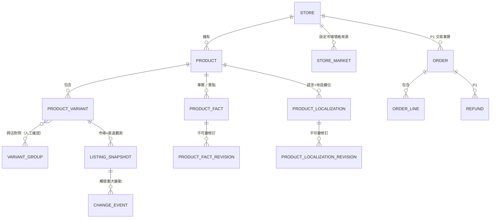

| 實體 | 關鍵語義 |
|---|---|
| `store` | 一個外部店鋪或匯入來源；`provider` = `tiktok_shop`／`shopify`／`shopee`／`lazada`（P2）／`amazon_sp`／`file_import`／`other`。P0a 匯入的平台店鋪也記實際平台鍵（`connection_id` 為 null、`status=import_only`），日後授權時沿用同一 `store` 升級為自動同步；一次授權涵蓋多店或多站點時，多個 `store` 共用同一 `account.connection`。粒度：TikTok Shop、Shopee 一店一市場；Lazada（P2）每個站點一個 `store`；Amazon 以賣家帳號×區域為一個 `store`，各 marketplace 對應 `store_market`；Shopify 一店可對多個市場（見 6.11） |
| `product`／`product_variant` | 以 `(store_id, external_*_id)` 唯一；SKU 只是業務欄位並加店鋪命名空間，**同 SKU 不同店不自動合併** |
| `variant_group` | 跨店「同一實體商品」的業務歸組，只能人工建立或人工確認系統建議；合併與拆分寫歷史 |
| `store_market` | 某店鋪在某 `market`×渠道的價格來源、購買網址樣板與啟用狀態（PC03 P0 的「使用者設定目標市場與價格來源」） |
| `listing_snapshot` | 變體×市場×渠道的觀測值：售價、比較價、幣別、可售、庫存狀態、購買網址、來源、平台更新時間（`source_updated_at`）與擷取時間（`observed_at`）；只新增不覆寫 |
| `product_fact` | 一條可被內容引用的商品事實；分類為 `spec`（規格）、`claim`（可佐證宣稱）、`selling_point`（賣點）、`usage_scenario`（情境）、`marketing_copy`（行銷描述）、`speculation`（推測） |
| `product_localization` | 某商品欄位在某語言（可再細到某市場）的版本；綁定來源版本雜湊 |
| `change_event` | 偵測到的重大變動（價格、可售、庫存跨閾值、事實撤回、多語失效）；下游模組據此做影響分析 |

#### 5.4.3 狀態機

**店鋪連線狀態（`store.status`）**

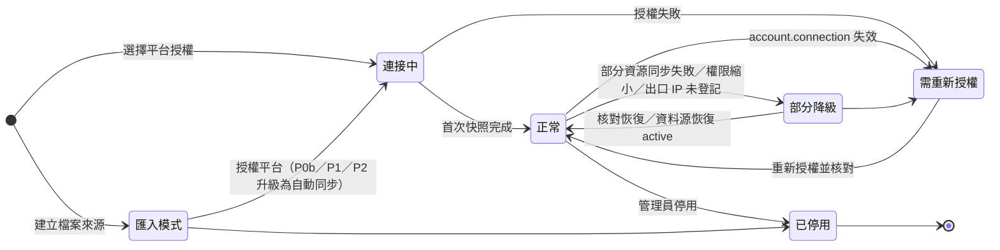

**多語版本（`product_localization.status`）**

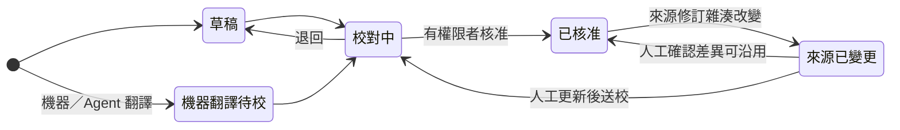

規則：`Approved` 狀態下若產生新的機器翻譯，只建立新修訂並把狀態留在 `Approved`、`pending_revision_id` 指向新修訂；不得替換 `approved_revision_id`（構思 PC05）。`origin=machine` 的修訂只能來自客戶在 AI07 配置的 `translate` 用途路由（P1，經外送檢查）；系統不內建任何機器翻譯引擎或模型供應商。未配置模型時隱藏機器翻譯入口，譯文只能由人工、外部 Agent 經 MCP（`origin=agent`）或店鋪同步（`store_sync`）產生。

#### 5.4.4 資料表

**P0 DDL**

```sql
create table commerce.store (
  @std, @ws, @actor, @ver,
  brand_id uuid not null references workspace.brand(id),
  provider text not null,                   -- tiktok_shop|shopify|shopee|lazada|amazon_sp|file_import|other（lazada 自 P2，D17）
  connection_id uuid references account.connection(id),   -- 純匯入為 null；可多店共用一個連接
  data_source_id uuid references ingest.data_source(id),  -- 同步設定由 DS 管
  external_store_id text,                   -- 平台店鋪 ID（Lazada、Amazon 加站點或區域後綴）；未授權的匯入店鋪可為 null
  name text not null,
  default_currency char(3) not null,
  default_locale text not null,
  region text,                              -- 平台店鋪所在站點或區域（如 TikTok Shop US、Lazada TH、Amazon NA）
  sync_scope jsonb not null default '{}',   -- {products:true, inventory:true, orders:false, inventory_source?:'inventory_list'}（後者見 5.4.11 第 11 條）
  status text not null,                     -- import_only|connecting|active|degraded|needs_reauth|disabled
  status_reason text,                       -- 例：ip_not_allowed（degraded；出口 IP 未登記，暫以檔案匯入，D16）
  last_snapshot_at timestamptz,             -- 最近一次完整快照完成
  last_incremental_at timestamptz,
  unique (tenant_id, provider, external_store_id)
);

create table commerce.store_market (        -- PC03：店鋪×市場×渠道的價格來源
  @std, @ws, @actor, @ver,
  store_id uuid not null references commerce.store(id),
  market_id uuid not null references workspace.market(id),
  channel text not null,                    -- online_store|tiktok_shop|marketplace|other
  price_source text not null,               -- store_market_price|store_base_price|manual
  purchase_url_template text,               -- 例：https://shop.example/{locale}/products/{handle}?variant={variant_id}
  low_stock_threshold integer,              -- 跨越時觸發 change_event
  inventory_locations text[],               -- 計入此市場庫存的地點（Shopify 多地點）；null = 全部地點加總（5.4.11 第 11 條）
  snapshot_ttl_minutes integer not null default 1440,  -- 超過視為過期，預檢顯示
  enabled boolean not null default true,
  unique (store_id, market_id, channel)
);

create table commerce.product (
  @std, @ws, @actor, @ver,
  store_id uuid not null references commerce.store(id),
  brand_id uuid not null references workspace.brand(id),
  external_product_id text,                 -- 手動建立為 null
  handle text,
  title text not null,                      -- 店鋪原文標題（多語另見 product_localization）
  product_type text, vendor text,
  status text not null,                     -- active|draft|archived|removed_at_source
  primary_asset_id uuid references asset.asset(id),
  source jsonb not null,                    -- 4.2 統一來源結構
  source_updated_at timestamptz,            -- 來源端最後修改時間
  unique (store_id, external_product_id)
);

create table commerce.product_variant (
  @std, @ws, @ver,
  product_id uuid not null references commerce.product(id),
  store_id uuid not null references commerce.store(id),
  external_variant_id text,
  sku text,                                 -- 業務欄位，不作全域唯一
  barcode text,
  options jsonb not null default '{}',      -- {color:'黑', size:'M'}
  status text not null,                     -- active|archived|removed_at_source
  source jsonb not null,
  unique (store_id, external_variant_id)
);
create index on commerce.product_variant (store_id, sku);

create table commerce.variant_group (       -- PC02：跨店對照
  @std, @ws, @actor, @ver,
  brand_id uuid not null references workspace.brand(id),
  name text not null,
  note text
);

create table commerce.variant_group_member (
  @std, @ws, @actor,
  group_id uuid not null references commerce.variant_group(id),
  variant_id uuid not null references commerce.product_variant(id),
  linked_via text not null,                 -- manual|suggestion_accepted|import
  evidence text,                            -- 對照依據（同條碼、人工確認說明）
  unlinked_at timestamptz, unlinked_by uuid, unlink_reason text
);
create unique index on commerce.variant_group_member (variant_id) where unlinked_at is null;

create table commerce.listing_snapshot (    -- 只新增；每個 (variant, market, channel) 只有一列 is_current
  @std, @ws,
  variant_id uuid not null references commerce.product_variant(id),
  market_id uuid not null references workspace.market(id),
  channel text not null,
  observed_at timestamptz not null,         -- 本系統擷取時間（快照年齡依此計算）
  source_updated_at timestamptz,            -- 平台端該價格／庫存的最後更新時間；平台未提供為 null
  price_amount_minor bigint,                -- null = 未取得
  compare_at_amount_minor bigint,
  currency char(3),
  price_source text not null,               -- store_market_price|store_base_price|manual|fx_estimate
  is_estimate boolean not null default false,
  fx_rate_id uuid references core.fx_rate(id),
  available_for_sale boolean,               -- null = 未知
  inventory_quantity integer,               -- null = 未取得或無權限
  inventory_status text not null,           -- in_stock|low|out_of_stock|unknown|not_tracked
  purchase_url text,
  availability text not null,               -- 4.9：observed|not_collected|no_permission|source_not_provided|sync_failed
  source jsonb not null,
  is_current boolean not null default true
);
create unique index on commerce.listing_snapshot (variant_id, market_id, channel) where is_current;
create index on commerce.listing_snapshot (variant_id, market_id, channel, observed_at desc);

create table commerce.product_fact (
  @std, @ws, @actor, @ver,
  product_id uuid not null references commerce.product(id),
  variant_id uuid references commerce.product_variant(id),  -- 僅適用特定變體時填
  brand_id uuid not null references workspace.brand(id),
  fact_key text not null,                   -- material|dimensions|ingredient|warranty|selling_point_1…
  category text not null,                   -- spec|claim|selling_point|usage_scenario|marketing_copy|speculation
  applicable_market_ids uuid[],             -- null = 全部市場
  current_revision_id uuid,                 -- 指向最新修訂
  approved_revision_id uuid,                -- 指向最新已核准修訂（內容只能插入已核准者）
  status text not null,                     -- active|retracted
  unique (product_id, variant_id, fact_key)
);

create table commerce.product_fact_revision (   -- 不可變
  id uuid primary key, tenant_id uuid not null, workspace_id uuid not null,
  fact_id uuid not null references commerce.product_fact(id),
  revision_no integer not null,
  value jsonb not null,                     -- {type:'text'|'number'|'locale_text', text?, number?, unit?, by_locale?}
  category text not null,
  evidence_urls text[] not null default '{}',
  evidence_ids uuid[] not null default '{}',  -- core.evidence
  source jsonb not null,                    -- 店鋪同步、人工、Agent 提案
  review_status text not null,              -- draft|approved|rejected|superseded
  reviewed_by uuid, reviewed_at timestamptz,
  content_hash text not null,
  created_by_type text not null, created_by_id uuid,
  created_at timestamptz not null default now(),
  unique (fact_id, revision_no)
);

create table commerce.product_localization (  -- PC05
  @std, @ws, @actor, @ver,
  product_id uuid not null references commerce.product(id),
  field_key text not null,                  -- title|description|selling_points|size_guide|fact:<fact_id>
  locale text not null,
  market_id uuid references workspace.market(id),   -- null = 該語言通用；非 null = 地區用語版本
  source_locale text not null,
  source_ref jsonb not null,                -- {kind:'store_field'|'product_fact_revision', id, content_hash}
  status text not null,                     -- draft|machine_translated|in_review|approved|stale
  current_revision_id uuid,
  approved_revision_id uuid,
  pending_revision_id uuid,                 -- 已核准狀態下的新機譯候選
  writeback_status text not null default 'none',  -- none|pending|written|verified|failed（P1）
  unique (product_id, field_key, locale, market_id)
);

create table commerce.product_localization_revision (   -- 不可變
  id uuid primary key, tenant_id uuid not null, workspace_id uuid not null,
  localization_id uuid not null references commerce.product_localization(id),
  revision_no integer not null,
  text text not null,
  origin text not null,                     -- human|machine|agent|store_sync
  source_hash text not null,                -- 翻譯當下來源內容雜湊
  glossary_version text,                    -- AS 術語集版本（knowledge_entry glossary 修訂雜湊）
  content_hash text not null,
  created_by_type text not null, created_by_id uuid,
  created_at timestamptz not null default now(),
  unique (localization_id, revision_no)
);

create table commerce.change_event (        -- PC06：重大變動
  @std, @ws,
  change_type text not null,                -- price_changed|became_unavailable|became_available|stock_low|out_of_stock|fact_retracted|fact_revised|localization_stale|product_removed
  product_id uuid not null references commerce.product(id),
  variant_id uuid references commerce.product_variant(id),
  market_id uuid references workspace.market(id),
  channel text,
  before jsonb, after jsonb,
  snapshot_id uuid references commerce.listing_snapshot(id),
  detected_at timestamptz not null,
  severity text not null,                   -- blocking|review|info
  status text not null,                     -- open|acknowledged|resolved|dismissed
  resolved_by uuid, resolved_at timestamptz, resolution_note text
);
create index on commerce.change_event (workspace_id, status, detected_at desc);
```

**P1／P2 資料表（簡表）**

| 表 | 階段 | 用途 | 關鍵欄位 |
|---|---|---|---|
| `commerce.promotion` | P1 | 促銷活動與店鋪優惠規則對照（PC07） | `campaign_id`、`market_ids`、`external_discount_id`、`rule`（門檻、折扣、適用商品）、`valid_from/until`、`state`（draft／scheduled／active／expired／cancelled）、`verified_at` |
| `commerce.promotion_code` | P1 | 優惠碼（含達人專屬碼） | `promotion_id`、`code`、`external_id`、`assigned_to`（creator／campaign）、`usage_limit` |
| `commerce.order` | P1 | 訂單事實（主帳在店鋪） | `(store_id, external_order_id)` 唯一、`placed_at`、`currency`、`subtotal/discount/tax/shipping/total_minor`、`financial_status`、`fulfillment_status`、`cancelled_at`、`store_customer_id`、`landing_site`／`utm`（若店鋪提供） |
| `commerce.order_line` | P1 | 訂單明細 | `order_id`、`variant_id`、`quantity`、`unit_price_minor`、`discount_minor` |
| `commerce.refund` | P1 | 退款物件（不等於已退款） | `order_id`、`external_refund_id`、`amount_minor`、`created_at`、`status`（requested／pending／succeeded／failed）、`lines` |
| `commerce.payment_transaction` | P1 | 收付款交易 | `order_id`、`kind`（sale／capture／refund／void）、`status`、`amount_minor`、`processed_at` |
| `commerce.discount_usage` | P1 | 優惠碼使用紀錄 | `order_id`、`code`、`promotion_id`、`amount_minor` |
| `commerce.store_customer` | P1 | 店鋪客戶（來源事實；統一客戶在 EM） | `(store_id, external_customer_id)`、加密 email／phone、`marketing_consent_raw`；只保存平台在不申請受限個資權限下提供的欄位，Shopee（P1）／Lazada（P2）為遮罩值；Amazon 不建立（只用非受限角色、不取得買家個資，D19；見 6.11） |
| `commerce.localization_writeback` | P1 | 多語寫回店鋪的請求與讀回驗證 | `localization_id`、`revision_id`、`status`、`verified_at`、`error` |
| `commerce.inventory_rule` | P2 | 缺貨自動暫停／恢復規則（PC06 P2） | `scope`、`condition`、`action`（pause_targets／notify）、`resume_condition` |

#### 5.4.5 權限

| 權限 | 說明 | 預設角色 |
|---|---|---|
| `commerce.store.read` | 查看店鋪與同步狀態 | 全部內部角色 |
| `commerce.store.admin` | 新增店鋪、授權、同步範圍、停用 | admin、commerce_ops |
| `commerce.product.read` | 商品、變體、快照 | 全部內部角色、agent（依權杖） |
| `commerce.product.draft` | 手動商品、對照、價格來源設定 | commerce_ops |
| `commerce.fact.draft` | 新增或修改事實（產生草稿修訂） | commerce_ops、social_ops、producer |
| `commerce.fact.approve` | 核准事實修訂 | commerce_ops、brand_lead |
| `commerce.localization.draft`／`.approve` | 多語草稿／核准 | social_ops／commerce_ops、brand_lead |
| `commerce.change.plan` | 確認、處理或駁回重大變動 | commerce_ops、social_ops |
| `commerce.promotion.plan`／`.execute` | P1：促銷草稿／寫入店鋪 | commerce_ops |
| `commerce.order.read` | P1：訂單明細（個資遮罩依角色） | commerce_ops、analyst、support |

#### 5.4.6 Web API

| 方法 | 路徑（前綴 `/api/v1/workspaces/{ws}`） | 說明 | 權限 | 階段 |
|---|---|---|---|---|
| GET／POST | `/stores` | 列表／建立店鋪（匯入模式直接建立為 `import_only`，P0a 四平台（`tiktok_shop`、`shopify`、`amazon_sp`、`shopee`）與 `file_import` 皆可，`lazada` 自 P2；選擇授權則回傳 AC 授權網址（Shopify 為該客戶 custom app 的安裝連結，D16），`tiktok_shop`、`shopify` 自 P0b，`amazon_sp`、`shopee` 自 P1，`lazada` 自 P2） | store.read／store.admin | P0 |
| POST | `/stores/{id}/connect` | 匯入模式店鋪升級為自動同步：回傳 AC 授權網址，授權後沿用同一 `store` 並比對既有商品（5.4.11 第 9 條） | store.admin | P0b |
| GET／PATCH | `/stores/{id}` | 詳情（同步狀態、最近錯誤、DS 資料源摘要）／修改範圍 | store.read／admin | P0 |
| POST | `/stores/{id}/sync` | 手動觸發增量或完整快照（轉 DS，回 `operation_id`） | store.admin | P0 |
| POST | `/stores/{id}/imports` | 上傳商品檔（`template_key=product_list`）；Shopify 店鋪另可上傳庫存檔（`inventory_list`，依地點覆寫庫存，5.4.11 第 11 條）。轉 DS 匯入批次，預覽後確認；依 `store.provider` 套用該平台匯出檔的預設欄位對應。P0 只接受商品類模板 | product.draft | P0 |
| POST | `/stores/{id}/imports`（`template_key=order_list`／`refund_list`） | Amazon、Shopee 訂單／退款報表匯入（D2：訂單／退款含匯入一律 P1；TikTok Shop、Shopify 走 API；Lazada 自 P2，D17） | store.admin | P1 |
| GET／PUT | `/stores/{id}/markets` | 店鋪×市場價格來源設定 | store.read／product.draft | P0 |
| GET | `/products` | 搜尋（品牌、店鋪、市場、SKU、狀態、可售） | product.read | P0 |
| GET／PATCH | `/products/{id}` | 商品詳情（變體、事實、多語、使用處）／手動欄位 | product.read／draft | P0 |
| GET | `/products/{id}/usage` | 被哪些內容修訂、發布目標、活動、素材引用（讀 CO／PL Facade） | product.read | P0 |
| GET | `/variants/{id}/listings` | 各市場×渠道最新快照與歷史 | product.read | P0 |
| GET／POST | `/variant-groups`、`/variant-groups/{id}/members` | 跨店對照；`GET /variant-groups/suggestions` 給建議 | product.read／draft | P0 |
| DELETE | `/variant-groups/{id}/members/{memberId}` | 拆分（寫 `unlinked_*`） | product.draft | P0 |
| GET／POST | `/products/{id}/facts` | 事實列表／新增 | product.read／fact.draft | P0 |
| POST | `/facts/{id}/revisions` | 新修訂（`If-Match`） | fact.draft | P0 |
| POST | `/fact-revisions/{id}/approve`、`/reject` | 核准／退回 | fact.approve | P0 |
| GET／PUT | `/products/{id}/localizations` | 多語欄位矩陣／更新草稿 | product.read／localization.draft | P0 |
| POST | `/localizations/{id}/approve`、`/accept-source-change` | 核准／確認來源差異可沿用 | localization.approve | P0 |
| POST | `/localizations/{id}/writeback` | 寫回店鋪並讀回驗證 | localization.approve | P1 |
| GET | `/change-events` | 重大變動清單（含下游影響計數） | product.read | P0 |
| POST | `/change-events/{id}/acknowledge`、`/resolve`、`/dismiss` | 處理 | change.plan | P0 |
| CRUD | `/promotions`、`/promotions/{id}/verify` | 促銷與對照驗證 | promotion.plan／execute | P1 |
| GET | `/orders`、`/orders/{id}`、`/refunds` | 訂單事實查詢 | order.read | P1 |

#### 5.4.7 MCP 工具

| 工具 | 類型 | 輸入要點 | 階段 |
|---|---|---|---|
| `catalog_search` | 讀 | `query`、`brand_id`、`store_id`、`market_id`、`available_only`；輸出含 `as_of`、`source` | P0 |
| `catalog_get_product` | 讀 | `product_id`；回傳變體、已核准事實、各市場最新快照 | P0 |
| `market_snapshot` | 讀 | `variant_ids[]`、`market_id`、`channel`；回傳價格、幣別、可售、庫存、`is_estimate`、`observed_at`、是否過期 | P0 |
| `catalog_list_facts` | 讀 | `product_id`、`category[]`、`approved_only`（預設 true） | P0 |
| `catalog_propose_fact` | 寫（草稿） | `product_id`、`fact_key`、`category`、`value`、`evidence_urls`；只產生 `draft` 修訂 | P0 |
| `catalog_update_localization` | 寫（草稿） | `localization_id` 或 `(product_id, field_key, locale, market_id)`、`text`、`expected_version`；不得覆寫已核准版本 | P0 |
| `commerce_list_changes` | 讀 | `status`、`since`、`campaign_id`；回傳受影響目標數 | P0 |
| `promotion_get` | 讀 | `promotion_id` 或 `campaign_id` | P1 |
| `orders_summary` | 讀 | 聚合查詢（期間、店鋪、商品、活動）；不回傳個資 | P1 |

#### 5.4.8 事件

| 發出 | 時機 | 主要訂閱者 |
|---|---|---|
| `commerce.store.status_changed` | 店鋪狀態轉換 | WS02 異常總覽、DS |
| `commerce.product.upserted`／`.removed_at_source` | 正規化後新增、變更、來源刪除 | CO（引用失效提示）、CA、WS 搜尋索引 |
| `commerce.listing.changed` | 寫入新快照且與前一列有重大差異（價格、可售、庫存跨閾值） | PL（掃描受影響 `publish_target`）、LP、AD、CA |
| `commerce.fact.revised`／`.approved`／`.retracted` | 事實修訂狀態變化 | CO（`content_reference` 標記 stale）、AI 上下文快取 |
| `commerce.localization.stale`／`.approved` | 來源變更／核准 | CO05、WS04 待辦 |
| `commerce.change_event.created` | 建立重大變動紀錄 | WS02、WS04 |
| `commerce.promotion.changed`／`.expired`、`commerce.order.upserted`、`commerce.refund.upserted`、`commerce.store_customer.upserted` | P1 | AN、CR、LP、EM |

| 訂閱 | 處理 |
|---|---|
| `ingest.sync_run.completed` | 執行商品／快照正規化器（本模組提供 sink） |
| `ingest.import_batch.merged` | 商品檔、庫存檔（`product_list`、`inventory_list`）匯入落庫；P1 起含訂單／退款報表（`order_list`、`refund_list`） |
| `account.connection.authorized`（purpose=store） | 依授權回傳的店鋪／站點／區域清單建立 `store`，或關聯既有 `import_only` 的 store 並轉 `connecting`（5.4.11 第 9 條）；一個連接可對應多個 store |
| `account.connection.expired`／`.revoked` | 更新 `store.status` |
| `ingest.data_source.status_changed`（`status_reason=ip_not_allowed`） | 店鋪轉 `degraded`、`status_reason=ip_not_allowed`，頁面標示「IP 未登記，暫以檔案匯入」（D16；DS 5.3.11 第 11 點）；資料源恢復 `active` 時回復 `active`；狀態有變即發 `commerce.store.status_changed` |
| `workspace.market.updated` | 重算快照過期判定與 `store_market` 有效性 |

#### 5.4.9 背景任務

| 任務 | 觸發 | 佇列 | 冪等鍵 |
|---|---|---|---|
| `commerce.normalize_catalog_page` | DS 同步頁抵達 | `sync:<provider>` | `norm:<raw_record_id>` |
| `commerce.apply_product_import` | 匯入批次確認（`product_list`；Shopify `inventory_list` 為另一批，只依地點覆寫庫存，見 5.4.11 第 11 條） | `export` | `import:<import_batch_id>` |
| `commerce.detect_listing_changes` | 新快照寫入後（同交易 add_job） | `default` | `chg:<snapshot_id>` |
| `commerce.mark_stale_listings` | 每 15 分鐘 | `default` | `stale:<store_id>:<window>` |
| `commerce.mark_localization_stale` | `commerce.fact.revised`、店鋪原文變更 | `default` | `l10n:<source_hash>` |
| `commerce.reconcile_store` | 每日；完整快照比對刪除與漏同步 | `sync:<provider>` | `recon:<store_id>:<date>` |
| `commerce.writeback_localization` | P1：核准後寫回 | `sync:<provider>` | `wb:<localization_revision_id>` |
| `commerce.normalize_orders` | P1：訂單／退款同步頁，或 `order_list`／`refund_list` 匯入批次確認 | `sync:<provider>` | `norm:<raw_record_id>`；匯入為 `import:<import_batch_id>` |

#### 5.4.10 前台頁面

| 路由（前綴 `/w/:ws/commerce`） | 頁面 | 關鍵元件 | 階段 |
|---|---|---|---|
| `/stores` | 店鋪與同步中心 | `EntityTable`、`CapabilityBadge`、`OperationProgress`、`EmptyState` | P0 |
| `/stores/:id` | 店鋪詳情：授權、範圍、市場價格來源、同步歷史、錯誤 | `StatusTimeline`、`ProvenanceDrawer` | P0 |
| `/products` | 商品清單（市場可售欄、價格欄依市場切換） | `EntityTable`、`MetricValue`（價格未取得顯示狀態） | P0 |
| `/products/:id` | 商品詳情分頁：變體／市場快照／事實／多語／使用處／變動 | `RelatedObjects`、`DiffViewer` | P0 |
| `/products/:id/localization` | 多語並排編輯（原文、譯文、地區版本、狀態） | `DiffViewer`、`CommentThread` | P0 |
| `/mapping` | 跨店對照與建議 | `BatchActionDialog` | P0 |
| `/changes` | 重大變動與受影響清單（內容、目標、廣告草稿） | `BatchActionDialog`（批次暫停轉 PL） | P0 |
| `/promotions` | 促銷與優惠碼、渠道文案一致性檢查 | `EntityTable` | P1 |
| `/orders` | 訂單、退款明細 | `EntityTable`、`ProvenanceDrawer` | P1 |

#### 5.4.11 關鍵規則與演算法

1. **價格來源優先序**：`store_market_price`（店鋪對該市場的實際售價）＞ `store_base_price`（店鋪基準價，僅在 `store_market` 明確允許時）＞ `manual` ＞ `fx_estimate`。`fx_estimate` 一律 `is_estimate=true`，**不得被 CO 以「售價」欄位插入可發布內容**，只能在分析或內部檢視中顯示（構思 PC03、8.3）。
2. **快照過期**：快照年齡＝`now() - observed_at`（本系統擷取時間）；`source_updated_at`（平台更新時間）可能缺漏或與平台時鐘不一致，只作顯示與回查比對參考，不用於計算年齡。年齡 `> store_market.snapshot_ttl_minutes` 視為過期；PL04／EX02 對引用過期快照的目標給「需重新核查」而非直接通過。
3. **重大變動判定**（`detect_listing_changes`）：價格任意變動（含幣別）→ `review`；`available_for_sale` 由 true 轉 false 或 `inventory_status` 轉 `out_of_stock` → `blocking`；跨越 `low_stock_threshold` → `review`；恢復可售 → `info`。只有 `availability='observed'` 的快照參與比較，未知不觸發「變為缺貨」。
4. **對照建議**：同條碼、同品牌下標題相似度高於門檻、同 `external_product_id` 跨平台映射紀錄 → 產生建議；**只有人工接受才建立 `variant_group_member`**。
5. **事實可用性**：CO 插入時只取 `approved_revision_id`；`speculation` 類事實不可插入對外內容（編輯器阻擋）；`claim` 類需至少一個佐證（`evidence_urls` 或 `evidence_ids`）才可核准。
6. **多語覆寫保護**：機器或 Agent 產生的修訂永遠不改變 `approved_revision_id`；地區版本（`market_id` 非 null）不被語言通用版本的更新覆蓋；來源 `content_hash` 與 `source_hash` 不符即轉 `stale`。
7. **訂單事實（P1）**：主鍵 `(store_id, external_order_id)`；取消、退款申請、退款成功分列；退款以 `refund.status='succeeded'` 才計入淨銷售扣減（構思 8.3、R29）。四平台的訂單／退款取得方式不同，部分平台退款事實有延遲、或預設只能讀近期訂單（見 6.11）；未完整期間由 DS 覆蓋區段標示，不推定為「無退款」。Amazon、Shopee 另可用後台報表匯入（`order_list`、`refund_list`），與 API 同步共用同一主鍵去重，同樣自 P1 起（D2）；Lazada 自 P2（D17）。
8. **店鋪平台分期與寫入邊界（D2、D14、D17）**：P0a 四平台（TikTok Shop、Shopify、Amazon、Shopee）只以檔案匯入商品（含 Shopify 庫存檔），不匯入訂單或退款；P0b TikTok Shop、Shopify 只唯讀同步商品、變體、價格、庫存（Shopify 依市場查價）；P1 Amazon、Shopee 商品同步（Amazon 先、Shopee 後）與四平台訂單／退款同步；P2 Lazada（商品匯入、同步與訂單／退款）。寫入（多語、優惠、聯盟）一律 P1 以後、選配，須人工核准並讀回驗證；平台寫入可能整筆重新校驗、觸發商品重審或逾時後結果不明，一律以讀回結果為準（見 6.11）。
9. **匯入升級為自動同步**：同一 `store` 由 `import_only` 轉 `connecting` 後，`normalize_catalog_page` 在首次完整快照依序以 `external_product_id`／`external_variant_id`（匯入檔有提供時）、`handle`、店鋪內 SKU 比對既有商品；唯一比對成功才沿用原 `product`／`product_variant`（保留事實、多語與內容引用），零筆或多筆者建立對照待辦，不自動合併、不刪除。
10. **平台口徑與使用限制**：各平台「售價」口徑不同（例如是否已含進行中促銷），正規化時把原口徑記入 `source`；平台規則要求導回平台商品頁的店鋪（如 Shopee，見 6.11），商品資料只用於導回該平台，`purchase_url` 必須指向平台商品頁、不得導向站外成交；買家個資在 Shopee／Lazada 為遮罩值，Amazon 不取得也不保存（D19，第 12 條）；歸因不依賴買家身分（訂單號、優惠碼、UTM、短鏈，見 5.16）；Amazon 的歸因與佣金只用訂單號與金額（D19）。
11. **Shopify 多地點庫存匯入（P0a）**：Shopify product CSV 的庫存欄只適用單一地點，多地點店鋪以 inventory CSV（DS `inventory_list`）為準（見 6.11）。
    - 順序：先匯入 `product_list` 建立商品與變體；`inventory_list` 每列為「變體×地點」數量，以 `handle`＋選項值比對變體，比對不到再用店鋪內 SKU；仍比對不到或多筆者該列 invalid（`variant_not_found`／`ambiguous_variant`），不新建變體。
    - 計算：各啟用 `store_market` 的庫存 = `inventory_locations` 所列地點（null 為全部地點）可售數量（available）的加總；寫入新的 `listing_snapshot`，價格欄沿用該 (variant, market, channel) 目前快照，各地點明細記入 `source.locations`，`source.batch_id` 指向庫存批次。
    - 覆寫：店鋪一旦匯入過 `inventory_list`（記 `store.sync_scope.inventory_source='inventory_list'`），之後的 `product_list` 只更新商品、變體與價格，不再以其庫存欄寫入快照。
    - 升級：P0b 改為 API 同步後依 `read_locations` 取得地點，`inventory_locations` 中的地點名稱依名稱對應一次轉為 location_id；對應不到者建立對照待辦，不自動丟棄。
    - 寫入後照常執行 `detect_listing_changes`（第 3 條）。
12. **店鋪平台應用路線與資料邊界（D16–D19；細節見 6.11）**：

| 平台 | 應用／開發者路線 | 啟用 | 資料邊界 |
|---|---|---|---|
| Shopify | 每客戶一個 custom app：SaaS 由我方 Partner 組織以 custom distribution 產生該客戶的安裝連結；私有部署客戶可在自家商家組織建 app。暫不上架 App Store；日後要做多商家 SaaS 須另建 public app（分發方式選定後不可變更） | P0b | custom distribution 安裝到組織外店鋪須設 IP 白名單，SaaS 與私有部署都從固定出口 IP 呼叫（OP `egress_ips`，5.19.11 (10)），清單外請求回 403 |
| Amazon（`amazon_sp`） | SP-API 只申請非受限角色，不申請 Restricted 角色 | P1（P1 店鋪中先實作） | 不取得、不保存買家個資：訂單請求不帶買家／收件人資料，`store_customer` 不建立；歸因與佣金只用訂單號與金額；誤存的個資依規定期限刪除（DS 5.3.11 第 8 點） |
| Shopee | SaaS 走 ISV＋ERP System app，在 SmartSell 已有上線的 Shopify／TikTok Shop 整合後才申請，以提高通過率；私有部署見 6.11 | P1（Amazon 之後）；API 核准前訂單／退款以報表匯入 | 買家資料為遮罩值，不申請個資存取 |
| Lazada | 開發者路線到 P2 再定 | P2 | 不申請敏感資料權限 |

#### 5.4.12 功能分期與驗收

| 功能 | P0 | P1 | P2 | 驗收要點 |
|---|---|---|---|---|
| **PC01 店鋪接入與同步中心** | `store`；P0a 四平台（TikTok Shop、Shopify、Amazon、Shopee）商品檔案匯入（DS 匯入批次；Shopify 為 product CSV＋inventory CSV）；P0a 不匯入訂單或退款；P0b TikTok Shop、Shopify 商品目錄唯讀自動同步（取得平台應用授權後，Webhook＋定期核對；Shopify 為每客戶一個 custom app，D16）與匯入店鋪升級；同步狀態與錯誤 | Amazon（`amazon_sp`）、Shopee 商品同步（Amazon 先、Shopee 後，D14；Shopee 在 Shopify／TikTok Shop 整合上線後申請 ISV，D18）；四平台訂單／退款同步（推播＋定期核對）；Amazon、Shopee 訂單／退款報表匯入（`order_list`、`refund_list`，D2）；其他店鋪 | Lazada 商品匯入、商品同步、訂單／退款同步與報表匯入（D17）；多店批次管理 | 連線成功但快照未完成時，商品頁顯示「同步中」而非空清單；失敗原因可見且可重試；匯入店鋪升級後不重建商品、內容引用不中斷；多地點 Shopify 店鋪的庫存以 inventory CSV 為準，之後再匯入 product CSV 不覆蓋庫存；Amazon 訂單與退款不含任何買家個資欄位 |
| **PC02 商品變體與 SKU 對照** | 自建商品／變體、手動對照、`variant_group`、內容使用處；P0b 起 TikTok Shop、Shopify 由店鋪 API 自動更新 | Amazon、Shopee 由店鋪 API 自動更新；對照建議 | Lazada 由店鋪 API 自動更新；大量對照審查 | 兩店同 SKU 不自動合併；拆分後歷史關聯仍可查 |
| **PC03 市場可售與地區價格** | `store_market` 價格來源設定、`listing_snapshot`、估算標記；P0b 起 TikTok Shop、Shopify 自動快照（Shopify 依市場查價，見 6.11） | Amazon 各 marketplace 與 Shopee 各站點的價格與庫存快照 | Lazada 各站點快照；依支付與渠道擴充 | 換匯估算價不能插入內容；未取得價格顯示「未取得」 |
| **PC04 商品事實與內容引用** | `product_fact`＋修訂、分類、佐證、核准；CO 引用 | 店鋪資料驅動的事實變更檢查 | 事實衝突偵測 | 內容引用可回溯到事實修訂與時間；推測類不可插入 |
| **PC05 多語商品與區域版本** | `product_localization`＋修訂、狀態機、覆寫保護 | 寫回店鋪翻譯並讀回驗證（選配，見 6.11）：Shopify 可行（需翻譯寫入權限，只在店家已發布的語系對買家可見）；Amazon 可行（依 marketplace 與語言標記寫入、先預覽驗證，可接受語言【未核實】）；Shopee 可改描述但多語翻譯【未核實】；TikTok Shop 未規劃（見 6.5、6.11.1）；不可行或無寫入權限時匯出 | 術語一致性檢查；Lazada 寫回（多語翻譯【未核實】，D17） | 原文更新後譯文轉「來源已變更」；機譯不覆蓋已核准地區內容 |
| **PC06 庫存價格與排程聯動** | `change_event`、發布前人工核對與過期標記（PL 訂閱） | 庫存／價格事件自動掃描排程、批次暫停轉 PL | `inventory_rule` 缺貨暫停與恢復 | 改價後受影響目標出現在變動頁與日曆，未經處理不得以舊批准發布 |
| **PC07 促銷活動與優惠規則** | — | `promotion`、`promotion_code` 匯入（四平台）；優惠讀取 API（選配，見 6.11）：Shopify、Shopee，Amazon 只能取得促銷成效報表且需品牌資格，TikTok Shop 未規劃（見 6.5、6.11.1）；有效期檢查、活動關聯；取得寫入權限後建立優惠並讀回驗證 | 組合促銷；Lazada 優惠匯入與讀取（欄位【未核實】，D17） | 草稿、生效、實際使用三種狀態分開；文案與實際優惠不一致時提示 |


### 5.5 活動、營運目標與預算（CA）｜模組鍵 `campaign`

#### 5.5.1 職責與邊界

| 類別 | 內容 |
|---|---|
| 擁有 | 活動（`campaign`）、分市場設定（`campaign_market`）、目標（`campaign_goal`）、活動商品關聯（`campaign_product`）、渠道規劃欄位（`campaign_plan_slot`）、簡報（`brief`＋修訂）、追蹤設定；P1 起擁有預算（`budget_line`）、費用承諾（`cost_commitment`）、實際費用（`cost_entry`）、結案快照（`campaign_closeout`）；P2 活動範本 |
| 不擁有（引用） | 里程碑與任務（WS `work_item`，本模組定義類型與依賴語義）；內容（CO `content_item.campaign_id`）；發布目標（PL `publish_target.campaign_id`）；短鏈與 UTM（LP，透過 Facade 產生）；達人合作（CR `collaboration.campaign_id`）；廣告（AD）；成效數字（AN）；花費審批（core 審批引擎） |
| 原則 | 活動是跨模組的主對象，但**其他模組的物件自行保存 `campaign_id`**，本模組不複製它們；矩陣與總覽以讀取側查詢組合 |
| 上游 | WS（品牌、市場）、PC（商品） |
| 下游 | CO、PL、CR、LP、AD、EM、AN、TE（客戶門戶的活動視圖） |

#### 5.5.2 領域模型

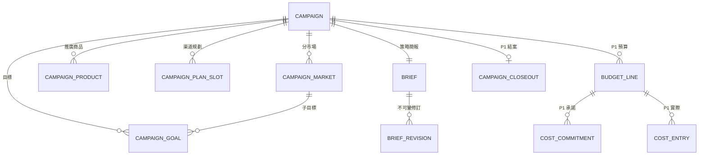

| 實體 | 關鍵語義 |
|---|---|
| `campaign` | 類型（新品、節慶、促銷、常態、品牌）、期間、負責人、品牌、狀態、`utm_key`（活動追蹤識別） |
| `campaign_market` | 活動在某市場的期間、語言、負責人、子目標；保留共同活動歸屬 |
| `campaign_goal` | 指標鍵（引用 AN `metric_definition.key`）、單位、基準值與基準來源、目標值、截止時間、範圍（全活動／某市場） |
| `campaign_plan_slot` | 「計畫」：在某平台／帳號／語言／活動階段預計產出幾則內容、在什麼時間窗；矩陣以此對照實際的內容與發布目標 |
| `brief` | 一個活動一份主簡報（可加附屬簡報）；修訂不可變，可送審 |
| 里程碑 | WS `work_item`，`kind='campaign_milestone'`；任務 `kind='campaign_task'`；依賴存在 WS 的 `work_item_dependency` |

#### 5.5.3 狀態機

**活動（`campaign.status`）**

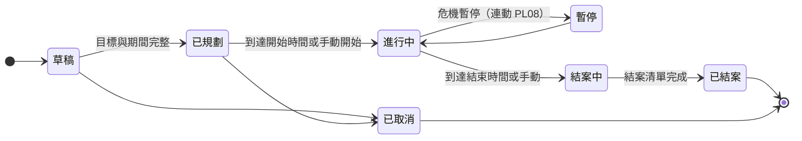

- `Paused` 只代表活動層的暫停意圖；實際阻止發布由 PL08 的暫停開關執行（本模組發事件，PL 處理）。
- `Closed` 後仍可接受數據回補，但回補只產生新的報告版本，不改結案快照（構思 CA06）。

**簡報修訂（`brief_revision.status`）**：`draft` → `in_review` → `approved`／`changes_requested`；新修訂建立後舊的 `approved` 轉 `superseded`。

#### 5.5.4 資料表

**P0 DDL**

```sql
create table campaign.campaign (
  @std, @ws, @actor, @ver,
  brand_id uuid not null references workspace.brand(id),
  name text not null,
  kind text not null,                       -- launch|seasonal|promotion|always_on|brand|other
  status text not null,                     -- draft|planned|active|paused|wrapping|closed|cancelled
  starts_at timestamptz, ends_at timestamptz,
  timezone text not null,                   -- 活動主時區（各市場另見 campaign_market）
  owner_user_id uuid not null,
  audience_note text,
  utm_key text not null,                    -- 活動追蹤識別；workspace 內唯一，建立後不可改
  objective_summary text,
  template_id uuid,                         -- P2：來源範本
  closed_at timestamptz,
  unique (workspace_id, utm_key)
);

create table campaign.campaign_market (
  @std, @ws, @actor, @ver,
  campaign_id uuid not null references campaign.campaign(id),
  market_id uuid not null references workspace.market(id),
  locales text[] not null,
  starts_at timestamptz, ends_at timestamptz,
  owner_user_id uuid,
  status text not null,                     -- planned|active|skipped|done
  unique (campaign_id, market_id)
);

create table campaign.campaign_goal (
  @std, @ws, @actor, @ver,
  campaign_id uuid not null references campaign.campaign(id),
  campaign_market_id uuid references campaign.campaign_market(id),  -- null = 全活動目標
  metric_key text not null,                 -- 對應 analytics.metric_definition.key，如 orders_count、reach、leads
  unit text not null,                       -- count|currency|percent|seconds
  currency char(3),                         -- unit=currency 時必填
  baseline_value numeric,
  baseline_source text,                     -- 基準來源說明：過去活動、平均、人工估計
  target_value numeric not null,
  due_at timestamptz not null,
  attribution_note text,                    -- 此目標以哪種口徑判定（例：自有 UTM 直接關聯）
  status text not null                      -- active|achieved|missed|withdrawn
);

create table campaign.campaign_product (
  @std, @ws, @actor,
  campaign_id uuid not null references campaign.campaign(id),
  product_id uuid not null references commerce.product(id),
  variant_ids uuid[],                       -- null = 全部變體
  market_ids uuid[],                        -- null = 活動全部市場
  role text not null,                       -- hero|supporting|bundle|gift
  unique (campaign_id, product_id)
);

create table campaign.campaign_plan_slot (  -- CA03 矩陣的「計畫」端
  @std, @ws, @actor, @ver,
  campaign_id uuid not null references campaign.campaign(id),
  stage text not null,                      -- teaser|launch|sustain|conversion|recap|custom
  platform text not null,
  social_account_id uuid references account.social_account(id),
  market_id uuid references workspace.market(id),
  locale text,
  content_format text,                      -- 對應 CO 的格式鍵
  planned_count integer not null default 1,
  window_start timestamptz, window_end timestamptz,
  owner_user_id uuid,
  note text
);

create table campaign.brief (
  @std, @ws, @actor, @ver,
  campaign_id uuid not null references campaign.campaign(id),
  kind text not null,                       -- main|market|creator|production
  campaign_market_id uuid references campaign.campaign_market(id),
  title text not null,
  current_revision_id uuid,
  approved_revision_id uuid
);

create table campaign.brief_revision (      -- 不可變
  id uuid primary key, tenant_id uuid not null, workspace_id uuid not null,
  brief_id uuid not null references campaign.brief(id),
  revision_no integer not null,
  body_doc jsonb not null,                  -- ProseMirror JSON
  requirements jsonb not null default '[]', -- 素材需求清單 [{type, count, spec, due_at}]
  fact_refs jsonb not null default '[]',    -- [{product_fact_revision_id}] 事實來源
  status text not null,                     -- draft|in_review|approved|changes_requested|superseded
  ai_generated boolean not null default false,
  content_hash text not null,
  created_by_type text not null, created_by_id uuid,
  created_at timestamptz not null default now(),
  unique (brief_id, revision_no)
);
```

**WS `work_item` 在本模組的使用約定**

| 欄位／約定 | 內容 |
|---|---|
| `kind` | `campaign_milestone`（節點，如拍攝完成、設計定稿、在地化完成、內容備妥）、`campaign_task`（一般工作） |
| `subject_ref` | `{type:'campaign', id}`；可再附 `campaign_market_id` |
| `due_at` | **製作期限**；與發布時間（PL `publish_target.scheduled_at`）分開存放與呈現 |
| `payload.gate` | `ready_for_scheduling`：里程碑完成只代表允許進入排期，不代表已發布或已達成目標 |
| 依賴 | WS `work_item_dependency(predecessor_id, successor_id, type='finish_to_start', lag_hours)`；前置未完成時後續顯示「被阻塞」 |

**P1／P2 資料表（簡表）**

| 表 | 階段 | 用途 | 關鍵欄位 |
|---|---|---|---|
| `campaign.campaign_goal_revision` | P1 | 目標變更記錄 | `goal_id`、`target_value`、`due_at`、`reason`、`changed_by` |
| `campaign.tracking_config` | P1 | 轉換目標與歸因設定（CA05） | `campaign_id`、`conversion_goals`（order／lead／signup）、`default_attribution_window_days`、`landing_targets` |
| `campaign.budget_line` | P1 | 預算分配 | `campaign_id`、`category`（ads／creator／production／sample／other）、`amount_minor`、`currency`、`fx_date`、`owner_user_id` |
| `campaign.cost_commitment` | P1 | 已承諾費用 | `budget_line_id`、`source_ref`（CR collaboration／AD proposal／外部 PO）、`amount_minor`、`currency`、`status`（pending_approval／committed／released） |
| `campaign.cost_entry` | P1 | 實際支出 | `budget_line_id`、`commitment_id`、`source`（manual／import／ads_sync／creator_settlement）、`amount_minor`、`currency`、`incurred_on`、`fx_rate_id`、`attachment_file_ids` |
| `campaign.campaign_closeout` | P1 | 結案快照 | `campaign_id`、`snapshot`（目標達成、費用、未完成事項）、`report_version_id`（AN）、`retrospective_doc`、`closed_by` |
| `campaign.campaign_template` | P2 | 活動範本 | `structure`（簡報範本、相對日期里程碑、渠道規劃欄位）、`source_campaign_id`；不含價格、授權、發布任務 |

#### 5.5.5 權限

| 權限 | 說明 | 預設角色 |
|---|---|---|
| `campaign.campaign.read` | 查看 | 全部內部角色；`client_reviewer` 經分享 |
| `campaign.campaign.draft` | 建立、修改草稿活動 | social_ops、brand_lead |
| `campaign.campaign.plan` | 目標、市場、渠道規劃、狀態轉換 | brand_lead、social_ops |
| `campaign.brief.draft`／`.approve` | 簡報撰寫／核准 | social_ops、producer／brand_lead |
| `campaign.budget.plan`／`.approve` | P1：預算分配／超額與重新分配審批 | brand_lead／brand_lead、owner |
| `campaign.cost.draft` | P1：登記費用與附件 | brand_lead、creator_manager、commerce_ops |
| `campaign.closeout.plan` | P1：結案與範本 | brand_lead |

#### 5.5.6 Web API

| 方法 | 路徑（前綴 `/api/v1/workspaces/{ws}`） | 說明 | 權限 | 階段 |
|---|---|---|---|---|
| GET／POST | `/campaigns` | 列表／建立 | campaign.read／draft | P0 |
| GET／PATCH | `/campaigns/{id}` | 詳情（含商品、市場、目標、簡報摘要、進度計數）／修改 | read／draft | P0 |
| POST | `/campaigns/{id}/transition` | 狀態轉換 `{to, reason}` | campaign.plan | P0 |
| PUT | `/campaigns/{id}/markets`、`/campaigns/{id}/products` | 市場與商品關聯 | campaign.plan | P0 |
| CRUD | `/campaigns/{id}/goals` | 目標 | campaign.plan | P0 |
| CRUD | `/campaigns/{id}/plan-slots` | 渠道規劃欄位 | campaign.plan | P0 |
| GET | `/campaigns/{id}/matrix` | 內容矩陣：plan slot × 實際內容／發布目標／作品（讀 CO、PL、EX） | campaign.read | P0 |
| POST | `/campaigns/{id}/matrix/gaps/create-items` | 依缺口建立 CO 內容項目與 WS 任務（dry run 預覽） | campaign.plan | P1 |
| GET／POST | `/campaigns/{id}/briefs`、`/briefs/{id}/revisions` | 簡報與修訂 | brief.draft | P0 |
| POST | `/brief-revisions/{id}/submit`、`/approve`、`/request-changes` | 簡報審閱 | brief.draft／approve | P0 |
| GET／POST | `/campaigns/{id}/milestones` | 里程碑（代理 WS work_item，含依賴） | campaign.plan | P0 |
| GET／POST | `/campaigns/{id}/links` | 活動追蹤連結（代理 LP Facade 建立 `short_link`） | campaign.plan | P0 |
| CRUD | `/campaigns/{id}/budget-lines`、`/cost-commitments`、`/cost-entries` | 預算與費用 | budget.plan／cost.draft | P1 |
| GET | `/campaigns/{id}/budget-summary` | 預算、已承諾、實際、剩餘、超支 | campaign.read | P1 |
| POST | `/campaigns/{id}/closeout` | 產生結案快照 | closeout.plan | P1 |
| CRUD | `/campaign-templates`、`POST /campaign-templates/{id}/instantiate` | 範本 | closeout.plan／campaign.draft | P2 |

#### 5.5.7 MCP 工具

| 工具 | 類型 | 輸入要點 | 階段 |
|---|---|---|---|
| `campaign_list` | 讀 | `status[]`、`brand_id`、`active_on` | P0 |
| `campaign_get_context` | 讀 | `campaign_id`；回傳目標、市場、商品（含已核准事實）、簡報最新已核准修訂、計畫欄位、進度 | P0 |
| `campaign_create_draft` | 寫（草稿） | `brand_id`、`name`、`kind`、期間、市場、商品、目標；狀態固定為 `draft` | P0 |
| `campaign_update` | 寫 | `campaign_id`、`expected_version`、欄位補丁；不得直接轉 `active` 以外由人觸發的狀態（`closed` 需 closeout） | P0 |
| `brief_update_draft` | 寫（草稿） | `brief_id`、`expected_version`、`body_doc` 或 markdown、`fact_refs` | P0 |
| `campaign_matrix` | 讀 | `campaign_id`；回傳計畫、實際、缺口、重複 | P0 |
| `campaign_create_tasks` | 寫 | `campaign_id`、任務清單（含依賴與製作期限） | P0 |
| `campaign_budget_summary` | 讀 | `campaign_id` | P1 |
| `campaign_closeout_draft` | 寫（草稿） | `campaign_id`；產生結案快照草稿與復盤草稿（事實與建議分欄） | P1 |

#### 5.5.8 事件

| 發出 | 時機 | 主要訂閱者 |
|---|---|---|
| `campaign.campaign.created`／`.updated` | 建立、修改 | WS 搜尋、AN 維度表 |
| `campaign.campaign.status_changed` | 狀態轉換（含 `paused`） | PL（活動級暫停）、WS02、TE 門戶 |
| `campaign.goal.changed` | 目標新增或變更 | AN（目標追蹤）、WS05 |
| `campaign.brief.approved` | 簡報修訂核准 | CO（選題與製作）、CR（合作簡報引用） |
| `campaign.milestone.delayed` | 里程碑逾期或前置阻塞 | WS04 待辦／通知 |
| `campaign.budget.overrun_detected` | P1：實際＋承諾超過預算 | WS04、審批引擎 |
| `campaign.budget.changed`、`campaign.cost_entry.changed` | P1：預算列或費用分錄變動 | AD（預算進度）、AN06 |
| `campaign.campaign.closed` | 結案快照完成 | AN（定稿報告）、TE05 交付 |

| 訂閱 | 處理 |
|---|---|
| `planning.target.*`、`execution.task.published` | 更新矩陣讀模型（實際端） |
| `workspace.work_item.completed` | 里程碑完成判定與後續解鎖 |
| `commerce.product.removed_at_source`、`commerce.listing.changed` | 在活動頁標示商品風險（不改活動資料） |
| `creator.terms.signed`、`analytics.observations.recorded` | P1：建立 `cost_commitment`／`cost_entry` |

#### 5.5.9 背景任務

| 任務 | 觸發 | 佇列 | 冪等鍵 |
|---|---|---|---|
| `campaign.auto_transition` | 每 5 分鐘；到達 `starts_at`／`ends_at` | `default` | `cat:<campaign_id>:<to>` |
| `campaign.refresh_matrix` | 相關事件；矩陣讀模型（物化表 `campaign.matrix_cell`）增量更新 | `default` | `mx:<campaign_id>:<event_id>` |
| `campaign.check_milestones` | 每小時；逾期與阻塞偵測 | `default` | `ms:<work_item_id>:<date>` |
| `campaign.budget_rollup` | P1：費用變動 | `default` | `bud:<campaign_id>:<event_id>` |
| `campaign.build_closeout` | P1：結案請求；長任務 | `export` | `close:<campaign_id>` |

#### 5.5.10 前台頁面

| 路由（前綴 `/w/:ws/campaigns`） | 頁面 | 關鍵元件 | 階段 |
|---|---|---|---|
| `/` | 活動列表（狀態、期間、目標進度、風險） | `EntityTable`、`MetricValue` | P0 |
| `/:id` | 活動總覽：目標、商品、市場、里程碑、近期發布、異常 | `RelatedObjects`、`StatusTimeline` | P0 |
| `/:id/brief` | 簡報編輯與審閱 | TipTap 編輯器、`ProductFactPicker`、`CommentThread`、`ApprovalPanel` | P0 |
| `/:id/matrix` | 內容矩陣（平台×帳號×語言×階段），計畫／實際／缺口 | 自建矩陣格、`BatchActionDialog` | P0 |
| `/:id/timeline` | 里程碑甘特與依賴（製作期限與發布時間雙軌） | 自建時間軸 | P0 |
| `/:id/tracking` | 活動連結、UTM、轉換目標 | LP 元件 | P0（連結）／P1（轉換） |
| `/:id/budget` | 預算、承諾、實際、附件 | `EntityTable`、`ApprovalPanel` | P1 |
| `/:id/closeout` | 結案清單、快照、復盤 | `DiffViewer`（計畫 vs 實際） | P1 |
| `/templates` | 活動範本 | — | P2 |

#### 5.5.11 關鍵規則與演算法

1. **兩種時間**：製作期限只存在 `work_item.due_at`，發布時間只存在 `publish_target.scheduled_at`；矩陣與時間軸以不同標記呈現，完成製作不改變任何發布狀態（構思 CA02）。
2. **矩陣計算**：每個 `campaign_plan_slot` 依（平台、帳號、市場／語言、階段、時間窗）匹配 `content_variant`（經 CO 的 `content_item.campaign_id`）與 `publish_target`；格狀態 = `planned_count` 對比 `in_production`／`scheduled`／`published`／`failed` 計數；未匹配到計畫欄位的實際內容列為「計畫外」；同一內容複用到多帳號時，每個目標獨立計數（構思 CA03）。
3. **目標口徑**：`campaign_goal.metric_key` 必須存在於 AN 指標字典；目標進度由 AN 計算並回傳 `coverage` 與歸因口徑，未知不顯示為 0%。
4. **追蹤識別**：`utm_key` 建立後不可修改，作為 `utm_campaign` 值與 LP `short_link.campaign_id` 的貫穿識別；改名活動不改追蹤識別。
5. **預算（P1）**：預算、承諾、實際分三本帳；全部以原幣保存並記錄換算日；剩餘額度 = 預算 −（承諾未轉實際＋實際）；超支只提醒並建立審批請求，**讀取費用不等於授權花費**，新增投放或付款仍走 AD／CR 各自的審批（構思 CA04）。
6. **結案（P1）**：快照固定資料截止時間、目標達成、費用、未完成事項清單；未完成發布目標、未結佣金、未歸還樣品列為阻擋或明示保留項目；範本只複製結構與相對日期，不複製價格、授權與發布目標（構思 CA06）。

#### 5.5.12 功能分期與驗收

| 功能 | P0 | P1 | P2 | 驗收要點 |
|---|---|---|---|---|
| **CA01 活動建立與目標設定** | `campaign`、`campaign_market`、`campaign_product`、`campaign_goal`（帶單位、基準、截止） | 分市場子目標完整化、`campaign_goal_revision` 變更記錄 | — | 目標缺單位或截止時間無法儲存；分市場目標仍歸屬同一活動 |
| **CA02 活動簡報與製作里程碑** | `brief`＋修訂與審閱、`work_item` 里程碑、製作期限與發布時間分欄 | 前置阻塞、延誤提醒、里程碑範本 | — | 里程碑完成不使任何內容變為已發布；簡報修訂可回溯 |
| **CA03 跨渠道活動內容矩陣** | `campaign_plan_slot`、渠道清單與活動日曆、矩陣讀模型 | 階段矩陣、缺口一鍵建立內容與任務、跨市場協作 | — | 同一內容發三個帳號計為三個目標；計畫外內容可見 |
| **CA04 預算分配與實際成本** | — | `budget_line`、`cost_commitment`、`cost_entry`、附件、超支提醒 | 預算建議與分攤規則 | 三本帳分開；原幣與換算日保存；超支不自動阻止已批准花費以外的動作 |
| **CA05 活動連結與成效追蹤設定** | `utm_key`、內容與連結的活動歸屬、經 LP 建立活動連結 | `tracking_config` 轉換目標、接網站與訂單事件 | 多觸點比較 | 從任一短鏈與內容可回到活動；優惠碼使用與點擊分開 |
| **CA06 活動結案與經驗複用** | — | `campaign_closeout` 快照、結案清單、復盤 | `campaign_template` 與歷史基準 | 結案後回補數據產生新報告版本，結案快照不變；範本不帶過期價格與授權 |


### 5.6 社媒監測競品與選品（LI）｜模組鍵 `intel`

#### 5.6.1 職責與邊界

LI 把**公開或經授權取得的外部訊號**整理成可檢查的研究證據，並轉成選題、選品與活動假設。它只保存「觀測」與「研究判斷」，不產生交易事實。

| 類別 | 內容 |
|---|---|
| 擁有 | 監測對象（`watch_target`）、觀測快照（`observation`）、研究板與研究項目（`research_board`、`research_item`）、創意參考（`creative_reference`）、候選商品與評分（`product_candidate`，P1）、警示規則與警示（P1）、提及與情緒標註（P1／P2）、話題趨勢（P1） |
| 不擁有（引用） | 資料源、採集排程、供應商合約與允許用途（DS）；商品主檔（PC `commerce.product`）；選題（CO `content.idea`）；活動簡報（CA `campaign.brief`）；素材授權（AS `asset.rights_grant`）；工作項目與通知（WS） |
| 上游 | DS（P1 起的供應商／官方資料管線，經 `intel.recordObservations` sink 寫入）、人工記錄、匯入、Agent 研究 |
| 下游 | CO01 選題池、CA01／CA02 活動假設與簡報、PC 商品（候選商品轉正式商品）、IN（LI07 危機升級為案件）、WS04 通知 |

#### 5.6.2 領域模型

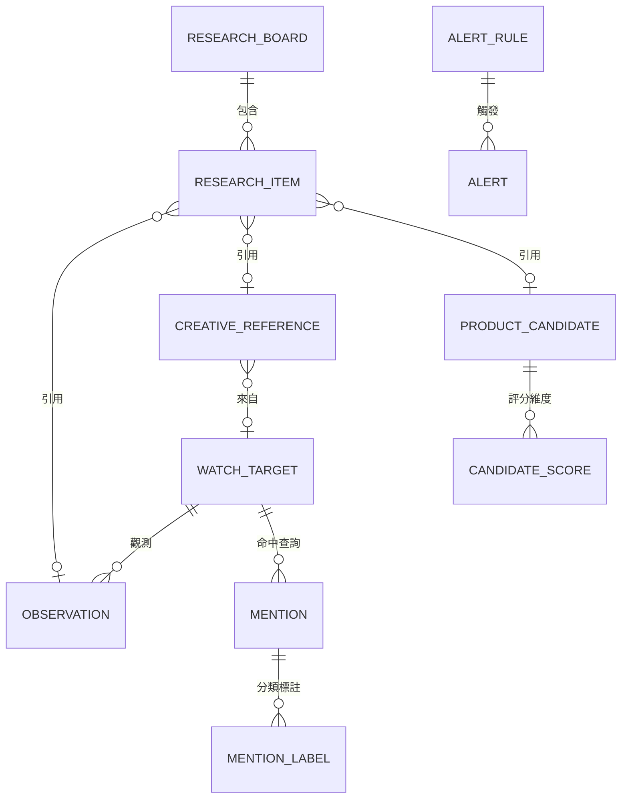

| 實體 | 說明 |
|---|---|
| `watch_target` | 一個監測範圍：競品帳號、關鍵詞、話題標籤、品類、商品網址、店鋪或達人帳號；標明資料取得方式（人工／匯入／供應商／官方 API） |
| `observation` | 某一時點對某對象的一次觀測（貼文、帳號、商品、影片、直播），只保存公開可見值與觀測時間 |
| `research_board`／`research_item` | 研究板與其中的連結、觀測、筆記、反例、疑問、需求標記 |
| `creative_reference` | 創意參考：開場、題材、時長、呈現方式、CTA 等結構化標註（人工或 Agent） |
| `product_candidate` | 候選商品與四個評分維度（P1） |
| `alert_rule`／`alert` | 可重現條件的警示（P1） |
| `mention`／`mention_label` | 品牌提及與情緒／意圖標註（P1 人工；P2 加入供應商資料，以及客戶在 AI07 配置 `classify` 用途路由後的模型標註，未配置時維持人工標註） |

#### 5.6.3 狀態機

**候選商品 `product_candidate`（P1）**

```mermaid
stateDiagram-v2
    direction LR
    state "提出" as proposed
    state "研究中" as researching
    state "驗證中" as validating
    state "採納" as accepted
    state "淘汰" as rejected
    state "暫存" as parked
    [*] --> proposed
    proposed --> researching
    researching --> validating: 至少兩個維度有證據
    validating --> accepted: 記錄採納理由並連結正式商品
    validating --> rejected: 記錄淘汰理由
    researching --> parked
    parked --> researching
    rejected --> researching: 新證據重新開啟
    accepted --> [*]
```

**警示 `alert`（P1）**：`open → acknowledged → assigned → resolved`；任何狀態可 `dismissed`（需理由）；相同事件指紋併入既有警示（`merged_into_id`）。資料中斷不產生「競品停止活動」警示，而是產生 `source_stale` 類型警示。

#### 5.6.4 資料表

**P0 資料表**（LI01 清單／連結收藏／人工記錄、LI04 參考板）

```sql
create table intel.watch_target (
  @std, @ws, @actor, @ver,
  brand_id uuid references workspace.brand(id),
  target_type text not null,          -- competitor_account|keyword|hashtag|category|product_url|store|creator_account
  platform text,                      -- 關鍵詞可跨平台時為 null
  market_ids uuid[] not null default '{}',
  name text not null,
  query jsonb not null,               -- {handle, url, keywords[], exclude[], language}
  external_ref jsonb,                 -- 已核實的平台帳號 id 等
  data_mode text not null,            -- manual|import|vendor|official_api（P0 僅 manual|import）
  data_source_id uuid references ingest.data_source(id),    -- P1
  refresh_frequency text not null default 'manual',          -- manual|daily|weekly
  owner_user_id uuid,
  tags text[] not null default '{}',
  coverage_note text,                 -- 可取得範圍摘要（例：「只有公開按讚與留言數」）
  status text not null                -- active|paused|archived
);

create table intel.observation (
  id uuid not null, tenant_id uuid not null, workspace_id uuid not null,
  watch_target_id uuid not null,
  subject_type text not null,         -- post|account|product|video|live
  external_id text, url text,
  published_at timestamptz,           -- 對象自身發布時間（可得時）
  observed_at timestamptz not null,
  age_at_observation interval,        -- observed_at − published_at，用於同齡比較
  metrics jsonb not null,             -- {likes:{value, availability}, comments:{…}, price:{amount_minor, currency}}
  attributes jsonb,                   -- 格式、時長、標題、商品規格等
  source jsonb not null,              -- 4.2 來源結構；estimate=true 表示供應商估算
  note text,
  created_by_type text not null, created_by_id uuid,
  primary key (id, observed_at)
) partition by range (observed_at);   -- 按季分區；保留期依 data_source.allowed_uses.cache_days 與工作區政策
create index on intel.observation (watch_target_id, external_id, observed_at desc);

create table intel.research_board (
  @std, @ws, @actor, @ver,
  brand_id uuid, campaign_id uuid references campaign.campaign(id),
  kind text not null,                 -- research|creative|product_opportunity
  title text not null, description text,
  status text not null                -- active|archived
);

create table intel.research_item (
  @std, @ws, @actor, @ver,
  board_id uuid not null references intel.research_board(id),
  item_type text not null,            -- link|observation|note|creative_reference|mention|candidate
  ref_id uuid,                        -- 指向 observation／creative_reference／mention／product_candidate
  url text, title text, body text,
  stance text,                        -- evidence|counter_example|question|demand|hypothesis
  labels text[] not null default '{}',
  lane text, position numeric,        -- 看板欄與排序
  ai_generated boolean not null default false,
  converted_to jsonb                  -- {module:'content', resource_type:'idea', id} 等
);

create table intel.creative_reference (
  @std, @ws, @actor, @ver,
  url text not null, platform text, external_id text,
  watch_target_id uuid references intel.watch_target(id),
  thumbnail_file_object_id uuid,      -- 僅內部參考縮圖，保存受來源條款限制
  structure jsonb not null default '{}', -- {hook, topic, duration_s, format, presentation, cta, interaction_question}
  structure_source text not null,     -- human|agent|mixed
  agent_job_id uuid, model_ref text,  -- Agent 標註時的工作與模型版本
  observed_metrics jsonb,             -- 公開互動快照＋observed_at
  tags text[] not null default '{}'
);
```

**P1／P2 資料表**

| 表 | 階段 | 用途與關鍵欄位 |
|---|---|---|
| `intel.topic` | P1 | 話題群組：`name`、`keywords`、`market_id`、`language` |
| `intel.topic_trend_point` | P1 | 話題趨勢點：`topic_id`、`period`、`sample_size`、`observed_increment`、`comparison_period`、`method_version` |
| `intel.product_candidate` | P1 | 候選商品：`name`、`market_ids`、`price_range`（minor＋currency）、`supply_notes`、`linked_product_id`（PC）、`status`、`decision_reason` |
| `intel.candidate_score` | P1 | 評分維度：`dimension`（demand_evidence\|competition\|product_fit\|supply_feasibility）、`score`、`uncertainty`、`evidence_item_ids`、`is_estimate`、`scored_by` |
| `intel.alert_rule` | P1 | 條件：`watch_target_ids`、`condition`（新貼文、互動增量、價格變動、關鍵詞出現）、`min_freshness`、`recipients` |
| `intel.alert` | P1 | 警示：`rule_id`、`fingerprint`、`evidence_observation_ids`、`status`、`assignee`、`merged_into_id`、`alert_type`（signal\|source_stale） |
| `intel.research_digest` | P1 | 研究簡報版本：`period`、`sections`（事實／建議分開）、`file_object_id` |
| `intel.mention` | P1 | 品牌／競品提及：`watch_target_id`、`platform`、`external_id`、`url`、`author_ref`、`text_excerpt`、`published_at`、`observed_at`、`source` |
| `intel.mention_label` | P1 | 標註：`label_type`（sentiment\|intent\|topic）、`value`、`confidence`、`model_ref`、`labeled_by`（model\|human）、`overrides_label_id` |
| `intel.share_of_voice_snapshot` | P2 | 聲量占比：`query_def_hash`、`sources`、`period`、`brand_counts`、`sample_size`、`coverage_note` |

#### 5.6.5 權限

| 權限 | 說明 | 預設角色 |
|---|---|---|
| `intel.target.read` | 查看監測與觀測 | 全部內部角色 |
| `intel.target.plan` | 建立／修改監測對象與頻率 | `social_ops`、`brand_lead`、`analyst` |
| `intel.observation.draft` | 人工記錄觀測 | `social_ops`、`analyst` |
| `intel.board.draft` | 研究板與項目、創意參考 | `social_ops`、`producer`、`analyst` |
| `intel.candidate.plan` | 候選商品評分與決策（P1） | `commerce_ops`、`brand_lead` |
| `intel.alert.plan` | 警示規則與處理（P1） | `social_ops`、`analyst` |
| `intel.mention.draft` | 修正情緒與意圖標註（P1） | `support`、`social_ops` |
| `intel.data.export` | 匯出研究資料（另受 DS 允許用途限制） | `analyst`、`brand_lead` |

#### 5.6.6 Web API

前綴 `/api/v1/workspaces/{ws}`。

| 方法 | 路徑 | 說明 | 權限 | 階段 |
|---|---|---|---|---|
| GET／POST | `/watch-targets` | 清單／建立 | target.read／plan | P0 |
| GET／PATCH | `/watch-targets/{id}` | 詳情／修改 | target.read／plan | P0 |
| GET | `/watch-targets/{id}/observations?subject=&from=&to=` | 觀測時間線（同對象歷次快照） | target.read | P0 |
| POST | `/observations` | 人工記錄（必填 `observed_at`、URL） | observation.draft | P0 |
| GET／POST | `/research-boards` | 研究板 | board.draft | P0 |
| GET／PATCH | `/research-boards/{id}` | 詳情 | board.draft | P0 |
| POST／PATCH／DELETE | `/research-boards/{id}/items`、`/research-items/{id}` | 項目 | board.draft | P0 |
| POST | `/research-items/{id}/convert` | 轉為選題（呼叫 CO `content.createIdea`）或活動假設（CA） | board.draft＋目標模組 draft | P0 |
| GET／POST／PATCH | `/creative-references` | 創意參考與結構標註 | board.draft | P0 |
| GET | `/research/compare?watch_target_ids=&metric=&age=` | 競品貼文頻率與同齡互動比較 | target.read | P1 |
| GET／POST／PATCH | `/product-candidates`、`/{id}/scores`、`/{id}/decide` | 候選商品 | candidate.plan | P1 |
| GET／POST／PATCH | `/alert-rules`、`/alerts`、`/alerts/{id}` | 警示 | alert.plan | P1 |
| GET | `/topics`、`/topics/{id}/trend` | 話題趨勢 | target.read | P1 |
| GET／PATCH | `/mentions`、`/mentions/{id}/labels` | 提及與標註 | target.read／mention.draft | P1 |
| POST | `/mentions/{id}/escalate` | 升級為 IN 案件或品牌值班任務 | mention.draft | P1 |
| POST | `/research-digests` | 產生研究簡報 → `202 {operation_id}` | board.draft | P1 |
| GET | `/share-of-voice` | 聲量占比（附查詢定義與樣本） | target.read | P2 |

#### 5.6.7 MCP 工具

| 工具 | 類型 | 輸入要點 | 階段 |
|---|---|---|---|
| `research_search` | 讀 | 關鍵字、監測對象、期間 → 觀測、研究項目、創意參考（外部文字包在 `untrusted_content`） | P0 |
| `research_create_note` | 寫（draft） | `board_id`、`body`、`stance`、`evidence_refs`（構思 7.2 的 `research.create_note`） | P0 |
| `research_add_item` | 寫（draft） | `board_id`、`url` 或 `ref_id`、`labels` | P0 |
| `creative_reference_annotate` | 寫（draft） | `creative_reference_id`、`structure`、`expected_version`；自動標記 `structure_source=agent` | P0 |
| `watch_targets_list` | 讀 | 範圍與資料取得方式 | P0 |
| `observations_compare` | 讀 | 監測對象、指標、作品年齡桶 → 帶 `as_of`、樣本數、估算標記 | P1 |
| `product_candidates_score` | 寫（draft） | 候選、維度、分數、證據項目；不可改變決策狀態 | P1 |
| `alerts_list` | 讀 | 狀態、期間 | P1 |
| `mentions_query` | 讀 | 查詢、期間、標註 → 附樣本與覆蓋說明 | P1 |

#### 5.6.8 事件

| 發出 | 時機 | 主要消費者 |
|---|---|---|
| `intel.watch_target.created`／`changed` | 監測範圍變動 | DS（P1 建立對應資料源排程） |
| `intel.observation.recorded` | 新觀測（批次摘要） | 警示評估（P1）、WS03 索引 |
| `intel.research_item.converted` | 項目轉為選題／活動假設 | CO、CA、WS04 |
| `intel.candidate.decided` | 候選商品採納／淘汰（P1） | PC（建立商品草稿）、WS04 |
| `intel.alert.raised` | 警示（P1） | WS04 通知 |
| `intel.mention.escalated` | 危機升級（P1） | IN（建立案件）、PL（P1 品牌暫停建議）、WS04 |

| 訂閱 | 處理 |
|---|---|
| `ingest.sync_run.completed`（vendor／官方來源，P1） | 評估警示規則 |
| `ingest.data_gap.detected` | 抑制受影響對象的訊號警示，改發 `source_stale` |
| `commerce.product.upserted` | 若來自候選商品，回寫 `linked_product_id` |

#### 5.6.9 背景任務

| 任務 | 觸發 | 佇列 | 冪等鍵 |
|---|---|---|---|
| `intel.evaluate_alert_rules` | 觀測批次寫入後（P1） | `default` | `alert-eval:<rule_id>:<batch_id>` |
| `intel.compute_topic_trends` | 每日（P1） | `default` | `trend:<topic_id>:<date>` |
| `intel.generate_digest` | 手動或排程（P1） | `export` | `digest:<operation_id>` |
| `intel.classify_mentions` | 新提及批次（P2；只在工作區於 AI07 配置 `classify` 用途路由時建立，並經外送檢查；未配置時不建立此任務，提及維持人工標註） | `agent` | `mention-cls:<batch_id>:<model_ref>` |
| `intel.purge_expired_observations` | 每日 | `default` | `intel-purge:<date>` |

#### 5.6.10 前台頁面

| 路由 | 頁面 | 關鍵元件 | 階段 |
|---|---|---|---|
| `/w/:ws/research` | 研究總覽：監測清單、最近觀測、我的研究板 | `EntityTable` | P0 |
| `/w/:ws/research/watchlist/:id` | 監測對象：觀測時間線、歷次快照、缺漏篩選 | `MetricValue`、`ProvenanceDrawer` | P0 |
| `/w/:ws/research/boards/:id` | 研究板（看板／清單），項目轉選題 | 看板、`RelatedObjects` | P0 |
| `/w/:ws/research/creatives` | 創意參考板：結構標註、篩選、轉拍攝簡報 | 標註表單、`AiSuggestionCard`（P0 顯示外部 Agent 經 MCP 寫入的標註；伺服器端模型建議 P1 起，未配置 AI07 路由時隱藏） | P0 |
| `/w/:ws/research/compare` | 競品比較（同齡互動、發文頻率） | ECharts | P1 |
| `/w/:ws/research/candidates` | 候選商品比較與決策 | 評分矩陣、證據抽屜 | P1 |
| `/w/:ws/research/trends` | 話題趨勢（附樣本量與比較期間） | ECharts | P1 |
| `/w/:ws/research/alerts` | 警示中心 | `EntityTable` | P1 |
| `/w/:ws/research/listening` | 聲量與情緒：原文、修正分類、升級 | `CommentThread`、標註修正 | P1／P2 |

#### 5.6.11 關鍵規則與演算法

1. **觀測不可變且帶年齡**：每次觀測新增一列，保存 `observed_at` 與 `age_at_observation`。比較貼文表現時只用相同年齡桶（如 24 小時、7 天）的觀測；**不把後續累積互動當作發布當日表現**（構思 LI02）。
2. **只存公開或授權可得的值**：曝光、觸及、銷售等私密指標若來源不提供，`availability=source_not_provided`；**禁止以公開按讚量推算後台數字**。
3. **估算與事實分層**：供應商的銷量、GMV、佣金率等估算一律 `source.estimate=true`，介面加「估算」標記；不得流入 AN05 收入、CR09 佣金或任何結算（構思 8.3 最後兩點）。
4. **參考不等於授權**：`creative_reference` 只保存連結、縮圖與結構分析；若要使用原素材，必須在 AS 建立 `rights_grant`，排程預檢會檢查（構思 LI04）。
5. **趨勢計算**：趨勢 = 兩次觀測之間的增量彙總，附樣本量、比較期間與方法版本；「熱門討論」與「購買意圖」分別標記，聲量不直接等同需求（LI03）。
6. **選品評分**：四個維度各自保存分數、不確定性與證據項目，不輸出單一黑箱總分；估算成本與實際報價分欄；採納時必須連結 PC 正式商品或建立商品草稿（LI05）。
7. **警示可重現**：規則觸發時保存條件、觀測證據與資料新鮮度；資料源過期（DS `freshness` 問題開啟中）時不評估訊號規則，改發 `source_stale`（LI06）。
8. **聲量與情緒**：聲量占比只針對明確的查詢定義與來源樣本計算，結果附 `sample_size` 與覆蓋說明；模型標註只來自客戶在 AI07 配置的 `classify` 用途路由（P2，系統不內建分類模型；未配置時只有人工標註，提及統計與升級照常），保存 `model_ref` 與 `confidence`，人工修正以新標註覆蓋並保留原標註；諷刺、多語混雜或樣本不足時標示「不確定」（LI07）。
9. **用途限制**：匯出、研究簡報分享、送模型分析前呼叫 `ingest.checkUse()`，送模型時另經 OP 外送政策檢查；供應商條款或外送政策不允許時阻擋並說明（`EGRESS_BLOCKED`），不改送其他模型供應商。
10. **Agent 結論必附證據**：Agent 寫入的研究筆記與評分必須帶 `evidence_refs`，否則以 `hypothesis` 身分保存。

#### 5.6.12 功能分期與驗收

| 功能 | P0 | P1 | P2 | 驗收要點 |
|---|---|---|---|---|
| LI01 監測對象與查詢管理 | 監測清單、連結收藏、人工觀測、負責人與頻率欄位 | 接入獲許可的官方或供應商資料（DS 資料源） | 多來源合併與覆蓋比較 | 每個對象顯示資料取得方式與可用範圍；人工與自動觀測可區分 |
| LI02 競品貼文與數據快照 | 人工觀測時間線（P0 基礎） | 匯入與定期採集、同齡比較、缺漏篩選 | 品質告警；平台限制變更時停用受影響欄位 | 比較只用相同年齡桶；私密指標顯示「來源未提供」 |
| LI03 話題趨勢與需求整理 | 研究板的需求／疑問／反例標記 | 話題分類與時間比較 | 授權監測服務擴大覆蓋 | 趨勢附樣本量與比較期間；Agent 結論有可回看證據 |
| LI04 內容形式與創意研究 | 創意參考板、結構標籤、轉拍攝簡報／選題（外部 Agent 可經 MCP 寫入標註） | Agent 結構分析（伺服器端需客戶在 AI07 配置 `analyze` 用途路由）＋人工修訂 | 相似題材實驗結果比較（AN08） | 參考連結不出現在素材庫可用清單；Agent 標註可辨識；未配置模型時結構標註仍可人工完成 |
| LI05 商品機會與選品評估 | — | 候選清單、四維評分、連結商品庫 | 獲許可的市場資料 | 估算與實際報價分欄；採納／淘汰理由必填 |
| LI06 監測警示與研究簡報 | — | 規則警示、合併重複、手動簡報匯出 | 排程摘要、跨來源比對 | 資料中斷產生 `source_stale` 而非競品停止；重複事件合併 |
| LI07 品牌聲量、情緒與危機研判 | — | 人工標註、有來源的提及統計、升級為案件 | 授權監測資料、模型分類（客戶 AI07 `classify` 用途路由）、異常規則、連動品牌暫停 | 聲量附查詢定義與樣本；人工修正保留原模型標註；未配置 `classify` 路由時不出現模型分類入口，人工標註與升級照常 |


### 5.7 選題、內容製作與本地化（CO）｜模組鍵 `content`

#### 5.7.1 職責與邊界

| 類別 | 內容 |
|---|---|
| 擁有 | 內容欄目（`content_pillar`）、選題（`idea`）、內容項目（母稿／主題，`content_item`）、內容變體（平台／格式／語言／市場版本，`content_variant`）、內容修訂（`content_revision`，不可變）、引用索引（`content_reference`）、翻譯關聯（`translation_link`）、製作階段歷史、複用血緣；P1 起 RSS 與外部內容匯入 |
| 不擁有（引用） | 素材原件與衍生檔（AS `asset`／`asset_version`／`asset_rendition`）；使用授權判定（AS `checkUsage`）；商品事實與市場快照（PC）；品牌術語與規則（AS `knowledge_entry`）；批註與留言（TE `comment_thread`／`comment`）；正式審批（core 審批引擎＋PL05）；發布目標與時間（PL）；執行與平台作品（EX）；能力判定（AC `capability`） |
| 三種狀態分開 | **製作狀態**（本模組：內容是否準備妥當）≠ **審批狀態**（PL＋core：某修訂是否被批准發往某帳號）≠ **發布狀態**（EX：外部執行結果）（構思 CO02） |
| 上游 | CA（活動、簡報）、PC（事實、快照）、AS（素材、知識、範本）、LI／IN（選題來源） |
| 下游 | PL（發布目標綁定 `content_revision`）、EX（讀渲染結果）、AD（創意來源）、AN（內容維度）、AI |

#### 5.7.2 領域模型

```mermaid
erDiagram
    CONTENT_PILLAR ||--o{ IDEA : "歸類"
    IDEA ||--o{ CONTENT_ITEM : "轉為製作"
    CONTENT_ITEM ||--o{ CONTENT_VARIANT : "平台／語言版本"
    CONTENT_VARIANT ||--o{ CONTENT_REVISION : "不可變修訂"
    CONTENT_REVISION ||--o{ CONTENT_REFERENCE : "引用素材／商品／連結"
    CONTENT_VARIANT ||--o{ TRANSLATION_LINK : "作為譯文"
    CONTENT_REVISION ||--o{ TRANSLATION_LINK : "作為來源修訂"
    CONTENT_ITEM }o--o| CONTENT_ITEM : "複用自"
```

| 實體 | 關鍵語義 |
|---|---|
| `content_pillar` | 內容欄目／內容柱（品牌級），可帶目標受眾、比例目標、常青屬性（供 PL09） |
| `idea` | 選題：來源（觀察、客服問題、競品參考、商品賣點、RSS、監測）、假設、目標、證據連結；與正式內容分開儲存 |
| `content_item` | 一個內容主題（母稿）：所屬品牌、活動、欄目、負責人、**製作階段**、製作期限 |
| `content_variant` | 一個可發布版本：`platform` × `format` × `locale`（可加 `market_id`、可指定 `social_account_id`）；有可變的工作稿 `draft_doc` 與指向最新修訂的 `current_revision_id`；`readiness` 表示是否可排期 |
| `content_revision` | 不可變快照：正文（ProseMirror JSON）、各平台渲染文字、媒體清單、商品引用、設定、可及性欄位、`content_hash`；PL 審批與 EX 執行都綁定修訂 |
| `content_reference` | 修訂 → 被引用物件的反向索引（素材版本、衍生檔、商品變體、事實修訂、快照、短鏈、知識條目），供 PC06、AS05 影響分析 |
| `translation_link` | 譯文變體與來源修訂、術語版本的關聯；來源前進即轉待重審 |

**工作稿與修訂**：編輯器自動保存只更新 `content_variant.draft_doc`（樂觀鎖 `version`），不產生修訂；「保存版本」「送審」「Agent 更新」才建立 `content_revision`。如此避免自動保存產生大量修訂，同時保證審批綁定的是明確版本。P2 才引入多人即時協同編輯（Yjs），屆時仍以「提交修訂」為審批單位。

**看板實作決定（CO02）**：看板的卡片是 `content_item`，欄位是 `content_item.production_stage`；撰寫、設計、剪輯、拍攝等可分派細項是 WS `work_item`（`kind='production_task'`，`subject_ref` 指向內容項目）。理由：階段描述「內容整體準備到哪」，一個內容常有多人並行的多個任務，兩者粒度不同。

#### 5.7.3 狀態機

**製作階段（`content_item.production_stage`）**

```mermaid
stateDiagram-v2
    direction LR
    state "已立項" as Accepted
    state "撰寫中" as Drafting
    state "設計／剪輯" as Design
    state "待素材" as AwaitAssets
    state "內部校稿" as InternalReview
    state "已備妥" as Ready
    state "已封存" as Archived
    [*] --> Accepted: 選題轉內容／直接建立
    Accepted --> Drafting
    Drafting --> Design
    Drafting --> AwaitAssets
    Design --> AwaitAssets
    AwaitAssets --> Design
    Design --> InternalReview
    Drafting --> InternalReview
    InternalReview --> Drafting: 退回修改
    InternalReview --> Ready: 交接檢查通過
    Ready --> Drafting: 需要修改
    Accepted --> Archived
    Ready --> Archived
    Archived --> [*]
```

- 拖動卡片只改 `production_stage` 並寫階段歷史，**不觸發任何發布**（構思 CO02）。
- `Ready` 的交接檢查：至少一個變體 `readiness='ready'`、無阻擋級驗證問題、無未解決的必要批註。

**變體可排期性（`content_variant.readiness`）**：`draft` → `ready`（負責人標記）；任何下列事件使其轉 `stale`：所引用商品事實被修訂或撤回、快照重大變動、素材授權到期或撤銷、翻譯來源前進、術語版本變更；`stale` 經人工更新或確認後回到 `ready`。`stale` 不自動改動已存在的審批，審批失效由 core 審批引擎依修訂差異判定。

#### 5.7.4 資料表

**P0 DDL**

```sql
create table content.content_pillar (
  @std, @ws, @actor, @ver,
  brand_id uuid not null references workspace.brand(id),
  name text not null, description text,
  audience_note text,
  target_share numeric(5,2),                -- 期望占比（%），供覆蓋檢查
  evergreen boolean not null default false,
  archived_at timestamptz,
  unique (brand_id, name)
);

create table content.idea (
  @std, @ws, @actor, @ver,
  brand_id uuid not null references workspace.brand(id),
  pillar_id uuid references content.content_pillar(id),
  campaign_id uuid references campaign.campaign(id),
  title text not null,
  hypothesis text,                          -- 選題假設
  objective text,
  audience_note text,
  origin text not null,                     -- observation|customer_question|competitor_ref|product_point|monitoring|rss|agent|other
  origin_refs jsonb not null default '[]',  -- [{type:'conversation'|'observation'|'research_note'|'url'|'product_fact', id|url}]
  observed_at timestamptz,
  status text not null,                     -- open|discussing|accepted|parked|rejected
  priority integer,
  tags text[] not null default '{}'
);

create table content.content_item (
  @std, @ws, @actor, @ver,
  brand_id uuid not null references workspace.brand(id),
  campaign_id uuid references campaign.campaign(id),
  pillar_id uuid references content.content_pillar(id),
  idea_id uuid references content.idea(id),
  title text not null,
  production_stage text not null,           -- accepted|drafting|design|awaiting_assets|internal_review|ready|archived
  owner_user_id uuid,
  production_due_at timestamptz,            -- 製作期限（與發布時間分開）
  derived_from_item_id uuid references content.content_item(id),   -- CO08 複用血緣
  blocked_reason text,
  archived_at timestamptz
);
create index on content.content_item (workspace_id, production_stage);
create index on content.content_item (campaign_id);

create table content.content_stage_history (
  @std, @ws,
  content_item_id uuid not null references content.content_item(id),
  from_stage text, to_stage text not null,
  changed_by_type text not null, changed_by_id uuid,
  note text, changed_at timestamptz not null
);

create table content.content_variant (
  @std, @ws, @actor, @ver,
  content_item_id uuid not null references content.content_item(id),
  platform text not null,                   -- instagram|facebook|tiktok|youtube|douyin|xiaohongshu|generic
  format text not null,                     -- feed_image|carousel|reel|story|short_video|long_video|text|note|live_teaser
  locale text not null,
  market_id uuid references workspace.market(id),
  social_account_id uuid references account.social_account(id),  -- 指定帳號專屬版本；null = 該平台通用
  parent_variant_id uuid references content.content_variant(id), -- 由哪個變體衍生（如語言版衍生自平台版）
  draft_doc jsonb not null,                 -- 工作稿（ProseMirror JSON＋媒體與設定的草稿結構）
  current_revision_id uuid,
  readiness text not null,                  -- draft|ready|stale
  stale_reasons jsonb not null default '[]',-- [{kind:'fact_revised'|'listing_changed'|'rights_expired'|'translation_source_changed'|'glossary_changed', ref_id}]
  derived_from_revision_id uuid,            -- CO08：複用來源修訂
  owner_user_id uuid,
  archived_at timestamptz
);
create index on content.content_variant (content_item_id);

create table content.content_revision (     -- 不可變
  id uuid primary key, tenant_id uuid not null, workspace_id uuid not null,
  variant_id uuid not null references content.content_variant(id),
  revision_no integer not null,
  body_doc jsonb not null,                  -- ProseMirror JSON（正本）
  rendered jsonb not null,                  -- {text, hashtags[], mentions[], links[], char_count, by_target_hint}
  media jsonb not null default '[]',        -- [{order, role:'primary'|'cover'|'slide'|'subtitle', asset_id, asset_version_id, rendition_id, alt_text, caption_rendition_id, crop:{x,y,w,h,aspect}, cover_time_ms}]
  product_refs jsonb not null default '[]', -- [{variant_id, fact_revision_id?, listing_snapshot_id?, market_id, field, inserted_text}]
  link_refs jsonb not null default '[]',    -- [{short_link_id|url}]
  settings jsonb not null default '{}',     -- {first_comment, location, user_tags, collaborators, product_tag, music_ref, visibility_hint, disclosure:{paid_partnership, ai_generated}, platform_options}
                                            -- platform_options（人員必選欄位無系統預設，見 5.7.11 規則 1）：tiktok={privacy_level, allow_comment, allow_duet, allow_stitch, commercial_disclosure:none|your_brand|branded_content|both}（TikTok 不用 visibility_hint）；douyin／xiaohongshu={visibility}【手機 App 必選項清單於腳本冒煙時核實】
  origin text not null,                     -- human|agent|template|import|translation
  ai_generated boolean not null default false,
  agent_job_id uuid,
  based_on_revision_id uuid,                -- 編輯基礎（衝突比對用）
  restored_from_revision_id uuid,           -- 恢復舊稿時指向原修訂
  content_hash text not null,
  created_by_type text not null, created_by_id uuid,
  created_at timestamptz not null default now(),
  unique (variant_id, revision_no)
);
create index on content.content_revision (variant_id, content_hash);

create table content.content_reference (    -- 反向引用索引
  tenant_id uuid not null, workspace_id uuid not null,
  revision_id uuid not null references content.content_revision(id),
  ref_type text not null,                   -- asset|asset_version|asset_rendition|product_variant|product_fact_revision|listing_snapshot|short_link|knowledge_entry|template
  ref_id uuid not null,
  ref_version text,                         -- 修訂號或雜湊
  primary key (revision_id, ref_type, ref_id)
);
create index on content.content_reference (ref_type, ref_id);

create table content.translation_link (     -- CO05
  @std, @ws, @actor, @ver,
  target_variant_id uuid not null references content.content_variant(id),
  source_variant_id uuid not null references content.content_variant(id),
  source_revision_id uuid not null references content.content_revision(id),  -- 譯文依據的來源修訂
  target_revision_id uuid references content.content_revision(id),          -- 對應的譯文修訂
  glossary_version text,                    -- AS 術語集版本雜湊
  status text not null,                     -- in_sync|source_changed|needs_review|accepted_divergence
  divergence_note text,                     -- 市場特有改寫說明（保留不被同步覆蓋）
  unique (target_variant_id)
);
```

**P1／P2 資料表（簡表）**

| 表 | 階段 | 用途 | 關鍵欄位 |
|---|---|---|---|
| `content.feed_source` | P1 | RSS／外部內容來源（CO09） | `url`、`kind`（rss／atom／sitemap）、`poll_interval_minutes`、`etag`、`last_modified`、`auto_enqueue_rule`、`status` |
| `content.feed_item` | P1 | 匯入項目與去重 | `(feed_source_id, guid)` 唯一、`url`、`title`、`summary`、`author`、`published_at`、`content_hash`、`idea_id`、`status`（new／imported／ignored／expired） |
| `content.handoff_checklist` | P1 | 交接檢查清單範本與結果（CO02 P1） | `scope`、`items`、`result` |
| `content.transcript` | P1 | 自動轉寫結果（CO06 P1） | `asset_version_id`、`locale`、`segments`、`model`、`reviewed` |
| `content.post_maintenance_request` | P1 | 發布後修改／隱藏／刪除的內容端記錄，執行委派 EX07 | `platform_post_id`、`action`、`new_revision_id`、`execution_task_id` |

#### 5.7.5 權限

| 權限 | 說明 | 預設角色 |
|---|---|---|
| `content.idea.read`／`.draft` | 選題 | 全部內部角色／social_ops、producer、brand_lead |
| `content.item.draft` | 建立內容項目、指派、改階段 | social_ops、producer（被指派者） |
| `content.variant.draft` | 編輯工作稿、提交修訂、標記備妥 | social_ops、producer |
| `content.translation.draft` | 建立與更新譯文、確認來源差異 | social_ops、producer |
| `content.pillar.plan` | 管理欄目 | brand_lead、social_ops |
| `content.feed.admin` | P1：RSS 來源 | social_ops |
| `content.item.export` | 匯出內容包 | social_ops、brand_lead |

正式批准權在 `planning.target.approve`（PL），本模組不提供批准動作。

#### 5.7.6 Web API

| 方法 | 路徑（前綴 `/api/v1/workspaces/{ws}`） | 說明 | 權限 | 階段 |
|---|---|---|---|---|
| CRUD | `/content-pillars` | 欄目 | pillar.plan | P0 |
| GET／POST／PATCH | `/ideas`、`/ideas/{id}` | 選題 | idea.read／draft | P0 |
| POST | `/ideas/{id}/convert` | 轉為 `content_item`（可同時建立變體與任務） | item.draft | P0 |
| GET／POST | `/content-items` | 列表（看板與清單共用篩選）／建立 | item.draft | P0 |
| GET／PATCH | `/content-items/{id}` | 詳情（變體、修訂摘要、引用、任務、相關發布目標）／修改 | item.draft | P0 |
| POST | `/content-items/{id}/stage` | 改階段 `{to, note}`（`If-Match`） | item.draft | P0 |
| POST | `/content-items/{id}/variants` | 建立變體（可指定 `copy_from_variant_id`） | variant.draft | P0 |
| GET／PATCH | `/content-variants/{id}` | 讀取／更新工作稿 `draft_doc`（`If-Match`） | variant.draft | P0 |
| POST | `/content-variants/{id}/revisions` | 由工作稿提交新修訂（`base_revision_id` 檢查衝突） | variant.draft | P0 |
| GET | `/content-variants/{id}/revisions`、`/content-revisions/{id}` | 修訂列表與內容 | item.read | P0 |
| GET | `/content-revisions/{a}/diff/{b}` | 文字、媒體、設定、引用差異 | item.read | P0 |
| POST | `/content-revisions/{id}/restore` | 以舊修訂建立新修訂 | variant.draft | P0 |
| POST | `/content-variants/{id}/validate` | `{social_account_ids[]}` → 依能力與規則回傳問題清單 | item.read | P0 |
| POST | `/content-variants/{id}/readiness` | 標記 `ready`／確認 `stale` 原因已處理 | variant.draft | P0 |
| GET／POST | `/content-variants/{id}/translations` | 列出／建立譯文變體（建立 `translation_link`） | translation.draft | P0 |
| POST | `/translation-links/{id}/accept-source-change`、`/mark-divergence` | 確認來源差異／標記市場特有改寫 | translation.draft | P0 |
| POST | `/content-items/{id}/duplicate` | 複用為新草稿（CO08，重檢商品與授權） | item.draft | P1 |
| POST | `/content-variants/batch` | Agent／批次建立或更新草稿（dry run＋operation） | variant.draft | P0 |
| CRUD | `/feeds`、`POST /feeds/{id}/poll`、`/feed-items/{id}/import` | RSS 與外部內容 | feed.admin | P1 |

#### 5.7.7 MCP 工具

| 工具 | 類型 | 輸入要點 | 階段 |
|---|---|---|---|
| `idea_list`／`idea_create` | 讀／寫（草稿） | 品牌、欄目、活動；`origin_refs` 必須附證據來源 | P0 |
| `content_list` | 讀 | 篩選：活動、階段、平台、語言、負責人、`readiness` | P0 |
| `content_get` | 讀 | `content_item_id` 或 `variant_id`；回傳最新修訂、引用、驗證問題、相關目標狀態 | P0 |
| `content_create_draft` | 寫（草稿） | `brand_id`、`campaign_id`、`title`、`variants[{platform, format, locale, body_markdown|body_doc, media, product_refs}]`；`origin='agent'`、`ai_generated=true`；不得填 `platform_options` 的人員必選欄位（5.7.11 規則 1） | P0 |
| `content_update_variant` | 寫（草稿） | `variant_id`、`base_revision_id`、`expected_version`、新內容；衝突時回傳目前修訂與差異，不覆寫人員修改；同樣不得填人員必選欄位 | P0 |
| `content_validate_variant` | 讀 | `variant_id`、`social_account_ids[]` | P0 |
| `content_diff_revisions` | 讀 | `revision_a`、`revision_b` | P0 |
| `content_create_translation` | 寫（草稿） | `source_variant_id`、`locale`、`market_id`、`text|body_doc`；自動建立 `translation_link` | P0 |
| `content_list_stale` | 讀 | `reason[]`、`campaign_id`；列出需更新的變體與原因 | P0 |
| `content_duplicate` | 寫（草稿） | `content_item_id`、目標品牌／活動 | P1 |

#### 5.7.8 事件

| 發出 | 時機 | 主要訂閱者 |
|---|---|---|
| `content.idea.created`／`.converted` | 選題建立／轉內容 | WS 搜尋、LI（研究回饋） |
| `content.item.created`／`.stage_changed`／`.archived` | 內容項目變化 | CA 矩陣、WS02、TE02 |
| `content.variant.created`／`.readiness_changed` | 變體建立、備妥、失效 | PL（可排期清單、預檢）、CA 矩陣 |
| `content.revision.created` | 新修訂 | core 審批引擎（判定既有批准是否失效）、PL、WS 搜尋 |
| `content.translation.source_changed` | 譯文來源前進 | WS04 待辦（指派譯者） |

| 訂閱 | 處理 |
|---|---|
| `commerce.fact.revised`／`.retracted`、`commerce.listing.changed` | 經 `content_reference` 找到現行修訂，將變體標 `stale` 並寫原因 |
| `asset.rights_grant.expiring`／`.expired`／`.revoked` | 同上；到期前提示、到期後標 `stale` |
| `asset.version.created` | 若被引用素材有新版本，在變體顯示「來源有更新」（不自動替換，AS07） |
| `asset.knowledge.activated`（glossary） | 對應語言的 `translation_link` 轉 `needs_review` |
| `execution.task.published` | 在內容項目顯示實際作品（CO08 維護入口） |

#### 5.7.9 背景任務

| 任務 | 觸發 | 佇列 | 冪等鍵 |
|---|---|---|---|
| `content.render_revision` | 修訂建立（同交易 add_job）：產生各平台純文字、計算字數、抽取標籤與連結、寫 `content_reference` | `default` | `render:<revision_id>` |
| `content.mark_stale_by_reference` | 上游事件 | `default` | `stale:<event_id>` |
| `content.reindex_search` | 內容事件 | `default` | `idx:<content_item_id>:<version>` |
| `content.feed_poll` | P1：依來源間隔；經 SSRF 防護抓取器 | `sync:rss` | `feed:<feed_source_id>:<window>` |
| `content.transcribe` | P1：請求轉寫；需外送政策允許 | `agent` | `asr:<asset_version_id>:<locale>` |

#### 5.7.10 前台頁面

| 路由（前綴 `/w/:ws/content`） | 頁面 | 關鍵元件 | 階段 |
|---|---|---|---|
| `/ideas` | 選題池（欄目、來源、狀態、覆蓋檢查） | `EntityTable`、`ProvenanceDrawer` | P0 |
| `/board` | 製作看板（欄＝製作階段，卡片＝內容項目，顯示負責人、期限、阻塞、任務數） | dnd-kit 看板 | P0 |
| `/items/:id` | 內容編輯器：變體分頁、TipTap 正文、媒體列、商品插入、設定、驗證問題、平台預覽、批註、歷史 | `PlatformPreview`、`AssetPicker`、`ProductFactPicker`、`CommentThread`、`CapabilityBadge` | P0 |
| `/items/:id/history` | 修訂歷史與比對、恢復 | `DiffViewer`、`StatusTimeline` | P0 |
| `/items/:id/translations` | 多語並排（來源修訂、譯文、狀態、術語提示） | `DiffViewer` | P0 |
| `/library` | 內容清單（已發布、可複用、待維護） | `EntityTable`、`RelatedObjects` | P0（清單）／P1（複用） |
| `/feeds` | RSS 與外部內容匯入預覽 | `BatchActionDialog` | P1 |

#### 5.7.11 關鍵規則與演算法

1. **能力校驗**（CO03）：`validate` 依 AC `capability`（目標帳號或平台預設）＋`packages/domain/content-rules/<platform>` 的規則檢查字數、標籤數、媒體數量、比例、時長、檔案大小、必要欄位；問題分 `blocking`／`warning`／`info`。帳號能力為 `unverified` 時只給警告並在預檢（PL04）要求再查。
   - **人員必選的平台欄位不給預設值**（6.4 Direct Post 稽核要求、6.9 手機流程第 3 步、EX 5.10.11）：TikTok 變體的 `settings.platform_options.tiktok.privacy_level`（選項依目標帳號的 `privacy_level_options` 呈現）與 `commercial_disclosure`（人員須明確回答，含 `none`）初始為空，系統、範本與 Agent 都不代選；複製、複用（CO08）、譯文衍生時不帶入，須重新選定。未選即為 `blocking`，變體不能標 `ready`。`branded_content`／`both` 搭配 `SELF_ONLY` 為 `blocking`。`allow_comment`／`allow_duet`／`allow_stitch` 依 TikTok 要求初始為關，只能由人員開啟，創作者已停用的項目灰掉。抖音、小紅書手機路徑的必選項（如可見範圍 `visibility`）登記在 `content-rules/<platform>` 的人員必選清單，規則相同。
   - 涵蓋所有 TikTok 路徑（Direct Post、Upload 收件匣草稿，含由連接器手機在 App 內完成的路徑）與所有手機路徑；EX 只套用凍結修訂中的已選值，缺值停止並轉人工（5.10.11），執行端不補預設值。`content_create_draft`／`content_update_variant` 帶入這些欄位或開啟互動開關時一律拒絕（AI08）。
2. **修訂衝突**：提交修訂必須帶 `base_revision_id`；若 `current_revision_id` 已前進，回 `409 VERSION_CONFLICT`，附三方差異（base／mine／current）；Agent 更新永不靜默覆蓋人員修訂（構思 11.3 第二列）。
3. **商品插入**（CO04）：`ProductFactPicker` 只提供已核准事實與非估算快照；插入時把值與 `fact_revision_id`／`listing_snapshot_id` 寫入 `product_refs`；價格欄位插入時同時記錄 `market_id` 與幣別。之後商品變動只標 `stale`，不改既有修訂文字。
4. **翻譯維護**（CO05）：`translation_link.source_revision_id` 落後來源變體 `current_revision_id` 即為 `source_changed`；術語版本不同為 `needs_review`；`accepted_divergence` 表示譯者確認市場特有改寫可保留，下次來源再前進時仍重新提示。同步來源**不得**直接覆寫譯文。
5. **可及性與素材適配**（CO06）：原件與平台衍生檔分開；裁切、封面時間、字幕檔、替代文字都在修訂的 `media` 裡；需要新尺寸時呼叫 AS 產生 `asset_rendition`，完成前變體不能標 `ready`。平台不支援替代文字時保留欄位但提示「平台不支援」。
6. **批註**（CO07）：TE `comment_thread.anchor` = `{resource:'content_revision', id, path, from, to}`（文字）或 `{asset_version_id, x, y, t_ms}`（畫面）；預設 `visibility='internal'`，切到客戶可見需 `team.share`。
7. **複用**（CO08）：複製建立新 `content_item`／`content_variant`，`derived_from_*` 記錄血緣；商品引用重新指向最新已核准事實並列出差異；素材重新跑 `checkUsage`，不通過者移出並提示。發布後修改／隱藏／刪除只建立請求，由 EX07 執行與核實。
8. **外部內容匯入**（CO09，P1）：抓取器只允許公網位址、限制重導次數與回應大小；以 `(feed_source_id, guid)` 與 `content_hash` 去重；匯入內容只產生 `idea` 或草稿，`origin_refs` 保留作者與來源，**不視為取得轉載權**。

#### 5.7.12 功能分期與驗收

| 功能 | P0 | P1 | P2 | 驗收要點 |
|---|---|---|---|---|
| **CO01 選題池與內容欄目** | `content_pillar`、`idea`、轉內容、證據連結 | 監測（LI）與客服（IN）來源直接入選題 | 依歷史效果輔助排序 | 選題與正式內容分開；一個選題可關聯多個內容項目 |
| **CO02 內容製作看板與交接** | 階段看板、`content_stage_history`、負責人與製作期限、WS 任務 | 製作依賴、工作量視圖、`handoff_checklist` | — | 拖動卡片不觸發發布；阻塞原因可見 |
| **CO03 多平台編輯器與發布預覽** | 圖文、輪播、短影音、長影片主流程；能力校驗；TikTok 與手機路徑的人員必選欄位（無預設）；近似預覽 | 更多格式（限動、筆記、合輯） | 進階版面預覽 | 每個變體獨立保存；預覽標示為近似；TikTok 隱私或商業內容揭露未選時 `validate` 為 `blocking`、不能標 `ready`，Agent 無法代填 |
| **CO04 商品與促銷事實校驗** | 商品引用、活動日期檢查、引用版本可見 | 價格／庫存變更提醒（訂閱 PC 事件）、市場差異規則 | — | 商品改價後變體轉 `stale`，已提交修訂文字不變 |
| **CO05 多語言改寫與翻譯維護** | 人工多語變體、`translation_link`、來源變更標記 | 差異比對、過期提醒、Agent 輔助更新 | — | 原稿修改後所有譯文顯示待重審；市場改寫不被覆蓋 |
| **CO06 字幕、替代文字與素材適配** | 尺寸衍生、字幕檔、替代文字欄位 | 自動轉寫、校對、安全區範本 | — | 平台不支援的欄位明確提示 |
| **CO07 版本比對與協作校稿** | 修訂歷史、比對、恢復（建立新修訂）、文字留言 | 精確錨點批註、建議修改、客戶可見設定 | 即時協同編輯 | 恢復舊稿產生新修訂並觸發審批失效判定 |
| **CO08 內容複用與發布後維護** | 已發布作品在內容項目可見 | 複製為新草稿並重檢、發布後維護請求（委派 EX07） | — | 複用保留血緣；外部修改以 EX 核實結果為準 |
| **CO09 RSS 與外部內容匯入** | — | `feed_source`、`feed_item`、預覽去重、轉選題 | 定期更新、過期清除、範圍內自動入列 | 匯入不等於轉載授權；重複項目不重複入列 |


### 5.8 素材、品牌知識與使用授權（AS）｜模組鍵 `asset`

#### 5.8.1 職責與邊界

| 類別 | 內容 |
|---|---|
| 擁有 | 素材（`asset`，邏輯身分）與其版本（`asset_version`，實際檔案）、衍生檔（`asset_rendition`）、資料夾與關聯（商品、活動）、使用授權（`rights_grant`＋修訂）、品牌知識（`knowledge_entry`＋修訂，含術語集）、範本（`template`）；P1 起外部投稿收件區、外部設計工具來源 |
| 不擁有（引用） | 檔案儲存與掃描狀態（core `file_object`）；證據檔（core `evidence`）；素材在內容中的使用（CO `content_reference` 為反向索引）；對外分享連結（TE `share`）；創作者與合作（CR，本模組授權以 `grantor_ref` 指回）；轉寫結果（CO `transcript`） |
| 核心原則 | **持有素材 ≠ 擁有使用權**；可見或可下載 ≠ 可重發或可投廣告（構思 7.1）。已被修訂引用的檔案永不覆蓋，替換一律產生新版本 |
| 上游 | WS（品牌）、PC（商品）、CA（活動）、CR（UGC 交付與授權來源） |
| 下游 | CO（選材、插入、可及性）、PL04／EX02（授權檢查）、AD03（付費用途檢查）、AI03（品牌上下文）、TE07（素材包） |

#### 5.8.2 領域模型

```mermaid
erDiagram
    ASSET_FOLDER ||--o{ ASSET : "收納"
    ASSET ||--o{ ASSET_VERSION : "檔案版本"
    ASSET_VERSION ||--o{ ASSET_RENDITION : "衍生檔"
    ASSET ||--o{ ASSET_LINK : "關聯商品／活動"
    RIGHTS_GRANT ||--o{ RIGHTS_GRANT_ASSET : "涵蓋"
    ASSET ||--o{ RIGHTS_GRANT_ASSET : "被授權"
    RIGHTS_GRANT ||--o{ RIGHTS_GRANT_REVISION : "條款修訂"
    KNOWLEDGE_ENTRY ||--o{ KNOWLEDGE_REVISION : "不可變修訂"
    TEMPLATE }o--o{ KNOWLEDGE_ENTRY : "引用規則"
```

| 實體 | 關鍵語義 |
|---|---|
| `asset` | 素材邏輯身分：品牌、類型、標題、標籤、語言、來源（上傳、UGC、創作者交付、設計工具、匯入、AI 生成）、`current_version_id` |
| `asset_version` | 一個實際檔案（`file_object_id`、sha256、技術中繼資料）；不可變；被引用者不可刪 |
| `asset_rendition` | 由某版本依參數產生的衍生檔（平台尺寸、裁切、字幕燒錄、封面、縮圖、轉碼、預覽）；`params_hash` 去重；完成後不可變 |
| `rights_grant` | 一份使用授權：授權方、類型、用途（有機／付費／網站／郵件…）、平台、地區、期間、修改權、署名要求、證據、狀態；可涵蓋多個素材 |
| `knowledge_entry` | 品牌知識條目：定位、語氣、禁用表達、術語、FAQ、參考案例、政策；`status` 區分正式規則與待採納建議 |
| `template` | 文案片段、標籤組、行動呼籲、說明文字範本、視覺範本（P2）；含可替換變數 schema |

#### 5.8.3 狀態機

**使用授權（`rights_grant.status`）**

```mermaid
stateDiagram-v2
    direction LR
    state "草稿" as Draft
    state "有效" as Active
    state "即將到期" as Expiring
    state "已到期" as Expired
    state "已撤銷" as Revoked
    state "已被取代" as Superseded
    [*] --> Draft
    Draft --> Active: 有權限者確認並附證據
    Active --> Expiring: 距到期 ≤ 提醒天數
    Expiring --> Active: 續約（新修訂延長期間）
    Expiring --> Expired: 到期
    Active --> Expired
    Active --> Revoked: 授權方撤回
    Expiring --> Revoked
    Active --> Superseded: 新授權取代
    Expired --> [*]
    Revoked --> [*]
    Superseded --> [*]
```

- Agent 只能建立 `Draft`；轉 `Active` 必須由具 `asset.rights.approve` 的人確認並附至少一個證據（合約、對話截圖、平台授權紀錄）。
- `Revoked` 帶 `revocation_effect`：`stop_new_use`（只阻擋新用途）或 `takedown_required`（已發布內容列入下架處理清單）。

**衍生檔（`asset_rendition.status`）**：`queued` → `processing` → `ready`／`failed`；`failed` 可重做（新的 job，同一 `params_hash`），不影響原件。

**知識條目（`knowledge_entry.status`）**：`proposed`（建議，來自人或 Agent）→ `active`（經審核）／`rejected`；`active` → `retired`；修改 `active` 條目產生新修訂並需再審核才生效。

#### 5.8.4 資料表

**P0 DDL**

```sql
create table asset.asset_folder (
  @std, @ws, @actor, @ver,
  brand_id uuid references workspace.brand(id),
  parent_id uuid references asset.asset_folder(id),
  name text not null,
  path text not null                        -- 物化路徑，供樹狀查詢
);

create table asset.asset (
  @std, @ws, @actor, @ver,
  brand_id uuid not null references workspace.brand(id),
  folder_id uuid references asset.asset_folder(id),
  kind text not null,                       -- image|video|audio|subtitle|document|design_link
  title text not null,
  description text,
  tags text[] not null default '{}',
  locale text,
  origin text not null,                     -- upload|ugc|creator_delivery|design_tool|import|ai_generated|stock
  origin_ref jsonb,                         -- {creator_id, collaboration_id, deliverable_id, external_url, edit_url, author}
  current_version_id uuid,
  status text not null,                     -- processing|ready|failed|archived
  favorite_count integer not null default 0,
  archived_at timestamptz
);
create index on asset.asset using gin (tags);

create table asset.asset_version (          -- 不可變
  id uuid primary key, tenant_id uuid not null, workspace_id uuid not null,
  asset_id uuid not null references asset.asset(id),
  version_no integer not null,
  file_object_id uuid not null references core.file_object(id),
  sha256 text not null,
  mime_type text not null,
  meta jsonb not null default '{}',         -- {width, height, duration_ms, fps, codec, bitrate, has_audio, color_space, pages}
  thumbnail_file_id uuid references core.file_object(id),
  perceptual_hash text,                     -- P1 重複偵測
  change_note text,
  external_version text,                    -- AS07 來源工具的版本識別
  created_by_type text not null, created_by_id uuid,
  created_at timestamptz not null default now(),
  unique (asset_id, version_no)
);
create index on asset.asset_version (tenant_id, sha256);

create table asset.asset_rendition (        -- 完成後不可變
  @std, @ws, @actor,
  asset_version_id uuid not null references asset.asset_version(id),
  kind text not null,                       -- platform_resize|crop|subtitle_burned|cover|thumbnail|transcode|preview|waveform
  params jsonb not null,                    -- {aspect:'9:16', width:1080, height:1920, crop:{…}, cover_time_ms, subtitle_asset_version_id, codec, max_bytes}
  params_hash text not null,
  target_platform text,
  file_object_id uuid references core.file_object(id),
  meta jsonb,
  status text not null,                     -- queued|processing|ready|failed
  error text,
  attempts integer not null default 0,
  unique (asset_version_id, params_hash)
);

create table asset.asset_link (             -- 素材與商品／活動的業務關聯
  @std, @ws, @actor,
  asset_id uuid not null references asset.asset(id),
  link_type text not null,                  -- product|product_variant|campaign
  link_id uuid not null,
  unique (asset_id, link_type, link_id)
);
create index on asset.asset_link (link_type, link_id);

create table asset.rights_grant (
  @std, @ws, @actor, @ver,
  brand_id uuid not null references workspace.brand(id),
  grant_type text not null,                 -- owned|license|ugc_permission|creator_contract|stock|employee
  grantor_kind text not null,               -- brand|creator|external_party|stock_provider|employee
  grantor_ref jsonb,                        -- {creator_id?, collaboration_id?, name?, platform_handle?}
  current_revision_id uuid,
  status text not null,                     -- draft|active|expiring|expired|revoked|superseded
  valid_from timestamptz,                   -- 冗餘自最新修訂，供查詢
  valid_until timestamptz,                  -- null = 無期限
  expiring_notice_days integer not null default 14,
  revoked_at timestamptz,
  revocation_effect text,                   -- stop_new_use|takedown_required
  superseded_by uuid references asset.rights_grant(id)
);
create index on asset.rights_grant (workspace_id, status, valid_until);

create table asset.rights_grant_revision (  -- 不可變條款
  id uuid primary key, tenant_id uuid not null, workspace_id uuid not null,
  rights_grant_id uuid not null references asset.rights_grant(id),
  revision_no integer not null,
  usages text[] not null,                   -- organic_social|paid_ads|creator_whitelisting|website|email|marketplace_listing|offline
  platforms text[],                         -- null = 不限平台
  regions text[],                           -- ISO 3166；null = 全球
  valid_from timestamptz not null,
  valid_until timestamptz,
  allow_modification boolean not null,      -- 可否裁切、配字、混剪
  attribution_required boolean not null default false,
  attribution_text text,
  exclusivity text,                         -- none|category|full
  restrictions text,                        -- 其他限制（自由文字，人工判讀）
  evidence_ids uuid[] not null default '{}',-- core.evidence；轉 active 時必須非空（owned 除外）
  confirmed_by uuid, confirmed_at timestamptz,
  content_hash text not null,
  created_by_type text not null, created_by_id uuid,
  created_at timestamptz not null default now(),
  unique (rights_grant_id, revision_no)
);

create table asset.rights_grant_asset (
  tenant_id uuid not null, workspace_id uuid not null,
  rights_grant_id uuid not null references asset.rights_grant(id),
  asset_id uuid not null references asset.asset(id),
  version_scope text not null default 'all_versions',   -- all_versions|specific_version
  asset_version_id uuid references asset.asset_version(id),
  primary key (rights_grant_id, asset_id)
);
create index on asset.rights_grant_asset (asset_id);

create table asset.knowledge_entry (
  @std, @ws, @actor, @ver,
  brand_id uuid not null references workspace.brand(id),
  kind text not null,                       -- positioning|tone|forbidden_phrase|glossary_term|faq|example|policy|product_pointer
  title text not null,
  market_ids uuid[],                        -- null = 全部市場
  locales text[],                           -- null = 全部語言
  status text not null,                     -- proposed|active|rejected|retired
  current_revision_id uuid,
  active_revision_id uuid,
  priority integer not null default 0       -- 上下文組裝時的排序權重
);
create index on asset.knowledge_entry (brand_id, kind, status);

create table asset.knowledge_revision (     -- 不可變
  id uuid primary key, tenant_id uuid not null, workspace_id uuid not null,
  entry_id uuid not null references asset.knowledge_entry(id),
  revision_no integer not null,
  body text not null,                       -- Markdown
  structured jsonb,                         -- glossary：{term, translations:{locale:text}, do_not_translate}；forbidden：{patterns[], severity}
  source jsonb not null,                    -- 文件匯入、人工、Agent 建議
  review_status text not null,              -- draft|approved|rejected|superseded
  reviewed_by uuid, reviewed_at timestamptz,
  content_hash text not null,
  created_by_type text not null, created_by_id uuid,
  created_at timestamptz not null default now(),
  unique (entry_id, revision_no)
);

create table asset.template (
  @std, @ws, @actor, @ver,
  brand_id uuid references workspace.brand(id),   -- null = 工作區共用
  kind text not null,                       -- text_snippet|hashtag_set|cta|caption_template|visual_template
  name text not null,
  body jsonb not null,                      -- ProseMirror JSON，含 {{product.title}}、{{promotion.code}}、{{link.short}} 變數節點
  variables jsonb not null default '[]',    -- [{key, source:'product_fact'|'listing'|'promotion'|'link'|'free', required}]
  platforms text[], market_ids uuid[], locales text[],
  status text not null                      -- active|archived
);
```

**P1／P2 資料表（簡表）**

| 表 | 階段 | 用途 | 關鍵欄位 |
|---|---|---|---|
| `asset.submission_box` | P1 | 外部投稿入口（AS06），與正式庫分離 | `target_folder_id`、`allowed_kinds`、`max_bytes`、`share_id`（TE）、`expires_at`、`requires_rights_form` |
| `asset.submission` | P1 | 投稿紀錄與審閱 | `box_id`、`submitter`（名稱、聯絡、portal_user_id）、`file_object_ids`、`declared_rights`、`status`（pending／accepted／rejected）、`accepted_asset_ids`、`reviewed_by` |
| `asset.external_source` | P1 | 外部設計工具／雲端資料夾來源（AS07） | `asset_id`、`connection_id`、`provider`（canva／google_drive／dropbox／figma）、`external_file_id`、`external_version`、`edit_url`、`last_checked_at`、`update_available` |
| `asset.collection` | P1 | 收藏與素材包（TE07 引用） | `name`、`asset_ids`、`purpose`、`expires_at` |
| `asset.duplicate_candidate` | P1 | 重複提示 | `asset_version_a`、`asset_version_b`、`method`（sha256／phash）、`score`、`status` |
| `asset.rights_impact` | P2 | 授權到期／撤銷對既有內容的影響追蹤 | `rights_grant_id`、`platform_post_id`、`required_action`、`status` |

#### 5.8.5 權限

| 權限 | 說明 | 預設角色 |
|---|---|---|
| `asset.asset.read` | 檢視與下載（下載量大時寫審計） | 全部內部角色 |
| `asset.asset.draft` | 上傳、標註、歸檔、建立衍生檔 | social_ops、producer、creator_manager |
| `asset.asset.admin` | 刪除、清除、資料夾結構 | admin、brand_lead |
| `asset.rights.draft` | 建立授權草稿、附證據 | creator_manager、social_ops |
| `asset.rights.approve` | 確認授權生效、撤銷、續約 | brand_lead、creator_manager |
| `asset.knowledge.draft`／`.approve` | 提出／核准品牌知識 | 全部內部角色／brand_lead |
| `asset.template.draft` | 範本 | social_ops、brand_lead |
| `asset.share.export` | P1：對外分享、投稿入口 | social_ops、brand_lead |

#### 5.8.6 Web API

| 方法 | 路徑（前綴 `/api/v1/workspaces/{ws}`） | 說明 | 權限 | 階段 |
|---|---|---|---|---|
| POST | `/assets/uploads` | 取得分段上傳預簽名 URL（回 `upload_id`）；P1 起（OP10 啟用後）儲存達 `storage_gb` 額度時回 `402 LICENSE_LIMIT`，既有素材不刪除 | asset.draft | P0 |
| POST | `/assets` | 完成上傳建立素材（`upload_id`、品牌、資料夾、標籤、關聯） | asset.draft | P0 |
| GET | `/assets` | 搜尋（品牌、類型、標籤、商品、活動、語言、授權狀態、使用中） | asset.read | P0 |
| GET／PATCH | `/assets/{id}` | 詳情（版本、衍生檔、授權、使用處）／修改描述 | asset.read／draft | P0 |
| POST | `/assets/{id}/versions` | 上傳新版本（不覆蓋舊版） | asset.draft | P0 |
| GET | `/assets/{id}/usage` | 使用處（CO 修訂、PL 目標、EX 作品、AD 創意） | asset.read | P0 |
| POST | `/asset-versions/{id}/renditions` | 請求衍生檔 `{kind, params}`；同參數直接回既有 | asset.draft | P0 |
| GET | `/renditions/{id}` | 狀態與下載連結 | asset.read | P0 |
| POST | `/assets/{id}/archive`、`DELETE /assets/{id}` | 封存／刪除（刪除前檢查引用與授權保留期） | asset.draft／admin | P0 |
| CRUD | `/asset-folders` | 資料夾 | asset.draft | P0 |
| GET／POST | `/rights-grants` | 授權台帳／建立草稿（含涵蓋素材） | rights.draft | P0 |
| POST | `/rights-grants/{id}/revisions` | 修改條款（產生新修訂） | rights.draft | P0 |
| POST | `/rights-grants/{id}/activate`、`/revoke`、`/renew` | 生效／撤銷／續約 | rights.approve | P0（生效、撤銷）／P1（續約） |
| POST | `/rights/check` | `checkUsage` 的 HTTP 版本（批次） | asset.read | P0 |
| GET／POST | `/knowledge`、`/knowledge/{id}/revisions` | 品牌知識與修訂 | knowledge.draft | P0 |
| POST | `/knowledge-revisions/{id}/approve`、`/reject` | 審核 | knowledge.approve | P0 |
| GET | `/brands/{brandId}/context` | 組裝後的品牌上下文（供 AI03 與編輯器） | asset.read | P0 |
| POST | `/knowledge/import` | 文件匯入拆條目（產生 `proposed`） | knowledge.draft | P1 |
| CRUD | `/templates`、`POST /templates/{id}/render` | 範本與填值預覽 | template.draft | P0 |
| CRUD | `/submission-boxes`、`/submissions/{id}/accept`、`/reject` | 投稿收件 | share.export | P1 |
| POST | `/assets/import-external` | 自外部工具匯入（AS07） | asset.draft | P1 |

#### 5.8.7 MCP 工具

| 工具 | 類型 | 輸入要點 | 階段 |
|---|---|---|---|
| `asset_search` | 讀 | 關鍵字、品牌、商品、活動、類型、`usable_for{usage, platform, region}`（只回可用素材） | P0 |
| `asset_get` | 讀 | `asset_id`；回傳版本、衍生檔、授權摘要；下載連結短效且受權限 | P0 |
| `asset_request_rendition` | 寫 | `asset_version_id`、`kind`、`params`；回 `rendition_id`（非同步） | P0 |
| `asset_check_usage` | 讀 | `asset_ids[]`、`usage`、`platform`、`region`、`at`、`modification` | P0 |
| `rights_create_draft` | 寫（草稿） | 授權方、涵蓋素材、條款、證據連結；只能建立草稿 | P0 |
| `knowledge_get_context` | 讀 | `brand_id`、`market_id`、`locale`、`task_kind`；回傳相關的有效規則、術語、禁用表達（附修訂號） | P0 |
| `knowledge_propose` | 寫（草稿） | 建議新增或修改條目；狀態 `proposed` | P0 |
| `template_list`／`template_render` | 讀 | 範本清單；以指定商品／活動填值並回傳待校驗欄位 | P0 |

AI03 另以 MCP 資源提供：`smartsell://workspaces/{ws}/brands/{brand}/knowledge`（有效條目彙整）、`smartsell://workspaces/{ws}/brands/{brand}/glossary/{locale}`。

#### 5.8.8 事件

| 發出 | 時機 | 主要訂閱者 |
|---|---|---|
| `asset.asset.created`／`.ready`／`.archived` | 素材生命週期 | WS 搜尋、CO |
| `asset.version.created` | 新版本 | CO（顯示來源有更新）、AS07 |
| `asset.rendition.ready`／`.failed` | 衍生檔完成或失敗 | CO（解除變體備妥阻擋）、PL 預檢 |
| `asset.rights_grant.activated`／`.revised` | 授權生效或條款變更 | PL、AD、CR06 |
| `asset.rights_grant.expiring`／`.expired`／`.revoked` | 到期提醒、到期、撤銷 | CO（標 stale）、PL（阻擋新排期）、AD、WS04、CR |
| `asset.knowledge.activated`／`.retired` | 規則生效或停用 | CO（術語變更→譯文待審）、AI 上下文快取 |
| `asset.submission.received` | P1：投稿 | WS04 |

| 訂閱 | 處理 |
|---|---|
| `creator.deliverable.accepted` | P1：將交付檔轉為素材（`origin='creator_delivery'`），並提示建立授權 |
| `planning.target.ready` | 對目標修訂引用的素材版本與衍生檔標記「保護中」，禁止刪除（保護直到目標結束與保留期） |
| `ops.setting.updated` | 重算清除候選 |
| `ops.license.limit_reached`（維度 `storage_gb`） | P1：拒絕新的上傳與新版本（402），既有素材與已排程引用不受影響 |

#### 5.8.9 背景任務

| 任務 | 觸發 | 佇列 | 冪等鍵 |
|---|---|---|---|
| `asset.probe_version` | 新版本：ffprobe／sharp 取中繼資料、縮圖、觸發掃描 | `media` | `probe:<asset_version_id>` |
| `asset.scan_file` | 新檔案：病毒掃描（可選 ClamAV），失敗則素材 `failed` | `media` | `scan:<file_object_id>` |
| `asset.generate_rendition` | 請求衍生檔 | `media` | `rend:<asset_version_id>:<params_hash>` |
| `asset.rights_expiry_scan` | 每日；`expiring`／`expired` 轉換與事件 | `default` | `rexp:<date>` |
| `asset.detect_duplicates` | P1：新版本 phash 比對 | `media` | `dup:<asset_version_id>` |
| `asset.check_external_sources` | P1：外部工具版本輪詢或 Webhook | `sync:<provider>` | `ext:<external_source_id>:<window>` |
| `asset.purge` | 依 OP05 保留政策清除封存且無引用者 | `default` | `purge:<asset_id>` |

#### 5.8.10 前台頁面

| 路由（前綴 `/w/:ws/assets`） | 頁面 | 關鍵元件 | 階段 |
|---|---|---|---|
| `/` | 素材庫（縮圖／清單、資料夾、篩選、授權狀態徽章） | `EntityTable`（縮圖模式）、`BatchActionDialog` | P0 |
| `/:id` | 素材詳情：預覽、版本、衍生檔、授權、使用處、來源 | `RelatedObjects`、`ProvenanceDrawer`、`StatusTimeline` | P0 |
| `/rights` | 授權台帳（即將到期、已撤銷、無授權但使用中） | `EntityTable`、`ApprovalPanel` | P0 |
| `/rights/:id` | 授權卡：條款修訂、涵蓋素材、證據、影響 | `DiffViewer` | P0 |
| `/knowledge` | 品牌知識庫（依類型、市場、語言；建議與正式分欄） | `DiffViewer`、`CommentThread` | P0 |
| `/templates` | 範本管理與填值預覽 | — | P0 |
| `/inbox` | 投稿審閱 | `BatchActionDialog` | P1 |
| `/shares` | 對外分享與到期（TE `share`） | — | P1 |

#### 5.8.11 關鍵規則與演算法

**`checkUsage(asset_ids, usage, platform, region, at, modification)`**（PL04、EX02、AD03、CO 編輯器共用）

1. 對每個素材，取 `rights_grant_asset` 關聯且 `status in (active, expiring)` 的授權最新修訂；`origin='upload'` 且品牌自有並以 `grant_type='owned'` 登記者視為自有。
2. 授權有效條件：`valid_from ≤ at < coalesce(valid_until, ∞)`、`usage ∈ usages`、`platforms is null or platform ∈ platforms`、`regions is null or region ∈ regions`、`modification → allow_modification`。
3. 結果：`allowed`（列出使用的 `grant_id` 與修訂）、`blocked`（原因：`no_grant`、`expired`、`revoked`、`usage_not_covered`、`region_not_covered`、`platform_not_covered`、`modification_not_allowed`）、`warning`（`expiring_within_days`、`attribution_required`）。
4. **無任何授權紀錄的素材**：P0 預設 `blocked: no_grant`，工作區可設定「自有上傳素材預設建立 owned 授權」以減少手動登記；UGC、創作者交付、外部來源永不預設。
5. 呼叫方必須把結果（含授權修訂號）寫入自己的預檢紀錄，作為批准與執行時的證據。

**其他規則**

1. **不可覆蓋**：`asset_version` 與完成的 `asset_rendition` 不可修改；「替換素材」= 新版本；正在被 `planning.target.ready` 保護或被任何修訂引用的版本不可刪除，只能封存（構思 AS02）。
2. **衍生檔去重**：`(asset_version_id, params_hash)` 唯一；重複請求回傳既有衍生檔；失敗重做沿用同一列並遞增 `attempts`。
3. **撤銷效果**：`stop_new_use` 只讓 `checkUsage` 對 `at ≥ revoked_at` 回傳 blocked；`takedown_required` 另經 CO `content_reference` 與 EX `platform_post` 找出已發布內容，建立下架處理工作項目（P2 寫入 `rights_impact` 追蹤）。
4. **品牌上下文組裝**（AS03、AI03）：依 `brand_id` → `market_ids`／`locales` 篩選 → 只取 `active_revision_id` → 按 `kind` 與 `priority` 排序 → 截斷到預算長度，並在輸出附每條的修訂號；**跨品牌條目永不混入**；`proposed` 條目只在明確要求時以「建議」標示回傳。
5. **範本填值**（AS04）：變數值來自 PC 已核准事實、非估算快照、有效促銷、LP 短鏈；填值後產生 CO 新變體或插入工作稿，**範本本身不保存當次值**；動態值在提交修訂時重新校驗。
6. **投稿區隔離**（AS06，P1）：投稿檔存放於 `purpose='import'` 的暫存前綴，接受後才建立 `asset`；投稿者的「聲明授權」只建立 `rights_grant` 草稿，仍需人工確認；分享下載權不轉化為發布授權。
7. **外部設計工具**（AS07）：只在連接授權範圍內讀取；來源更新時標 `update_available`，由人選擇匯入為新版本並決定是否替換待審內容；**已批准的發布檔永不自動替換**。

#### 5.8.12 功能分期與驗收

| 功能 | P0 | P1 | P2 | 驗收要點 |
|---|---|---|---|---|
| **AS01 素材庫與使用歷史** | 上傳（分段、預簽名）、搜尋、資料夾、標籤、商品／活動關聯、使用處（經 CO 反向索引） | 重複提示、批次整理、收藏 | 語義搜尋（pgvector） | 改名或移資料夾後使用歷史不失聯 |
| **AS02 素材版本與衍生檔管理** | `asset_version`、中繼資料、縮圖、必要轉換、`asset_rendition` | 批次衍生、處理進度、重做入口 | — | 被引用版本不可覆蓋或刪除；衍生失敗不影響原件 |
| **AS03 品牌規則與產品知識庫** | `knowledge_entry`＋修訂、正式／建議分開、品牌上下文 API | 文件匯入、變更提醒、對既有內容的影響檢查 | — | 其他品牌條目不會出現在上下文；輸出附修訂號 |
| **AS04 文案範本與常用內容組** | 文案片段、標籤組、行動呼籲、商品／活動變數填值 | 活動範本整合 | 視覺範本 | 範本填入的價格與優惠在提交時重新校驗 |
| **AS05 素材來源與授權有效性** | `rights_grant`＋修訂、`checkUsage`、無授權阻擋、到期掃描 | 渠道／地區／期限細化、續約、到期前提醒 | `rights_impact` 既有內容影響追蹤 | 授權過期後新排期與新投放被阻擋（構思 11.3） |
| **AS06 外部素材收件與安全分享** | — | `submission_box`、`submission`、審閱入庫、TE `share` 限時分享 | 批次驗收與合作方交付清單 | 投稿與正式庫分離；下載權不等於發布授權 |
| **AS07 設計工具與雲端素材整合** | 成品上傳＋來源編輯連結（`origin_ref.edit_url`） | `external_source`：Canva、雲端硬碟等實際可用接口 | 增量同步與版本提醒 | 來源更新不覆蓋已批准發布檔 |


### 5.9 發布日曆、排期與審批（PL）｜模組鍵 `planning`

#### 5.9.1 職責與邊界

| 類別 | 內容 |
|---|---|
| 擁有 | 發布計畫 `publish_plan`（一次規劃或批次提交）；發布目標 `publish_target`（帳號 × 內容變體確定修訂 × 時間 × 可見性 × 商品／連結）；排期規則（單次、週期、常用時段）；預檢 `precheck_run`／`precheck_item`；內容審批政策的設定與套用（引擎在 core）；客戶審閱輪次；發布總開關與危機暫停 `pause_switch`；原生作品對帳候選；常青佇列 `evergreen_queue`（P1） |
| 不擁有 | 內容與修訂（CO）；素材與授權（AS）；商品快照（PC）；能力、執行位置（AC）；執行任務、嘗試、平台作品（EX）；審批引擎資料表（core）；分享與留言（TE）；製作期限（WS `work_item`） |
| 上游 | CO（變體修訂與平台校驗）、AC（能力、時區、執行位置與連接器模式、自動模式設定與限制；手機 App 路徑的手機在線狀態、手機與 App 帳號綁定、iPhone 簽章到期日，D21）、AS（授權有效性）、PC（商品快照與即時回查）、CA（活動歸屬）、OP（租戶層或工作區級自動模式緊急停止、任務類型版本支援模式 `component_compat.supported_modes`）、EX（當日自動提交計數 `countAutoSubmits`、執行狀態事件）、core 審批引擎 |
| 下游 | EX（就緒目標交付執行）、AN（計畫 vs 實際、準時率）、WS（待審待辦、總覽） |

**計畫狀態與執行狀態分開**：`publish_target.plan_status` 只描述「這則發布意圖是否已準備好、是否被允許、是否仍有效」；外部執行進度由 EX 的 `execution_task.status` 描述。PL 不寫執行狀態，EX 不改計畫狀態（EX 以事件通知 PL 收尾）。前台以合併規則（5.9.11）呈現一個「顯示狀態」，詳情頁兩條時間線並排。

#### 5.9.2 領域模型

```mermaid
erDiagram
    publish_plan ||--o{ publish_target : "包含"
    publish_target }o--|| social_account : "發往（AC）"
    publish_target }o--|| content_variant : "內容（CO）"
    publish_target ||--o{ publish_target_ref : "引用商品／連結／素材"
    publish_target ||--o{ precheck_run : "預檢"
    precheck_run ||--o{ precheck_item : "檢查項"
    publish_target ||--o{ approval_request : "審批（core）"
    publish_target ||--o| execution_task : "執行（EX）"
    schedule_rule ||--o{ publish_target : "週期展開"
    evergreen_queue ||--o{ evergreen_queue_item : "候選"
    evergreen_queue_item ||--o{ publish_target : "每次重用"
    pause_switch }o--o{ publish_target : "暫停範圍"
```

| 實體 | 關鍵屬性 |
|---|---|
| `publish_plan` | campaign_id、title、source（manual／batch／agent／recurring／evergreen）、commit_mode（all_or_nothing／partial）、status |
| `publish_target` | social_account_id、content_variant_id、variant_revision_id、visibility、scheduled_at、schedule_tz、local_scheduled_at、schedule_kind、plan_status、approval_request_id、frozen_hash、campaign_id、origin、connector_mode_pref（inherit／assist，只能降級） |
| `publish_target_ref` | ref_type（product_variant／listing_snapshot／promotion／short_link／asset_rendition／rights_grant）、ref_id；供 PC06、AS05 反查受影響目標 |
| `precheck_run`／`precheck_item` | stage（schedule／approval／preflight／execution）、check_key、severity（blocker／risk／info）、result（pass／fail／warn／unknown）、checked_at、valid_until |
| `pause_switch` | scope_type（workspace／brand／campaign／social_account）、scope_id、reason、activated_by、released_at |

#### 5.9.3 狀態機

**`publish_target.plan_status`**

```mermaid
stateDiagram-v2
    state "草稿" as Draft
    state "待審批" as AwaitingApproval
    state "需修改" as ChangesRequested
    state "已就緒" as Ready
    state "已暫停" as Paused
    state "取消請求中" as CancelRequested
    state "已取消" as Cancelled
    state "已被取代" as Superseded
    state "已結束" as Closed

    [*] --> Draft
    Draft --> AwaitingApproval: 提交且政策要求審批
    Draft --> Ready: 提交且無需審批或長期授權涵蓋
    AwaitingApproval --> Ready: 批准（人或政策）
    AwaitingApproval --> ChangesRequested: 退回／要求修改
    ChangesRequested --> Draft: 修改後
    Ready --> AwaitingApproval: 變更超出容忍範圍（批准失效）
    Ready --> Paused: 總開關／人工暫停
    Paused --> Ready: 解除暫停並選擇處理方式
    Draft --> Cancelled: 取消
    AwaitingApproval --> Cancelled: 取消
    Ready --> CancelRequested: 取消（執行任務已建立）
    Paused --> CancelRequested: 取消
    CancelRequested --> Cancelled: EX 確認已取消
    CancelRequested --> Closed: EX 回報已發布（取消失敗）
    Ready --> Closed: EX 終態（已發布／確認失敗不再重試／人工完成／過期跳過）
    Draft --> Superseded: 批次重排取代
    Ready --> Superseded: 批次重排取代（需先取消執行任務）
    Cancelled --> [*]
    Closed --> [*]
    Superseded --> [*]
```

- `Ready` 是「允許執行」的唯一狀態；進入 `Ready` 時 PL 呼叫 `ExecutionFacade.ensureTask(target)` 建立或重新凍結執行任務。
- `Closed` 帶 `close_reason`：published／failed_final／manual_done／expired_skipped／matched_native。

#### 5.9.4 資料表

**P0 DDL**

```sql
create table planning.publish_plan (
  @std, @ws, @actor, @ver,
  campaign_id uuid references campaign.campaign(id),
  title text,
  source text not null,                     -- manual|batch|agent|recurring|evergreen
  commit_mode text not null default 'partial',   -- all_or_nothing|partial
  status text not null,                     -- draft|previewed|committing|committed|partially_committed|failed
  preview jsonb,                            -- 最近一次 dry run 差異摘要（新增／變更／移除／錯誤）
  committed_at timestamptz,
  operation_id uuid references core.operation(id),
  agent_job_id uuid
);

create table planning.publish_target (
  @std, @ws, @actor, @ver,
  plan_id uuid references planning.publish_plan(id),
  campaign_id uuid references campaign.campaign(id),
  brand_id uuid not null references workspace.brand(id),
  social_account_id uuid not null references account.social_account(id),
  content_item_id uuid not null references content.content_item(id),
  content_variant_id uuid not null references content.content_variant(id),
  variant_revision_id uuid not null references content.content_revision(id),  -- 確定修訂
  operation text not null default 'publish',          -- publish|publish_story|publish_short…（對應能力 operation）
  content_format text not null,                       -- image|carousel|reel|video|short|story|text
  visibility text not null default 'public',          -- public|private|unlisted|followers|scheduled_private
  options jsonb not null default '{}',                -- 首則留言、地點、標記、封面、平台特有欄位
  schedule_kind text not null,                        -- exact|asap|manual_date（人工發布只約日期）
  scheduled_at timestamptz,                           -- UTC 確定時刻
  schedule_tz text,                                   -- IANA
  local_scheduled_at timestamp,                       -- 使用者輸入的當地時間（無時區）
  dst_resolution text,                                -- none|shifted_forward|earlier_occurrence|later_occurrence
  late_policy text,                                   -- 覆寫 EX 預設：skip|notify|grace_window
  grace_minutes integer,
  connector_mode_pref text not null default 'inherit' check (connector_mode_pref in ('inherit','assist')),
                                                      -- 連接器路徑：inherit=沿用帳號綁定模式；assist=本目標要求人員按最後一下（只能降級，不能把輔助帳號升為自動）
  plan_status text not null,                          -- draft|awaiting_approval|changes_requested|ready|paused|cancel_requested|cancelled|superseded|closed
  close_reason text,                                  -- published|failed_final|manual_done|expired_skipped|matched_native
  approval_request_id uuid references core.approval_request(id),
  frozen_hash text,                                   -- 批准綁定的 resource_hash（見 5.9.11）
  last_precheck_run_id uuid,
  precheck_summary text,                              -- pass|risk|blocked|stale|not_run
  origin text not null default 'manual',              -- manual|batch|agent|recurring|evergreen|native_reconciled
  schedule_rule_id uuid,                              -- P1
  evergreen_queue_item_id uuid,                       -- P1
  execution_task_id uuid,                             -- EX 回填
  paused_by_switch_id uuid,
  owner_user_id uuid
);
create index on planning.publish_target (workspace_id, scheduled_at);
create index on planning.publish_target (social_account_id, scheduled_at);
create index on planning.publish_target (plan_status) where plan_status in ('ready','paused','awaiting_approval');
create unique index on planning.publish_target (plan_id, social_account_id, content_variant_id, scheduled_at)
  where plan_status not in ('cancelled','superseded');   -- 批次重送去重

create table planning.publish_target_ref (
  tenant_id uuid not null, workspace_id uuid not null,
  publish_target_id uuid not null references planning.publish_target(id),
  ref_type text not null,                   -- product_variant|listing_snapshot|promotion|short_link|asset_rendition|rights_grant
  ref_id uuid not null,
  bound_at_revision uuid,                   -- 綁定時的內容修訂
  primary key (publish_target_id, ref_type, ref_id)
);
create index on planning.publish_target_ref (ref_type, ref_id);

create table planning.precheck_run (
  @std, @ws, @actor,
  publish_target_id uuid not null references planning.publish_target(id),
  stage text not null,                      -- schedule|approval|preflight|execution
  target_version integer not null,
  overall text not null,                    -- pass|risk|blocked
  checked_at timestamptz not null,
  valid_until timestamptz                   -- 例：商品快照 2 小時、身分核對 30 分鐘
);

create table planning.precheck_item (
  run_id uuid not null references planning.precheck_run(id),
  check_key text not null,                  -- capability|media_spec|caption_rules|rights|product_fact|listing_availability|promotion_validity|account_connection|session_identity|device_online|mobile_device_online|mobile_app_binding|mobile_signing|connector_mode|automation_limits|time_conflict|approval_valid|link_health|pause_switch|quota
                                            -- mobile_*：手機 App 路徑專用（D21；Android P0b、iPhone P1；mobile_signing 只限 iPhone）
  severity text not null,                   -- blocker|risk|info
  result text not null,                     -- pass|fail|warn|unknown
  message text not null,
  detail jsonb not null default '{}',
  fix_action jsonb,                         -- {label, route} 修復入口
  evidence jsonb,                           -- 對比的快照 id、能力列 id；連接器檢查另記 effective_mode（assist|auto）、`connector_channel`（browser|mobile）、手機 id 與降級原因
  primary key (run_id, check_key)
);

create table planning.pause_switch (
  @std, @ws, @actor, @ver,
  scope_type text not null,                 -- workspace|brand|campaign|social_account（P0 僅 workspace，P1 全部）
  scope_id uuid not null,
  reason text not null,
  mode text not null default 'hold',        -- hold（停止新提交）|hold_and_unschedule（並嘗試撤回平台端排程）
  activated_at timestamptz not null,
  released_at timestamptz, released_by uuid,
  release_decisions jsonb                   -- 解除時對錯過時段的處理決定摘要
);
create unique index on planning.pause_switch (scope_type, scope_id) where released_at is null;
```

**P1／P2 表**

| 表 | 用途 | 關鍵欄位 | 階段 |
|---|---|---|---|
| `planning.slot_template` | 常用發布時段（PL02） | social_account_id、weekday、local_time、tz、label | P1 |
| `planning.schedule_rule` | 週期排期（PL02） | rrule（freq、byday、local_time）、tz、starts_on、ends_on、exceptions、dst_policy、horizon_days、content_source | P1 |
| `planning.review_round` | 客戶審閱輪次（PL06） | target_ids、revision_ids、share_id（TE）、status、due_at、reminders | P1 |
| `planning.reconciliation_candidate` | 原生作品候選匹配（PL07） | platform_post_id、publish_target_id、score、signals、status（suggested／confirmed／rejected） | P1 |
| `planning.evergreen_queue` | 常青佇列（PL09） | category、social_account_ids、slots、min_interval_days、max_uses、expires_at、paused | P1 |
| `planning.evergreen_queue_item` | 佇列候選內容 | content_item_id、variant_map、use_count、last_used_at、expires_at、status | P1 |
| `planning.slot_suggestion` | 時段建議（連 AN10） | social_account_id、local_time、sample_size、basis | P2 |

#### 5.9.5 權限

| 權限 | 說明 | 預設角色 |
|---|---|---|
| `planning.target.read` | 查看日曆、目標、預檢 | 全部內部角色；`client_reviewer` 只限分享物件 |
| `planning.target.plan` | 建立、修改、改期、提交、取消目標與計畫 | `social_ops`、`brand_lead` |
| `planning.target.approve` | 審批決定（另受政策步驟的人員限制） | `approver`、`brand_lead`、被指派的 `client_reviewer` |
| `planning.policy.admin` | 管理審批政策 | `admin`、`brand_lead` |
| `planning.pause_switch.execute` | 啟動暫停 | `brand_lead`、`social_ops`、`admin` |
| `planning.pause_switch.admin` | 解除暫停 | `brand_lead`、`admin` |
| `planning.queue.plan` | 管理常青佇列 | `social_ops` |

#### 5.9.6 Web API

| 方法 | 路徑（前綴 `/api/v1/workspaces/{ws}`） | 說明 | 權限 | 階段 |
|---|---|---|---|---|
| GET | `/calendar` | 日曆讀模型：`from,to,view,brand_id,social_account_id,campaign_id,status,owner_id`；回傳目標、執行狀態、作品、製作期限四類標記 | target.read | P0 |
| GET | `/publish-targets`、`/publish-targets/{id}` | 列表與詳情（含合併顯示狀態、兩條時間線、`allowed_actions`） | target.read | P0 |
| POST | `/publish-targets` | 建立單一目標（draft） | target.plan | P0 |
| PATCH | `/publish-targets/{id}` | 修改（If-Match）；回傳批准是否保留 | target.plan | P0 |
| POST | `/publish-targets/{id}/submit` | 提交：跑預檢 → 依政策建立審批或直接就緒 | target.plan | P0 |
| POST | `/publish-targets/{id}/precheck` | 立即預檢 `{stage}` | target.read | P0 |
| POST | `/publish-targets/{id}/reschedule` | 改期 `{scheduled_at|local_scheduled_at+tz, dst_choice?}` | target.plan | P0 |
| POST | `/publish-targets/{id}/cancel` | 取消（已有執行任務時轉 `cancel_requested`） | target.plan | P0 |
| POST | `/publish-targets/{id}/approve`、`/reject`、`/request-changes` | 審批決定（寫 `core.approval_decision`） | target.approve | P0 |
| POST | `/publish-targets/{id}/register-post` | 人工登記作品連結（PL07），呼叫 EX Facade | target.plan | P0 |
| GET | `/approvals` | 待我審批清單（跨目標） | target.approve | P0 |
| POST | `/publish-plans`、`/publish-plans/{id}/preview`、`/publish-plans/{id}/commit` | 批次計畫：建立、dry run 差異、提交（回 operation_id） | target.plan | P0（單條）／P1（批次差異） |
| POST | `/approvals/batch` | 批次審批（每筆綁定各自 hash） | target.approve | P1 |
| GET／POST／PATCH | `/approval-policies` | 政策管理（core 表，PL 提供內容審批的介面） | policy.admin | P0 |
| GET／POST | `/pause-switches`；POST `/pause-switches/{id}/release`（含 `dry_run`） | 啟動、解除；解除預覽列出錯過時段目標 | pause_switch.* | P0（工作區）／P1（品牌等） |
| POST | `/review-rounds` | 送客戶審閱（建立 TE share） | target.plan | P1 |
| GET／POST | `/reconciliation/candidates`、`/{id}/confirm`、`/{id}/reject` | 原生作品匹配確認 | target.plan | P1 |
| CRUD | `/slot-templates`、`/schedule-rules`、`/evergreen-queues` | 時段、週期、常青佇列 | target.plan／queue.plan | P1 |

#### 5.9.7 MCP 工具

| 工具 | 類型 | 輸入要點 | 階段 |
|---|---|---|---|
| `publishing_list_targets` | 讀 | 日期範圍、帳號、活動、狀態；回傳合併顯示狀態 | P0 |
| `publishing_get_target` | 讀 | target_id；含預檢、審批、執行摘要 | P0 |
| `publishing_preview_plan` | 讀（dry run） | items[{social_account_id, content_variant_id, revision_id?, scheduled_at, tz, visibility, connector_mode_pref?}]；回傳差異、預檢（含連接器有效模式）、需審批項；Agent 可把 `connector_mode_pref` 設為 `assist`，不能由 `assist` 改回 `inherit`（升級方向只能由人在 Web 操作） | P0 |
| `publishing_schedule` | 寫（plan） | plan_id 或 items、idempotency_key、commit_mode；超出長期授權時回 `APPROVAL_REQUIRED` 與請求 id | P0 |
| `publishing_reschedule` | 寫（plan） | target_id、expected_version、新時間、dst_choice | P0 |
| `publishing_cancel` | 寫（plan） | target_id、expected_version、reason | P0 |
| `publishing_run_precheck` | 讀 | target_id、stage | P0 |
| `publishing_request_approval` | 寫（plan） | target_id；Agent 只能提交，不能決定 | P0 |
| `publishing_pause` | 寫（execute） | scope、reason；Agent 可啟動暫停（安全方向），**解除只能由人在 Web 操作** | P0 |
| `publishing_suggest_post_match` | 讀 | platform_post_id → 候選目標與分數 | P1 |

#### 5.9.8 事件

| 發出 | 時機 |
|---|---|
| `planning.plan.committed` | 計畫提交完成（含逐筆結果摘要） |
| `planning.target.created`／`updated`／`rescheduled` | 目標建立、修改、改期 |
| `planning.target.submitted` | 提交（含是否需審批） |
| `planning.target.ready` | 進入就緒（EX 訂閱以建立／重新凍結任務） |
| `planning.target.approval_invalidated` | 變更超出容忍範圍 |
| `planning.target.paused`／`resumed` | 暫停／恢復 |
| `planning.target.cancel_requested`／`cancelled` | 取消 |
| `planning.target.closed` | 結束（含 close_reason） |
| `planning.precheck.completed` | 預檢完成（含 blocker 數，供 WS02 總覽） |
| `planning.pause_switch.activated`／`released` | 總開關 |
| `planning.target.matched_post` | 作品與目標建立關聯 |

| 訂閱 | 處理 |
|---|---|
| `core.approval_request.approved`／`rejected`／`changes_requested`／`invalidated`／`expired`（引擎事件，resource_type=planning.publish_target） | 轉換 plan_status |
| `content.revision.created` | 找出引用該變體的非終態目標：草稿自動跟隨最新修訂；`Ready`／待審者依 change_tolerance 決定保留或失效（不靜默替換） |
| `asset.rights_grant.expired`／`revoked` | 經 `publish_target_ref` 反查 → 重新預檢，blocker 時通知負責人 |
| `commerce.listing.changed`、`commerce.promotion.changed` | 反查 → 標記 `precheck_summary=stale` 並重跑；影響賣點時提示修改（PC06） |
| `account.capability.changed`、`account.connection.revoked` | 重新預檢受影響帳號的目標 |
| `account.binding.changed`、`account.binding.auto_enabled`／`auto_disabled`／`auto_stopped`／`auto_halted`／`auto_resumed`、`account.connector_auto_policy.halted`／`resumed` | 重新預檢受影響帳號（全域者為整個工作區）的非終態目標，更新有效模式（`connector_mode`／`automation_limits`）；自動停止或緊急停止時通知未來 24 小時內降為輔助的目標負責人 |
| `account.mobile_device.online`／`offline`／`updated`／`removed`、`account.mobile_app_binding.created`／`verified`／`identity_mismatch`／`login_required`／`removed`（AC；D21） | 重新預檢綁定該手機或該帳號的非終態目標（`mobile_device_online`／`mobile_app_binding`） |
| `account.mobile_device.signing_expiring`／`signing_expired`（AC；iPhone，P1，D21） | 重新預檢綁定該手機的非終態目標（`mobile_signing`）；簽章將在排程時刻前到期時通知目標負責人與工作區管理員重新簽章 |
| `ops.connector_auto.stopped`／`resumed`（OP 租戶層緊急停止，`job_pause_rule(scope='connector_auto')`） | 重新預檢範圍內（`scope_value='all'` 為整個租戶，`<workspace_id>` 為該工作區）的非終態目標，更新有效模式（`automation_limits`）；停止時通知未來 24 小時內降為輔助的目標負責人；解除時只重算尚未派送的目標，已降為輔助或人工的執行任務不回升（OP (8)） |
| `execution.task.status_changed` | 更新顯示狀態快取；終態時 `Closed` |
| `execution.task.cancelled`／`cancel_failed` | 完成 `CancelRequested` 轉換 |
| `execution.platform_post.observed`（origin=native） | P1：產生對帳候選 |

#### 5.9.9 背景任務

| 任務 | 觸發 | 佇列 | 冪等鍵 |
|---|---|---|---|
| `planning.precheck_target` | 提交、修改、事件反查、手動 | `default` | `precheck:<target_id>:<target_version>:<stage>` |
| `planning.preflight_sweep` | scheduler 每 5 分鐘：未來 60 分鐘內就緒目標跑 `preflight` 預檢，blocker 提前通知；連接器輔助目標（含降為輔助的自動目標）提前通知帳號負責人屆時確認並按發布；手機 App 路徑目標另提醒保持手機連線（D21） | `default` | `preflight:<target_id>:<hour_bucket>` |
| `planning.commit_plan` | 批次提交 | `export` | `commit:<plan_id>:<plan_version>` |
| `planning.impact_scan` | 商品、授權、能力事件 | `default` | `impact:<event_id>` |
| `planning.apply_pause` | 啟動總開關 | `publish` | `pause:<switch_id>` |
| `planning.expand_recurring` | 每日；規則變更 | `default` | `expand:<rule_id>:<local_date>` |
| `planning.expand_evergreen` | 每日；佇列變更 | `default` | `evergreen:<queue_id>:<slot_utc>` |
| `planning.match_native_post` | 原生作品事件 | `default` | `match:<platform_post_id>` |
| `planning.approval_reminder` | scheduler 每 15 分鐘 | `notify` | `remind:<approval_request_id>:<step>:<n>` |

#### 5.9.10 前台頁面

| 路由 | 頁面 | 關鍵元件 | 階段 |
|---|---|---|---|
| `/w/:ws/calendar` | 日／週／月／清單；帳號泳道視圖；計畫時間 vs 實際發布並排；製作期限以虛線標記 | 自建日曆格線、`EntityTable`（清單）、`MetricValue` | P0 |
| `/w/:ws/calendar/targets/:id`（抽屜） | 目標詳情：平台預覽、計畫時間線＋執行時間線、預檢清單（含修復入口）、執行方式（API／連接器輔助／連接器自動／人工；連接器另標執行面：電腦瀏覽器或手機 App 與綁定手機）與降級原因、審批面板、相關對象 | `PlatformPreview`、`StatusTimeline`、`ApprovalPanel`、`RelatedObjects` | P0 |
| `/w/:ws/calendar/plan/new` | 排期精靈：選內容變體與帳號 → 時間與時區 → 預檢 → 提交；批次時顯示新增／變更／移除差異 | `BatchActionDialog`、`DiffViewer` | P0（單條）／P1（批次） |
| `/w/:ws/approvals` | 審批中心：待我審批、我提交的、已失效；版本差異比對 | `ApprovalPanel`、`DiffViewer` | P0 |
| 頂部列「暫停發布」按鈕＋`/w/:ws/settings/publishing` | 總開關、預設遲到策略、審批政策 | 解除預覽對話框 | P0 |
| `/w/:ws/calendar/reconcile` | 原生作品對帳：未匹配作品、候選目標、確認／拒絕 | 候選評分卡 | P1 |
| `/w/:ws/calendar/queues` | 常青佇列：候選內容、時段、未來展開預覽 | 佇列預覽 | P1 |
| Portal `/review/:share` | 客戶審閱：選定版本預覽、客戶可見留言、批准 | `PlatformPreview`、`CommentThread` | P1 |

#### 5.9.11 關鍵規則與演算法

**合併顯示狀態**（計畫狀態 × 執行狀態 → 日曆徽章；執行狀態定義見 5.10.3）

| plan_status | execution_task.status | 顯示狀態 | 徽章語義 |
|---|---|---|---|
| draft | — | 草稿 | 灰 |
| awaiting_approval | — | 待審批 | 黃 |
| changes_requested | — | 需修改 | 橙 |
| ready | scheduled | 已排程（預檢 pass／risk／blocked 以角標顯示） | 藍 |
| ready | queued／running／accepted | 執行中（子狀態：上傳中／待人員按發布（連接器輔助）／平台處理中／平台審核中） | 藍動態 |
| ready | blocked | 執行受阻（附原因：需授權、裝置離線、手機離線或 iPhone 簽章過期、預檢阻擋） | 紅 |
| ready／closed | outcome_unknown | 結果待核實（**不得顯示為成功或失敗**） | 紫 |
| ready | manual | 待人工處理 | 橙 |
| closed(published) | published | 已發布（系統核實／人工登記 兩種圖示） | 綠 |
| closed(failed_final) | failed | 發布失敗 | 紅 |
| closed(expired_skipped) | expired | 已錯過並跳過 | 灰刪除線 |
| paused | 任一非終態 | 已暫停 | 灰鎖 |
| cancel_requested | cancel_pending | 取消確認中 | 灰動態 |

**批准綁定與容忍規則**（PL05）

- `frozen_hash = sha256(canonical({social_account_id, variant_revision.content_hash, rendition_sha256[], visibility, options, publish_target_ref[], schedule_bucket}))`，`schedule_bucket` 依政策粒度（預設：日期）。
- 修改目標或其內容產生新修訂時，計算差異欄位集合，比對 `approval_policy.change_tolerance`：
  - 預設 `keep`：改期 ±60 分鐘且不跨日、修改首則留言以外的內部備註、`connector_mode_pref` 改為 `assist`。
  - 預設 `invalidate`：正文、素材、帳號、可見性、商品引用、連結目的地、優惠、`connector_mode_pref` 由 `assist` 改回 `inherit`（可能由人工按發布改為自動提交）。
- 保留批准時寫審計 `approval_kept_under_tolerance`；失效時 `approval_request.status=invalidated`，目標回到 `awaiting_approval`，執行任務被 EX 轉為 `blocked(approval_invalid)`。
- **長期授權自動批准**：提交時 `authorize(principal,'planning.target.approve',target)` 回 `allow via standing_grant` 且預檢無 blocker → 建立 `approval_request(status=approved, approved_via=policy, standing_grant_id)`；任何 blocker 或超出 `constraints`（每日數量、時間窗）→ 轉一般審批。
- 多級流程按 `steps.order` 推進；Agent 主體的審批決定請求一律回 `PERMISSION_DENIED`。

**時區與 DST**（PL02）

1. 使用者輸入 `local_scheduled_at`＋`schedule_tz`（預設 `social_account.default_timezone`）。
2. 轉換時若當地時間**不存在**（春季跳時），回 `VALIDATION_FAILED(code=DST_GAP)` 並給選項：`shift_forward`（預設，順延到跳時後第一個有效時刻）或改選時間；週期規則依 `dst_policy` 自動處理並記錄 `dst_resolution`。
3. 當地時間**重複**（秋季回撥）時要求選 `earlier_occurrence`（預設）或 `later_occurrence`。
4. 帳號時區變更時，不改已確定的 `scheduled_at`；只列出受影響目標供使用者選擇「保持 UTC 時刻」或「保持當地時間」。
5. 週期規則展開視窗預設 14 天，每次展開產生獨立 `publish_target`，各自預檢、審批、執行（P1）。

**預檢**（PL04）：`PrecheckService.run(target, stage)` 是可插拔檢查器集合，透過各模組 Facade 取資料：

| check_key | 來源 | blocker 條件 |
|---|---|---|
| capability | AC `assertCapability` | 狀態非 `available`／`manual_only`（manual_only 時改為 risk 並提示人工路徑） |
| media_spec | CO 平台校驗＋AS 衍生檔規格 | 尺寸、時長、格式不符 |
| caption_rules | CO | 超長、禁用詞（AS03 品牌規則） |
| rights | AS `checkUsage(asset_ids, usage=organic, platform, region, at=scheduled_at)` | 排程時刻授權已過期或範圍不含此渠道 |
| product_fact／listing_availability／promotion_validity | PC 快照；快照過期時經 PC 即時回查一次（6.11 共通設計） | 停售、目標市場不可售、優惠在排程時刻無效；價格變動為 risk（影響賣點時升級為 blocker）。快照年齡超過 `snapshot_ttl_minutes` 時：`schedule`／`approval` 為 risk（需重新核查）；`preflight`／`execution` 經 PC 即時回查一次（P0b：TikTok Shop、Shopify；P1：Amazon、Shopee（依序，D14）；P2：Lazada（D17）），回查結果與快照不符為 blocker，修復入口為人工確認差異後放行或修改內容；匯入店鋪（`import_only`）不回查，只標示過期（risk）；回查失敗時維持「需重新核查」並通知負責人 |
| account_connection／session_identity／device_online | AC | 連接失效；連接器路徑身分未核實或不符；`preflight`／`execution` 階段裝置離線（`schedule`／`approval` 階段離線為 risk）；手機 App 路徑的 `device_online` 指手機所屬的連接器電腦 |
| mobile_device_online／mobile_app_binding／mobile_signing | AC 手機狀態與綁定＋OP `component_compat`（5.19.11 (11)） | 只在手機 App 路徑檢查（D21）：手機未連線或自動化授權失效、App 未綁定此帳號或 App 內身分不符、iPhone 簽章已過期；階段規則見下方「手機 App 路徑預檢」 |
| connector_mode | AC 執行位置（`resolveExecutors`、綁定 `connector_mode`）＋目標 `connector_mode_pref` | 綁定已停用（`paused`）；其餘依設定模式分流（見下表） |
| automation_limits | AC 自動模式設定與緊急停止＋OP `job_pause_rule(scope='connector_auto')`＋PL 同帳號就緒目標＋EX `ExecutionFacade.countAutoSubmits(social_account_id, local_day)`（當日 `granted` 自動提交許可數） | 僅設定模式為自動時檢查；時段窗外、超出每日上限在 `schedule`／`approval` 階段為 blocker（見下表） |
| time_conflict | PL | 同帳號 ±N 分鐘內已有目標（risk） |
| approval_valid | core | 綁定 hash 不符 |
| pause_switch | PL | 範圍內有啟用中的總開關 |
| link_health | LP | 短鏈目的地 4xx／5xx（risk） |

每個 `precheck_run` 記錄 `checked_at` 與 `valid_until`；**排期預檢不代表未來可用**，`execution` 階段由 EX02 呼叫同一服務再跑一次（構思 PL04）。

**連接器路徑預檢：輔助模式與自動模式**（AC04、AC06、EX04）

- 設定模式：綁定 `connector_mode=auto` 且目標 `connector_mode_pref=inherit` 時為「自動」，否則為「輔助」。自動模式只以帳號為單位由工作區管理員在 AC 開啟，沒有工作區層的允許／不允許開關。自動目標再由 `connector_mode`、`automation_limits` 判斷本次能否自動提交（任務類型與裝置版本支援 auto、帳號自動模式啟用中且未被自動停止、風險確認有效且確認的條款版本為現行版本、未緊急停止、在時段窗內、未達每日上限）；不能時記 `effective_mode=assist` 與降級原因。頻率上限（最小間隔、每小時上限）不是降級條件：執行時 EX 提交許可回 `deferred`，只延後提交（見下表）。預檢只會往輔助方向降級，PL 與 Agent 都不會把輔助帳號的目標升為自動。
- 依設定模式分流：

| 檢查 | 輔助模式（系統填好、人員按最後一下） | 自動模式（連接器自動提交） |
|---|---|---|
| `device_online` | `schedule`／`approval` 離線為 risk；`preflight`／`execution` 離線為 blocker | 同左 |
| `session_identity` | 未核實或不符為 blocker | 同左；不符時 AC 另自動停止該帳號自動模式（`account.binding.auto_stopped`）並開 `account_block`，須工作區管理員重新開啟 |
| `connector_mode` | info：排程時刻需有人員在裝置上確認並按發布（手機 App 路徑為在手機上按發布）；等待人員提交逾時（預設 30 分鐘，可設定）時 EX 將任務轉人工（Manual） | pass；連接器任務類型或裝置版本不支援自動（含 OP `component_compat.supported_modes` 被收窄為只含 `assist`）、帳號自動模式已關閉、已被自動停止（連續失敗、驗證碼、風控、身分不符；須工作區管理員重新開啟）或風險確認失效（條款版本已更新）→ risk，降為輔助 |
| `automation_limits`：緊急停止 | — | 工作區全域（AC `connector_auto_policy.halted`）、租戶層或工作區級（OP `job_pause_rule(scope='connector_auto')`）或帳號級（`auto_halted`）緊急停止啟用中 → risk，降為輔助；緊急停止是疊加旗標，不改寫綁定 `connector_mode`，解除後各帳號回到原設定；要連輔助派送一起停止時改用 `pause_switch` |
| `automation_limits`：允許時段窗 | — | 排程時刻（帳號時區）不在 `auto_allowed_windows` 內 → `schedule`／`approval` 為 blocker；修復入口：改期到窗內，或本目標改為 `assist` |
| `automation_limits`：每日上限 | — | 帳號時區同一日已就緒的自動目標數已達 `auto_daily_cap` → 新提交的目標在 `schedule`／`approval` 為 blocker；修復入口同上 |
| `automation_limits`：頻率上限 | — | 與同帳號前一則自動目標的間隔小於 `auto_min_interval_seconds`，或同一小時自動目標數超過 `auto_max_per_hour` → risk（不降級）：執行時 EX 提交許可回 `deferred`（`min_interval`／`hourly_cap`），任務停在 `awaiting_submit_permit`，到 `retry_at` 重新申請；延後超過寬限依遲到策略（EX03）處理 |

- `preflight`／`execution` 階段降級條件成立（時段窗外、EX 當日實際自動提交數已達每日上限、緊急停止（含 OP）、自動模式已停止、條款版本過期等，執行時對應提交許可 `denied`）時為 risk 並降為輔助：EX 改以輔助模式派送或轉人工，不在臨近發布時才整筆阻擋；頻率上限只延後、不降級（見上表）。任何階段都不以重試、換裝置或其他方式繞過上限、驗證碼或風控。
- 頻率上限與每日上限的目的是遵守平台限制與降低平台負載；PL 只做預估，執行時以 EX 提交許可（`auto_submit_permit`）的實際計數為準。
- 平台發布規範（例如 6.7 抖音）列入 AC 自動模式風險確認條款，由客戶承擔（5.2.11）；PL 不另設逐平台、逐則的人工確認閘門。同質化內容（同一內容發多次或發到多個帳號）仍由 CO 在跨帳號複用時提示。

**手機 App 路徑預檢**（D21；Android P0b 隨連接器提供，iPhone P1；流程見 7.4.1，架構見 4.16，平台風險見 6.9）

- 適用：AC `resolveExecutors` 回傳的連接器執行位置為手機 App（本地連接器電腦經 USB 或同網段控制客戶自有的實體手機）時，除上表連接器路徑檢查外再加下列檢查。手機路徑涵蓋 TikTok（在 App 內完成收件匣草稿與發布）、抖音、小紅書，以及 Instagram／Facebook 官方 API 不足時的備援；同一格式有官方 API 可用時仍以 API 為先（AC 執行位置順序）。

| 檢查 | 內容 | 階段與結果 |
|---|---|---|
| `device_online`（所屬連接器） | 手機所屬的連接器電腦（Windows／macOS）在線 | 同連接器路徑：`schedule`／`approval` 離線為 risk；`preflight`／`execution` 為 blocker |
| `mobile_device_online` | 連接器回報該手機已連線（USB 或同網段）且自動化授權有效（Android：手機已授權此電腦偵錯；iPhone：已信任電腦、開啟開發者模式與 UI 自動化）；系統、自動化驅動與目標 App 版本符合 OP `component_compat` | 未連線或授權失效：`schedule`／`approval` 為 risk，`preflight`／`execution` 為 blocker；版本被相容表阻擋時 AC 不回此手機，改用下一個執行器（API）或轉人工，不改走同一帳號的電腦瀏覽器（5.2.11）（由 `capability` 檢查呈現） |
| `mobile_app_binding` | 該手機上的目標 App 已綁定此平台帳號（每支手機每個 App 綁定一個客戶自有帳號），最近一次 App 內登入身分核對與綁定一致 | 未綁定、綁定到其他帳號或身分不符：任何階段為 blocker；身分不符時 AC 另自動停止該帳號自動模式（同 `session_identity`）；執行時連接器仍在提交前於 App 內再核對一次 |
| `mobile_signing`（只限 iPhone） | 自動化元件（WDA）與相簿輔助 App 的描述檔與開發憑證到期日（由客戶自己的 Apple 開發者帳號簽章，AC 記錄） | 排程時刻前會到期：`schedule`／`approval` 為 risk（修復入口：重新簽章精靈）；`preflight`／`execution` 時已過期為 blocker；7 天內到期為 info 並提醒 |
| `connector_mode`／`automation_limits` | 手機 App 自動操作沿用上表同一套帳號級規則（風險確認與條款版本、頻率／每日上限、時段窗、帳號／工作區／OP 緊急停止、自動停止）；手機任務類型或版本不支援自動時降為輔助（人員在手機上按發布） | 同上表 |

- 頻率上限與每日上限以帳號計，電腦瀏覽器與手機 App 的自動提交合併計數（EX `countAutoSubmits` 不分執行面）；目的是遵守平台限制、降低平台負載。
- 硬性邊界（與 D4 相同並明列）：不做瀏覽器或裝置指紋偽裝、不修改裝置識別碼、不以模擬器／雲手機冒充實體裝置、不 root／越獄來隱藏自動化、不規避平台偵測、不破解或代解驗證碼、不模擬人類行為以躲避風控、不做帳號農場（手機只操作已綁定的客戶自有帳號）；遇驗證碼、風控、身分不符一律停止並轉人工。預檢不以換手機、換帳號或重試繞過任何一項檢查。

**批次提交**（PL03）：`preview` 以 `(social_account_id, content_variant_id, scheduled_at)` 比對既有目標，產生新增／變更／移除／不變四類；`commit_mode=all_or_nothing` 時任一 blocker 即整批不提交；`partial` 時逐筆寫 `core.operation_item`。同一 `Idempotency-Key` 重送回傳原 operation。

**改期、取消、危機暫停**（PL08）

- 改期：執行任務在 `scheduled`／`queued`／`blocked` 時直接更新並重新凍結；`running` 以後回 `409 LEASE_HELD` 並提示改用取消；若已提交到平台原生排程，改期等同「取消平台排程＋新排程」，由 EX 以兩步驟執行並核實。
- 取消：`Draft`／`AwaitingApproval` 直接 `Cancelled`；有執行任務則 `CancelRequested`，由 EX 回報 `cancelled`／`cancel_failed`（已發布）／`irrevocable`。
- 總開關：啟動時交易內寫 `pause_switch`，把範圍內 `Ready` 目標轉 `Paused`（記 `paused_by_switch_id`），發事件；EX 拒絕新提交、對平台端已排程者在 `hold_and_unschedule` 模式下嘗試撤回並逐筆回報。解除時先 `dry_run` 列出「暫停期間錯過時段」的目標，使用者逐筆或批次選擇：跳過、立即發布、改期；未選擇者沿用 EX 遲到策略。

**原生作品對帳**（PL07）

- P0：人工貼上連結 → EX Facade `registerManualPost(url, target_id)` 解析平台作品（可讀時以 API 核實為 `system_verified`，否則 `manual_confirmed` 並要求證據）→ 目標 `Closed(matched_native)`，保留原 `scheduled_at` 與實際 `published_at` 以計算延誤。
- P1 自動候選：EX 回報 `origin=native` 的新作品時，在同帳號、`scheduled_at ±6h`、非終態目標中評分：連結含本系統短鏈或 UTM（+0.5）、正文正規化後 trigram 相似度 ≥0.6（+0.3）、素材數量與類型一致（+0.1）、時間差 ≤30 分鐘（+0.1）。分數 ≥0.9 且唯一 → 建議並在 UI 高亮，**仍需人工確認**；平台作品同步永遠不覆寫原計畫與延誤歷史。

#### 5.9.12 功能分期與驗收

| 功能 | P0 | P1 | P2 | 驗收要點 |
|---|---|---|---|---|
| PL01 發布日曆與自訂檢視 | 日／週／月／清單、篩選、四類標記、合併顯示狀態 | 保存檢視（WS03）、跨活動疊加、共享 | — | 結果未知的目標不顯示為成功或空白；製作期限與發布時間標記可區分 |
| PL02 時區、常用時段、週期 | 明確時區、單次排期、DST 不存在／重複時間處理 | `slot_template`、`schedule_rule` 展開 | 依 AN10 建議時段 | 春季跳時的時間不被靜默轉換；展開的每次發布各有獨立目標 |
| PL03 單條與批次計畫 | 單條建立、確定修訂提交、冪等 | 批次差異預覽、部分失敗、`operation` 進度 | — | 同一冪等鍵重送不產生重複目標；部分失敗逐筆可見 |
| PL04 排期前檢查 | `PrecheckService`、blocker／risk、修復入口、`valid_until`；連接器目標依輔助／自動模式分流檢查（自動模式隨連接器於 P0b 提供）；手機 App 路徑檢查（Android，P0b，D21）；商品快照過期時即時回查（P0b：TikTok Shop、Shopify） | 資源衝突、歷史異常、提前恢復提醒；Amazon、Shopee 即時回查（依序，D14）；iPhone 手機路徑與簽章檢查（D21） | Lazada 即時回查（D17） | 預檢通過後授權過期，preflight 與執行階段仍會擋下；手機離線、App 未綁定此帳號或 App 內身分不符時 preflight 擋下，iPhone 簽章在排程時刻前到期會預先提醒、已過期時不執行；引用過期快照的目標在 preflight 即時回查，與快照不符時未經人工確認不會執行；自動模式目標排在時段窗外或超出每日上限時無法提交；未達最小間隔或達每小時上限的自動目標只延後提交、不降為輔助；緊急停止或自動停止後，未執行的自動目標顯示「降為輔助」且不會被自動提交 |
| PL05 審批與版本鎖定 | 單級政策、hash 綁定、容忍規則、長期授權自動批准 | 多級、批次審批、期限提醒 | — | 修改正文後原批准失效；Agent 無法寫審批決定 |
| PL06 客戶審閱與內外留言 | — | `review_round`＋TE share、客戶可見留言、限時連結、批准步驟 | 批次審閱、自動提醒優化 | 客戶看不到內部留言；新修訂後舊審閱連結顯示「版本已更新」 |
| PL07 原生發布與人工記錄對帳 | 人工登記連結、核實標記（系統核實／人工登記） | 自動候選匹配、歷史同步、定期對帳 | 擴充平台 | 原生作品不覆寫原計畫；不確定匹配不自動關聯 |
| PL08 改期、取消、危機暫停 | 改期、取消（含 CancelRequested）、工作區總開關 | 品牌／活動／帳號級暫停、平台排程撤回、解除預覽批次處理 | — | 暫停期間無新提交；平台端已排程者逐筆顯示撤回結果 |
| PL09 常青佇列 | — | 佇列、間隔、使用次數、到期、展開預覽；每次重用重跑預檢 | 依成效排序建議 | 到期內容自動退出；母稿修改依審批規則重新處理 |


### 5.10 發布執行與異常恢復（EX）｜模組鍵 `execution`

#### 5.10.1 職責與邊界

| 類別 | 內容 |
|---|---|
| 擁有 | 執行任務 `execution_task`（每個 `publish_target` 同時最多一個有效任務）；執行嘗試 `execution_attempt`（執行器、連接器執行位置 browser／mobile（D21）、嘗試目的（提交，或在手機 App 內完成 TikTok 收件匣草稿）、fencing token、`client_request_id`、回執、錯誤分類、證據）；嘗試步驟紀錄；平台作品 `platform_post`（origin：system／native／manual_registered，見 3.5）；同帳號寫入互斥 `account_write_slot`；手機裝置層互斥 `mobile_device_slot`（P1【需評估】，D21；EX 嘗試、IN 回覆與 DS 讀取共用）；連接器自動模式提交許可與用量計數 `auto_submit_permit`；發布後操作 `post_operation`（EX07）；人工接管與路徑切換 `execution_handover`（EX08）；執行設定（遲到策略、重試、核實排程） |
| 不擁有 | 發布意圖、審批、預檢服務（PL；EX 以 `stage=execution` 呼叫）；能力、執行位置、連接器模式與自動模式設定（上限、時段、緊急停止、自動停止）、裝置、手機登錄與 App 帳號綁定、身分核對（AC）；手機自動操作相容表（OP `component_compat`）；租戶層自動模式緊急停止 `job_pause_rule(scope='connector_auto')`（OP）；素材檔與衍生檔（AS）；證據檔（core.evidence）；作品指標（AN）；作品下的評論（IN） |
| 上游 | PL（就緒目標與凍結內容）、AC（能力、綁定、裝置與手機、身分）、AS（衍生檔與雜湊）、平台適配器（4.15）、本地連接器（4.16，含其經 USB 或同網段控制的客戶自有實體手機：Android P0b、iPhone P1） |
| 下游 | PL（終態收尾）、AN（作品與準時率）、IN（作品評論同步錨點）、AD（推廣既有作品）、WS（人工任務、異常總覽） |

**意圖／嘗試／結果三分**：`publish_target`（PL，意圖）→ `execution_task`（EX，此意圖的執行生命週期）→ `execution_attempt`（每一次對外嘗試）→ `platform_post`（平台上真實存在的作品）。任務與嘗試分開，是「重試」「換路徑」「結果未知」能被正確解釋的前提（構思 7.1）。

#### 5.10.2 領域模型

```mermaid
erDiagram
    publish_target ||--o| execution_task : "一個有效任務（PL）"
    execution_task ||--o{ execution_attempt : "嘗試"
    execution_attempt ||--o{ execution_attempt_step : "步驟／子狀態"
    execution_attempt ||--o{ evidence : "證據（core）"
    execution_task ||--o| platform_post : "結果作品"
    social_account ||--o{ platform_post : "作品（AC）"
    social_account ||--|| account_write_slot : "寫入互斥"
    platform_post ||--o{ post_operation : "發布後操作"
    execution_task ||--o{ execution_handover : "交接"
    execution_attempt ||--o{ auto_submit_permit : "自動提交許可"
    execution_attempt ||--o| execution_attempt : "手機完成收件匣草稿（complete_draft）"
    mobile_device ||--o{ execution_attempt : "手機嘗試（AC）"
```

| 實體 | 關鍵屬性 |
|---|---|
| `execution_task` | publish_target_id、social_account_id、frozen（凍結內容）、frozen_hash、due_at、route、status、sub_status、active_attempt_id、late_policy、retry_count、platform_post_id |
| `execution_attempt` | attempt_no、purpose（submit／complete_draft）、parent_attempt_id、executor（api／connector／manual）、connector_channel（browser／mobile）、mobile_device_id、mobile_app、connector_mode（assist／auto，派送時的模式，降級後不改寫；事件另帶 effective_mode，有 `mode_downgrade` 步驟者為 assist）、submitted_by（human／auto／api／manual，實際提交方式）、device_id、fencing_token、client_request_id、request_hash、status、external_refs、receipt、error_class、outcome_checked_at |
| `auto_submit_permit` | social_account_id、attempt_id、decision（granted／deferred／denied）、deny_reason、halt_source、retry_at、local_day（自動提交前的許可紀錄，也是頻率與每日上限的計數依據；同一嘗試可有多筆 deferred，最多一筆 granted） |
| `platform_post` | provider、external_post_id、permalink、origin、verification（system_verified／manual_confirmed／unverified）、submitted_by、post_status、published_at |
| `post_operation` | kind（edit_caption／delete／hide／unschedule）、status、before_snapshot、after_payload、attempts |
| `execution_handover` | from_executor、to_executor、reason、completed_steps、pending_side_effects、status |

#### 5.10.3 狀態機

構思 8.1 的狀態機細化如下（任務層）。新增 `已排程`（尚未到期）、`受阻`（提交前阻塞，無副作用）、`已過期`（遲到策略跳過）三個狀態，其餘與構思一致。

```mermaid
stateDiagram-v2
    direction TB
    state "已排程" as Scheduled
    state "待執行" as Queued
    state "受阻" as Blocked
    state "執行中" as Running
    state "平台已接受" as Accepted
    state "結果待核實" as Unknown
    state "已確認發布" as Published
    state "已確認失敗" as Failed
    state "允許重試" as Retryable
    state "取消待確認" as CancelPending
    state "已取消" as Cancelled
    state "人工接手" as Manual
    state "已過期" as Expired

    [*] --> Scheduled: PL 目標就緒
    Scheduled --> Queued: 到期（扣除準備前置時間）
    Scheduled --> Cancelled: 取消
    Scheduled --> Blocked: 暫停／授權失效／批准失效
    Queued --> Running: 取得租約與帳號寫入槽
    Queued --> Blocked: 執行期預檢 blocker／裝置或手機不可用／身分不符
    Queued --> Cancelled: 取消
    Blocked --> Queued: 阻塞解除且仍在時間範圍
    Blocked --> Expired: 遲到策略＝跳過
    Blocked --> Manual: 轉人工
    Blocked --> Cancelled: 取消
    Running --> Accepted: 平台回執
    Running --> Unknown: 送出後逾時／斷線
    Running --> Failed: 送出前失敗或平台明確拒絕
    Running --> Blocked: 送出前遇驗證碼／風控／身分不符（連接器），或提交許可延後超過寬限且遲到策略為通知
    Running --> Expired: 提交許可延後超過寬限且遲到策略為跳過（未送出）
    Running --> CancelPending: 送出後收到取消
    Running --> Manual: 輔助模式等待人員提交逾時
    Accepted --> Published: 核實可公開存取／已確認
    Accepted --> Failed: 平台處理失敗／審核拒絕
    Accepted --> CancelPending: 取消（平台排程中）
    Accepted --> Unknown: 手機完成收件匣草稿送出後結果不明
    CancelPending --> Cancelled: 撤回已確認
    CancelPending --> Published: 撤回失敗（已上線）
    CancelPending --> Unknown: 撤回結果不明
    Unknown --> Published: 找到作品
    Unknown --> Retryable: 確認未生效
    Unknown --> Manual: 無法自動判定
    Failed --> Retryable: 條件已恢復
    Failed --> Manual: 不可自動重試
    Retryable --> Queued: 仍在批准及時間範圍
    Retryable --> Expired: 超出時間範圍
    Manual --> Published: 人工完成並提交證據
    Manual --> Cancelled: 人工決定不發
    Manual --> Failed: 人工確認失敗
    Published --> [*]
    Cancelled --> [*]
    Expired --> [*]
```

**子狀態**（`execution_task.sub_status`，在任務詳情時間線呈現；構思 8.1 末段要求）

| 主狀態 | 子狀態 | 說明 |
|---|---|---|
| Running | `preparing_media`、`uploading`、`uploaded`、`submitting` | 上傳完成不等於已提交 |
| Running（連接器輔助 assist） | `identity_check`、`awaiting_user_click`（已填好內容，等待人員按發布；**只用於輔助模式**，含自動嘗試本次降為輔助者；逾 `assist_submit_timeout_minutes`（預設 30 分鐘）轉 Manual） | 人員按下後才算送出 |
| Running（連接器自動 auto） | `identity_check`、`awaiting_submit_permit`（向後端申請自動提交許可；`deferred` 時停留並於 `retry_at` 重新申請；`denied` 即降為輔助並轉 `awaiting_user_click`）、`auto_submitting`（連接器已自動提交，等待結果頁） | 自動提交後的錯誤同樣一律轉 Unknown，並走結果核實 |
| Running（連接器手機 mobile，D21；與上兩列的模式子狀態並用） | `preparing_media`（下載凍結素材並校驗）→ `pushing_media`（推送到手機相簿並確認已進媒體庫）→ `opening_app` → `identity_check`（App 個人頁核對登入帳號）→ `filling`（在 App 內填入凍結內容）→ 輔助 `awaiting_user_click`（人員在手機上按發布）或自動 `awaiting_submit_permit` → `auto_submitting` → `capturing_result`（擷取作品連結／ID 與遮罩截圖） | `filling`（含）之前的步驟都在提交前，停止即無副作用；進入 `awaiting_user_click`（人員可能已按發布）或 `auto_submitting` 後的中斷，無法確認未送出時一律轉 Unknown |
| Accepted | `processing`、`under_review`、`scheduled_on_platform`、`published_limited`（私人／僅自己可見）、`awaiting_creator_action`（TikTok 收件匣模式：草稿已送達，等待創作者在 App 內完成；帳號綁定 Android 手機時由連接器在 App 內自動完成（iPhone P1），見 5.10.11；逾時轉人工追蹤，見 6.4）、`completing_on_device`（手機正在 App 內完成收件匣草稿，子步驟記在完成嘗試） | 平台已接受但尚未公開 |
| Published | `public`、`private`、`unlisted` | 實際可見性（可能與計畫不同，例如未稽核 TikTok 應用只能私人可見） |
| Blocked | `needs_authorization`、`device_offline`、`mobile_unavailable`（手機離線、偵錯授權或前置條件失效、相容表阻擋、iOS 簽章到期）、`identity_mismatch`、`session_challenge`（驗證碼、風控提示、登入過期、App 跳出需人員處理的對話框，待人員在本機或手機上處理）、`precheck_blocked`、`approval_invalid`、`paused`、`quota_exhausted`、`late_awaiting_decision` | 皆為提交前，無副作用 |
| Failed | `rejected_input`、`platform_rejected`、`processing_failed`、`retries_exhausted` | |
| Manual | `awaiting_assignee`、`in_progress`、`awaiting_evidence` | |

**嘗試層 `execution_attempt.status`**：`created → claimed → in_progress → submitted → accepted | rejected | unknown → verified_published | verified_failed | verified_absent | abandoned`。`verified_absent` 表示核實確認平台上不存在此作品，是任務進入 `Retryable` 的唯一依據。完成收件匣草稿的嘗試（`purpose=complete_draft`）走同一套狀態；它在提交前停止一律記 `abandoned`。

**發布後操作 `post_operation.status`**：`requested → awaiting_approval → queued → running → accepted → verified | failed | unknown → manual`（與任務狀態機同一套結果核實規則）。

#### 5.10.4 資料表

**P0 DDL**

```sql
create table execution.execution_task (
  @std, @ws, @ver,
  publish_target_id uuid not null references planning.publish_target(id),
  social_account_id uuid not null references account.social_account(id),
  operation text not null,                  -- publish|publish_story|…
  content_format text not null,
  frozen jsonb not null,                    -- 凍結內容：{variant_revision_id, content_hash, renditions:[{id,sha256,storage_key}], caption_rendered, options, visibility, refs, listing_snapshot_ids, approval_request_id}
  frozen_hash text not null,                -- 必須等於核准請求的 resource_hash
  frozen_version integer not null default 1,
  due_at timestamptz,                       -- null=人工路徑或 asap
  prepare_lead_seconds integer not null default 300,   -- 媒體準備前置
  route jsonb not null,                     -- EX04 解析結果：[{executor, device_id?, channel?（browser|mobile）, mobile_device_id?, app?, mode?}]
  status text not null,                     -- scheduled|queued|blocked|running|accepted|outcome_unknown|published|failed|retryable|cancel_pending|cancelled|manual|expired
  sub_status text,
  status_reason text,
  active_attempt_id uuid,
  attempt_count integer not null default 0,
  auto_retry_count integer not null default 0,
  late_policy text not null,                -- skip|notify|grace_window
  grace_minutes integer not null default 0,
  cancel_requested_at timestamptz, cancel_requested_by uuid,
  platform_post_id uuid,
  first_started_at timestamptz, finished_at timestamptz,
  lease_owner_type text, lease_owner_id text, lease_expires_at timestamptz,
  fencing_token bigint not null default 0
);
create unique index on execution.execution_task (publish_target_id)
  where status not in ('cancelled','expired','failed','published');   -- 每個目標一個有效任務
create index on execution.execution_task (status, due_at);
create index on execution.execution_task (social_account_id, status);

create table execution.execution_attempt (
  @std, @ws,
  task_id uuid not null references execution.execution_task(id),
  attempt_no integer not null,
  purpose text not null default 'submit' check (purpose in ('submit','complete_draft')),   -- complete_draft＝在手機 App 內完成已送達收件匣的 TikTok 草稿（不重送內容，D21）
  parent_attempt_id uuid references execution.execution_attempt(id),   -- complete_draft 時指向送達草稿的 api 嘗試（同一 publish_id）
  executor text not null,                   -- api|connector|manual
  device_id uuid references account.device(id),
  connector_channel text check (connector_channel in ('browser','mobile')),   -- executor=connector 時必填：電腦瀏覽器｜手機 App（D21；Android P0b、iOS P1）
  mobile_device_id uuid references account.mobile_device(id),   -- connector_channel=mobile 時必填
  mobile_app text,                          -- connector_channel=mobile 時必填：tiktok|douyin|xiaohongshu|instagram|facebook
  connector_mode text,                      -- assist|auto（executor=connector 時必填；auto 送出前必須取得 auto_submit_permit；降為輔助後保留原值，降級記於 mode_downgrade 步驟）
  submitted_by text,                        -- human|auto|api|manual：實際提交方式（human＝人員在連接器填好的頁面按發布；auto＝連接器自動提交；manual＝人工路徑）；送出時填入，connector 路徑必填；auto 必須有本嘗試的 granted 許可且無 mode_downgrade 步驟
  adapter text, adapter_version text, api_version text,
  fencing_token bigint not null,
  client_request_id text not null,          -- 送給平台（支援時）；同時寫入可辨識標記供核實
  request_hash text not null,               -- 本次送出內容雜湊，必須等於任務 frozen_hash
  status text not null,                     -- created|claimed|in_progress|submitted|accepted|rejected|unknown|verified_published|verified_failed|verified_absent|abandoned
  external_refs jsonb not null default '{}',-- {upload_session_id, container_id, publish_id, video_id, post_id}
  receipt jsonb,                            -- 平台回執（遮罩後）
  error_class text,                         -- transient|rate_limited|auth_expired|permission_denied|invalid_input|platform_rejected|outcome_unknown|unsupported|quota_exhausted
  error_detail jsonb,
  submitted_at timestamptz,
  outcome_checked_at timestamptz, next_check_at timestamptz, check_count integer not null default 0,
  started_at timestamptz, finished_at timestamptz,
  triggered_by_type text not null, triggered_by_id uuid,   -- system|user|agent_client
  check (executor <> 'connector' or connector_channel is not null),
  check (connector_channel is distinct from 'mobile' or (mobile_device_id is not null and mobile_app is not null)),
  check (purpose <> 'complete_draft' or (parent_attempt_id is not null and executor = 'connector' and connector_channel = 'mobile')),
  unique (task_id, attempt_no)
);
create index on execution.execution_attempt (status, next_check_at) where status in ('submitted','accepted','unknown');
create unique index on execution.execution_attempt (mobile_device_id) where status in ('claimed','in_progress');   -- 一支手機同時只執行一個嘗試（自動化驅動一台裝置一個工作階段）
create unique index on execution.execution_attempt (parent_attempt_id) where purpose = 'complete_draft' and status <> 'abandoned';   -- 同一份草稿最多一個越過提交前階段的完成嘗試

create table execution.execution_attempt_step (   -- 步驟時間線與子狀態歷史
  attempt_id uuid not null references execution.execution_attempt(id),
  seq integer not null,
  step text not null,                       -- claim|precheck|prepare_media|push_media|open_app|identity_check|open_draft|fill|upload|submit_permit|submit|await_click|mode_downgrade|capture_result|poll|verify|cancel
                                            -- （push_media、open_app、open_draft、fill、capture_result 為手機路徑，D21；push_media 的 detail 記媒體庫確認結果）
  status text not null,                     -- started|succeeded|failed|skipped
  detail jsonb, evidence_id uuid,
  at timestamptz not null default now(),
  primary key (attempt_id, seq)
);

create table execution.platform_post (
  @std, @ws, @ver,
  social_account_id uuid not null references account.social_account(id),
  provider text not null,
  external_post_id text,                    -- 人工登記且無法解析時可為空
  permalink text,
  post_type text,                           -- image|carousel|reel|video|short|story|text|note
  origin text not null,                     -- system|native|manual_registered
  verification text not null,               -- system_verified|manual_confirmed|unverified
  submitted_by text,                        -- human|auto|api|manual：由產生此作品的嘗試帶入（manual_registered 為 manual；native 為 null）
  post_status text not null,                -- live|private|processing|removed_by_platform|deleted|hidden|unknown
  visibility text,
  published_at timestamptz,
  caption_snapshot text,
  media_summary jsonb,                      -- [{type, sha256?, duration_s?}]
  publish_target_id uuid references planning.publish_target(id),
  execution_task_id uuid references execution.execution_task(id),
  campaign_id uuid,
  first_seen_at timestamptz not null,
  last_observed_at timestamptz,
  source jsonb not null,                    -- 4.2 來源結構
  evidence_ids uuid[] not null default '{}'
);
create unique index on execution.platform_post (social_account_id, external_post_id) where external_post_id is not null;
create index on execution.platform_post (publish_target_id);

create table execution.account_write_slot (
  social_account_id uuid primary key references account.social_account(id),
  tenant_id uuid not null,
  holder_kind text,                         -- attempt|post_operation|reply（IN 回覆共用）
  holder_id uuid,
  fencing_token bigint not null default 0,
  lease_expires_at timestamptz
);

create table execution.auto_submit_permit (  -- 連接器自動模式：每次自動提交前的許可（頻率與每日上限計數依據）
  id uuid primary key, tenant_id uuid not null, workspace_id uuid not null,
  social_account_id uuid not null references account.social_account(id),
  attempt_id uuid not null references execution.execution_attempt(id),   -- P1【需評估】起改為可空，與 reply_attempt_id 二者擇一非空（見下方 P1／P2 表，D21）
  device_id uuid not null references account.device(id),
  write_slot_fencing_token bigint not null,  -- 必須等於當下持有的 account_write_slot token
  decision text not null check (decision in ('granted','deferred','denied')),
  deny_reason text,                         -- deferred：min_interval|hourly_cap；denied：outside_window|daily_cap|emergency_halt|auto_stopped|terms_version_outdated
  halt_source text,                         -- deny_reason=emergency_halt 時必填：workspace（AC connector_auto_policy.halted，含 OP 經 AC 落地者）|account（AC auto_halted）|ops（OP job_pause_rule(scope='connector_auto')）
  retry_at timestamptz,                     -- deferred 時必填：最早可提交時刻
  local_day date not null,                  -- 帳號時區的日期（每日上限計數）
  decided_at timestamptz not null default now()
);
create unique index on execution.auto_submit_permit (attempt_id) where decision = 'granted';   -- 每個嘗試最多一筆授予
create index on execution.auto_submit_permit (social_account_id, decided_at) where decision = 'granted';

create table execution.post_operation (
  @std, @ws, @actor, @ver,
  platform_post_id uuid not null references execution.platform_post(id),
  kind text not null,                       -- edit_caption|delete|hide|unschedule
  executor text not null,                   -- api|connector|manual
  status text not null,                     -- requested|awaiting_approval|queued|running|accepted|verified|failed|unknown|manual|cancelled
  before_snapshot jsonb not null,           -- 原內容（保留原發布審計）
  after_payload jsonb,
  approval_request_id uuid references core.approval_request(id),
  reason text not null,
  receipt jsonb, error_class text,
  fencing_token bigint not null default 0,
  completed_at timestamptz,
  evidence_ids uuid[] not null default '{}'
);

create table execution.execution_handover (
  @std, @ws, @actor,
  task_id uuid not null references execution.execution_task(id),
  from_attempt_id uuid references execution.execution_attempt(id),
  from_executor text not null, to_executor text not null,   -- api|connector|manual
  to_device_id uuid, assignee_user_id uuid,
  to_connector_channel text, to_mobile_device_id uuid,       -- to_executor=connector 時：browser|mobile 與目標手機（D21）
  reason text not null,
  completed_steps jsonb not null,           -- 已完成步驟（如已上傳未提交）
  pending_side_effects jsonb not null,      -- 待確認副作用；非空時禁止建立新嘗試
  status text not null,                     -- proposed|fenced|in_progress|completed|aborted
  work_item_id uuid,                        -- WS 人工任務
  completed_at timestamptz
);

create table execution.execution_setting (  -- 工作區／品牌／帳號層級預設，越細越優先
  @std, @ws, @actor, @ver,
  scope_type text not null,                 -- workspace|brand|social_account
  scope_id uuid not null,
  late_policy text not null default 'notify',     -- skip|notify|grace_window
  grace_minutes integer not null default 30,
  max_auto_retries integer not null default 3,
  verify_schedule_seconds integer[] not null default '{30,120,300,900,3600,21600}',
  unknown_to_manual_after_minutes integer not null default 360,
  assist_submit_timeout_minutes integer not null default 30,   -- 輔助模式等待人員按發布的時限，逾時轉 Manual
  unique (scope_type, scope_id)
);
```

**P1／P2 表**

| 表 | 用途 | 關鍵欄位 | 階段 |
|---|---|---|---|
| `execution.mobile_device_slot` | 手機裝置層互斥：一支手機同時只執行一個任務，EX 嘗試、IN 手機回覆與 DS 手機留言讀取共用（D21；見 5.10.11「同帳號寫入互斥」） | mobile_device_id（PK，參照 `account.mobile_device`）、tenant_id、holder_kind（`attempt`／`reply_attempt`／`sync_run`）、holder_id、fencing_token、lease_expires_at（租約＋fencing token，連接器心跳續租；輔助等待人員送出期間持續持有）；取得順序：寫入者先取帳號寫入槽 `account_write_slot`、後取手機槽，只讀者（DS 讀取、IN 讀回核實）只取手機槽 | P1【需評估】，D21 |
| `execution.auto_submit_permit`（P1 變更） | 擴及 IN 手機 App 回覆的自動送出許可（D21；IN 5.11.11 第 11 條） | 新增 reply_attempt_id（參照 `inbox.outbound_reply_attempt`）；attempt_id 改為可空；加 check `num_nonnulls(attempt_id, reply_attempt_id) = 1`（二者擇一非空）；granted 唯一索引改為兩個部分唯一索引：`(attempt_id) where decision='granted' and attempt_id is not null`、`(reply_attempt_id) where decision='granted' and reply_attempt_id is not null`；判定順序與結果同 5.10.11 | P1【需評估】，D21 |
| `execution.route_rule` | 可配置路由（EX04 P2） | conditions（provider、format、時段）、executor_order、fallback | P2 |
| `execution.oncall_assignment` | 人工任務值班路由與處理時限（EX08 P2） | queue、members、sla_minutes | P2 |
| `execution.post_watch` | 發布後長時處理與撤回監測（EX05 P2） | platform_post_id、watch_until、last_status | P2 |
| `execution.fault_drill` | 跨執行器故障演練紀錄（EX06 P2） | scenario、result | P2 |

#### 5.10.5 權限

| 權限 | 說明 | 預設角色 |
|---|---|---|
| `execution.task.read` | 查看任務、嘗試、證據 | 全部內部角色 |
| `execution.target.execute` | 觸發立即發布、重試、轉人工、確認人工完成 | `social_ops`（受審批約束） |
| `execution.task.plan` | 指派人工任務、決定遲到處理、路徑切換 | `social_ops`、`brand_lead` |
| `execution.post.read` | 查看平台作品 | 全部內部角色 |
| `execution.post.execute` | 發布後修改、隱藏、刪除 | `social_ops`、`brand_lead`（可設審批政策） |
| `execution.setting.admin` | 遲到策略、重試、核實排程、輔助提交逾時 | `admin`、`brand_lead` |

#### 5.10.6 Web API

| 方法 | 路徑（前綴 `/api/v1/workspaces/{ws}`） | 說明 | 權限 | 階段 |
|---|---|---|---|---|
| GET | `/execution-tasks`（篩選 status、sub_status、帳號、executor、connector_channel、connector_mode） | 執行監控列表 | task.read | P0 |
| GET | `/execution-tasks/{id}` | 任務詳情：凍結內容、路由、嘗試、步驟、證據、`allowed_actions` | task.read | P0 |
| POST | `/execution-tasks/{id}/run-now` | 提前執行（仍需批准有效、預檢通過） | target.execute | P0 |
| POST | `/execution-tasks/{id}/retry` | 只在 `retryable` 可用；`outcome_unknown` 回 `OUTCOME_UNKNOWN` | target.execute | P0 |
| POST | `/execution-tasks/{id}/reconcile` | 立即核實（結果未知、已接受） | target.execute | P0 |
| POST | `/execution-tasks/{id}/late-decision` | 對 `late_awaiting_decision` 選擇跳過／立即發布／交回 PL 改期 | task.plan | P0 |
| POST | `/execution-tasks/{id}/handover` | 轉人工或切換路徑 `{to_executor, assignee?, device?, channel?, mobile_device?}`；先 fence 原嘗試；`pending_side_effects` 非空時拒絕（含電腦瀏覽器、手機 App、API 之間的切換） | task.plan | P0（人工）／P1（裝置、手機） |
| POST | `/execution-tasks/{id}/manual-complete` | 人工完成：`{permalink, evidence_file_ids, published_at}` | target.execute | P0 |
| POST | `/execution-tasks/{id}/manual-abandon` | 人工決定不發或確認失敗 | target.execute | P0 |
| GET | `/platform-posts`、`/platform-posts/{id}` | 平台作品（origin、verification、狀態、關聯目標） | post.read | P0 |
| POST | `/platform-posts/register` | 人工登記作品（供 PL07 與 IN 使用） | target.execute | P0 |
| POST | `/platform-posts/{id}/operations` | 建立發布後操作 `{kind, after_payload, reason}`；能力不支援時回人工路徑 | post.execute | P0（人工）／P1（API） |
| POST | `/post-operations/{id}/manual-complete` | 人工完成並回填證據 | post.execute | P0 |
| GET／PUT | `/execution-settings/{scope_type}/{scope_id}` | 執行設定 | setting.admin | P0 |
| — 裝置端（principal=device，前綴 `/api/v1/device`） | | | | |
| POST | `/tasks/claim` | 領取指派給此裝置的嘗試（回租約、fencing token、`connector_mode`、`connector_channel`、凍結內容、預簽名下載 URL；mobile 另回 `mobile_device_id`、`mobile_app`；`complete_draft` 另回父嘗試的 `publish_id` 與草稿辨識資訊）；該手機已有 `claimed`／`in_progress` 嘗試時不派出 | device | P0（手機 P0b） |
| POST | `/attempts/{id}/heartbeat` | 續租、回報步驟（含手機子步驟）；回應帶本嘗試當下的 `effective_mode`（AC 或 OP 緊急停止、自動停止時為 `assist`；緊急停止是疊加旗標，不改寫 AC `account_execution_binding.connector_mode`），以及輔助提交逾時等停止指令 | device | P0 |
| POST | `/attempts/{id}/submit-permit` | 自動模式提交前取得許可（檢查 AC 與 OP 緊急停止、時段、頻率與每日上限、寫入槽 fencing）；`granted` 才可自動提交，`deferred` 帶 `retry_at` 到時再申請，`denied` 則降為輔助；fencing 失效回 `409 FENCING_STALE`（不屬於許可結果） | device | P0b |
| POST | `/attempts/{id}/result` | 回報結果 `{status, external_refs, permalink, evidence}`；舊 fencing token 回 `409` | device | P0 |

#### 5.10.7 MCP 工具

| 工具 | 類型 | 輸入要點 | 階段 |
|---|---|---|---|
| `publishing_get_execution` | 讀 | target_id 或 task_id；回傳狀態、子狀態、嘗試摘要、可用動作 | P0 |
| `publishing_list_exceptions` | 讀 | 篩選 `blocked`、`outcome_unknown`、`manual`、`failed` | P0 |
| `publishing_reconcile` | 寫（觸發核實，無對外寫入） | task_id、idempotency_key；回 operation_id | P0 |
| `publishing_retry` | 寫（execute） | task_id、expected_version、idempotency_key；只在 `retryable` 成功 | P0 |
| `posts_list`、`posts_get` | 讀 | 帳號、期間、origin、verification | P0 |
| `posts_request_operation` | 寫（execute，destructive） | platform_post_id、kind、after_payload、reason、idempotency_key；依政策可能回 `APPROVAL_REQUIRED` | P1 |

Agent 不能提交人工完成證據、不能對 `outcome_unknown` 強制重送、不能切換執行路徑（含電腦瀏覽器與手機 App 之間）或連接器模式；這些動作需要人在 Web 確認。

#### 5.10.8 事件

| 發出 | 時機 |
|---|---|
| `execution.task.created`／`refrozen` | 任務建立、重新凍結 |
| `execution.task.status_changed` | 任何主狀態變更（payload：from、to、sub_status、reason） |
| `execution.task.blocked` | 進入受阻（供 AC 回寫影響數、WS 總覽） |
| `execution.attempt.started`／`accepted`／`failed` | 嘗試生命週期（payload 含 purpose、executor、connector_channel（browser／mobile）、mobile_device_id、connector_mode（派送時，降級後不改寫）、effective_mode（assist／auto；有 `mode_downgrade` 步驟者為 assist）、submitted_by（human／auto／api／manual；已送出者必帶，未送出為 null）；failed 帶 error_class）。AC 自動停止的連續失敗只計 `submitted_by=auto` 的嘗試，降為輔助後由人員提交者既不累加也不歸零（5.2.11） |
| `execution.attempt.outcome_unknown` | 結果未知（觸發核實與通知；payload 含 purpose、connector_channel、connector_mode、effective_mode、submitted_by，規則同上） |
| `execution.attempt.mode_downgraded` | 自動嘗試降為輔助（許可 `denied`、緊急停止或自動停止；`deferred` 不發；payload：reason（許可的 `deny_reason`，或檢查點降級時的 `emergency_halt`／`auto_stopped`）、halt_source、connector_channel），通知負責人按發布（手機路徑為在手機上按發布） |
| `execution.task.published` | 確認發布（含 platform_post_id、verification、submitted_by） |
| `execution.task.failed`／`expired`／`cancelled`／`cancel_failed` | 終態 |
| `execution.task.manual_required` | 轉人工（建立 WS 待辦） |
| `execution.platform_post.observed` | 新作品出現（任一 origin，含 DS 同步到的原生作品） |
| `execution.platform_post.linked` | 作品與目標建立關聯 |
| `execution.platform_post.status_changed` | 被刪除、隱藏、平台移除 |
| `execution.post_operation.completed` | 發布後操作完成或失敗 |

| 訂閱 | 處理 |
|---|---|
| `planning.target.ready` | 建立任務或重新凍結（只在 `scheduled`／`queued`／`blocked` 可重新凍結） |
| `planning.target.approval_invalidated` | 非執行中任務轉 `blocked(approval_invalid)` |
| `planning.target.cancel_requested` | 執行取消流程（見 5.10.11） |
| `planning.pause_switch.activated`／`released` | 範圍內任務轉 `blocked(paused)`；`hold_and_unschedule` 時對 `accepted.scheduled_on_platform` 發起撤回 |
| `account.connection.revoked`／`expired`、`account.session.identity_mismatch`、`account.device.offline`、`account.mobile_app_binding.identity_mismatch`／`login_required`／`removed`、`account.mobile_device.offline`／`updated`（轉 `needs_attention`）／`removed` | 提交前任務轉 `blocked`（手機相關為 `mobile_unavailable` 或 `identity_mismatch`）；進行中嘗試不中斷外部動作，但禁止新提交；Accepted／`completing_on_device` 中尚未提交的完成嘗試停止並記 `abandoned`，任務回到 `awaiting_creator_action` |
| `account.block.resolved`、`account.device.online`、`account.mobile_device.online`、`account.mobile_app_binding.verified` | 對應 `blocked` 任務重新評估（仍在時間範圍則回 `queued`）；停在 `awaiting_creator_action` 的任務重新評估手機完成路徑 |
| `account.binding.auto_stopped`／`auto_halted`／`auto_disabled`、`account.connector_auto_policy.halted`、`ops.connector_auto.stopped`（OP 租戶層，`scope_value='all'` 為整個租戶，`<workspace_id>` 為該工作區） | 範圍內未送出的自動嘗試（電腦瀏覽器與手機 App 相同）在下一個步驟檢查點降為輔助（`awaiting_user_click`）並發 `mode_downgraded`；已送出者照常核實；`queued` 任務於下次路由重算改走輔助。EX 不改寫帳號綁定的 `connector_mode`（緊急停止是疊加旗標；自動停止由 AC 改回 `assist`） |
| `ops.connector_auto.resumed`、`account.connector_auto_policy.resumed`、`account.binding.auto_resumed` | 只記錄；不回升或重送已降為輔助或人工的嘗試；尚未派送的任務於下次路由重算時依當下有效模式決定（緊急停止解除後各帳號回到原設定；已被自動停止者仍須管理員重新開啟） |

#### 5.10.9 背景任務

| 任務 | 觸發 | 佇列 | 冪等鍵 |
|---|---|---|---|
| `execution.due_scan` | scheduler 每 15 秒：`scheduled` 且 `due_at - prepare_lead <= now()` → `queued` | — | 單例 |
| `execution.prepare_media` | 進入 `queued` 時；確認衍生檔存在、雜湊一致、必要時預上傳 | `media` | `prep:<task_id>:<frozen_version>` |
| `execution.run_attempt` | `queued` 且到期、取得帳號寫入槽 | `publish` | `exec:attempt:<attempt_id>` |
| `execution.dispatch_connector` | 路由為 connector 時通知 ingress 推送給裝置（帶 `connector_mode`、`connector_channel`；mobile 時指定手機與 App） | `publish` | `dispatch:<attempt_id>` |
| `execution.complete_creator_action` | 任務進入 Accepted／`awaiting_creator_action`，或手機、App 綁定恢復可用時：AC `resolveExecutors` 對該帳號回手機路徑（`channel=mobile`、`app=tiktok`）→ 建立 `complete_draft` 嘗試並派送（見 5.10.11） | `publish` | `complete:<parent_attempt_id>:<n>` |
| `execution.verify_attempt` | 嘗試 `submitted`／`accepted`／`unknown`，依 `verify_schedule_seconds` 退避 | `publish` | `verify:<attempt_id>:<check_count>` |
| `execution.cancel_attempt` | 取消請求遇到已送出或平台端排程 | `publish` | `cancel:<task_id>:<cancel_requested_at>` |
| `execution.lease_reaper` | scheduler 每 30 秒：租約到期的嘗試 → 不重發；`executor=connector`（電腦瀏覽器與手機 App 相同）且已進入 `awaiting_user_click`（輔助，含本次降為輔助）或 `awaiting_submit_permit` 之後步驟（已取得 `granted` 許可或 `auto_submitting`）的嘗試，或已 `submitted` 的嘗試，因後端無法排除人員或連接器已送出，一律轉 `unknown` 並安排核實（`pending_side_effects` 非空，EX08）；其餘確定未送出者轉 `abandoned` | — | 單例 |
| `execution.late_policy_eval` | 任務在 `blocked` 解除或到期時已超過 `due_at`；自動提交許可延後（`deferred`）的 `retry_at` 超過寬限 | `default` | `late:<task_id>:<due_at>` |
| `execution.assist_submit_timeout` | scheduler 每 60 秒：子狀態 `awaiting_user_click` 已超過 `assist_submit_timeout_minutes`（預設 30 分鐘）→ 終止原嘗試並轉 Manual（見 5.10.11；電腦瀏覽器與手機相同；`complete_draft` 嘗試確認未送出後任務回到 `awaiting_creator_action`，不轉 Manual） | `default` | `assist_timeout:<attempt_id>` |
| `execution.run_post_operation` | 發布後操作進入 `queued` | `publish` | `postop:<operation_id>:<n>` |
| `execution.unknown_escalation` | 結果未知超過 `unknown_to_manual_after_minutes` | `default` | `escalate:<attempt_id>` |

#### 5.10.10 前台頁面

| 路由 | 頁面 | 關鍵元件 | 階段 |
|---|---|---|---|
| 目標抽屜「執行」分頁（`/w/:ws/calendar/targets/:id`） | 凍結內容、路由與所需資源、嘗試時間線（含子狀態；手機嘗試顯示手機、App 與步驟截圖；收件匣草稿的完成嘗試掛在原嘗試下）、證據、平台連結、可用動作 | `StatusTimeline`、`ProvenanceDrawer` | P0 |
| `/w/:ws/execution` | 執行監控：按狀態分欄（受阻／結果待核實／人工／失敗／執行中），顯示原因與責任人；連接器任務標示輔助／自動與執行位置（電腦瀏覽器／手機 App），「待人員按發布」獨立一欄（手機任務註明在哪支手機上按）；全域自動模式緊急停止入口（P0b，呼叫 AC） | `EntityTable`、`BatchActionDialog` | P0 |
| `/w/:ws/execution/manual` | 人工任務：操作指引、凍結內容一鍵複製、素材下載、提交證據（連結＋截圖） | 證據上傳 | P0 |
| `/w/:ws/posts`、`/w/:ws/posts/:id` | 平台作品：origin、核實方式、關聯目標、發布後操作歷史、指標入口（AN） | `RelatedObjects`、`MetricValue` | P0 |
| `/w/:ws/settings/publishing` | 遲到策略、重試、核實排程、輔助提交逾時（與 PL 設定同頁） | 表單 | P0 |

#### 5.10.11 關鍵規則與演算法

**凍結（EX01）**：任務建立時以 PL 提供的確定修訂組出 `frozen`，計算 `frozen_hash` 必須等於 `approval_request.resource_hash`（無審批政策時等於 PL `frozen_hash`）；不等則拒絕建立。母稿更新不自動覆蓋；PL 在容忍範圍內的變更（例如改期）以 `refreeze` 進行，`frozen_version+1`，且只允許在 `scheduled`／`queued`／`blocked`。

**執行期預檢（EX02）**：`run_attempt` 取得租約後、送出前呼叫 `PrecheckService.run(target, stage='execution')`；額外由 EX 檢查：`frozen_hash` 仍等於有效批准 hash、`pause_switch`、AC 權杖有效與身分核對、商品快照與批准當下 `listing_snapshot_ids` 的差異（價格、庫存、優惠、市場可售性）。影響賣點的差異 → `blocked(precheck_blocked)` 並通知 PL 回到審閱，**模型或系統都不得自行改內容後沿用舊批准**。

**路由（EX04）**：`route = AccountFacade.resolveExecutors(account, operation, format)`，在任務建立與每次新嘗試前重算。規則：

1. 能力 `available` 且 `executors` 含 `api` → `api`。
2. 否則綁定有裝置且支援該任務類型 → `connector`（執行位置依 AC 回傳：`browser` 或 `mobile`；`mobile` 只在手機 `ready`、App 綁定已核對、相容表允許時回傳，否則 AC 改回下一個執行器或人工，不會改走同帳號的電腦瀏覽器。模式依 AC 回傳：`assist` 預設；`auto` 只在 AC 判定可用時，見下方「連接器輔助與自動模式」）。派送前同樣檢查 AC `connector_auto_policy.halted`、`auto_halted` 與 OP `job_pause_rule(scope='connector_auto')`（程序內快取 ≤5 秒），任一生效即以 `assist` 派送（只決定本次派送模式，不改寫 AC `account_execution_binding.connector_mode`）。
3. 否則 `allow_manual_fallback` → `manual`。
4. 同一任務同時只能有一個 `active_attempt_id`；新嘗試必須先以 `fencing_token+1` 取得任務租約。

**同帳號寫入互斥**：嘗試在送出步驟前取得 `account_write_slot`：

```sql
update execution.account_write_slot
   set holder_kind='attempt', holder_id=$attempt, fencing_token=fencing_token+1,
       lease_expires_at=now()+interval '10 minutes'
 where social_account_id=$account
   and (holder_id is null or lease_expires_at < now())
returning fencing_token;
```

取不到時任務留在 `queued`，並以短延遲重排；IN 的回覆與 EX07 的操作共用此槽。槽租約到期後釋放給其他任務，但**持有者嘗試本身仍依其狀態核實**，不因釋放槽而被視為未發生。此規則對輔助與自動模式、電腦瀏覽器與手機 App 完全相同。手機另有裝置層互斥：同一支手機上可能綁著多個 App 的帳號，但自動化驅動一支手機同時只有一個工作階段，因此一支手機同時只允許一個 `claimed`／`in_progress` 嘗試（唯一索引）；取不到時同樣留在 `queued` 短延遲重排。P1【需評估】起（D21），EX 嘗試、IN 回覆與 DS 讀取共用手機槽 `execution.mobile_device_slot`（5.10.4 P1 表）：寫入者先取帳號寫入槽、後取手機槽，手機槽取不到即釋放已取得的寫入槽並短延遲重排；只讀者（DS 讀取、IN 讀回核實）只取手機槽；上述唯一索引保留為 EX 嘗試的最後防線。

**連接器輔助與自動模式（EX04，D4；電腦瀏覽器與手機 App 兩種執行位置相同，D21）**

| 項目 | 輔助 `assist` | 自動 `auto` |
|---|---|---|
| 適用 | 預設；綁定為 connector／hybrid 的帳號（手機路徑由人員在手機上按發布） | AC 回傳 `mode=auto`（工作區管理員已對該帳號開啟並完成風險確認、條款版本為現行、AC 與 OP 都未緊急停止、任務類型支援 auto；沒有工作區層的允許開關）；P0b 隨連接器提供 |
| 最後提交 | 人員在頁面按發布（`awaiting_user_click`） | 連接器取得提交許可後自動提交（`awaiting_submit_permit` → `auto_submitting`） |
| 等待人員提交逾時 | `awaiting_user_click` 超過 `assist_submit_timeout_minutes`（預設 30 分鐘，可設定）→ 任務轉 Manual（見下方「輔助提交逾時」） | 只適用於本次已降為輔助的嘗試，同左 |
| 提交前檢查 | 身分核對、`request_hash = frozen_hash`、持有帳號寫入槽 | 同左，另加提交許可 |
| 許可延後（`deferred`：未達最小間隔、達每小時上限） | — | 不降級；停在 `awaiting_submit_permit`，到 `retry_at` 重新申請；延後超過寬限依遲到策略（EX03） |
| 許可被拒（`denied`：時段窗外、達每日上限、緊急停止、自動模式已停止、條款版本過期） | — | 不自動提交；本次降為輔助（`awaiting_user_click`），寫 `mode_downgrade` 步驟、發 `execution.attempt.mode_downgraded`；不等待額度恢復 |
| 驗證碼／風控／身分不符 | 連接器立即停止，嘗試 `abandoned`，任務 `blocked(session_challenge／identity_mismatch)`，AC 開阻塞，之後依遲到策略或轉人工（手機 App 內出現同類畫面時相同） | 同左；AC 另自動停止該帳號自動模式：開 `account_block`、`connector_mode` 改回 `assist`、發 `account.binding.auto_stopped`；之後任務走輔助或人工，須管理員重新開啟 |
| 連續失敗 | — | 連續 `failure_stop_threshold`（AC，預設 3）次自動提交失敗或結果未知 → AC 自動停止（處理同上列）；只計 `submitted_by=auto` 的嘗試，降為輔助後由人員提交者既不累加也不歸零（5.2.11） |
| 送出後 | 連接器擷取作品連結；斷線一律 Unknown；`submitted_by=human` | 相同；**自動提交成功不等於已發布**，仍須 `verify_attempt` 核實才轉 Published；`submitted_by=auto`，本次已降為輔助者記為 `human`（`connector_mode` 保留 `auto`）；核實後 `platform_post.submitted_by` 帶同一值 |
| 寫入互斥 | 同帳號 `account_write_slot` | 同左，不變 |

**自動提交許可**（`/attempts/{id}/submit-permit`）：在持有該帳號寫入槽的前提下於單一交易判定（寫入槽已序列化同帳號提交，計數不會競態），依序檢查：attempt fencing token 與寫入槽 token 仍有效 → 全域與帳號級緊急停止（AC `connector_auto_policy.halted`、`auto_halted`，以及 OP `job_pause_rule(scope='connector_auto')`，程序內快取 ≤5 秒）→ `connector_mode='auto'` 且條款版本為現行 → 現在落在 `auto_allowed_windows` 內 → 當日（`local_day`）`granted` 數 < `auto_daily_cap` → 距上一筆 `granted` ≥ `auto_min_interval_seconds` → 近一小時 `granted` 數 < `auto_max_per_hour`。判定結果：

| 結果 | 條件（`deny_reason`） | 處理 |
|---|---|---|
| `granted` | 全部通過 | 回許可，連接器自動提交 |
| `deferred` | `min_interval`、`hourly_cap` | 不降級；`retry_at` 取「上一筆 `granted`＋最小間隔」與「近一小時最早一筆 `granted`＋1 小時」中較晚者；任務停在 `awaiting_submit_permit`，延後期間釋放寫入槽，到 `retry_at` 重新取得寫入槽後再申請。`retry_at` 已在時段窗外 → 改判 `denied(outside_window)`；`retry_at - due_at` 超過寬限（`due_at` 為空時不限）→ 嘗試轉 `abandoned`（未送出，無副作用）並交 `execution.late_policy_eval` 依 EX03 處理，本次回 `409` 令連接器停止 |
| `denied` | `outside_window`（時段窗外）、`daily_cap`（達每日上限）、`emergency_halt`（AC 工作區全域或帳號級緊急停止、OP 全域停止；`halt_source` 記來源）、`auto_stopped`（帳號自動模式已被自動停止或關閉，綁定 `connector_mode` 已非 `auto`）、`terms_version_outdated`（條款版本過期） | 本次降為輔助（見上表「許可被拒」） |

attempt fencing token 或寫入槽 token 已失效時不屬於許可結果，直接回 `409 FENCING_STALE`，不寫 `auto_submit_permit` 紀錄；嘗試已被終止，連接器停止，不降級。

許可以「是否授予」計數（只計 `granted`），授予後即使送出前失敗也計入額度（保守）。頻率與每日上限的目的是遵守平台限制與降低平台負載。`ExecutionFacade.countAutoSubmits(social_account_id, local_day)` 回傳該帳號當日 `granted` 數，供 PL `automation_limits` 預檢使用。連接器回報結果（`/attempts/{id}/result`）時填入 `submitted_by`；嘗試有 `mode_downgrade` 步驟者一律記為 `human`，`connector_mode` 保留原值。

**輔助提交逾時**：`execution.assist_submit_timeout` 發現嘗試停在 `awaiting_user_click` 超過 `assist_submit_timeout_minutes`（預設 30 分鐘，`execution_setting` 可設定；自動模式本次降為輔助者同樣適用）→ 下一次心跳令連接器關閉提交頁並回報是否已送出，回報後才以 `fencing_token+1` 終止原嘗試：
- 確認未送出 → 原嘗試 `abandoned`，經 `execution_handover(reason=assist_submit_timeout, to_executor=manual)` 任務轉 Manual（`awaiting_assignee`），人工任務附已填頁面狀態說明與延誤分鐘數，不自動補發。
- 回報已送出（人員剛好按下）→ 照送出後規則轉 Accepted 或 Unknown 並核實，不轉人工。
- 一個心跳週期內無回應（裝置離線）→ 終止原嘗試並同樣轉 Manual，但 `pending_side_effects` 非空：人工任務須先確認原頁面是否已送出（`verify_attempt` 同時進行），確認前不得重發（EX08）。

**連接器執行器：電腦瀏覽器與手機（EX04，D21；Android P0b、iPhone P1）**：`executor=connector` 的嘗試以通道 `connector_channel`（4.15）分兩種，派送時由路由決定，嘗試建立後不變；要換通道只能走 EX08。

| 項目 | 電腦瀏覽器 `browser` | 手機 `mobile` |
|---|---|---|
| 執行環境 | 連接器電腦上該帳號專用的 Chromium 設定檔 | 連接器經 USB 或同網段控制的客戶自有實體手機上的平台 App（手機與 App 綁定見 5.2.11）；一支手機同時只執行一個嘗試 |
| 適用 | 抖音、小紅書創作者網頁（6.9） | TikTok（在 App 內完成收件匣草稿與發布，見下方）、抖音、小紅書、Instagram／Facebook（只在官方 API 不足時備援） |
| 步驟／子狀態 | `preparing_media` → `identity_check` → 填寫 → `awaiting_user_click` 或 `awaiting_submit_permit` → `auto_submitting` | `preparing_media` → `pushing_media` → `opening_app` → `identity_check` → `filling` → `awaiting_user_click`（人員在手機上按發布）或 `awaiting_submit_permit` → `auto_submitting` → `capturing_result` |
| 媒體 | 在頁面上傳凍結素材 | 下載凍結素材並校驗 sha256 後推送到手機相簿：Android 寫入後查詢媒體庫確認檔案已可見（推送成功不代表已進媒體庫）；iPhone 由同一簽章團隊的相簿輔助 App 寫入（見 6.9）。未確認就停止（提交前失敗，無副作用）；核實完成後由 `mobile.cleanup_media` 刪除本次推送的素材，結果未知期間保留供人工比對 |
| 填寫 | 頁面欄位 | App 內欄位；內容全部來自凍結修訂，不即時改寫；平台要求由使用者選擇的設定（例如 TikTok 隱私設定）只套用使用者在變體中已選的值，缺值即停止轉人工，不代填預設值 |
| 身分核對 | 頁面上的登入身分（AC05） | App 個人頁的帳號 ID／handle 與 `mobile_app_binding` 綁定帳號比對（AC05）；每次提交前都做 |
| 需人員處理的畫面 | 驗證碼、風控、登入過期 → 停止轉人工 | 同左；另 App 跳出新條款、權限、更新或同意對話框時停止並通知人員在手機上處理，不代為同意（任務 `blocked(session_challenge)`，AC 開 `app_prompt` 阻塞）；手機鎖定時通知人員解鎖，連接器不輸入鎖屏密碼 |
| 自動模式 | AC 帳號層級設定；提交前申請 `auto_submit_permit` | 完全相同：同一許可、同一頻率／每日上限與時段窗、同一緊急停止與自動停止規則；目的為遵守平台限制、降低平台負載 |
| 證據 | 遮罩截圖、作品連結／ID | 關鍵步驟截圖與遮罩後的 UI 階層（遮罩通知列、私訊與其他帳號資訊）、作品連結／ID；必要時短錄影（每段 ≤180 秒、無音訊）；`core.evidence.capture_context` 記通道、連接器與手機；保存期依 D10 |
| 送出後中斷 | 一律 Unknown 並核實 | 相同；手機重新連線後先在 App 個人頁擷取最近作品比對，找不到則交人工確認 |
| 換通道 | 結果未知（`pending_side_effects` 非空）時禁止換到手機、API 或人工重發 | 結果未知時禁止換到電腦瀏覽器或 API 重發（EX08） |

**TikTok 收件匣草稿的手機自動完成**（EX05，D21；Android P0b、iPhone P1）：P0a 的 TikTok Upload 模式只把草稿送到創作者收件匣（6.4），最後一步原本由創作者在 App 內完成；帳號綁定手機時改由連接器在 App 內完成。

| 項目 | 規則 |
|---|---|
| 觸發 | api 嘗試回 `SEND_TO_USER_INBOX`，任務進入 Accepted／`awaiting_creator_action`；AC `resolveExecutors` 對該帳號回手機路徑（`channel=mobile`、`app=tiktok`、手機 `ready`、App 綁定 `verified`、相容表允許）→ `execution.complete_creator_action` 建立 `execution_attempt(purpose=complete_draft, parent_attempt_id=<api 嘗試>)`，以連接器任務類型 `tiktok.app.publish`（6.9）派送，任務子狀態轉 `completing_on_device`。無手機路徑時維持原流程（創作者自行在 App 內完成）。Direct Post 已通過稽核且帳號可發時，路由優先走 Direct Post，不使用此路徑（6.4） |
| 草稿序列化 | 帳號走手機完成路徑時，EX 對該帳號序列化收件匣 Upload：前一份草稿完成、轉人工或任務終止前，不為同一帳號送出下一份草稿（新任務留在 `queued`），讓收件匣同一時間只有一份待手機完成的草稿 |
| 不重送內容 | 完成嘗試只操作已送達的同一份草稿（同一 `publish_id`），不重新上傳，因此不屬於 EX08 的「新嘗試」，不受 `pending_side_effects` 限制。同一份草稿最多一個越過提交前階段的完成嘗試（唯一索引）；提交前停止者記 `abandoned`，阻塞排除後可再建立一次 |
| 步驟 | `opening_app` → `identity_check`（App 內登入帳號須等於綁定帳號，即 API 授權 open_id 對應的帳號）→ `filling`（在 App 收件匣找到本任務的草稿；無法唯一對應時（例如多份待處理草稿無法區分）停止轉人工；依凍結內容填入說明文字與話題，並套用 TikTok 變體中使用者已選的隱私設定、互動開關與商業內容揭露）→ 提交 → `capturing_result` |
| 提交 | 依 AC 回傳模式：輔助 → `awaiting_user_click`，人員在手機上按發布；自動 → 申請 `auto_submit_permit`，`granted` 才由連接器按發布，`deferred`／`denied` 規則同上（`denied` 本次降為輔助）。輔助等待逾時：確認未送出 → 完成嘗試 `abandoned`，任務回到 `awaiting_creator_action`（沿用其逾時轉人工追蹤），不轉 Manual |
| 核實 | 以父嘗試的 `publish_id` 查詢狀態或接 Webhook（`PUBLISH_COMPLETE` 且有公開作品 ID → Published，對應見 6.4），屬強核實；連接器擷取的作品連結為輔助證據；自動提交成功不等於已發布。核實後父嘗試與完成嘗試都轉 `verified_published`，`platform_post.submitted_by` 取完成嘗試的值（`auto` 或 `human`） |
| 提交前停止 | 遇驗證碼、風控、身分不符、App 對話框或手機斷線 → 完成嘗試 `abandoned`，任務維持 Accepted／`awaiting_creator_action`（草稿仍在收件匣，創作者可自行完成）；AC 開阻塞，自動模式帳號遇驗證碼、風控、身分不符時同時自動停止 |
| 結果未知 | 已按發布（或人員可能已按）後斷線、逾時 → 任務轉 `outcome_unknown`，只能以 `publish_id` 狀態查詢與作品列表核實；**禁止再次開啟同一份草稿發布，也禁止改走 API 重新上傳或電腦瀏覽器重發**（同一 `publish_id` 可被做成多則作品，見 6.4）；超過 `unknown_to_manual_after_minutes` 轉人工 |
| 計數 | 自動提交記 `submitted_by=auto`、人員在手機上按發布記 `human`；AC 連續失敗只計 `submitted_by=auto` 的完成嘗試，規則同 5.2.11 |
| 平台限制 | 收件匣 24 小時內最多 5 份待處理草稿（6.4）；自動完成仍受帳號頻率與每日上限節制 |

**硬性邊界**：連接器在兩種模式、兩種通道下都不做瀏覽器或裝置指紋偽裝、不修改裝置識別碼、不以模擬器／雲手機冒充實體裝置、不 root／越獄來隱藏自動化、不規避平台偵測、不破解或代解驗證碼、不模擬人類行為以躲避風控、不做帳號農場（手機只操作已綁定的客戶自有帳號）；遇驗證碼、風控、身分不符一律停止並轉人工（5.2.11）。頻率與每日上限的目的是遵守平台限制、降低平台負載。

**遲到策略（EX03）**：任務實際可執行時刻 `t` 晚於 `due_at`：

| late_policy | `t - due_at ≤ grace` | 超過 grace |
|---|---|---|
| `grace_window` | 正常執行，標記延誤分鐘數 | `expired`（跳過）並通知 |
| `notify` | 正常執行 | `blocked(late_awaiting_decision)`，建立待辦讓負責人選擇 |
| `skip` | 正常執行（grace 預設 0） | `expired` |

裝置離線或暫停期間到期的任務都經過此判斷；離線補發不會無條件發生（構思 EX03）。

**送出與結果分類**

- 送出前錯誤（驗證、媒體準備、權杖過期、限流、配額）→ 嘗試 `rejected` 或 `abandoned`，任務依類別轉 `blocked`／`retryable`／`failed`；`transient`、`rate_limited` 自動重試最多 `max_auto_retries` 次（指數退避＋抖動）。
- 送出後（HTTP 已發出且未收到確定回應）錯誤 → **一律** `unknown`；只能由核實決定後續。
- 平台多步驟流程（例如先建立容器再發布、先初始化上傳再提交）在每一步完成後寫 `external_refs` 與步驟紀錄；重新進入時從最後確定步驟續做，**已建立的容器或上傳工作階段優先重用**，避免平台端產生重複草稿。

**結果核實（EX05）**：`verify_attempt` 依序嘗試：

1. 以回執中的平台 ID 查詢狀態（`observe(receipt)`）。
2. 無 ID 時，列出該帳號 `submitted_at ±30 分鐘`的最新作品，以 `client_request_id` 標記（平台允許時寫入隱藏欄位）、正文正規化雜湊、素材數量與時長比對。
3. 連接器路徑（電腦瀏覽器與手機 App）：以連接器擷取的作品連結為準；可用 API 讀取時再做一次系統核實（TikTok 完成收件匣草稿以父嘗試的 `publish_id` 核實）。

結果：找到 → `verified_published`，建立／關聯 `platform_post(origin=system, verification=system_verified)`，任務 `published`；平台明確回報處理失敗 → `verified_failed`；在「平台可列出作品且延遲窗口已過」的條件下確定不存在 → `verified_absent` → 任務 `retryable`；條件不足（平台不能列出作品、延遲窗口未過）不得判定不存在，超過 `unknown_to_manual_after_minutes` 轉 `manual`。

**重試（EX06）**：`retryable → queued` 需同時滿足：批准仍有效（hash 一致）、未超出遲到策略、上一嘗試為 `verified_absent` 或送出前失敗。重試建立新 `execution_attempt`（新 `attempt_no`、新 `client_request_id`、新 fencing token），舊嘗試保留。

**取消競態**

| 取消時任務狀態 | 行為 |
|---|---|
| `scheduled`／`queued`／`blocked` | 以 CAS（`where status in (...) and version=$v`）直接轉 `cancelled` |
| `running` 且尚未送出 | 設 `cancel_requested_at`；worker 在每個步驟檢查點看到後停止並轉 `cancelled` |
| `running` 已送出、`accepted` | 轉 `cancel_pending`；平台支援撤回（如取消平台端排程、刪除剛發布的作品需另行確認）則執行 `cancel_attempt`，否則標記「不可撤銷」，作品上線後轉 `published` 並發 `cancel_failed` |
| `outcome_unknown` | 轉 `cancel_pending`，核實後依結果轉 `cancelled` 或 `published` |

PL 依 `cancelled`／`cancel_failed` 完成計畫狀態；只改本地資料庫就宣稱已取消是不允許的（構思 8.2）。

**人工接管與路徑切換（EX08）**

1. 建立 `execution_handover(proposed)`，計算 `pending_side_effects`：原嘗試若為 `submitted`／`accepted`／`unknown` 則非空。
2. `pending_side_effects` 非空 → 禁止建立新嘗試，只能先核實或由人工確認原嘗試結果（構思 EX08：「結果未知時禁止換端重發」）。此規則同樣適用於電腦瀏覽器、手機 App 與 API 之間的切換：手機嘗試結果未知時，不得改由電腦瀏覽器或 API 重發，反之亦然（D21）；唯一例外是 `complete_draft`，它只完成同一份已送達的草稿、不重送內容（見上方「TikTok 收件匣草稿的手機自動完成」）。
3. 為空 → 以 `fencing_token+1` 終止原執行權（`fenced`），原嘗試轉 `abandoned`；再依 `to_executor` 建立新嘗試或 WS 人工任務。
4. 人工完成時必須提交作品連結與證據；系統可讀時立即核實（`system_verified`），否則 `manual_confirmed`；人工回填一律關聯原 `publish_target`。

**發布後修改與刪除（EX07）**：`post_operation` 是獨立對外動作：檢查 `execution.post.execute` 與可選審批政策（resource_type=`execution.post_operation`）→ 取得帳號寫入槽 → 執行 → 核實（讀回正文或確認作品不存在）。`before_snapshot` 永久保存；刪除成功後 `platform_post.post_status=deleted`，原發布審計與指標歷史不刪除。能力不支援時建立人工任務並提供平台原生編輯頁連結。

**構思 8.2 規則落實表**

| 構思情境 | 擁有模組 | 機制 |
|---|---|---|
| 已批准內容被修改 | PL＋core | hash 綁定＋`change_tolerance`；EX 拒絕 `frozen_hash` 不符的任務 |
| 商品價格、庫存或優惠改變 | PL／EX | `publish_target_ref` 反查重新預檢；EX02 比對批准當下快照，影響賣點則 `blocked` 並回審 |
| 同一內容發往多個平台 | PL／EX | 每個帳號獨立 `publish_target` 與 `execution_task`；單一任務失敗不影響其他任務 |
| 提交後斷網或逾時 | EX | 送出後錯誤一律 `unknown` → `verify_attempt`；只有 `verified_absent` 才可重試 |
| 取消或改期與執行撞在一起 | PL／EX | 步驟檢查點＋`cancel_pending`＋平台撤回回執；改期在 `running` 後拒絕 |
| 切換 API、裝置或人工路徑 | EX | `execution_handover`＋`pending_side_effects`＋fencing token；同帳號寫入槽互斥；電腦瀏覽器與手機 App 之間切換同樣受限（D21） |
| 本機被切換登入帳號 | AC／EX | 連接器提交前身分核對（電腦瀏覽器讀頁面、手機讀 App 個人頁）；不符 → `blocked(identity_mismatch)`；自動模式帳號同時由 AC 自動停止自動模式 |
| 桌面 Agent 或本機電腦離線 | EX | API 路徑任務不受影響；連接器路徑 `blocked(device_offline)` → 遲到策略或轉人工；只有手機斷線或前置條件失效時 `blocked(mobile_unavailable)`，處理相同 |
| 外部平台手動發布 | EX／PL | DS 同步呼叫 `execution.upsertObservedPost()` → `platform_post(origin=native)` → PL07 對帳候選，人工確認 |
| 多人或多個 Agent 修改 | PL／EX | `If-Match` 版本檢查（編輯）＋任務租約（執行）兩者並用 |
| 資料庫寫入成功、任務入列失敗 | EX | `add_job` 與狀態轉換同交易；`due_scan` 對 `queued` 但無 job 的任務補入列 |
| 備份還原後重新啟動 | EX／OP | 還原後所有 `running`／`accepted`／`unknown`／`queued` 任務先轉 `blocked(restore_reconcile)`，由 OP07 對帳流程逐筆核實後才恢復 |

#### 5.10.12 功能分期與驗收

| 功能 | P0 | P1 | P2 | 驗收要點 |
|---|---|---|---|---|
| EX01 發布目標與版本凍結 | 單篇多目標各自任務、`frozen`／`frozen_hash`、批准綁定 | 活動批次排程的批量建立 | 大量變更預覽與批次修訂 | 母稿更新後已排程任務內容不變；hash 不符無法建立任務 |
| EX02 發布前商品與內容檢查 | 執行期預檢：帳號、格式、商品連結、人工確認的商品事實、批准 hash | 自動核查市場價格、庫存、優惠差異 | 活動與跨市場規則 | 批准後商品停售，任務停在 `blocked` 並回審，不發出 |
| EX03 定時調度與遲到策略 | `due_scan`、時區保留、三種遲到策略、`execution_setting` | 平台原生排程（`scheduled_on_platform`）與本地準備 | 大量時區與節假日規則 | 裝置離線 2 小時後恢復，依策略跳過或待決，不無條件補發 |
| EX04 執行路徑與提交控制 | api 與 manual 路徑、**（提前）** connector 輔助與自動模式（P0b，與連接器一起提供；自動模式含 `auto_submit_permit`、時段、頻率與每日上限、緊急停止（AC 與 OP）與自動停止時降為輔助、`submitted_by`、輔助提交逾時轉人工）、單一 active attempt、帳號寫入槽；（P0b）connector 執行器分 `browser` 與 `mobile`，Android 手機隨連接器提供：手機子狀態、媒體推送與媒體庫確認、App 內身分核對、手機互斥，自動模式規則相同（D21） | 路由診斷；iPhone 手機路徑（只限 macOS 連接器） | 可配置 `route_rule`、執行器相容檢查 | 同帳號兩任務不會同時提交；同一支手機不會同時執行兩個嘗試；手機媒體未確認進入媒體庫時不提交；手機 App 內身分不符時不提交；手機嘗試結果未知時不會改走電腦瀏覽器或 API 重發；路由結果與原因可在詳情查看；`awaiting_user_click` 只出現在輔助模式，等待人員提交逾時（預設 30 分鐘）任務轉 Manual；未達最小間隔或達每小時上限時延後到 `retry_at` 再申請、延後超過寬限依遲到策略處理；時段外、達每日上限、緊急停止（含 OP `connector_auto`）、自動模式已停止或條款版本過期時不發生自動提交並降為輔助；緊急停止不改寫帳號 `connector_mode`，解除後回到原設定；降級後提交記為 `human`，且不計入 AC 自動停止的連續失敗；自動提交後未核實不轉 Published |
| EX05 發布狀態與結果核實 | 完整狀態機與子狀態（含 TikTok 收件匣 `awaiting_creator_action`）、回執、`verify_attempt`、未知隔離；（P0b）Android 手機在 App 內自動完成 TikTok 收件匣草稿（`complete_draft`，受自動模式規則與提交後核實約束） | 平台審核中狀態、多渠道查證；iPhone 完成收件匣草稿 | 長時處理與撤回監測 `post_watch` | 提交後斷網進入待核實；找到作品後關聯成功，不重送；手機完成草稿後以 `publish_id` 核實才轉 Published；同一份草稿不會被完成兩次，完成結果未知時不重新上傳也不改走電腦瀏覽器 |
| EX06 重試、取消與中斷恢復 | 有限自動重試、持久化步驟續做、取消確認、租約回收 | 連接器中斷恢復（重用上傳工作階段） | 故障演練 | 租約到期不直接重發；`verified_absent` 才進入重試 |
| EX07 發布後修改與刪除 | 能力提示、人工處理與結果回填、`post_operation` 紀錄 | 接入允許的修改／刪除 API 並核實 | 批次影響預覽與追蹤 | 刪除後原發布審計與指標歷史仍可查 |
| EX08 人工接管與路徑切換 | 人工任務、證據回填、責任人、`execution_handover` 與 fencing | 本地接管與受控切換到其他裝置或手機（含電腦瀏覽器與手機 App 之間） | 值班路由與處理時限 | 結果未知時切換路徑被拒絕（API、電腦瀏覽器、手機 App 之間皆同）；人工回填關聯原目標 |


### 5.11 統一收件箱與客戶關係（IN）｜模組鍵 `inbox`

#### 5.11.1 職責與邊界

| 類別 | 內容 |
|---|---|
| 擁有 | 對話 `conversation`、訊息 `message`、平台參與者 `participant`、處理狀態與指派、標籤分類、已讀狀態、對話占用租約、回覆草稿 `reply_draft`、對外回覆意圖 `outbound_reply` 與嘗試、內部備註 `internal_note`；P1：服務時限政策、營業時間、案件 `case`、評論管理動作、規則回覆；P2：評價來源與評價 |
| 不擁有（引用） | 平台作品 `platform_post`（EX，評論串錨點）；連接與能力 `connection`／`capability`（AC）；客戶、渠道身份、同意（EM）；商品、訂單（PC）；工作項目與通知（WS）；回覆範本（AS `template`，`kind='reply_snippet'`）；審批（core）；同帳號寫入槽 `account_write_slot`、手機槽 `mobile_device_slot`、連接器自動提交許可 `auto_submit_permit`（EX；後兩者供手機 App 路徑，P1【需評估】，D21） |
| 上游 | DS 採集管線（Webhook＋輪詢）呼叫 `InboxFacade.ingestMessages()` 寫入訊息；AC 提供 `comment.read`、`comment.reply`、`dm.read`、`dm.send`、`comment.moderate` 等能力；P1【需評估】抖音、小紅書留言可經本地連接器的手機 App 路徑讀取與回覆（D21，見 5.11.11 第 11 條） |
| 下游 | AN（回應效率、服務報表）、WS（待回覆總覽、通知）、AI（分類、翻譯、摘要、草稿；伺服器端模型能力只在客戶於 AI07 配置對應用途路由時啟用，D9）、LI07（升級為品牌處理任務）、EM（P1 客戶關聯） |

設計要點：**處理狀態**（對話是否需要人處理）與**已讀狀態**（某人是否看過）分開；**回覆草稿**（可編輯內容）、**對外回覆**（綁定草稿版本的發送意圖）、**嘗試**、**結果訊息**四者分開，沿用構思 8.1 的執行語義。

#### 5.11.2 領域模型

```mermaid
erDiagram
    conversation ||--o{ message : contains
    conversation }o--|| participant : "primary participant"
    message }o--|| participant : author
    conversation ||--o| conversation_occupancy : "occupied by"
    conversation ||--o{ reply_draft : has
    reply_draft ||--o{ outbound_reply : "submitted as"
    outbound_reply ||--o{ outbound_reply_attempt : tries
    outbound_reply ||--o| message : "results in"
    conversation ||--o{ internal_note : has
    conversation ||--o{ conversation_tag : tagged
    conversation ||--o{ conversation_activity : timeline
    conversation }o--o| case : "escalated to (P1)"
```

| 實體 | 說明 |
|---|---|
| `conversation` | 一個處理單位。`kind`：`comment_thread`（某作品下以一則頂層評論為根的串）、`private_thread`（私訊）、`mention`（被提及）、`ad_comment`（廣告留言，P1）、`review`（P2）。公開性由 `kind` 決定 |
| `message` | 平台上的一則訊息或評論；以 `(social_account_id, external_message_id)` 去重；`direction` 為 `inbound`／`outbound`；保留平台狀態（可見、已隱藏、作者刪除、我方刪除） |
| `participant` | 平台身分；ID 命名空間依平台而定（例如 Meta 的頁面範圍 ID 只在該帳號內有效），故唯一鍵含 `scope_account_id` |
| `conversation_occupancy` | 處理租約：誰（人或 Agent）正在處理此對話 |
| `reply_draft` | 可編輯的回覆內容；可由人、快捷回覆或 Agent 產生 |
| `outbound_reply` | 綁定草稿 `content_hash` 的發送意圖；有自己的執行狀態 |
| `internal_note` | 只在內部可見的備註；與對外訊息在同一時間線呈現但分區顯示 |

#### 5.11.3 狀態機

**對話處理狀態**（與已讀分開）

```mermaid
stateDiagram-v2
    direction LR
    state "待處理" as Open
    state "等待客戶" as Waiting
    state "暫緩" as Snoozed
    state "已解決" as Resolved
    [*] --> Open: 新進訊息
    Open --> Waiting: 已回覆，等待對方
    Open --> Snoozed: 設定稍後處理（保留截止時間）
    Open --> Resolved: 結案
    Waiting --> Open: 對方新訊息
    Waiting --> Resolved: 逾期自動結案（P1 規則）
    Snoozed --> Open: 到期或新訊息
    Resolved --> Open: 新進訊息重開（記錄 reopen）
```

**對外回覆**（與 EX 的執行狀態一致）

```mermaid
stateDiagram-v2
    direction TB
    state "待送出" as Queued
    state "送出中" as Running
    state "平台已接受" as Accepted
    state "結果待核實" as Unknown
    state "已送達" as Delivered
    state "已確認失敗" as Failed
    state "允許重試" as Retryable
    state "人工接手" as Manual
    state "已取消" as Cancelled
    [*] --> Queued
    Queued --> Running
    Queued --> Cancelled
    Running --> Accepted
    Running --> Unknown
    Running --> Failed
    Accepted --> Delivered: 讀回平台訊息 ID
    Accepted --> Unknown: 讀回逾時
    Unknown --> Delivered: 核實找到
    Unknown --> Retryable: 確認未送達
    Unknown --> Manual
    Failed --> Retryable: 條件恢復且可重試
    Failed --> Manual
    Retryable --> Queued: 重新取得占用與預檢通過
    Delivered --> [*]
    Cancelled --> [*]
```

#### 5.11.4 資料表

**P0 DDL**

```sql
create table inbox.participant (
  @std, @ws,
  provider text not null,                     -- meta_instagram|meta_facebook|tiktok|youtube|douyin|xiaohongshu
  scope_account_id uuid references account.social_account(id), -- ID 只在某帳號內有效時填；全平台唯一時為 null
  external_user_id text not null,
  handle text, display_name text, avatar_file_object_id uuid, profile_url text,
  is_own_account boolean not null default false,
  customer_identity_id uuid,                  -- P1：EM lifecycle.customer_identity
  first_seen_at timestamptz not null, last_seen_at timestamptz not null,
  source jsonb not null,
  unique nulls not distinct (tenant_id, provider, scope_account_id, external_user_id)
);

create table inbox.conversation (
  @std, @ws, @ver,
  brand_id uuid not null references workspace.brand(id),
  social_account_id uuid not null references account.social_account(id),
  kind text not null,                         -- comment_thread|private_thread|mention|ad_comment|review
  platform_post_id uuid references execution.platform_post(id),  -- 評論串的作品錨點
  external_thread_id text not null,           -- 頂層評論 ID、私訊 thread ID 或提及作品 ID
  primary_participant_id uuid references inbox.participant(id),
  status text not null default 'open',        -- open|waiting_customer|snoozed|resolved
  priority text not null default 'normal',    -- low|normal|high|urgent
  assignee_user_id uuid,                      -- null = 未分派
  assignee_team_key text,                     -- P1：分派到群組
  snooze_until timestamptz,
  campaign_id uuid,                           -- 由作品推得的活動歸屬（可為 null）
  language text,                              -- 訊息語言：取平台回傳值或人工標記，可為 null；系統不內建語言偵測模型（D9）
  last_inbound_at timestamptz, last_outbound_at timestamptz,
  last_message_id uuid,
  inbound_since_last_reply integer not null default 0,
  reopened_count integer not null default 0,
  resolved_at timestamptz, resolved_by uuid,
  sync_state text not null default 'synced',  -- synced|partial|stale（父訊息缺失或同步落後）
  unique (social_account_id, kind, external_thread_id)
);
create index on inbox.conversation (workspace_id, status, assignee_user_id, last_inbound_at desc);
create index on inbox.conversation (platform_post_id);

create table inbox.message (
  @std, @ws,
  conversation_id uuid not null references inbox.conversation(id),
  social_account_id uuid not null references account.social_account(id),
  external_message_id text not null,
  parent_external_id text,                    -- 回覆樹；父訊息未到時先保留外部 ID
  direction text not null,                    -- inbound|outbound
  visibility text not null,                   -- public|private
  author_participant_id uuid references inbox.participant(id),
  body_text text,
  attachments jsonb not null default '[]',    -- [{type,url,file_object_id,mime}]
  platform_created_at timestamptz not null,
  platform_state text not null default 'visible', -- visible|hidden|deleted_by_author|deleted_by_us|unknown
  edit_history jsonb not null default '[]',   -- 平台允許編輯時保留舊文
  outbound_reply_id uuid,                     -- 由本系統送出時關聯意圖
  sent_via text,                              -- system|native|unknown（我方帳號在平台原生回覆）
  source jsonb not null,
  unique (social_account_id, external_message_id)
);
create index on inbox.message (conversation_id, platform_created_at);

create table inbox.conversation_read_state (
  tenant_id uuid not null, user_id uuid not null,
  conversation_id uuid not null references inbox.conversation(id),
  last_read_message_id uuid, read_at timestamptz not null,
  primary key (user_id, conversation_id)
);

create table inbox.tag (
  @std, @ws, @actor,
  kind text not null,                         -- topic|issue_type|intent|sentiment|custom
  key text not null, label text not null, color text,
  archived_at timestamptz,
  unique (workspace_id, kind, key)
);

create table inbox.conversation_tag (
  tenant_id uuid not null, workspace_id uuid not null,
  conversation_id uuid not null references inbox.conversation(id),
  tag_id uuid not null references inbox.tag(id),
  applied_by_type text not null, applied_by_id uuid,
  ai_suggested boolean not null default false, confidence numeric(4,3),
  applied_at timestamptz not null default now(),
  primary key (conversation_id, tag_id)
);

create table inbox.conversation_activity (    -- 對話時間線（指派、狀態、標籤、占用、重開）
  @std, @ws, @actor,
  conversation_id uuid not null references inbox.conversation(id),
  type text not null,                         -- assigned|unassigned|status_changed|tagged|untagged|priority_changed|occupied|released|reopened|escalated
  from_value jsonb, to_value jsonb,
  via text not null                           -- web|mcp|automation|system
);
create index on inbox.conversation_activity (conversation_id, created_at);

create table inbox.conversation_occupancy (   -- IN04 處理租約
  conversation_id uuid primary key references inbox.conversation(id),
  tenant_id uuid not null, workspace_id uuid not null,
  holder_type text not null,                  -- user|agent_client
  holder_id uuid not null,
  agent_job_id uuid,
  purpose text not null default 'reply',      -- reply|review|moderate
  acquired_at timestamptz not null,
  lease_expires_at timestamptz not null,      -- 預設 5 分鐘，編輯器開啟時自動續期
  fencing_token bigint not null,
  based_on_message_id uuid                    -- 領取時看到的最新訊息
);

create table inbox.reply_draft (
  @std, @ws, @actor, @ver,
  conversation_id uuid not null references inbox.conversation(id),
  in_reply_to_message_id uuid references inbox.message(id),
  reply_mode text not null,                   -- public_reply|private_reply|dm
  body_text text not null,
  attachments jsonb not null default '[]',
  template_id uuid,                           -- AS template（reply_snippet）
  based_on_message_id uuid not null,          -- 起草時對話的最新訊息
  content_hash text not null,
  ai_generated boolean not null default false,
  agent_job_id uuid,
  fact_refs jsonb not null default '[]',      -- 引用的商品／訂單事實（P1）
  status text not null default 'editing',     -- editing|pending_approval|approved|submitted|discarded
  approval_request_id uuid
);

create table inbox.outbound_reply (           -- 發送意圖
  @std, @ws, @actor, @ver,
  conversation_id uuid not null references inbox.conversation(id),
  reply_draft_id uuid not null references inbox.reply_draft(id),
  draft_content_hash text not null,
  social_account_id uuid not null references account.social_account(id),
  reply_mode text not null,
  target_external_id text,                    -- 回覆的平台訊息或 thread ID
  status text not null default 'queued',      -- queued|running|accepted|outcome_unknown|delivered|failed|retryable|manual|cancelled
  idempotency_key text not null,
  current_attempt_no integer not null default 0,
  result_message_id uuid references inbox.message(id),
  error_class text, error_detail text,
  submitted_via text not null,                -- web|mcp|automation
  unique (tenant_id, idempotency_key)
);

create table inbox.outbound_reply_attempt (
  @std, @ws,
  outbound_reply_id uuid not null references inbox.outbound_reply(id),
  attempt_no integer not null,
  executor text not null,                     -- api|connector|manual
  device_id uuid,
  connector_channel text check (connector_channel in ('browser','mobile')),   -- executor=connector 時必填：電腦瀏覽器｜手機 App（4.15，與 EX、AC 一致；D21）
  mobile_device_id uuid references account.mobile_device(id),   -- connector_channel=mobile 時必填：經手機 App 路徑時的配對手機（AC；P1【需評估】，D21）
  submitted_by text check (submitted_by in ('auto','human')), -- 連接器路徑：連接器自動送出 auto、人員在裝置上按送出 human；自動停止的連續失敗只計 auto（D4）
  fencing_token bigint not null,
  client_request_id text not null,
  started_at timestamptz not null, finished_at timestamptz,
  outcome text,                               -- accepted|failed|outcome_unknown|delivered|not_delivered
  error_class text,                           -- 4.15 ErrorClass
  receipt jsonb, evidence_ids uuid[] not null default '{}',
  unique (outbound_reply_id, attempt_no),
  check (executor <> 'connector' or connector_channel is not null),
  check (connector_channel is distinct from 'mobile' or mobile_device_id is not null)
);

create table inbox.internal_note (
  @std, @ws, @actor, @ver,
  conversation_id uuid not null references inbox.conversation(id),
  anchor_message_id uuid references inbox.message(id),
  body text not null,
  mentions uuid[] not null default '{}',
  data_refs jsonb not null default '[]',      -- 引用的訂單、商品（依權限展開）
  deleted_at timestamptz
);
```

**P1／P2 表**

| 表 | 階段 | 用途 | 關鍵欄位與約束 |
|---|---|---|---|
| `inbox.business_hours` | P1 | 營業時間 | `tz`、`weekly jsonb`（每日區段）、`holidays date[]`、`exceptions jsonb`；一工作區可多組 |
| `inbox.sla_policy` | P1 | 服務時限 | `conditions jsonb`（帳號、kind、優先級、標籤）、`first_response_minutes`、`resolution_minutes`、`business_hours_id`、`pause_on_status text[]`（如 `waiting_customer`） |
| `inbox.conversation_sla` | P1 | 每對話時限計算 | `conversation_id` PK、`policy_id`、`first_response_due_at`、`first_responded_at`、`resolution_due_at`、`paused_seconds`、`breached_first boolean`、`breached_resolution boolean`；升級不覆寫原期限 |
| `inbox.message_translation` | P1 | 翻譯 | `message_id`、`target_lang`、`text`、`origin`（human|model_route）、`provider_id`、`model`（取自 AI07 `model_route`；`origin=human` 時為 null）、`model_version`；譯文來源只限人工或客戶配置的 `translate` 用途路由，系統不內建翻譯引擎（D9）；原文不改寫 |
| `inbox.case` | P1 | 案件（IN09） | `kind`（presale_inquiry|return_exchange|product_issue|other）、`status`（open|handed_off|accepted_by_external|resolved|closed）、`conversation_ids uuid[]`、`order_refs`／`product_refs`、`external_system`、`external_ref`、`handoff_dedupe_key` unique |
| `inbox.case_handoff` | P1 | 交接紀錄 | `case_id`、`target`（crm|helpdesk|team）、`requested_at`、`acknowledged_at`、`external_status`；接收與結案分開 |
| `inbox.moderation_action` | P1 | 評論管理（IN06） | `message_id`、`action`（hide|unhide|delete|block_user|restrict）、`status` 同對外回覆、`reversible boolean`、`reason_tag`；意圖→嘗試→結果 |
| `inbox.auto_rule` | P1 | 規則回覆（IN11） | `trigger`（keyword|business_hours_off|new_dm|comment_to_dm）、`conditions`、`template_id`、`mode`（draft_only|auto_send，auto_send 為 P2）、`max_per_participant_per_day`、`stop_conditions`、`@ver` |
| `inbox.auto_rule_run` | P1 | 觸發紀錄 | `rule_id`、`message_id`、`outcome`（drafted|sent|skipped_occupied|skipped_replied|skipped_duplicate|skipped_window）；unique `(rule_id, message_id)` |
| `inbox.review_source`、`inbox.review` | P2 | 公開評價（IN10） | `review` 獨立於 `message`：`rating`、`scale_max`、`editable_by_brand boolean`、`reply_capability`、`source_url` |
| `inbox.csat_response` | P2 | 滿意度 | `conversation_id`、`score`、`channel`、`collected_at` |

#### 5.11.5 權限

| 權限 | 動作級 | 預設角色 |
|---|---|---|
| `inbox.conversation.read` | read | support、social_ops、brand_lead、analyst |
| `inbox.conversation.plan`（指派、狀態、標籤、優先級） | plan | support、social_ops |
| `inbox.reply.draft`、`inbox.note.draft` | draft | support、social_ops、producer |
| `inbox.reply.approve` | approve | brand_lead、approver |
| `inbox.reply.execute`（送出） | execute | support、social_ops（受審批政策約束） |
| `inbox.moderation.execute` | execute | social_ops（P1） |
| `inbox.case.plan` | plan | support（P1） |
| `inbox.rule.admin`、`inbox.sla.admin` | admin | admin（P1） |
| `inbox.commerce_context.read`（側欄訂單資料） | read | support、commerce_ops（P1，欄位級遮罩） |

回覆審批政策以 `core.approval_policy(resource_type='inbox.reply_draft')` 設定，例如「品牌帳號公開回覆需審批，客服私訊不需」。

#### 5.11.6 Web API

| 方法 | 路徑 | 說明 | 權限 | 階段 |
|---|---|---|---|---|
| GET | `/conversations` | 佇列查詢：`view=unassigned|mine|open|waiting|snoozed|resolved`＋共用篩選＋`kind`、`tag_id`、`priority` | conversation.read | P0 |
| GET | `/conversations/{id}` | 對話詳情：訊息（游標分頁）、備註、活動、占用、能力摘要、作品摘要 | conversation.read | P0 |
| PATCH | `/conversations/{id}` | 修改 `status`、`priority`、`assignee_user_id`、`snooze_until`（If-Match） | conversation.plan | P0 |
| POST | `/conversations/{id}/tags`、DELETE `/conversations/{id}/tags/{tagId}` | 標籤 | conversation.plan | P0 |
| POST | `/conversations/{id}/read` | 標記已讀到某訊息 | conversation.read | P0 |
| POST | `/conversations/{id}/occupancy` | 領取／續期占用（回傳 fencing_token） | reply.draft | P0 |
| DELETE | `/conversations/{id}/occupancy` | 釋放；`?handover_to=` 明確移交 | reply.draft | P0 |
| POST | `/conversations/{id}/reply-drafts` | 建立草稿（可帶 `template_id`） | reply.draft | P0 |
| PATCH | `/reply-drafts/{id}` | 修改草稿（If-Match） | reply.draft | P0 |
| POST | `/reply-drafts/{id}/submit-approval` | 送審 | reply.draft | P0 |
| POST | `/reply-drafts/{id}/send` | 建立 `outbound_reply`（Idempotency-Key、fencing_token）；可能回 `APPROVAL_REQUIRED`、`LEASE_HELD`、`CAPABILITY_UNAVAILABLE`、`PRECHECK_BLOCKED`（含「有新訊息」） | reply.execute | P0 |
| GET | `/outbound-replies/{id}` | 狀態、嘗試、證據 | conversation.read | P0 |
| POST | `/outbound-replies/{id}/reconcile` | 手動觸發核實 | reply.execute | P0 |
| POST | `/outbound-replies/{id}/manual-complete` | 人工回填（平台連結或證據） | reply.execute | P0 |
| POST | `/conversations/{id}/notes`、PATCH／DELETE `/notes/{id}` | 內部備註 | note.draft | P0 |
| GET／POST／PATCH | `/inbox/tags` | 標籤設定 | rule.admin | P0 |
| GET | `/inbox/coverage` | 各帳號各類訊息的能力與最後同步時間（讀 AC 能力＋DS 同步狀態） | conversation.read | P0 |
| POST | `/conversations/batch` | 批次指派、標籤、結案（dry_run） | conversation.plan | P1 |
| GET | `/conversations/{id}/context` | 客戶、訂單、商品側欄（依欄位權限遮罩） | commerce_context.read | P1 |
| CRUD | `/inbox/business-hours`、`/inbox/sla-policies` | 時限設定 | sla.admin | P1 |
| CRUD | `/cases`、POST `/cases/{id}/handoff` | 案件與交接 | case.plan | P1 |
| POST | `/messages/{id}/moderation` | 隱藏、刪除、封鎖（先回 `impact` 預覽） | moderation.execute | P1 |
| CRUD | `/inbox/auto-rules`、GET `/inbox/auto-rules/{id}/runs` | 規則與觸發紀錄 | rule.admin | P1 |
| GET | `/reviews` | 評價 | conversation.read | P2 |

#### 5.11.7 MCP 工具

| 工具 | 類型 | 輸入要點 | 階段 |
|---|---|---|---|
| `inbox_list` | 讀 | `workspace_id`、view、篩選、`limit`；回傳摘要與 `as_of`（最後同步） | P0 |
| `inbox_get_conversation` | 讀 | `conversation_id`、`include_messages`；平台訊息內容包在 `untrusted_content` | P0 |
| `inbox_claim` | 寫 | `conversation_id`、`purpose`；回傳 `fencing_token`、`lease_expires_at`；已被占用回 `LEASE_HELD` | P0 |
| `inbox_release` | 寫 | `conversation_id`、`handover_to_user_id?` | P0 |
| `inbox_draft_reply` | 寫（草稿） | `conversation_id`、`body_text`、`in_reply_to_message_id`、`reply_mode`、`fact_refs` | P0 |
| `inbox_send_reply` | 對外 | `reply_draft_id`、`expected_version`、`fencing_token`、`idempotency_key`；超出長期授權回 `APPROVAL_REQUIRED` | P0 |
| `inbox_get_reply_status` | 讀 | `outbound_reply_id` | P0 |
| `inbox_update_conversation` | 寫 | `conversation_id`、`expected_version`、status／assignee／priority／tags | P0 |
| `inbox_add_note` | 寫 | `conversation_id`、`body` | P0 |
| `inbox_create_case` | 寫 | `conversation_ids`、`kind`、`refs` | P1 |
| `inbox_suggest_tags` | 寫（建議） | `conversation_id`；經客戶在 AI07 配置的 `classify` 用途路由產生 `ai_suggested` 標籤（經外送檢查），需人確認或依自動化範圍套用；未配置時回 `AI_NOT_CONFIGURED`，人工標籤照常（D9） | P1 |

#### 5.11.8 事件

| 發出 | 時機 |
|---|---|
| `inbox.message.received` | 新進入站訊息（去重後） |
| `inbox.conversation.created`、`inbox.conversation.reopened` | 新對話、已解決對話因新訊息重開 |
| `inbox.conversation.assigned`、`inbox.conversation.status_changed` | 指派與狀態變更 |
| `inbox.reply.submitted`、`inbox.reply.delivered`、`inbox.reply.failed`、`inbox.reply.outcome_unknown` | 對外回覆各階段。`delivered`／`failed`／`outcome_unknown` 的 payload 含 `outbound_reply_id`、`outbound_reply_attempt_id`、`social_account_id`、`executor`、`connector_channel`（browser／mobile）、`mobile_device_id`、`submitted_by`（auto／human；已送出者必帶，未送出為 null）；`failed` 另帶 `error_class`。P1【需評估】手機 App 路徑（D21）：AC 以 `submitted_by=auto` 的 `failed`／`outcome_unknown` 累加 `auto_consecutive_failures`、`submitted_by=auto` 的 `delivered` 歸零，與 EX 嘗試共用同一計數；人員送出（`human`）既不累加也不歸零（5.2.8、5.2.11） |
| `inbox.note.mentioned` | 備註提及成員（WS 產生通知） |
| `inbox.sla.at_risk`、`inbox.sla.breached`（P1） | 時限即將超時、已超時 |
| `inbox.case.created`、`inbox.case.handed_off`（P1） | 案件 |
| `inbox.moderation.completed`（P1） | 管理動作核實完成 |
| `inbox.participant.linked`（P1） | 參與者經人工確認或可驗證依據關聯到 EM 客戶身份 |

| 訂閱 | 處理 |
|---|---|
| `execution.platform_post.observed` | 回填評論串的作品錨點與活動歸屬 |
| `account.connection.revoked`、`account.capability.changed` | 停止新送出、將排隊中的回覆轉 `manual` 或阻擋；更新覆蓋狀態 |
| `account.binding.auto_stopped`／`auto_halted`／`auto_resumed`、`account.connector_auto_policy.halted`／`resumed`、`ops.connector_auto.stopped`／`resumed`（P1【需評估】，手機 App 路徑，D21） | 停止時：停止該帳號（或範圍內帳號）手機 App 留言讀取；排隊中的自動送出回覆本次降為輔助（人員在手機上按送出）或轉 `manual`；覆蓋頁標示同步中斷與原因。解除時：只恢復仍開啟自動模式的帳號，已降級的回覆不回升 |
| `lifecycle.customer.merged`、`lifecycle.customer.split`（P1） | 更新參與者的客戶關聯快取 |
| `lifecycle.consent.changed`（P1） | 規則回覆不得把索取資料擴張為行銷同意（只讀同意狀態，不寫） |
| `intel.mention.escalated`（P1） | 由 LI07 升級的提及建立對話或案件 |

#### 5.11.9 背景任務

| 任務 | 觸發 | 佇列 | 冪等鍵 |
|---|---|---|---|
| `inbox.ingest_batch` | DS 同步頁或 Webhook 解析結果 | `default` | `inbox:ingest:<batch_id>:<page>` |
| `inbox.send_reply_attempt` | `outbound_reply` 建立或轉 `retryable` | `publish` | `inbox:reply:<outbound_reply_id>:<attempt_no>` |
| `inbox.verify_reply` | `accepted`／`outcome_unknown` 後 30s、2m、10m 退避 | `publish` | `inbox:verify:<outbound_reply_id>:<n>` |
| `inbox.reap_occupancy` | scheduler 每分鐘 | `default` | — |
| `inbox.unsnooze` | scheduler 每分鐘 | `default` | `inbox:unsnooze:<conversation_id>:<snooze_until>` |
| `inbox.sla_tick` | scheduler 每分鐘（P1） | `default` | — |
| `inbox.eval_auto_rules` | `inbox.message.received`（P1） | `default` | `inbox:rule:<rule_id>:<message_id>` |
| `inbox.translate_message` | 使用者請求或規則（P1；只在工作區於 AI07 配置 `translate` 用途路由時建立，先檢查外送政策；未配置時不建立此任務） | `agent` | `inbox:tr:<message_id>:<lang>` |

#### 5.11.10 前台頁面

| 路由 | 頁面 | 關鍵元件 | 階段 |
|---|---|---|---|
| `/w/:ws/inbox` | 三欄收件箱：左佇列（未分派、我的、待處理、等待客戶、暫緩、已解決）、中對話、右脈絡側欄 | `EntityTable`（精簡列表）、`CapabilityBadge`、`EmptyState`（未連接／無權限／未同步／不支援） | P0 |
| `/w/:ws/inbox/c/:id` | 對話：原作品卡、訊息樹、內部備註分區、占用提示（「某某正在處理」）、回覆編輯器、送出狀態 | `StatusTimeline`、`RelatedObjects`、`ProvenanceDrawer`、`AiSuggestionCard`（P0 顯示外部 Agent 經 MCP 寫入的草稿；伺服器端模型建議 P1 起，未配置 AI07 路由時隱藏）、`ApprovalPanel` | P0 |
| `/w/:ws/inbox/coverage` | 渠道覆蓋：各帳號可讀／可回覆類型與最後同步；標示取得路徑（API 或手機 App，手機路徑 P1【需評估】，D21） | `CapabilityBadge`、`MetricValue` | P0 |
| `/w/:ws/inbox/settings` | 標籤、快捷回覆（AS 範本）、營業時間、時限政策、規則 | — | P0（標籤）／P1 |
| `/w/:ws/inbox/cases` | 案件列表與交接狀態 | `EntityTable`、`StatusTimeline` | P1 |
| `/w/:ws/inbox/reports` | 首次回覆、處理時長、超時、樣本與被排除時間 | `MetricValue` | P1 |
| `/w/:ws/inbox/reviews` | 評價 | — | P2 |

#### 5.11.11 關鍵規則與演算法

1. **去重與亂序**：以 `(social_account_id, external_message_id)` upsert；Webhook 與輪詢可能重複或亂序到達。父訊息尚未到達時以 `parent_external_id` 暫存，對話 `sync_state='partial'` 並排程補採父訊息。訊息被平台編輯時更新 `body_text` 並把舊文推入 `edit_history`。
2. **未取得 ≠ 沒有訊息**：佇列頁讀取 `/inbox/coverage`；某帳號 `dm.read` 能力非 `available` 時，私訊視圖顯示對應空狀態，不顯示「0 則」。官方 API 不提供的留言能力（小紅書留言）標示「API `unsupported`；P1 評估手機路徑」，並保留原文入口與人工記錄；抖音留言官方 API 為 P1 且取決於資質與審核，未取得前同樣顯示原文入口，並一併評估手機路徑（第 11 條）。
3. **我方原生回覆**：同步到我方帳號作者的訊息標記 `direction='outbound'`、`sent_via='native'`，可據此把對話轉為 `waiting_customer`，並避免規則重複回覆。
4. **占用與送出檢查**（IN04、IN05），送出前在同一交易內依序檢查：
   - 呼叫者持有占用且 `fencing_token` 為最新；
   - 自 `reply_draft.based_on_message_id` 之後沒有新的入站訊息，否則回 `PRECHECK_BLOCKED(code=new_inbound)` 並附新訊息；
   - AC 能力 `comment.reply`／`dm.send` 為 `available`，且符合能力限制（例如私訊回覆時限窗口；具體時限依平台能力登錄，見第 6 章）；
   - 草稿狀態為 `approved`，或審批政策不要求，或長期授權涵蓋；
   - 取得 EX `account_write_slot`（同帳號寫入互斥）；手機 App 路徑取得寫入槽後再取得 EX 手機槽 `mobile_device_slot`（順序見第 11 條「手機互斥」）。
5. **結果未知核實**：讀回該 thread 中我方帳號在送出時間 ±10 分鐘內、文字雜湊相符的訊息；找到即 `delivered` 並關聯 `result_message_id`；三次核實仍無法確定且平台不提供查詢時轉 `manual`。核實未完成前，對同一草稿的再次送出回 `OUTCOME_UNKNOWN`。
6. **占用租約**：Web 編輯器開啟時每 60 秒續期；Agent 透過 `inbox_claim` 取得並須在 `lease_expires_at` 前續期。到期由 `reap_occupancy` 釋放；若到期時有 `running` 的回覆，對話保留占用標記「送出結果待核實」，他人不能直接送出。
7. **已讀 ≠ 完成**：`conversation_read_state` 只影響個人未讀標記；佇列與 WS 待辦只看 `status` 與指派。
8. **重開規則**：`resolved` 對話收到入站訊息即轉 `open` 並記 `reopened`；P1 可設定「只含表情或感謝詞時不重開」的規則，但仍記錄訊息。
9. **翻譯與摘要**（P1）：只新增 `message_translation` 或 AI 摘要，原文不變；送模型前檢查 `ops.egress_policy` 的「客戶訊息」資料類別（`message`；含參與者個資時另檢查 `customer_pii`）。翻譯與摘要只經客戶在 AI07 配置的用途路由產生（翻譯用 `translate`、摘要用 `analyze`），系統不內建翻譯引擎或模型供應商；未配置對應路由時，隱藏翻譯與摘要入口，API 回 `409 AI_NOT_CONFIGURED`，收件箱核心流程不受影響（D9）。
10. **規則回覆**（P1）：只在能力允許的渠道與時限內；跳過條件依序為「人工占用中、已有我方回覆、同參與者當日已觸發、超出時限窗口」；P1 只產生草稿，自動送出（P2）須平台允許並經工作區管理員啟用；索取聯絡方式不寫入任何行銷同意。
11. **手機 App 路徑（抖音、小紅書留言；P1【需評估】，D21）**：抖音留言優先走官方 API（6.7）；小紅書留言 API `unsupported`。兩者評估由本地連接器在客戶自有、已綁定的實體手機上自動操作 App 讀取與回覆留言（只限已綁定帳號自己作品下的留言，不含私訊），受與發布相同的一套自動模式規則（D4；4.16、5.2.11、7.4.1）：

| 面向 | 規則 |
|---|---|
| 開啟 | 只以帳號為單位由工作區管理員開啟自動模式並做風險確認（條款版本更新後須重新確認，D15）；讀取屬自動操作，未開啟自動模式的帳號不讀取，維持原文入口＋人工記錄 |
| 讀取 | DS 依帳號頻率上限與時段窗排程讀取，經 `InboxFacade.ingestMessages()` 寫入；每次讀取前須取得該手機的手機槽（見「手機互斥」），取不到即順延到下一個排程點；`message.source` 記 `via=mobile_app`、手機與擷取時間；讀取不完整時對話 `sync_state` 標 `partial`／`stale` |
| 回覆 | 輔助（連接器在 App 內填好回覆、人員在手機上按送出）或自動（連接器送出）；`outbound_reply_attempt` 記 `executor=connector`、`connector_channel=mobile`、`mobile_device_id`、`submitted_by`。自動送出前在持有帳號寫入槽與手機槽下向 EX 申請 `auto_submit_permit`（P1 起許可以 `reply_attempt_id` 參照本表嘗試，`attempt_id` 改為可空，二者擇一非空，見 EX 5.10.4 P1 表），判定順序與結果同 EX 5.10.11：`deferred` 釋放兩個槽、到 `retry_at` 重新申請；`denied` 本次降為輔助。送出前在 App 內核對登入身分；結果以 App 內留言串讀回核實（第 5 條，讀回同樣須取得手機槽），無法確定即轉 `manual`。輔助等待人員送出逾時（沿用 EX `assist_submit_timeout_minutes`，預設 30 分鐘）且確認未送出 → 嘗試結束、回覆轉 `manual`，不自動補送 |
| 手機互斥 | 自動化驅動一支手機同時只有一個工作階段（4.16）。同一支手機上的 DS 讀取、IN 回覆（填寫、送出、讀回核實）與 EX 嘗試共用 EX 手機槽 `execution.mobile_device_slot`（EX 5.10.4 P1 表；以 `mobile_device_id` 為鍵，`holder_kind` 為 `attempt`／`reply_attempt`／`sync_run`，租約＋fencing token，連接器心跳續租；輔助等待人員送出期間持續持有）。取得順序以 EX 5.10.11 為準，與 EX 嘗試相同：先帳號寫入槽、後手機槽；不寫入者（DS 讀取、IN 讀回核實）只取手機槽。手機槽取不到即釋放已取得的寫入槽，回覆留在 `queued` 短延遲重排 |
| 停止 | 驗證碼、風控、身分不符一律停止並轉人工，自動模式帳號由 AC 自動停止；自動送出（`submitted_by=auto`）連續失敗或結果未知達 AC `failure_stop_threshold` 時同樣自動停止（AC 依 5.11.8 `inbox.reply.*` payload 計數，與 EX 嘗試合併，見 5.2.8）；帳號、工作區或 OP 緊急停止生效時停止讀取與自動送出（5.11.8 訂閱） |
| 上限 | 頻率上限與每日上限的目的是遵守平台限制、降低平台負載。自動回覆與自動發布合併計數：同一帳號共用 AC 的最小間隔、每小時上限與每日上限，許可 `granted` 即計入（不分 EX 嘗試或 IN 回覆），`ExecutionFacade.countAutoSubmits` 含自動回覆；輔助送出不申請許可、不計入 |
| 硬性邊界 | 不做瀏覽器或裝置指紋偽裝、不修改裝置識別碼、不以模擬器／雲手機冒充實體裝置、不 root／越獄來隱藏自動化、不規避平台偵測、不破解或代解驗證碼、不模擬人類行為以躲避風控、不做帳號農場（手機只操作已綁定的客戶自有帳號） |
| 評估項 | (a) 手機畫面通常讀不到平台訊息 ID 與使用者 ID，去重鍵需以作品＋作者暱稱＋正文雜湊＋時間近似合成，可靠性待驗證；(b) 預設與發布合併計數（見「上限」），自動回覆可能因此延後排程發布；若實測顯示平台對留言回覆另有獨立限制，再評估於 AC 增設回覆專用上限；(c) 抖音、小紅書用戶協議限制自動化程式或第三方軟體接入，封號風險由客戶在風險確認時承擔（見 6.9）；(d) 截圖證據含第三方個資，需遮罩並依保存期限刪除 |

#### 5.11.12 功能分期與驗收

| 功能 | P0 | P1 | P2 | 驗收要點 |
|---|---|---|---|---|
| IN01 跨平台收件箱 | 首批平台中能力為 `available` 的評論先接（IG、FB、YouTube；TikTok、抖音依第 6 章能力驗證結果；小紅書留言 API `unsupported`，只有原文入口）；`conversation`、`message`、`participant`、覆蓋頁 | 私訊（通過平台審核後）、廣告留言、跨渠道篩選；抖音、小紅書留言經手機 App 路徑讀取與回覆【需評估】（D21，第 11 條） | 更多渠道 | 重複 Webhook 不產生重複訊息；無權限的類型顯示「無權限」而非 0；API `unsupported` 的類型顯示「API 不支援；P1 評估手機路徑」而非 0；手機路徑讀取在自動停止或緊急停止時停止，覆蓋頁顯示中斷原因 |
| IN02 分派分類佇列 | 人工指派、標籤、優先級、狀態佇列、活動時間線 | 暫緩重開規則、規則路由、群組分派、批次 | 負載分配、技能路由 | 已讀不改變處理狀態；狀態與指派變更皆可在時間線追溯 |
| IN03 脈絡與內部備註 | 原作品卡、訊息樹、`internal_note` 分區 | 商品／訂單側欄（欄位遮罩）、翻譯、摘要（客戶 AI07 `translate`／`analyze` 用途路由） | — | 備註永不出現在送出內容；翻譯保留原文入口；未配置 AI07 路由時不出現翻譯與摘要入口，收件箱其餘功能照常 |
| IN04 占用與接管 | `conversation_occupancy`、fencing、明確移交 | 續期提示、強制接管（需權限並記錄） | — | 兩人同時送出時後到者收到 `LEASE_HELD`；Agent 與人共用同一租約 |
| IN05 草稿審核與送達核實 | 草稿、審批、`outbound_reply` 狀態機、核實與人工回填 | 快捷回覆（AS 範本）、Agent 草稿、可設定審核流程；手機 App 路徑送出與 App 內讀回核實【需評估】（D21） | — | 平台逾時進入「結果待核實」，不重送；送出後狀態可解釋到每次嘗試；手機路徑回覆不與同一支手機上的發布嘗試或留言讀取同時進行；自動回覆未取得許可不送出，且計入帳號自動提交上限 |
| IN06 評論管理 | 平台原文入口 | `moderation_action`（隱藏、刪除、封鎖，依能力） | 規則提議與批次預覽 | 管理動作保留原文與操作者；API 不支援的平台只顯示人工入口 |
| IN07 客戶檔案與關聯 | — | 參與者連到 EM `customer_identity`（人工確認或可驗證依據）；撤銷合併 | CRM 同步 | 暱稱相同不自動合併；合併可撤銷並留痕 |
| IN08 時限與服務品質 | — | 營業時間、`sla_policy`、`conversation_sla`、升級與報表 | 技能路由、滿意度、趨勢 | 等待客戶期間依政策暫停計時；報表顯示樣本數與被排除時間 |
| IN09 案件與交接 | — | `case`、`case_handoff`、去重鍵 | 雙向狀態同步、分流規則 | 外部接收與結案分開；普通互動不自動成商機 |
| IN10 評價處理 | — | — | 一個評價來源唯讀＋人工交接，再加回覆核實與口碑報告 | 評價與私訊分開建模；不推定可刪評 |
| IN11 規則回覆 | — | 快捷回覆、規則產生草稿、`auto_rule_run` 去重 | 平台允許下的限定自動回覆、留言轉私信 | 人工占用或已回覆時規則跳過並記錄原因；不擴張行銷同意 |


### 5.12 達人合作 UGC 與聯盟（CR）｜模組鍵 `creator`

#### 5.12.1 職責與邊界

| 類別 | 內容 |
|---|---|
| 擁有 | 創作者 `creator`、創作者帳號 `creator_account`、聯絡方式、評估紀錄、合作 `collaboration`、合作條款 `collaboration_terms`（含修訂）、邀約 `outreach`、交付物 `deliverable`（含版本）、寄樣單 `sample_shipment`、直播企劃 `live_session`、聯盟碼與連結指派 `affiliate_assignment`、佣金分錄 `commission_entry`、結算批次 `settlement_batch` |
| 不擁有（引用） | 素材與使用授權（AS `asset`、`rights_grant`：CR06 只建立引用）；短鏈（LP `short_link`）；商品、變體、訂單、退款、優惠（PC）；費用入帳（CA `cost_entry`）；審批（core）；工作項目（WS `work_item`）；平台作品（EX `platform_post`，用於確認已發布）；外部連接（AC，郵件、TikTok Shop Affiliate、電子簽署） |
| 上游 | PC（商品、訂單、退款、優惠使用）、LP（短鏈點擊）、EX（作品同步，確認交付已發布）、LI（候選線索，P2） |
| 下游 | AN（創作者成效、活動成效）、CA（合作費、樣品成本、佣金進入預算實際值）、AD（UGC 付費放大）、TE03（創作者門戶） |

本模組全部為 P1／P2；P0 的活動與內容流程不依賴本模組。**三件事永遠分開**：收到檔案、驗收交付、取得使用授權（構思 CR06）；**估算營業額不能進佣金帳**（構思 8.3）。

#### 5.12.2 領域模型

```mermaid
erDiagram
    creator ||--o{ creator_account : owns
    creator ||--o{ collaboration : "participates in"
    collaboration ||--o{ collaboration_terms : "versioned terms"
    collaboration ||--o{ outreach : "contacted via"
    collaboration ||--o{ deliverable : requires
    deliverable ||--o{ deliverable_version : submits
    collaboration ||--o{ sample_shipment : ships
    collaboration ||--o{ affiliate_assignment : "assigned codes/links"
    affiliate_assignment ||--o{ commission_entry : accrues
    commission_entry }o--o| settlement_batch : "settled in"
    collaboration ||--o{ live_session : plans
```

| 實體 | 說明 |
|---|---|
| `creator` | 跨平台的人或團隊；屬於工作區（代理商不同客戶間不共享創作者資料，除非 P2 明確建立共享名錄） |
| `creator_account` | 某平台帳號；以 `(provider, external_account_id)` 唯一；核實等級：`self_reported`／`public_profile`／`oauth_verified`／`platform_partner` |
| `collaboration` | 某創作者在某活動的一次合作；類型 `gifted`／`fixed_fee`／`commission`／`hybrid` |
| `collaboration_terms` | 條款修訂：費用、佣金規則、交付要求、使用權要求、截止日、附件；簽署狀態依版本記錄 |
| `outreach` | 邀約與往來：草稿、實際送出、收到回覆分開記錄 |
| `deliverable` | 一項應交付內容（例：1 支 TikTok 影片＋原始檔）；`deliverable_version` 保存每次提交 |
| `sample_shipment` | 寄樣：SKU、數量、外部訂單／物流單號、狀態來源 |
| `affiliate_assignment` | 指派給合作的優惠碼（PC `promotion` 的碼）或短鏈（LP `short_link`） |
| `commission_entry` | 每筆合格訂單行的佣金分錄，包含觀察期、沖回、爭議與結算方 |

#### 5.12.3 狀態機

**合作**

```mermaid
stateDiagram-v2
    direction LR
    state "候選" as Prospect
    state "已聯絡" as Contacted
    state "洽談中" as Negotiating
    state "待簽條款" as TermsPending
    state "合作中" as Active
    state "交付驗收中" as Delivering
    state "已完成" as Completed
    state "已取消" as Cancelled
    [*] --> Prospect
    Prospect --> Contacted: 邀約已實際送出
    Contacted --> Negotiating: 收到回覆
    Negotiating --> TermsPending: 條款版本送簽
    TermsPending --> Active: 條款已簽（證據）
    TermsPending --> Negotiating: 條款修改
    Active --> Delivering: 首個交付提交
    Delivering --> Completed: 全部交付驗收＋結算完成
    Prospect --> Cancelled
    Negotiating --> Cancelled
    Active --> Cancelled: 需處理已寄樣與已付款
```

**交付物**：`requested → in_progress → submitted → changes_requested ↔ submitted → accepted → published_verified`（`published_verified` 需 EX `platform_post` 或人工回填連結；`accepted` 不代表已取得 AS 授權）。

**佣金分錄**

```mermaid
stateDiagram-v2
    direction LR
    state "觀察期" as Observing
    state "可核准" as Eligible
    state "已核准" as Approved
    state "已付款" as Paid
    state "平台已結算" as PlatformSettled
    state "已沖回" as Reversed
    state "爭議中" as Disputed
    [*] --> Observing: 合格訂單入帳
    Observing --> Eligible: 觀察期滿且未退款
    Observing --> Reversed: 觀察期內全額退款／取消
    Eligible --> Approved: 人工核准（審批）
    Eligible --> Disputed
    Disputed --> Eligible
    Disputed --> Reversed
    Approved --> Paid: 回填付款憑證
    Approved --> PlatformSettled: 外部平台結算 ID 對上
    Paid --> Reversed: 事後退款（產生負向分錄）
```

#### 5.12.4 資料表

本模組無 P0 表。P1 核心表：

| 表 | 用途 | 關鍵欄位與約束 |
|---|---|---|
| `creator.creator` | 創作者主檔 | `@std @ws @actor @ver`；`display_name`、`languages text[]`、`audience_markets jsonb`（每項帶 `source_kind`：self_reported|oauth_insights|public|manual 與 `observed_at`）、`rate_card jsonb`（同樣帶來源）、`tags`、`status`（active|do_not_contact|archived）、`do_not_contact_reason`、`merged_into_id`、`last_verified_at` |
| `creator.creator_account` | 平台帳號 | `creator_id`、`provider`、`external_account_id`、`handle`、`profile_url`、`verification_level`、`public_stats jsonb`（觀測值＋`observed_at`）、`connection_id`（創作者授權時）；unique `(tenant_id, provider, external_account_id)`；暱稱相似不自動合併 |
| `creator.creator_contact` | 聯絡方式（個資） | `creator_id`、`kind`（email|phone|messaging|agent）、`value_encrypted`、`value_hash`、`verified_at`、`source`；欄位權限 `creator.contact_pii.read` |
| `creator.creator_merge` | 合併紀錄 | `from_id`、`into_id`、`evidence jsonb`、`merged_by`、`reverted_at`；只在有核實依據時允許 |
| `creator.evaluation` | 評估（CR02） | `creator_id`、`campaign_id`、`scores jsonb`（brand_fit、market_fit、content_quality、audience_evidence、cost_fit，每項帶 `evidence_refs`、`missing_fields`）、`total`、`scoring_model_version`、`ai_generated`、`adjusted_by`、`decision`（shortlist|exclude|hold）、`reason` |
| `creator.collaboration` | 合作 | `@ver`；`creator_id`、`campaign_id`、`brand_id`、`type`、`status`（見狀態機）、`owner_user_id`、`current_terms_revision_id`、`market_ids uuid[]`、`next_action`、`next_action_due_at`；unique `(campaign_id, creator_id)` 的進行中合作（部分唯一索引，排除 cancelled／completed） |
| `creator.collaboration_terms` | 條款修訂（只新增） | `collaboration_id`、`revision_no`、`fee jsonb`（`amount_minor`、`currency`、付款節點）、`commission_rule jsonb`（比例或固定、計算基準 net_sales、觀察期天數、退款沖回規則、結算方 `settlement_by`：self|tiktok_shop|shopify_collabs|other；`shopify_collabs` 沒有 API 同步，資料只來自匯入或訂單折扣碼／UTM 推導，見 5.12.11 第 9 條與 6.11）、`deliverable_requirements jsonb`、`usage_rights_required jsonb`（渠道、地區、期間、付費使用）、`content_hash`、`sign_status`（draft|sent|signed|superseded|void）、`signed_evidence_ids`、`esign_external_ref`；unique `(collaboration_id, revision_no)` |
| `creator.outreach` | 邀約往來 | `collaboration_id`、`channel`（email|platform_dm|phone|other）、`direction`（outbound|inbound）、`status`（draft|sent|failed|received）、`body`、`ai_generated`、`external_message_ref`、`sent_at`、`dedupe_key`；同創作者跨活動 7 日內重複邀約時警示 |
| `creator.deliverable` | 應交付項 | `collaboration_id`、`kind`（short_video|image_post|story|live|raw_footage|other）、`platform`、`due_at`、`acceptance_criteria jsonb`、`status`、`accepted_version_id`、`platform_post_id`（發布確認）、`rights_grant_ids uuid[]`（AS 引用）、`publish_target_id`（品牌再發布時，PL） |
| `creator.deliverable_version` | 提交版本 | `deliverable_id`、`version_no`、`asset_ids uuid[]`（AS 素材，先入投稿區）、`post_url`、`submitted_by`（portal_user／user）、`submitted_at`、`review_status`（pending|changes_requested|accepted）、`review_thread_id`（TE 留言串）；unique `(deliverable_id, version_no)` |
| `creator.sample_shipment` | 寄樣 | `collaboration_id`、`lines jsonb`（`product_variant_id`、`qty`）、`ship_to_ref`（加密地址或外部地址 ID）、`external_order_ref`、`carrier`、`tracking_no`、`status`（draft|requested|picking|shipped|delivered|exception|returned|cancelled）、`status_source jsonb`、`sample_cost_minor`、`currency`、`cost_entry_id`（CA）；簽收不改變合作或交付狀態 |
| `creator.live_session` | 直播企劃（CR07） | `collaboration_id` 或 `campaign_id`、`platform`、`scheduled_at`、`tz`、`host_creator_ids`、`run_sheet jsonb`（商品順序、優惠、話術要點）、`warmup_publish_target_ids`、`status`（planning|scheduled|live|ended|cancelled）、`stats_snapshot_ref`（匯入） |
| `creator.affiliate_assignment` | 聯盟碼／連結 | `collaboration_id`、`kind`（discount_code|short_link|platform_affiliate）、`promotion_id`（PC）、`code`、`short_link_id`（LP）、`external_affiliate_ref`、`valid_from`、`valid_until`；unique `(tenant_id, kind, code)` |
| `creator.commission_entry` | 佣金分錄 | `affiliate_assignment_id`、`collaboration_id`、`terms_revision_id`、`order_id`、`order_line_id`（PC）、`basis_amount_minor`、`commission_minor`、`currency`、`status`、`observe_until`、`reversal_of_id`、`settlement_by`、`source_kind`（platform_api|platform_push|import|order_derived|manual，見 5.12.11 第 9 條）、`external_settlement_id`、`settlement_batch_id`、`dispute jsonb`；unique `(order_line_id, collaboration_id, kind)` 其中 `kind`（accrual|reversal）防重複計佣 |
| `creator.settlement_batch` | 結算批次 | `period`、`currency`、`total_minor`、`status`（draft|pending_approval|approved|paid|partially_paid）、`approval_request_id`、`payment_evidence_ids`、`external_payout_ref` |

P2：`creator.shared_directory`（代理商跨客戶共享名錄，需明確授權）、`creator.vendor_profile_cache`（授權資料商回傳快取，依合約保存期限）、`creator.contract_template`。

#### 5.12.5 權限

| 權限 | 動作級 | 預設角色 |
|---|---|---|
| `creator.creator.read`、`creator.collaboration.read` | read | creator_manager、brand_lead、analyst |
| `creator.creator.draft`、`creator.evaluation.draft` | draft | creator_manager |
| `creator.contact_pii.read` | read | creator_manager |
| `creator.collaboration.plan`、`creator.shipment.plan` | plan | creator_manager |
| `creator.outreach.execute`（實際送出邀約） | execute | creator_manager |
| `creator.terms.approve`（條款與費用承諾） | approve | brand_lead |
| `creator.deliverable.approve`（驗收） | approve | creator_manager、brand_lead |
| `creator.commission.draft`、`creator.commission.approve` | draft／approve | creator_manager／brand_lead |
| `creator.settlement.spend`（P2 經整合發起付款） | spend | owner、brand_lead |

#### 5.12.6 Web API

| 方法 | 路徑 | 說明 | 權限 | 階段 |
|---|---|---|---|---|
| CRUD | `/creators`、`/creators/{id}/accounts`、`/creators/{id}/contacts` | 檔案、帳號、聯絡 | creator.draft | P1 |
| POST | `/creators/import` | CSV 匯入（經 DS 匯入批次） | creator.draft | P1 |
| POST | `/creators/{id}/merge`、`/creator-merges/{id}/revert` | 合併與撤銷 | creator.draft | P2 |
| GET／POST | `/campaigns/{cid}/creator-evaluations` | 評估與比較 | evaluation.draft | P1 |
| CRUD | `/collaborations`、PATCH `/collaborations/{id}`（If-Match） | 合作看板 | collaboration.plan | P1 |
| POST | `/collaborations/{id}/terms`、`/terms/{rid}/send`、`/terms/{rid}/mark-signed` | 條款修訂、送簽、回填簽署證據 | collaboration.plan／terms.approve | P1 |
| POST | `/collaborations/{id}/outreach`、`/outreach/{id}/send` | 邀約草稿與送出（Idempotency-Key） | outreach.execute | P1 |
| CRUD | `/collaborations/{id}/deliverables`；POST `/deliverables/{id}/versions`、`/deliverable-versions/{vid}/review` | 交付與審閱 | collaboration.plan／deliverable.approve | P1 |
| POST | `/deliverables/{id}/link-rights` | 關聯 AS 授權（呼叫 AS 建立或引用 `rights_grant`） | deliverable.approve | P1 |
| CRUD | `/sample-shipments`；POST `/sample-shipments/{id}/sync` | 寄樣與物流讀取 | shipment.plan | P1 |
| CRUD | `/live-sessions` | 直播企劃 | collaboration.plan | P1 |
| CRUD | `/collaborations/{id}/affiliate-assignments` | 指派碼與連結（呼叫 LP 建短鏈） | collaboration.plan | P1 |
| GET | `/commission-entries`；POST `/commission-entries/import` | 佣金台帳與外部報表匯入 | commission.draft | P1 |
| POST | `/settlement-batches`、`/settlement-batches/{id}/submit-approval`、`/settlement-batches/{id}/record-payment` | 結算批次 | commission.approve | P1 |
| GET | `/portal/collaborations`、POST `/portal/deliverables/{id}/versions` | 創作者門戶（TE03 分享範圍） | portal | P1 |

#### 5.12.7 MCP 工具

| 工具 | 類型 | 輸入要點 | 階段 |
|---|---|---|---|
| `creators_search` | 讀 | 市場、語言、題材、預算；只搜本工作區檔案與合約允許的資料源；回傳每項資料的 `source_kind` | P1 |
| `creators_get` | 讀 | `creator_id`；聯絡個資依權限遮罩 | P1 |
| `creators_evaluate` | 寫（草稿） | `campaign_id`、`evaluations[]`（每項 `creator_id`、各維度 `scores`（每維度帶 `evidence_refs`、`missing_fields`）、`decision`、`reason`）；評估內容由呼叫的 Agent 提供，伺服器只驗證（維度與分數範圍、`evidence_refs` 可解析且呼叫者可讀）、依工作區權重計算 `total`（5.12.11 第 2 條）、保存並標 `ai_generated=true`，不呼叫模型（D9）；可被人工調整並留痕 | P1 |
| `collaborations_create`、`collaborations_update` | 寫 | `expected_version`、狀態與下一步 | P1 |
| `outreach_draft` | 寫（草稿） | `collaboration_id`、`channel`、語言、`body`（由呼叫的 Agent 撰寫）；伺服器只驗證並保存為 `status=draft`、標 `ai_generated=true`，不呼叫模型（D9）；不送出 | P1 |
| `outreach_send` | 對外 | `outreach_id`、`idempotency_key`；需 execute 權限或長期授權 | P1 |
| `deliverables_submit` | 寫 | 代創作者或團隊提交版本（`asset_ids`、`post_url`） | P1 |
| `deliverables_list_missing` | 讀 | 逾期與缺件清單 | P1 |
| `commissions_list` | 讀 | 狀態、期間；區分 `settlement_by` | P1 |

本模組伺服器端不呼叫模型（D9）：`creators_evaluate`、`outreach_draft` 寫入的評估與邀約草稿內容一律由呼叫的 Agent 提供（外部 Codex／Claude 經 MCP，或 P1 伺服器端 Runner；Runner 自身的模型呼叫經客戶在 AI07 配置的用途路由），伺服器只驗證、保存並標 `ai_generated=true`。Web 端沒有由伺服器產生評估或邀約的入口；人工評估與手寫邀約不依賴 AI07 配置，未配置模型時照常可用。

#### 5.12.8 事件

| 發出 | 時機 |
|---|---|
| `creator.collaboration.status_changed` | 合作狀態變更 |
| `creator.terms.signed`、`creator.terms.superseded` | 條款簽署或被取代 |
| `creator.outreach.sent`、`creator.outreach.replied` | 邀約送出、收到回覆 |
| `creator.deliverable.submitted`、`creator.deliverable.accepted`、`creator.deliverable.published_verified`、`creator.deliverable.overdue` | 交付各階段 |
| `creator.shipment.status_changed` | 寄樣狀態 |
| `creator.commission.accrued`、`creator.commission.reversed`、`creator.settlement.approved` | 佣金與結算 |

| 訂閱 | 處理 |
|---|---|
| `commerce.order.upserted`、`commerce.order.upserted` | 依優惠碼或歸因鏈接配對合格訂單，建立 `accrual` 分錄 |
| `commerce.refund.upserted`、`commerce.order.upserted` | 建立沖回分錄或轉 `reversed` |
| `execution.platform_post.observed` | 比對創作者帳號作品，回填 `published_verified` 候選（需確認） |
| `asset.rights_grant.revoked`、`asset.rights_grant.expiring` | 標記受影響交付與再發布 |
| `campaign.campaign.closed` | 檢查未結合作、未交付與未結算 |

#### 5.12.9 背景任務

| 任務 | 觸發 | 佇列 | 冪等鍵 |
|---|---|---|---|
| `creator.match_affiliate_orders` | 訂單事件 | `default` | `cr:match:<order_line_id>` |
| `creator.mature_commissions` | scheduler 每日 | `default` | `cr:mature:<date>` |
| `creator.sync_shipment_status` | 定時（有物流整合時） | `sync:<provider>` | `cr:ship:<shipment_id>:<hour>` |
| `creator.check_deliverable_due` | scheduler 每小時 | `default` | `cr:due:<deliverable_id>:<due_at>` |
| `creator.sync_tiktok_shop_affiliate` | 定時（取得 Affiliate 權限後，P1 候選） | `sync:tiktok_shop` | `cr:tts:<connection_id>:<window>` |
| `creator.send_outreach` | 邀約送出 | `notify` | `cr:outreach:<outreach_id>` |

聯盟資料目前只有 `creator.sync_tiktok_shop_affiliate` 一個 API 同步任務；Shopify Collabs、Amazon、Shopee（P1，依 D14 順序 Amazon 先、Shopee 後）與 Lazada（延至 P2，D17）走匯入（`/commission-entries/import`）或訂單推導（`creator.match_affiliate_orders`），不建同步任務；Amazon 的配對與佣金分錄只用訂單號與金額，不取得、不保存買家個資（D19）（見 5.12.11 第 9 條、6.11）。

#### 5.12.10 前台頁面

| 路由 | 頁面 | 關鍵元件 | 階段 |
|---|---|---|---|
| `/w/:ws/creators` | 創作者庫與候選池（篩選、評估比較、排除清單） | `EntityTable`、`ProvenanceDrawer` | P1 |
| `/w/:ws/creators/:id` | 創作者檔案：帳號、核實等級、合作歷史、聯絡（遮罩） | `RelatedObjects` | P1 |
| `/w/:ws/creators/board` | 合作看板（依狀態） | dnd 看板、`BatchActionDialog` | P1 |
| `/w/:ws/collaborations/:id` | 合作詳情分頁：條款、簡報與交付、寄樣、碼與連結、佣金、往來紀錄 | `DiffViewer`（條款修訂）、`ApprovalPanel`、`CommentThread` | P1 |
| `/w/:ws/creators/shipments` | 寄樣總表（延遲提醒） | `StatusTimeline` | P1 |
| `/w/:ws/creators/commissions` | 佣金台帳、結算批次、對帳差異 | `MetricValue`、`ProvenanceDrawer` | P1 |
| `/w/:ws/creators/live` | 直播企劃與流程表 | — | P1 |
| 門戶 `/portal/c/collaborations/:id` | 創作者查看 brief、提交交付、看審閱意見 | `CommentThread`（creator 可見） | P1 |

#### 5.12.11 關鍵規則與演算法

1. **身分核實**：`creator_account` 唯一鍵是平台穩定 ID；只有 handle 時 `verification_level='self_reported'`，取得 OAuth 或平台合作授權後升級。受眾比例、報價等每個數值保存來源類別，畫面上不同來源用不同標記。
2. **評估分數**：`total = Σ wᵢ·scoreᵢ`，權重由工作區設定；缺少證據的維度計為「未知」並降低 `confidence`，不以 0 分代替。粉絲數與公開互動只作 `audience_evidence` 的參考訊號。
3. **條款版本與流程閘門**：`sample_shipment` 由 `requested` 進入 `picking` 前，以及 `deliverable` 被接受前，檢查 `current_terms_revision.sign_status='signed'`（或工作區允許的「贈品免簽」政策）；寄樣不視為發布承諾。
4. **交付 → 授權**：驗收交付時，若條款 `usage_rights_required` 有要求，必須呼叫 AS 建立或引用 `rights_grant`（範圍、期間、付費使用）；PL／AD 選用該素材時由 AS 檢查授權，CR 不另存授權狀態。
5. **佣金計算**：`commission = rule(basis)`，`basis` 取 PC 訂單行的淨銷售（扣折扣、不含稅運，依條款），只使用合格訂單（實際訂單、非估算）；觀察期 `observe_until = order.paid_at + observation_days`；退款以負向分錄沖回，不修改原分錄。
6. **防雙重支付**：`settlement_by` 為外部平台時，分錄只追蹤並以 `external_settlement_id` 對帳，不進入自行付款批次；同一訂單行同一合作只能有一筆 `accrual`。
7. **碼外流偵測**（CR08）：同一優惠碼在合作市場外、或短時間內使用量異常（相對指派後的基準）時產生 `work_item` 提醒，不自動作廢碼。
8. **費用入帳**：條款簽署時以 CA `cost_entry(kind='commitment')` 記錄承諾，付款回填時記 `actual`；寄樣成本以 `sample` 類別入帳，分析上與銷售訂單分開。
9. **聯盟資料來源**（CR08、CR09；見 6.11.1）：各平台聯盟／達人資料的取得方式如下表，`commission_entry.source_kind` 依來源標示。只有 `platform_api` 來源能以 API 對帳 `external_settlement_id`；其他來源以匯入報表或人工核對，不得假設可 API 對帳。`settlement_by` 為外部平台但沒有 API 時（例如 `shopify_collabs`），平台結算狀態只能匯入或人工回填。

| 平台 | 聯盟資料來源 | `source_kind` | 階段 |
|---|---|---|---|
| TikTok Shop | Affiliate Seller API（需 Partner Manager 開通，見 6.5），由 `creator.sync_tiktok_shop_affiliate` 同步；開通前匯入報表 | platform_api／import | P1 候選 |
| Shopify Collabs | 沒有公開 API；以訂單折扣碼／UTM 推導，或匯入 Collabs 報表；Shopify Flow 的 Collabs 觸發器（例如 Order Attributed）以 HTTP 轉送為選配 | order_derived／import；Flow 轉送為 platform_push | P1；Flow 選配（未排期） |
| Amazon | SP-API 沒有聯盟資料，且只申請非受限角色、不取得不保存買家個資（D19）；匯入報表的配對與佣金計算只用訂單號與金額；Attribution 屬 Amazon Ads API（另案申請，整合約 2–4 個月）；Creator Connections 沒有公開 API | import | 匯入 P1（店鋪順序先於 Shopee，D14）；Attribution 另案 |
| Shopee AMS | AMS API 須另建 AMS 類 app，且賣家須先同意 AMS 條款【未核實】 | import | API 未排期；匯入 P1（Amazon 之後，D14） |
| Lazada | 賣家側聯盟 API【未核實】，只能匯入；開發者路線於 P2 再定（D17） | import | 匯入 P2（D17） |
| 自有優惠碼／短鏈 | PC 訂單折扣碼、LP 短鏈歸因 | order_derived | P1 |

#### 5.12.12 功能分期與驗收

| 功能 | P0 | P1 | P2 | 驗收要點 |
|---|---|---|---|---|
| CR01 檔案與核實 | — | `creator`、`creator_account`、`creator_contact`、匯入、人工核實 | 重複檔案審查、有證據合併／撤銷 | 暱稱相同不合併；每項受眾數據顯示來源與時間 |
| CR02 篩選評估 | — | `evaluation`、可調權重、比較介面 | 授權資料源、Agent 推薦可回溯 | 缺失欄位顯示未知；Agent 評估可被人工調整並留痕 |
| CR03 邀約進度 | — | `outreach`、看板、下一步與負責人；郵件整合（經 AC 連接） | — | 草稿、已送、已回覆分開；重複聯絡警示 |
| CR04 簡報與交付 | — | `deliverable`、`deliverable_version`、驗收條件、門戶提交 | 批量合作模板 | 上傳不等於驗收；日期變動提示相關排程 |
| CR05 寄樣物流 | — | `sample_shipment`、人工物流連結、匯入 | 店鋪或物流 API 讀取 | 簽收不改變交付或付款狀態；地址欄位遮罩 |
| CR06 UGC 授權引用 | — | 交付素材入 AS、授權關聯、選材時檢查 | 批量交付、授權撤回影響追蹤 | 無付費授權的素材不能進 AD 創意 |
| CR07 直播企劃 | — | `live_session`、流程表、預熱排程、片段復用任務 | 片段建議、場次數據同步 | 不自建推流；片段復用經授權檢查 |
| CR08 聯盟碼表現 | — | `affiliate_assignment`、訂單配對、匯入平台報表；TikTok Shop Affiliate 整合候選；Shopify Collabs 以訂單折扣碼／UTM 推導（Flow 觸發器轉送選配）；店鋪報表匯入依 D14 順序：Amazon 先（只用訂單號與金額，D19）、Shopee 後（Shopee AMS API 未排期，需另建 AMS 類 app）；Amazon Attribution 另案申請（Ads API）；分錄標示 `source_kind`（見 5.12.11 第 9 條） | Lazada 報表匯入（D17，只能匯入） | 估算營業額不進佣金；平台歸因不與自有鏈路相加；Amazon 分錄不含買家個資 |
| CR09 佣金結算 | — | `commission_entry`、觀察期、沖回、`settlement_batch`、人工核准 | 外部結算狀態同步（僅限有 API 的平台，目前只有 TikTok Shop；其餘匯入）、經整合付款 | 同一訂單行不重複計佣；平台已結算不進自行付款 |
| CR10 條款與簽署 | — | `collaboration_terms` 修訂、簽署附件、流程閘門 | 電子簽署整合 | 未簽條款時阻擋寄樣與驗收（依政策）；修訂可比對 |


### 5.13 導流頁短鏈與線索（LP）｜模組鍵 `traffic`

#### 5.13.1 職責與邊界

| 類別 | 內容 |
|---|---|
| 擁有 | 連結網域 `link_domain`、UTM 範本 `utm_template`、短鏈 `short_link`（含目的地修訂）、點擊觀測 `click_event` 與彙總、承接目的地登錄 `landing_destination`、頁面檢查 `page_check`；P1：導流頁 `landing_page`（含版本）、個人檔案連結頁 `bio_page`、表單 `form`（含版本）、線索 `lead`、站內觸點事件 `touchpoint_event`、市場分流規則 |
| 不擁有（引用） | 活動（CA `campaign`；CA05 透過本模組建立活動連結）；商品、市場商品快照、促銷（PC）；同意紀錄與同意文字版本（EM `consent_record`、`consent_text_version`）；實驗（AN `experiment`）；歸因（AN `attribution_record`）；素材（AS）；分享與門戶（TE） |
| 執行位置 | 管理面在 `api`；跳轉、頁面渲染、表單提交在 `public` 角色（獨立網域、可 CDN 快取、與內部管理面分開授權） |
| 上游 | CA（活動識別）、CO／PL（內容與發布目標識別碼）、CR（創作者專屬連結）、PC（商品網址、價格、可售） |
| 下游 | AN03／AN04（點擊、觸點、歸因）、EM（線索同意進入同意台帳）、IN／CRM（線索交接） |

設計要點：**跳轉紀錄 ≠ 真人點擊**；**連結綁定穩定識別碼**，改址保留歷史；本產品頁面只做承接，**結帳與支付仍在店鋪**（構思 LP01）。平台規則要求導回平台商品頁的店鋪（如 Shopee，依 PC `store.provider` 判定），其短鏈目的地與導流頁商品卡、購買按鈕（CTA）必須指向平台商品頁，不得用平台商品資料組出站外成交頁；LP01 目的地檢查與 LP06 檢查清單新增此項（PC 5.4.11 第 10 條、6.11.3.7；規則見 5.13.11 第 10 條）。

#### 5.13.2 領域模型

```mermaid
erDiagram
    link_domain ||--o{ short_link : hosts
    utm_template ||--o{ short_link : "builds params"
    short_link ||--o{ short_link_revision : "destination history"
    short_link ||--o{ click_event : observes
    landing_destination ||--o{ page_check : checked
    short_link ||--o{ page_check : checked
    landing_page ||--o{ landing_page_version : versions
    landing_page_version ||--o{ form : embeds
    form ||--o{ form_version : versions
    form_version ||--o{ lead : collects
    landing_page_version ||--o{ touchpoint_event : "observes (P1)"
```

| 實體 | 說明 |
|---|---|
| `short_link` | 一個可追蹤入口；綁定 `campaign_id`、`content_item_id`／`publish_target_id`、`collaboration_id`、`product_variant_id`、`market_id` 等穩定識別碼 |
| `short_link_revision` | 每次改目的地或 UTM 都新增修訂；點擊記錄當下使用的修訂 |
| `click_event` | 跳轉觀測，帶分類（疑似真人、預覽爬蟲、爬蟲、預取、未知） |
| `landing_destination` | 已存在的承接網址（店鋪商品頁、集合頁、外部頁、自建頁），P0 用於集中管理與檢查 |
| `page_check` | 一次檢查（自動斷鏈檢查或人工檢查清單）及逐項結果 |
| `landing_page`／`landing_page_version` | P1 自建輕量頁；版本不可變，發布即指向某版本 |
| `form`／`form_version`、`lead` | P1 表單與線索；每個渠道的同意獨立選擇 |

#### 5.13.3 狀態機

**短鏈**：`active ⇄ paused`、`active → expired`（到期，跳轉到 `fallback_url` 或提示頁）、任一狀態 `→ archived`。

**導流頁（P1）**

```mermaid
stateDiagram-v2
    direction LR
    state "草稿" as Draft
    state "待檢查" as Checking
    state "可發布" as Ready
    state "已發布" as Published
    state "已下線" as Unpublished
    [*] --> Draft
    Draft --> Checking: 送出發布前檢查
    Checking --> Draft: 有阻擋項
    Checking --> Ready: 檢查通過或已確認風險
    Ready --> Published: 發布（指向此版本）
    Published --> Draft: 編輯產生新草稿版本（線上仍為舊版）
    Published --> Unpublished
    Unpublished --> Published: 重新發布指定版本
```

**線索（P1）**：`new → contact_permitted | contact_not_permitted`；`contact_permitted → contacted → qualified → handed_off → converted`；任一狀態可 `→ closed`。「明確同意聯絡」只來自表單的渠道勾選或後續同意紀錄，不由狀態推定。

#### 5.13.4 資料表

**P0 DDL**

```sql
create table traffic.link_domain (
  @std, workspace_id uuid,                    -- null = 租戶共用網域
  @actor,
  hostname text not null unique,              -- 例：go.brand.com；SaaS 預設提供共用短網域
  kind text not null,                         -- shared_default|custom
  verification_status text not null,          -- pending|verified|failed
  tls_status text not null,                   -- pending|active|failed
  verified_at timestamptz
);

create table traffic.utm_template (
  @std, @ws, @actor, @ver,
  name text not null,
  params jsonb not null,                      -- {"utm_source":"{platform}","utm_medium":"social","utm_campaign":"{campaign.slug}","utm_content":"{content.short_id}"}
  rules jsonb not null,                       -- {"lowercase":true,"allowed":"[a-z0-9_-]","max_len":100}
  is_default boolean not null default false
);

create table traffic.short_link (
  @std, @ws, @actor, @ver,
  domain_id uuid not null references traffic.link_domain(id),
  code text not null,                         -- 隨機 7 字元或自訂 slug
  brand_id uuid not null,
  campaign_id uuid,                           -- CA
  content_item_id uuid,                       -- CO 穩定識別碼
  publish_target_id uuid,                     -- PL（每目標一條時）
  collaboration_id uuid,                      -- CR（P1）
  product_variant_id uuid,                    -- PC
  market_id uuid,
  current_revision_id uuid,                   -- 指向 short_link_revision
  status text not null default 'active',      -- active|paused|expired|archived
  expires_at timestamptz,
  fallback_url text,
  locked_after_publish boolean not null default true, -- 已用於已發布作品時，改址需確認
  unique (domain_id, code)
);
create index on traffic.short_link (workspace_id, campaign_id);

create table traffic.short_link_revision (     -- 只新增
  @std, @ws, @actor,
  short_link_id uuid not null references traffic.short_link(id),
  revision_no integer not null,
  destination_url text not null,              -- 不含 UTM 的基底
  utm_params jsonb not null,                  -- 展開後的實際參數
  final_url text not null,                    -- 基底＋UTM
  market_routes jsonb,                        -- P1：[{market_id, url, label}] 與預設
  destination_ref jsonb,                      -- {landing_destination_id|landing_page_id|product_variant_id}
  change_reason text,
  unique (short_link_id, revision_no)
);

create table traffic.click_event (            -- 按月分區；保留期依 OP05
  id uuid not null, tenant_id uuid not null, workspace_id uuid not null,
  short_link_id uuid not null, revision_id uuid not null,
  occurred_at timestamptz not null,
  classification text not null,               -- human_likely|bot_preview|crawler|prefetch|unknown
  classification_rule text,                   -- 命中的規則鍵
  referrer_host text,
  country char(2),                            -- 粗粒度地理（可關閉）
  ua_family text, device_class text,          -- mobile|desktop|tablet|bot|unknown
  daily_visitor_hash text,                    -- sha256(ip ‖ ua ‖ 當日鹽)；鹽每日輪替後銷毀，只用於當日去重
  route_market_id uuid,
  primary key (id, occurred_at)
) partition by range (occurred_at);

create table traffic.click_rollup_hourly (     -- AN 讀取此彙總
  tenant_id uuid not null, workspace_id uuid not null,
  short_link_id uuid not null, hour timestamptz not null,
  redirects integer not null,                 -- 全部跳轉
  human_likely integer not null,
  bot_filtered integer not null,
  daily_unique_estimate integer not null,     -- 當日去重估計，標記 estimate
  primary key (short_link_id, hour)
);

create table traffic.landing_destination (
  @std, @ws, @actor, @ver,
  url text not null,
  kind text not null,                         -- store_product|store_collection|external_page|own_landing_page
  brand_id uuid not null, market_id uuid,
  product_id uuid, product_variant_id uuid,   -- PC
  campaign_id uuid,
  expected_language text,
  status text not null default 'active',      -- active|archived
  last_check_id uuid,
  last_check_status text,                     -- pass|warn|fail|unknown
  unique (workspace_id, url)
);

create table traffic.page_check (
  @std, @ws, @actor,
  target_type text not null,                  -- short_link|landing_destination|landing_page_version
  target_id uuid not null,
  kind text not null,                         -- auto_link|manual_checklist|pre_publish
  trigger text not null,                      -- schedule|pre_publish|manual|event
  publish_target_id uuid,                     -- 發布前檢查時關聯
  status text not null,                       -- pass|warn|fail|unknown
  items jsonb not null,                       -- [{check:'http_status',result:'pass|warn|fail|unknown',detail,evidence_id}]
  checked_at timestamptz not null
);
create index on traffic.page_check (target_type, target_id, checked_at desc);
```

**P1／P2 表**

| 表 | 階段 | 用途 | 關鍵欄位與約束 |
|---|---|---|---|
| `traffic.landing_page` | P1 | 自建導流頁 | `slug`（網域內唯一）、`brand_id`、`campaign_id`、`market_id`、`status`、`published_version_id`、`@ver` |
| `traffic.landing_page_version` | P1 | 頁面版本（不可變） | `page_id`、`version_no`、`blocks jsonb`（商品卡、影片、FAQ、CTA、表單）、`product_refs`（PC 變體＋市場）、`locale`、`content_hash`、`check_id`；unique `(page_id, version_no)` |
| `traffic.bio_page`、`traffic.bio_item` | P1 | Link in Bio | `social_account_id`；`bio_item`：`label`、`short_link_id`、`sort`、`market_ids`、`valid_from`、`valid_until`、`status` |
| `traffic.market_route_rule` | P1 | 市場分流 | `short_link_id` 或 `bio_page_id`、`mode`（visitor_choice|signal_suggest）、`signals text[]`（accept_language、store_market_cookie）、`fallback_url`；不得以位置強制決定語言 |
| `traffic.form`、`traffic.form_version` | P1 | 表單 | `fields jsonb`、`channel_options jsonb`（每渠道一個未預勾選的選項，引用 EM `consent_text_version_id`）、`service_contact_only boolean`、`content_hash` |
| `traffic.lead` | P1 | 線索 | `form_version_id`、`source_page_version_id`、`short_link_id`、`campaign_id`、`contact_encrypted jsonb`、`contact_hash`、`channel_consents jsonb`（對應 EM `consent_record_ids`）、`status`、`assignee_user_id`、`next_follow_up_at`、`customer_id`（EM，經驗證後關聯）、`external_crm_ref`；`dedupe_key`（可驗證的 email／電話雜湊＋表單）|
| `traffic.lead_activity` | P1 | 跟進紀錄 | `lead_id`、`type`（note|contacted|status_changed|handed_off）、`outcome`、`at` |
| `traffic.touchpoint_event` | P1 | 站內觸點 | 按月分區；`event_type`（page_view|product_view|add_to_cart|form_submit|checkout_start）、`event_id`（去重鍵）、`landing_page_version_id`、`short_link_id`、`session_ref`（第一方、經同意）、`consent_state`、`occurred_at`；不使用裝置指紋 |
| `traffic.experiment_assignment` | P2 | 頁面實驗分流 | `experiment_id`（AN）、`arm_key`、`landing_page_version_id`、`split_weight`；分流以第一方隨機桶 |

#### 5.13.5 權限

| 權限 | 動作級 | 預設角色 |
|---|---|---|
| `traffic.link.read` | read | 全部內部角色 |
| `traffic.link.plan`（建立、修改 UTM、暫停） | plan | social_ops、commerce_ops、creator_manager |
| `traffic.link_destination.plan`（改目的地；已發布作品使用中時需額外確認） | plan | social_ops、brand_lead |
| `traffic.check.plan`（人工檢查清單） | plan | social_ops、commerce_ops |
| `traffic.page.draft`、`traffic.page.execute`（發布公開頁） | draft／execute | social_ops／brand_lead（P1） |
| `traffic.form.execute`（上線表單） | execute | brand_lead（P1） |
| `traffic.lead.read`、`traffic.lead_pii.read`、`traffic.lead.plan`、`traffic.lead.export` | read／read／plan／export | support、brand_lead（P1） |
| `traffic.domain.admin`、`traffic.utm.admin` | admin | admin |

#### 5.13.6 Web API

| 方法 | 路徑 | 說明 | 權限 | 階段 |
|---|---|---|---|---|
| GET／POST | `/short-links` | 列表與建立（可依 `utm_template_id` 自動展開；回傳重複命名警示） | link.read／link.plan | P0 |
| GET／PATCH | `/short-links/{id}` | 詳情（含修訂歷史、使用中的作品）、狀態與到期 | link.plan | P0 |
| POST | `/short-links/{id}/destination` | 改目的地（`reason` 必填；使用中時需 `confirm_in_use=true`） | link_destination.plan | P0 |
| GET | `/short-links/{id}/stats` | 依小時／日彙總：跳轉、疑似真人、過濾、當日去重估計 | link.read | P0 |
| POST | `/short-links/batch` | 為一批發布目標產生短鏈（dry_run） | link.plan | P0 |
| CRUD | `/utm-templates`；POST `/utm-templates/preview` | 範本與預覽 | utm.admin | P0 |
| CRUD | `/landing-destinations` | 既有承接網址登錄 | link.plan | P0 |
| POST | `/page-checks`；GET `/page-checks?target_type=&target_id=` | 觸發檢查、查詢結果 | check.plan | P0 |
| CRUD | `/link-domains`；POST `/link-domains/{id}/verify` | 自訂網域 | domain.admin | P0（共用）／P1（自訂） |
| CRUD | `/landing-pages`、`/landing-pages/{id}/versions`；POST `/landing-pages/{id}/publish`、`/unpublish` | 自建頁 | page.draft／page.execute | P1 |
| CRUD | `/bio-pages`、`/bio-pages/{id}/items` | Link in Bio | page.draft／page.execute | P1 |
| CRUD | `/forms`、`/forms/{id}/versions`；POST `/forms/{id}/activate` | 表單 | page.draft／form.execute | P1 |
| GET／PATCH | `/leads`、`/leads/{id}`；POST `/leads/{id}/handoff`、`/leads/export` | 線索 | lead.* | P1 |
| 公開 | `GET https://{domain}/{code}` | 跳轉（`public` 角色） | public | P0 |
| 公開 | `GET /p/{slug}`、`GET /b/{handle}`、`POST /f/{form_id}/submit` | 頁面、Bio、表單提交 | public | P1 |

#### 5.13.7 MCP 工具

| 工具 | 類型 | 輸入要點 | 階段 |
|---|---|---|---|
| `links_create` | 寫 | `destination_url` 或 `landing_destination_id`、綁定識別碼（campaign、content_item、publish_target、product_variant）、`utm_template_id` | P0 |
| `links_get_stats` | 讀 | `short_link_id` 或 `campaign_id`、期間；回傳 `redirects` 與 `human_likely` 分開，帶 `estimate` | P0 |
| `links_check` | 寫 | 觸發檢查並回傳 `operation_id` 或結果 | P0 |
| `utm_build` | 讀 | 依範本預覽參數與驗證問題 | P0 |
| `pages_create_draft` | 寫（草稿） | `blocks`、`product_refs`、`market_id`；不發布 | P1 |
| `leads_list` | 讀 | 篩選；聯絡資料預設遮罩 | P1 |

#### 5.13.8 事件

| 發出 | 時機 |
|---|---|
| `traffic.short_link.created`、`traffic.short_link.destination_changed` | 建立、改址（附新舊修訂） |
| `traffic.page_check.failed`、`traffic.page_check.recovered` | 檢查失敗或恢復 |
| `traffic.click.recorded`（批次，每分鐘彙總一筆，不逐點擊發事件） | 新點擊寫入 `click_event` 並更新 `click_rollup_hourly`；AN 以批次識別碼讀取 |
| `traffic.touchpoint_event.recorded`（批次） | P1：站內觸點事件入庫（同意範圍內） |
| `traffic.landing_page.published`、`traffic.landing_page.unpublished` | P1 |
| `traffic.form.submitted`、`traffic.lead.created`、`traffic.lead.status_changed`、`traffic.lead.handed_off` | P1 |

| 訂閱 | 處理 |
|---|---|
| `planning.target.ready` | 對目標內容中的短鏈與目的地排入「發布前檢查」（到期前 2 小時再查一次） |
| `commerce.listing.changed`、`commerce.product.upserted` | 重新檢查引用該商品的目的地與頁面 |
| `commerce.promotion.expired` | 檢查引用該優惠的頁面與 Bio 項目 |
| `execution.platform_post.observed` | 記錄短鏈「已用於已發布作品」，啟用改址保護 |
| `lifecycle.consent.changed` | 更新線索的可聯絡狀態 |

#### 5.13.9 背景任務

| 任務 | 觸發 | 佇列 | 冪等鍵 |
|---|---|---|---|
| `traffic.flush_clicks` | `public` 程序內緩衝每 2 秒或 500 筆以 COPY 寫入；資料庫不可用時寫本機暫存檔後補送 | （程序內） | `event id` |
| `traffic.rollup_clicks` | scheduler 每 10 分鐘 | `default` | `traffic:rollup:<hour>` |
| `traffic.check_links` | scheduler 每日；發布前；事件觸發 | `default` | `traffic:check:<target_id>:<trigger>:<window>` |
| `traffic.expire_links` | scheduler 每小時 | `default` | — |
| `traffic.render_page` | 頁面發布（P1，產生快取 HTML） | `default` | `traffic:render:<version_id>` |
| `traffic.sync_lead` | 線索交接到 CRM（P1） | `notify` | `traffic:lead:<lead_id>:<target>` |

#### 5.13.10 前台頁面

| 路由 | 頁面 | 關鍵元件 | 階段 |
|---|---|---|---|
| `/w/:ws/traffic/links` | 短鏈列表（活動、商品、帳號篩選）、批次產生 | `EntityTable`、`BatchActionDialog` | P0 |
| `/w/:ws/traffic/links/:id` | 詳情：目的地修訂歷史、使用中的作品、點擊（真人與過濾分開）、檢查結果 | `StatusTimeline`、`MetricValue`、`RelatedObjects` | P0 |
| `/w/:ws/traffic/destinations` | 承接網址登錄與最近檢查 | `EntityTable` | P0 |
| `/w/:ws/traffic/checks` | 檢查清單與失敗項 | `ProvenanceDrawer` | P0 |
| `/w/:ws/settings/traffic` | 網域、UTM 範本 | — | P0 |
| `/w/:ws/traffic/pages`、`/pages/:id/edit` | 導流頁區塊編輯、手機尺寸預覽（編輯器只做桌面版版面，D20；預覽的是訪客在手機上看到的公開頁）、地區版本 | `ProductFactPicker`、`AssetPicker`、`DiffViewer` | P1 |
| `/w/:ws/traffic/bio` | Link in Bio 編排與排程 | dnd 列表 | P1 |
| `/w/:ws/traffic/forms`、`/traffic/leads` | 表單編輯、線索收件箱 | `EntityTable`（遮罩欄位） | P1 |

#### 5.13.11 關鍵規則與演算法

1. **UTM 產生**：範本 token 以實體欄位展開（`{platform}`、`{account.handle}`、`{campaign.slug}`、`{content.short_id}`、`{creator.handle}`），套用 `rules` 正規化；同一活動內若兩條不同目標產生完全相同的 UTM 組合，回傳重複警示。
2. **改址保護**：`locked_after_publish=true` 且短鏈已被 `platform_post` 使用時，改址需 `confirm_in_use`、`reason`，並在新目的地指向不同商品時額外提示；所有改址寫入 `short_link_revision`，點擊記錄當下修訂，報表可依修訂拆分。
3. **跳轉分類**：已知預覽爬蟲（社媒平台抓取預覽的 UA）、搜尋爬蟲、`Purpose: prefetch` 標頭、同一 `daily_visitor_hash` 秒級重複，依序歸類；無法判斷為 `unknown`。報表預設顯示 `human_likely` 並同時列出全部跳轉，命名為「跳轉」而非「點擊」。
4. **隱私**：不寫入原始 IP；`daily_visitor_hash` 的鹽每日輪替並銷毀，因此無法跨日追蹤；國家層級地理可在工作區關閉。站內觸點（P1）只在訪客同意後記錄第一方工作階段識別碼，不做裝置指紋拼接（構思 AN03）。
5. **跳轉效能**：`public` 以程序內 LRU 快取 `code → final_url`，經 LISTEN/NOTIFY 失效；點擊寫入非同步，不阻塞跳轉；短鏈暫停或到期時跳轉到 `fallback_url` 或品牌提示頁。
6. **連結檢查**：以 HEAD（失敗時 GET）追蹤至多 5 次轉址；記錄狀態碼、最終網址、`<html lang>` 與市場語言是否一致、頁面是否含商品下架或缺貨標記（PC 快照比對）；只允許公網位址（SSRF 防護）。檢查結果 `unknown` 不等於通過。
7. **市場分流（P1）**：預設讓訪客選擇；`signal_suggest` 只以訊號預選並保留切換；任何情況下都有預設目的地。
8. **表單與同意（P1）**：每個渠道一個未預勾選的選項，提交時為每個勾選的渠道各寫一筆 EM `consent_record`（含 `consent_text_version_id`、來源表單版本、時間）；`service_contact_only` 表單只建立服務聯絡許可，不建立行銷同意。
9. **頁面版本（P1）**：發布只是把 `published_version_id` 指向某個不可變版本；回復舊版即重新指向；頁面上的價格與購買連結在渲染時讀 PC 快照並標示更新時間，不複製交易邏輯。
10. **平台導回規則**：短鏈建立或改址、`landing_destination` 登錄、導流頁版本發布與 Bio 項目建立（P1）時，凡目的地或頁面引用 PC 商品，依該商品所屬 PC `store.provider` 查平台規則（PC 5.4.11 第 10 條、6.11.3.7）。規則要求導回平台商品頁的店鋪（如 `shopee`），短鏈目的地、商品卡與 CTA 只能指向該平台商品頁（PC `purchase_url`），不得指向站外結帳、自建購物頁或其他站外成交流程，也不得用該平台商品資料建立站外成交流程。不符時 Web API 與 MCP 一律回 `VALIDATION_FAILED` 並說明原因與可用的平台商品頁；排程或事件觸發的 `page_check` 檢查項 `platform_redirect` 記為 `fail`（PL 預檢視為 blocker）；無法判定所屬店鋪時記 `unknown`，不視為通過。`lazada` 延至 P2 接入（D17），其導回規則於 P2 查證後登錄；登錄前引用 Lazada 商品的目的地或頁面，`platform_redirect` 記 `unknown`，不視為通過。

#### 5.13.12 功能分期與驗收

| 功能 | P0 | P1 | P2 | 驗收要點 |
|---|---|---|---|---|
| LP01 導流頁與商品承接 | `landing_destination` 登錄既有承接網址與檢查（含平台導回規則） | 自建輕量頁 `landing_page`／`version`、模板、寫回獲授權店鋪 | 擴充模板 | 頁面不含結帳；價格顯示來源與時間；要求導回平台的店鋪（如 Shopee），目的地與 CTA 只指向平台商品頁，違反時阻擋（5.13.11 第 10 條）；Lazada 導回規則 P2 登錄前記 `unknown`（D17） |
| LP02 短鏈與 UTM | `short_link`、`short_link_revision`、`utm_template`、`click_event`、彙總 | 預覽爬蟲過濾強化、市場分流、自訂網域 | — | 改址保留歷史；報表區分跳轉與疑似真人 |
| LP03 個人檔案連結頁 | — | `bio_page`、`bio_item` 排程、手動市場選擇 | 整合店鋪目錄與地區判斷 | 到期與下架項目自動提示；不以位置強制語言 |
| LP04 表單與渠道同意 | — | `form`、`form_version`、渠道獨立同意寫入 EM | 防重複、表單實驗 | 不預勾選；服務聯絡與行銷訂閱分開 |
| LP05 線索收件箱 | — | `lead`、`lead_activity`、指派、匯出、CRM 交接 | 自動分派與跟進提醒 | 聯絡資料依權限遮罩；待聯絡、同意聯絡、已成交分開 |
| LP06 頁面檢查與實驗 | `page_check`：斷鏈偵測、平台導回規則 `platform_redirect`、人工檢查清單、發布前檢查 | 接同意後的轉化事件 `touchpoint_event` | `experiment_assignment` 穩定分流與實驗報表（AN） | 檢查 `unknown` 不顯示為通過；實驗報表標示流量不足 |


### 5.14 付費廣告與創意（AD）｜模組鍵 `ads`

#### 5.14.1 職責與邊界

| 類別 | 內容 |
|---|---|
| 擁有 | 廣告帳戶 `ad_account`（業務歸屬與設定快照）、外部投放結構快照 `ad_entity`（廣告活動／組／廣告）、廣告創意 `ad_creative`（含變體）、投放提案 `ad_proposal`（含修訂）、對外投放操作 `ad_operation`（含嘗試）、調整建議 `adjustment_suggestion` |
| 不擁有（引用） | 連接與能力（AC：廣告帳戶授權是獨立連接，讀取與寫入是不同能力）；**投放指標與支出觀測**（AN `metric_observation`，主體類型 `ads.ad_entity`）；預算與費用（CA `budget_line`、`cost_entry`）；素材與付費使用授權（AS `asset_rendition`、`rights_grant`）；商品與庫存（PC）；實驗（AN `experiment`）；審批（core） |
| 上游 | DS 採集管線（廣告報表同步或匯入）、AS（素材與授權）、PC（商品與庫存快照）、CR（UGC 交付） |
| 下游 | AN（廣告成效、歸因比較）、CA（實際支出回填預算進度） |

**指標放置決策**：支出、曝光、點擊、平台回報轉化一律寫入 AN `metric_observation`（保留平台原口徑、幣別、時區、`observed_at`、`availability`），AD 不另建指標表。理由：(1) 與自然內容使用同一套「未知≠零」與覆蓋計算；(2) 歸因比較（AN04）需要同一查詢層；(3) 預算進度只是「AN 支出 × CA 預算」的視圖。AD 只保存投放結構與設定快照。

**分期**：P1 唯讀報表＋本地提案；P2 取得寫入權限後才做外部草稿、發布、暫停、調整。**讀取成本不等於授權花費**（構思 CA04）。

#### 5.14.2 領域模型

```mermaid
erDiagram
    ad_account ||--o{ ad_entity : "structure snapshot"
    ad_entity ||--o{ ad_entity : parent
    ad_creative ||--o{ ad_creative_variant : variants
    ad_proposal ||--o{ ad_proposal_revision : revisions
    ad_proposal_revision }o--o{ ad_creative_variant : uses
    ad_proposal ||--o{ ad_operation : "executed by (P2)"
    ad_operation ||--o{ ad_operation_attempt : tries
    ad_operation }o--o| ad_entity : "results in"
    adjustment_suggestion }o--|| ad_entity : targets
```

#### 5.14.3 狀態機

**投放提案**

```mermaid
stateDiagram-v2
    direction LR
    state "草稿" as Draft
    state "審閱中" as InReview
    state "已批准" as Approved
    state "已退回" as Rejected
    state "已匯出操作包" as Exported
    state "已建外部草稿" as ExternalDraft
    state "已投放" as Launched
    state "已被取代" as Superseded
    [*] --> Draft
    Draft --> InReview: 送審（綁定修訂 hash）
    InReview --> Approved
    InReview --> Rejected
    Rejected --> Draft: 修改產生新修訂
    Approved --> Exported: P1 無寫入權限時
    Approved --> ExternalDraft: P2 建立外部草稿並讀回核對
    ExternalDraft --> Launched: 發布操作核實（P2）
    Approved --> Superseded: 新修訂取代
    Draft --> Superseded
```

**對外投放操作（P2）**：沿用構思 8.1 執行語義 `queued → running → accepted → (platform_review) → active_verified | failed | outcome_unknown → retryable | manual`；其中「平台已接受」「平台審核通過」「開始產生花費」是三個不同觀測，分別記錄。

#### 5.14.4 資料表

本模組無 P0 表。

| 表 | 階段 | 用途 | 關鍵欄位與約束 |
|---|---|---|---|
| `ads.ad_account` | P1 | 廣告帳戶 | `@std @ws @ver`；`connection_id`（AC）、`provider`（meta_ads|tiktok_ads|google_ads…）、`external_account_id`、`brand_id`、`currency`、`timezone`、`status_snapshot`、`read_capability`／`write_capability`（AC 能力快照鍵）、`spend_cap_snapshot`；unique `(tenant_id, provider, external_account_id)`；一個廣告帳戶只歸屬一個品牌 |
| `ads.ad_entity` | P1 | 外部結構快照 | `ad_account_id`、`level`（campaign|ad_group|ad）、`external_id`、`parent_entity_id`、`name`、`objective`、`status_snapshot`、`budget_snapshot jsonb`（`amount_minor`、`currency`、daily|lifetime）、`campaign_id`（CA，人工或命名規則對應）、`ad_creative_variant_id`、`platform_post_id`（推廣既有作品時）、`observed_at`、`source`；unique `(ad_account_id, level, external_id)` |
| `ads.ad_creative` | P1 | 創意 | `brand_id`、`campaign_id`、`origin`（platform_post|deliverable|asset|new）、`origin_ref`、`rights_check jsonb`（AS 檢查結果：`paid_usage`、地區、期間、是否需以創作者身分投放）、`status`（draft|ready|blocked_rights|archived） |
| `ads.ad_creative_variant` | P1 | 變體 | `creative_id`、`headline`、`primary_text`、`cta`、`rendition_ids uuid[]`（AS）、`aspect_ratio`、`locale`、`content_hash`、`external_creative_id`（P2）、`usage_history`（引用 `ad_entity`）|
| `ads.ad_proposal` | P1 | 提案 | `@ver`；`brand_id`、`campaign_id`、`ad_account_id`、`status`、`current_revision_id`、`approval_request_id`、`experiment_id`（AN） |
| `ads.ad_proposal_revision` | P1 | 提案修訂（只新增） | `proposal_id`、`revision_no`、`objective`、`product_variant_ids`、`market_ids`、`audience_spec jsonb`、`placements`、`schedule jsonb`（含 tz）、`budget jsonb`（`type`、`amount_minor`、`currency`、`cap_minor`）、`creative_variant_ids`、`estimates jsonb`（每項標 `estimate=true` 與來源）、`unsupported_fields jsonb`（適配器校驗後停用的設定）、`content_hash`；unique `(proposal_id, revision_no)` |
| `ads.ad_operation` | P2 | 對外操作意圖 | `proposal_revision_id`、`approval_request_id`、`kind`（create_external_draft|launch|pause|resume|update_budget|update_creative）、`target_entity_id`、`client_reference`（寫入外部名稱或標籤，用於重試前查重）、`status`、`spend_delta_minor`、`currency`、`idempotency_key` unique、`result_entity_id` |
| `ads.ad_operation_attempt` | P2 | 嘗試 | `operation_id`、`attempt_no`、`fencing_token`、`client_request_id`、`outcome`、`error_class`、`receipt`、`evidence_ids`；unique `(operation_id, attempt_no)` |
| `ads.adjustment_suggestion` | P2 | 調整建議（AD06） | `target_entity_id`、`kind`（pause|scale|reallocate|swap_creative）、`rationale`、`evidence_refs`（AN 查詢快照）、`checks jsonb`（庫存、授權、預算、樣本量）、`ai_generated`、`status`（proposed|accepted|modified|rejected）、`resulting_proposal_revision_id` |

#### 5.14.5 權限

| 權限 | 動作級 | 預設角色 |
|---|---|---|
| `ads.account.read`、`ads.report.read` | read | brand_lead、analyst、social_ops |
| `ads.account.admin`（連接、品牌歸屬） | admin | admin |
| `ads.creative.draft`、`ads.proposal.draft` | draft | social_ops、analyst |
| `ads.proposal.approve` | approve | brand_lead |
| `ads.operation.execute`（暫停、恢復等不增加花費的動作） | execute | brand_lead（P2） |
| `ads.operation.spend`（投放、提高預算） | spend | owner、brand_lead（P2；可用長期授權的 `max_spend_minor` 約束） |
| `ads.report.export` | export | analyst |

#### 5.14.6 Web API

| 方法 | 路徑 | 說明 | 權限 | 階段 |
|---|---|---|---|---|
| GET／POST／PATCH | `/ad-accounts` | 連接（經 AC 建立連接）、品牌歸屬、能力摘要 | account.admin | P1 |
| POST | `/ad-accounts/{id}/import` | 報表匯入（經 DS 匯入批次） | account.admin | P1 |
| GET | `/ad-entities` | 結構快照與篩選 | report.read | P1 |
| GET | `/ads/performance` | 查詢 AN 指標（依活動、帳戶、廣告）＋預算進度視圖 | report.read | P1 |
| CRUD | `/ad-creatives`、`/ad-creatives/{id}/variants` | 創意與變體；建立時回傳授權檢查 | creative.draft | P1 |
| CRUD | `/ad-proposals`、POST `/ad-proposals/{id}/revisions` | 提案與修訂（適配器校驗回傳不支援欄位） | proposal.draft | P1 |
| POST | `/ad-proposals/{id}/submit-approval` | 送審 | proposal.draft | P1 |
| POST | `/ad-proposals/{id}/export` | 匯出人工操作清單（CSV／PDF） | proposal.draft | P1 |
| POST | `/ad-proposals/{id}/operations` | 建立外部操作（Idempotency-Key；`spend` 類需 spend 權限與有效審批） | operation.execute／spend | P2 |
| GET | `/ad-operations/{id}`；POST `/ad-operations/{id}/reconcile` | 狀態與核實 | report.read／operation.execute | P2 |
| GET／POST | `/adjustment-suggestions`、`/adjustment-suggestions/{id}/decide` | 建議與採納 | proposal.draft | P2 |

#### 5.14.7 MCP 工具

| 工具 | 類型 | 輸入要點 | 階段 |
|---|---|---|---|
| `ads_query_performance` | 讀 | 帳戶／活動／期間；回傳平台原口徑、`as_of`、`coverage`、延遲標記 | P1 |
| `ads_create_creative` | 寫（草稿） | `origin_ref`、文案、`rendition_ids`；回傳授權檢查結果 | P1 |
| `ads_create_proposal` | 寫（草稿） | 結構化設定；模型不得補造平台不支援的參數，不支援欄位由適配器校驗回傳 | P1 |
| `ads_get_proposal` | 讀 | `proposal_id` | P1 |
| `ads_execute_operation` | 對外 | `proposal_revision_id`、`kind`、`idempotency_key`；需有效審批或長期授權（spend 上限） | P2 |
| `ads_suggest_adjustments` | 寫（建議） | `campaign_id`；產生 `adjustment_suggestion`，不直接執行 | P2 |

#### 5.14.8 事件

| 發出 | 時機 |
|---|---|
| `ads.account.connected`、`ads.account.capability_changed` | 連接、讀寫能力變化 |
| `ads.proposal.submitted`、`ads.proposal.approved`、`ads.proposal.rejected` | 提案審批 |
| `ads.operation.accepted`、`ads.operation.verified`、`ads.operation.failed`、`ads.operation.outcome_unknown` | P2 對外操作 |
| `ads.budget.pacing_alert` | 依 AN 支出與 CA 預算計算的超支或落後提醒 |

| 訂閱 | 處理 |
|---|---|
| `asset.rights_grant.revoked`、`asset.rights_grant.expiring` | 創意轉 `blocked_rights`；P2 對使用中廣告產生暫停建議（不自動暫停，除非工作區規則允許） |
| `commerce.listing.changed` | 推廣缺貨商品的廣告產生提醒或暫停建議 |
| `analytics.observations.recorded`（ad 主體） | 重新計算預算進度 |
| `campaign.budget.changed` | 重新計算預算進度 |

#### 5.14.9 背景任務

| 任務 | 觸發 | 佇列 | 冪等鍵 |
|---|---|---|---|
| `ads.sync_structure` | 定時（P1） | `sync:<provider>` | `ads:struct:<ad_account_id>:<window>` |
| `ads.sync_metrics` | 定時，回補最近 N 日（平台延遲修正） | `sync:<provider>` | `ads:metrics:<ad_account_id>:<date>` |
| `ads.compute_pacing` | 指標更新、預算變更 | `default` | `ads:pacing:<campaign_id>:<hour>` |
| `ads.run_operation_attempt` | P2 操作建立或可重試 | `publish` | `ads:op:<operation_id>:<attempt_no>` |
| `ads.verify_operation` | P2 嘗試後退避查詢 | `publish` | `ads:verify:<operation_id>:<n>` |

#### 5.14.10 前台頁面

| 路由 | 頁面 | 關鍵元件 | 階段 |
|---|---|---|---|
| `/w/:ws/ads` | 廣告總覽：支出、曝光、點擊、轉化（平台口徑），預算進度 | `MetricValue`、`EmptyState` | P1 |
| `/w/:ws/ads/accounts` | 帳戶與讀寫能力 | `CapabilityBadge` | P1 |
| `/w/:ws/ads/creatives` | 創意池、變體、授權狀態、使用紀錄 | `AssetPicker`、`RelatedObjects` | P1 |
| `/w/:ws/ads/proposals/:id` | 提案表單、修訂比對、預估（標示估算）、審批 | `DiffViewer`、`ApprovalPanel` | P1 |
| `/w/:ws/ads/operations` | 對外操作與核實 | `StatusTimeline` | P2 |
| `/w/:ws/ads/experiments` | 實驗與建議 | `AiSuggestionCard` | P2 |

#### 5.14.11 關鍵規則與演算法

1. **讀寫分離**：`ad_account` 的讀取能力與寫入能力分別來自 AC 能力登錄；社媒帳號授權不代表廣告帳戶授權。寫入相關 API 在能力不為 `available` 時一律回 `CAPABILITY_UNAVAILABLE`。
2. **預算進度**：`pacing = Σ 支出（AN，availability='observed'）／ CA budget_line(kind='ads')`，同時回傳「最新支出觀測時間」與「未回傳天數」；當日未回傳不視為 0，進度顯示為區間或「資料延遲」。
3. **授權閘門**：創意變體引用的每個 `asset_rendition` 須有 `paid_usage` 範圍涵蓋投放市場與期間的 `rights_grant`；以創作者身分投放（白名單投放）另需對應授權。不符時阻止送審。
4. **提案結構化**：表單或 Agent 產出的設定先經適配器 `validate()`；平台不支援的目標或格式寫入 `unsupported_fields` 並在 UI 停用，不靜默丟棄。
5. **重試前查重（P2）**：建立類操作在名稱或外部標籤寫入 `client_reference`；嘗試結果未知時先以 `client_reference` 查詢外部結構，找到即關聯，找不到且平台確認未建立才重試。
6. **花費約束**：`spend` 類操作需要有效審批（綁定提案修訂 hash）或長期授權；長期授權的 `max_spend_minor` 以「本次操作新增的每日或總預算上限」計算。
7. **建議不自動加碼**（AD06）：建議必須附 AN 查詢快照、樣本量與檢查結果；樣本不足或同期促銷時標示限制；採納後產生新提案修訂，仍走審批。

#### 5.14.12 功能分期與驗收

| 功能 | P0 | P1 | P2 | 驗收要點 |
|---|---|---|---|---|
| AD01 帳戶接入與權限 | — | 官方唯讀報表與帳戶資訊、報表匯入、讀寫能力分開顯示 | 申請投放權限、擴充平台 | 社媒授權不啟用廣告功能；跨品牌隔離 |
| AD02 表現與預算進度 | — | AN 指標＋預算進度、延遲標記、提醒 | 更細層級、異常檢測 | 未回傳不顯示為零支出；口徑與時區可見 |
| AD03 創意池與版本 | — | `ad_creative`、變體、來源關聯、授權檢查 | 平台素材上傳、創意測試 | 無付費授權時阻止送出 |
| AD04 投放方案與草稿 | — | `ad_proposal` 修訂、審批、匯出操作包 | 外部草稿建立並讀回核對、模板 | 估算與上限、實際分開；不支援欄位明確停用 |
| AD05 發布暫停與核查 | — | — | `ad_operation` 逐項批准、預算限制、發布、暫停、核實 | API 接受不等於已投放；重試不重複建立 |
| AD06 實驗與調整提案 | — | — | 實驗紀錄（AN）、`adjustment_suggestion`、限定範圍執行 | 建議附證據與限制；無接口時輸出人工清單 |


### 5.15 客戶分群與生命週期行銷（EM）｜模組鍵 `lifecycle`

#### 5.15.1 職責與邊界

| 類別 | 內容 |
|---|---|
| 擁有 | 統一客戶 `customer`、渠道身份 `customer_identity`、合併／拆分紀錄、同意紀錄 `consent_record`（只新增）與同意文字版本 `consent_text_version`、分群 `segment`（含條件版本與執行快照）、ESP 帳戶設定、ESP 活動引用 `esp_campaign_ref`、ESP 流程引用 `esp_flow_ref`、投遞健康快照、頻次規則（P2） |
| 不擁有（引用） | 店鋪客戶、訂單、商品（PC，作為身份與購買概況來源）；IN 參與者（以 `customer_identity` 關聯）；LP 線索（寫入同意與身份）；連接（AC，ESP 帳戶授權）；開信、點擊、ESP 歸因收入等指標（AN `metric_observation`，保留 ESP 原口徑）；活動與日曆（CA、PL 日曆以唯讀層疊顯示 ESP 排期）；審批（core） |
| 執行邊界 | **實際投遞、退訂連結、抑制名單、送達管理由 ESP 負責**（構思第 3 章）；本模組只協調、保存引用與同步狀態，不自建郵件或簡訊投遞網路 |
| 上游 | PC（店鋪客戶與訂單）、LP（線索與同意）、IN（參與者）、ESP 同步（DS 管線） |
| 下游 | IN、LP（可聯絡狀態）、AN（客群、ESP 表現）、CA（活動日曆） |

本模組全部為 P1／P2。

#### 5.15.2 領域模型

```mermaid
erDiagram
    customer ||--o{ customer_identity : "identified by"
    customer ||--o{ consent_record : "consent ledger"
    consent_record }o--|| consent_text_version : "agreed text"
    customer ||--o{ customer_merge : "merge history"
    segment ||--o{ segment_version : "definition versions"
    segment_version ||--o{ segment_snapshot : "executed snapshots"
    esp_campaign_ref }o--|| segment_version : targets
    esp_campaign_ref }o--o| segment_snapshot : "sent to"
    esp_flow_ref }o--o| segment_version : "entry criteria"
```

| 實體 | 說明 |
|---|---|
| `customer` | 統一客戶檔案；由一或多個可驗證身份組成 |
| `customer_identity` | 一個渠道身份：店鋪客戶 ID、已驗證 email、已驗證電話、ESP profile ID、社媒參與者、線索；唯一鍵是「類型＋命名空間＋值雜湊」 |
| `consent_record` | 同意事件流水：某客戶在某渠道、某目的上同意或撤回；目前狀態由最新有效紀錄推得 |
| `segment_version` | 分群條件的不可變版本；`segment_snapshot` 是某次執行（排期估算或實際發送）當下的成員數與雜湊 |
| `esp_campaign_ref` | 一次性活動：本地草稿＋外部 Campaign ID；建立、排期、執行、送達分開 |
| `esp_flow_ref` | 事件觸發流程：外部 Flow ID、觸發條件、等待與退出規則快照、狀態 |

#### 5.15.3 狀態機

**渠道同意狀態**（每個 `customer × channel × purpose` 各自一條）

```mermaid
stateDiagram-v2
    direction LR
    state "未知" as Unknown
    state "待雙重確認" as Pending
    state "已同意" as OptedIn
    state "已退訂" as OptedOut
    state "來源衝突" as Conflict
    [*] --> Unknown
    Unknown --> Pending: 表單勾選（需雙重確認的渠道）
    Unknown --> OptedIn: 有效同意證據
    Pending --> OptedIn: 完成確認
    Pending --> Unknown: 逾期未確認
    OptedIn --> OptedOut: 退訂／撤回（任何來源）
    OptedOut --> OptedIn: 新的明確重新同意
    OptedIn --> Conflict: 店鋪與 ESP 狀態不一致
    Conflict --> OptedOut: 依「撤回優先」解決
    Conflict --> OptedIn: 人工依證據確認
```

**ESP 活動**：`draft → ready（受眾預覽與測試寄送完成）→ scheduled_external（ESP 回執）→ sending → sent`；另有 `cancelled`、`failed`；「已排期」以 ESP 回執為準，本地日曆上的計畫時間不等於已排期。

**ESP 流程**：`draft → manual（人工檢閱模式）⇄ live → paused → archived`，狀態以 ESP 讀回為準。

#### 5.15.4 資料表

本模組無 P0 表。

| 表 | 階段 | 用途 | 關鍵欄位與約束 |
|---|---|---|---|
| `lifecycle.customer` | P1 | 統一客戶 | `@std @ws @ver`；`display_name_encrypted`、`primary_locale`、`market_id`、`brand_id`（或工作區共用）、`lifecycle_stage`（prospect|first_purchase|repeat|lapsed，衍生欄位）、`purchase_summary jsonb`（PC 衍生：首購、最近購買、訂單數、`as_of`）、`status`（active|merged|erased）、`merged_into_id` |
| `lifecycle.customer_identity` | P1 | 渠道身份 | `customer_id`、`kind`（store_customer|email|phone|esp_profile|social_participant|lead）、`namespace`（店鋪 ID、ESP 帳戶 ID、平台）、`value_encrypted`、`value_hash`、`verified boolean`、`verification_method`（store_account|double_opt_in|otp|esp_verified|manual_evidence）、`source jsonb`；unique `(tenant_id, kind, namespace, value_hash)` |
| `lifecycle.customer_merge` | P1 | 合併／拆分 | `from_customer_id`、`into_customer_id`、`basis`（shared_verified_identity|manual_evidence）、`evidence_ids`、`decided_by`、`reverted_at`、`reverted_by`；拆分即撤銷合併，身份依原歸屬還原 |
| `lifecycle.consent_text_version` | P1 | 同意文字版本 | `channel`、`purpose`（marketing|service）、`locale`、`text`、`content_hash`、`effective_from`；LP 表單與匯入同意都引用此版本 |
| `lifecycle.consent_record` | P1 | 同意流水（只新增） | `customer_id`、`identity_id`、`channel`（email|sms|whatsapp|push|site_tracking|platform_dm）、`purpose`、`action`（opt_in|opt_out|double_opt_in_confirmed|withdrawn|imported_state）、`source`（lp_form|store|esp|import|support_request|unsubscribe_link）、`source_ref`、`consent_text_version_id`、`captured_at`、`evidence_ids` |
| `lifecycle.consent_state` | P1 | 目前狀態（由流水投影，可重建） | `customer_id`、`channel`、`purpose`、`state`（unknown|pending|opted_in|opted_out|conflict）、`last_record_id`、`updated_at`；PK `(customer_id, channel, purpose)` |
| `lifecycle.esp_account` | P1 | ESP 設定 | `connection_id`（AC）、`provider`（klaviyo|…）、`external_account_id`、`brand_id`、`sender_profiles jsonb`、`is_sending_system_of_record boolean`（同一品牌同一渠道只能一個，避免兩套自動化重複發送） |
| `lifecycle.segment` | P1 | 分群 | `name`、`brand_id`、`current_version_id`、`esp_segment_ref`（引用 ESP 既有分群時）、`mode`（esp_native|local_definition） |
| `lifecycle.segment_version` | P1 | 條件版本 | `segment_id`、`version_no`、`definition jsonb`（市場、語言、購買商品、最近互動、訂閱資格）、`required_consent jsonb`、`content_hash`；unique `(segment_id, version_no)` |
| `lifecycle.segment_snapshot` | P1 | 執行快照 | `segment_version_id`、`purpose`（preview|schedule_estimate|send_execution）、`taken_at`、`eligible_count`、`excluded jsonb`（依原因計數：無同意、已退訂、抑制、頻次）、`member_hash`、`member_file_object_id`（依保留政策，可不保存名單）、`esp_count`（ESP 回報） |
| `lifecycle.esp_campaign_ref` | P1 | 一次性活動 | `@ver`；`esp_account_id`、`campaign_id`（CA）、`channel`、`segment_version_id`、`template_ref`、`product_refs`、`planned_send_at`、`tz`、`external_campaign_id`、`status`、`test_send_log jsonb`、`approval_request_id`、`send_snapshot_id` |
| `lifecycle.esp_flow_ref` | P1 | 流程 | `esp_account_id`、`external_flow_id`、`kind`（welcome|abandoned_cart|post_purchase|winback|other）、`trigger_snapshot jsonb`、`steps_snapshot jsonb`（等待、條件、退出、抑制）、`status`、`last_synced_at`、`campaign_id` |
| `lifecycle.deliverability_snapshot` | P1 | 投遞健康 | `esp_account_id`、`period`、`sent`、`bounced`、`complained`、`unsubscribed`、`suppressed_total`、`source`、`observed_at`；數值同時寫入 AN 以統一報表 |
| `lifecycle.frequency_rule` | P2 | 頻次規則 | `channel`、`max_per_window`、`window_hours`、`scope`（brand|workspace）、`applies_to`（campaign|flow|both）；只能涵蓋已接入渠道的真實發送 |
| `lifecycle.erasure_request` | P1 | 資料主體刪除／匯出 | `customer_id`、`kind`（export|erase）、`status`、`external_propagation jsonb`（店鋪、ESP 回執） |

#### 5.15.5 權限

| 權限 | 動作級 | 預設角色 |
|---|---|---|
| `lifecycle.customer.read` | read | support、brand_lead、analyst |
| `lifecycle.customer_pii.read` | read | support、brand_lead |
| `lifecycle.customer.plan`（合併、拆分、手動關聯） | plan | support、brand_lead |
| `lifecycle.consent.admin`（人工記錄同意變更，需證據） | admin | admin、brand_lead |
| `lifecycle.segment.draft` | draft | analyst、social_ops |
| `lifecycle.campaign.draft`、`lifecycle.campaign.approve`、`lifecycle.campaign.execute`（在 ESP 排期或發送） | draft／approve／execute | social_ops／brand_lead／brand_lead |
| `lifecycle.flow.plan`、`lifecycle.flow.execute`（啟用） | plan／execute | brand_lead |
| `lifecycle.data.export` | export | admin |

#### 5.15.6 Web API

| 方法 | 路徑 | 說明 | 權限 | 階段 |
|---|---|---|---|---|
| GET | `/customers`、`/customers/{id}` | 客戶檔案、身份、同意狀態、購買概況（個資依權限遮罩） | customer.read | P1 |
| POST | `/customers/{id}/identities`、DELETE `/customer-identities/{id}` | 手動關聯或解除（需證據） | customer.plan | P1 |
| POST | `/customers/merge`、`/customer-merges/{id}/revert` | 合併與撤銷 | customer.plan | P1 |
| GET | `/customers/{id}/consents` | 同意流水與目前狀態 | customer.read | P1 |
| POST | `/customers/{id}/consents` | 人工記錄（如客服收到退訂請求） | consent.admin | P1 |
| GET | `/consent-conflicts` | 店鋪與 ESP 衝突清單 | consent.admin | P1 |
| CRUD | `/consent-texts` | 同意文字版本 | consent.admin | P1 |
| CRUD | `/esp-accounts` | ESP 連接與發送主系統設定 | consent.admin | P1 |
| CRUD | `/segments`、POST `/segments/{id}/versions`、`/segments/{id}/preview` | 分群與有效受眾預覽（排除原因） | segment.draft | P1 |
| CRUD | `/esp-campaigns`；POST `/esp-campaigns/{id}/test-send`、`/schedule`、`/cancel` | 一次性活動（Idempotency-Key） | campaign.* | P1 |
| GET | `/esp-flows`；POST `/esp-flows/{id}/status` | 流程讀取與狀態切換 | flow.* | P1 |
| GET | `/lifecycle/health` | 頻次碰撞、退訂、退信、抑制 | customer.read | P1 |
| POST | `/customers/{id}/erasure-requests` | 資料主體請求 | data.export | P1 |

#### 5.15.7 MCP 工具

| 工具 | 類型 | 輸入要點 | 階段 |
|---|---|---|---|
| `customers_get` | 讀 | `customer_id`；個資預設遮罩，除非權杖具 `customer_pii.read` 且外送政策允許 | P1 |
| `segments_preview` | 讀 | `definition` 或 `segment_version_id`；回傳有效人數與排除原因計數，不回傳名單 | P1 |
| `lifecycle_create_campaign_draft` | 寫（草稿） | `segment_version_id`、`template_ref`、`product_refs`、`planned_send_at` | P1 |
| `lifecycle_schedule_campaign` | 對外 | `esp_campaign_id`、`expected_version`、`idempotency_key`；需審批或長期授權 | P1 |
| `lifecycle_get_health` | 讀 | 期間、品牌；ESP 原口徑 | P1 |

#### 5.15.8 事件

| 發出 | 時機 |
|---|---|
| `lifecycle.customer.created`、`lifecycle.customer.merged`、`lifecycle.customer.split` | 客戶建立、合併、拆分 |
| `lifecycle.consent.changed` | 任一渠道同意狀態改變（IN、LP、CR 外聯等訂閱，停止對應渠道的新行銷動作） |
| `lifecycle.consent.conflict_detected` | 來源衝突 |
| `lifecycle.segment.version_created` | 分群新版本 |
| `lifecycle.esp_campaign.scheduled`、`lifecycle.esp_campaign.sent`、`lifecycle.esp_campaign.failed` | ESP 回執 |
| `lifecycle.flow.status_changed` | 流程狀態讀回變更 |
| `lifecycle.health.alert` | 退訂、退信異常或頻次碰撞 |

| 訂閱 | 處理 |
|---|---|
| `commerce.store_customer.upserted`、`commerce.order.upserted` | 建立或更新 `store_customer` 身份與購買概況。依 PC 來源限制：Shopee 的遮罩值不建立 `verified` 身份，也不作為合併或同意依據（Lazada 延至 P2 接入，D17，接入後同此規則）；Amazon 只申請 SP-API 非受限角色、不取得不保存買家個資（D19），沒有 store_customer，不建立任何身份，其訂單也不寫入任何客戶的購買概況；Shopify 只有 customer GID 與 PCD Level 1 允許的欄位 |
| `traffic.form.submitted`、`traffic.lead.created` | 建立線索身份、寫入同意流水 |
| `inbox.participant.linked`（P1，由 IN 人工確認後發出） | 關聯社媒參與者身份 |

#### 5.15.9 背景任務

| 任務 | 觸發 | 佇列 | 冪等鍵 |
|---|---|---|---|
| `lifecycle.sync_esp_profiles_consent` | 定時＋ESP Webhook | `sync:<esp>` | `em:consent:<esp_account_id>:<cursor>` |
| `lifecycle.project_consent_state` | 每筆 `consent_record` 新增 | `default` | `em:proj:<record_id>` |
| `lifecycle.detect_conflicts` | 同步完成後 | `default` | `em:conflict:<esp_account_id>:<run_id>` |
| `lifecycle.sync_campaigns_flows` | 定時 | `sync:<esp>` | `em:cf:<esp_account_id>:<window>` |
| `lifecycle.schedule_esp_campaign` | 使用者或 Agent 排期 | `publish` | `em:sched:<esp_campaign_id>:<version>` |
| `lifecycle.verify_send` | 排期時間後 | `publish` | `em:verify:<esp_campaign_id>` |
| `lifecycle.snapshot_segment` | 預覽、排期、發送前 | `export` | `em:snap:<segment_version_id>:<purpose>:<at>` |
| `lifecycle.process_erasure` | 資料主體請求 | `default` | `em:erase:<request_id>` |

#### 5.15.10 前台頁面

| 路由 | 頁面 | 關鍵元件 | 階段 |
|---|---|---|---|
| `/w/:ws/lifecycle/customers`、`/customers/:id` | 客戶列表與檔案：身份、同意（逐渠道）、購買概況、互動、合併歷史 | `EntityTable`、`ProvenanceDrawer`、`StatusTimeline` | P1 |
| `/w/:ws/lifecycle/consents` | 同意衝突、人工記錄、同意文字版本 | `DiffViewer` | P1 |
| `/w/:ws/lifecycle/segments/:id` | 條件編輯、有效受眾預覽與排除原因、版本 | `MetricValue` | P1 |
| `/w/:ws/lifecycle/campaigns/:id` | 草稿、受眾、測試寄送、排期、ESP 回執與報表 | `ApprovalPanel`、`StatusTimeline` | P1 |
| `/w/:ws/lifecycle/flows` | 歡迎、棄購、購後、召回流程：觸發、等待、退出規則快照與狀態 | — | P1 |
| `/w/:ws/lifecycle/health` | 頻次碰撞、退訂、退信、抑制（與活動日曆層疊） | `MetricValue` | P1 |

#### 5.15.11 關鍵規則與演算法

1. **身份與合併**：只有共享「已驗證」身份（同一店鋪客戶 ID、已驗證 email 或電話）才允許系統建議合併；姓名、社媒暱稱只作提示。合併寫 `customer_merge` 並把身份的 `customer_id` 指向新客戶；拆分（撤銷）依合併紀錄還原，期間新增的身份由人工指定歸屬。
2. **同意投影**：`consent_state` 由 `consent_record` 依時間順序投影；任一來源的退訂或撤回立即生效（撤回優先）；重新同意只能來自新的明確動作，匯入的「已同意」若無證據標記為 `imported_state` 並可設定為不視為有效同意。
3. **渠道與目的獨立**：email 同意不推及簡訊；服務聯絡（`purpose='service'`）不推及行銷；站點追蹤同意與 email 同意互不相關。
4. **受眾估算 vs 執行**：排期時產生 `schedule_estimate` 快照；發送前重新評估資格（同意、抑制、退出條件）並產生 `send_execution` 快照，與 ESP 回報人數對照，差異超過門檻產生提醒。
5. **單一發送主系統**：同一品牌同一渠道只能有一個 `is_sending_system_of_record=true` 的 ESP；設定第二個時要求先處理衝突，避免兩套自動化重複發送（構思 10.1）。
6. **流程不覆寫**：本模組讀取 Flow 並可切換狀態；P1 只用官方能力建立 ESP 支援的流程草稿，觸發與投遞仍由 ESP 執行；已購買者的棄購提醒抑制以 ESP 規則為準，本模組只檢查設定快照是否包含退出條件並提醒。
7. **指標口徑**：開信、點擊、ESP 歸因收入以 ESP 原定義寫入 AN，標記來源；不與店鋪實際交易或其他歸因相加（構思 8.3）。
8. **個資外送**：MCP 與模型呼叫預設只取得遮罩欄位與聚合數；名單匯出需 `lifecycle.data.export` 並寫審計。

#### 5.15.12 功能分期與驗收

| 功能 | P0 | P1 | P2 | 驗收要點 |
|---|---|---|---|---|
| EM01 客戶檔案與渠道同意 | — | `customer`、`customer_identity`、`consent_record`、`consent_state`、衝突檢測、撤回同步、資料主體請求 | 更多渠道；Lazada 店鋪客戶來源（D17） | 退出某渠道後該渠道停止新增行銷動作，其他渠道不受影響；暱稱不作合併依據 |
| EM02 動態分群與受眾預覽 | — | 整合 ESP 既有分群、本地條件版本、預覽與排除原因、執行快照 | 跨活動碰撞檢查、受眾變動提醒 | 預覽人數與發送時人數分開保存並可對照 |
| EM03 單次 Campaign | — | `esp_campaign_ref` 草稿、測試寄送、排期、ESP 回執、Reporting 指標；無接口時匯出操作包 | — | 本地排期 ≠ 已排期；送達以 ESP 報表為準 |
| EM04 事件觸發 Flow | — | 讀取流程與狀態、人工檢閱模式、官方能力內建立草稿 | 流程模板擴充 | Flow 與 Campaign 分開建模；狀態以 ESP 讀回為準 |
| EM05 頻次與投遞健康 | — | ESP 報表與抑制結果、`deliverability_snapshot`、提醒與人工調整 | `frequency_rule` 跨活動規則、異常建議 | 未接入渠道的發送標示覆蓋限制；開信點擊不等同購買 |


### 5.16 分析歸因與報告（AN）｜模組鍵 `analytics`

#### 5.16.1 職責與邊界

AN 擁有**指標口徑、指標觀測、衍生彙總、歸因、報告與實驗**，提供 Web、WS05 儀表板與 MCP 共用的唯一查詢引擎。AN 只讀取交易與觸點事實，不修改它們。

| 類別 | 內容 |
|---|---|
| 擁有 | 指標定義與版本（`metric_definition`）、指標觀測（`metric_observation`）、最新值／同齡值／每日彙總、報告與報告版本（`report`、`report_version`）、歸因模型與歸因紀錄（P1）、收入與對帳事實（P1）、單位成本與貢獻快照（P1）、客群（P1）、實驗（`experiment`，P1）、受眾洞察與時段建議（P1） |
| 不擁有（引用） | 採集管線、原始紀錄、欄位映射（DS）；平台作品（EX `platform_post`）；短鏈、點擊與站內事件（LP `traffic.short_link`、`touchpoint_event`）；訂單、退款、交易、優惠使用（PC）；活動費用（CA `cost_entry`）；佣金（CR `commission_entry`）；廣告結構（AD）；儀表板卡片配置（WS05） |
| 上游 | DS 透過 `analytics.recordObservations` sink 寫入；PC、LP、CA、CR 的事件 |
| 下游 | WS05 儀表板、CA06 結案快照、TE05 交付報告、PL（AN10 時段建議）、AI（Agent 分析）、LP06／AD06（實驗） |

#### 5.16.2 領域模型

```mermaid
erDiagram
    METRIC_DEFINITION ||--o{ METRIC_DEFINITION_REVISION : "版本"
    METRIC_DEFINITION ||--o{ METRIC_OBSERVATION : "口徑"
    METRIC_OBSERVATION }o--|| SUBJECT : "作品／帳號／短鏈／頁面／店鋪"
    METRIC_OBSERVATION ||--o{ METRIC_LATEST : "最新值"
    METRIC_OBSERVATION ||--o{ METRIC_AT_AGE : "同齡值"
    METRIC_OBSERVATION ||--o{ METRIC_DAILY : "每日彙總"
    REPORT ||--o{ REPORT_VERSION : "定稿版本"
    ATTRIBUTION_MODEL ||--o{ ATTRIBUTION_RECORD : "計算"
    ATTRIBUTION_RECORD }o--|| ORDER_REF : "訂單（PC）"
    ATTRIBUTION_RECORD ||--o{ ATTRIBUTION_TOUCH : "觸點證據"
    EXPERIMENT ||--o{ EXPERIMENT_VARIANT : "版本"
    EXPERIMENT ||--o{ EXPERIMENT_RESULT_SNAPSHOT : "結果快照"
```

| 實體 | 說明 |
|---|---|
| `metric_definition` | 指標鍵、原生名稱、平台、單位、值型（累積／期間／即時／比率）、可加總性、分子分母 |
| `metric_observation` | 一次觀測值：對象、期間型、觀測時間、對象年齡、值、`availability`、來源批次 |
| `metric_latest`／`metric_at_age`／`metric_daily` | 由觀測衍生的查詢表：最新值、同齡值（1h／24h／7d…）、每日值 |
| `report`／`report_version` | 報告定義（範圍、期間、區塊查詢）與定稿版本（資料截點、查詢快照、口徑版本、結果、敘述） |
| `attribution_model`／`attribution_record` | 歸因模型版本與每筆訂單在某模型下的信用分配（P1） |
| `experiment` | 實驗登記、版本、主要指標、成功條件、限制與決策（P1） |

#### 5.16.3 狀態機

**報告版本 `report_version`**

```mermaid
stateDiagram-v2
    direction LR
    state "產生中" as generating
    state "草稿" as draft
    state "已定稿" as finalized
    state "已被取代" as superseded
    state "失敗" as failed
    [*] --> generating
    generating --> draft: 查詢完成、結果凍結
    generating --> failed
    draft --> draft: 編輯敘述（結果不可改）
    draft --> finalized: 定稿
    finalized --> superseded: 回補後產生新版本並定稿
    failed --> [*]
```

**實驗 `experiment`（P1）**

```mermaid
stateDiagram-v2
    direction LR
    state "設計中" as draft
    state "進行中" as running
    state "已停止" as stopped
    state "已結論" as concluded
    state "已封存" as archived
    [*] --> draft
    draft --> running: 設計凍結（假設、版本、指標、期間）
    running --> stopped: 達停止條件或手動停止
    running --> concluded: 到期
    stopped --> concluded: 記錄決策與限制
    concluded --> archived
```

**歸因紀錄 `attribution_record`（P1）**：`active → superseded`（模型或資料更新後重算）；`active → reversed`（訂單全額退款或取消）。

#### 5.16.4 資料表

**P0 資料表**

```sql
create table analytics.metric_definition (
  id uuid primary key,
  tenant_id uuid,                     -- null = 系統內建；P2 允許租戶自訂
  key text not null,                  -- 例：ig.media.reach、yt.video.views、norm.post.engagements
  scope text not null,                -- platform_native|normalized|derived|traffic|commerce
  platform text,                      -- 原生指標所屬平台；正規化／衍生為 null
  native_name text,                   -- 平台原始名稱，保留原義
  display_name jsonb not null,        -- {zh-Hant, en, …}
  subject_types text[] not null,      -- platform_post|social_account|short_link|landing_page|store|ad|campaign
  unit text not null,                 -- count|seconds|ratio|percent|currency
  value_kind text not null,           -- cumulative|period_sum|gauge|ratio
  additivity text not null,           -- additive|additive_within_platform|non_additive
  numerator_key text, denominator_key text,
  current_revision integer not null,
  status text not null,               -- active|deprecated
  unique (tenant_id, key)
);

create table analytics.metric_definition_revision (
  definition_id uuid not null references analytics.metric_definition(id),
  revision integer not null,
  definition_text jsonb not null,     -- 多語口徑說明（含統計期間、分母、平台差異）
  formula jsonb,                      -- 衍生／正規化公式
  platform_window text,               -- 平台自帶的歸因或統計窗口
  effective_from timestamptz not null,
  created_at timestamptz not null default now(),
  primary key (definition_id, revision)
);

create table analytics.metric_observation (
  id uuid not null,
  tenant_id uuid not null, workspace_id uuid not null,
  metric_key text not null,
  definition_revision integer not null,
  subject_type text not null,
  subject_id uuid not null,
  brand_id uuid, platform text,       -- 反正規化，便於篩選
  dims jsonb not null default '{}',   -- {country, traffic_source:'organic'|'paid', surface}
  dims_hash text not null default '',
  period_kind text not null,          -- lifetime|day|hour|range
  period_start timestamptz, period_end timestamptz,
  observed_at timestamptz not null,   -- 採集時間（≠ 事件時間）
  subject_age_seconds bigint,         -- observed_at − 作品 published_at
  value numeric,
  availability text not null,         -- observed|not_collected|no_permission|not_applicable|sync_failed|source_not_provided|estimated
  currency char(3),                   -- 金額型指標
  source jsonb not null,              -- method、batch_id（sync_run／import_batch）、estimate
  ingested_at timestamptz not null default now(),
  primary key (id, observed_at),
  unique (subject_type, subject_id, metric_key, period_kind, period_start, dims_hash, observed_at)
) partition by range (observed_at);   -- 按月分區；明細保留 25 個月（可設定），之後只留衍生表
create index on analytics.metric_observation (subject_type, subject_id, metric_key, observed_at desc);
create index on analytics.metric_observation (workspace_id, metric_key, period_start) where period_kind = 'day';

create table analytics.metric_latest (
  tenant_id uuid not null, workspace_id uuid not null,
  subject_type text not null, subject_id uuid not null,
  metric_key text not null, dims_hash text not null default '',
  value numeric, availability text not null,
  observed_at timestamptz not null, subject_age_seconds bigint,
  source jsonb not null,
  primary key (subject_type, subject_id, metric_key, dims_hash)
);

create table analytics.metric_at_age (     -- 同齡比較
  tenant_id uuid not null, workspace_id uuid not null,
  subject_type text not null, subject_id uuid not null,
  metric_key text not null,
  age_bucket text not null,           -- 1h|6h|24h|72h|7d|28d|90d
  value numeric, availability text not null,
  method text not null,               -- exact|nearest_before|interpolated
  observed_at timestamptz,
  deviation_seconds bigint,           -- 實際觀測時間與目標年齡的差距
  primary key (subject_type, subject_id, metric_key, age_bucket)
);

create table analytics.metric_daily (
  tenant_id uuid not null, workspace_id uuid not null,
  subject_type text not null, subject_id uuid not null,
  metric_key text not null, dims_hash text not null default '',
  day date not null, tz text not null,  -- 依品牌報表時區切日
  value numeric, availability text not null,
  derivation text not null,           -- native_daily|cumulative_diff|interpolated|backfilled
  coverage numeric,                   -- 0..1
  computed_at timestamptz not null,
  primary key (subject_type, subject_id, metric_key, dims_hash, day)
);

create table analytics.report (
  @std, @ws, @actor, @ver,
  title text not null,
  kind text not null,                 -- social_performance|campaign|client_monthly|custom；P1：ecommerce
  template_id uuid,                   -- P1
  scope jsonb not null,               -- {brand_ids, social_account_ids, campaign_ids, platforms, market_ids}
  period jsonb not null,              -- {from, to, tz, compare:{type}}
  sections jsonb not null,            -- [{key, type:'kpi'|'chart'|'table'|'narrative', query: MetricQuery, options}]
  owner_user_id uuid,
  schedule jsonb,                     -- P2：定期產生與分享
  status text not null                -- active|archived
);

create table analytics.report_version (
  @std, @ws, @actor,
  report_id uuid not null references analytics.report(id),
  version_no integer not null,
  status text not null,               -- generating|draft|finalized|superseded|failed
  data_cutoff_at timestamptz not null,
  query_snapshot jsonb not null,      -- 展開後的所有區塊查詢
  definition_revisions jsonb not null,-- {metric_key: revision}
  attribution_versions jsonb,         -- P1：{model_key: revision}
  results jsonb not null,             -- 各區塊結果＋coverage；產生後不可修改
  narrative jsonb,                    -- [{section_key, blocks:[{kind:'fact'|'estimate'|'recommendation', text, refs}]}]
  data_issues jsonb not null default '[]', -- 未採集、無權限、覆蓋不足等說明
  supersedes_version_id uuid,
  rendered_files jsonb,               -- {pdf, csv, xlsx: file_object_id}
  finalized_by uuid, finalized_at timestamptz,
  agent_job_id uuid,
  unique (report_id, version_no)
);
```

**P1／P2 資料表**

| 表 | 階段 | 用途與關鍵欄位 |
|---|---|---|
| `analytics.attribution_model` | P1 | 模型與版本：`key`（link_session\|discount_code\|first_touch\|last_touch\|linear\|platform_reported\|external_service）、`revision`、`window`、`reconcilable`（信用合計是否 ≤ 訂單）、`params` |
| `analytics.attribution_run` | P1 | 計算批次：`model_key`、`revision`、`scope`、`period`、`status`、`stats` |
| `analytics.attribution_record` | P1 | 每筆訂單 × 模型 × 對象：`order_id`（PC）、`credited_subject_type`／`_id`（作品、短鏈、合作、活動、廣告）、`weight`、`credited_amount_minor`、`currency`、`net_of_refunds_minor`、`run_id`、`status` |
| `analytics.attribution_touch` | P1 | 觸點證據：`record_id`、`touchpoint_event_id`（LP）或 `discount_usage_id`（PC）或平台報表列、`occurred_at`、`evidence_kind` |
| `analytics.sales_daily_fact` | P1 | 店鋪 × 幣別 × 日：`gross_sales`、`discounts`、`net_sales`、`refunds_requested`、`refunds_succeeded`、`cancellations`、`collected`（皆 minor）、`derivation`、`coverage` |
| `analytics.reconciliation_check` | P1 | 每日對帳：來源總數與總額 vs 本系統事實、差異、狀態；差異開 DS 品質問題 |
| `analytics.unit_cost_version` | P1 | 變體單位成本與運費規則：`product_variant_id`、`cost_minor`、`currency`、`valid_from`、`source`（import\|erp\|manual） |
| `analytics.contribution_snapshot` | P1 | 商品／活動估算貢獻：`scope`、`period`、`formula_version`、各收入與成本項、`missing_items` |
| `analytics.cohort_definition`／`cohort_snapshot` | P1 | 客群：依首購月份／商品／市場／活動；`history_coverage_from`、`new_customer_reliability` |
| `analytics.experiment` | P1 | 實驗：`hypothesis`、`type`（content\|page\|ad）、`primary_metric`、`success_criteria`、`allocation`、`period`、`stop_conditions`、`status`、`decision`、`limitations` |
| `analytics.experiment_variant` | P1 | 版本：`ref_type`（content_variant\|landing_page_version\|ad_creative）、`ref_id`、`allocation` |
| `analytics.experiment_result_snapshot` | P1 | 結果快照：每版本指標、樣本、區間估計、`as_of` |
| `analytics.audience_insight_snapshot` | P1 | 受眾：`social_account_id`、`dimension`（country\|age\|gender\|active_hour\|language）、`values`、`source`（platform\|owned_engagement\|third_party_estimate）、`observed_at` |
| `analytics.posting_time_recommendation` | P1 | 時段建議：`social_account_id`、`slots`（帳號時區的星期×小時與分數）、`sample_size`、`basis_period`、`method_version`、`status`（proposed\|applied\|dismissed） |
| `analytics.report_template` | P1 | 報告範本（供 TE06 代理商範本複用） |

#### 5.16.5 權限

| 權限 | 說明 | 預設角色 |
|---|---|---|
| `analytics.metric.read` | 查詢指標與內容表現 | 全部內部角色（受資源範圍限制） |
| `analytics.definition.admin` | 管理指標定義與自訂指標（P2） | `admin`、`analyst` |
| `analytics.report.draft` | 建立報告、產生版本、編輯敘述 | `analyst`、`brand_lead`、`social_ops` |
| `analytics.report.approve` | 定稿 | `analyst`、`brand_lead` |
| `analytics.report.export` | 匯出與分享 | `analyst`、`brand_lead` |
| `analytics.revenue.read` | 收入、退款、貢獻（P1，敏感） | `brand_lead`、`commerce_ops`、`analyst` |
| `analytics.attribution.read`／`.admin` | 查看歸因／管理模型參數（P1） | `analyst`／`admin` |
| `analytics.cost.draft` | 匯入單位成本（P1） | `commerce_ops`、`analyst` |
| `analytics.experiment.plan` | 實驗登記與決策（P1） | `analyst`、`social_ops`、`brand_lead` |

#### 5.16.6 Web API

前綴 `/api/v1/workspaces/{ws}`。

| 方法 | 路徑 | 說明 | 權限 | 階段 |
|---|---|---|---|---|
| GET | `/metric-definitions`、`/metric-definitions/{key}` | 指標字典與版本 | metric.read | P0 |
| POST | `/metrics/query` | 統一查詢（`MetricQuery`，見 5.16.11） | metric.read | P0 |
| GET | `/performance/posts?…` | 作品表現清單（含同齡值、availability） | metric.read | P0 |
| GET | `/performance/posts/{platform_post_id}/history` | 單一作品的觀測歷程 | metric.read | P0 |
| GET | `/performance/accounts?…` | 帳號表現與趨勢 | metric.read | P0 |
| GET | `/performance/links?…` | 短鏈點擊（讀 LP） | metric.read | P0 |
| GET／POST | `/reports` | 報告清單／建立 | report.draft | P0 |
| GET／PATCH | `/reports/{id}` | 定義 | report.draft | P0 |
| POST | `/reports/{id}/versions` | 產生新版本（`data_cutoff_at` 預設現在）→ `202 {operation_id}` | report.draft | P0 |
| GET | `/reports/{id}/versions/{n}` | 版本內容 | metric.read | P0 |
| PATCH | `/reports/{id}/versions/{n}/narrative` | 編輯敘述（只限 draft） | report.draft | P0 |
| POST | `/reports/{id}/versions/{n}/finalize` | 定稿 | report.approve | P0 |
| POST | `/reports/{id}/versions/{n}/export` | `{format: pdf\|csv\|xlsx}` → `202` | report.export | P0 |
| POST | `/reports/{id}/versions/{n}/share` | 經 TE `share` 分享 | report.export | P1 |
| GET | `/attribution/orders/{order_id}/explain` | 單筆訂單在各模型下的信用與證據 | attribution.read | P1 |
| POST | `/attribution/query` | 依活動／內容／達人彙總歸因（模型分欄） | attribution.read | P1 |
| GET／PATCH | `/attribution-models` | 模型參數 | attribution.admin | P1 |
| GET | `/revenue/daily`、`/revenue/reconciliation` | 收入事實與對帳 | revenue.read | P1 |
| POST | `/unit-costs/import` | 經 DS 匯入（模板 `unit_cost`） | cost.draft | P1 |
| GET | `/contribution?scope=` | 估算貢獻與公式 | revenue.read | P1 |
| GET | `/cohorts`、`/cohorts/{id}` | 客群 | revenue.read | P1 |
| GET／POST／PATCH | `/experiments`、`/{id}`；POST `/{id}/start`、`/stop`、`/conclude` | 實驗 | experiment.plan | P1 |
| GET | `/audience-insights?social_account_id=` | 受眾洞察 | metric.read | P1 |
| GET | `/posting-time-recommendations`；POST `/{id}/apply` | 時段建議；套用為 PL 時段範本 | metric.read；planning 權限 | P1 |

#### 5.16.7 MCP 工具

| 工具 | 類型 | 輸入要點 | 階段 |
|---|---|---|---|
| `metrics_query` | 讀 | `MetricQuery`；輸出帶 `definitions`、`coverage`、`as_of`、`warnings` | P0 |
| `metric_definitions_get` | 讀 | `keys` | P0 |
| `posts_performance_get` | 讀 | 篩選、年齡桶 → 作品清單與同齡值 | P0 |
| `reports_create` | 寫（draft） | 範圍、期間、區塊 | P0 |
| `reports_generate_version` | 寫（draft） | `report_id`、`data_cutoff_at?` → `operation_id` | P0 |
| `reports_get` | 讀 | `report_id`、`version_no` → 結果、資料問題、敘述（區分事實／估算／建議） | P0 |
| `reports_update_narrative` | 寫（draft） | `version_id`、`expected_version`、敘述區塊（每段必帶 `refs`） | P0 |
| `reports_export` | 寫（export） | 格式；經外送政策檢查 | P0 |
| `attribution_explain` | 讀 | `order_id` 或 `subject` → 各模型信用、窗口、證據、未歸因比例（構思 7.2） | P1 |
| `attribution_query` | 讀 | 活動／內容／達人、模型清單 → 分欄結果 | P1 |
| `revenue_query` | 讀 | 店鋪、期間、幣別 → 收入事實（需 revenue.read） | P1 |
| `experiments_create`、`experiments_list` | 寫（plan）／讀 | 假設、版本、主要指標、成功條件 | P1 |
| `posting_time_suggest` | 讀 | 帳號 → 建議時段、樣本、限制 | P1 |

#### 5.16.8 事件

| 發出 | 時機 | 主要消費者 |
|---|---|---|
| `analytics.observations.recorded` | 觀測批次寫入（摘要：對象數、指標） | WS05（快取失效）、LI（P1） |
| `analytics.metric_definition.revised` | 口徑變更 | DS（映射檢查）、報告提示 |
| `analytics.report_version.ready`／`finalized`／`failed` | 版本狀態 | WS04 通知、TE05 交付、CA06 |
| `analytics.attribution_run.completed` | 歸因計算完成（P1） | CR08、CA、WS05 |
| `analytics.experiment.state_changed` | 實驗狀態（P1） | LP06、AD06、WS04 |
| `analytics.recommendation.created` | 時段建議產生（P1） | PL、WS04 |

| 訂閱 | 處理 |
|---|---|
| `ingest.sync_run.completed` | 增量更新 `metric_daily` 與作用集的 `metric_at_age` |
| `execution.platform_post.observed`、`execution.task.published` | 取得 `published_at`，回填既有觀測的 `subject_age_seconds` |
| `ingest.data_gap.detected`／`resolved` | 標記受影響日期的 `coverage`；解決後重算 |
| `commerce.order.upserted`、`commerce.refund.upserted` | P1：增量更新收入事實、重算受影響訂單歸因 |
| `traffic.touchpoint_event.recorded`（批次） | P1：更新漏斗與歸因候選觸點 |
| `campaign.cost_entry.changed`、`creator.commission.accrued`／`.reversed` | P1：貢獻快照失效 |

#### 5.16.9 背景任務

| 任務 | 觸發 | 佇列 | 冪等鍵 |
|---|---|---|---|
| `analytics.apply_observation_batch` | `recordObservations` 寫入後 | `default` | `obs:<batch_id>` |
| `analytics.compute_daily` | 同步完成（近 3 日）＋每夜全量（近 35 日） | `default` | `daily:<ws>:<date>:<run>` |
| `analytics.compute_age_buckets` | 每小時（作用集） | `default` | `age:<ws>:<hour>` |
| `analytics.generate_report_version` | 產生版本 | `export` | `report:<version_id>` |
| `analytics.render_report_file` | 匯出 | `export` | `render:<version_id>:<format>` |
| `analytics.maintain_partitions` | 每月 | `default` | `part:<yyyymm>` |
| `analytics.run_attribution` | 每小時增量＋退款事件（P1） | `default` | `attr:<model>:<rev>:<window>` |
| `analytics.reconcile_revenue` | 每日（P1） | `default` | `recon:<store>:<date>` |
| `analytics.compute_cohorts` | 每夜（P1） | `default` | `cohort:<ws>:<date>` |
| `analytics.snapshot_experiments` | 每日（P1） | `default` | `exp:<id>:<date>` |
| `analytics.compute_posting_times` | 每週（P1） | `default` | `ptime:<account>:<week>` |

#### 5.16.10 前台頁面

| 路由 | 頁面 | 關鍵元件 | 階段 |
|---|---|---|---|
| `/w/:ws/data/performance` | 內容表現：依帳號、平台、形式、活動篩選；年齡桶切換 | `EntityTable`、`MetricValue`、ECharts | P0 |
| `/w/:ws/data/performance/posts/:id` | 作品數據歷程（每次觀測、累積與增量） | 時間序列圖、`ProvenanceDrawer` | P0 |
| `/w/:ws/data/accounts` | 帳號表現與趨勢 | ECharts | P0 |
| `/w/:ws/data/metrics` | 指標字典：定義、版本、平台差異、可加總性 | 表格 | P0 |
| `/w/:ws/reports`、`/reports/:id` | 報告清單與編輯（區塊、範圍、期間） | 區塊編輯器 | P0 |
| `/w/:ws/reports/:id/v/:n` | 版本檢視：結果、資料問題、敘述（事實／估算／建議標記）、匯出 | `MetricValue`、`DiffViewer`（版本比較） | P0 |
| `/w/:ws/data/attribution` | 歸因：模型分欄、未歸因比例、訂單解釋抽屜 | 分欄表、證據抽屜 | P1 |
| `/w/:ws/data/revenue` | 收入與對帳 | 表格、差異標記 | P1 |
| `/w/:ws/data/contribution` | 估算貢獻與公式、缺失成本 | 公式面板 | P1 |
| `/w/:ws/data/cohorts` | 客群與復購 | 群組熱力圖 | P1 |
| `/w/:ws/data/experiments` | 實驗看板與復盤 | 看板、結果圖 | P1 |
| `/w/:ws/data/audience` | 受眾洞察與時段建議 | 熱力圖、套用按鈕 | P1 |

#### 5.16.11 關鍵規則與演算法

**1. 統一查詢契約**（WS05 儀表板、報告區塊、MCP `metrics_query` 共用）

```ts
type MetricQuery = {
  workspace_id: string;
  metrics: string[];                                   // metric_definition.key
  subject: {
    type: 'platform_post' | 'social_account' | 'short_link' | 'landing_page' | 'campaign' | 'store';
    filter: { brand_ids?: string[]; social_account_ids?: string[]; platforms?: string[];
              campaign_ids?: string[]; content_types?: string[]; market_ids?: string[]; subject_ids?: string[] };
  };
  time: { from: string; to: string; tz: string; basis: 'published_at' | 'period' };
  granularity?: 'none' | 'day' | 'week' | 'month';
  age_bucket?: '1h' | '24h' | '72h' | '7d' | '28d';    // 同齡比較
  group_by?: Array<'platform' | 'social_account' | 'campaign' | 'content_type' | 'market'>;
  compare?: { type: 'previous_period' | 'same_period_last_year' | 'custom'; from?: string; to?: string };
  traffic_source?: 'organic' | 'paid' | 'all';
};

type MetricResult = {
  rows: Array<{ group: Record<string, string>; values: Record<string, MetricCell> }>;
  definitions: Array<{ key: string; revision: number; text: string; additivity: string }>;
  coverage: { subjects_total: number; subjects_observed: number; by_availability: Record<string, number> };
  as_of: string;
  gaps: Array<{ data_source_id: string; period: string; gap_type: string }>;
  warnings: string[];   // 例：NON_ADDITIVE_ACROSS_PLATFORMS、LOW_COVERAGE、MIXED_DEFINITION_REVISIONS
};
type MetricCell = { value: number | null; availability: string; estimate: boolean };
```

**2. 累積值與期間增量分開**：平台多數作品指標為 `cumulative`。`metric_daily` 優先使用平台原生日值（`native_daily`）；沒有時以相鄰兩次觀測差值分配到觀測區間（`cumulative_diff`），跨日區間按時間比例分攤並標為 `interpolated`。歷史回補得到的值以事件日期落點並標 `backfilled`，**不得讓回補看起來像今天暴增**（構思 8.3）。累積值下降時不產生負增量，該日標 `availability=sync_failed` 並交由 DS `negative_cumulative_delta` 規則開問題。

**3. 同齡值**：對每個作品 × 指標 × 年齡桶，取「觀測年齡 ≤ 目標年齡且最接近」的觀測（`nearest_before`）；若前後觀測都在容忍範圍內（預設目標年齡的 ±10%）可線性內插（`interpolated`）；兩者都沒有則 `not_collected`。`deviation_seconds` 讓使用者判斷可信度。比較作品表現時預設用 24h 與 7d 桶，並分開自然與付費流量、不同格式（構思 AN02、8.3）。

**4. 聚合與可加總性**：只有 `observed`（與明確選擇納入的 `estimated`）參與加總；`additive_within_platform` 的指標跨平台查詢時自動按平台分組並加 `NON_ADDITIVE_ACROSS_PLATFORMS` 警告；比率類指標由分子分母重新計算，不平均比率；結果一律帶 `coverage`，覆蓋率低於 80% 加 `LOW_COVERAGE`。

**5. 指標口徑版本**：口徑變更產生新 `revision`；觀測保存當時的 `definition_revision`；同一查詢若跨越多個版本，加 `MIXED_DEFINITION_REVISIONS` 警告並在指標字典說明差異。

**6. AN03 點擊與站內事件**：P0 只讀 LP 的短鏈跳轉紀錄，指標分為 `link.redirects`（跳轉次數，含預覽爬蟲）與 P1 的 `link.clicks_filtered`（排除已知爬蟲與預覽請求）；P1 再接入同意後的瀏覽器事件與服務端訂單事件，以 LP 的事件 id 去重。未知身份**不以裝置指紋拼接**旅程。

**7. 歸因（AN04，P1）**

| 模型 | 依據 | 可對帳（信用合計 ≤ 訂單淨額） |
|---|---|---|
| `link_session` | 訂單帶有本系統短鏈／UTM 參數或可驗證的會話關聯 | 是 |
| `discount_code` | 訂單使用了指派給活動或達人的優惠碼 | 是 |
| `first_touch`／`last_touch`／`linear` | 窗口內可識別觸點 | 是 |
| `platform_reported` | 平台或 ESP 自報（匯入） | 否（可能重複計功） |
| `external_service` | 第三方歸因服務（P2） | 依服務定義 |

**店鋪平台歸因輸入（P1，D2，見 6.11）**：歸因依據只有訂單號、優惠碼、UTM 與短鏈，**不依賴買家姓名、電話、地址或 email**（Shopee 買家欄位為遮罩值；Amazon 只申請 SP-API 非受限角色，不取得、不保存買家個資，歸因與佣金只用訂單號與金額（D19）；Shopify 只保留 customer GID）。P1 店鋪訂單／退款來源依 D14 順序實作：Amazon 先、Shopee 後；Lazada 延至 P2（D17）。

| 平台 | 歸因與對帳鍵 | 限制 |
|---|---|---|
| Shopify | 訂單的 `discount_code`、`customerJourneySummary` 的 UTM、`customerOrderIndex`（新客／回頭客）；`Order.refunds` | 預設只能讀最近 60 天，60 天外需 `read_all_orders`；Collabs 沒有 API，達人歸因改由折扣碼／UTM 推導 |
| Amazon | 歸因：訂單號（order_id）與金額（D19）；退款對帳：Finances 交易的 REFUND_ID／ORDER_ADJUSTMENT_ITEM_ID | 不取得、不保存買家個資（D19）；財務交易可能缺最近 48 小時，退款事實延遲到達；SP-API 無站外導流歸因（屬 Amazon Ads API，另案） |
| Shopee | `order_sn`；`return_sn`（同一訂單可有多個） | 買家資料遮罩；P1 實作排在 Amazon 之後（D14） |
| Lazada（P2，D17） | `trade_order_id`、`trade_order_line_id`；`reverse_order_line_id` | 延至 P2 接入，開發者路線屆時再定；買家資料遮罩；退款金額單位見第 8 點 |
| TikTok Shop | 訂單號；聯盟訂單（Affiliate Seller API，需 Partner Manager 開通） | 客戶個資未規劃（見 6.5） |

退款延遲與覆蓋未完整期間的淨銷售處理見第 8 點。

每筆 `attribution_record` 保存模型版本、窗口、觸點證據與計算批次。報表**按模型分欄呈現**，並列出「未歸因」金額（訂單淨額 − 可對帳模型信用合計）；不可對帳模型另加「可能重複計功」標示，**任何情況都不把不同模型的結果相加成營業額**（構思 8.3、11.3）。退款事件觸發重算，`net_of_refunds_minor` 反映扣回；全額退款或取消的紀錄轉為 `reversed`。歸因不等於因果，介面與 Agent 輸出都必須帶此說明。

**8. 收入對帳（AN05，P1）**：訂單、折扣、退款、付款交易分別入帳；退款「申請」與「成功」分欄；取消與退款不重複扣減（同一金額只從其最終狀態扣一次）；原幣金額與報表換算並存，換算記錄 `core.fx_rate` 列。每日以來源 API 總數與總額對帳，差異寫 `reconciliation_check` 並開 DS 品質問題。**店鋪平台限制（D2，見 6.11）**：淨銷售依 DS 覆蓋區段（`coverage_segment`）計算；退款來源未完整覆蓋的期間（例如 Amazon 財務交易最近 48 小時、Shopify 60 天外未取得 `read_all_orders`、同步缺口），`sales_daily_fact.coverage`<1 並標示「退款資料未完整」，**不推定為零退款**；延遲到達的退款寫入後重算該日事實與歸因。各平台金額單位在 DS06 `field_mapping` 換算，P1 驗收逐平台核對換算結果；Lazada（P2，D17）接入時另行核對（`refund_amount` 以分計、VN 除外）。

**9. 估算貢獻（AN06，P1）**：`貢獻 = 淨銷售 − 商品成本 − 運費 − 支付費 − 廣告支出 − 固定合作費 − 佣金 − 寄樣與製作成本`。每一項標示來源與完整度；缺失項列入 `missing_items` 且**不默認為零**；結果標註「估算貢獻，非財務利潤，亦非應付佣金」。成本來源去重：廣告支出來自 AN 指標，合作費來自 CA `cost_entry`，佣金來自 CR，同一外部結算識別碼只計一次。

**10. 客群（AN07，P1）**：以已驗證客戶與成功交易建立首購群組；店鋪可讀歷史起點記為 `history_coverage_from`，起點之後 N 個月內首購者標 `new_customer_reliability=low`；只比較相同觀察期。Shopee 買家為遮罩值（Lazada 於 P2 接入後同，D17）、Amazon 不取得買家個資也不建立客戶（D19，見 6.11），無法可靠識別同一買家，這些店鋪預設不納入首購客群；使用者選擇並列顯示時整組標 `new_customer_reliability=low`。Shopify 以 customer GID 與 `customerOrderIndex` 判定新客，不需個資（60 天外訂單需 `read_all_orders`）。

**11. 報告可重現（AN09）**：產生版本時把資料截點、展開後查詢、口徑版本、歸因版本與結果全部凍結；敘述區塊必須標 `fact`／`estimate`／`recommendation` 並帶 `refs`（指向區塊或原始紀錄）。資料回補後不修改既有版本，只能產生新版本並 `supersede`。Agent 產生的敘述與 Web 使用同一查詢結果，`agent_job_id` 留痕。

**12. 時段建議（AN10，P1）**：以帳號時區、相近內容形式、相同年齡桶的互動為依據計算星期 × 小時分數；樣本不足（預設 < 30 則作品）時不給建議並沿用人工時段；套用時寫入 PL 的時段範本（PL02），作為可調整計畫而非自動排程。

#### 5.16.12 功能分期與驗收

| 功能 | P0 | P1 | P2 | 驗收要點 |
|---|---|---|---|---|
| AN01 指標字典與資料品質 | 首批平台原生指標與少量正規化指標；`availability` 規則；與 DS 健康頁連動 | 店鋪與外部報表口徑 | 自動資料核對、自訂指標 | 未知、不可用與零分開顯示；指標頁可見原始名稱與版本 |
| AN02 社媒內容與帳號表現 | 平台內內容與帳號報表、作品歷程、同齡值、手動匯入資料 | 活動維度 | 有明確口徑的跨平台比較 | 跨平台加總被拒並提示；同齡比較顯示觀測偏差 |
| AN03 點擊與站內轉化事件 | 短鏈跳轉與 UTM 紀錄（讀 LP） | 像素、同意訊號、訂單事件與去重對帳、爬蟲過濾 | 更多獲許可渠道 | 跳轉數與過濾後點擊分開；不使用指紋拼接 |
| AN04 基礎歸因與模型比較 | UTM／短鏈與內容對照可查（LP 綁定） | 可解釋訂單關聯、多模型分欄、訂單解釋 | 第三方歸因 API／MCP | 同一訂單只有一筆交易事實；各模型分欄不相加；顯示未歸因；歸因不依賴買家個資 |
| AN05 銷售退款與實收對帳 | — | 訂單、退款、交易事實與每日對帳；店鋪來源依 D14 順序 Amazon 先、Shopee 後 | 多店匯總、退款後群組分析；Lazada 訂單／退款來源（D17） | 退款申請與成功分開；取消與退款不重複扣減；覆蓋未完整期間標示「退款資料未完整」而非零退款；各平台金額單位換算逐一核對（P2 接入 Lazada 時核對以分計、VN 除外）；Amazon 事實不含買家個資（D19） |
| AN06 成本與估算貢獻分析 | — | 單位成本匯入、公式可檢查 | ERP、廣告、結算資料對帳 | 缺失成本不為零並列出；標示非財務利潤 |
| AN07 新客復購與客群追蹤 | — | 首購群組、復購、留存 | 多店身份對照與成本 | 歷史不足時標示新客判定限制；Shopee／Amazon 店鋪（P2 起含 Lazada）不納入首購客群或標 `low` |
| AN08 內容與營運實驗復盤 | — | 實驗登記、看板、人工復盤 | 頁面／廣告實驗結果整合、專業增量測試 | 設計凍結後不可改主要指標；結論附限制說明 |
| AN09 營運報告與可追溯分析 | 社媒報告、版本凍結、敘述標記、CSV／PDF 匯出、Agent 查詢與草擬 | 電商閉環區塊、報告範本、分享 | 排程產生與已授權渠道分享、PPT 匯出 | 定稿版本可重現；回補產生新版本而保留舊版；結論可回到圖表或原始紀錄 |
| AN10 受眾洞察與發布時段建議 | — | 受眾資料（依來源分開）、帶樣本說明的建議、套用到 PL | 效果驗證與自動調整建議 | 樣本不足不給建議；平台資料與第三方估計分開顯示 |


### 5.17 AI 助手、MCP 與工作流（AI）｜模組鍵 `agent`

#### 5.17.1 職責與邊界

**擁有**

- MCP 服務本身：工具登錄（registry）、依權杖動態過濾的工具清單、資源（resources）、提示模板（prompts）、MCP 工作階段紀錄。
- Agent 工作（`agent_job`）：可由人或 Agent 領取的可執行工作單位，含租約、續期、交接、結果提交（AI04、AI05）。
- 變更集（`change_set`）：Agent 擬做的一組變更，先預覽差異，再由人或長期授權套用（AI08）。
- 自動化規則（`automation_rule`）與每次觸發紀錄（`rule_run`）（AI06）。
- 模型接入層（OpenAI 相容與 Anthropic Messages 相容兩種協定適配器）、模型供應商設定、用途路由與用量帳（AI07）；系統不內建也不預設任何模型供應商或翻譯引擎，預設接客戶自有閘道／私有模型；全系統的 AI 能力（翻譯、摘要、分類、嵌入等）只經本模組依客戶配置的用途路由提供（D9）。
- 頁面助手的建議紀錄（AI01）與流程模板（`workflow_template`，AI03）。
- 工具呼叫日誌（讀取類呼叫；寫入類另寫 `core.audit_event`）。

**不擁有（只引用）**

- 品牌知識條目 → AS `asset.knowledge_entry`（AI03 只負責組裝成上下文包並以資源提供）。
- 任何業務對象的寫入 → 由各模組 Application Service 執行；本模組的工具只是薄層。
- 審批 → core 審批引擎；長期授權 → `iam.standing_grant`；權杖與 OAuth → `iam.api_token`／`iam.oauth_grant`。
- 工作項目在清單中的呈現 → WS `workspace.work_item`（每個 `agent_job` 對應一筆 `work_item`，讓人員在同一個待辦清單看到誰在處理）。
- 資料外送政策 → OP `ops.egress_policy`（本模組在呼叫模型前檢查）。

**上下游**：上游是所有模組的 Facade 與工具定義；下游是 WS（待辦、通知）、OP（用量、外送政策）、AN（AI 產出採納率報表，P2）。

#### 5.17.2 領域模型

```mermaid
erDiagram
    AGENT_JOB ||--|| WORK_ITEM : "對應"
    AGENT_JOB ||--o{ AGENT_JOB_EVENT : "時間線"
    AGENT_JOB ||--o{ CHANGE_SET : "產出"
    CHANGE_SET ||--|{ CHANGE_SET_ITEM : "包含"
    AUTOMATION_RULE ||--o{ RULE_RUN : "觸發"
    RULE_RUN ||--o| AGENT_JOB : "需要推理時建立"
    MCP_SESSION ||--o{ TOOL_CALL : "呼叫"
    TOOL_CALL }o--o| AGENT_JOB : "歸屬"
    MODEL_PROVIDER ||--o{ MODEL_ROUTE : "提供"
    MODEL_ROUTE ||--o{ AI_USAGE : "計量"
    WORKFLOW_TEMPLATE ||--o{ WORKFLOW_TEMPLATE_REVISION : "版本"
    ASSIST_SUGGESTION }o--o| CHANGE_SET : "採納後轉為"
```

| 實體 | 說明 |
|---|---|
| `mcp_session` | 一次 MCP 連線工作階段：客戶端、協定版本、代表的使用者、權杖、最後活動 |
| `tool_call` | 每次工具呼叫：工具名、輸入雜湊與遮罩摘要、結果狀態、延遲、涉及資源、所屬 `agent_job` |
| `agent_job` | 可領取的工作：種類、輸入範圍（工作區、品牌、活動、資源清單）、期望產出、領取者、租約、狀態、結果引用 |
| `agent_job_event` | 領取、續期、進度備註、交接、提交、驗收的時間線 |
| `change_set`／`change_set_item` | 擬變更集合與逐項變更（目標資源、操作、`expected_version`、patch、預覽、套用結果） |
| `automation_rule`／`rule_run` | 觸發條件（排程／事件／門檻）、條件、動作（確定性動作或建立 Agent 工作）、每次觸發的結果與等待原因 |
| `model_provider`／`model_route` | 客戶配置的模型端點：種類、協定（`openai_chat`／`anthropic_messages`）、端點、憑據（`core.secret`）、能力、允許資料類別、預算；路由把「用途」對應到具體模型與參數（由客戶配置，系統無出廠預設） |
| `ai_usage` | 每次模型呼叫的 token、費用估算、用途、所屬工作區與工作 |
| `workflow_template` | 營運流程模板（提示與步驟），以 MCP prompts 與資源提供 |
| `assist_suggestion` | 頁面助手產出的建議，記錄採納、修改後採納、退回 |

#### 5.17.3 狀態機

**Agent 工作**

```mermaid
stateDiagram-v2
    direction LR
    state "待領取" as Open
    state "已領取" as Claimed
    state "進行中" as InProgress
    state "已提交" as Submitted
    state "已驗收" as Accepted
    state "退回修改" as Returned
    state "租約逾時待核實" as LeaseExpired
    state "已取消" as Cancelled
    state "已完成" as Done

    [*] --> Open
    Open --> Claimed: claim（取得租約與 fencing token）
    Claimed --> InProgress: 第一次 heartbeat／進度
    InProgress --> InProgress: heartbeat 續期
    InProgress --> Submitted: submit_result
    InProgress --> Open: handoff（附已做事項與待核實操作）
    InProgress --> LeaseExpired: 租約到期
    LeaseExpired --> Open: 核實無未決副作用
    LeaseExpired --> InProgress: 原持有者以新 token 續辦
    Submitted --> Accepted: 人員驗收／規則自動驗收
    Submitted --> Returned: 退回並附意見
    Returned --> InProgress
    Accepted --> Done
    Open --> Cancelled
    InProgress --> Cancelled: 取消請求經持有者確認
    Done --> [*]
    Cancelled --> [*]
```

規則：租約到期**不會**自動交給下一個領取者；必須先查該工作已發出的工具呼叫中是否有對外副作用（`tool_call.side_effect = true` 且結果非確定），有則轉人工核實（構思 AI04、8.2）。

**變更集**

```mermaid
stateDiagram-v2
    direction LR
    state "草擬中" as Drafting
    state "待審閱" as Pending
    state "部分套用" as Partial
    state "已套用" as Applied
    state "已退回" as Rejected
    state "已過期" as Stale

    [*] --> Drafting
    Drafting --> Pending: Agent 提交
    Pending --> Applied: 全部項目套用成功
    Pending --> Partial: 部分成功（逐項結果）
    Pending --> Rejected: 審閱者退回
    Pending --> Stale: 目標資源版本已變動
    Partial --> Applied: 補套或放棄剩餘項
    Stale --> Drafting: Agent 依新版本重做
    Applied --> [*]
    Rejected --> [*]
```

逐項狀態：`pending | applied | conflict | rejected | failed | skipped`。套用時每一項都以 `expected_version` 呼叫擁有模組的命令；版本不符即 `conflict`，不覆寫人員修改（構思 11.3 第二列）。

**規則觸發紀錄**：`triggered → evaluating → (skipped | waiting | acting) → (succeeded | failed)`；`waiting` 必須帶等待原因（例：等待 Agent 領取、等待審批、等待連接器上線）。

#### 5.17.4 資料表

**P0 表**

```sql
create table agent.mcp_session (
  @std, workspace_id uuid,
  session_key text not null unique,          -- MCP Mcp-Session-Id
  principal_type text not null,              -- agent_client|user（PAT）
  principal_id uuid not null,
  on_behalf_of_user_id uuid not null,
  oauth_client_id uuid references iam.oauth_client(id),
  api_token_id uuid references iam.api_token(id),
  client_name text, client_version text, protocol_version text not null,
  started_at timestamptz not null, last_seen_at timestamptz not null,
  closed_at timestamptz
);

create table agent.tool_call (               -- 按月分區；保留期依 OP05 data_class `tool_call`（預設 180 天，可由工作區調整，D10）
  id uuid not null, tenant_id uuid not null, workspace_id uuid,
  occurred_at timestamptz not null,
  mcp_session_id uuid, agent_job_id uuid,
  tool_name text not null,
  kind text not null,                        -- read|draft|plan|execute|spend|export
  side_effect boolean not null,              -- 是否可能產生對外副作用
  input_hash text not null,
  input_summary jsonb not null,              -- 遮罩後摘要；不存秘密與完整個資
  outcome text not null,                     -- success|denied|require_approval|conflict|error|outcome_unknown
  error_code text,
  resource_refs jsonb not null default '[]', -- [{type,id,version}]
  operation_id uuid,                         -- 長任務
  latency_ms integer not null,
  idempotency_key text,
  trace_id text,
  primary key (id, occurred_at)
) partition by range (occurred_at);

create table agent.agent_job (
  @std, @ws, @actor, @ver,
  work_item_id uuid not null unique,         -- WS work_item（type=agent_task）
  kind text not null,                        -- content_batch_draft|translate|report_analysis|inbox_triage|research|custom
  title text not null,
  input_scope jsonb not null,                -- {brand_ids, campaign_id, resource_refs[], constraints}
  expected_output jsonb not null,            -- {type: change_set|report|note|operation, schema?}
  workflow_template_revision_id uuid,
  status text not null,                      -- open|claimed|in_progress|submitted|returned|lease_expired|accepted|cancelled|done
  assignee_type text,                        -- user|agent_client|runner
  assignee_id uuid,
  lease_owner_type text, lease_owner_id uuid,
  lease_expires_at timestamptz,
  fencing_token bigint not null default 0,
  due_at timestamptz,
  result_ref jsonb,                          -- {change_set_id}|{report_id}|{operation_id}
  source_rule_run_id uuid,                   -- 由自動化規則建立時
  cancel_requested_at timestamptz,
  check (status in ('open','claimed','in_progress','submitted','returned','lease_expired','accepted','cancelled','done'))
);
create index on agent.agent_job (workspace_id, status, due_at);

create table agent.agent_job_event (
  @std, @ws,
  agent_job_id uuid not null references agent.agent_job(id),
  type text not null,                        -- claimed|heartbeat|progress|handoff|submitted|returned|accepted|lease_expired|cancel_requested|cancelled
  actor_type text not null, actor_id uuid,
  fencing_token bigint,
  note text,
  pending_side_effects jsonb,                -- 交接時列出待核實的對外操作（tool_call id 清單）
  occurred_at timestamptz not null
);

create table agent.change_set (
  @std, @ws, @actor, @ver,
  agent_job_id uuid references agent.agent_job(id),
  title text not null,
  rationale text,                            -- Agent 說明；標示 ai_generated
  sources jsonb not null default '[]',       -- 依據的資料（resource refs、報表、證據）
  status text not null,                      -- drafting|pending|partial|applied|rejected|stale
  review_mode text not null,                 -- human|standing_grant
  standing_grant_id uuid,
  reviewed_by_user_id uuid, reviewed_at timestamptz,
  check (status in ('drafting','pending','partial','applied','rejected','stale'))
);

create table agent.change_set_item (
  @std, @ws,
  change_set_id uuid not null references agent.change_set(id),
  seq integer not null,
  target_type text not null,                 -- content.variant|planning.publish_target|inbox.reply_draft|…
  target_id uuid,                            -- 新建時為空
  operation text not null,                   -- create|update|delete|schedule|reschedule|cancel|link
  expected_version integer,
  patch jsonb not null,                      -- 交給擁有模組的命令參數
  preview jsonb not null,                    -- 呈現用差異（DiffViewer）
  required_permission text not null,         -- 套用此項需要的權限字串
  status text not null,                      -- pending|applied|conflict|rejected|failed|skipped
  result jsonb,                              -- 套用後資源版本或錯誤
  unique (change_set_id, seq)
);

create table agent.automation_rule (
  @std, @ws, @actor, @ver,
  name text not null,
  enabled boolean not null default false,
  trigger jsonb not null,                    -- {type:'schedule',cron,tz}|{type:'event',event_type,filter}|{type:'threshold',metric,op,value,window}
  conditions jsonb not null default '[]',
  actions jsonb not null,                    -- [{type:'create_work_item'|'notify'|'run_sync'|'pause_targets'|'create_agent_job', params}]
  run_as_service_account_id uuid not null references iam.service_account(id),
  rate_limit jsonb,                          -- {max_runs_per_hour}
  last_run_at timestamptz
);

create table agent.rule_run (
  @std, @ws,
  rule_id uuid not null references agent.automation_rule(id),
  rule_version integer not null,
  trigger_ref jsonb not null,                -- 事件 id 或排程時刻
  status text not null,                      -- triggered|evaluating|skipped|waiting|acting|succeeded|failed
  waiting_reason text,
  action_results jsonb not null default '[]',
  started_at timestamptz not null, finished_at timestamptz,
  unique (rule_id, trigger_ref)              -- 同一觸發不重複執行
);

create table agent.model_provider (          -- P0 只建表、無設定入口與模型呼叫（設定 API、頁面與後端呼叫皆 P1）；系統不內建、不預設任何供應商，客戶配置後才啟用 AI 功能
  @std, workspace_id uuid, @actor, @ver,
  kind text not null,                        -- openai_compatible|anthropic_compatible|internal_gateway|anthropic|bedrock|vertex|foundry
                                             -- 前三者為主（客戶自有閘道／私有模型）；後四者為客戶自選的雲端直連，非預設：anthropic 隨 P1 提供，bedrock|vertex|foundry 為 P2
  protocol text not null,                    -- openai_chat|anthropic_messages；*_compatible 由 kind 決定，internal_gateway 需明確指定；anthropic|bedrock|vertex|foundry 沿用 anthropic_messages 請求格式：anthropic 直連直接用 Anthropic Messages 相容適配器（固定端點、API 金鑰），bedrock|vertex|foundry 的鑑權與端點層另需實作（見 5.17.11 (4)）
  name text not null,
  endpoint text,                             -- 客戶閘道或私有模型的 base URL；anthropic 直連為官方固定端點；bedrock|vertex|foundry 為區域／專案／資源識別（P2）
  secret_id uuid references core.secret(id),
  capabilities jsonb not null default '{}',  -- 探測或手填：{tool_calling, structured_output, streaming, prompt_cache, batch, embeddings}
  allowed_data_classes text[] not null,      -- 與 ops.egress_policy 交集後生效
  monthly_budget_minor bigint, currency char(3),
  status text not null                       -- active|disabled
);

create table agent.workflow_template (
  @std, workspace_id uuid, @actor, @ver,
  key text not null, name text not null,
  scope text not null,                       -- system|tenant|workspace
  current_revision_id uuid,
  unique (tenant_id, workspace_id, key)
);

create table agent.workflow_template_revision (
  @std, workspace_id uuid, @actor,
  template_id uuid not null references agent.workflow_template(id),
  revision_no integer not null,
  prompt jsonb not null,                     -- MCP prompt 定義（參數、訊息）
  steps jsonb not null default '[]',         -- 建議步驟與要用的工具
  required_resources text[] not null default '{}',
  content_hash text not null,
  unique (template_id, revision_no)
);
```

**P1／P2 表**

| 表 | 階段 | 用途與關鍵欄位 |
|---|---|---|
| `agent.model_route` | P1 | 用途 → 模型：`purpose`（draft、translate、classify、analyze、plan，摘要歸 analyze；P2 增 embed，只能路由到 `protocol=openai_chat` 且 `capabilities.embeddings` 為真的端點（OpenAI 相容端點或客戶自有閘道），因 Anthropic Messages 相容協定沒有嵌入端點；WS `semantic_index` 依此路由）、`provider_id`、`model`（客戶端點上的模型名）、`params`（`max_tokens`、推理深度等；依 `provider.protocol` 與 `capabilities` 只送支援的參數）、`fallback`、`enabled` |
| `agent.ai_usage` | P1 | `provider_id`、`model`、`purpose`、`input_tokens`、`output_tokens`、`cache_read_tokens`、`cost_estimate_minor`、`agent_job_id`、`user_id`、`occurred_at`（按月分區） |
| `agent.assist_suggestion` | P1 | `page`、`resource_ref`、`prompt_kind`、`output`、`status`（shown/adopted/edited/rejected）、`change_set_id` |
| `agent.runner_config` | P1 | 伺服器端 Agent Runner（自建、供應商無關的工具呼叫迴圈）：`service_account_id`、`model_route_id`、`allowed_job_kinds`、`max_concurrency`、`max_iterations`、`budget` |
| `agent.eval_case`／`eval_run` | P2 | 模板評估與越權測試：輸入、期望、評分、模型版本、結果 |

#### 5.17.5 權限

| 權限 | 說明 | 預設角色 |
|---|---|---|
| `agent.mcp.connect` | 建立 MCP 連接（OAuth 同意或建立 PAT） | 所有內部角色 |
| `agent.mcp.admin` | 檢視與撤銷工作區內所有 MCP 連接 | admin |
| `agent.job.read`／`agent.job.plan` | 查看／建立、指派 Agent 工作 | 所有內部角色／brand_lead、social_ops |
| `agent.job.claim` | 領取工作（人或 Agent） | 被授權的成員與其 agent_client |
| `agent.change_set.review` | 審閱變更集；套用每一項仍需該項的 `required_permission` | 依目標資源 |
| `agent.rule.admin` | 建立與啟用自動化規則 | admin、brand_lead |
| `agent.model.admin` | 管理模型供應商、路由、預算 | admin |
| `agent.template.draft`／`agent.template.approve` | 編寫與發布流程模板 | social_ops／brand_lead |

`agent_client` 的有效權限 = 使用者權限 ∩ 權杖 scope ∩ 工具白名單（4.4）；它永遠不能持有 `*.approve` 的「決定」權（只能被長期授權免除審批）。

#### 5.17.6 Web API

| 方法 | 路徑 | 說明 | 權限 | 階段 |
|---|---|---|---|---|
| GET | `/workspaces/{ws}/mcp/connections` | 已連接的宿主、權杖、最近呼叫、可操作帳號 | `agent.mcp.connect`（自己）／`agent.mcp.admin` | P0 |
| DELETE | `/workspaces/{ws}/mcp/connections/{id}` | 撤銷 OAuth 授權或 PAT | 同上 | P0 |
| GET | `/workspaces/{ws}/mcp/setup` | 產生 Codex／Claude 等宿主的設定片段（伺服器 URL、授權方式） | `agent.mcp.connect` | P0 |
| GET | `/workspaces/{ws}/tool-calls` | 工具呼叫紀錄查詢（篩選工具、主體、資源、結果） | `agent.mcp.admin` | P0 |
| GET/POST | `/workspaces/{ws}/agent-jobs` | 列表／建立 | `agent.job.read`／`agent.job.plan` | P0 |
| POST | `/workspaces/{ws}/agent-jobs/{id}/claim`、`/heartbeat`、`/handoff`、`/submit`、`/accept`、`/return`、`/cancel` | 狀態轉換（Web 端人員也可領取） | `agent.job.claim`／`agent.job.plan` | P0 |
| GET | `/workspaces/{ws}/change-sets/{id}` | 變更集與逐項差異 | 依目標資源讀權限 | P0 |
| POST | `/workspaces/{ws}/change-sets/{id}/apply` | 套用全部或指定 `item_seqs`；回傳逐項結果 | `agent.change_set.review`＋各項權限 | P0 |
| POST | `/workspaces/{ws}/change-sets/{id}/reject` | 退回並附意見 | `agent.change_set.review` | P0 |
| GET/POST/PATCH | `/workspaces/{ws}/automation-rules` | 規則管理；`POST …/{id}/test` 以歷史事件試跑（不產生副作用） | `agent.rule.admin` | P0（固定排程與事件）／P2（多步） |
| GET | `/workspaces/{ws}/automation-rules/{id}/runs` | 觸發紀錄與等待原因 | `agent.rule.admin` | P0 |
| GET/POST/PATCH | `/admin/model-providers`、`/workspaces/{ws}/model-routes` | 模型端點（客戶閘道／私有模型或客戶自選雲端）、路由、預算；`POST /admin/model-providers/{id}/test` 連線與能力探測（不送業務資料）；新增供應商時同一流程確認 `allowed_data_classes` 並經 OP 建立 `egress_rule`（5.17.11 (4)） | `agent.model.admin` | P1 |
| POST | `/workspaces/{ws}/assist` | 頁面助手：`{page, resource_refs, intent}` → 建議或變更集；未配置模型回 `409 AI_NOT_CONFIGURED`；`ai_tokens_month` 達額度回 `402 LICENSE_LIMIT`（5.17.9） | 依資源讀權限＋`export`（送模型） | P1 |
| GET/POST | `/workspaces/{ws}/workflow-templates` | 模板與版本 | `agent.template.*` | P0 |
| GET | `/workspaces/{ws}/ai-usage` | 用量與預算 | `agent.model.admin` | P1 |

#### 5.17.7 MCP 工具

本模組定義三類工具：**(a) Agent 協作工具**、**(b) 跨模組上下文工具**、**(c) 工具登錄機制**。各業務模組的工具定義在各自的 x.7 節，總表見附錄 C。

上下文入口 `workspace_get_context`（依 `task_kind` 縮小範圍的品牌規則、可操作帳號與能力、生效中的長期授權）與 `tasks_list` 由 WS 定義（5.1.7），本模組負責其上下文組裝規則（見 5.17.11 第 5 點）。

本地工具（連接器狀態查詢，P0b，隨連接器提供，唯讀）不另定義新工具，沿用 AC 5.2.7 的 `devices_list` 與 `accounts_check_operation`；回傳內容涵蓋連接器所在電腦與其控制的客戶自有實體手機（D21；Android P0b、iPhone P1）：

| 工具 | 回傳要點 |
|---|---|
| `devices_list` | 電腦（Windows／macOS）上的連接器在線、版本；經 USB 或同網段連接的手機：平台（Android／iPhone；iPhone 只能由 macOS 連接器控制）、在線、連線方式、每個 App 綁定的客戶自有帳號、手機自動化可用狀態與不可用原因（例如 iPhone 尚未完成裝置簽章） |
| `accounts_check_operation` | 帳號連接器模式 assist／auto；執行路徑（電腦瀏覽器或手機 App）與綁定手機；最近一次提交前 App 內登入身分核對結果；是否緊急停止中（帳號級、工作區、OP 租戶層）；自動停止狀態與原因（含手機自動操作遇驗證碼、風控、身分不符或連續失敗）；今日自動提交用量與每日上限 |

本模組不提供、也不登錄任何開啟或放寬自動模式（含手機自動操作）、調整上限與時段、啟動或解除緊急停止、綁定或更換手機與帳號的寫入工具；Agent 經 MCP 只能讀取上述狀態，不能開啟或放寬自動模式。手機自動操作的硬性邊界（D4、D21）：不做瀏覽器或裝置指紋偽裝、不修改裝置識別碼、不以模擬器／雲手機冒充實體裝置、不 root／越獄來隱藏自動化、不規避平台偵測、不破解或代解驗證碼、不模擬人類行為以躲避風控、不做帳號農場（手機只操作已綁定的客戶自有帳號）；遇驗證碼、風控、身分不符一律停止並轉人工。MCP 工具不提供任何繞過這些邊界的參數。

| 工具 | 類型 | 輸入要點 | 階段 |
|---|---|---|---|
| `agent_jobs_list` | 讀 | `status`、`kind`、`campaign_id` | P0 |
| `agent_jobs_claim` | 寫 | `agent_job_id`；回 `lease_expires_at`、`fencing_token`、完整輸入範圍 | P0 |
| `agent_jobs_heartbeat` | 寫 | `agent_job_id`、`fencing_token`、可選 `progress_note` | P0 |
| `agent_jobs_submit_result` | 寫 | `agent_job_id`、`fencing_token`、`result_ref`（通常是 `change_set_id`） | P0 |
| `agent_jobs_handoff` | 寫 | `agent_job_id`、`fencing_token`、`done_summary`、`pending_side_effects` | P0 |
| `change_sets_create` | 草稿 | `title`、`rationale`、`sources`、`items[]`（target、operation、expected_version、patch）；伺服器驗證每項並產生 preview | P0 |
| `change_sets_get` | 讀 | `change_set_id`；回傳逐項狀態（Agent 可據此重做衝突項） | P0 |
| `change_sets_apply` | 依項目 | 只有當主體對每一項都有權限，或長期授權涵蓋時才會直接套用；否則回 `APPROVAL_REQUIRED` 並保持 `pending` | P0 |
| `jobs_get` | 讀 | `operation_id`；所有模組長任務共用（AI05） | P0 |
| `jobs_cancel` | 寫 | `operation_id`；只設定 `cancel_requested` | P0 |
| `workflow_templates_list` | 讀 | 可用流程模板（也以 MCP prompts 暴露） | P0 |
| `automation_rules_list` | 讀 | 唯讀檢視規則與最近觸發；建立規則只在 Web（P0） | P1 |

**資源（resources）**

| URI | 內容 | 階段 |
|---|---|---|
| `smartsell://workspaces/{ws}/brands/{brand}/context` | 品牌上下文包：定位、語氣、禁用說法、產品要點、市場差異（組裝自 AS knowledge_entry 的生效版本，附版本號） | P0 |
| `smartsell://workspaces/{ws}/products/{id}/facts` | 商品事實與各市場快照（附 `observed_at`、`source`） | P0 |
| `smartsell://workspaces/{ws}/campaigns/{id}/brief` | 活動簡報生效修訂 | P0 |
| `smartsell://workspaces/{ws}/reports/{id}/versions/{v}` | 定稿報告（大結果以資源連結回傳） | P0 |
| `smartsell://workspaces/{ws}/templates/{key}` | 流程模板內容 | P0 |

宿主不支援資源時，`workspace_get_context` 與各模組讀取工具提供相同內容（構思 AI03「仍有工具讀取的基本路徑」）。

**提示模板（prompts）**：由 `workflow_template` 發布，例如 `campaign_launch_plan`、`weekly_social_report`、`inbox_triage`、`localize_variants`、`creator_shortlist`（P1）。

**工具登錄機制**

```ts
// 每個模組在 mcp/ 匯出 ToolDef，agent 模組彙整並註冊到 MCP server
interface ToolDef<I, O> {
  name: string;                 // <領域>_<動詞>，≤64 字元，[a-z0-9_]
  title: string;
  description: string;          // 寫明前置條件、副作用、何時改用其他工具
  input: ZodType<I>;            // 同時產生 JSON Schema
  output: ZodType<O>;
  kind: 'read'|'draft'|'plan'|'approve'|'execute'|'spend'|'export';
  permission: PermissionKey;    // 用於 tools/list 過濾與執行前授權
  annotations: { readOnlyHint: boolean; destructiveHint: boolean; idempotentHint: boolean; openWorldHint: boolean };
  sideEffect: boolean;          // true 時必填 idempotency_key，並寫 tool_call.side_effect
  phase: 'P0'|'P1'|'P2';
  handler: (input: I, ctx: ToolCtx) => Promise<O>;  // 只呼叫本模組 app/ 的命令或查詢
}
```

- `tools/list` 依權杖有效權限與授權模組開關（OP10）過濾；同一宿主在不同工作區看到的工具可能不同。
- 每次呼叫先寫 `tool_call`（開始），再執行，最後更新結果；寫入類同時寫 `core.audit_event`（帶 `tool_name`、`agent_job_id`）。
- 錯誤以 MCP tool error 回傳，`structuredContent` 帶 4.12 錯誤碼，讓 Agent 能判斷是衝突、需審批還是結果未知。

#### 5.17.8 事件

| 發出 | 時機 |
|---|---|
| `agent.job.created`、`agent.job.claimed`、`agent.job.handed_off`、`agent.job.submitted`、`agent.job.accepted`、`agent.job.returned`、`agent.job.lease_expired`、`agent.job.cancelled` | 工作狀態轉換（WS 更新 work_item 與通知） |
| `agent.change_set.submitted`、`agent.change_set.applied`、`agent.change_set.partially_applied`、`agent.change_set.rejected`、`agent.change_set.stale` | 變更集狀態（通知審閱者與提交者） |
| `agent.rule_run.completed`、`agent.rule_run.failed`、`agent.rule_run.waiting` | 規則執行 |
| `agent.mcp_connection.revoked` | 撤銷連接 |
| `agent.usage.budget_threshold_reached` | 模型用量達預算門檻（P1） |

| 訂閱 | 處理 |
|---|---|
| 任意業務事件（依 `automation_rule.trigger.event_type`） | 規則評估器建立 `rule_run` |
| `team.member.removed`、`iam.oauth_grant.revoked`、`iam.api_token.revoked` | 終止相關 MCP 工作階段；該主體持有的 agent_job 租約轉 `lease_expired` |
| 各模組 `*.version_changed`（變更集目標） | 檢查 `pending` 變更集是否轉 `stale` |
| `asset.knowledge.activated` | 失效品牌上下文包快取 |
| `ops.license.limit_reached`（維度 `ai_tokens_month`） | P1：停止新的模型呼叫與 Runner 領取，回 `402 LICENSE_LIMIT` 並在 `/w/:ws/automation/models` 顯示額度已用盡；進行中的呼叫可以完成；核心流程不受影響（5.17.9） |

#### 5.17.9 背景任務

| 任務 | 觸發 | 佇列 | 冪等鍵 |
|---|---|---|---|
| `agent.evaluate_rule` | 事件分發／crontab | `default` | `rule:<rule_id>:<trigger_ref>` |
| `agent.reap_job_leases` | scheduler 每分鐘 | `default` | `reap:<minute>` |
| `agent.verify_pending_side_effects` | 租約逾時或交接時 | `default` | `verify:<agent_job_id>:<fencing_token>` |
| `agent.apply_change_set` | 套用請求（大批量時非同步） | `default` | `apply:<change_set_id>:<version>` |
| `agent.run_runner_job` | P1：Runner 領取 `agent` 佇列 | `agent` | `runner:<agent_job_id>:<fencing_token>` |
| `agent.rollup_usage` | 每小時（P1） | `default` | `usage:<hour>` |
| `agent.partition_maintenance` | 每月 | `default` | `part:<month>` |

`agent.rollup_usage`：彙總 `agent.ai_usage` 後由本模組直接寫入 `ops.usage_event(meter_key='model_tokens')`（不經事件訂閱，與 5.19 計量來源一致），供 OP10 `ai_tokens_month` 使用；同一小時重跑以冪等鍵避免重複寫入。AI 用量計量與額度阻擋皆自 P1 起（隨 AI07 後端模型接入；P0 沒有後端模型呼叫可計量）：收到 `ops.license.limit_reached`（`ai_tokens_month`）後，新的模型呼叫（含 `/assist`）與 Runner 領取一律回 `402 LICENSE_LIMIT`：進行中的單次呼叫可以完成，Runner 已領取的 `agent_job` 隨即以 handoff 交回 `open` 並附原因「AI 用量額度已用盡」，由規則建立的工作其 `rule_run` 轉 `waiting` 並記 `waiting_reason`；人員與外部 MCP 宿主（Codex／Claude）仍可領取與處理工作，核心流程不受影響（D8、D9）。

#### 5.17.10 前台頁面

| 路由 | 頁面 | 關鍵元件 | 階段 |
|---|---|---|---|
| `/w/:ws/automation/jobs` | Agent 工作中心：待領取、進行中（租約倒數）、待驗收、交接紀錄 | `EntityTable`、`StatusTimeline`、`OperationProgress` | P0 |
| `/w/:ws/automation/change-sets/:id` | 變更集審閱：逐項差異、依據來源、全部／部分套用、衝突項重新整理 | `DiffViewer`、`ProvenanceDrawer`、`BatchActionDialog` | P0 |
| `/w/:ws/automation/rules` | 規則清單、編輯器（觸發／條件／動作）、試跑、觸發紀錄與等待原因 | 規則表單、`StatusTimeline` | P0 |
| `/w/:ws/automation/mcp` | MCP 接入：設定指引、已連接宿主、可用工具清單（依我的權限）、最近呼叫、撤銷 | `EntityTable` | P0 |
| `/w/:ws/automation/templates` | 流程模板與版本、預覽 Agent 會讀到的上下文 | `DiffViewer` | P0 |
| `/w/:ws/automation/models` | 模型端點與協定、能力探測、用途路由、允許資料類別與外送規則確認、預算與用量；未配置時顯示「AI 功能未啟用」與接入指引；外送規則未確認時顯示被外送政策阻擋的原因 | `MetricValue` | P1 |
| 各業務頁右側 | 頁面助手面板：選取資料 → 建議卡片 → 採納／修改／退回 | `AiSuggestionCard` | P1 |

#### 5.17.11 關鍵規則與演算法

**(1) 兩種寫入路徑**

| 路徑 | 適用 | 規則 |
|---|---|---|
| 直接工具呼叫 | 單筆、低風險、主體權限內的動作（建立草稿、更新自己負責的變體、讀取） | 與 Web 相同的命令、版本檢查、審計 |
| 變更集 | 批次修改、跨多資源、超出主體直接權限、或工作區設定「Agent 批次動作一律走變更集」 | 人員在 Web 審閱後套用；長期授權涵蓋的項目可自動套用並記 `review_mode=standing_grant` |

發布、刪除、回覆、花費等對外副作用即使走直接呼叫，也只能落在「建立意圖」（publish_target 排期、reply 送出請求），真正的對外執行仍由 EX／IN 的執行器在審批與預檢通過後進行。目標帳號若已由工作區管理員開啟連接器自動模式（AC 帳號層級設定，沒有工作區層的允許開關；含本地連接器控制手機 App 的自動操作，D21），執行器才會自動提交，且仍受該帳號的頻率上限與每日上限（遵守平台限制、降低平台負載）、允許時段窗、緊急停止（帳號級、工作區與 OP 全域）與長期授權範圍約束，並須取得 EX 提交許可（許可結果與延後、降級規則見 5.10.11），提交後照常走 EX 結果核實；經手機 App 提交前須在 App 內核對登入身分與綁定帳號一致；Agent 不能經由 MCP 開啟、放寬或略過自動模式設定（含手機自動操作）。連接器（電腦或手機）遇到驗證碼、風控或身分不符時一律停止並轉人工，不嘗試處理挑戰；連續失敗達門檻亦同。此時 AC 自動停止該帳號的自動模式並建立阻塞（`account.binding.auto_stopped`），任務降回輔助／人工，須工作區管理員重新開啟，Agent 無法改判為可繼續。連接器（含手機自動操作）的硬性邊界（D4、D21）：不做瀏覽器或裝置指紋偽裝、不修改裝置識別碼、不以模擬器／雲手機冒充實體裝置、不 root／越獄來隱藏自動化、不規避平台偵測、不破解或代解驗證碼、不模擬人類行為以躲避風控、不做帳號農場（手機只操作已綁定的客戶自有帳號）。

**(2) 提示注入防護（AI08）**

1. 從平台、網頁、匯入檔取得的文字在工具輸出中一律放在 `untrusted_content` 欄位，附來源與擷取時間。
2. 權限只由權杖與伺服器端授權決定；外部文字內容永遠不能提升權限或改變審批狀態。
3. 對外副作用工具必帶 `idempotency_key`，並受每權杖速率限制（P0：每分鐘 30 次寫入、每小時 200 次對外意圖；可調）。
4. 高風險工具（`execute`、`spend`、`delete`）在 `tools/list` 預設不出現，需工作區管理員在權杖或長期授權中明確開啟。
5. P2：越權評測集（`eval_case`）定期以惡意留言、偽造指令網頁測試工具鏈，結果寫入 OP 告警。

**(3) Hook 與排程的邊界（AI06）**

- 確定性動作（同步、提醒、建立待辦、暫停排期）由 `worker` 直接執行，不需要任何 Agent 在線。
- 需要推理的工作建立 `agent_job` 進入佇列：由桌面 Agent 在使用者開啟時透過 `agent_jobs_list`／`agent_jobs_claim` 領取，或由 P1 的伺服器端 Runner 領取。
- Hook 只產生事件；系統不嘗試喚醒已關閉的桌面 Agent（構思 8.2、10.2 第四點）。

**(4) 模型閘道與 Runner 選型（AI07）**

| 項目 | 設計 |
|---|---|
| 無模型可用 | 系統不內建也不預設任何模型供應商或翻譯引擎；未配置時 AI 功能關閉，AI 入口隱藏或顯示「未配置」，所有核心頁面與流程照常運作（構思 AI01） |
| 用途路由為唯一來源 | 其他模組的 AI 能力一律經本模組 `ModelClient` 依用途路由呼叫：PC／IN 翻譯（`translate`）、IN 摘要（`analyze`）、LI 提及分類（`classify`）、WS 語意索引嵌入（`embed`，P2）等；對應用途未配置路由時，該入口隱藏、API 回 `409 AI_NOT_CONFIGURED`，不退回任何內建引擎，核心流程不受影響（D9） |
| 預設接入 | 客戶自有閘道或私有模型（`kind` 為 `openai_compatible`、`anthropic_compatible`、`internal_gateway`）；Anthropic 直連、Bedrock、Vertex、Foundry 為客戶自選，不是預設，分兩類：(a) Anthropic 直連（`kind=anthropic`）與 `anthropic_compatible` 共用 Anthropic Messages 相容適配器，只是端點固定、以 API 金鑰鑑權，不需另做鑑權層，隨 P1 AI07 提供；(b) Bedrock、Vertex、Foundry 沿用 `anthropic_messages` 請求格式，但各需專屬的鑑權與端點層（Bedrock SigV4、Vertex GCP OAuth／服務帳號、Foundry Azure 金鑰或 Entra ID），屬選配，P2 實作；實作前，客戶可經自有閘道（`kind` 為 `anthropic_compatible`／`internal_gateway`）接入。路由由客戶配置 |
| 協定適配器 | 接入層只實作兩種協定：OpenAI 相容與 Anthropic Messages 相容；業務程式只呼叫內部 `ModelClient` 介面（訊息、工具、結構化輸出、串流、用量），不依賴任何供應商 SDK 型別。兩個適配器內部可各自使用對應協定的官方 SDK（OpenAI、Anthropic），以 base URL 指向客戶端點；SDK 型別不外露於 `ModelClient`；使用哪種協定由客戶端點的 `protocol` 決定 |
| 憑據 | 只接受客戶提供的 API 憑據（閘道金鑰、私有模型金鑰、雲端服務身分），存 `core.secret`；**桌面 Agent 訂閱不作為後端可轉調的憑據** |
| 用途分級建議 | 文件只給分級，不指定供應商或模型：高能力模型用於規劃、分析、長文案；低成本模型用於批量翻譯初稿、分類、標籤。實際模型名由客戶在路由中填寫 |
| 呼叫參數原則 | 供應商無關：需要結構化結果時優先用協定原生的結構化輸出（JSON Schema），端點不支援時以 zod 驗證並有限次重試；長輸出使用串流；上下文順序對快取友善（見下列）；每次呼叫在用量帳記錄實際模型、token、快取命中與估算費用。Anthropic 專屬參數（例：`output_config.effort`、`output_config.format`、伺服器端拒答備援）只在 `protocol = anthropic_messages` 且端點支援時送出 |
| 快取 | 上下文組裝順序固定為：工具定義 → 系統提示（平台規則、品牌上下文包，版本號穩定）→ 對話；每次呼叫的變動內容（日期、使用者問題）放在最後，讓支援前綴快取的端點能命中；`capabilities.prompt_cache` 為真時才加協定的快取標記 |
| 批次 | 非即時的大量工作（整批翻譯、歷史留言分類）在端點支援批次介面時使用，否則以低併發佇列執行；成本與即時請求分開記帳 |
| 外送檢查 | 新增 `model_provider` 時，同一流程列出其 `allowed_data_classes`，管理員確認後經 OP 建立該 `destination_id`（`destination_kind=model_provider`）的 `egress_rule`（`allow` 或 `allow_masked`）並寫入審計；未確認則維持 `deny`，`/w/:ws/automation/models` 顯示被外送政策阻擋的原因（對齊 5.19.11 (2)）。呼叫前以 `ops.egress_policy` ∩ `model_provider.allowed_data_classes` 過濾上下文；被阻擋的欄位以「已遮罩」占位，必要資料被擋時工作轉 `waiting` 並說明原因（構思 11.3 最後一列） |
| P1 伺服器端 Runner | 本系統自建、供應商無關的工具呼叫迴圈，在 `worker` 內執行：經協定適配器（OpenAI 相容／Anthropic Messages 相容）送出請求 → 解析工具呼叫 → 以 zod 驗證輸入 → 直接呼叫本系統工具定義（重用 zod 定義，不經網路 MCP）→ 回填結果，直到完成或達 `max_iterations`／預算上限；身分為指定的 `service_account`，權限、審計與 `tool_call` 紀錄同 MCP 呼叫；不需讓外部服務連入，私有部署與 SaaS 共用 |

**(5) 上下文縮小**：`workspace_get_context` 與資源依 `task_kind` 只回傳相關片段（例：收件箱分類只給客服話術與商品要點，不給活動預算），並附版本號讓 Agent 在提交時聲明依據版本。

#### 5.17.12 功能分期與驗收

| 功能 | P0 | P1 | P2 | 驗收要點 |
|---|---|---|---|---|
| AI01 頁面助手與完整人工操作 | 所有主鏈頁面不依賴 AI；AI 入口在未配置時隱藏 | `/assist` 端點、`assist_suggestion`、建議轉變更集 | 跨模組連續協作（同一工作延續多頁） | 移除所有模型設定後，第 11.3 節「全程不使用 Agent」情境全部通過 |
| AI02 統一 MCP 工具入口 | `/mcp`、OAuth 2.1＋PAT、工具登錄與動態過濾、連接管理頁、`tool_call` 紀錄；P0b 本地工具（連接器狀態查詢，隨連接器提供）：唯讀，回傳裝置在線（電腦與其控制的 Android 手機，D21）、帳號連接器模式（assist／auto）、執行路徑與綁定手機、提交前 App 內身分核對結果、緊急停止（帳號級、工作區、OP 租戶層）、自動停止狀態與原因、今日自動提交用量與每日上限，與 AC `devices_list`／`accounts_check_operation` 共用；不提供開啟或放寬自動模式（含手機自動操作）、調整上限或時段、啟動或解除緊急停止的 MCP 寫入工具（5.2.7）；手機硬性邊界見 5.17.7 | 電商協作、達人工具；本地工具回傳涵蓋 iPhone（只限 macOS 連接器，D21） | 版本相容（工具 schema 版本化）、企業治理（工具白名單政策） | 無權限的工具不出現在清單；撤銷後 60 秒內既有工作階段失效；Agent 經 MCP 無法開啟或放寬任何帳號的自動模式（含手機自動操作） |
| AI03 品牌上下文與流程模板 | 品牌上下文資源、商品事實資源、模板與版本、預覽 Agent 讀到的內容 | 達人與客服流程模板 | 模板評估、跨品牌複用 | 品牌 A 的權杖無法讀到品牌 B 的知識條目（含經由搜尋與資源） |
| AI04 Agent 任務領取與交接 | `agent_job` 全狀態機、租約、fencing、交接附待核實清單 | 多人多 Agent 衝突提示、指派建議 | 工作量管理 | 兩個 Agent 同時 claim 僅一個成功；租約逾時後不自動改派 |
| AI05 MCP 長任務與恢復查詢 | 所有長任務回 `operation_id`；`jobs_get`／`jobs_cancel` | 進度推播（SSE 與 MCP 進度通知） | 依宿主支援採用規範 Tasks 能力 | 斷線重連後以 `operation_id` 查到原任務，不重建 |
| AI06 自動化規則與事件 Hook | 排程與事件觸發、確定性動作、建立 agent_job、試跑、觸發紀錄 | 自建伺服器端 Runner 正式接入 | 多步規則、規則版本測試 | 同一事件重送不重複執行；等待狀態有原因 |
| AI07 自選模型與可選模型閘道 | 未配置模型時 AI 功能關閉、核心流程照常；外部 Codex／Claude 經 MCP 接入 | 客戶自有閘道／私有模型接入（OpenAI 相容、Anthropic Messages 相容兩種適配器）、Anthropic 直連（共用 Anthropic Messages 相容適配器，客戶自選、非預設）、能力探測、用途路由、預算、外送檢查（含新增供應商時確認外送規則）、用量帳與 `model_tokens` 計量、自建 Runner | Bedrock、Vertex、Foundry 專屬鑑權與端點層、`embed` 用途、模型比較與用量治理 | 全新安裝無任何供應商配置且 AI 入口隱藏；被外送政策阻擋時不切換到其他供應商；同一 Runner 工作在兩種協定的端點上都能完成工具呼叫迴圈 |
| AI08 AI 變更預覽與操作約束 | 變更集差異預覽、版本衝突、工具審計、`untrusted_content` 包裝 | 對外溝通（回覆、邀約）納入變更集審閱 | 越權評測與異常行為分析 | 惡意留言內含「刪除所有排程」等指令時，Agent 工具鏈不產生任何刪除意圖 |


### 5.18 團隊、代理商與客戶門戶（TE）｜模組鍵 `team`

#### 5.18.1 職責與邊界

| 類別 | 內容 |
|---|---|
| 擁有 | 工作區層的成員、角色指派與資源範圍管理流程（寫入 `iam` 表的 Application Service）、離職與轉派交接 `handover`；通用留言串 `comment_thread`／`comment`（內部／客戶／創作者可見性與錨點）；物件級分享 `share` 與存取紀錄；門戶（portal）的身分邀請與 API 閘道；交付清單（TE05）；工作區／流程／報告範本（TE06）；品牌化與白標設定（P2）；品牌大使素材包（TE07，P2） |
| 不擁有（引用） | 使用者與權杖表本身（`iam`，第 4.4 節）；租戶層成員、席位、企業 SSO（OP02，只限 SaaS）；工作項目（WS `work_item`，TE02 只是其視圖與交接流程）；審批決定（core 審批引擎；門戶批准經 core 寫入）；報告內容（AN）；素材與授權（AS）；創作者交付物（CR，門戶只提供入口） |
| 上游 | core／iam、WS |
| 下游 | CO07 校稿、PL06 客戶審閱、AS06 素材分享、AN09 報告分享、CR04 創作者交付皆使用 `comment_thread` 與 `share` |

**TE01 與 OP02 的分工**

| 面向 | OP02（租戶層，`/api/v1/admin`） | TE01（工作區層，`/api/v1/workspaces/{ws}`） |
|---|---|---|
| 誰操作 | 租戶 `owner`／`admin` | 工作區管理者（具 `team.member.admin`） |
| 管什麼 | `iam.tenant_membership`、租戶角色、席位額度、建立工作區、企業 SSO（OIDC／SAML＋SCIM，P2，只限 SaaS；私有部署不提供） | `iam.workspace_membership`、`iam.membership_role`（角色＋資源範圍）、外部成員、移除與交接；邀請尚非租戶成員的使用者時占用租戶席位（額度由 OP10 判定） |
| 移除效果 | 停用使用者於整個租戶：撤銷 Session、PAT、OAuth 授權 | 從單一工作區移除：撤銷該工作區範圍的權杖與長期授權，產生交接單 |

#### 5.18.2 領域模型

```mermaid
erDiagram
    comment_thread ||--o{ comment : "包含"
    comment ||--o{ comment_mention : "提及"
    share ||--o{ share_access_log : "存取紀錄"
    handover ||--o{ handover_item : "交接項目"
    delivery_plan ||--o{ delivery_item : "交付物"
    workspace_template ||--o{ template_application : "套用紀錄"
```

| 實體 | 說明 |
|---|---|
| `comment_thread` | 錨定在任意資源（`resource_type`／`resource_id`），可選擇錨定到某修訂與位置；有 `audience`（`internal`／`client`／`creator`） |
| `comment` | 留言本體；可見性繼承串並可再收窄；附檔指向 `core.file_object` |
| `share` | 把**指定物件**（可指定修訂）分享給門戶使用者、外部 email 或簽名連結；權限列舉 `view`／`comment`／`approve`／`download`／`submit`；有到期與撤銷 |
| `handover` | 人員移除、請假或轉派時的交接單，列出被移轉的工作項目、對話占用、Agent 工作、長期授權 |

#### 5.18.3 狀態機

```mermaid
stateDiagram-v2
    direction LR
    state "啟用" as Active
    state "已到期" as Expired
    state "已撤銷" as Revoked
    state "需重新確認" as Stale
    [*] --> Active: 建立分享
    Active --> Stale: 被分享物件產生新修訂
    Stale --> Active: 分享者確認新版本
    Active --> Expired: 到期
    Stale --> Expired: 到期
    Active --> Revoked: 手動撤銷／成員移除
    Stale --> Revoked
```

分享綁定修訂時，物件更新後轉 `Stale`：門戶仍可看到原修訂並標示「已有新版本，待團隊確認」，不可對舊修訂批准（構思 PL06）。

| 聚合 | 狀態 |
|---|---|
| `comment_thread` | `open → resolved → open`（重開保留歷史）；錨點失效時加旗標 `anchor_outdated`，不改狀態 |
| `handover` | `draft → pending_accept → completed`；`cancelled`；接收者接受前，原負責人仍保有項目 |
| `delivery_item`（P1） | `planned → produced → sent → confirmed`；任一非終態可轉 `overdue`（期限到而未確認）、`cancelled`；產生、送達、確認是三個獨立事件（構思 TE05） |

#### 5.18.4 資料表

**P0 DDL**

```sql
create table team.comment_thread (
  @std, @ws, @actor, @ver,
  resource_type text not null, resource_id uuid not null,
  revision_id uuid,                         -- 錨定的修訂（content_revision、brief 修訂…）；null=整體
  anchor jsonb,                             -- {kind:'text_range',from,to} | {kind:'media_region',x,y,w,h} | {kind:'timecode',t} | {kind:'field',path}
  anchor_outdated boolean not null default false,
  audience text not null default 'internal',-- internal|client|creator
  status text not null,                     -- open|resolved
  resolved_by uuid, resolved_at timestamptz
);
create index on team.comment_thread (workspace_id, resource_type, resource_id);

create table team.comment (
  @std, @ws, @actor, @ver,
  thread_id uuid not null references team.comment_thread(id),
  body jsonb not null,                      -- ProseMirror JSON（含提及節點）
  body_text text not null,
  visibility text not null,                 -- internal|client|creator；不得比串的 audience 更寬
  attachment_file_ids uuid[] not null default '{}',
  suggestion jsonb,                         -- P1：建議修改（目標欄位與替換內容）
  edited_at timestamptz, deleted_at timestamptz,
  check (visibility in ('internal','client','creator'))
);

create table team.comment_mention (
  tenant_id uuid not null, workspace_id uuid not null,
  comment_id uuid not null references team.comment(id),
  mentioned_type text not null,             -- user|role|portal_user
  mentioned_id uuid not null,
  primary key (comment_id, mentioned_type, mentioned_id)
);

create table team.handover (
  @std, @ws, @actor, @ver,
  from_user_id uuid not null, to_user_id uuid,
  reason text not null,                     -- member_removed|leave|reassign
  status text not null,                     -- draft|pending_accept|completed|cancelled
  note text,
  accepted_at timestamptz, completed_at timestamptz
);

create table team.handover_item (
  @std, @ws,
  handover_id uuid not null references team.handover(id),
  item_type text not null,                  -- work_item|conversation_lease|agent_job|standing_grant|approval_step|saved_view
  item_id uuid not null,
  done_summary text, pending_summary text,  -- 已完成部分、待處理問題（構思 TE02）
  result text not null default 'pending',   -- pending|transferred|revoked|skipped
  result_reason text
);
```

**P1／P2 表**

| 表 | 階段 | 用途與關鍵欄位 |
|---|---|---|
| `share` | P1 | 物件級分享：`resource_type`、`resource_id`、`revision_id`、`grantee_type`（portal_user／email／link）、`grantee_id`、`permissions text[]`（view／comment／approve／download／submit）、`link_token_hash`、`expires_at`、`status`（active／stale／expired／revoked）、`created_by` |
| `share_access_log` | P1 | `share_id`、`accessor`、`action`（view／download／comment／approve）、`ip`、`at`；客戶門戶的存取紀錄（構思 TE03） |
| `portal_invitation` | P1 | 門戶使用者邀請：`email`、`kind`（client／creator）、`workspace_id`、`token_hash`、`expires_at`、`accepted_user_id` |
| `delivery_plan` | P1 | 交付計畫：`client_workspace_id`、`period`（月／活動）、`campaign_id`、`owner_id` |
| `delivery_item` | P1 | `plan_id`、`kind`（content／report／asset_pack／custom）、`resource_ref`＋`revision_id`、`due_at`、`status`、`sent_at`、`confirmed_at`、`confirmed_by`、`share_id` |
| `workspace_template` | P1 | 範本：`kind`（workspace／workflow／report）、`payload jsonb`（市場預設、審批政策、看板欄位、里程碑範本、報告版型、角色）、`version`；**不含**連接、秘密、客戶資料、授權 |
| `template_application` | P1 | 套用紀錄：`template_id`、`template_version`、`target_workspace_id`、`created_objects jsonb`、`operation_id` |
| `capacity_profile` | P2 | 成員可用工時、技能標籤（TE02 容量規劃） |
| `branding_profile` | P2 | 標誌、色彩、門戶網域、寄件人、`domain_verification`（DNS TXT）、TLS 狀態 |
| `ambassador_kit`／`ambassador_enrollment`／`ambassador_share` | P2 | 素材包（引用 AS 素材與 `rights_grant`、期限、版本）、自願報名與退出、領取與分享回填（連結或授權接口核實） |

#### 5.18.5 權限

| 權限字串 | 說明 | 預設角色 |
|---|---|---|
| `team.member.read`／`.admin` | 查看成員／邀請、改角色與範圍、移除 | 全體內部／`admin` |
| `team.handover.plan` | 建立與指派交接 | `admin`、`brand_lead` |
| `team.comment.read`／`.draft` | 讀與發表內部留言 | 全體內部 |
| `team.comment.execute` | 發表客戶或創作者可見留言（對外送達，屬 execute 級；P1） | `brand_lead`、`social_ops`、`creator_manager` |
| `team.share.export` | 建立對外分享（屬資料離開系統） | `brand_lead`、`social_ops`、`analyst` |
| `team.workload.read` | 看他人工作量 | `brand_lead`、`admin` |
| `team.delivery.plan` | 交付清單 | `brand_lead` |
| `team.template.admin`／`team.branding.admin` | 範本、品牌化 | `admin` |
| 門戶 `client_reviewer` | 透過 `share.permissions` 判定，不使用一般權限字串 | — |

#### 5.18.6 Web API

| 方法 | 路徑（前綴 `/api/v1/workspaces/{ws}`） | 說明 | 權限 | 階段 |
|---|---|---|---|---|
| GET／POST | `/members`、`/members/invite` | 成員清單（含角色與範圍）、邀請；新使用者需占用租戶席位；P1 起（OP10 啟用後）額度不足回 `402 LICENSE_LIMIT` | `team.member.*` | P0 |
| PATCH | `/members/{id}/roles` | 角色與資源範圍；即時影響後續授權並寫審計 | `team.member.admin` | P0 |
| POST | `/members/{id}/remove` | 回傳交接預覽（未完成工作、占用、長期授權）；確認後撤銷工作區範圍憑據 | `team.member.admin` | P0 基本／P1 完整交接 |
| GET／POST | `/handovers`、`/handovers/{id}/accept`、`/complete` | 交接單 | `team.handover.plan` | P0 |
| GET／POST | `/threads?resource_type&resource_id`、`/threads` | 留言串 | `team.comment.*` | P0 |
| POST／PATCH | `/threads/{id}/comments`、`/comments/{id}`、`/threads/{id}/resolve` | 留言與解決 | 同上（外部可見需 `team.comment.execute`） | P0 內部／P1 外部 |
| POST | `/shares/preview` | 列出對方將看到的物件、修訂、留言與附件（構思 TE04） | `team.share.export` | P1 |
| GET／POST／DELETE | `/shares` | 建立、撤銷分享 | `team.share.export` | P1 |
| GET | `/workload?group_by=member&types` | 工作量（WS `work_item`＋IN 對話＋審批請求） | `team.workload.read` | P0 基本／P1 阻塞視圖 |
| GET／POST／PATCH | `/delivery-plans`、`/delivery-items/{id}/mark-sent` | 交付清單 | `team.delivery.plan` | P1 |
| GET／POST | `/api/v1/admin/templates`、`/templates/{id}/apply` | 範本（套用回傳 `operation_id`） | `team.template.admin` | P1 |
| PUT | `/api/v1/admin/branding` | 品牌化與網域 | `team.branding.admin` | P2 |

**門戶 API**（前綴 `/api/v1/portal`，獨立 Session 網域；每次請求以 `share` 判定可見範圍）

| 方法 | 路徑 | 說明 | 階段 |
|---|---|---|---|
| GET | `/me`、`/workspaces` | 門戶使用者與其可見工作區 | P1 |
| GET | `/shares`、`/shares/{id}` | 分享給我的物件與其指定修訂（後端轉呼叫擁有模組的唯讀投影） | P1 |
| GET／POST | `/shares/{id}/threads`、`/threads/{id}/comments` | 只回傳 `client`（或 `creator`）可見留言 | P1 |
| POST | `/shares/{id}/approve`、`/request-changes` | 需 `share.permissions` 含 `approve`；經 core 寫 `approval_decision`（`decided_via=portal`） | P1 |
| GET | `/shares/{id}/download` | 需 `download`；簽發短效預簽名 URL 並記錄存取 | P1 |
| — | `/creator/...` | 創作者交付入口路由（API 由 CR 定義，經此前綴與 share 授權） | P1 |

#### 5.18.7 MCP 工具

| 工具 | 類型 | 輸入要點 | 階段 |
|---|---|---|---|
| `comments_list` | 讀 | 資源參照；只回傳權杖主體可見的留言 | P0 |
| `comments_add` | 寫 | 預設 `visibility=internal`；外部可見需 `team.comment.execute` 且帶 `idempotency_key` | P0 內部／P1 外部 |
| `team_get_workload` | 讀 | 成員或範圍；用於 Agent 建議指派 | P1 |
| `deliveries_list` | 讀 | 交付計畫與逾期項目 | P1 |

#### 5.18.8 事件

| 方向 | 事件 |
|---|---|
| 發出 | `team.member.invited`、`team.member.role_changed`、`team.member.removed`、`team.handover.completed`、`team.comment.created`、`team.comment.mentioned`、`team.thread.resolved`、`team.share.created`／`stale`／`revoked`／`expired`／`accessed`、`team.delivery_item.sent`／`confirmed`／`overdue`、`team.template.applied` |
| 訂閱 | `content.revision.created` 等可錨定資源的修訂事件（重新映射錨點、分享轉 Stale）；`core.approval_request.invalidated`（門戶顯示需重新確認）；`analytics.report_version.ready`（交付物綁定版本不被悄悄更新） |

#### 5.18.9 背景任務

| 任務 | 觸發 | 佇列 | 冪等鍵 |
|---|---|---|---|
| `team.reanchor_comments` | 修訂事件 | `default` | `reanchor:<resource_id>:<revision_id>` |
| `team.apply_handover` | 交接接受 | `default` | `handover:<handover_id>` |
| `team.share_expiry_scan` | 每 15 分鐘 | `default` | `shareexp:<share_id>` |
| `team.delivery_reminder` | 每日（P1） | `notify` | `deliv:<item_id>:<date>` |
| `team.apply_template` | API（`core.operation`） | `export` | `tpl:<template_id>:<target_ws>` |

#### 5.18.10 前台頁面

| 路由 | 頁面 | 關鍵元件 | 階段 |
|---|---|---|---|
| `/w/:ws/settings/members` | 成員、角色、資源範圍、移除與交接預覽 | `EntityTable`、範圍選擇器 | P0 |
| `/w/:ws/team/workload` | 工作量與阻塞（依成員、類型、期限） | 熱力格、拖放轉派 | P0 基本／P1 |
| `/w/:ws/team/handovers` | 交接單 | `StatusTimeline` | P0 |
| 各資源詳情側欄 | 留言串（內部／客戶分頁） | `CommentThread` | P0 |
| `/w/:ws/team/deliveries` | 交付清單與客戶確認狀態 | 月曆＋清單 | P1 |
| `/admin/templates`、`/admin/branding` | 範本與品牌化 | 套用預覽 | P1／P2 |
| 門戶 `/`、`/s/:shareId`、`/creator/*` | 客戶首頁（待審、報告、素材）、分享詳情、創作者入口 | `PlatformPreview`、`CommentThread`（只限外部可見）、`ApprovalPanel` | P1 |

門戶（含創作者入口）與內部頁面同為只做桌面版版面（D20）：最低支援寬度 1280px、支援的桌面瀏覽器與低於最低寬度時的處理見 5.1.10；不做手機 App 或手機版版面，分享連結在手機上開啟時維持桌面版面並提示改用電腦瀏覽器。門戶介面語言規則同 5.1.11 (7)（`zh-Hant` 預設／`en`；簡體中文、日文不排期，D13）。

#### 5.18.11 關鍵規則與演算法

1. **可見性單向收窄**：`comment.visibility` 不得寬於 `thread.audience`；`internal` 串內的留言永遠不會出現在門戶 API 回應。門戶 API 以白名單投影回傳欄位，不使用內部 DTO（避免旁路洩漏，構思 TE03）。
2. **分享前預覽**：建立分享前計算「對方實際可見集合」：物件指定修訂、該修訂的外部可見留言、附件、相關報告圖表的查詢範圍；預覽結果的 hash 寫入 `share`，若建立時集合已改變則要求重新預覽。
3. **通知重查權限**：提及與分享通知在投遞前重新判斷收件人是否仍可讀該資源；角色變更或轉派後不外送舊摘要（構思 TE04）。
4. **錨點重映射**：文字錨點使用 ProseMirror step mapping 由舊修訂映射到新修訂；無法映射（段落被刪）時保留在舊修訂並標 `anchor_outdated`；媒體區域錨點只在素材 hash 不變時沿用。
5. **移除成員**：同一交易內停用 `workspace_membership`、撤銷該工作區的 PAT 範圍與 `standing_grant`、釋放對話占用；產生 `handover` 草稿，列出指派中的 `work_item`、Agent 工作、審批步驟。歷史紀錄中的責任人保持原人，不改寫（構思 TE01）。
6. **範本套用不帶敏感物**：範本序列化時以白名單收集結構與預設值；`connection`、`secret`、`customer`、`rights_grant`、`publish_target` 一律排除；套用產生的審批政策預設為停用，需管理者確認後啟用。
7. **白標隔離（P2）**：自訂網域只改外觀與寄件設定，授權仍以 `share` 判定；每個網域綁定單一工作區，跨網域請求 Session 不共用。

#### 5.18.12 功能分期與驗收

| 功能 | P0 | P1 | P2 | 驗收要點 |
|---|---|---|---|---|
| TE01 成員角色與資源權限 | 工作區邀請、系統角色、資源範圍、移除即撤銷 | 外部成員、自訂角色、完整離職交接 | 企業 SSO（OIDC／SAML）＋SCIM（只限 SaaS，與 OP02 協作）；私有部署不提供 | 移除成員後其 PAT 呼叫該工作區回 403；歷史責任人不變 |
| TE02 團隊分工與工作量管理 | 指派、期限、`handover` 與 `work_item_event` 記錄、基本工作量清單 | 工作量與阻塞視圖、拖放轉派 | `capacity_profile` 容量規劃與分配建議 | 轉派後原進度與責任歷史仍可查；Agent 工作出現在工作量中 |
| TE03 客戶專屬門戶與可見範圍 | — | 門戶 SPA（只做桌面版，D20）、`share`、`portal_invitation`、存取紀錄、到期管理 | 白標入口 | 客戶在搜尋、下載、報告查詢都看不到未分享物件；內部草稿永不可見；門戶在 1280px 寬的支援桌面瀏覽器中不需水平捲動 |
| TE04 內外協作、留言與交接通知 | 內部留言、提及、附件、錨點、交接通知 | 客戶可見回饋、分享前預覽、外部通知 | — | 內部備註不出現在任何門戶回應；角色變更後不再收到該資源摘要 |
| TE05 交付清單與客戶報告 | — | `delivery_plan`／`delivery_item`、報告分享、確認提醒 | 服務成果比較 | 產生、送達、確認三個時間點分開；後補數據不改變已交付的報告版本 |
| TE06 代理商範本與品牌化交付 | — | 工作區／流程／報告範本、套用紀錄 | `branding_profile`、自訂網域、代理商批次設定 | 套用範本的新工作區沒有任何連接、秘密或客戶資料 |
| TE07 品牌大使與員工分享素材包 | — | — | 素材包、自願報名與退出、專屬連結、分享回填核實 | 「領取」不計為「已分享」；授權到期的素材自動從素材包下架 |


### 5.19 私有部署、整合與系統管理（OP）｜模組鍵 `ops`

#### 5.19.1 職責與邊界

| 類別 | 內容 |
|---|---|
| 擁有 | 部署設定與節點健康 `deployment_setting`（含固定出口 IP `egress_ips`，D16）、`node_heartbeat`；資料外送政策 `egress_policy`；授權與用量 `license_entitlement`、`license_file`、`usage_event`、`usage_meter`；背景任務控制 `job_pause_rule`（含連接器自動模式全域／工作區緊急停止，涵蓋電腦瀏覽器與手機 App 自動操作，D21）；資料保留 `retention_policy`、`purge_run`；告警 `alert_rule`、`alert_incident`；備份還原 `backup_policy`、`backup_run`、`restore_run`、`restore_reconciliation_item`；外部回呼端點 `callback_endpoint`、出站 Webhook `webhook_subscription`、`webhook_delivery`；版本與相容 `system_release`、`component_compat`（含配對手機的系統、自動化驅動、目標 App 版本）、自動模式風險條款全文 `auto_terms`（D15）、`upgrade_run`、`maintenance_window`；租戶層成員管理流程（OP02） |
| 不擁有（引用） | 秘密本體（`core.secret`）、外部連接（AC `connection`）、模型供應商設定（AI07，OP03 只做彙整清單與撤銷入口）、平台 Webhook 的解析與去重（DS04）、審計事件表（`core.audit_event`，OP06 只提供查詢與告警）、工作區層成員（TE01）、帳號級連接器自動模式開關與上限（AC）、手機配對、手機與帳號綁定及提交前的 App 內身分核對（AC） |
| 上游 | core／iam |
| 下游 | 所有模組：外送檢查、授權額度檢查、任務暫停旗標、資料保留清除前的引用檢查 |

所有 OP 管理端點位於 `/api/v1/admin/...`，屬租戶層；只有 `owner`／`admin` 可用。例外：部署全域的自動模式風險條款與連接器版本發布（`ops.platform_release.admin`）只限 SaaS 營運端主體，任何租戶角色（含 `owner`）都不可持有；私有部署不開放此類 API 寫入，只隨版本包匯入（5.19.5）。OP 的管理寫入**不透過 MCP 暴露**。

#### 5.19.2 領域模型

```mermaid
erDiagram
    deployment_setting }o--|| tenant : "設定"
    egress_policy ||--o{ egress_rule : "規則"
    license_entitlement }o--|| tenant : "授權"
    usage_event }o--|| usage_meter : "彙總"
    retention_policy ||--o{ purge_run : "執行"
    alert_rule ||--o{ alert_incident : "觸發"
    backup_policy ||--o{ backup_run : "備份"
    restore_run ||--o{ restore_reconciliation_item : "還原對帳"
    webhook_subscription ||--o{ webhook_delivery : "投遞"
    system_release ||--o{ upgrade_run : "升級"
    auto_terms ||--o{ component_compat : "條款版本"
```

#### 5.19.3 狀態機

**還原後對帳（OP07）**

```mermaid
stateDiagram-v2
    direction TB
    state "還原中" as Restoring
    state "安全模式" as SafeMode
    state "對帳中" as Reconciling
    state "待人工裁決" as NeedsDecision
    state "恢復運行" as Resumed
    [*] --> Restoring
    Restoring --> SafeMode: 資料與素材一致性檢查通過
    SafeMode --> Reconciling: 管理員啟動對帳
    Reconciling --> NeedsDecision: 有無法自動判定的項目
    NeedsDecision --> Reconciling: 逐項裁決
    Reconciling --> Resumed: 全部項目已解決且管理員確認
    Resumed --> [*]
```

| 聚合 | 狀態 |
|---|---|
| `alert_incident` | `open → acknowledged → resolved`；同一規則與範圍重複觸發只累加次數 |
| `purge_run` | `previewed → approved → running → completed`；`blocked`（有引用）、`failed` |
| `upgrade_run` | `preflight → ready → draining → migrating → verifying → completed`；任一步可轉 `rolled_back`（回復程式不代表外部操作已撤銷，見 5.19.11） |
| `webhook_delivery` | `pending → delivered`；`retrying`（指數退避，最多 24 小時）→ `failed`；訂閱連續失敗自動 `suspended` |
| `license_entitlement` | `active → grace → read_only → terminated`（到期策略見 5.19.11） |

#### 5.19.4 資料表

**P0 DDL**

```sql
create table ops.deployment_setting (
  id uuid primary key,
  tenant_id uuid,                           -- null = 部署全域
  key text not null,                        -- public_base_url|public_pages_base_url|callback_base_url|mcp_base_url|smtp|object_storage|safe_mode|data_region|egress_ips|feature_flags|…
                                            -- data_region：部署所在資料區域代碼，只存部署全域列（tenant_id 為 null）；所有 core.tenant.data_region 必須等於此值；
                                            -- 目前只有海外單一區域，不提供變更，也不提供中國區部署；欄位保留為日後分區擴充點（D1）
                                            -- egress_ips：固定出口 IP 清單（D16），只存部署全域列；SaaS＝NAT 閘道固定 IP，私有部署＝客戶提供；
                                            -- 供店鋪平台 allowlist／IP 白名單登記與部署前置檢查比對（5.19.11 (10)）
  value jsonb not null,
  is_secret_ref boolean not null default false, -- value 為 core.secret id
  updated_by uuid, updated_at timestamptz not null default now(),
  @ver,
  unique (tenant_id, key)
);

create table ops.node_heartbeat (           -- 各程序角色健康（OP01）
  node_id text primary key,
  roles text[] not null,                    -- api|mcp|worker|media|scheduler|ingress|public
  version text not null, host text,
  started_at timestamptz not null, last_seen_at timestamptz not null,
  status jsonb not null                     -- {db:'ok', storage:'ok', queue_lag_s:3, …}
);

create table ops.egress_policy (            -- 4.17 引用；每工作區一份（可繼承租戶預設）
  @std, workspace_id uuid, @actor, @ver,    -- workspace_id null = 租戶預設
  default_effect text not null,             -- deny|allow
  unique (tenant_id, workspace_id)
);

create table ops.egress_rule (
  @std, @actor,
  policy_id uuid not null references ops.egress_policy(id),
  destination_kind text not null,           -- mcp_client|model_provider|data_vendor|outbound_webhook|platform_api|connector
  destination_id text,                      -- 指定 oauth_client／模型供應商／資料商；null=該類全部
  data_classes text[] not null,             -- content|brand_knowledge|product|order|customer_pii|message|asset_file|metric|credential（credential 永遠 deny）
  effect text not null,                     -- allow|deny|allow_masked
  note text
);

-- 以下四張授權與計量表先給出 DDL 以固定 LICENSE_LIMIT 判定與計量事件契約（OP10）：
-- usage_event 自 P0 起只記錄、不做額度阻擋（seats|brands|social_accounts|storage_bytes|sync_calls）；
-- model_tokens 自 P1 起計量（隨 AI07 後端模型呼叫，系統不內建模型，未配置時無用量，D9）；
-- license_entitlement、license_file、usage_meter 與額度阻擋在 P1 啟用
create table ops.license_entitlement (
  @std, @ver,
  module_key text not null,                 -- core|commerce_suite|creator_suite|intel|ads|agency_portal|…（私有部署不設模組鍵，以 source=offline_license_file 區分）
  enabled boolean not null,
  plan_key text,                            -- SaaS 方案代碼；離線授權為 null
  limits jsonb not null,                    -- 每維度 {limit, basis}；維度：seats|brands|social_accounts|storage_gb|sync_calls_month|min_sync_interval_min|ai_tokens_month
                                            -- basis：billed（SaaS 計費維度，目前只有 seats）|plan（方案額度）|addon（加購）|license（離線授權檔額度）；維度定義見 5.19.11 (3)
  valid_from timestamptz not null, valid_until timestamptz,
  status text not null,                     -- active|grace|read_only|terminated
  source text not null,                     -- saas_subscription|offline_license_file|manual
  unique (tenant_id, module_key)
);

create table ops.license_file (             -- 私有部署離線授權（OP10）
  @std, @actor,
  payload jsonb not null,                   -- 授權內容：模組、各維度額度（同 limits 結構，basis=license）、有效期
  signature bytea not null,                 -- 供應商私鑰簽章，部署內只有公鑰
  install_fingerprint text not null,
  verified_at timestamptz, verify_error text,
  superseded_by uuid
);

create table ops.usage_event (              -- 只新增；按月分區
  id uuid not null, tenant_id uuid not null, workspace_id uuid,
  meter_key text not null,                  -- seats|brands|social_accounts|storage_bytes|sync_calls|model_tokens|mcp_calls|vendor_queries（後兩者只觀測、不計費）
  quantity numeric not null,                -- 數量型（seats|brands|social_accounts|storage_bytes）記增減量；累計型記本次用量
  source_ref jsonb,                         -- 可核對來源：{resource_type, resource_id, event_id}
  occurred_at timestamptz not null,
  primary key (id, occurred_at)
) partition by range (occurred_at);

create table ops.usage_meter (              -- 由 usage_event 彙總
  tenant_id uuid not null, meter_key text not null,
  period_start date not null, period_end date not null,
  aggregation text not null check (aggregation in ('peak','sum')), -- 數量型取期間峰值，累計型取加總
  quantity numeric not null, computed_at timestamptz not null,
  primary key (tenant_id, meter_key, period_start)
);

create table ops.job_pause_rule (           -- 背景任務暫停（OP04、OP07、OP09 共用）；連接器自動模式全域緊急停止也記於此
  @std, @actor,
  scope text not null,                      -- queue|provider|workspace|side_effect|task_kind|connector_auto
  scope_value text not null,                -- 例：'publish'、'tiktok'、'<workspace_id>'、'all'；connector_auto 只接受 'all' 或 '<workspace_id>'
                                            -- connector_auto 同時涵蓋電腦瀏覽器與手機 App 的自動操作（D21），不另設手機專用範圍
  reason text not null,
  active boolean not null default true,
  expires_at timestamptz
);

create table ops.retention_policy (         -- workspace_id null = 租戶預設；預設值見 5.19.11 (4)
  @std, workspace_id uuid, @actor, @ver,
  data_class text not null,                 -- raw_record|tool_call|audit_event|evidence|asset_file|metric_observation|message|customer_pii|export_file|operation|store_pii_amazon
  retain_mode text not null default 'fixed_days'
    check (retain_mode in ('fixed_days','follow_resource')), -- follow_resource = 跟隨所屬作品生命週期（evidence 預設）
  retain_days integer,                      -- fixed_days 時必填
  check (retain_mode = 'follow_resource' or retain_days is not null),
  retain_anchor text not null default 'created_at'
    check (retain_anchor in ('created_at','order_delivered_at')), -- 起算點；order_delivered_at 只用於 store_pii_amazon（D19，見 5.19.11 (4)）
  workspace_override text not null default 'any'
    check (workspace_override in ('any','shorten_only')),         -- shorten_only：工作區覆寫只能縮短、不可放寬（store_pii_amazon）
  action text not null,                     -- delete|anonymize|archive
  legal_hold boolean not null default false,
  unique (tenant_id, workspace_id, data_class)
);

create table ops.purge_run (
  @std, workspace_id uuid, @actor,
  policy_id uuid references ops.retention_policy(id),
  status text not null,                     -- previewed|approved|running|completed|blocked|failed
  preview jsonb not null,                   -- {candidates, blocked_by:[{resource_ref, reason:'scheduled_target'|'active_rights'|'legal_hold'}]}
  operation_id uuid references core.operation(id),
  approved_by uuid, completed_at timestamptz
);

create table ops.alert_rule (
  @std, workspace_id uuid, @actor, @ver,
  name text not null,
  signal text not null,                     -- queue_lag|job_failure_rate|publish_unknown_count|sync_staleness|node_down|auth_expired_count|storage_usage|license_usage|webhook_failures|connector_auto_stopped|connector_auto_halt_active|platform_ip_denied|device_compat_blocked
                                            -- platform_ip_denied：店鋪平台因出口 IP 不在 allowlist／白名單回 403（D16，見 5.19.11 (10)）；device_compat_blocked：連接器或其配對手機的版本被相容表阻擋（D21，見 5.19.11 (11)）
  condition jsonb not null,                 -- {op:'>', threshold, window_minutes, scope}
  severity text not null,                   -- critical|warning|info
  channels jsonb not null,                  -- {in_app_roles:[], email:[], chat_webhook_id}
  enabled boolean not null default true
);

create table ops.alert_incident (
  @std, workspace_id uuid,
  rule_id uuid not null references ops.alert_rule(id),
  scope_key text not null,                  -- 去重鍵（規則＋範圍）
  status text not null,                     -- open|acknowledged|resolved
  first_seen_at timestamptz not null, last_seen_at timestamptz not null,
  occurrences integer not null default 1,
  snapshot jsonb not null,
  acknowledged_by uuid, resolved_at timestamptz, resolution_note text
);
create unique index on ops.alert_incident (rule_id, scope_key) where status <> 'resolved';

create table ops.backup_policy (
  @std, @actor, @ver,
  schedule text not null,                   -- cron
  includes text[] not null,                  -- database|object_storage|config
  retention_days integer not null,
  pitr_enabled boolean not null default false,
  target jsonb not null                     -- 備份目的地（秘密以 secret id 引用）
);

create table ops.backup_run (
  @std,
  policy_id uuid references ops.backup_policy(id),
  status text not null,                     -- running|succeeded|failed|verified
  db_snapshot_ref text, storage_manifest_ref text, config_ref text,
  consistent_at timestamptz,                -- 資料庫與素材清單一致的時間點
  verified_by_restore_drill_at timestamptz,
  error text
);

create table ops.restore_run (
  @std, @actor,
  backup_run_id uuid references ops.backup_run(id),
  restore_point timestamptz not null,
  status text not null,                     -- restoring|safe_mode|reconciling|needs_decision|resumed|failed
  safe_mode_entered_at timestamptz, resumed_at timestamptz, resumed_by uuid,
  summary jsonb
);

create table ops.restore_reconciliation_item (
  @std, workspace_id uuid,
  restore_run_id uuid not null references ops.restore_run(id),
  domain text not null,                     -- publish|reply|ad_action|sample_shipment|commission_payment|esp_send|connector_task
  resource_type text not null, resource_id uuid not null,
  db_state text not null,                   -- 備份中的狀態
  external_state text,                      -- 外部查得的狀態
  decision text not null default 'pending', -- pending|adopt_external|keep_cancelled|requeue|manual
  decided_by uuid, decided_at timestamptz, evidence_id uuid
);

create table ops.callback_endpoint (        -- 平台回呼與必要對外入口（OP08 P0）
  @std, @actor, @ver,
  provider text not null,                   -- meta_instagram|meta_facebook|tiktok|tiktok_shop|youtube|douyin|shopify|shopee|lazada|amazon_sp|…（ProviderKey，與 4.15 一致）
  channel text not null default 'https'     -- https|sqs|eventbridge；amazon_sp 沒有 HTTPS 回呼，只走 SQS／EventBridge，由 DS04 佇列消費者讀取
    check (channel in ('https','sqs','eventbridge')),
  path text not null,                       -- https：ingress 上的路徑（lazada 須掛 CA 簽發的 OV／EV 憑證，DV 與自簽不可；Lazada 延後到 P2，D17）；sqs／eventbridge：佇列或 destination 識別
  verify_secret_id uuid,                    -- core.secret
  reachable boolean, last_received_at timestamptz, last_check_at timestamptz,
  fallback_polling boolean not null default false, -- 回呼不可達或缺回呼類前置條件（見 5.19.11 (10)）時改由 DS 輪詢補採；固定出口 IP／allowlist 類不標此欄（退回檔案匯入）
  unique (tenant_id, provider, channel)
);

create table ops.system_release (
  id uuid primary key,
  version text not null unique,
  migrations text[] not null,
  released_at timestamptz not null, applied_at timestamptz,
  notes text
);

create table ops.component_compat (         -- 連接器、適配器、協定、手機自動操作相容表（OP09；手機部分 D21，見 5.19.11 (11)）
  id uuid primary key,
  component_type text not null              -- connector|adapter|mcp_protocol|connector_task|mobile_os|mobile_driver
    check (component_type in ('connector','adapter','mcp_protocol','connector_task','mobile_os','mobile_driver')),
  component_key text not null,              -- 例：'connector'、'adapter:tiktok'、'task:xhs.note.publish'、'task:douyin.video.publish'；
                                            -- 手機：'os:android'|'os:ios'（component_version＝系統主版本）、'driver:android'|'driver:ios'（自動化驅動版本）、
                                            -- 手機任務類型（命名以 6.9 任務類型表為準）：'task:tiktok.app.publish'、'task:douyin.app.publish'、'task:xhs.app.publish'、
                                            -- 'task:instagram.app.publish'、'task:facebook.app.publish'、'task:mobile.verify_app_identity'、'task:mobile.push_media'、
                                            -- 'task:mobile.cleanup_media'；Android 自 P0b、iOS 自 P1；
                                            -- P1【需評估】手機留言任務類型（'task:douyin.app.comment_sync'、'task:xhs.app.comment_sync'、
                                            -- 'task:douyin.app.comment_reply'、'task:xhs.app.comment_reply'；D21 延伸，待 10.3 Q23 確認）評估通過後才登記並開放派送（6.9）
  component_version text not null,
  min_server_version text not null, max_server_version text, -- mobile_os／mobile_driver：開始／停止支援此版本的伺服器版本
  status text not null,                     -- supported|deprecated|blocked
  supported_modes text[],                   -- connector_task 專用：此任務類型版本支援的模式 assist|auto（AC resolveExecutors 判定「任務類型宣告支援 auto」的來源）；其他類型為 null
  check (supported_modes is null or supported_modes <@ array['assist','auto']::text[]),
  check (component_type <> 'connector_task' or supported_modes is not null),
  device_requirements jsonb,                -- 手機任務類型專用：{os:'android'|'ios', os_min, os_max, driver_min, app_id, app_version_min, app_version_max}；
                                            -- 與連接器回報的配對手機系統、驅動、目標 App 版本比對，不符者不派送到該手機；其他類型為 null
  auto_terms_version text,                  -- connector 專用：此版本附帶的自動模式風險條款版本（null＝沿用前一版），見 5.19.11 (6)；
                                            -- 非 null 時 ops.auto_terms 須已有該版本全部已開放介面語言（ops.auto_terms.locale check 允許者）的全文，否則拒絕發布；
                                            -- 連接器版本列與本欄的發布須 ops.platform_release.admin（SaaS 只限營運端；私有部署隨版本包匯入，5.19.5）
  note text,
  unique (component_type, component_key, component_version)
);

create table ops.auto_terms (               -- 自動模式風險確認條款全文（D15；每個版本、每個介面語言一列；部署全域、只增不改）
  id uuid primary key,
  version text not null,                    -- 對應 component_compat.auto_terms_version 與 AC auto_ack_terms_version
  locale text not null                      -- 介面語言（D13：P0 繁中預設＋英文）；新增介面語言時與 iam.user.ui_locale／workspace.default_ui_locale 一併擴充此 check，
                                            -- 並須先由法務提供該語言的條款全文、為現行條款版本補入該語言列（新增列，不改既有列）後才開放該語系（D13、D15）
    check (locale in ('zh-Hant','en')),
  body text not null,                       -- 法務定稿全文（Markdown）；條款屬部署全域、不屬任何租戶，直接存表內，不用租戶範圍的 core.file_object
  content_hash text not null,               -- sha256(body)；AC 風險確認審計 diff 帶 locale 與 content_hash，可回查確認當時的全文
  released_at timestamptz not null,
  released_by uuid,                         -- SaaS 營運端主體（持 ops.platform_release.admin，5.19.5）；私有部署隨版本包匯入時為 null
  unique (version, locale)
  -- 已發布列不可更新或刪除（觸發器拒絕 update／delete），不受保留政策清除；AC GET /connector-auto-policy 的條款全文由此表提供
);
```

**P1／P2 表**

| 表 | 階段 | 用途與關鍵欄位 |
|---|---|---|
| `upgrade_run` | P1 | `from_version`、`to_version`、`preflight jsonb`（遷移試跑、相容檢查、待執行副作用任務數）、`status`、`rollback_of` |
| `maintenance_window` | P1 | `starts_at`、`ends_at`、`pause_side_effects`、`notice_sent_at` |
| `webhook_subscription` | P1 | 出站 Webhook：`url`、`event_types text[]`、`filters`、`secret_id`、`status`（active／suspended）、`consecutive_failures` |
| `webhook_delivery` | P1 | `subscription_id`、`event_id`、`attempt`、`status`、`response_code`、`next_retry_at`；冪等以 `event_id` |
| `diagnostic_bundle` | P1 | 遮罩後診斷包：`scope`、`file_object_id`、`expires_at` |
| `sso_connection` | P2（只限 SaaS） | 企業 SSO：OIDC／SAML 設定、網域驗證、SCIM 權杖（secret id）；私有部署不提供 SSO，維持帳密＋P1 TOTP |
| `capacity_forecast` | P2 | 容量趨勢與成本預測（佇列、儲存、平台配額） |

#### 5.19.5 權限

| 權限字串 | 說明 |
|---|---|
| `ops.deployment.read`／`.admin` | 部署設定與健康 |
| `ops.member.admin` | 租戶層成員、席位、建立工作區（OP02） |
| `ops.credential.read`／`.admin` | 憑證清單（遮罩）與撤銷（OP03） |
| `ops.egress.admin` | 外送政策 |
| `ops.jobs.read`／`.plan` | 任務監控／暫停、恢復、重試；連接器自動模式全域緊急停止與解除 |
| `ops.retention.admin` | 保留政策與清除 |
| `ops.audit.read`／`.export` | 審計查詢與匯出 |
| `ops.alert.plan` | 告警規則與處理 |
| `ops.backup.admin` | 備份、還原、對帳裁決 |
| `ops.integration.admin` | 回呼端點、出站 Webhook、整合權杖 |
| `ops.release.admin` | 升級、維護窗口、相容表；不含下列 `ops.platform_release.admin` 的部署全域發布（SaaS 下相容表對租戶只讀；私有部署可調整既有列的 `status`、`supported_modes`，見 5.19.11 (6)、(11)） |
| `ops.platform_release.admin` | 部署全域的發布（營運端專用）：自動模式風險條款全文（`POST /auto-terms`）、連接器版本列與其 `auto_terms_version` 的發布（`component_compat`），以及 SaaS 下 `component_compat` 的其他寫入；SaaS 只由 SmartSell 營運端主體持有，私有部署不開放此類 API 寫入，條款與連接器版本只隨版本包匯入 |
| `ops.license.admin` | 授權與用量 |

預設只授予 `owner`（全部，`ops.platform_release.admin` 除外）與 `admin`（除 `ops.license.admin`、`ops.platform_release.admin` 外全部）；`brand_lead` 可有 `ops.jobs.read`、`ops.audit.read`（限其工作區）。`ops.platform_release.admin` 不在任何租戶角色的可授予清單內（自訂角色也不可加入），SaaS 租戶 `owner`／`admin` 的 `ops.release.admin` 不含條款發布與連接器版本發布（含 `auto_terms_version`）；營運端主體為 SaaS 內部營運人員的部署層身分，不屬任何租戶，屬內部營運（同 5.19.11 (9)），操作寫入審計。

#### 5.19.6 Web API

| 方法 | 路徑（前綴 `/api/v1/admin`） | 說明 | 權限 | 階段 |
|---|---|---|---|---|
| GET | `/health` | 各角色節點、資料庫、儲存、佇列延遲、連接器與配對手機在線數（手機 P0b 起）、店鋪平台部署前置檢查（含固定出口 IP，5.19.11 (10)） | `ops.deployment.read` | P0 |
| GET／PUT | `/settings`、`/settings/{key}` | 部署設定（秘密欄位只回遮罩） | `ops.deployment.admin` | P0 |
| GET／POST／PATCH | `/members`、`/members/{id}/disable` | 租戶層成員；停用即撤銷全部 Session／權杖 | `ops.member.admin` | P0 |
| GET | `/credentials` | 彙整 `core.secret`＋AC 連接＋AI07 模型設定：用途、到期、最後使用、外連目的地 | `ops.credential.read` | P0 |
| POST | `/credentials/{id}/revoke`、`/rotate` | 撤銷（委派擁有模組執行後續阻擋）、輪替 | `ops.credential.admin` | P0／P2（輪替） |
| GET／PUT | `/egress-policies/{workspace_id\|default}` | 外送政策與規則 | `ops.egress.admin` | P0 |
| POST | `/egress-policies/evaluate` | 試算：某資料類別送往某目的地是否允許 | `ops.egress.admin` | P0 |
| GET | `/jobs?queue&status&kind&workspace_id` | 佇列與任務（`core.operation`＋graphile-worker 檢視） | `ops.jobs.read` | P0 |
| POST／DELETE | `/job-pause-rules` | 暫停／恢復（佇列、平台、工作區、副作用類） | `ops.jobs.plan` | P0 |
| POST | `/jobs/{id}/retry` | 只允許錯誤分類為可重試且非對外副作用的任務；副作用任務導向 EX 核實流程 | `ops.jobs.plan` | P0 |
| GET | `/connector-auto` | 連接器自動模式總覽（電腦瀏覽器與手機 App 分列）：全域／工作區停止狀態、已開啟自動模式的帳號數、近 24 小時自動停止紀錄（`account.binding.auto_stopped`） | `ops.jobs.read` | P0b |
| POST | `/connector-auto/emergency-stop`、`/connector-auto/resume` | 全域（`all`）或指定工作區的緊急停止與解除；必填原因，寫審計（見 5.19.11 (8)） | `ops.jobs.plan` | P0b |
| GET／PUT | `/retention-policies` | 保留政策 | `ops.retention.admin` | P0 基本／P1 |
| POST | `/purge-runs`（預覽）、`/purge-runs/{id}/approve` | 清除預覽與核准 | `ops.retention.admin` | P0 |
| GET | `/exports`、`POST /exports` | 資料匯出（受角色與供應商合約限制） | `ops.audit.export` 或模組 export 權限 | P0 |
| GET | `/audit-events?actor&resource&action&from&to&agent_job_id` | 審計查詢 | `ops.audit.read` | P0 |
| GET／POST／PATCH | `/alert-rules`、`/alert-incidents/{id}/ack`、`/resolve` | 告警 | `ops.alert.plan` | P0 |
| POST | `/diagnostic-bundles` | 產生遮罩診斷包（`operation_id`） | `ops.audit.export` | P1 |
| GET／PUT | `/backup-policies`、`GET /backup-runs` | 備份 | `ops.backup.admin` | P0 |
| POST | `/restore-runs`、`/restore-runs/{id}/reconcile`、`/items/{id}/decide`、`/resume` | 還原與對帳 | `ops.backup.admin` | P0 |
| GET／PUT | `/callback-endpoints` | 回呼端點與可達性檢查 | `ops.integration.admin` | P0 |
| GET／POST／PATCH | `/webhook-subscriptions`、`/webhook-deliveries` | 出站 Webhook | `ops.integration.admin` | P1 |
| GET／PUT | `/releases`、`/component-compat` | 版本與相容表；SaaS 下 PUT 只限營運端（含連接器版本列與 `auto_terms_version` 的發布）；私有部署的 PUT 只調整既有列的 `status`、`supported_modes`，新連接器版本與 `auto_terms_version` 只隨版本包匯入 | GET：`ops.release.admin`；PUT：`ops.release.admin`（私有部署）／`ops.platform_release.admin`（SaaS） | P0 |
| GET／POST | `/auto-terms`、`/auto-terms/{version}` | 自動模式風險條款版本與全文（`ops.auto_terms`，只增不改）；POST 只限 SaaS 營運端主體，私有部署不開放 POST、隨版本包匯入 | GET：`ops.release.admin`；POST：`ops.platform_release.admin` | P0b |
| POST | `/upgrade-runs`、`/maintenance-windows` | 升級預檢與維護窗口 | `ops.release.admin` | P1 |
| GET／POST | `/license`、`/license/file`、`/usage` | 授權、離線授權檔上傳、用量 | `ops.license.admin` | P1 |

#### 5.19.7 MCP 工具

| 工具 | 類型 | 輸入要點 | 階段 |
|---|---|---|---|
| `ops_get_health` | 讀 | 只回傳與主體工作區相關的連接器與同步健康，不含基礎設施細節 | P1 |
| `audit_query` | 讀 | 需 `ops.audit.read`；限主體可見工作區；用於 Agent 追查「誰改了什麼」 | P1 |

OP 的所有寫入（設定、外送、清除、還原、授權、連接器自動模式緊急停止與解除）刻意不提供 MCP 工具。

#### 5.19.8 事件

| 方向 | 事件 |
|---|---|
| 發出 | `ops.setting.updated`、`ops.egress_policy.updated`、`ops.queue.paused`／`resumed`、`ops.connector_auto.stopped`／`resumed`（payload：rule_id、scope、scope_value、reason、actor）、`ops.safe_mode.entered`／`exited`、`ops.restore.reconciliation_completed`、`ops.retention.purge_completed`、`ops.alert.raised`／`resolved`、`ops.license.limit_reached`／`expiring`／`status_changed`、`ops.release.applied`、`ops.component.blocked`、`ops.member.disabled` |
| 訂閱 | 計量（寫入 `usage_event`，數量型收到後依權威來源重算增減量）：`workspace.brand.created`／`archived`（brands）；`account.social_account.created`／`disabled`／`enabled`（social_accounts）；`team.member.invited`／`removed`、`ops.member.disabled`，以及 OP02 成員啟用／停用的內部寫入（seats）。不經事件訂閱、由來源直接寫 `usage_event`：`core.file_object` 建立與刪除（storage_bytes）、DS 同步執行（`sync_calls`）、AI `agent.rollup_usage` 每小時彙總 `agent.ai_usage`（`model_tokens`，P1 起，隨 AI07 後端模型接入）。其他：`workspace.workspace.created`（租戶層 `connector_auto` 停止生效中時，新工作區立即套用，見 5.19.11 (8)）；`account.device.online`／`.offline`（連接器版本，對照 `component_compat`）；`account.mobile_device.online`／`updated`（AC 5.2.8；配對手機的系統、自動化驅動、目標 App 版本，`updated` 依 payload `changed_fields` 判定，對照 `component_compat`，告警 `device_compat_blocked`；Android 自 P0b、iPhone 自 P1，D21）；`execution.attempt.*`、`ingest.sync_run.*`（告警訊號）；`account.binding.auto_stopped`（AC 5.2.8 登記，payload：reason、block_id；帳號自動模式被系統自動停止，告警訊號 `connector_auto_stopped`；`reason=terms_outdated` 不觸發此告警，見 5.19.11 (8)）；`core.outbox` 全部事件類型（出站 Webhook 分發，P1） |

#### 5.19.9 背景任務

| 任務 | 觸發 | 佇列 | 冪等鍵 |
|---|---|---|---|
| `ops.heartbeat` | 每程序每 15 秒 | （程序內） | `node_id` |
| `ops.alert_evaluate` | 每分鐘 | `default` | `alert:<rule_id>:<minute>` |
| `ops.usage_aggregate` | 每小時 | `default` | `usage:<tenant>:<meter>:<hour>` |
| `ops.license_check` | 每日／啟動時 | `default` | `lic:<tenant>:<date>` |
| `ops.retention_preview`／`ops.retention_purge` | 每日／核准後 | `export` | `purge:<purge_run_id>` |
| `ops.backup_execute`／`ops.backup_verify` | 依 cron | `export` | `backup:<policy_id>:<slot>` |
| `ops.restore_reconcile` | 還原後管理員啟動 | `publish` | `rrec:<restore_run_id>:<item_id>` |
| `ops.callback_probe` | 每小時 | `default` | `cbp:<endpoint_id>:<hour>` |
| `ops.deploy_precheck` | 啟動時／每小時／`egress_ips` 或店鋪連接變更（5.19.11 (10)） | `default` | `dpc:<tenant>:<provider>:<hour>` |
| `ops.webhook_deliver` | 事件（P1） | `notify` | `whd:<subscription_id>:<event_id>` |
| `ops.upgrade_preflight` | 升級前（P1） | `export` | `upf:<to_version>` |

#### 5.19.10 前台頁面

| 路由 | 頁面 | 關鍵元件 | 階段 |
|---|---|---|---|
| `/admin/system` | 部署健康：角色節點、版本、佇列延遲、儲存、連接器與配對手機（P0b 起）、店鋪平台部署前置檢查 | 狀態卡、`MetricValue` | P0 |
| `/admin/settings` | 網址、SMTP、儲存、資料區域（唯讀，D1）、固定出口 IP（D16）、功能開關 | 秘密遮罩輸入 | P0 |
| `/admin/members` | 租戶成員、席位、工作區清單 | `EntityTable` | P0 |
| `/admin/credentials` | 憑證與外連目的地總表 | 到期提醒、撤銷影響預覽 | P0 |
| `/admin/egress` | 外送政策矩陣（資料類別 × 目的地） | 試算器 | P0 |
| `/admin/jobs` | 佇列、任務、暫停規則、重試；連接器自動模式總覽與全域緊急停止 | `OperationProgress`、`BatchActionDialog`、緊急停止按鈕（常駐頁首，二次確認＋原因） | P0／P0b（緊急停止） |
| `/admin/audit` | 審計查詢、告警、事件 | 時間線、篩選、匯出 | P0 |
| `/admin/data` | 保留政策、清除預覽、匯出 | 引用阻擋清單 | P0 |
| `/admin/backup` | 備份、還原、對帳工作台 | 逐項裁決表 | P0 |
| `/admin/integrations` | 回呼端點、出站 Webhook、API 權杖 | 測試投遞 | P0／P1 |
| `/admin/releases` | 版本、相容表（含手機系統、自動化驅動、目標 App 版本；Android P0b、iOS P1）、自動模式風險條款版本與全文（P0b）、維護窗口 | 預檢結果 | P0／P1 |
| `/admin/license` | 模組、各維度額度（席位、品牌、社媒帳號、儲存、採集量／頻率、AI 用量）、用量、到期 | 用量趨勢 | P1 |

`/admin/*` 全部頁面與 Web 工作台同為只做桌面版版面（D20；最低支援寬度與支援瀏覽器見 5.1.10），不做手機 App 或手機版版面。

#### 5.19.11 關鍵規則與演算法

**(1) 任務暫停旗標（OP04、OP07、OP09 共用）**：所有 graphile-worker job 在入列時帶旗標：`q:<queue>`、`p:<provider>`、`ws:<workspace_id>`、`k:<task_kind>`，有對外副作用的任務另帶 `fx`。worker 以 `forbiddenFlags` 函式讀取 `job_pause_rule`（程序內快取 5 秒）排除被暫停的任務；暫停不刪除任務，恢復後自然被領取。`safe_mode=true` 等同全域 `fx` 暫停，且 scheduler 不再展開新的到期目標。`scope=connector_auto` 不排除任務，而是經 AC 設定範圍內各工作區的 `connector_auto_policy.halted`（疊加旗標，不改寫帳號的 `connector_mode`），令自動模式降回輔助，見 (8)。

**(2) 外送政策評估**：`egress.evaluate(workspace_id, destination, data_classes[]) → allow | allow_masked | deny`。評估順序：`credential` 一律拒絕 → 工作區規則（destination_id 精確匹配優先於類別）→ 租戶預設 → `default_effect`。呼叫端：MCP 回應組裝（`mcp_client`）、模型閘道（`model_provider`）、資料商查詢（`data_vendor`）、出站 Webhook。`allow_masked` 由呼叫端套用遮罩器（Email、電話、地址、訂單號）。私有部署預設 `deny` 模型與資料商、`allow` 本工作區已授權 MCP 客戶端的非個資類別。管理員新增 `model_provider` 時，於同一流程列出其 `allowed_data_classes`，經確認後建立針對該 `destination_id` 的 `egress_rule`（`allow` 或 `allow_masked`），並寫入審計；未確認則保持 `deny`，AI 頁面顯示被外送政策阻擋的原因。

**(3) 授權與額度（OP10）**：功能權益（模組是否啟用）與資源權限（角色）分開判定，先查權益再查權限。額度檢查在「建立」時進行（新增品牌、帳號、席位）並回 `402 LICENSE_LIMIT`；既有資料永不因超額被刪除。到期策略：`grace`（14 天，橫幅提醒）→ `read_only`（停止新的對外副作用與排程展開；保留讀取、匯出，進行中任務允許完成核實）→ `terminated`（僅匯出）。離線授權檔以內嵌公鑰驗章並比對 `install_fingerprint`，不需連網。

計量維度：SaaS 以**席位**為主要計費維度，其餘維度為方案額度或加購；私有部署全部維度由離線授權檔記載額度（`basis=license`）。

| 維度 | `limits` 鍵 | `meter_key`（彙總） | 計量來源 | SaaS | 私有部署 |
|---|---|---|---|---|---|
| 使用席位 | `seats` | `seats`（峰值） | 啟用中的租戶內部成員（OP02；TE01 邀請新使用者時占用），停用即釋放；Agent 與 MCP 客戶端不占席位 | 主要計費維度 | 授權檔額度 |
| 品牌數 | `brands` | `brands`（峰值） | WS 品牌建立／封存 | 方案額度或加購 | 授權檔額度 |
| 社媒帳號數 | `social_accounts` | `social_accounts`（峰值） | AC 帳號納管／停用 | 方案額度或加購 | 授權檔額度 |
| 儲存 | `storage_gb` | `storage_bytes`（峰值） | 物件儲存用量（`core.file_object`） | 方案額度或加購 | 授權檔額度 |
| 採集量／頻率 | `sync_calls_month`、`min_sync_interval_min` | `sync_calls`（加總）；頻率只作額度不計量 | DS 同步執行 | 方案額度或加購 | 授權檔額度 |
| AI 用量 | `ai_tokens_month` | `model_tokens`（加總） | AI `agent.rollup_usage` 每小時彙總 `agent.ai_usage`（AI07；P1 起，系統不內建模型，未配置時無用量，D9） | 方案額度或加購 | 授權檔額度 |

數量型維度在建立時檢查（見上）；累計型維度與儲存達額度時發 `ops.license.limit_reached`，由擁有模組拒絕超出額度的新增用量（回 `402 LICENSE_LIMIT`），已排程的發布與結果核實不受影響。

**(4) 保留預設與清除前引用檢查（OP05）**：預設保留期在租戶建立時寫入租戶預設列（`workspace_id` 為 null），工作區可覆寫；與 DS07、AI 的既有保留敘述一致。

| `data_class` | 內容 | 預設 | 備註 |
|---|---|---|---|
| `raw_record` | 平台原始回應 | 90 天 | 實際取 `min(工作區政策, 資料源 cache_days)`（DS07）；含 DS `ingest.webhook_delivery` 的 payload（路由前工作區未知時取租戶預設） |
| `tool_call` | MCP 工具呼叫日誌（`agent.tool_call`） | 180 天 | — |
| `audit_event` | 操作審計（`core.audit_event`） | 2 年 | 只可歸檔或期滿刪除 |
| `evidence` | 執行證據截圖與回執（`core.evidence`） | 跟隨作品生命週期（`follow_resource`） | 所屬作品記錄存在期間保留，作品記錄被清除時一併清除 |
| `store_pii_amazon` | `amazon_sp` 誤存的買家個資：`raw_record`、`webhook_delivery` payload 與匯入列中被 Amazon 列為 PII 的欄位（例如非美國訂單的 `deliveryAddress.postalCode`，6.11.4.8；D19） | 30 天，以訂單送達時間起算（`retain_anchor=order_delivered_at`；尚無送達時間時以收到時間起算）；`action=delete` | DPP 最遲期限，工作區只能縮短、不可放寬（`workspace_override=shorten_only`）；不走清除預覽、引用阻擋與人工核准。DS 每日掃描 `amazon_sp` 的上述資料，偵測到個資欄位即刪除該欄位（或改寫為遮罩值）並寫審計，不等 `raw_record` 的 `retention_until` 到期（DS 背景任務 `ingest.purge_misstored_pii`，見 DS 5.3.9、5.3.11 第 8 點）；該任務失敗計入 `job_failure_rate` 告警 |

清除預覽階段向各擁有模組查詢引用（`store_pii_amazon` 除外，見上表）：排程中或進行中的 `publish_target`、有效期內的 `rights_grant` 證據、未結的 `case`、法律保留；有引用的項目列入 `blocked_by`，不會被清除。審計事件只可依政策歸檔或在法定期限後刪除，不可單筆刪改。

**(5) 備份與還原對帳（OP07）**：

1. 備份：資料庫快照（或 PITR）與物件儲存清單在同一 `consistent_at` 時間點記錄；設定檔另存（秘密只存加密值）。
2. 還原完成後**自動進入安全模式**（全域 `fx` 暫停、scheduler 停止展開）。
3. 對帳候選：在 `consistent_at − 安全邊際（預設 1 小時）` 之後建立或狀態非終態的對外動作：`execution_attempt`（發布、刪除、回覆）、`ad` 動作、`sample_shipment`、`commission_entry` 付款、ESP 發送、連接器任務。
4. 對每一項呼叫擁有模組的 `reconcile(resource_id)` Facade 查詢外部真實狀態（例如 EX 依 `client_request_id`／帳號作品列表比對），寫入 `restore_reconciliation_item`。
5. 能自動判定的（外部已存在 → `adopt_external`；外部確認不存在且仍在批准與時間範圍內 → `requeue`）自動處理；其餘進入人工裁決。
6. 全部項目解決後由管理員解除安全模式。舊任務永不整批重送（構思 8.2 最後一列）。

**(6) 升級與回復（OP09）**：預檢包含：遷移在影子資料庫試跑、`component_compat` 檢查（在線連接器版本是否仍被支援）、未完成副作用任務數。升級時先 `draining`（暫停 `fx`、等待執行中嘗試結束或轉待核實），完成後執行遷移與驗證。回復程式版本不代表外部動作被撤銷；復工前沿用 (5) 的對帳流程檢查升級期間的外部結果。連接器回報版本為 `blocked` 時，後端不再派送任務給該裝置並提示更新；配對手機的系統、自動化驅動或目標 App 版本被標 `blocked` 或不符 `device_requirements` 時，只停止派送到該手機（見 (11)）。連接器版本可附帶新的自動模式風險條款版本（`component_compat.auto_terms_version`）；發布權限為 `ops.platform_release.admin`（SaaS 只限營運端主體，租戶的 `ops.release.admin` 不含；私有部署隨版本包匯入，5.19.5）；發布時須同時寫入法務定稿的條款全文到 `ops.auto_terms`（每個已開放介面語言一列，含 `content_hash`；私有部署隨版本包匯入），缺任一已開放介面語言（`ops.auto_terms.locale` check 允許者）的全文即拒絕發布；新增介面語言時須先為現行條款版本補入該語言全文再開放（D13，見 5.19.4 `auto_terms.locale` 註解）；發布時觸發 AC `account.auto_terms_recheck`，未重新確認的帳號降回輔助（AC 記 `auto_stop_reason=terms_outdated`；EX 提交許可回 `denied`，原因 `terms_version_outdated`），須管理員重新確認條款後再開啟。平台改版時，SaaS 營運端（`ops.platform_release.admin`；私有部署由客戶 `ops.release.admin`）可把受影響 provider 的任務類型版本 `supported_modes` 改為只含 `assist`，AC `resolveExecutors` 隨即回 `mode=assist`，不必停用整個連接器。

**(7) 告警**：訊號來自 Prometheus 指標與資料庫查詢兩類；`scope_key` 去重，同一事件不重複通知；業務失敗（如平台拒絕內容）與系統故障（如佇列延遲、節點離線）分屬不同訊號與接收人（構思 OP06）。

**(8) 連接器自動模式全域緊急停止（OP04、OP06）**：自動模式以帳號為單位由工作區管理員在 AC 開啟，帳號級開關、頻率與每日上限（目的：遵守平台限制、降低平台負載）、時段窗與帳號級緊急停止屬 AC；不設工作區層的允許／不允許開關。OP 提供租戶層的全域與工作區級緊急停止與告警；停止與告警同時涵蓋電腦瀏覽器自動操作與連接器控制手機 App 的自動操作（D21，手機運維與硬性邊界見 (11)）。範圍用語：AC 的「工作區全域緊急停止」（`connector_auto_policy.halted`）指單一工作區內全部帳號；OP 的 `all` 指租戶內全部工作區、`<workspace_id>` 指單一工作區；4.16 的「全部或指定工作區」即 OP 這兩種範圍。OP 停止一律經 `AccountFacade.setConnectorAutoHalt` 落地為 AC 的 `connector_auto_policy.halted`；AC `resolveExecutors` 與 EX 派送、提交許可另直接讀 `job_pause_rule(scope='connector_auto')`（程序內快取 ≤5 秒）作雙重檢查。兩者都是疊加旗標，**不改寫** `account_execution_binding.connector_mode`（`assist`｜`auto`）與風險確認紀錄。

1. 觸發：`owner`／`admin` 在 `/admin/jobs` 頁首按緊急停止（二次確認＋原因），寫入 `job_pause_rule(scope='connector_auto', scope_value='all'|'<workspace_id>')`（不設 `expires_at`，只能人工解除）、寫審計，並呼叫 `AccountFacade.setConnectorAutoHalt({workspace_ids, halted:true, source:'ops', rule_id, reason, actor})`，把此規則 id 加入範圍內每個工作區的 `connector_auto_policy.ops_halt_rule_ids`，AC 依 `halted_by_workspace or ops_halt_rule_ids 非空` 重算有效旗標 `halted`（`scope_value='all'` 涵蓋租戶內全部工作區，停止生效期間新建的工作區於 `workspace.workspace.created` 時立即套用；工作區管理員自行設定的 `halted_by_workspace` 不被覆寫）；有效旗標變更時由 AC 發 `account.connector_auto_policy.halted`（payload `source=ops`、`ops_rule_id`）；OP 另發 `ops.connector_auto.stopped`；不經 MCP。觸發與解除只限租戶 `owner`／`admin`，SmartSell 營運端不能代租戶觸發或解除此停止；SaaS 下 SmartSell 依服務條款暫停或終止客戶服務屬合約與內部營運層面的處置（同 (9) SaaS 自營環境，本文不展開），不寫入 `job_pause_rule`；私有部署下 SmartSell 無法存取客戶實例（4.16「自動模式風險確認條款要點」硬性邊界列）。
2. 生效：沿用既有的 `connector_auto_policy.halted` 判定：AC `resolveExecutors` 回 `mode=assist`、PL 預檢降為輔助、EX 提交許可回 `denied`（原因 `emergency_halt`，`halt_source` 記 `workspace` 或 `ops`）（5.2.11、5.9、5.10.11）。範圍內 `connector_mode=auto` 帳號的有效模式一律為 `assist`（`resolveExecutors` 回 `mode=assist`，裝置不可用時轉人工）；不改寫 `account_execution_binding.connector_mode` 與風險確認紀錄，解除後依 AC 的開啟狀態恢復。已派送但尚未提交的自動嘗試由 EX 在下一個步驟檢查點停在提交前，本次降為輔助（`awaiting_user_click`，發 `execution.attempt.mode_downgraded`），由人員按下發布並記 `submitted_by=human`；逾 `assist_submit_timeout_minutes`（預設 30 分鐘）未提交即轉 Manual。人員提交的嘗試不計入 AC 自動停止的連續失敗（只計 `submitted_by=auto`）。後端同時經裝置通道推送停止指令；連接器收到後立即中止對已配對手機的自動化操作並停在提交前（App 內草稿保留，由人員在手機上按發布，逾時轉人工）。已送出的提交不撤回，照常走 EX 結果核實。
3. 解除：`POST /connector-auto/resume` 必填原因並寫審計；呼叫 `AccountFacade.setConnectorAutoHalt({workspace_ids, halted:false, source:'ops', rule_id, reason, actor})`，只從範圍內各工作區的 `ops_halt_rule_ids` 移除此規則 id 後重算 `halted`（工作區管理員在 AC 自行啟動的停止不受影響；同一工作區仍被其他有效 `connector_auto` 規則涵蓋時維持停止），有效旗標轉為 `false` 時由 AC 發 `account.connector_auto_policy.resumed`；OP 發 `ops.connector_auto.resumed`。OP 設定的停止不可在 AC 端由工作區管理員解除（AC 回 `409 HALTED_BY_OPS`）。解除只撤銷疊加的停止旗標，各帳號回到原本的 `connector_mode` 設定；不重送停止期間已降為輔助或人工的任務；各帳號仍受 AC 的開啟狀態與各項上限限制，停止期間被自動停止者仍須管理員重新開啟。
4. 告警（電腦瀏覽器與手機 App 自動操作共用，snapshot 標示執行位置）：預設規則 `connector_auto_halt_active`（全域或工作區緊急停止生效中；`critical`；通知 `owner`／`admin`）、`connector_auto_stopped`（訊號來源 `account.binding.auto_stopped`：帳號因連續失敗（只計 `submitted_by=auto` 的嘗試）、驗證碼或風控、身分不符被自動停止，AC 已開 `account_block` 並降回輔助／人工；`reason=terms_outdated` 不觸發此告警，由 AC 通知重新確認條款；以帳號為 `scope_key` 去重；`warning`；通知該工作區管理員）。告警只通知與記錄，處理一律由人介入，不提供自動恢復自動模式，須工作區管理員重新開啟。
5. 安全模式（(5)）與升級 `draining`（(6)）的全域 `fx` 暫停已涵蓋自動模式任務；解除安全模式不會連帶解除 `connector_auto` 停止規則。

**(9) 部署形態與私有部署建議起點規格（OP01）**

| 形態 | 交付與基礎設施 | 高可用 | 負責 |
|---|---|---|---|
| 私有部署 | 只交付單機 Docker Compose：同一 server 映像，`ROLE=all` 單容器或少數角色容器；不對客戶交付 Helm／Kubernetes；客戶須提供固定出口 IP（D16，部署前置檢查項，見 (10)） | 不提供；以 OP07 備份還原保障（備份目的地須在主機之外，建議開啟 PITR） | 客戶主機；以本模組 `/admin/*` 管理 |
| SaaS 自營環境 | 同一映像部署於內部容器平台，基礎設施以 Terraform 管理；多實例、資料庫高可用、跨區備份、依容量拆分；對外呼叫經 NAT 閘道固定出口 IP（D16） | 內部營運負責 | 內部營運，不屬客戶交付物，本文不展開 |

| 私有部署規模（建議起點，需以壓測校正） | 組成（單機 Docker Compose） | 建議資源 |
|---|---|---|
| 小型（≤ 5 品牌、≤ 20 人、≤ 50 帳號） | `server`（ROLE=all）、`web`／`portal`／`public`（Nginx）、PostgreSQL 17、MinIO、可選 ClamAV | 單機 4 vCPU／16 GB RAM／200 GB SSD；物件儲存另計 |
| 中型（≤ 30 品牌、≤ 100 人、≤ 300 帳號） | 同一主機拆少數角色容器：`api`、`mcp`、`worker`×2、`media`、`scheduler`、`ingress`、`public`；PostgreSQL 17（容器或客戶既有實例）；MinIO 或客戶 S3 相容儲存 | 單機 20 vCPU／64 GB RAM／1 TB SSD（PostgreSQL 用客戶既有實例時，應用主機可降為 12 vCPU／32 GB） |
| 超出中型 | 私有部署不提供多機叢集與高可用；建議改用 SaaS 或另案評估 | — |

Compose 各角色容器與 SaaS 自營環境共用同一映像與同一組環境變數規格（`ROLE`、`DATABASE_URL`、`S3_*`、`KEK_SOURCE`、`PUBLIC_BASE_URL`、`CALLBACK_BASE_URL`、`MCP_BASE_URL`、`LICENSE_FILE`）。

**(10) 店鋪平台部署前置檢查（OP01、OP08；D2、D16，平台細節見 6.11）**：各項檢查由 `ops.deploy_precheck` 執行，結果寫入 `/admin/health`（未通過者標示受影響 provider 與退回方式）。未通過時依類別退回：

| 類別 | 範例 | 退回方式 |
|---|---|---|
| 回呼類前置條件 | Amazon 無 AWS 帳號而無 SQS／EventBridge、Lazada 無 OV／EV 憑證的 callback（P2）、回呼不可達 | `callback_endpoint.fallback_polling=true`，由 DS 輪詢補採 |
| 固定出口 IP／allowlist 類 | 私有部署未提供固定出口 IP、請求被 IP allowlist／白名單拒絕（403） | 前置檢查不通過、觸發 `platform_ip_denied`、該 provider 停用 API 同步並退回檔案匯入直到恢復；不標 `fallback_polling`（輪詢同樣會回 403）。退回檔案匯入的範圍：商品與庫存（`product_list`／`inventory_list`）；訂單／退款只限具備報表範本的 provider（P1：`shopee`；`lazada` 自 P2）；`shopify` 沒有訂單／退款匯入範本，拒絕期間只記 `data_gap(gap_type=ip_not_allowed)`，恢復後回補，超出 60 天且未取得 `read_all_orders` 的部分轉 `unrecoverable`（DS 5.3.11 第 11 點） |

各項檢查隨該平台自動同步的分期啟用：P0a 四平台一律以檔案匯入商品、不需此檢查；Shopify 自 P0b（商品目錄唯讀同步）；Amazon、Shopee 自 P1（實作順序 Amazon 先、Shopee 後，D14；商品同步，訂單／退款同步也在 P1）；Lazada 延後到 P2（D17）。

**固定出口 IP（D16）**：SaaS 與私有部署都必須以固定出口 IP 呼叫需 IP allowlist／白名單的店鋪平台（Shopify、Shopee；Lazada 於 P2），不採用動態出口。

| 形態 | 要求 | 未通過時 |
|---|---|---|
| SaaS | 對外呼叫經 NAT 閘道固定 IP（多個閘道時全部列入 `egress_ips`）；每個客戶的 Shopify custom app 建立時即登記 allowlist；出口 IP 變更須先更新各平台清單再切換 | 觸發 `platform_ip_denied` |
| 私有部署 | 部署前置檢查要求客戶提供固定出口 IP 並寫入 `egress_ips`，客戶負責登記到所用 app 的清單 | 未提供：需 IP 白名單的 provider 檢查不通過，店鋪自動同步不啟用、維持檔案匯入（匯入範圍同上表；`shopify` 訂單／退款沒有匯入範本，提供固定出口 IP 前無法取得） |
| 共同 | 店鋪平台呼叫回 403 且判定為出口 IP 不在清單時，`platform_ip_denied` 告警（`critical`；通知 `owner`／`admin`；以 provider＋連接為 `scope_key`） | 受影響連接標示 IP 未登記，該 provider 店鋪同步退回檔案匯入直到恢復（匯入範圍同上表） |

| 平台 | 要求 | SaaS | 私有部署（單機 Docker） |
|---|---|---|---|
| Shopify（`shopify`） | 只用 custom app、每客戶一個（D16）：SaaS 由我方 Partner 組織以 custom distribution 產生安裝連結；私有部署客戶可在自家商家組織建 app。暫不上架 App Store；日後要做多商家 SaaS 須另建 public app（分發方式不可變更）。Custom app 安裝到組織外店鋪須設 IP allowlist：2026-11-20 起新安裝、2027-01-01 起既有安裝；組織內任一 app 缺 allowlist 即無法再安裝任何 app 到組織外店鋪；清單外請求回 403（6.11.2.1） | NAT 閘道固定出口 IP 登記到每個客戶 app 的 allowlist；先 Run test 再 Enforce；新客戶 app 未設 allowlist 前不發出安裝連結 | 客戶提供固定出口 IP：使用我方 custom distribution app 時由我方登記到該 app 的 allowlist；客戶在自家商家組織建 app 時 allowlist 非強制，仍須登記（官方建議）；出口與清單不符時 Admin API 回 403，店鋪同步退回檔案匯入（只限商品與庫存；訂單／退款只記缺口、恢復後回補） |
| Shopee（`shopee`，P1）／Lazada（`lazada`，P2，D17） | Open Platform IP 白名單須與實際出口 IP 一致（6.11.3.6）；Shopee 走 ISV＋ERP System app（D18） | 同上，NAT 閘道固定出口 IP | 客戶提供固定出口 IP 並登記到 App Console |
| Lazada 推播（`lazada`，P2） | HTTPS callback 須為 CA 簽發的 OV／EV 憑證，DV 與自簽不可；失敗率超過 50% 會停推（6.11.3.3） | `callback_base_url` 使用 OV／EV 憑證 | 客戶提供 OV／EV 憑證並掛在 `ingress`；無法提供時 `fallback_polling=true` |
| Amazon 通知（`amazon_sp`） | 只有 SQS 標準佇列與 EventBridge，沒有 HTTPS 回呼；SQS 須授權 SP-API 寫入（含 SSE 金鑰權限），每個 AWS 帳號一個 EventBridge destination（6.11.4.3） | 內部 AWS 帳號建佇列與 destination；`callback_endpoint.channel=sqs`／`eventbridge`，由 DS04 佇列消費者讀取 | 客戶有 AWS 帳號時同 SaaS（佇列存取憑證存 `core.secret`）；沒有 AWS 時退回輪詢（`callback_endpoint.fallback_polling=true`） |
| Amazon DPP（`amazon_sp`） | 2026-08-25 起的 DPP 新要求：TLS 1.2+、憑證加密、WAF、事件聯絡窗口；SP-API 只申請非受限角色，不取得、不保存買家個資（D19）；誤存的 PII 須在訂單送達後 30 天內刪除（6.11.4.7、6.11.4.8） | 內部營運落實並完成自評 | 以客戶自有開發者身分接入時由客戶自評並提供 WAF 與事件聯絡窗口；本系統提供 TLS、秘密加密（`core.secret`）與誤存個資保留類別 `store_pii_amazon`（OP05，訂單送達後 30 天內刪除，見 (4)） |

**(11) 手機自動操作的相容、停止與告警（OP04、OP06、OP09；D21）**：本地連接器（只在 Windows／macOS 電腦上，D20）透過 USB 或同網段控制客戶自有的實體手機，自動操作手機 App 完成發布（含發布流程中必要的 App 內互動）；Android 自 P0b 隨連接器提供，iPhone 自 P1（只能由 macOS 上的連接器控制，需 Apple 開發者帳號與裝置簽章）。P1【需評估】：抖音、小紅書留言的讀取與回覆，只限綁定帳號自己作品下的留言、不含私訊，屬 D21「必要時互動」的延伸，評估通過前不開放（D21 是否涵蓋留言互動待使用者確認，10.3 Q23）；通過後其任務類型同樣登記於相容表，並受本節緊急停止、告警與硬性邊界約束（5.11.11 第 11 條、5.3.11 第 12 點、R21）。手機配對、手機與帳號綁定（每支手機每個 App 綁定一個客戶自有帳號）、提交前的 App 內登入身分核對與帳號級自動模式設定屬 AC；OP 負責相容表、緊急停止與告警，並在營運面維持硬性邊界。

| 面向 | 規則 |
|---|---|
| 相容表 | `component_compat` 三層判定：`mobile_os`（`os:android`／`os:ios` 系統主版本）、`mobile_driver`（`driver:android`／`driver:ios` 自動化驅動版本）、手機任務類型（`connector_task`＋`device_requirements`：系統、驅動、目標 App 版本範圍）。連接器上線與心跳回報其配對手機的系統、驅動、目標 App 版本；任一層為 `blocked` 或不符 `device_requirements` 時 AC `resolveExecutors` 不回該手機（改其他執行位置或人工）並提示更新，OP 依 AC 的連接器上線（`account.device.online`，連接器版本）與手機上線、版本變更（`account.mobile_device.online`／`updated`，AC 5.2.8；`updated` 依 payload `changed_fields` 判定）觸發告警 `device_compat_blocked`。目標 App 改版使自動操作失效時，營運端（`ops.platform_release.admin`；私有部署由客戶 `ops.release.admin`）把該任務類型版本 `supported_modes` 改為只含 `assist`（同 (6)） |
| 緊急停止 | `job_pause_rule(scope='connector_auto')` 與 (8) 的流程同時涵蓋手機 App 自動操作，不另設手機專用範圍；生效時連接器中止對配對手機的自動化操作並停在提交前，本次降為輔助（人員在手機上按發布），逾時轉人工；已送出的提交不撤回，照常走 EX 結果核實 |
| 告警 | `connector_auto_halt_active`、`connector_auto_stopped` 涵蓋手機（手機因連續失敗、驗證碼或風控、App 內身分不符被 AC 自動停止時通知工作區管理員）；`device_compat_blocked`（連接器或配對手機的系統、驅動、App 版本被阻擋或不符；`warning`；以裝置為 `scope_key`；通知工作區管理員） |
| 硬性邊界 | 與 D4 相同並明列：不做瀏覽器或裝置指紋偽裝、不修改裝置識別碼、不以模擬器／雲手機冒充實體裝置、不 root／越獄來隱藏自動化、不規避平台偵測、不破解或代解驗證碼、不模擬人類行為以躲避風控、不做帳號農場（手機只操作已綁定的客戶自有帳號）；遇驗證碼、風控、身分不符一律停止並轉人工；頻率與每日上限沿用 AC 帳號級設定，目的為遵守平台限制、降低平台負載。OP 的相容表與營運設定不提供任何繞過上述邊界的選項 |

#### 5.19.12 功能分期與驗收

| 功能 | P0 | P1 | P2 | 驗收要點 |
|---|---|---|---|---|
| OP01 部署模式與環境設定 | `deployment_setting`、`node_heartbeat`、`/admin/health`、私有部署單機 Docker Compose（ROLE=all 或少數角色容器）；固定出口 IP（`egress_ips`；SaaS 用 NAT 閘道固定 IP，私有部署由客戶提供，D16）與部署前置檢查（P0b 起隨 Shopify） | 企業測試環境、多團隊 | —（私有部署不做多機與高可用；SaaS 依容量拆分屬內部營運） | 停掉 worker 後健康頁 30 秒內顯示該角色離線；ROLE=all 單容器可走完主鏈；單機 Compose 全新安裝後可完成一次備份還原演練；店鋪平台部署前置檢查（5.19.11 (10)）可在 `/admin/health` 顯示；私有部署未提供固定出口 IP 時 Shopify 檢查標示未通過且店鋪維持檔案匯入；出口 IP 不在 allowlist（403）時觸發 `platform_ip_denied` |
| OP02 工作區、成員與角色 | 租戶成員、建立工作區、停用即撤銷全部憑據 | 代理商協作、細分權限 | 企業 SSO（OIDC／SAML＋SCIM，`sso_connection`，只限 SaaS）、委派管理；私有部署不提供 SSO | 停用使用者後其 MCP 權杖立即失效；待執行任務重新判定權限；私有部署不出現 SSO 設定入口 |
| OP03 憑證保管與外連設定 | 憑證總表（遮罩）、撤銷、`egress_policy` | 客戶自有資料源與模型設定（AI07）彙整 | 企業 KMS、自動輪替 | 任何 API、日誌、MCP 輸出都不出現明文秘密；撤銷後相關任務被阻擋 |
| OP04 背景任務與一致性控制 | 任務監控、`job_pause_rule`、副作用任務不可直接重試；連接器自動模式全域／工作區緊急停止（P0b，涵蓋電腦瀏覽器與手機 App 自動操作：Android P0b、iPhone P1） | 電商任務分類限流 | 工作池容量調度 | 暫停 `publish` 佇列後新到期目標不執行，恢復後依遲到策略處理；全域緊急停止後 5 秒內新派送的連接器任務一律為輔助模式，尚未提交的自動任務（含手機 App 自動操作）停在提交前（提交許可回 `denied`，原因 `emergency_halt`）；解除後帳號綁定的 `connector_mode` 未被改寫、回到原設定，工作區管理員在 AC 自行設定的停止仍保留 |
| OP05 儲存、保留與資料匯出 | `retention_policy`（預設：平台原始回應 90 天、MCP 工具呼叫日誌 180 天、操作審計 2 年、執行證據截圖跟隨作品生命週期，皆可由工作區調整）、清除預覽與引用阻擋、基本匯出 | 授權期限與完整保留政策；`store_pii_amazon`（隨 Amazon 訂單同步，D19） | 分層儲存、批次治理 | 被排程引用的素材無法被清除，預覽列出阻擋原因；工作區覆寫保留期後，下一次清除預覽依新值計算；`amazon_sp` 資料混入 `postalCode` 等個資欄位時，DS 每日任務刪除並寫審計，最遲不超過訂單送達後 30 天，工作區無法放寬 |
| OP06 審計、告警與運維診斷 | 審計查詢、`alert_rule`／`alert_incident`、錯誤追蹤；連接器自動模式緊急停止與自動停止告警（P0b，含手機 App 自動操作）；`platform_ip_denied`（P0b 起隨 Shopify）、`device_compat_blocked`（P0b） | 診斷包、通知整合 | 容量趨勢、故障演練 | 能從一則作品追到人員／Agent、工具、任務、平台回執的完整鏈；帳號自動模式被自動停止（連續失敗、驗證碼或風控、身分不符；電腦瀏覽器與手機 App 皆同）時工作區管理員收到告警 |
| OP07 備份、還原與任務對帳 | 備份、還原、安全模式、發布對帳（私有部署不做高可用，以此保障） | 物流與付款對帳項目 | 定期還原演練；災難切換只限 SaaS 自營環境（內部營運） | 還原到 1 小時前的備份後，已在平台上線的貼文被識別為 `adopt_external`，不重發 |
| OP08 外部整合與開放接口 | 核心 REST、API 權杖、`callback_endpoint` 與可達性檢查、不可達時輪詢補採 | 出站 Webhook（HMAC 簽章、重試、自動暫停）、店鋪／物流／協作整合 | 企業整合範本、接口相容管理 | 出站 Webhook 簽章可被接收方驗證；同事件重送不產生重複處理；店鋪平台部署前置檢查（5.19.11 (10)）可在 `/admin/health` 顯示，缺回呼類前置條件（無 SQS／EventBridge、無 OV／EV 憑證、回呼不可達）的 provider 自動標 `fallback_polling`；固定出口 IP／allowlist 類未通過時不標 `fallback_polling`，改觸發 `platform_ip_denied` 並退回檔案匯入 |
| OP09 升級、相容與變更控制 | `system_release`、`component_compat`、可驗證升級流程；（P0b）手機相容：Android 系統版本、自動化驅動版本、目標 App 版本（`mobile_os`、`mobile_driver`、`device_requirements`） | `upgrade_run` 預檢、維護窗口、連接器相容阻擋；iOS 系統與驅動版本相容（隨 iPhone 控制） | 灰度更新（只限 SaaS 自營環境，內部營運）、快速回復；私有部署以升級預檢＋備份還原回復 | 舊版連接器被標 `blocked` 後不再收到任務並看到更新提示；手機系統、驅動或目標 App 版本被標 `blocked` 或不符 `device_requirements` 後該手機不再收到任務，工作區管理員收到 `device_compat_blocked`；SaaS 租戶 `owner`／`admin` 呼叫 `POST /auto-terms` 或寫入 `component_compat` 回 403（只限持 `ops.platform_release.admin` 的營運端） |
| OP10 產品授權、模組開關與用量配額 | 模組開關的程式內判定（預設全開）；`usage_event` 只記錄不阻擋（席位、品牌、社媒帳號、儲存、sync_calls） | `license_entitlement`、`usage_meter`、額度阻擋、用量看板、離線授權檔；計量維度：席位（SaaS 主要計費維度）、品牌、社媒帳號、儲存、採集量／頻率、AI 用量 | 訂閱／企業授權管理整合 | 授權到期進入唯讀後仍可匯出資料，進行中的發布仍完成核實；席位額度用盡時新增成員回 402，停用成員後釋放席位 |


---

## 6. 首批平台接入設計

> 查證日期：2026-11-19。以下事實取自各平台官方開發者文件與使用條款，來源見 6.12（以 [Pxx] 標註；手機自動化有少數非官方來源，已在 6.12 註明）。官方文件確認的是「介面存在及其公開限制」，不代表本產品已取得該權限或審核。查不到或文件互相矛盾的內容標【未核實】，在接入驗證階段（6.10）以真實測試帳號確認。

**本章標記約定**

| 標記 | 含義 |
|---|---|
| `api` | 後端 worker 以官方 API 執行（EX `api` 執行器） |
| `connector` | 本地連接器執行（只在 Windows／macOS 電腦上，D20），分兩種執行位置，本章簡寫與通道列舉 `connector_channel`（4.15）一一對應：`connector:web`＝`connector_channel=browser`（電腦上的專用瀏覽器設定檔）；`connector:app`＝`connector_channel=mobile`（連接器經 USB 或同網段控制客戶自有的實體手機，操作平台 App；D21；矩陣中的階段指 Android，iPhone 一律 P1 且只限 macOS 連接器）。資料模型、事件、API 與 EX 路由一律用 `browser`／`mobile`，本章簡寫只用於矩陣與說明。只寫 `connector` 時兩種位置皆適用。兩種位置都分輔助（預設，人員最後確認提交）與自動（工作區管理員逐帳號開啟並完成風險確認後，由連接器自動提交）兩種模式；見 6.9 |
| `manual` | 產生人工任務，人員在平台原生介面完成並回填連結／證據 |
| `import` | 以 CSV／Excel 或平台匯出檔匯入（DS05） |
| `unsupported` | 平台未提供，介面明示不支援並提供原文入口 |
| P0a／P0b／P1／P2 | 落地階段（P0a／P0b 定義見第 8 章；本章建議見 6.1 末段） |

**跨平台共同結論**

1. 6.1 所列七個 provider 中，只有 Instagram、Facebook、YouTube 能在「一般品牌客戶＋公開可見發布」條件下，以官方 API 直接完成主鏈；TikTok Direct Post 需要通過稽核，抖音發布能力有准入限制，小紅書目前沒有對一般品牌開放的筆記發布 API。
2. 因此 EX 必須同時支援 `api`、`connector`、`manual` 三種執行器，且同一帳號的同一操作可以因審核狀態不同而走不同路徑（由能力登錄 `account.capability` 決定）。
3. 平台審核本身對產品 UX 有硬性要求（TikTok 的隱私選項不得預設、抖音的「是否同步」勾選），這些要求必須回寫到 CO03 編輯器與 PL03 排期流程，而不只是適配器內部細節。
4. 店鋪平台（TikTok Shop、Shopify、Shopee、Lazada、Amazon）只作為商品與交易事實的來源，以讀取為主，翻譯寫回須人工核准；交易主帳留在店鋪平台（6.5、6.11）。
5. 手機 App 自動操作（D21）只補官方 API 的缺口：TikTok 收件匣草稿在 App 內完成、抖音與小紅書發布（與瀏覽器路徑並列）、Instagram／Facebook 在官方 API 不足時備援。有官方 API 可用時一律先走 API。TikTok、Meta、小紅書、抖音的使用條款都限制或禁止非官方自動化 [P216][P219][P220][P221][P223]，所以手機與瀏覽器自動模式都要由客戶逐帳號做風險確認，並受同一組硬性邊界約束（6.9）。

### 6.1 平台總覽能力矩陣

| 操作 | Instagram（`meta_instagram`） | Facebook 粉專（`meta_facebook`） | TikTok（`tiktok`） | TikTok Shop（`tiktok_shop`） | YouTube（`youtube`） | 抖音（`douyin`） | 小紅書（`xiaohongshu`） |
|---|---|---|---|---|---|---|---|
| 單圖貼文 | api｜P0a（僅 JPEG）；connector:app（API 不足時備援）｜P0b | api｜P0a；connector:app（備援）｜P0b | api（Direct Post，需稽核）｜P0b；connector:app｜P0b【圖文路徑接入核實】 | — | unsupported | manual｜P0a → connector:web／connector:app｜P0b | manual｜P0a → connector:web／connector:app｜P0b |
| 多圖／輪播／圖文 | api（≤20 張）｜P0a；connector:app（備援）｜P0b | api【多圖貼文作法接入核實】｜P0a；connector:app（備援）｜P0b | api（Photo Post）｜P0b；connector:app｜P0b【圖文路徑接入核實】 | — | unsupported | manual → connector:web／connector:app｜P0b | manual → connector:web／connector:app｜P0b |
| 短影音／影片 | api（Reels）｜P0a；connector:app（備援）｜P0b | api（影片；Reels 端點【接入核實】）｜P0a；connector:app（備援）｜P0b | api：Upload 至收件匣｜P0a（人員在 App 完成）；Upload＋connector:app 在 App 內完成草稿｜P0b；Direct Post｜P0b | — | api（含 Shorts）｜P0a | manual → connector:web／connector:app｜P0b；api（若取得准入）｜P1 | manual → connector:web／connector:app｜P0b |
| 限時動態 Stories | api｜P0a | 【未核實】｜P1；connector:app（備援）｜P0b【接入核實】 | — | — | — | — | — |
| 平台原生排程 | unsupported（由本系統排程） | api（10 分鐘～30 天）｜P0a | unsupported（由本系統排程） | — | api（private＋`publishAt`）｜P0a | 【未核實】 | 【未核實】 |
| 發布後修改 | 【未核實】→ manual｜P0a | api（僅限本應用發布的貼文）｜P1 | unsupported → manual | — | api（`videos.update`）｜P1 | manual | manual |
| 刪除 | 【未核實】→ manual｜P0a | api（僅限本應用發布的貼文）｜P1 | unsupported → manual | — | api（`videos.delete`）｜P1 | manual｜P0a；api（`video.delete` 權限）｜P1【未核實】 | manual |
| 自有作品同步（含原生發布） | api｜P0a | api｜P0a | api（Accounts API）｜P0b | — | api｜P0a | manual 登記｜P0a；api｜P1 | manual 登記｜P0a；connector:web｜P1 |
| 作品指標 | api（延遲≤48h）｜P0a | api｜P0a | api（T+24～48h）｜P0b | — | api：Data API 統計｜P0a；Analytics API｜P0b | import｜P0a；api（數據權限）｜P1 | import｜P0a；connector:web｜P1【需評估】 |
| 留言讀取／回覆 | api｜P0a | api｜P0a | api（Accounts API）｜P0b | — | api｜P0b | api（`item.comment`／`video.comment`）｜P1；connector:app（API 未取得時，手機 App 讀取與回覆）｜P1【需評估】 | API unsupported（原文入口＋人工記錄）；connector:app（手機 App 讀取與回覆）｜P1【需評估】，見 5.11.11 第 11 條 |
| 留言隱藏／刪除 | api｜P1 | api｜P1 | api（自有影片）｜P1 | — | api（`setModerationStatus`）｜P1 | 【未核實】 | unsupported |
| 私訊 | api（需 Advanced Access）｜P1 | api（Messenger）【接入核實】｜P1 | 【未核實】｜P2 | — | unsupported | api（企業號 `im`）｜P1 | unsupported |
| 商品目錄（商品／SKU／價格／庫存） | — | — | — | import｜P0a；api（唯讀）｜P0b | — | — | —（未排期，見 6.8） |
| 訂單／退款 | — | — | — | api｜P1 | — | — | —（未排期，見 6.8） |
| 聯盟／達人合作 | — | — | — | api（需 Partner Manager 開通）｜P1 | — | — | 【未核實】（蒲公英） |

Shopify、Shopee、Lazada、Amazon 等店鋪平台的能力見 6.11.1。

**P0a／P0b 劃分建議**

- **P0a（不依賴外部審核即可完成主鏈）**：Instagram、Facebook、YouTube 的發布／同步／指標／（IG、FB）留言；TikTok 走「Upload 至創作者收件匣」半自動模式；抖音、小紅書走人工任務＋連結回填；TikTok Shop 以檔案匯入商品。
- **P0b（取決於外部審核或較大工程量）**：TikTok Direct Post（稽核通過後）、TikTok Accounts API（作品、指標、留言）、TikTok Shop 商品 API、YouTube Analytics 與留言、本地連接器發布（輔助模式與自動模式，見 6.9）：抖音／小紅書的電腦瀏覽器路徑與 Android 手機 App 路徑並列；TikTok 收件匣草稿由 Android 手機在 App 內完成；Instagram／Facebook 的 Android 手機 App 備援（D21）。
- **P1**：抖音官方發布 API（若取得准入）、各平台私訊、留言管理動作、TikTok Shop 訂單與聯盟；iPhone 控制（只限 macOS 連接器，D21）。
- **店鋪平台**（6.11）：P0a TikTok Shop、Shopify、Amazon、Shopee 以檔案匯入商品；P0b TikTok Shop、Shopify 商品目錄唯讀自動同步；P1 Amazon、Shopee 商品同步（Amazon 先、Shopee 後，D14），以及 TikTok Shop、Shopify、Amazon、Shopee 的訂單／退款同步；P2 Lazada（匯入、商品同步、訂單／退款，D17）。

### 6.2 Instagram（`meta_instagram`）

**授權與帳號**

| 項目 | 設計 |
|---|---|
| 帳號類型 | 必須是 Instagram 專業帳號（商業或創作者）[P01] |
| 授權方案 | Meta 目前提供三種設定：Unified Login（官方建議新整合採用；不需粉專，但需要 Business portfolio）、Instagram Login（不需粉專）、Facebook Login（需連結粉專）[P01]。**建議以 Unified Login 為主、Instagram Login 為退路**，適配器以 `auth_variant` 區分；需要商品標記、Hashtag 搜尋、Partnership ads 時只能走 Unified／Facebook Login [P01]【主方案於接入驗證確認】 |
| 權限（Instagram Login） | `instagram_business_basic`、`instagram_business_content_publish`、`instagram_business_manage_comments`、`instagram_business_manage_messages`（P1）[P01] |
| 權限（Facebook Login） | `instagram_basic`、`instagram_content_publish`、`instagram_manage_comments`、`instagram_manage_insights`、`instagram_manage_messages`、`pages_show_list`、`pages_read_engagement` [P01] |
| 存取等級 | 服務非自有帳號需 **Advanced Access**，前提是完成 App Review 與 Business Verification [P01] |
| 權杖生命週期 | 授權碼 1 小時；短期權杖 1 小時；換成長期權杖 60 天，可在到期前刷新 [P01] → AC02 排程在到期前 7 天刷新，失敗即降級為 `needs_authorization` |
| 粉專發布授權（PPA） | 連結粉專且需要 PPA 的帳號，在完成 PPA 前無法發布，且無法以 API 預先判斷 [P02] → AC03 在首次發布失敗時寫入 `failure_reason` 並提示完成 PPA |

**發布流程（容器模式）[P02][P03]**

```mermaid
sequenceDiagram
    autonumber
    participant W as worker（EX api 執行器）
    participant S as 公開媒體 URL（CDN／public）
    participant IG as Instagram Graph API

    W->>S: 產生有效期 ≥ 2 小時的公開簽名 URL
    W->>IG: POST /{ig_id}/media（image_url／video_url、media_type、caption、alt_text）
    IG-->>W: container_id（記入 attempt.external_ref）
    loop 每分鐘一次，影片可延長
        W->>IG: GET /{container_id}?fields=status_code,status
        IG-->>W: IN_PROGRESS／FINISHED／ERROR／EXPIRED
    end
    W->>IG: GET /{ig_id}/content_publishing_limit（發布前查額度）
    W->>IG: POST /{ig_id}/media_publish（creation_id=container_id）
    IG-->>W: ig_media_id
    W->>IG: GET /{ig_media_id}?fields=permalink,timestamp,media_product_type
```

| 平台狀態 | EX 狀態／子狀態 | 說明 |
|---|---|---|
| 建立容器成功 | Running／`uploaded` | 保存 `container_id` |
| `status_code=IN_PROGRESS` | Running／`processing` | 官方建議每分鐘查詢、最多 5 分鐘 [P02]；影片可依大小延長，逾時轉 Unknown |
| `FINISHED` | Running／`ready_to_publish` | 可呼叫 `media_publish` |
| `media_publish` 回傳 media id | Accepted → 讀到 permalink 後 Published | 寫入 `execution.platform_post` |
| `media_publish` 逾時／斷線 | Unknown | 以容器狀態核實（見下） |
| `ERROR` | Failed | `status` 欄位為錯誤子碼 [P03] |
| `EXPIRED` | Retryable | 容器 24 小時內未發布即過期 [P03]，需重建容器 |

**結果核實**：Instagram 是首批平台中核實最強的一個。Unknown 時查詢原容器的 `status_code`：`PUBLISHED` → 以帳號媒體列表比對時間與 caption 雜湊取回 media id 後轉 Published；`FINISHED` → 確認未發布，轉 Retryable 並沿用同一容器；`EXPIRED` → Retryable（新嘗試需建新容器）。**同一容器絕不重複呼叫 `media_publish`。**

**格式與限制**

| 限制 | 內容 | 落地 |
|---|---|---|
| 發布配額 | 每帳號 24 小時滾動窗口最多 100 則 API 發布，輪播算 1 則；同頁的輪播段落另寫 50 則 [P02] | 以 `content_publishing_limit` 端點的即時值為準；PL04 預檢與 EX 執行前都查 |
| 媒體來源 | 必須是發布當下可公開存取的 URL [P02] | 受限內網部署需提供可對外的媒體中繼（`public` 角色或 CDN），寫入 OP01 部署檢查 |
| 圖片格式 | 只支援 JPEG；不支援購物標籤、濾鏡 [P02] | CO06／AS02 自動產生 JPEG 衍生檔；購物標籤在 IG 變體停用 |
| 輪播 | 最多 20 個項目，以第一張的比例裁切 [P02] | CO03 編輯器校驗 |
| 替代文字 | 圖片貼文支援 `alt_text`（Reels、Stories 不支援）[P02] | CO06 依格式顯示可用性 |
| 試播 Reels | `trial_params.graduation_strategy`（MANUAL／SS_PERFORMANCE）[P02] | P1 作為 IG 變體的進階欄位 |

**同步、指標與互動**

| 項目 | 設計 |
|---|---|
| 作品同步 | 讀取帳號媒體列表，原生發布作品以 `origin=native` 寫入 `platform_post`（PL07 對帳） |
| 作品指標 | `views`、`reach`、`saved`、`shares`、`comments`、`likes`、`total_interactions`、`reposts` 等；`impressions` 對 2024-07-02 後建立的媒體已停用，`plays` 等於 v22 起停用 [P04][P06]；2026-04 新增跨版位彙總 `total_views／total_likes／total_comments`（僅 Facebook Login）[P05] |
| 缺值語義 | 指標不存在或暫不可用時回傳**空集合而非 0** [P04] → DS 寫入 `availability=source_not_provided` 或 `not_collected`，不得補 0 |
| 延遲與保存 | 資料最多延遲 48 小時；指標保存最多 2 年 [P04] → DS02 回補上限 2 年；DS03 對 48 小時內的作品提高同步頻率並標示「可能未穩定」 |
| 自然 vs 付費 | `views`、`likes` 等只含自然互動，`total_*` 含推廣 [P04] → AN 指標字典分成兩個定義，不混加 |
| 留言 | 讀取、回覆、刪除、隱藏、關閉留言，以及被 @提及 的媒體 [P01] → IN01 P0a；管理動作 IN06 P1 |
| 私訊 | Messaging 需 `instagram_business_manage_messages` 與 Advanced Access；Human Agent 功能允許在使用者訊息後 7 天內由真人回覆 [P01] → IN P1；IN05 送出前檢查訊息窗口 |
| Webhook | 留言、提及、訊息事件 → `ingress` 驗簽後交 DS04 去重；Webhook 只觸發補採，最終狀態以 API 查詢為準 |

**錯誤分類對應（4.15 ErrorClass）**

| 平台訊號 | ErrorClass | EX 處理 |
|---|---|---|
| 權杖失效／過期（OAuthException） | `auth_expired` | Failed → AC06 重新授權 |
| 權限不足、未完成 PPA | `permission_denied` | Failed；能力降級 |
| 發布額度用盡 | `quota_exhausted` | Retryable，延到額度窗口釋放 |
| 呼叫頻率限制 | `rate_limited` | 依回應延後重試 |
| 容器 `ERROR`（格式、尺寸、版權） | `invalid_input`／`platform_rejected` | Failed，回到內容修改 |
| 容器暫時不存在類錯誤 | `transient` | 30 秒至 2 分鐘內重試 1–2 次，仍失敗再重建容器【錯誤子碼以 Meta 錯誤碼表為準】 |
| 送出後逾時 | `outcome_unknown` | Unknown → 容器狀態核實 |

**手機 App 備援（`connector:app`，`instagram.app.publish`；Android P0b、iPhone P1，D21）**

| 項目 | 設計 |
|---|---|
| 適用情境 | 只在官方 API 不足時使用：帳號尚未取得 Advanced Access 或權杖失效、待重新授權；受限內網無法提供公開媒體 URL（手機路徑經 USB／同網段推送素材，不需公開 URL）；API 不支援的發布功能（購物標籤、濾鏡等 [P02]） |
| 路由 | AC `resolveExecutors` 先回 `api`；API 可用時不派手機任務。手機路徑仍只發本帳號的已核准凍結修訂，不擴大可發內容 |
| 條款依據 | Instagram 使用條款 4.2：未經明確許可不得以自動化方式存取或收集資訊、不得規避存取控制 [P220]；Meta 開發者頁：Platform API 是唯一允許的程式化存取方式 [P219] → 預設輔助模式；開啟自動模式時，此條款列入風險確認條款（6.9「平台條款依據」） |
| 頻率 | API 的發布額度（`content_publishing_limit`）不適用於 App 路徑；改用 AC 帳號級頻率、每日上限與時段窗（目的：遵守平台限制、降低平台負載），上限不得高於能力登錄登記的平台限制 |
| 身分核對 | 提交前在 App 個人頁讀取 username 與綁定的 `social_account` 比對（6.9） |
| 結果核實 | 擷取貼文連結；帳號有 API 授權時再以媒體列表讀回比對（核實強度同 Facebook 的「中」，見 6.10 末表） |
| 硬性邊界（D4、D21，詳見 6.9 合規約束） | 不做瀏覽器或裝置指紋偽裝、不修改裝置識別碼、不以模擬器／雲手機冒充實體裝置、不 root／越獄來隱藏自動化、不規避平台偵測、不破解或代解驗證碼、不模擬人類行為以躲避風控、不做帳號農場（手機只操作已綁定的客戶自有帳號）；遇驗證碼、風控、身分不符一律停止並轉人工 |

**審核前置與風險**：App Review（每個權限需錄影示範）、Business Verification、隱私權政策與資料刪除回呼；Meta 審核排程不可控，需預留緩衝。風險：Meta 登入方案在 2026 年仍在演進（Unified Login 為新建議）[P01]；媒體需公開 URL 與受限內網衝突。

### 6.3 Facebook 粉專（`meta_facebook`）

| 項目 | 設計 |
|---|---|
| 授權 | Facebook Login for Business，取得粉專存取權杖 [P07] |
| 權限 | `pages_manage_posts`、`pages_read_engagement`、`pages_read_user_engagement`、`pages_manage_engagement`；發布影片另需 `publish_video` [P07]；洞察權限【`read_insights` 接入核實】 |
| 粉專任務 | 授權者需能在粉專執行 `CREATE_CONTENT`、`MANAGE`、`MODERATE` [P07] → AC03 探測並顯示缺少的任務 |
| 發布端點 | 文字／連結：`POST /{page_id}/feed`；相片：`POST /{page_id}/photos`；影片：Video API [P07]；多圖與 Reels 端點【接入核實】 |
| 原生排程 | `published=false`＋`scheduled_publish_time`，時間須在請求後 10 分鐘至 30 天內 [P07] |
| 修改／刪除 | `POST /{post_id}` 更新、`DELETE /{post_id}` 刪除；**只能修改由本應用建立的貼文** [P07] → EX07 對原生發布的貼文顯示「需在平台操作」 |
| Permalink | `https://www.facebook.com/{page_post_id}` [P07] |
| 手機 App 備援（`connector:app`，`facebook.app.publish`；Android P0b、iPhone P1，D21） | 只在官方 API 不足時使用（授權者缺粉專任務或權限未通過審核、多圖與 Reels 端點未核實、受限內網無公開媒體 URL）；API 可用時不派手機任務。Meta 服務條款 3.2 禁止未經許可以自動化方式存取、禁止規避存取控制 [P220]，Platform API 是唯一允許的程式化存取方式 [P219] → 預設輔助模式，自動模式須做風險確認。提交前在 App 內核對目前操作的粉專與綁定帳號一致；路由、頻率、核實規則同 6.2「手機 App 備援」。硬性邊界（D4、D21，詳見 6.9）：不做瀏覽器或裝置指紋偽裝、不修改裝置識別碼、不以模擬器／雲手機冒充實體裝置、不 root／越獄來隱藏自動化、不規避平台偵測、不破解或代解驗證碼、不模擬人類行為以躲避風控、不做帳號農場（手機只操作已綁定的客戶自有帳號）；遇驗證碼、風控、身分不符一律停止並轉人工 |

**排程路由**：PL 排定時間距今 10 分鐘至 30 天時，EX 優先採平台原生排程（提前提交，降低到點失敗風險）；超出範圍則由本系統排程器到點提交。原生排程模式下，`CancelPending` 透過 `DELETE /{post_id}` 撤回並讀回確認，才轉 `Cancelled`（構思 PL08）。

| 平台狀態 | EX 狀態／子狀態 |
|---|---|
| 立即發布回傳 post id | Accepted → 讀回貼文後 Published |
| 原生排程回傳 post id | Accepted／`scheduled_on_platform` |
| 排程時間到後讀回已公開 | Published【公開狀態欄位接入核實】 |
| 撤回請求送出 | CancelPending → 讀回不存在後 Cancelled |
| 送出逾時 | Unknown → 讀取粉專最近貼文，以訊息雜湊比對 |

**同步與互動**：`GET /{page_id}/feed` 取得貼文（含原生發布）[P07]；留言回覆用 `pages_manage_engagement` [P07]；Webhook `feed` 欄位觸發補採【欄位名稱接入核實】。錯誤分類與 Instagram 共用 Meta 錯誤碼對應表。

### 6.4 TikTok（`tiktok`）

TikTok 有兩個獨立的開發者體系，需要**兩個應用、兩組權杖**，AC 以兩個 `connection` 綁定同一個 `social_account`：

| 體系 | 用途 | 權限 |
|---|---|---|
| TikTok for Developers（Login Kit＋Content Posting API） | 發布 | `video.upload`（上傳到收件匣）、`video.publish`（Direct Post）[P08][P11] |
| TikTok API for Business（Accounts API） | 自有作品、指標、留言 | `video.list`、`video.insights`、留言讀取與管理等 [P12][P13]；**2026-03-20 起須先提交 Accounts API Access Application Form** 才能申請相關權限 [P13] |

**兩種發布模式**

| 模式 | 流程 | 限制 | 本設計定位 |
|---|---|---|---|
| Upload（草稿送創作者收件匣） | `POST /v2/post/publish/inbox/video/init/` → 上傳 → 創作者在 TikTok App 點通知完成編輯與發布 [P11] | 每使用者權杖每分鐘 6 次；24 小時內最多 5 個待處理分享；`upload_url` 有效 1 小時 [P11]；同一 `publish_id` 可被創作者做成多則作品 [P10] | **P0a 半自動路徑**：系統負責準備與送達，最後一步由人員在 App 完成。**P0b 起**，帳號綁定連接器手機時，由連接器在 TikTok App 內完成草稿並發布（`tiktok.app.publish`，輔助或自動模式；Android P0b、iPhone P1，見下方「收件匣草稿的手機自動完成」與 6.9） |
| Direct Post | `creator_info/query` → `video/init`（或 `content/init` 發圖文）→ 上傳／拉取 → 狀態查詢 [P08] | 未稽核：只能 `SELF_ONLY`、24 小時內最多 5 位使用者、帳號須設為私人 [P09]；稽核後仍有每創作者每日約 15 則的上限（跨所有應用共享）與每應用活躍創作者上限 [P09] | **P0b**：稽核通過後啟用 |

**Direct Post 稽核對產品的硬性要求**（[P09]，必須回寫到 CO03／PL03／EX）

| 要求 | 落地 |
|---|---|
| 發布頁顯示創作者暱稱；`creator_info` 表示不能再發時必須停止 | EX 執行前重新查 `creator_info`；不能發則轉 Retryable 並通知 |
| 影片長度不得超過 `max_video_post_duration_sec` | CO03 校驗＋EX 執行前再驗 |
| 隱私選項必須依 `privacy_level_options` 呈現，**由使用者手動選擇，不得有預設值** | TikTok 變體的 `privacy_level` 欄位必填且無預設；Agent 不得代填（AI08 規則） |
| 留言／合拍／拼接開關**預設全關**，由使用者手動開啟；已被創作者停用的必須灰掉 | TikTok 變體欄位預設 false |
| 商業內容揭露（Your brand／Branded content）與對應聲明文字；Branded content 不可設為僅自己可見 | CO03 表單規則＋聲明文字版本化 |
| 發布前顯示「By posting, you agree to TikTok's Music Usage Confirmation」等聲明，且**使用者明確同意後才可開始上傳** | 同意紀錄（使用者、時間、聲明版本）存為 `publish_target` 的證據（`core.evidence`）；排程發布的同意在排期時取得【排程情境是否符合稽核要求，需於稽核申請時說明並確認】 |
| 預覽、告知處理需要數分鐘、輪詢狀態或接 Webhook | PL 預覽頁＋EX 狀態時間線 |
| 不得在內容上疊加品牌浮水印、Logo 或推廣文字 | PL04 預檢：TikTok 變體禁止套用本系統浮水印範本 |
| 用途：不接受「只為自己或團隊管理帳號上傳內容的工具」[P09] | **重大風險**：SaaS 需以服務多家客戶的產品送審；私有部署若以客戶自有應用送審，可能不符合此條款 → 私有部署預設 Upload 模式＋人工 |

**媒體傳輸**：`PULL_FROM_URL` 的網域或 URL 前綴必須先在 TikTok 應用中完成所有權驗證 [P08][P09] → SaaS 驗證本系統媒體 CDN 網域；私有部署需由客戶在其自有應用中驗證其公開媒體網域【私有部署的應用歸屬待確認】。

**狀態對應 [P10]**

| 平台狀態／事件 | EX 狀態／子狀態 |
|---|---|
| `PROCESSING_UPLOAD`／`PROCESSING_DOWNLOAD` | Running／`uploading` |
| `SEND_TO_USER_INBOX`（`post.publish.inbox_delivered`） | Accepted／`awaiting_creator_action`（**不是**已發布；帳號綁定連接器手機時派送 `tiktok.app.publish`；超過設定時限轉人工追蹤） |
| 公開內容審核中（Direct Post） | Accepted／`under_review`（通常一分鐘內，可能數小時）[P10] |
| `PUBLISH_COMPLETE`＋有 `publicaly_available_post_id` | Published |
| `PUBLISH_COMPLETE` 但未回傳 post id（非公開或審核未完） | Accepted／`published_limited`（非公開）或 `under_review`（審核未完）；收到 `post.publish.publicly_available` 補上 post id 後轉 Published |
| `post.publish.no_longer_publicaly_available` | `platform_post` 可見性改為不可見，觸發 IN／AN 通知 |
| `FAILED`＋`fail_reason` | Failed（依下表分類） |
| `publish_cancelled` | Cancelled |

| `fail_reason`／錯誤 | ErrorClass |
|---|---|
| `file_format_check_failed`、`duration_check_failed`、`frame_rate_check_failed`、`picture_size_check_failed` | `invalid_input` |
| `video_pull_failed`、`photo_pull_failed`、5xx `internal_error` | `transient`（可重試） |
| `spam_risk_too_many_posts`、`spam_risk_too_many_pending_share` | `quota_exhausted` |
| `spam_risk_user_banned_from_posting` | `platform_rejected`（轉人工，不重試） |
| `auth_removed`、`access_token_invalid` | `auth_expired` |
| `scope_not_authorized`、`url_ownership_unverified` | `permission_denied` |
| `rate_limit_exceeded`（狀態查詢每權杖每分鐘 30 次）[P10] | `rate_limited` |

**結果核實**：有 `publish_id` 時以狀態查詢或 Webhook 核實，屬強核實；**若 `init` 回應遺失而未取得 `publish_id`**，Content Posting API 沒有可依客戶端請求識別碼查詢的端點【未核實】→ 轉 Unknown，等待 Accounts API 作品列表在觀察窗口內出現候選作品後交人工確認；確認前禁止重發。

**收件匣草稿的手機自動完成（D21；Android P0b、iPhone P1）**

| 項目 | 設計 |
|---|---|
| 前提 | Upload 已送達（`SEND_TO_USER_INBOX`，EX 為 Accepted／`awaiting_creator_action`）；該帳號在 AC 綁定一支連接器手機（每支手機每個 App 綁定一個客戶自有帳號）；手機上的 TikTok App 由客戶本人登入 |
| 流程 | 連接器領取 `tiktok.app.publish` → `mobile.verify_app_identity` 在 App 個人頁讀取 @username 與綁定帳號比對 → 從 App 收件匣通知開啟對應草稿 → 填入凍結修訂的文案與話題；隱私、留言／合拍／拼接等選項依 TikTok 變體中人員選定的值填入，系統不代選預設值（沿用 Direct Post 的 UX 要求 [P09]）→ 輔助：停在發布按鈕前，由人員在手機上按發布；自動：取得 EX 提交許可後由連接器按發布 → `post.capture_result` |
| 草稿辨識 | 同一帳號同一時間只允許一個待手機完成的收件匣草稿（EX 對該帳號序列化 Upload）；收件匣有多個待處理草稿而無法以送達時間唯一對應時，停止並轉人工，不猜測 |
| EX 建模 | 完成動作建為 `execution_attempt(purpose=complete_draft, parent_attempt_id=<原 api 嘗試>)`，以 `tiktok.app.publish` 派送；任務子狀態由 `awaiting_creator_action` 轉 `completing_on_device`（子步驟記在完成嘗試）；只操作已送達的同一份草稿（同一 `publish_id`），不重新上傳。提交前停止（驗證碼、風控、身分不符、App 對話框、手機斷線）或輔助等待逾時 → 完成嘗試 `abandoned`，任務回到 Accepted／`awaiting_creator_action`，不轉 Manual、不改路徑（5.10.11） |
| 結果核實 | 以原 `publish_id` 的狀態查詢與 Webhook 核實（強核實，`PUBLISH_COMPLETE`＋`publicaly_available_post_id` 才轉 Published）；手機擷取的連結只作證據 |
| 結果未知 | 已按發布（或人員可能已按）後斷線、逾時 → 任務轉 `outcome_unknown`，只能以 `publish_id` 狀態查詢與 Accounts API 作品列表核實；**不得重開同一份草稿發布，也不得改走 API 重新上傳或改走電腦瀏覽器重發**（同一 `publish_id` 可被做成多則作品 [P10]）；超過 `unknown_to_manual_after_minutes` 轉人工（5.10.11） |
| 條款依據 | TikTok 條款（美國以外地區）限私人、非商業使用，並禁止以自動化腳本與服務互動、規避存取限制、把服務整合進其他產品 [P216]；美國條款禁止未經授權讓他人存取帳號 [P217]；社群守則禁止用自動化工具繞過系統，違者可能封禁帳號 [P218] → 預設輔助模式；自動模式須由工作區管理員逐帳號做風險確認，風險由客戶承擔（D4） |
| 頻率 | AC 帳號級頻率、每日上限與時段窗（目的：遵守平台限制、降低平台負載），上限不得高於能力登錄登記的平台限制；手機完成的草稿仍受 Upload 端「24 小時內最多 5 個待處理分享」限制 [P11] |
| 硬性邊界（D4、D21，詳見 6.9 合規約束） | 不做瀏覽器或裝置指紋偽裝、不修改裝置識別碼、不以模擬器／雲手機冒充實體裝置、不 root／越獄來隱藏自動化、不規避平台偵測、不破解或代解驗證碼、不模擬人類行為以躲避風控、不做帳號農場（手機只操作已綁定的客戶自有帳號）；遇驗證碼、風控、身分不符一律停止並轉人工 |
| 與 Direct Post 的關係 | Direct Post 稽核通過且帳號可用時優先走 Direct Post；手機路徑用於稽核未通過（含私有部署，見上表「用途」列）或 `creator_info` 暫不可發的帳號 |

**作品、指標與留言（Accounts API）[P12][P13][P14]**

| 項目 | 設計 |
|---|---|
| 作品列表 | `/business/video/list/`，`business_id` 取 Login 回傳的 `open_id`；每頁最多 20 則；因違規被過濾的作品不會回傳 |
| 指標延遲 | 多數作品指標 T+24～48 小時更新；作品發布 365 天後停止更新；創作者需在 App 開啟 Analytics 才有數據 [P13] → DS06 在介面標示延遲與停止更新；`video_views` 含自然與付費 |
| 不活躍作品 | 超過 7 天無互動的作品，`reach`、觀看時長等欄位可能取不到 [P13] → `availability=source_not_provided` |
| 留言 | 自有影片的留言列表、回覆、建立、按讚、隱藏、刪除自有留言 [P12]；`comment.update` Webhook 約 5 分鐘內通知 [P14] |
| 留言發送節制 | 短時間大量相似留言會被判為垃圾並隱藏 [P14] → IN11 規則回覆需頻率上限與內容變化檢查 |

**風險**：Direct Post 稽核結果不可控且有「內部工具」排除條款；兩套開發者體系各自審核；Accounts API 須先提交申請表；每創作者每日約 15 則上限跨應用共享，帳號同時使用其他工具時可用額度不確定；手機 App 自動操作違反 TikTok 條款與社群守則的風險（可能限流、刪文或封號）由客戶經風險確認承擔，App 改版會使操作腳本失效（6.10 第 62 列）。

### 6.5 TikTok Shop（`tiktok_shop`）

| 項目 | 設計 |
|---|---|
| 開發者身份 | 賣家自研（TikTok Shop Seller developer，只服務自己的店）或 ISV（第三方應用開發商）[P15] |
| 應用類型 | **Custom App**：為特定賣家開發，不上架應用市集，以授權連結分發，上線前需完成註冊審核；**Public App**：上架 TikTok Shop App Store，須通過應用審核；Custom 可升級為 Public [P15] |
| 授權 | 賣家開啟授權連結 → 回呼 `auth_code` → 換取 access token；一個應用可加入多個市場 [P15]；授權後以「Get Authorized Shops」核對店鋪 [P16] |
| 請求簽章 | API 請求需依官方規則簽章（「Sign your API request」）→ 適配器內建簽章器，秘密存 `core.secret` |
| 市場政策 | 跨境賣家每個目標國家一間店；本地賣家只有一間本地店；店鋪有地區與狀態 [P17] → PC 以「店鋪＝市場」建模，SKU 以店鋪命名空間 |
| 測試 | 開發店鋪（Development Shop）與 API 測試工具，依市場與賣家類型提供 [P15] |

**分期**

| 階段 | 範圍 |
|---|---|
| P0a | 商品檔案匯入（DS05），PC 建立與 TikTok Shop 商品 ID 的人工對照 |
| P0b | 唯讀：授權店鋪、商品搜尋與詳情、SKU、價格、庫存 → `commerce.product`／`product_variant`／`listing_snapshot`；商品 Webhook 觸發補採 |
| P1 | 訂單、退貨退款、財務（AN05）；Affiliate Seller API：公開／定向合作、樣品申請審核、聯盟訂單、創作者市場搜尋（CR）[P16] |

**Affiliate 限制**：Affiliate API 預設未啟用，需由客戶經理或 Partner Manager 審批開通；官方流程要求建立 Affiliate（public）、Affiliate（custom）與 Connector（custom）三個應用並對 public 應用發起合規審查；創作者授權使用獨立的授權連結與獨立權杖 [P16]。

**建議路線**：SaaS 以 ISV 身份建立 Public App（審核時間長，早啟動）；首批客戶可先用 Custom App 授權連結接入；私有部署由客戶以賣家自研身份建立自己的 Custom App，提供 app key／secret【商務與合規確認】。

### 6.6 YouTube（`youtube`）

| 項目 | 設計 |
|---|---|
| 授權 | Google OAuth 2.0；上傳需 `youtube.upload`（或 `youtube`／`youtube.force-ssl`）[P18]；同步用唯讀範圍；留言需 `youtube.force-ssl`【Analytics 範圍名稱與 Google OAuth 應用驗證要求接入核實】 |
| 上傳 | `videos.insert` 可續傳上傳，檔案上限 256GB [P18]；設定 `snippet`、`localizations`、`status.privacyStatus`、`status.publishAt`、`selfDeclaredMadeForKids`、`containsSyntheticMedia`、`notifySubscribers` [P18] |
| 原生排程 | `privacyStatus=private`＋`publishAt` |
| AI 內容揭露 | `status.containsSyntheticMedia` [P18] → 由 CO 內容的 `ai_generated` 標記與人工確認帶入，不自動推定 |
| 未驗證專案 | 2026-11 更新的 `videos.insert` 文件寫明「未驗證 API 專案上傳的影片**不**限於私人觀看」[P18]；舊版文件曾有私人鎖定限制 →【以接入驗證實測為準】 |

**配額（重大限制）[P19][P20][P21]**

| 方法 | 配額 |
|---|---|
| `videos.insert` | 自 2026-06 起有**獨立配額桶，預設每個 GCP 專案每天 100 次**（每次 1 單位）；2025-12 起上傳成本由約 1600 單位降為約 100 單位，2026-06 再改為獨立桶 |
| `search.list` | 獨立桶，預設每天 100 次 |
| 其他方法 | 合計每天 10,000 單位：`videos.list` 1、`videos.update` 50、`videos.delete` 50、`commentThreads.insert` 50、`comments.setModerationStatus` 50、`thumbnails.set` 50、`captions.insert` 400 |
| 重置與擴充 | 太平洋時間午夜重置；超出預設需先通過合規稽核再申請擴充 |

**影響**：SaaS 共用一個 GCP 專案時，**所有租戶合計每天只能上傳 100 支影片** → 接入驗證階段即須送配額擴充；能力登錄以「專案級配額」作為 YouTube 發布的全域資源，PL04 預檢顯示剩餘額度；私有部署以客戶自有 GCP 專案與 OAuth 客戶端接入，配額各自獨立。

**狀態對應**

| 平台狀態 | EX 狀態／子狀態 |
|---|---|
| 可續傳工作階段建立、上傳中 | Running／`uploading` |
| `videos.insert` 回傳 video id，`uploadStatus=uploaded` | Accepted／`processing` |
| 處理完成且 `publishAt` 在未來 | Accepted／`scheduled_on_platform` |
| 處理完成且公開（或排程時間到後讀回公開） | Published |
| `uploadStatus=failed`／`rejected`（`failureReason`／`rejectionReason`）[P22] | Failed（`invalid_input`／`platform_rejected`） |
| 上傳中斷 | Running：以工作階段續傳，不新建 |
| 最終回應遺失 | Unknown → 讀取頻道上傳清單在時間窗口內的候選影片，以標題、時長比對；不唯一時轉 Manual |
| 排程未到前取消 | CancelPending → `videos.delete` 或保持私人並讀回確認 → Cancelled |

**同步與互動**：頻道與上傳清單、`videos.list` 統計（P0a）；YouTube Analytics API 報表（P0b）；`commentThreads.list／insert` 留言讀取與回覆（P0b）；`setModerationStatus` 審核（P1）。上傳推播通知【PubSubHubbub 支援範圍未核實】，P0 以定期同步為主。

### 6.7 抖音（`douyin`）

**官方能力現況**

| 能力 | 官方資訊 | 對本產品的意義 |
|---|---|---|
| 代替用戶發布內容到抖音（`video.create.bind`） | 僅限**網站應用**、經「能力實驗室」申請、審核約 7 個工作日 [P24][P25]。目前能力頁列出的准入條件為「開發者主體需為黨政機關或事業單位」[P24]；2023 年上線公告另允許「企業服務：面向抖音帳號的內部內容管理服務平台，僅限 toB 自有帳號」[P25] | **兩份官方資料不一致，商業 SaaS 能否取得准入【未核實】**；P0 不依賴此能力 |
| 發布規範 | 即時或預設發布須由使用者在第三方應用上自行操作；須讓使用者勾選「是否同步」、明示綁定帳號與發布內容；禁止同質化內容（同一影片發多次或發到多個帳號）[P24][P26] | P1 API 路徑（`video.create.bind`）：PL03 批次排期對抖音需逐則人工確認；CO 複用跨帳號時對抖音提示同質化風險 |
| 授權排他 | 一個使用者只能把此能力授權給一個應用，新授權會覆蓋舊授權 [P25] | AC02 授權前提示：會使客戶其他工具失效 |
| 活躍要求 | 單項能力超過 60 天無調用可能被處理 [P26] | OP 監控長期未使用的能力 |
| 發布限制 | 一使用者在一應用下每天最多 75 個作品；標題 ≤1000 字；影片 ≤15 分鐘；建立後有審核期，期間僅自己可見 [P23] | 能力登錄限制欄位 |
| 互動與資料 | `item.comment`（普通用戶）、`video.comment`（企業號）評論管理；企業號 `im` 私信；`data.external.item`、`data.external.user`、`fans.data` 等數據權限 [P27][P28] | IN／DS P1 |
| 資料使用 | 不得將用戶個人數據用於商業化數據服務；服務商需在客戶間隔離資料；停止使用能力時須刪除全部取得的資料（含備份）[P26] | OP05 依 provider 設定斷開連接後的清除策略；egress policy 禁止將抖音資料送往外部模型【範圍需法務確認】；客戶主要為海外主體，系統只做單一海外區域部署，抖音資料只保存營運必要欄位（D1） |
| 用戶服務協議（連接器路徑） | 2.4 只授予個人、可撤銷、非商業的使用權；3.4 帳號僅限本人使用，平台認為使用者非註冊者時可暫停或終止服務；5.1 禁止用插件、外掛或第三方工具干擾或影響抖音運行，「包括但不限於使用任何自動化程式、軟體或類似工具接入抖音」；違約最重可永久關閉帳號 [P223]。另有抖音營運方起訴群控軟體（模擬真人、批量控制帳號）並獲判賠的二手報導【未核實】[P224] | 瀏覽器與手機 App 的自動操作都明確觸及 5.1：預設輔助模式；自動模式的風險確認條款須列明此條（6.9「平台條款依據」）；硬性邊界禁止群控與帳號農場（6.9） |

**分期**

| 階段 | 路徑 |
|---|---|
| P0a | `manual`：產生人工發布任務（附凍結版本的素材包與文案），人員在抖音發布後回填作品連結，系統標記「人工登記」 |
| P0b | `connector`，兩條路徑並列，依帳號在 AC 的綁定選擇：(a) `connector:web`：在電腦上的創作者服務平台網頁版準備內容（`douyin.video.publish`）；(b) `connector:app`：連接器控制綁定的 Android 手機，在抖音 App 內推送素材並建立作品（`douyin.app.publish`，D21）。兩者都預設輔助模式（人員最後確認提交），工作區管理員可逐帳號開啟自動模式（連接器自動提交；P0b 隨連接器提供，平台條款與封號風險由客戶經風險確認承擔，見 6.9、6.10 第 22 列）。手機路徑的硬性邊界（D4、D21，詳見 6.9）：不做瀏覽器或裝置指紋偽裝、不修改裝置識別碼、不以模擬器／雲手機冒充實體裝置、不 root／越獄來隱藏自動化、不規避平台偵測、不破解或代解驗證碼、不模擬人類行為以躲避風控、不做帳號農場（手機只操作已綁定的客戶自有帳號）；遇驗證碼、風控、身分不符一律停止並轉人工 |
| P1 | 若取得 `video.create.bind` 准入：`api` 執行器（上傳影片 → `create_video` → 取得 `item_id`）；評論、數據權限；`connector:app` 支援 iPhone（只限 macOS 連接器，D21） |

**API 路徑錯誤對應（P1）[P23]**

| 錯誤碼 | ErrorClass |
|---|---|
| 2114007（超過每日上限）、28003017（quota 用完） | `quota_exhausted` |
| 28001003、28001008（access_token 無效或過期） | `auth_expired` |
| 28001014、28001018、28001019（未授權能力、未獲能力、能力被封禁）、28001016（應用被封禁或下線） | `permission_denied`（28001016 另發系統告警） |
| 2100004、28001005、28001006（系統繁忙、內部錯誤、網路錯誤） | `transient` |
| 28001007、210005、2100005、2114006、2190007（參數、標題、時長、無效 video_id） | `invalid_input` |

API 路徑狀態：上傳影片 → Running／`uploading`；`create_video` 回傳 `item_id` → Accepted／`under_review`（審核期僅自己可見）；讀回公開 → Published【查詢端點接入核實】。

### 6.8 小紅書（`xiaohongshu`）

| 官方入口 | 現況 | 結論 |
|---|---|---|
| 小紅書開放平台（帳號授權，2026 年上線） | 目前**只開放 `basic_info`**（暱稱、頭像等）；`write_notes`（發布筆記）列為「規劃中」，屬敏感權限，需人工審核且「僅特定場景開放」[P29][P30] | 沒有可用的筆記發布 API；持續追蹤 `write_notes` |
| 小紅書電商開放平台 | 類目為商品、庫存、訂單、售後、物流、ERP、跨境 ERP、直播工具、會員通等；商家自研需店鋪主帳號且不可為個人店 [P31] | 未排期（不在 D2 首批店鋪平台）；有客戶需求時再評估，並遵守 D1 營運必要欄位原則 |
| 小程序 `xhs.postNote` | 只能在小紅書 App 內的小組件中呼叫，喚起發布筆記頁，由使用者完成 [P32] | 不適用於本產品的後端發布 |
| 聚光、蒲公英（廣告與達人） | 【未核實 API 開放範圍】 | 不納入 P0；AD／CR 後續評估 |
| 用戶服務協議與社區規範（連接器路徑） | 協議 4.1 禁止透過非小紅書開發或授權的第三方軟體、插件、外掛、系統登入或使用平台；2.3 帳號僅限本人使用，未經同意授權第三方使用一律無效；違約可禁言、刪除內容、封禁或註銷帳號 [P221]。社區規範 4.4.3 把「批量發布、高頻發布、機器發布」列為作弊行為，4.4.4 禁止以程式、腳本產生虛假數據（查到的是 2021-12-24 版，之後可能已更新）[P222] | 瀏覽器與手機 App 的自動操作都觸及上述條款：預設輔助模式；自動模式風險確認條款須列明（6.9「平台條款依據」）；帳號級頻率與每日上限宜保守設定（目的：遵守平台限制、降低平台負載），不提供批量發布 |

**分期**：P0a `manual`；P0b `connector` 發布，兩條路徑並列：`connector:web`（電腦上的創作者平台網頁版，`xhs.note.publish`）與 `connector:app`（連接器控制綁定的 Android 手機操作小紅書 App，`xhs.app.publish`，D21；iPhone P1，只限 macOS 連接器），皆為輔助模式或逐帳號開啟的自動模式（見 6.9）。手機路徑的硬性邊界（D4、D21，詳見 6.9）：不做瀏覽器或裝置指紋偽裝、不修改裝置識別碼、不以模擬器／雲手機冒充實體裝置、不 root／越獄來隱藏自動化、不規避平台偵測、不破解或代解驗證碼、不模擬人類行為以躲避風控、不做帳號農場（手機只操作已綁定的客戶自有帳號）；遇驗證碼、風控、身分不符一律停止並轉人工。指標以創作者中心匯出檔或人工輸入匯入（DS05）；私訊 `unsupported`；留言 API `unsupported`，收件箱顯示「API 不支援；P1 評估手機路徑」並保留原文入口與人工記錄；P1【需評估】經綁定手機的 App 讀取與回覆留言（`connector:app`，只限綁定帳號自己作品下的留言，不含私訊；見 5.11.11 第 11 條）。

**資料保存**：客戶主要為海外主體，系統只做單一海外區域部署；小紅書資料只保存營運必要欄位（D1）。

**明確不採用**：任何以 Cookie、抓包取得的非公開介面、自行偽造簽章的「非官方 API」；以模擬器、雲手機、群控或 App 多開分身操作帳號。理由：違反平台規則、帳號有封禁風險、介面隨時變動且無法核實結果。

### 6.9 本地連接器任務設計（電腦瀏覽器與手機 App）

**兩種執行位置**（連接器只在 Windows／macOS 電腦上執行，D20；手機配對與綁定歸 AC，見 4.16、5.2；相容表歸 OP，見 5.19.11 (11)）

| 位置 | 執行環境 | 平台與用途 | 階段 |
|---|---|---|---|
| 電腦瀏覽器（`connector:web`，`connector_channel=browser`） | 每個平台帳號一個專用 Chromium 持久化設定檔 | 抖音創作者服務平台、小紅書創作者平台網頁版 | P0b |
| Android 手機（`connector:app`，`connector_channel=mobile`） | 連接器經 USB 或同網段無線偵錯控制客戶自有的實體手機；Windows 與 macOS 連接器皆可 | TikTok（收件匣草稿在 App 內完成，6.4）、抖音、小紅書；Instagram／Facebook 只在官方 API 不足時備援（6.2、6.3） | P0b |
| iPhone（`connector:app`，`connector_channel=mobile`） | 只由 macOS 連接器經 USB 或同網段（Xcode 網路配對，P1 接入驗證）控制（自動化元件需以 Xcode 建置並簽章 [P205]）；需 Apple 開發者帳號與裝置簽章（帳號歸屬暫定，見 10.3 Q22） | 同 Android | P1 |

**兩種一級模式**（`connector_mode`；設定歸 AC，見 4.16、5.2；提交許可與核實歸 EX，見 5.10；兩種執行位置都適用）

| 模式 | 最後提交 | 開啟方式 | 階段 |
|---|---|---|---|
| 輔助（`assist`，預設） | 系統填好內容並開啟提交頁，人員核對後自行按下發布 | 所有連接器帳號預設 | P0b |
| 自動（`auto`） | 連接器取得 EX 提交許可後自動提交 | 以帳號為單位由工作區管理員開啟，須完成風險確認 | P0b（隨連接器提供） |

兩種模式都只執行白名單任務、都在提交前核對身分、都走 EX 結果核實；每次任務的有效模式在 claim 時由後端判定，執行中遇緊急停止或自動停止時由心跳回傳的 `effective_mode` 改為輔助，只會往輔助方向降級。手機任務在輔助模式下停在 App 的發布按鈕前，由人員在手機上按發布。

**任務類型**（定義在 `packages/connector-tasks`，schema 驗證，白名單制）

| 任務 | 用途 | 模式 | 階段 |
|---|---|---|---|
| `session.verify_identity` | 瀏覽器：開啟帳號設定檔，讀取已登入帳號的平台識別碼並與 `social_account` 比對（AC05）；每次任務前執行 | 兩種 | P0b |
| `douyin.video.publish` | 瀏覽器：在抖音創作者服務平台網頁準備影片發布；`auto` 時於取得提交許可後提交 | assist／auto | P0b |
| `xhs.note.publish` | 瀏覽器：在小紅書創作者平台網頁準備圖文或影片筆記；`auto` 時於取得提交許可後提交 | assist／auto | P0b |
| `mobile.verify_app_identity` | 手機：核對裝置序號／UDID 與綁定一致，開啟平台 App 個人頁讀取帳號名稱或 ID 並與綁定的 `social_account` 比對（見下方「身分核對」）；每次手機任務前執行 | 兩種 | Android P0b；iPhone P1 |
| `mobile.push_media` | 手機：把凍結版本的素材推送到手機相簿，並確認已進媒體庫（見下方「媒體推送」） | 兩種 | Android P0b；iPhone P1 |
| `tiktok.app.publish` | 手機：在 TikTok App 內開啟收件匣草稿、填入凍結修訂並發布（6.4）；`auto` 時於取得提交許可後提交 | assist／auto | Android P0b；iPhone P1 |
| `douyin.app.publish` | 手機：在抖音 App 內選取已推送素材、填入凍結修訂並發布 | assist／auto | Android P0b；iPhone P1 |
| `xhs.app.publish` | 手機：在小紅書 App 內建立圖文或影片筆記並發布 | assist／auto | Android P0b；iPhone P1 |
| `instagram.app.publish`、`facebook.app.publish` | 手機：官方 API 不足時的備援發布（6.2、6.3） | assist／auto | Android P0b；iPhone P1 |
| `mobile.cleanup_media` | 手機：結果核實後刪除本次推送的素材（只刪本系統推送、以檔名與 sha256 辨識的檔案） | — | Android P0b；iPhone P1 |
| `douyin.app.comment_sync`、`xhs.app.comment_sync` | 手機：在綁定的抖音／小紅書 App 內讀取綁定帳號自己作品下的留言（唯讀，不含私訊），經 DS 寫入 IN（5.11.11 第 11 條）；評估通過後才登記到 OP `component_compat`（`supported_modes`、`device_requirements`）並開放派送 | —（唯讀；帳號須已開啟自動模式） | P1【需評估】 |
| `douyin.app.comment_reply`、`xhs.app.comment_reply` | 手機：在 App 內對指定留言填入已核准的回覆；`auto` 時於取得提交許可後送出，結果以 App 內留言串讀回核實；`component_compat` 登記同上 | assist／auto | P1【需評估】 |
| `post.capture_result` | 擷取作品連結、作品 ID 與遮罩截圖（手機另存遮罩後的 UI 階層） | 兩種 | P0b |
| `post.verify_visible` | 重新開啟作品連結確認可見（核實） | 兩種 | P0b |
| `metrics.capture_snapshot` | 讀取創作者中心的作品數據（唯讀，不涉及提交） | — | P1【需逐平台評估規則後再開放】 |

「模式」欄是任務類型的宣告；執行期以 `ops.component_compat.supported_modes`（OP 5.19.11 (6)）為準，AC `resolveExecutors` 依此判定可否走 `auto`；手機任務另以 `device_requirements`（系統、自動化驅動、目標 App 版本範圍）判定能否派送到該手機（OP 5.19.11 (11)）。平台頁面或 App 改版、冒煙失敗時，營運可暫時把該任務類型版本收窄為只含 `assist`，不必停用整個連接器。

**發布流程**（瀏覽器；手機見下方「手機發布流程」）

| 步驟 | 連接器動作 | EX 狀態／子狀態 |
|---|---|---|
| 1 | 領取任務（租約＋fencing token＋本次有效 `connector_mode`），從預簽名 URL 下載凍結版本的素材並校驗 sha256 | Running／`preparing_media` |
| 2 | 開啟該帳號專用的 Chromium 設定檔；執行 `session.verify_identity`，不一致或未登入即停止 | Running／`identity_check` |
| 3 | 開啟平台官方創作者發布頁，上傳素材、填入標題、正文、話題（全部來自凍結修訂，不即時改寫） | Running |
| 4a（輔助） | 在頁面上方顯示提示列「請核對內容後自行按下發布」，並以系統通知提醒負責人；人員檢查並按下發布，連接器偵測成功頁或新作品連結 | Running／`awaiting_user_click` → Accepted |
| 4b（自動） | 向後端申請提交許可（`/attempts/{id}/submit-permit`），結果有三種（判定見 5.10.11）：`granted` 時由連接器按下發布並偵測結果頁；`deferred`（未達最小間隔或達每小時上限）時不降級，停在 `awaiting_submit_permit`，於 `retry_at` 重新申請，延後超過寬限依 EX03 遲到策略處理；`denied`（時段外、達每日上限、緊急停止（含 OP 全域停止）、自動模式已停止、條款版本過期）時本次降為輔助，改走 4a | Running／`awaiting_submit_permit`（`deferred` 時停留）→ `auto_submitting` → Accepted |
| 5 | `post.capture_result`：記錄作品 URL／ID、遮罩截圖、時間與提交方式 `submitted_by`（`auto`＝連接器自動提交；`human`＝人員按發布，含自動模式本次降為輔助者，此時 `connector_mode` 仍保留 `auto`），寫入 `execution_attempt` 並於核實後帶入 `platform_post`；經預簽名 URL 上傳證據 | Accepted |
| 6 | `post.verify_visible` 於數分鐘後確認可見（平台審核期間可能僅自己可見）；自動提交成功不等於已發布 | Published 或 Accepted／`under_review` |

**手機發布流程**（與上方「發布流程」的差異；未列步驟相同）

| 步驟 | 連接器動作 | EX 狀態／子狀態 |
|---|---|---|
| 1 | 領取任務與下載素材同上方第 1 步，另檢查：手機在線且已授權、手機未鎖定、系統／驅動／App 版本符合 `device_requirements`；手機鎖定時通知人員解鎖，連接器不輸入鎖屏密碼 | Running／`preparing_media` |
| 1a | `mobile.push_media`（TikTok 收件匣路徑免此步） | Running／`pushing_media` |
| 1b | 開啟綁定的平台 App；跳出權限、更新、登入或帳號切換對話框即停止（見下方例外處理） | Running／`opening_app` |
| 2 | `mobile.verify_app_identity`；不一致、未登入或 App 內目前帳號不是綁定帳號即停止，連接器不代為切換帳號 | Running／`identity_check` |
| 3 | 在 App 內建立作品（TikTok 為開啟收件匣草稿）：只選取 1a 推送的素材，填入凍結修訂的文案與話題；平台必選項由人員在內容變體中選定，系統不代選預設值 | Running／`filling` |
| 4a／4b | 同瀏覽器流程：輔助停在發布按鈕前，由人員在手機上按發布；自動先申請提交許可，`granted` 才由連接器按發布 | 同瀏覽器流程 |
| 5 | `post.capture_result`：從 App 分享連結或個人頁最新作品取得作品連結／ID，並擷取證據（見下方「證據擷取」） | Running／`capturing_result`，回報後轉 Accepted |
| 6 | `post.verify_visible`；TikTok 收件匣路徑改以 `publish_id` 的狀態查詢與 Webhook 核實（6.4） | Published 或 Accepted／`under_review` |
| 7 | `mobile.cleanup_media`：核實完成後刪除 1a 推送的素材；結果未知期間保留，供人工比對 | — |

TikTok 收件匣路徑（`complete_draft` 嘗試，6.4）：領取後只做第 1 步的手機檢查，不下載、不推送素材，從 1b 開始；任務子狀態維持 Accepted／`completing_on_device`，上表的 Running 子狀態記在完成嘗試的步驟上；提交前停止或輔助逾時回到 `awaiting_creator_action`，結果未知轉 `outcome_unknown`（5.10.11）。

**手機配對與綁定**（資料與 API 歸 AC，見 5.2）

| 項目 | Android（P0b） | iPhone（P1） |
|---|---|---|
| 裝置來源 | 只接受客戶自有的實體手機；adb 序號為 `emulator-*` 或裝置回報為模擬器者拒絕配對；不支援雲手機 | 只接受實體手機（以 UDID 識別）；不支援模擬器 |
| 最低版本 | Android 8（UiAutomator2 driver 6.0 起的下限 [P200]）；無線連線需 Android 11 以上 [P196] | iOS 18（iOS 18 以下只能走 Apple 預計移除的 usbmux 舊服務 [P205]） |
| 手機端前置（客戶本人操作） | 開啟開發者選項與 USB 偵錯（Android 4.2 起需連點版本號碼 7 次，各品牌路徑不同）；首次連線時解鎖手機並同意 RSA 金鑰授權 [P196]；部分機型（如小米）另需開啟「USB 偵錯（安全性設定）」才能注入輸入 [P203]；無線偵錯以配對碼或 QR 配對一次，之後持續有效，直到手機上「忘記」或撤銷授權 [P196] | 信任這部電腦；開啟 Developer Mode（重開機後確認並輸入密碼，Apple 警告會降低裝置安全性）[P207]；開啟「啟用 UI 自動化」，並在「VPN 與裝置管理」信任開發者 [P205] |
| 電腦端 | Windows 可能需安裝 OEM USB 驅動 [P203] | 只限 macOS（自動化元件 WebDriverAgent 需以 Xcode 建置、以有效描述檔簽章 [P205]）。Windows 只有 iOS 18 以上、預裝元件、需管理員權限常駐通道的受限模式 [P206]，本設計不採用 |
| 簽章歸屬 | 不需簽章；Appium 經 adb 安裝的輔助 APK 不受 Android 開發者驗證影響 [P204] | 暫定，歸屬待確認，見 10.3 Q22：自動化元件與輔助 App 以**客戶自己的** Apple Developer 帳號（或客戶的免費 Personal Team）簽章；SmartSell 只提供建置與簽章精靈，不以 SmartSell 的團隊憑證替客戶裝置簽章。理由：授權協議要求註冊裝置由簽章方擁有、控制或屬其關聯個人 [P212]；Enterprise 計畫不得提供給客戶 [P213]；每個會員年度每個產品系列最多註冊 100 台，年中停用不釋出名額 [P211] |
| 簽章效期 | — | Personal Team：最多 3 台裝置、每台 3 個 App、描述檔 7 天到期 [P208]；付費帳號開發憑證一年到期 [P209]；2021-06-06 後建立的團隊，開發簽章 App 首次啟動須連線 ppq.apple.com [P210] → AC 監控到期日並提前提醒重新簽章；配對時檢查首次啟動連線 |
| 綁定 | 每支手機的每個平台 App 綁定一個客戶自有的 `social_account`；一支手機可裝多個平台 App，各綁一個帳號；不支援 App 多開或分身切換帳號 | 同左 |
| 裝置識別 | adb 序號＋型號（`adb devices -l` [P196]）；無線連線的 IP:port 會變動，以 mDNS 服務實例或序號重新對應 [P196] | UDID |
| 電腦端金鑰 | adb RSA 金鑰即這台電腦對手機的授權身分，加密存於 OS 鑰匙圈；金鑰外洩等同手機被接管 | WebDriverAgent 簽章資料由客戶的 Xcode 管理，連接器不保存 Apple 帳號密碼 |
| 解綁與回收 | AC 解除綁定後，引導客戶在手機上「撤銷 USB 偵錯授權」（會一次撤銷所有電腦）或在無線偵錯頁「忘記」此電腦 [P196] | 引導客戶關閉 Developer Mode 並刪除輔助 App |
| 授權失效 | adb 授權可能在未連線一段時間後被撤銷（第三方資料稱 7 天【未核實】[P197]）；心跳偵測到 `unauthorized` 時提示人員到手機上重新授權，連接器不代按授權對話框 | 描述檔或憑證過期時停止派送並提示重新簽章 |

**手機執行環境**（連接器內建；版本登錄於 OP `component_compat` 的 `mobile_os`／`mobile_driver`）

| 元件 | 設計 |
|---|---|
| adb | 內附固定版本的 platform-tools（37.0.0 以上，Android 17 的無線自動重連需要此版本 [P196]）；使用連接器自己的 adb server 埠，不用預設 5037，避免與客戶電腦上其他 adb 或鏡像工具版本衝突 [P196][P203] |
| 自動化驅動 | Appium 4（2026-11-15 發布，Node 需 ^22.22.2、^24.15.0 或 ≥26，ESM-only，官方只支援最新版 [P201]）；Android 用 UiAutomator2 driver 9.x（只相容 Appium 4，需 JDK 與 Android SDK build-tools [P200]）；iPhone 用 XCUITest driver 13.x（只相容 Appium 4 [P205]）。以獨立的 Node 執行環境作為子程序執行，不依賴 Electron 內建 Node；driver 版本鎖定，升級前先跑 6.10 的驅動升級驗證 |
| 多裝置 | 一台裝置同時只有一個自動化 session；每支手機分配唯一的 `systemPort`（Android 預設池 8200–8299）與 `mjpegServerPort`，iPhone 另分配 `wdaLocalPort`、`derivedDataPath` [P202][P215]；連接器內建埠位配置器。adb 指令一律以 `-s <serial>` 指定手機 [P196]。每台電腦可接的手機數官方沒有上限，依 6.10 實測訂定 |
| 畫面（選配） | 輔助模式下人員可直接在手機上操作；需要在電腦上看手機畫面時，Android 用鏡像工具（不需 root、不在手機安裝 App [P203]），iPhone 用 MJPEG 串流 |

**媒體推送**

| 位置 | 方式 | 防靜默失敗 |
|---|---|---|
| Android | `adb push` 到本系統專用相簿資料夾，檔名帶嘗試 ID；推送不會自動進入媒體庫，需觸發媒體掃描（舊的 `MEDIA_SCANNER_SCAN_FILE` 廣播自 Android 10 起棄用，官方建議寫入 MediaStore）[P196][P198] | Appium 的 pushFile 掃描失敗只寫 log、不拋錯 [P199]，所以推送後一律查詢 MediaStore 確認檔案、大小與 sha256；查不到時重試掃描一次，仍失敗即停止（`transient`），不在 App 內改選其他素材 |
| iPhone | XCUITest 的 pushFile 只能寫入 App 容器，不能寫入「照片」圖庫；改以同一簽章團隊（暫定為客戶團隊，見 10.3 Q22）簽章的輔助 App 經 PhotoKit（add-only 權限）寫入 [P214] | 寫入後以資產識別碼回查；Personal Team 下輔助 App 會占用每台裝置 3 個 App 名額之一 [P208] |

**身分核對**

| 位置 | 核對內容 | 不一致時 |
|---|---|---|
| 瀏覽器 | `session.verify_identity`：設定檔中已登入帳號的平台識別碼 vs `social_account` | 停止，`identity_mismatch` |
| 手機 | `mobile.verify_app_identity`：(1) 裝置序號／UDID 與 AC 綁定的手機一致；(2) App 個人頁的帳號名稱或平台 ID（TikTok @username、抖音號、小紅書號、Instagram username、Facebook 粉專）與綁定的 `social_account` 一致；(3) 提交前在同一 App 內再讀一次，確認未被切換帳號 | 停止，`identity_mismatch`，同下方例外處理 |
| 共同 | 平台登入一律由客戶本人在自己的電腦或手機上完成；連接器不保存、不代填平台密碼（Meta、Instagram、TikTok 條款都禁止索取或洩露帳密 [P216][P220]） | — |

**證據擷取**（保存期跟隨作品生命週期，D10）

| 項目 | Android | iPhone |
|---|---|---|
| 截圖 | 身分核對、提交前、結果頁三個關鍵步驟以 `adb exec-out screencap -p` 擷取 [P196] | 自動化驅動截圖 |
| UI 階層 | 同時保存同一時點的 UI 階層（遮罩後），供選擇器失效時排查 | 同左 |
| 錄影（選配，預設關） | `screenrecord` 每段最長 180 秒、不錄音訊 [P196] | MJPEG 串流擷取 |
| 中繼資料 | 時間戳、裝置 ID、綁定帳號、檔案 sha256、作品連結／ID、`submitted_by` | 同左 |
| 個資遮罩 | 截圖前收起通知列；通知列、私訊預覽與非本作品的帳號資訊一律遮罩，只保留 App 內與本作品相關的區域；不另作統計或商業用途 | 同左 |

**自動模式控制**（欄位與狀態見 5.2.11，許可判定見 5.10.11）

| 控制 | 規則 |
|---|---|
| 開啟與風險確認 | 只以帳號為單位，由工作區管理員開啟（`account_execution_binding.connector_mode`：`assist`｜`auto`）；不設工作區層的允許／不允許開關。開啟時確認「平台條款與封號風險由客戶承擔」，確認人、時間、條款版本寫入審計；條款版本更新後須重新確認；Agent 不能經 MCP 開啟、放寬或略過 |
| 頻率與每日上限 | 每帳號必填每小時次數、最小間隔與每日上限，不得高於能力登錄的平台限制；目的是遵守平台限制與降低平台負載。未達最小間隔或達每小時上限 → 許可 `deferred`（不降級，到 `retry_at` 再申請）；達每日上限 → 許可 `denied`，本次降為輔助 |
| 允許時段窗 | 每帳號必填（帳號時區）；時段外許可 `denied`，該次降為輔助 |
| 緊急停止 | 帳號級、工作區全域（AC），以及 OP 全域緊急停止（租戶層或指定工作區，見 5.19）；啟動後不再發出提交許可，未提交的任務降為輔助，已提交者照常核實。緊急停止是疊加旗標，不改寫帳號的 `connector_mode` 與風險確認紀錄；解除後各帳號回到原設定 |
| 自動停止 | 連續失敗或結果未知達門檻（`failure_stop_threshold`，預設 3 次；只計 `submitted_by=auto` 的嘗試，降為輔助後由人員提交者既不累加也不歸零）、遇到驗證碼或風控提示、身分核對不符 → 立即停止該帳號的自動模式（AC 將 `connector_mode` 改回 `assist`、發 `account.binding.auto_stopped`）、建立阻塞（`account_block`，AC06）並通知，任務降回輔助／人工；不會自動恢復，須工作區管理員重新開啟 |
| 提交後核實 | 自動提交後與輔助模式相同：`post.capture_result`、`post.verify_visible` 與 EX 結果核實；結果未知時禁止重發或換路徑 |
| 平台發布規範 | 自動模式不改變 6.7 的抖音發布規範：同質化內容由 CO 複用時提示；平台條款風險寫入自動模式風險確認條款，由客戶承擔（D4） |
| 手機 App 自動操作（D21） | 沿用本表全部規則，不另設手機專用的開關或上限：同一帳號的電腦與手機提交共用同一組頻率、每日上限與時段窗計數；緊急停止生效時，連接器立即中止對手機的自動化操作並停在 App 發布按鈕前（草稿保留，由人員在手機上按發布，逾時轉人工）；驗證碼、風控、App 內身分不符或連續失敗同樣觸發自動停止 |
| 風險確認條款 | 條款必含要點由文件列出、法務定稿（D15）；本章提供各平台的條款依據（見下表），條款有版本，更新後已開啟自動模式的帳號須重新確認 |

**平台條款依據**（供自動模式風險確認條款引用；法務依此定稿，見 6.10 第 22 列）

| 平台 | 與自動操作相關的條款 | 對本設計的約束 |
|---|---|---|
| TikTok | 美國以外地區條款：限私人、非商業使用；禁止以自動化腳本與服務互動、規避存取限制、未經授權使用他人帳號、把服務整合進其他產品 [P216]。美國條款：禁止未經許可讓他人存取帳號 [P217]。社群守則：禁止用自動化工具、腳本繞過系統，可封禁帳號 [P218]。官方 API 指引把「幫你或你的團隊管理的帳號上傳內容的工具」列為不可接受 [P09] | 有 Direct Post 時優先走 API；手機路徑只操作客戶自有帳號、由客戶本人登入 |
| Instagram／Facebook | Instagram 使用條款 4.2、Meta 服務條款 3.2：未經許可不得以自動化方式存取、不得規避存取控制、不得索取他人帳密 [P220]；Platform API 是唯一允許的程式化存取方式 [P219] | 手機只作 API 不足時的備援（6.2、6.3） |
| 抖音 | 用戶服務協議 3.4 帳號僅限本人；5.1 禁止「使用任何自動化程式、軟體或類似工具接入抖音」[P223]；群控軟體訴訟先例為二手報導【未核實】[P224] | 不做群控、不做帳號農場 |
| 小紅書 | 用戶服務協議 4.1 禁止非授權第三方軟體登入或使用、2.3 帳號僅限本人 [P221]；社區規範把批量、高頻、機器發布列為作弊 [P222] | 不提供批量發布；頻率上限保守設定 |
| 共同後果 | 即使只操作客戶自有帳號、不規避偵測，帳號仍可能被限流、刪文或封號，損失由客戶承擔 | 條款文字須明列；風險確認記錄確認人、時間、條款版本 |

**例外處理**

| 情況 | 處理 |
|---|---|
| 人員關閉提交頁而未發布（輔助，含自動模式本次降為輔助者） | 連接器回報是否已送出：確認未送出 → 原嘗試 `abandoned`，經 `execution_handover` 轉 Manual（同輔助提交逾時處理，5.10.11），不自動補發；無法確認 → 依送出後規則轉 Unknown 核實；只有經 PL 取消（PL08）才轉 Cancelled |
| 等待人員提交逾時（輔助，含自動模式本次降為輔助者；預設 30 分鐘，可設定） | 任務轉 Manual，保留已填頁面狀態說明；不自動補發 |
| 提交許可延後（自動，`deferred`：未達最小間隔或達每小時上限） | 不降級、不自動提交；停在 `awaiting_submit_permit`，到 `retry_at` 重新申請許可；延後超過寬限依 EX03 遲到策略處理 |
| 提交許可被拒（自動，`denied`：時段外、達每日上限、緊急停止中（含 OP 全域停止）、自動模式已停止、條款版本過期） | 不自動提交；本次降為輔助並通知負責人按發布，不排隊硬等額度；之後由人員提交者記 `submitted_by=human` |
| 出現驗證碼、簡訊驗證、風控提示 | **立即停止**，回報 AC06 阻塞，通知負責人在本機自行處理；連接器不嘗試破解、代解或繞過。EX：嘗試 `abandoned`、任務 Blocked／`session_challenge`；自動模式帳號同時由 AC 自動停止自動模式（`auto_stop_reason`=`captcha`／`risk_control`，發 `account.binding.auto_stopped`），須管理員重新開啟 |
| 登入過期 | 停止並回報 AC06 阻塞；人員在本機重新登入並通過身分核對後才繼續 |
| 身分核對不符 | 停止並回報 `identity_mismatch`，暫停該帳號所有連接器任務。EX：嘗試 `abandoned`、任務 Blocked／`identity_mismatch`；自動模式帳號同時由 AC 自動停止自動模式（`auto_stop_reason`=`identity_mismatch`，發 `account.binding.auto_stopped`），須管理員重新開啟 |
| 送出後連接器斷線 | Unknown；裝置恢復後先執行 `post.capture_result` 查找最近作品，找不到則交人工確認，**不重發** |
| 頁面結構改版導致腳本失效 | 任務 Failed（`unsupported`），能力自動降為 `manual_only` 並通知維運更新腳本版本；已由連接器自動提交（`submitted_by=auto`）的嘗試才計入自動停止的連續失敗，提交前就失效者不計入 |
| 手機離線、鎖定、adb 未授權或簽章過期（提交前） | 停止並通知人員在手機上解鎖、重新授權或重新簽章；連接器不輸入鎖屏密碼、不代按授權對話框。EX：嘗試 `abandoned`，任務 Blocked／`mobile_unavailable`，手機恢復後重新評估，依 EX03 遲到策略或轉人工；不改走同一帳號的電腦瀏覽器（5.10.11）；提交後才斷線者同「送出後連接器斷線」 |
| App 版本不在相容範圍、App 改版使選擇器失效 | 不在相容範圍：不派送到該手機（OP `device_compat_blocked`）。執行中失效：同「頁面結構改版導致腳本失效」，營運可把該任務類型版本收窄為只含 `assist` |
| 素材未進入手機媒體庫 | 重試掃描一次，仍查不到即停止；任務 Failed（`transient`），不在 App 內改選其他素材 |
| TikTok 收件匣草稿無法唯一辨識 | 停止並轉人工，不猜測（6.4） |
| App 或系統跳出權限、更新、登入或帳號切換對話框 | 停止並通知人員在手機上處理；連接器不代為同意權限、不更新 App、不登入或切換帳號 |

註：TikTok 收件匣完成嘗試（`complete_draft`）在提交前停止（上表任一提交前情況）或輔助等待逾時時，嘗試記 `abandoned`，任務維持 Accepted／`awaiting_creator_action`（草稿仍在收件匣），不轉 Manual、不改路徑（5.10.11）。

**合規約束（硬規則，兩種模式、兩種執行位置皆適用；D4、D21）**

1. 不做瀏覽器或裝置指紋偽裝、不修改 User-Agent 以冒充他種裝置、不修改裝置識別碼（序號、Android ID、廣告 ID、IMEI 等）、不注入規避自動化偵測的腳本、不使用代理池輪換 IP；不以任何方式規避平台偵測。
2. 不破解或代解驗證碼（含第三方打碼服務、簡訊或 App 內驗證），不自動處理風控挑戰；遇到驗證碼、風控或身分不符一律停止並轉人工。
3. 不模擬人類行為以躲避風控（不做擬人化滑鼠軌跡、觸控軌跡、打字節奏或隨機停頓）；頻率上限、每日上限與時段窗只為遵守平台限制與降低平台負載。
4. 自動提交只在工作區管理員逐帳號開啟並完成風險確認後可用；未開啟、緊急停止或自動停止時，最終提交一律由人員點擊（手機上由人員按發布）。
5. Cookie、登入狀態只留在本機設定檔或手機 App 內，不上傳、不送模型；連接器不讀取、不匯出 App 資料，不保存或代填平台密碼；證據截圖預設遮罩帳號敏感區域。
6. 連接器只執行白名單任務，不接受任意 URL、腳本或命令（含任意 adb shell 指令）。
7. 手機只用客戶自有的實體裝置：不以模擬器或雲手機冒充實體裝置；不 root、不越獄、不安裝用來隱藏自動化的模組；手機上只安裝自動化必需的驅動元件與本系統輔助 App。
8. 不做帳號農場：每支手機每個 App 只綁一個客戶自有帳號；不批量註冊或養號、不多開分身、不在同一 App 內輪換帳號、不操作未綁定的帳號；手機只操作已綁定的客戶自有帳號，提交前在 App 內核對登入身分。

### 6.10 接入驗證清單

接入驗證階段（構思 11.1）逐項完成；任一項未通過，該項能力在能力登錄維持 `unverified` 或降為 `manual_only`（第 22 列除外，見該列）。

| # | 平台 | 驗證項目 | 方法 | 通過標準 |
|---|---|---|---|---|
| 1 | 全部 | 測試帳號 | 每平台準備專業／企業帳號與個人帳號各一 | 可重複執行測試且不影響正式帳號 |
| 2 | IG／FB | 登入方案選定 | 以 Unified Login 與 Instagram Login 各跑一次授權 | 確認主方案、Business portfolio 要求與權杖類型 |
| 3 | IG／FB | App Review 與 Business Verification | 準備錄影、隱私政策、資料刪除回呼 | 取得各權限 Advanced Access |
| 4 | IG | 發布全格式 | 單圖、輪播、Reels、Stories 各發一次；故意送非 JPEG | 狀態對應符合 6.2；錯誤歸類正確 |
| 5 | IG | Unknown 核實 | 在 `media_publish` 前後人為中斷 | 以容器狀態正確判定，無重複發布 |
| 6 | IG | 發布額度 | 讀 `content_publishing_limit` | 確認實際上限（100 或 50） |
| 7 | IG | 修改／刪除能力 | 嘗試 caption 修改與刪除 | 確認是否支援，更新 6.1 矩陣 |
| 8 | FB | 原生排程與撤回 | 排 15 分鐘後貼文再刪除 | 撤回讀回確認 |
| 9 | FB | 多圖、影片、Reels 端點 | 各發一次 | 確認端點與權限 |
| 10 | TikTok | Content Posting 申請 | 申請 `video.upload`、`video.publish`；驗證媒體網域 | Upload 模式可用；Direct Post 稽核排程確認 |
| 11 | TikTok | Direct Post UX 稽核 | 依 [P09] 做稽核用介面錄影 | 稽核通過；確認排程發布的同意方式被接受 |
| 12 | TikTok | Accounts API 申請 | 提交 Access Application Form | 取得 `video.list`、`video.insights`、留言權限 |
| 13 | TikTok | 收件匣模式完整路徑 | 送出草稿、在 App 完成發布 | Webhook 與狀態查詢都能核實 |
| 14 | TikTok Shop | 應用類型與市場 | 建 Custom App、連開發店鋪 | 讀到商品、SKU、價格、庫存 |
| 15 | TikTok Shop | Public App／Affiliate | 送應用審核；聯繫 Partner Manager | 取得時程與資格結論 |
| 16 | YouTube | OAuth 應用驗證 | 依 Google 要求送驗證 | 敏感範圍可對外部使用者使用 |
| 17 | YouTube | 配額擴充 | 送合規稽核與配額擴充表單 | 取得符合 SaaS 預估量的 `videos.insert` 配額 |
| 18 | YouTube | 未驗證專案可見性 | 以未驗證專案上傳一支公開影片 | 確認是否被鎖私人 |
| 19 | 抖音 | 准入資格 | 以公司主體建網站應用並詢問平台 | 書面確認商業 SaaS 是否可申請 `video.create.bind` |
| 20 | 抖音 | 評論與數據權限 | 在管理中心申請 `item.comment`／`video.comment`／數據權限 | 確認可用範圍與企業號條件 |
| 21 | 小紅書 | 開放平台追蹤 | 登記開發者帳號，追蹤 `write_notes` | 每季複查一次 |
| 22 | 抖音／小紅書（瀏覽器與手機 App）；TikTok、IG／FB（手機 App） | 連接器發布規則評估（輔助與自動模式，含手機 App 自動操作） | 由法務／營運審閱平台使用條款（6.9「平台條款依據」），並據此撰寫自動模式風險確認條款（版本化；必含要點由文件列出、法務定稿，D15） | 評估結論寫入自動模式風險條款新版本（條款版本隨連接器發布）；條款更新後，已開啟自動模式的帳號須重新確認（AC `account.auto_terms_recheck`）；`douyin.video.publish`、`xhs.note.publish` 於 P0b 宣告支援 assist／auto（D4）；手機任務類型（`tiktok.app.publish`、`douyin.app.publish`、`xhs.app.publish`、`instagram.app.publish`、`facebook.app.publish`）Android 於 P0b、iPhone 於 P1 宣告支援 assist／auto（D21）；評估結論只用於撰寫風險確認條款文字與版本，不作為自動模式能否提供的通過條件；`supported_modes` 只在頁面改版或冒煙失敗時由營運暫時收窄（5.19.11 (6)）。本列不適用本節開頭「未通過即維持 `unverified`／降為 `manual_only`」的規則 |
| 23 | 全部 | Webhook 可達性 | 在 SaaS 與受限內網兩種拓撲測試 | 無法到達時輪詢補採可覆蓋 |
| 24 | 全部 | 資料使用條款 | 核對快取、展示、匯出、送模型的限制 | 結論寫入 `ops.egress_policy` 預設值 |
| 25 | 抖音／小紅書（瀏覽器與手機 App 各驗一次）；TikTok（手機 App） | 連接器自動模式安全閥 | 以測試帳號開啟自動模式並完成風險確認，在上限內低頻自動提交，驗證頻率與每日上限、時段外、帳號級與工作區全域緊急停止、OP 全域緊急停止與解除、切換登入帳號（身分不符）與 `post.verify_visible` 核實；連續失敗、驗證碼、風控提示只在本地模擬平台頁驗證（9.1、9.4 第 14 列），不在真實平台上故意觸發風控 | 確認人、時間、條款版本可在審計查到；未達最小間隔或每小時上限時延後重新申請許可，超過寬限依 EX03 遲到策略；時段外或達每日上限不自動提交並降為輔助；緊急停止後沒有自動提交，OP 全域停止解除後各帳號回到原設定（`connector_mode` 未被改寫）；觸發自動停止時該帳號降回輔助並建立阻塞，連續失敗只計 `submitted_by=auto` 的嘗試；遇驗證碼不嘗試處理；自動提交後仍經 `post.verify_visible` 核實 |
| 26 | Shopify | App 類型與分發方式（D16） | SaaS：在 SmartSell Partner 組織為測試客戶建一個 custom distribution app 並產生安裝連結；私有部署：在測試商家組織的 Dev Dashboard 建 app | 每客戶一個 custom app 的建立、安裝與移除流程可重複；不建 public app；「分發方式選定後不可變更」記錄在案 |
| 27 | Shopify | 授權與 scope | client credentials 每 24 小時重取；authorization code 帶 `expiring=1` 測 1 小時 token、90 天 refresh 輪替與 401 `invalid_request`；以 `currentAppInstallation.accessScopes` 核對 | token 可自動續期；已授權 scope 與 P0b／P1 宣告一致 |
| 28 | Shopify | API 版本與 IP allowlist | 請求 URL 固定 API 版本（例如 `2026-10`）並監控 `X-Shopify-API-Version`；在 Dev Dashboard 以固定出口 IP（OP `egress_ips`）設 allowlist，先 Run test 再 Enforce，再從清單外發一次請求 | fall forward 會告警；SaaS 與私有部署的請求都從固定出口 IP 發出；清單外請求回 403 並觸發 `platform_ip_denied` |
| 29 | Shopify | bulk 全量同步 | 以 `bulkOperationRunQuery` 匯出商品、變體、庫存；Partner app 先啟用 bulk queries | `__parentId` 重組、`bulk_operations/finish` 通知、7 天 URL 過期處理正確；所用 token 類型可執行 bulk【未核實】 |
| 30 | Shopify | 多市場價格與庫存 | 對每個目標國家查 `contextualPricing`；比對 inventoryLevel 與後台各地點庫存 | 金額與幣別與 Markets 一致，未啟用市場不計價；available／on_hand／committed 一致；發布前核對能阻擋有差異的貼文 |
| 31 | Shopify | Webhook 與對帳 | Shopify CLI `webhook trigger`；Dev Dashboard Logs；停機後以 `updated_at` 篩選回補 | 驗 HMAC、5 秒內回 2xx、以 `X-Shopify-Webhook-Id` 去重、以 `X-Shopify-Triggered-At` 判斷先後；`app/uninstalled` 後停止同步並標記 `auth_expired`；回補能補齊漏送 |
| 32 | Shopify | 強制性合規 webhook | 訂閱 `customers/data_request`、`customers/redact`、`shop/redact` 並模擬送達 | HMAC 失敗回 401；30 天內完成匯出或刪除；`shop/redact` 後刪除該店鋪資料 |
| 33 | Shopify | 限流 | 模擬 `THROTTLED` 與 `MAX_COST_EXCEEDED` | 依 `restoreRate` 退避並自動縮小 `first` |
| 34 | Shopify | 翻譯寫回（P1） | `translationsRegister` 測 digest 過期、帶 `marketId`、寫入後回讀 | `userErrors` 分類正確；逾時走 `outcome_unknown` 回讀比對 |
| 35 | Shopify | 訂單與退款（P1） | 驗 60 天窗口與 `read_all_orders` 核准狀態；`refunds/create` 與 `Order.refunds` 對帳；讀 `discount_code` 與 `customerJourneySummary` | PCD 未核准欄位（200＋null＋errors）判為 `permission_denied` 而非空值；UTM 與 `customerOrderIndex` 可讀 |
| 36 | Shopee | 開發者資格與 app（D18） | SaaS：在 SmartSell 已有上線的 Shopify／TikTok Shop 整合後申請 ISV，建立 ERP System app；私有部署：客戶以 Registered Business Seller 建立 Seller In-house app | ISV 審核通過；App 詳情頁 API Permission 含 Product、Order、Returns |
| 37 | Shopee | Console 設定與授權 | 設 Live／Test Redirect URL Domain 與 IP 白名單（固定出口 IP）；PII Necessity Declaration 設 OFF；以 10 分鐘內有效的 code 換 token | redirect 網域一致；白名單與實際出口 IP 一致；每個 shop_id／merchant_id 的 token 分開保存，access 4 小時內輪替、refresh 30 天內續期 |
| 38 | Shopee | 商品、訂單、退款回補 | 沙箱跑 `get_item_list` → `get_item_base_info` → `get_model_list`；`get_order_list`、`get_return_list` 以 15 天以內視窗、page_size ≤100 分段 | has_model 商品的價格與庫存取自 model；無 `order.order_list_invalid_time`；return_sn 與 order_sn 關聯已落庫 |
| 39 | Shopee | 推播 | Console 驗證 callback；排程 `get_lost_push_message`／`confirm_consumed_lost_push_message`；訂閱 code 2、12 | 以 partner_key 對 callback_url、分隔符與原始 body 做 HMAC-SHA256 驗簽；3 秒內回 2xx 空 body；成功率持續高於 70%；連線狀態隨授權推播更新 |
| 40 | Shopee | 配額健康度 | 查 API Calls Statistics；模擬 `error_rate_limit` 與 `error_limit` | 日成功率 ≥90%；`error_rate_limit` 退避、`error_limit` 暫停到 UTC+8 00:00 再恢復 |
| 41 | Lazada（P2，D17） | 開發者資格與授權策略 | P2 確定開發者路線後提交基本資料；候選 Enterprises Commercial 或 Self-Developed | 審核通過；授權策略（ABA、ALA 或 ASA）記錄在案 |
| 42 | Lazada（P2，D17） | 授權與 token | callback URL 與 redirect_uri 完全一致；30 分鐘內以 code 換 token；依 `expires_in`／`refresh_expires_in` 排程刷新；依 `country_user_info` 選站點 endpoint | refresh_token 到期前提醒賣家重新授權；跨境授權可涵蓋多站 |
| 43 | Lazada（P2，D17） | 商品、訂單、退款同步 | `/products/get`（limit ≤50）與 `/orders/get`（limit ≤100）依 update_after 增量；GetReverseOrdersForSeller 依修改時間範圍 | price、special_price、庫存寫入快照；同一訂單 30 秒內查詢 ≤10 次；refund_amount 依站點換算（VN 以外以分計） |
| 44 | Lazada（P2，D17） | 推播 | 使用 CA 簽發 OV／EV 憑證的 HTTPS callback；訂閱 trade order（0）與 reverse order（10）；每 6 小時以 `/orders/get` 補拉 | 500ms 內回 200；以 HMAC-SHA256（app_key＋body）驗簽；補拉能找出漏單 |
| 45 | Lazada（P2，D17） | 錯誤分類與個資 | 模擬 ApiCallLimit、998、E1009、ServiceTimeout；檢查買家欄位遮罩 | 分類與退避正確，寫入逾時走 `outcome_unknown` 讀回對帳；歸因不依賴姓名、電話、地址 |
| 46 | Lazada（P2，D17） | 上線額度 | Apply Online | 每日配額由測試狀態的 10,000 提升為上線額度 |
| 47 | Amazon | SPP 與 developer profile | SPP 身分驗證（含視訊通話）；以公開開發者送出 developer profile | 只勾選非受限角色（Product Listing、Pricing、Inventory and Order Tracking、Amazon Fulfillment、Finance and Accounting），沒有 Restricted 角色（D19） |
| 48 | Amazon | 授權流程 | 設定 OAuth login URI、redirect URI 與 `Referrer-Policy: no-referrer`；Draft 以 `version=beta` 測授權 | `spapi_oauth_code` 5 分鐘內換得 refresh token；以「賣家×區域」加密保存 `selling_partner_id` 與 `authorized_at` |
| 49 | Amazon | 授權維運 | 實測 365 天重新授權與 LWA client secret 180 天輪替（APPLICATION_OAUTH_CLIENT_SECRET_EXPIRY、7 天過渡期） | 可覆寫新 refresh token 與 secret；授權數接近 25 時告警 |
| 50 | Amazon | 區域與目錄 | 建 NA／EU／FE 端點與 marketplaceId 對應表；`searchCatalogItems`（每批 ≤20）帶 `locale` | 路由正確；summaries、images、relationships 與在地化內容可取回 |
| 51 | Amazon | 價格與庫存 | `getListingsItem`（offers、fulfillmentAvailability）逐 marketplace 取；`getInventorySummaries` 單一 marketplace | 價格、幣別、可售量與快照時間戳正確；nextToken 30 秒內續取；`startDateTime` 不早於 18 個月 |
| 52 | Amazon | 翻譯寫回（P1） | `patchListingsItem` 先跑 `VALIDATION_PREVIEW`；掃描程式碼 | 非同步問題可經 `includedData=issues` 或 LISTINGS_ITEM_ISSUES_CHANGE 追蹤；程式碼沒有 `putListingsItem` |
| 53 | Amazon | 訂單與退款 | Orders v2026-01-01 `searchOrders` 以 `lastUpdatedAfter` 增量；`listTransactions` 以 ORDER_ID 與 `postedAfter`（≤180 天、預留 48h） | 排程符合 0.0056 rps，paginationToken 24 小時內用畢；不帶 BUYER／RECIPIENT，入庫前剔除 PII（含 postalCode），歸因與佣金只用訂單號與金額（D19）；以 REFUND_ID 或 ORDER_ADJUSTMENT_ITEM_ID 判定退款 |
| 54 | Amazon | 通知 | SQS 標準佇列授權 SP-API 寫入並建 destination；建立 EventBridge destination | ORDER_CHANGE、TRANSACTION_UPDATE、FBA_INVENTORY_AVAILABILITY_CHANGES、LISTINGS_ITEM_*（非 1.0 payload）訂閱成功；以 NotificationId 去重並回拉 API 確認 |
| 55 | Amazon | 報表、錯誤分類與匯入 | Reports create→poll→download；以 sandbox 驗 429；匯入 All Listings、訂單、退貨報表檔 | DONE／CANCELLED／FATAL 處理正確；400／403／404／413／415／429／500／503 與 Listings INVALID 映射到 ErrorClass；P0a All Listings 匯入可解析（含 UTF-8 BOM）；P1 訂單、退貨報表匯入可解析 |
| 56 | Amazon | DPP 合規 | 依 2026-08-25 起的要求自評；SaaS 由 SmartSell 營運方以公開開發者身分自評，私有部署由客戶以自有開發者身分自評（6.11 私有部署表） | TLS 1.2+、憑證加密、WAF、事件聯絡窗口、PII 30 天刪除齊備 |
| 57 | 手機（Android） | 系統版本與 ADB 授權 | 以 Android 8、Android 11、最新版各一支實機（含小米等需另開「USB 偵錯（安全性設定）」的機型）測 USB 偵錯 RSA 授權、無線偵錯配對、撤銷授權，並放置不連線超過 7 天後重連 | 低於 Android 8 拒絕配對、無線連線限 Android 11 以上；`unauthorized`、撤銷、逾時都能被偵測並提示人員到手機上重新授權，連接器不代按授權；授權逾時天數以實測結果寫回 6.9（第三方資料稱 7 天【未核實】） |
| 58 | 手機（Android） | 多裝置、連線與共存 | Windows 與 macOS 電腦各接多支手機（USB 與無線混用）連續跑任務；電腦上另裝其他版本的 adb 或鏡像工具；在擋 mDNS 的網路測無線連線 | 埠位不衝突；與客戶既有 adb 工具共存；每台電腦支援的手機數上限由實測訂定並寫入 6.9；mDNS 被擋時 `adb mdns` 診斷可指出原因 |
| 59 | 手機（Android） | 素材推送與媒體庫 | 推送圖片與影片後查詢 MediaStore；人為讓掃描失敗 | 檔案出現在各目標 App 的相簿選擇器；掃描失敗能被偵測並停止，不依賴 Appium log |
| 60 | 手機（iPhone，P1） | 簽章與裝置數量 | 以客戶自有的 Apple Developer 帳號與 Personal Team 各跑一次自動化元件與輔助 App 的建置簽章精靈；檢查信任電腦、Developer Mode、「啟用 UI 自動化」、信任開發者；測首次啟動連線 ppq.apple.com；USB 與同網段（Xcode 網路配對）各連線一次並跑身分核對 | 只用客戶自己的團隊簽章，SmartSell 團隊憑證不用於客戶裝置（暫定，歸屬待 10.3 Q22 定案）；USB 與同網段都能建立自動化 session，同網段不可用時結論寫回 6.9 並只提供 USB；描述檔與憑證到期日可監控並提前提醒（Personal Team 7 天、付費帳號開發憑證一年）；精靈提示 Personal Team 的 3 台裝置、每台 3 個 App 上限與付費帳號每年 100 台上限；iOS 低於 18 拒絕配對 |
| 61 | 手機（iPhone，P1） | 照片寫入 | 輔助 App 以 PhotoKit add-only 權限寫入圖片與影片 | 各目標 App 的相簿選擇器可見；寫入失敗可被偵測 |
| 62 | 手機（Android P0b、iPhone P1） | 各 App 版本更新後的腳本冒煙 | 每個目標 App（TikTok、抖音、小紅書、Instagram、Facebook）新版上架後，以測試帳號在測試手機跑身分核對、建立作品並停在發布按鈕前（輔助模式）、結果擷取 | 通過才把該 App 版本納入 `component_compat.device_requirements`；失敗時該任務類型版本 `supported_modes` 收窄為只含 `assist` 或不派送該版本，並通知維運；冒煙不在正式帳號上提交 |
| 63 | 手機（Android P0b、iPhone P1） | 自動化驅動升級 | 新版 Appium、UiAutomator2／XCUITest driver 在測試手機跑全部手機任務的冒煙 | 通過才更新 `component_compat`（`mobile_driver`）並隨連接器發布；未通過維持舊版鎖定 |
| 64 | TikTok（手機 App） | 收件匣草稿在 App 內完成 | 以測試帳號送 Upload 草稿，由綁定的 Android 手機在 App 內完成（輔助與自動各一次）；另造收件匣同時有兩個待處理草稿；試送圖文草稿 | 以 `publish_id` 的狀態查詢與 Webhook 核實到 `PUBLISH_COMPLETE`；隱私等選項只取人員選定的值；草稿無法唯一辨識時停止並轉人工；圖文能否走收件匣路徑的結論寫回 6.1 矩陣 |
| 65 | 手機（全部） | 身分核對與證據 | 在手機上切換成非綁定帳號、登出、把手機改接到另一台電腦；檢查證據內容 | 一律停止並回報 `identity_mismatch` 或裝置不符；證據含時間戳、裝置 ID、綁定帳號、sha256；通知列與私訊預覽已遮罩 |

**結果核實強度總覽**（供 EX 決定 Unknown 後的策略）

| 平台 | 核實依據 | 強度 | Unknown 預設處理 |
|---|---|---|---|
| Instagram | 容器 `status_code` | 強 | 自動判定 |
| Facebook | 貼文 ID 讀回；遺失時比對最近貼文 | 中 | 自動比對，唯一命中才判定 |
| TikTok（有 `publish_id`） | 狀態查詢＋Webhook | 強 | 自動判定 |
| TikTok（無 `publish_id`） | 作品列表候選比對 | 弱 | 人工確認 |
| TikTok（收件匣草稿由手機在 App 內完成） | 原 `publish_id` 的狀態查詢＋Webhook；手機擷取的連結只作證據 | 強 | 自動判定 |
| YouTube | video id 讀回；遺失時比對上傳清單 | 中 | 唯一命中才判定，否則人工 |
| 抖音／小紅書（連接器，瀏覽器或手機 App；輔助與自動模式相同） | 擷取的作品連結 | 中 | 有連結自動判定，否則人工 |
| Instagram／Facebook（手機 App 備援） | 擷取的作品連結；帳號有 API 授權時以 API 讀回比對 | 中 | 有連結自動判定，否則人工 |
| 抖音／小紅書（人工） | 人工回填連結 | 人工 | 標記「人工登記」 |

### 6.11 店鋪平台接入（TikTok Shop 以外）

> 查證日期：2026-11-19。TikTok Shop 見 6.5；本節為 Shopify、Shopee、Lazada、Amazon（SP-API），來源 P33–P195 見 6.12。

店鋪平台在本系統定位為**商品與交易事實的來源**：讀取商品目錄與各市場價格／庫存快照，供社媒內容引用與發布前核對；P1 讀取訂單與退款事實，供歸因與佣金；必要時寫回商品翻譯（須人工核准）。交易主帳、履約與客服留在店鋪平台。店鋪連接由 PC 經 AC Facade 建立（`purpose=store`，不建立 `social_account`，見 5.2）。

| 階段 | 範圍（D2、D14、D17） |
|---|---|
| P0a | TikTok Shop、Shopify、Amazon、Shopee 以檔案匯入商品（DS05）；P0a 只匯入商品，不含訂單／退款 |
| P0b | TikTok Shop、Shopify 商品目錄唯讀自動同步（商品、變體、價格、庫存） |
| P1 | Amazon（SP-API）、Shopee 商品同步，實作順序 Amazon 先、Shopee 後（D14）；TikTok Shop、Shopify、Amazon、Shopee 訂單／退款同步；訂單／退款報表檔匯入範本（API 未核准前的備援）同屬 P1 |
| P2 | Lazada：檔案匯入、商品同步、訂單／退款同步與報表匯入；開發者路線屆時再定（D17）。6.11.3 的 Lazada 內容保留作 P2 參考 |

**應用路線**（D16、D18、D19；細節見各小節）

| 平台 | 路線 |
|---|---|
| Shopify | 只用 custom app、每客戶一個：SaaS 由 SmartSell 的 Partner 組織以 custom distribution 為每個客戶產生安裝連結；私有部署客戶可在自家商家組織建 app。暫不上架 App Store；日後要做多商家 SaaS 須另建 public app（分發方式選定後不可變更）。安裝到組織外店鋪須設 IP allowlist，SaaS 與私有部署都以固定出口 IP 呼叫（6.11.2.1） |
| Amazon | SP-API 只申請非受限角色，不取得、不保存買家個資；歸因與佣金只用訂單號與金額，誤存的個資依期限刪除（6.11.4） |
| Shopee | SaaS 走 ISV＋ERP System app，在 SmartSell 已有上線的 Shopify／TikTok Shop 整合後才申請，以提高通過率（6.11.3） |
| Lazada | P2 再定（D17） |

#### 6.11.1 店鋪平台能力矩陣

格式沿用 6.1：`方式｜階段`；`import` 一律經 DS05。

| 操作 | TikTok Shop（`tiktok_shop`） | Shopify（`shopify`） | Shopee（`shopee`） | Lazada（`lazada`，P2，D17） | Amazon（`amazon_sp`） |
|---|---|---|---|---|---|
| 商品／變體讀取 | import｜P0a；api（唯讀）｜P0b | import（product CSV＋inventory CSV）｜P0a；api（Admin GraphQL，全量用 bulk）｜P0b | import｜P0a；api（`get_item_list`→`get_item_base_info`→`get_model_list`）｜P1（Amazon 之後，D14；ISV 核准後，D18） | import｜P2；api（`/products/get`）｜P2 | import（All Listings 報表檔）｜P0a；api（Catalog Items＋Listings Items）｜P1（P1 店鋪中先實作，D14） |
| 價格與幣別／多市場 | import｜P0a；api（唯讀；店鋪＝市場，跨境每國一店）｜P0b | import｜P0a；api（`contextualPricing` 依國家查；`read_markets`）｜P0b | import｜P0a；api（一店一市場一幣別，多市場逐店授權；跨境另有 `local_price`）｜P1 | import｜P2；api（六站各自 endpoint；跨境授權可涵蓋多站）｜P2 | import｜P0a；api（`getListingsItem` offers 逐 marketplace；NA／EU／FE 分區授權）｜P1 |
| 庫存 | import｜P0a；api（唯讀）｜P0b | import｜P0a；api（`read_inventory`＋`read_locations`）｜P0b | import｜P0a；api（`stock_info_v2`）｜P1 | import｜P2；api（`options=1` 取保留庫存）｜P2 | import｜P0a；api（FBA Inventory；FBM 用 `fulfillmentAvailability`）｜P1 |
| 商品寫入（描述／翻譯） | —（未規劃） | api（`translationsRegister`，選配）｜P1 | api（`update_item`，須人工核准）｜P1 選配 | api（`/product/update`，須人工核准；多語欄位【未核實】）｜P2 選配 | api（`patchListingsItem`，先 `VALIDATION_PREVIEW`；禁用 put）｜P1 |
| 優惠／促銷讀取 | —（未規劃） | api（`discountNodes`）｜P1 | api（`get_discount_list`）｜P1 選配 | api（Voucher／Flexi Combo，欄位【未核實】）｜P2 選配 | api（Reports：促銷與優惠券成效，需 Brand Registry／Brand Analytics）｜P1 選配；促銷清單 API【未核實】 |
| 訂單讀取 | api｜P1 | api（需 PCD Level 1；超過 60 天需 `read_all_orders`）｜P1 | import｜P1（API 未核准前的備援）；api（`get_order_list`／`get_order_detail`）｜P1 | import｜P2；api（`/orders/get`）｜P2 | import｜P1（API 未核准前的備援）；api（Orders v2026-01-01，非受限角色）｜P1 |
| 退款讀取 | api（退貨退款）｜P1 | api（`Order.refunds`＋`refunds/create`）｜P1 | import｜P1（API 未核准前的備援）；api（Returns API，須 ERP System 類 app）｜P1 | import｜P2；api（Reverse API）｜P2 | import｜P1（API 未核准前的備援）；api（Finances `listTransactions`，延遲可達 48h；退貨報表輔助）｜P1 |
| 客戶資料（個資） | —（未規劃） | 不納入（需 PCD Level 2；只保留 customer GID） | 不納入（預設遮罩；不申請 PII 存取） | 不納入（2026-07-01 起遮罩；不申請 Sensitive Data Privilege） | 不取得、不保存（只用非受限角色，D19；誤存者依 6.11.4.8 期限刪除） |
| 事件推播 | api（商品 Webhook 觸發補採）｜P0b | api（Webhook，HMAC 驗證）｜P0b 商品與庫存；P1 訂單／退款／優惠 | api（Push Mechanism）｜P1 | api（Push，須 OV／EV 憑證）｜P2 | api（Notifications：只有 SQS／EventBridge，無 HTTPS webhook）｜P1 |
| 聯盟／達人計畫 | api（Affiliate Seller API，需 Partner Manager 開通）｜P1 | unsupported（Collabs 無公開 API；改由折扣碼／UTM 推導） | 【未核實】（AMS API 須另建 AMS 類 app；P1 後再評估） | 【未核實】 | unsupported（SP-API 無；Attribution 屬 Amazon Ads API，另案申請） |

**共通設計**：快照保存價格、幣別、庫存、平台更新時間與擷取時間；社媒發布引用商品時，依快照年齡即時回查一次，與快照不符時阻擋發布或提示人工確認。推播（Webhook／Push／通知）一律只觸發回拉，並以定期對帳補漏；歸因不依賴買家個資。寫回（翻譯）送出後逾時一律歸 `outcome_unknown`，先讀回比對再決定是否重送。寫回的譯文只取自 PC 已核准的翻譯修訂（人工、外部 Agent 經 MCP，或客戶在 AI07 配置的 `translate` 用途路由產生）；系統不內建任何翻譯引擎或模型，未配置 `translate` 路由時沒有機器翻譯入口，商品同步與匯入等核心流程不受影響（5.4、D9）。

**私有部署**（D7 單機 Docker；TikTok Shop 見 6.5）：不共用 SaaS 應用（應用秘密與回呼網域屬 SaaS），店鋪平台應用原則上由客戶以自家主體註冊；Shopify 例外，可用客戶自家商家組織的 app（方案 A）或 SmartSell Partner 組織為其建立的 custom distribution app（方案 B），兩者皆為每客戶一個 custom app（D16）。憑據由客戶提供（方案 B 的 app 憑據由 SmartSell 提供）並存 `core.secret`。出口 IP 由客戶固定並登錄平台白名單（SaaS 同樣以固定出口 IP 呼叫，見 OP `egress_ips`，5.19.11 (10)；D16）。推播不可用或回呼不可達時，`ops.callback_endpoint.fallback_polling` 標為 true（OP08 可達性檢查），由 DS04 改為較高頻輪詢補採；部署檢查見 OP。

| 平台 | 應用歸屬與憑據 | 出口 IP | 推播不可用時 |
|---|---|---|---|
| Shopify | 客戶可在自家商家組織 Dev Dashboard 建 app（6.11.2.1 方案 A，client credentials），或使用 SmartSell Partner 組織為該客戶建的 custom distribution app（方案 B）；兩者都是每客戶一個 custom app（D16） | IP allowlist 填客戶固定出口 IP：方案 B 為必填，由 SmartSell 登記；方案 A 不強制，官方建議設定，仍須登記 | Webhook 不可達時以 `updated_at` 篩選定期回補 |
| Shopee | 客戶以 Registered Business Seller 建 Seller In-house app（Returns API 權限含此類型） | Console IP 白名單登錄客戶固定出口 IP | callback 不可達時以 update_time 視窗（≤15 天）輪詢商品、訂單、退貨 |
| Lazada（P2，D17） | P2 再定；候選為客戶以 Self-Developed 建 app（ABA 白名單） | app 設有 IP 白名單時登錄客戶固定出口 IP | 無 CA 簽發的 OV／EV 憑證或 callback 不可達時不訂閱推播，改為較高頻輪詢 `/orders/get` 與 GetReverseOrdersForSeller |
| Amazon | 客戶以私有開發者註冊（只限自家組織，自授權上限 10；Professional 帳號要求【未核實】，見 6.11.4.1），只申請非受限角色（D19）；developer profile 與 DPP 自評由客戶完成 | — | 客戶沒有 AWS 帳號（SQS／EventBridge）時不建 destination，改為定期輪詢（`searchOrders` 增量、`listTransactions` 每日補拉、listing 與庫存定期刷新） |

#### 6.11.2 Shopify（`shopify`）

定位：交易主帳留在 Shopify 店鋪。SmartSell 在 P0b 只讀商品目錄與市場價格／庫存快照，供社媒內容引用與發布前核對。P1 讀訂單、退款與優惠事實，供歸因與佣金使用，必要時寫回商品翻譯。P0a 只以檔案匯入商品（DS05）；訂單／退款一律自 P1 起（D2）。API 一律使用 Admin GraphQL：REST Admin API 自 2024-10-01 起列為 legacy，2025-04-01 起新的公開 app 只能使用 GraphQL [P64]。

##### 6.11.2.1 授權與帳號

| 項目 | 設計／事實 | 依據 |
|---|---|---|
| App 類型（D16：只用 custom app，每客戶一個；分發方式選定後不可變更） | A. 私有部署：客戶可在自家商家組織的 Dev Dashboard 建立 app（custom），用 client credentials grant 取 token。B. SaaS：由 SmartSell 的 Partner 組織為每個客戶各建一個 app，走 custom distribution 產生安裝連結交給店主安裝，用 authorization code grant 取 token；custom distribution 只能安裝到單店或同一 Plus 組織的多店，所以是每客戶一個 app（私有部署客戶也可使用）。C. public distribution（上架 App Store）：暫不採用；日後要做多商家 SaaS 須另建 public app 並通過 App Store 審核，既有 custom app 的分發方式不能改 | [P38][P39][P45] |
| 舊式「後台建立的 custom app」 | 已無法新建，既有的 app 可以繼續使用。不納入規劃 | [P38] |
| Token：client credentials | 不需轉址流程，有效 24 小時（`expires_in`=86399），重送同一請求即可續期。只限 app 與店鋪屬於同一組織，跨組織會回 `shop_not_permitted`。請求時不要帶 `scope` 參數 | [P43][P45] |
| Token：authorization code + `expiring=1` | offline access token 有效 1 小時，refresh token 簽發時 90 天。每次 refresh 都會輪替出新的 refresh token。「取得新 token」和「refresh」不可對同一店鋪同時進行，否則其中一個結果會失效。refresh token 失效時回 401 `invalid_request`，需讓店主重新授權 | [P43][P44] |
| 公開 app 的 token 期限（日後另建 public app 才適用） | 2027-01-01 起，仍使用非過期 offline token 的 public app 會被下架並禁止新安裝；2027-04-01 起這類 token 呼叫 Admin API 回 403 | [P42][P36] |
| 呼叫方式 | `POST https://{shop}.myshopify.com/admin/api/{version}/graphql.json`，header 帶 `X-Shopify-Access-Token` | [P45][P56] |
| API 版本 | 每季 1 日發布新版，每個 stable 版至少支援 12 個月。目前最新 stable 為 `2026-10`（可用至 2027-10-16），`2026-01` 可用至 2027-01-16。請求到已下線版本時會自動 fall forward，可從 `X-Shopify-API-Version` header 察覺 | [P33] |
| IP allowlist | Custom app 安裝到組織外店鋪：2026-11-20 起新安裝必須設定，2027-01-01 起既有安裝也必須設定；屆時只要有任一 app 缺 allowlist，就無法再把任何 app 安裝到組織外店鋪。Public app：2026-11-12 起，沒有 allowlist 的 bulk 操作被擋；2026-11-20 起下架並禁止新安裝；2027-04-01 起 Admin API 請求被拒。商家自建 app 不受強制，但官方建議設定。上限為 250 筆 IP/CIDR（IPv4 最寬 /16）、10 個 ASN、10 個國家。清單外的請求回 403。→ 本設計（D16）：SaaS 與私有部署都以固定出口 IP 呼叫（OP `egress_ips`，5.19.11 (10)），不採 ASN 或動態出口；每個客戶 app 建立時先登記 allowlist（先 Run test 再 Enforce），再發安裝連結 | [P40][P41][P42] |
| Scopes：P0b | `read_products`、`read_inventory`、`read_locations`、`read_markets`、`read_translations` | [P46] |
| Scopes：P1 | `read_orders`（超過 60 天需另加 `read_all_orders`）、`read_discounts`、`write_translations`（選配；write scope 本身含 read）。不申請 `read_customers` | [P46] |
| Scope 生效條件 | 宣告 scope 不等於已取得授權，要用 `currentAppInstallation.accessScopes` 確認。新版本加入的 scope 須由店主在每個店鋪核准（自有組織也一樣） | [P46][P69] |
| 受保護客戶資料（PCD） | 訂單與退款都屬於受保護客戶資料。Level 1 不含姓名、地址、電話、email；Level 2 含這些欄位。Public app 兩個等級都要審核；custom app 直接可用。申請前必須先選好分發方式。`read_orders` 需先在 Dev Dashboard 填好 PCD 用途 | [P47][P70] |

##### 6.11.2.2 本系統使用的資源與階段

| 資源 | API／方式 | 階段 | 備註 |
|---|---|---|---|
| 商品／變體目錄（檔案） | 從 Shopify 後台匯出 product CSV（含 `Price / International` 欄）＋ inventory CSV，經 DS05 匯入 | P0a | Inventory quantity 欄只適用單一地點的店鋪，多地點須用 inventory CSV。匯出含 100 個以上變體的商品時，檔案改以 email 寄送 [P67][P68] |
| 商品、變體 | `products`、`productVariants`；首次全量與每日全量用 `bulkOperationRunQuery` | P0b | `read_products`。一般分頁最多取到 25,000 個物件，全量同步須改用 bulk [P35][P54] |
| 多市場價格與幣別 | `ProductVariant.contextualPricing(context:{country})`，以 alias 在一次查詢中取多國價格；`catalogs`／`priceList` 用來了解固定價設定 | P0b | 回傳的金額為該國在 Markets 設定的幣別；自 2025-04 版起只計入啟用中的市場；每多查一國就增加查詢成本 [P56][P57] |
| 市場與語系設定 | `Market`（`read_markets`）；既有翻譯用 `translatableResources` 讀取 | P0b | [P46][P58] |
| 庫存 | `inventoryItem.inventoryLevels.quantities(names:["available","on_hand","committed",…])` | P0b | `read_inventory`、`read_locations`。`on_hand` 等於 available、committed、reserved、damaged、safety_stock、quality_control 六項的總和 [P60] |
| 商品翻譯寫回 | 先用 `translatableResource` 取得 digest，再呼叫 `translationsRegister`；可帶 `marketId` 寫入特定市場的翻譯 | P1（選配） | `write_translations`。商品 tags 無法翻譯；翻譯只在已發布的語系對買家可見 [P58][P59] |
| 優惠／促銷 | `discountNodes`、`codeDiscountNodes`、`automaticDiscountNodes` | P1 | `read_discounts`。`PriceRule` 已於 `2026-10` 版移除 [P46] |
| 訂單 | `orders`（用 `updated_at`、`discount_code` 等條件篩選）、`Order.customerJourneySummary`（UTM、來源、`customerOrderIndex`） | P1 | 預設只能讀最近 60 天，需 PCD Level 1 [P46][P61][P62] |
| 退款 | `Order.refunds` 加上 `refunds/create` webhook | P1 | 退款屬受保護客戶資料；該 webhook 在退款建立時觸發，與實際金流移動無關 [P47][P53] |
| 客戶 | 不同步客戶資料，只保留訂單上的 customer GID | P1（不取個資） | 讀取姓名、email、電話、地址需 Level 2 欄位審核 [P47] |
| Webhook | app-specific 訂閱（設定在 TOML 或 Dev Dashboard 的 app 版本） | P0b／P1 | [P52][P53] |
| Shopify Collabs | 沒有公開 API | unsupported | Shopify 員工在官方開發者社群確認沒有公開 Collabs API。替代做法：Shopify Flow 的 Collabs 觸發器（例如 Order Attributed）搭配 HTTP 請求轉送；或從訂單的折扣碼與 UTM 推導歸因 [P65][P66] |

##### 6.11.2.3 同步與 Webhook 設計

- **P0b 全量同步**：以 `bulkOperationRunQuery` 匯出商品、變體與庫存。限制如下：
  - 單一查詢最多 5 個 connection，巢狀深度最多 2 層 [P55]。
  - 自 `2026-01` 版起，每個 app 在同一店鋪最多同時執行 5 個 bulk 查詢；單次執行超過 10 天會被標為 failed [P54]。
  - 用 `bulk_operations/finish` webhook 得知完成，結果 JSONL 依 `__parentId` 重組。`url` 與 `partialDataUrl` 7 天後過期 [P54][P55]。
  - Partner 建立的 app 要先在 Dev Dashboard 啟用 bulk queries（即時生效、無須審核）；連續 31 天未使用就要重新啟用。商家自建 app 不需要這一步 [P54]。
  - bulk 查詢中能否帶 `contextualPricing`【未核實】。可行的替代：只對要上架社媒的 SKU 個別查價。
- **增量同步**：訂閱以下 topic [P53]：
  - P0b：`products/create`、`products/update`、`products/delete`、`inventory_levels/update`、`inventory_items/update`。
  - P1：`orders/create`、`orders/updated`、`refunds/create`、`discounts/create`、`discounts/update`、`discounts/delete`。
  - 全程：`app/uninstalled`、`app/scopes_update`。
- **對帳**：webhook 不保證送達，也不保證順序。依官方建議以 `updated_at` 篩選定期回補 [P49]。
- **發布前核對**：社媒貼文發布前，對該變體即時查詢目標國家的 `contextualPricing` 與 `available` 庫存，與快照比對；有差異就阻擋發布或提示人工確認 [P56][P60]。
- **Webhook 接收**：
  - HTTPS 送達須驗證 `X-Shopify-Hmac-Sha256`（Pub/Sub 與 EventBridge 不需要）[P50]。
  - 連線逾時 1 秒、整個請求 5 秒；只有 2xx 算成功，3xx 也視為失敗 [P50]。
  - 以 `X-Shopify-Webhook-Id` 去重，以 `X-Shopify-Triggered-At` 或 payload 的 `updated_at` 判斷先後，舊事件不可覆蓋新狀態 [P49][P50][P52]。
  - 失敗會在 4 小時內重試 8 次。用 Admin API 建立的訂閱在連續 8 次失敗後會被刪除，因此改用 app-specific 訂閱 [P50][P51]。
  - Webhook payload 跟隨 API 版本 [P33]。
- **強制性合規 webhook**（`customers/data_request`、`customers/redact`、`shop/redact`）：
  - App Store 上架必須訂閱；custom app 也建議訂閱 [P48]。
  - 收到後回 2xx，並在 30 天內完成處理；HMAC 驗證失敗時回 401 [P48]。
  - `shop/redact` 在店主解除安裝 48 小時後送出；`customers/redact` 在刪除請求後 5 天送出 [P48]。
- **歸因與佣金（P1）**：
  - 以訂單的 `discount_code` 篩選與 `customerJourneySummary.firstVisit/lastVisit.utmParameters` 推導歸因 [P61][P62]。
  - 用 `customerOrderIndex` 區分新客與回頭客，不需要個資 [P62]。
- **翻譯寫入**：
  - 寫入前必須先取得最新 digest [P59]。
  - `translationsRegister` 不在官方列出的 `@idempotent` mutation 範圍內（該機制只涵蓋特定 inventory 與退款類 mutation）[P63]。
  - 因此逾時後要先回讀 `translatableResource` 比對，再決定是否重送。

##### 6.11.2.4 限流與配額

| 項目 | 數值／規則 | 依據 |
|---|---|---|
| 成本型限流 | 每個「app × 店鋪」組合各有一個 leaky bucket。回補速率：Standard 100 點/秒、Advanced 200、Plus 1,000、Commerce Components 2,000 | [P34] |
| 單次查詢上限 | requested cost 不得超過 1,000 點，在執行前檢查；mutation 預設每次 10 點 | [P34] |
| 回應中的成本資訊 | `extensions.cost.throttleStatus` 提供 `maximumAvailable`、`currentlyAvailable`、`restoreRate`；加上 `Shopify-GraphQL-Cost-Debug=1` 可看各欄位明細 | [P34] |
| 輸入陣列／分頁 | 陣列參數最多 250 個元素；分頁（含 count）最多 25,000 個物件 | [P35] |
| 資源型限流 | 店鋪變體數達 50 萬後，每天最多新增 1 萬個變體（Plus 不受限）。本系統不建立變體 | [P34] |
| Bulk | 執行 bulk 查詢本身不計入一般限流，只有啟動與輪詢的請求計費 | [P34][P54] |
| 退避 | 官方建議至少等待 1 秒；Shopify 可能暫時調低限流 | [P35] |
| 大頁面失敗 | 即使沒超過成本上限，大頁面查詢仍可能回 `INTERNAL_SERVER_ERROR` 或 5xx。應縮小 `first` 或改用 bulk | [P34][P36] |
| 平台每日呼叫配額 | 官方文件未見每日呼叫上限【未核實】 | — |

##### 6.11.2.5 錯誤分類映射（ErrorClass）

| ErrorClass | Shopify 訊號 | 處置 |
|---|---|---|
| transient | HTTP 500／502／503／504／530／540；`extensions.code=INTERNAL_SERVER_ERROR`；讀取時網路逾時 [P36][P37] | 指數退避後重試。大查詢要拆小，不可原樣重送 |
| rate_limited | HTTP 200 加上 `THROTTLED`（GraphQL 不用 429）；REST 回 429；bulk 併發已滿 [P36][P34][P54] | 依 `restoreRate` 計算等待時間；bulk 則排隊等候 |
| quota_exhausted | 變體數達 50 萬後，`productCreate`／`productUpdate`／`productVariantsBulkCreate` 觸發每日限流，回 429 [P34] | 停止當日寫入，隔日再試（本系統理論上不會觸發） |
| auth_expired | 401（access token 過期）；refresh token 失效（401 `invalid_request`）；收到 `app/uninstalled`；2027-04-01 起非過期 token 回 403，訊息為 `Non-expiring access tokens…` [P36][P44][P53] | client credentials 直接重取 token，或用 refresh 換新；refresh 失效則請店主重新授權 |
| permission_denied | `ACCESS_DENIED`（缺 scope，HTTP 200 且 data 為 null）；PCD 未核准欄位會回 200，該欄位為 null 並附 errors；IP allowlist 擋下回 403；bulk 未啟用回 access denied [P46][P47][P40][P54] | 停止重試，提示補申請或調整設定 |
| invalid_input | 400；422；`MAX_COST_EXCEEDED`；陣列超過 250；`translationsRegister` 回 `userErrors`（例如 digest 不符）；`IDEMPOTENCY_KEY_PARAMETER_MISMATCH` [P36][P37][P35][P59][P63] | 修正請求後再送，不自動重試 |
| platform_rejected | 402（店鋪凍結）；423 Locked；`SHOP_INACTIVE`；GraphQL Admin 回 403（店鋪被標記詐欺）；430 Security Rejection [P36][P37] | 暫停該店鋪同步並通知營運 |
| outcome_unknown | 寫入（`translationsRegister`）送出後逾時、5xx 或斷線；`IDEMPOTENCY_CONCURRENT_REQUEST`；bulk 失敗但有 `partialDataUrl` [P63][P54] | 先回讀確認結果再決定是否重送；部分資料要標記不完整 |
| unsupported | Collabs 資料（沒有 API）；501 Not Implemented（例如非 Plus 店鋪呼叫 Plus 限定端點）；商品 tags 翻譯 [P66][P36][P58] | 改走替代路徑或標示無法支援 |

##### 6.11.2.6 審核前置作業

1. 分發方式已定為 custom（D16；選定後不可改）[P38][P39]：SaaS 每新增一個客戶，就在 SmartSell Partner 組織建一個 custom distribution app 並產生安裝連結；私有部署客戶也可在自家商家組織建 app。暫不上架 App Store。
   - 日後若另建 public app（多商家 SaaS）：需註冊 Shopify App Store 並繳一次性費用（金額【未核實】），再送審（審核時程【未核實】）。
2. 申請 PCD Level 1：public app 需審核；custom app 直接可用 [P47]。原則上不申請 Level 2；若要申請，須參與資料保護審查（時程【未核實】）。
3. `read_all_orders`：Partner 組織的 app 須先在 Dev Dashboard 的 Access requests 申請並核准，才能宣告此 scope；商家組織的 app 免申請 [P46]。
4. Partner app 須啟用 bulk queries [P54]。
5. 設定 IP allowlist [P40]：SaaS 與私有部署都以固定出口 IP 呼叫（D16；SaaS 為 NAT 閘道固定 IP，私有部署由客戶提供），不採 ASN 或動態出口；每個客戶 app 先登記 allowlist 再發安裝連結。
6. 日後另建 public app 時，須使用可過期的 offline token（2027-01-01 起非過期 token 的 public app 會被下架）[P42]。
7. 每次新增 scope 都需店主在每個店鋪核准 [P69]。
8. 店家端須先完成 Markets 設定與語系發布，多市場價格與翻譯才會生效 [P57][P58]。

##### 6.11.2.7 風險

- **IP allowlist 期限迫近**：custom app 安裝到組織外店鋪的要求自 2026-11-20 生效（查證日次日）。若出口 IP 不固定，所有 Admin API 請求都會回 403 [P40][P41]；因此 SaaS 與私有部署都必須有固定出口 IP（D16）。組織內任一 app 缺 allowlist，就無法再把任何 app 安裝到組織外店鋪，所以每個客戶 app 都要在建立時就完成登記。
- **每客戶一個 app 的維運量**：app 數隨客戶數增加，每個 app 的 scope 版本、allowlist、client secret 與 bulk 啟用狀態都要逐一管理，需由 AC／OP 以清單追蹤。
- **Token 輪替失誤**：可過期 token 只有 1 小時。若 refresh 與重新授權同時進行，會造成 token 失效 [P43]。
- **API 版本漂移**：每季一版，下線後會自動 fall forward 到較新版本，造成回應與 webhook payload 結構悄悄改變；`read_price_rules` 已於 2026-10 移除 [P33][P46]。
- **PCD 審核影響 P1 時程**：未核准欄位不會報錯，只回 200 且資料為空，容易誤判為「沒有資料」[P47]。
- **訂單只能讀 60 天**：若佣金結算週期長於 60 天，需要 `read_all_orders` [P46]。
- **Webhook 可能漏送或亂序**；用 Admin API 建立的訂閱可能被自動刪除，必須有對帳機制 [P49][P50]。
- **多國查價成本**：每國一個 alias，成本隨國家數線性增加，容易超過 1,000 點上限；只計入啟用中的市場 [P34][P56]。
- **Collabs 沒有 API**：達人佣金只能從訂單推導，無法取得 Collabs 內的佣金層級與付款資料 [P66]。
- **分發方式不可逆**：custom distribution 只能安裝在單店或同一 Plus 組織；日後要做多商家 SaaS，須另建 public app，既有客戶須改裝新 app 並重新授權 [P38][P39]。

#### 6.11.3 Shopee 與 Lazada（`shopee`／`lazada`）

範圍：SmartSell 對兩平台只做三件事：(1) 讀取商品目錄與各市場的價格／庫存快照，供社媒內容引用與發布前核對；(2) 讀取訂單與退款事實，供歸因與佣金計算（P1）；(3) 必要時寫回商品名稱／描述翻譯。交易主帳、履約與客服仍留在店鋪後台。階段定義：**Shopee**：P0a 只以檔案匯入商品（DS05，Seller Center 匯出檔），訂單／退款匯入範本屬 P1（D2）；P0b 不排任何 API 能力，只處理沙箱與審核前置；P1（Amazon 之後，D14）起改用官方 Open API 做商品同步、訂單與退款，ISV 於 SmartSell 已有上線的 Shopify／TikTok Shop 整合後才申請（D18），核准前訂單／退款以報表匯入。**Lazada**：全部延後到 P2（含檔案匯入），開發者路線屆時再定（D17）；本節的 Lazada 內容保留作 P2 參考。以下事實依 2026-11-19 可取得的官方文件整理，查不到或文件之間互相矛盾者標【未核實】。

##### 6.11.3.1 授權與帳號

| 項目 | Shopee（`shopee`） | Lazada（`lazada`，P2，D17） |
|---|---|---|
| 開發者帳號類型 | Individual Seller、Registered Business Seller 只能服務自家店；Third-party Partner Platform（ISV）可服務其他賣家 [P71][P75] | 合作夥伴類型分 Enterprises Commercial（須把服務上架 Lazada Service Marketplace）與 Enterprise／Personal Self-Developed（自家或指定店鋪）[P98][P102] |
| App 類型 | ERP System、Product Management、Order Management、Accounting and Finance、Marketing、Customer Service、Seller In-house System。ISV 可建 ERP／Product／Order／Accounting／Marketing；賣家帳號只能建 Seller In-house。ERP System 可用 Chat、Ads 以外的全部 API [P71]。AMS（聯盟）API 只開放 Affiliate Marketing Solution Management 類型 [P91][P92]，與「ERP 可用全部 API」的說法衝突【未核實】 | App 類目決定授權策略、API 權限群組與呼叫上限；缺少的權限可開工單詢問 [P101]。目前完整類目清單【未核實】 |
| 建議選型 | 多租戶 SaaS 選 ISV 並建 ERP System app（D18），因為 Returns API 權限只列 ERP／Seller In-house／Customer Service，沒有 Order Management（依官方文件鏡像 [P81]；官方頁為 JS 渲染，無法直接讀取）。ISV 資格要求已上線且有既有電商整合的產品 [P74][P75]，所以在 SmartSell 已有上線的 Shopify／TikTok Shop 整合後才申請，以提高通過率。私有部署或只服務單一品牌自家店，可由品牌以 Registered Business Seller 身分建 Seller In-house app [P71] | P2 再定（D17）。候選：多租戶 SaaS 選 Enterprises Commercial，上線後授權策略改為訂閱授權（ASA）[P99][P101]；只服務自家或 60 家以內的指定店，可選 Self-Developed（ABA 白名單）[P99] |
| 授權流程 | 授權網址為 open.shopee.com/auth（中國大陸 .cn、巴西 .com.br），參數 partner_id、auth_type=seller、redirect_uri（網域須與 Console 宣告一致）、response_type=code、state。賣家以店鋪帳號或主帳號（可授權多店）登入並通過手機驗證；子帳號不能授權。跨境賣家須勾選 Auth Merchant [P72] | OAuth2 code-for-token，授權網址為 auth.lazada.com/oauth/authorize，redirect_uri 須與 app callback 完全一致。賣家選站點後以 Seller Center 帳號登入；跨境賣家選 Crossborder 可一次授權全部站點 [P99] |
| 授權碼 | 一次性，10 分鐘內有效 [P72] | 一次性，須在 30 分鐘內換取 token [P99][P104] |
| Token 效期 | access_token 4 小時；refresh_token 30 天；換發新 token 後舊 token 仍有效 5 分鐘；每個 shop_id／merchant_id 的 token 須分開保存 [P72] | 官方文件不一致【未核實】：授權說明範例為 access 10 天、refresh 50 天 [P99]；Choice 授權頁列測試狀態 7／30 天、上線狀態 30／180 天 [P100]；社群公告稱一般為 30／180 天 [P106]。refresh 不會重置 refresh_token 效期，到期須重新授權 [P100]。已上架服務市場的 app 不能 refresh（AUTH_TYPE_UNSUPPORTED，效期綁服務訂單）[P105]。實作一律以回傳的 expires_in／refresh_expires_in 為準 |
| 授權總效期 | 單次授權最長 365 天，賣家可選 7／30／90／180／365 天或自訂 [P72]；到期前有授權到期推播（code 12）[P85] | 依 refresh_token 到期時間而定；有 Auth alert 推播（授權將於 x 天後到期）[P122] |
| 簽章 | HMAC-SHA256，base string 為 partner_id＋api path＋timestamp（Shop API 再加 access_token＋shop_id），timestamp 5 分鐘內有效 [P73] | HMAC-SHA256，timestamp 與 UTC 誤差須小於 7200 秒 [P112] |
| 站點 | Market Code 列 SG、MY、TW、ID、VN、TH、BR、PH、MX、CO、CL、PL [P94]，但官網首頁稱「8 個市場」[P95]，實際開放站點【未核實】。API 網域依伺服器所在地選 SG、中國大陸或巴西 [P73]；本系統為單一海外區域部署，不使用中國大陸網域 | SG、MY、TH、VN、ID、PH 共 6 站，各有獨立 endpoint（如 api.lazada.sg/rest）；授權統一走 auth.lazada.com [P103][P99] |
| 跨境 | 跨境商家須用 Merchant API／Global Product；CNSC／KRSC 店有部分 API 不能用 [P73][P96]。SIP 主店授權會自動帶入連結店，但連結店的 API 權限受限 [P72] | 跨境 token 可用於多站，country_user_info 列出各站 seller_id [P99]；Choice 賣家須改用 Choice 專用商品 API [P111] |

##### 6.11.3.2 本系統使用的資源與階段

| 資源 | API／方式 | 階段 | 備註 |
|---|---|---|---|
| shopee 商品／變體 | DS05 匯入 Seller Center 匯出檔 | P0a | 建立 seller SKU 與 item_id／model_id 的對照 |
| shopee 商品／變體 | v2.product.get_item_list（page_size ≤100，可依 update_time 篩選）→ get_item_base_info（item_id_list ≤50）→ has_model 為真時再呼叫 get_model_list [P76][P77][P78] | P1 | item_name 為當地語言 [P77] |
| shopee 價格／幣別 | price_info 含 currency、original_price、current_price（進行中促銷時為促銷價）；跨境店另有 local_price、local_promotion_price [P77][P97] | P1 | 一店對應一個市場；多市場需逐店授權 |
| shopee 庫存 | stock_info_v2：total_available_stock、seller_stock、shopee_stock [P77] | P1 | 只讀 |
| shopee 翻譯寫回 | v2.product.update_item：可改價格、庫存、變體、尺寸表以外的欄位，每次更新都會全量校驗商品資料 [P76] | P1（選配） | 須經人工核准；CNSC／KRSC 店可呼叫 update_item [P96] |
| shopee 促銷 | v2.discount.get_discount_list（update_time 視窗 ≤30 天，page_size ≤100）[P93] | P1（選配） | 權限與欄位依鏡像整理 |
| shopee 訂單 | v2.order.get_order_list（create_time 或 update_time 視窗 ≤15 天，page_size 1–100，以 cursor 翻頁）→ get_order_detail [P79] | P1 | 買家資料預設遮罩 [P88] |
| shopee 退貨退款 | v2.returns.get_return_list（create／update 視窗 ≤15 天，page_size ≤100）→ get_return_detail（refund_amount、currency、status、return_solution）[P80][P81] | P1 | 同一訂單可有多個 return_sn [P80] |
| shopee 推播 | Push Mechanism：code 3 訂單狀態、8 預留庫存變動、2／12 授權事件等 [P82][P85] | P1 | 推播只通知「有變動」，內容須再呼叫 API 取得 [P82] |
| shopee 聯盟（AMS） | v2.ams.get_conversion_report 等 [P91] | P1 後再評估 | 須另建 AMS 類型 app，且賣家須先同意 AMS 條款 [P92] |
| lazada 商品／SKU | DS05 匯入 | P2 | 同上 |
| lazada 商品／SKU | /products/get：filter、update_after、limit ≤50；offset 已棄用且上限 10000；options=1 可取得 ReservedStock 等庫存欄位 [P107] | P2 | 官方建議依日期捲動，不用 offset [P107] |
| lazada 價格 | skus.price、special_price 與特價期間 [P107] | P2 | 回應中沒有顯式的 currency 欄位，幣別隨站點而定【未核實】 |
| lazada 庫存 | skus.quantity／Available；多倉賣家另有 multiWarehouseInventories [P107][P111] | P2 | 只讀 |
| lazada 翻譯寫回 | /product/update：Attributes.name 上限 255 字，description 上限 25000 字（HTML，只能放 Lazada 內部連結）[P108][P110] | P2（選配） | 部分類目屬性有 description_en，能否寫回多語依 GetCategoryAttributes 而定【未核實】；官方不建議用 UpdateProduct 改價格或庫存 [P108] |
| lazada 促銷 | /promotion/vouchers/get、/promotion/flexicombo/list [P123][P124] | P2（選配） | 官方頁為 JS 渲染，欄位依 SDK 鏡像整理【未核實】 |
| lazada 訂單 | /orders/get（created_after 與 update_after 須擇一，limit ≤100）→ /order/get、/order/items/get [P112][P114] | P2 | 2026-07-01 起買家資料加密遮罩 [P113] |
| lazada 退款 | /reverse/getreverseordersforseller（page_no、page_size、毫秒時間範圍；request_type 為 CANCEL／RETURN／ONLY_REFUND）→ /order/reverse/return/detail/list [P116][P117] | P2 | refund_amount 以「分」計，VN 除外 [P116] |
| lazada 推播 | trade order（msg_type 0）、reverse order（msg_type 10），以及商品新增／編輯／刪除、低庫存、授權提醒等 [P120][P121][P122] | P2 | 只有 access token 有效期間才會推送 [P101] |
| lazada 聯盟 | 查不到賣家側的官方 Affiliate API；發布者側的 /marketing/conversion/report 只見於非官方來源 [P126] | 【未核實】（P2 再評估） | 不排入 P1 |

##### 6.11.3.3 同步與 Webhook 設計

- **共通**
  - 每個（provider, shop 或 seller, site）維護一組游標。
  - 快照表保存 price、currency、stock、平台的 update_time 與擷取時間。
  - 社媒發布前依「快照年齡」判斷：超過門檻就即時 GET 核對一次。
  - 歸因鍵：Shopee 用 order_sn、return_sn；Lazada 用 trade_order_id、trade_order_line_id、reverse_order_line_id。兩平台都會遮罩買家資料 [P88][P113]，因此歸因不依賴買家個資。
- **Shopee 商品**
  - 首次以 get_item_list 全量拉取，之後依 update_time_from／update_time_to 增量更新。
  - 預留庫存變動（code 8）、違規下架（code 6）、促銷（code 7／9）推播只用來觸發單品重抓 [P82][P85]。
  - item_price_update_push 存在 [P97]，但各 app 類型能否訂閱【未核實】。
- **Shopee 訂單**
  - order_status_push（code 3）只帶 ordersn、status、update_time，收到後再呼叫 get_order_detail [P83]。
  - 推播不保證順序、可能重複 [P83]，因此以（shop_id, order_sn, update_time）做冪等，狀態只往前推進。
  - 另以 update_time 視窗（≤15 天）定期補拉 [P79]。
- **Shopee 退款**
  - 沒查到專屬的退貨推播【未核實】，以 get_return_list 依 update_time 視窗輪詢。
  - order_status_push 的 completed_scenario=RRAOC 代表「訂單完成後才申請的退貨退款」已結案，可作為觸發補拉的訊號 [P83]。
- **Shopee 推播接收**
  - Callback URL 須先在 Console 通過 POST 驗證 [P82]。
  - 驗簽方式：以 partner_key 對 `callback_url + "|" + 原始 body` 做 HMAC-SHA256，結果與 Authorization header 比對；不可先 JSON 重新序列化再驗 [P82]。
  - 3 秒內回 2xx 且 body 為空。重試間隔為 300s、1800s、10800s [P83]。
  - 重試仍失敗而被丟棄的訊息，3 天內可用 get_lost_push_message 取回（每次回傳最早 100 筆），處理完再呼叫 confirm_consumed_lost_push_message [P84]。
  - 6 小時內推送超過 600 則時：成功率低於 70% 會收到警告信，低於 30% 會停用訂閱，停用期間的訊息不會補發 [P82]。
  - 接收端只寫入佇列就立即回應。
  - 另訂閱 code 1、2、12（授權、取消授權、授權到期）以更新連線狀態 [P85]。
- **Lazada 商品**
  - /products/get 依 update_after 捲動，limit ≤50 [P107]。
  - 商品新增／編輯／刪除推播用來觸發單品重抓。這三類推播的 msg_type 編號，中文推播文件的表頭與範例互相矛盾【未核實】[P119]。
- **Lazada 訂單**
  - trade order 推播只帶 trade_order_id、order_status、status_update_time [P120]，收到後呼叫 /order/get 與 /order/items/get。
  - 同一賣家查同一訂單，30 秒內最多 10 次；此計數在賣家層級，跨 app 共用 [P114]，因此須對同一訂單去抖。
  - 官方建議每 6 小時以 /orders/get 全量補拉，比對漏單 [P119]。
- **Lazada 退款**
  - reverse 推播只推部分狀態，例如 REFUND_SUCCESS 只在 ONLY_REFUND 類型時才推 [P121]。
  - 因此必須以 ReverseOrderLineModifiedTimeRange 輪詢 GetReverseOrdersForSeller 補齊 [P116]。
- **Lazada 推播接收**
  - 只接受 HTTPS，且須為 CA 簽發的 OV 或 EV 憑證；DV 與自簽憑證都不行 [P118]。
  - 500ms 內須回 HTTP 200，否則每 30 分鐘重試一次，最多 12 次 [P118]。
  - 簽章為 HEX(HMAC-SHA256(app_key + body, app_secret))，放在 Authorization header [P119]。
  - 一個 AppKey 只能綁一個推播地址；失敗率超過 50% 會停止推送 [P119]。
- **翻譯寫回**
  - 只處理經人工核准的翻譯任務。
  - 寫入前先讀取目前值，寫入後再讀回比對。
  - P1 不寫價格與庫存。

##### 6.11.3.4 限流與配額

| 項目 | Shopee | Lazada（P2） |
|---|---|---|
| 每日總量 | 有日上限，超過回 error_limit，於 UTC+8 00:00 重置；具體數值未公開【未核實】[P79] | 每個 AppKey 每 24 小時：測試狀態一般 10,000 次，上線狀態一般 10,000,000 次 [P101] |
| 每秒／每 API | 超過回 error_rate_limit，數值未公開【未核實】。API 定義中 rate_limit 欄位為 [0, 0, 0]，語意【未核實】[P79] | 超過回 ApiCallLimit，各 API 上限不同，觸發後封鎖 1 秒 [P115]；庫存 API 每賣家每秒 50 次 [P109]；GetBrandByPages 總 QPS 為 30 [P115] |
| 單筆物件 | 無公開規則 | GetOrder、GetOrderItems、GetMultipleOrderItems：同賣家同訂單 30 秒內最多 10 次，超過回 E1009 [P114] |
| 視窗與分頁 | 訂單與退貨時間視窗 ≤15 天，page_size ≤100；get_item_base_info 單次 ≤50 個 id [P79][P81][P77] | GetOrders limit ≤100；GetProducts limit ≤50；單次寫入 ≤50 個 SKU（建議 20）[P112][P107][P109][P115] |
| 品質門檻與懲罰 | 日均成功率須 ≥90%；連續 7 天不達標會警告，再過 7 天未改善就調降日上限 [P86][P87]。app 建立後 90 天內須上線，上線後每 90 天至少呼叫 1 次 [P86]。平台可自行限制呼叫量，提高上限可能需要特別認證 [P128] | 大促期間可能回 998（API 服務暫停）[P115]；2026-10-30 已發布 D11 降級計畫 [P127] |
| 用戶端策略 | 每店一個令牌桶，遇 error_rate_limit 就指數退避；初始速率由沙箱壓測決定，不引用未公開數字 | 每 API、每賣家各一個令牌桶；遇 ApiCallLimit 等 1 秒後重試；大促降級期間延後非必要同步 |

##### 6.11.3.5 錯誤分類映射（ErrorClass）

| ErrorClass | Shopee | Lazada（P2） | 處理 |
|---|---|---|---|
| transient | error_server、error_inner、error_network、error_auth「System error, please try again later.」、HTTP 5xx [P79] | ISP 類後端服務錯誤 [P125]；讀取時的 ServiceTimeout [P115] | GET 以指數退避重試 |
| rate_limited | error_rate_limit [P79] | ApiCallLimit、code 6／E1009 [P114][P115]；998 大促降級 [P115] | 退避；遇 998 依降級公告延後 |
| quota_exhausted | error_limit（日上限）[P79]；成功率不達標被調降額度 [P87] | 24 小時呼叫總量超限 [P101]，錯誤碼【未核實】 | 暫停到重置時間，並告警 |
| auth_expired | error_auth「Invalid access_token」、invalid_acceess_token、shop_no_linked、partner_shop_no_link、error_partner_key_expired [P79]；refresh_token 超過 30 天 [P72] | IllegalAccessToken（含請求站點與授權站點不符、賣家解綁、授權子帳號被刪等原因）[P106]；IllegalRefreshToken [P105]；InvalidCode [P104] | 先刷新一次；仍失敗就標記「需重新授權」並通知賣家 |
| permission_denied | error_api_permission（此 app 類型無權呼叫）、error_auth「No permission to current api」、error_permission、source_ip_undeclared、error_api_call_restricted、shop_banned、error_kyc_auth、error_ashop_api_permission [P79] | API 不在權限群組內、IP 白名單不符 [P101]，錯誤碼【未核實】 | 不重試，交由人工處理 |
| invalid_input | error_param、error_sign、order.order_list_invalid_time、error_not_found [P79] | MissingParameter、IncompleteSignature [P104]；E014、E017、E019 [P112]；1001、4115 [P108] | 修正參數後才重送 |
| platform_rejected | update_item 全量校驗不通過 [P76]，具體錯誤碼【未核實】 | 500／501 搭配業務碼（如 THD_APPROVAL_RULE_CENTER_ERR_PRE_QC_LISTING_LIMIT_ERROR）[P115]；商品 QC 駁回（推播通知）[P122] | 不重試，回報給操作者 |
| outcome_unknown | POST 寫入（update_item）逾時或連線中斷；官方未定義冪等鍵 | 寫入時 ServiceTimeout（單次超過 50 個 SKU 時尤其容易發生）[P115] | 先讀回目前狀態比對，再決定是否重送 |
| unsupported | api_suspended、「This API is currently offline」[P79]；CNSC／KRSC 店不能用的 API [P96] | Mp3SellerApiLimit [P116]；AUTH_TYPE_UNSUPPORTED [P105]；Choice 賣家須改用 Choice API [P111] | 關閉該能力並在 UI 標示 |

Lazada 的錯誤分為 SYSTEM、ISV、ISP 三類 [P125]：SYSTEM 依上表分流，ISV（業務規則錯誤）一律視為 invalid_input 或 platform_rejected，ISP（後端服務錯誤）視為 transient。

##### 6.11.3.6 審核前置作業

1. **Shopee 開發者資格**
   - 申請時點（D18）：SmartSell 已有上線的 Shopify／TikTok Shop 整合之後，以這些整合作為「已上線且有既有電商整合的產品」送審。
   - 選 ISV 須具備：公司註冊文件、已上線且有既有電商整合的產品、可登入的試用帳號、https 且 TLS 1.2 的產品網址 [P74][P75]。
   - 審核時間：ISV 約 10 個工作天（印尼 14 天），賣家帳號約 3 個工作天（依官方指南鏡像 [P75]）。
2. **Shopee app 上線**
   - 流程：建立 ERP System app → 沙箱測試 → 送 Go Live。
   - 官方稱提交後 24 小時審核，不能加急 [P71]；巴西賣家教育頁稱約 48 小時 [P74]。
3. **Shopee Console 設定**
   - Redirect URL Domain [P72]、IP 白名單 [P90]（登錄固定出口 IP，OP `egress_ips`）。
   - PII Necessity Declaration 保持 OFF。若改為 ON，服務泰、馬、新、菲賣家的 ISV 及 CNCB／HKCB ISV 須提交滲透測試報告，效期 2 年 [P88][P89]。
4. **Shopee 推播**：callback URL 須先通過驗證 [P82]。
5. **Shopee 聯盟**：須另建 AMS 類型 app，且賣家須在 Seller Center 同意 AMS 條款 [P91][P92]。
6. **Lazada 開發者資格**（第 6–9 項皆屬 P2，開發者路線屆時再定，D17）
   - 註冊並提交基本資料，3 個工作天內審核 [P98]。
   - 選 Enterprises Commercial 時：須在服務市場申請 Software Developer 或 Service Provider 資格（1–3 個工作天）；上架付費服務需 ID、MY、PH、TH 或 SG 的營業執照 [P102]。
7. **Lazada app 上線**
   - Apply Online 不可逆 [P101]。
   - Enterprises Commercial 上線後改為 ASA：本地賣家須先在服務市場訂閱才能授權 [P99][P101]。
8. **Lazada 推播**：須準備 OV 或 EV 憑證的 HTTPS callback，並在 App Console 驗證 [P118]。
9. **Lazada 敏感資料**：不申請 Sensitive Data Privilege（須通過安全稽核）[P101]。

##### 6.11.3.7 風險

- Shopee 的 ISV 資格要求「已有電商整合的上線產品」[P74][P75]，因此延到 SmartSell 的 Shopify／TikTok Shop 整合上線後才申請（D18）；仍可能被拒。Returns API 又需要 ERP 類型 app，因此退款能力取決於 ISV 審核結果；核准前 Shopee 訂單／退款以報表匯入。
- Lazada 延後到 P2（D17），以下 Lazada 相關風險屆時重新評估。
- Shopee 禁止為了在站外成交而擷取商品資料 [P74]。社媒內容必須導回 Shopee 商品頁，不能導向站外成交。
- Shopee 的速率與日上限數值都未公開 [P79]，成功率不到 90% 還會被調降額度 [P87]，因此參數錯誤本身也會消耗配額健康度。
- 兩平台都遮罩買家資料 [P88][P113]，歸因不能依賴買家身分。
- Lazada 走 Enterprises Commercial 路線必須上架服務市場，本地賣家須先訂閱才能授權，token 效期綁服務訂單 [P101][P105]。
- Lazada 的 token 效期文件互相矛盾 [P99][P100][P106]，而且 refresh 不會延長 refresh_token [P100]，到期必定要重新授權。
- Lazada 推播要求 OV／EV 憑證，失敗率超過 50% 會停推 [P118][P119]；退款推播也不涵蓋所有狀態 [P121]，輪詢不可省略。
- Lazada 大促期間可能降級停用 API [P115][P127]，這段時間的價格與庫存快照可能過期。
- 兩平台的翻譯寫回都可能觸發商品重審或全量校驗失敗 [P76][P122]。
- 聯盟／達人資料：Shopee 需要另一個 app 類型 [P91]；Lazada 賣家側 API【未核實】[P126]。

#### 6.11.4 Amazon（Selling Partner API）（`amazon_sp`）

定位：SmartSell 對 Amazon 以「讀取為主、少量寫回」為原則：商品目錄、各市場價格／庫存快照（供社媒內容引用與發布前核對）、訂單與退款事實（歸因與佣金，P1），必要時以 Listings 寫回商品翻譯；交易主帳仍在 Seller Central。P0a 只以檔案匯入商品（All Listings 報表檔，DS05），訂單與退款／付款報表檔匯入屬 P1（D2）；本 provider 無 P0b 項目（P0a 匯入後直接進入 P1 API），在 P1 店鋪中先於 Shopee 實作（D14）。SP-API 只申請非受限角色，不取得、不保存買家個資；歸因與佣金只用訂單號與金額，誤存的個資依 6.11.4.8 的期限刪除（D19）。查證日 2026-11-19，以 Amazon 官方開發者文件為準；文件站同時存在 developer-docs.amazon 與 developer-docs.amazon.com 兩個網域，部分頁面內容不同步，矛盾處已標註。

##### 6.11.4.1 授權與帳號

| 項目 | 結論 | 來源 |
|---|---|---|
| 開發者類型 | SmartSell 服務多個外部賣家，應註冊為公開開發者（public developer）：須經 OAuth 取得每位賣家授權，並依協議上架 Selling Partner Appstore；私有開發者僅供自家組織使用 | [P130] |
| SPP 帳號 | 須在 Solution Provider Portal 註冊並完成身分驗證（營業登記號、政府證件或護照、近期銀行或信用卡帳單、與 Amazon 人員視訊通話） | [P132] |
| 是否需 Professional 賣家帳號 | 官方 FAQ 表示經 SPP 註冊的開發者不需要 [P133]；私有開發者入門頁仍寫「只有 Professional 帳號可註冊」[P134]。兩者矛盾，本案走公開開發者＋SPP 路線，私有路線要求【未核實】 | [P133][P134] |
| 本系統所需角色（皆非受限） | Product Listing（Catalog Items、Listings Items、FBA 庫存）；Pricing（Product Pricing）；Inventory and Order Tracking 或 Amazon Fulfillment（訂單、ORDER_CHANGE）；Finance and Accounting（Finances listTransactions）；選配 Selling Partner Insights（促銷成效報表）、Brand Analytics（優惠券報表） | [P144][P147][P153][P155][P157][P164][P170][P177] |
| 刻意不申請的受限角色（D19） | Direct-to-Consumer Shipping、Tax Invoicing、Tax Remittance 皆為 Restricted（涉及 PII）；一旦申請，就要走商業、安全、技術（與解決方案架構師會談）三階段審查 | [P129][P131] |
| 授權流程（Seller Central app authorization） | 採 Website authorization workflow（也可由 Appstore 發起）：導向該區域 Seller Central `/apps/authorize/consent?application_id=…&state=…`（Draft 測試時加 `version=beta`）→ 經 login URI 綁定 SmartSell 帳號 → redirect URI 收到 `spapi_oauth_code` 與 `selling_partner_id` → 5 分鐘內向 LWA `https://api.amazon.com/auth/o2/token` 換取 refresh token；access token 有效期通常為 3600 秒 | [P136] |
| 授權有效期 | 公開應用須由賣家每 365 天重新授權（新增角色時也要），重新授權會產生新 refresh token，須覆寫保存 [P137][P138]。developer-docs.amazon.com 舊頁曾寫「refresh token 不過期」，與現行頁面矛盾，以 365 天為準 | [P137][P138][P184] |
| LWA client secret | 所有應用每 180 天須輪替，截止前 90 天會通知；產生新 secret 後，舊 secret 於 7 天後失效；可在 SPP 註冊 SQS 接收 APPLICATION_OAUTH_CLIENT_SECRET_EXPIRY 通知 | [P139][P140] |
| 授權數上限 | 私有應用：自授權 10。公開應用未上架 Appstore：賣家 OAuth 25；已上架：不限（自授權仍為 10） | [P135] |
| 區域端點 | NA `https://sellingpartnerapi-na.amazon.com`（us-east-1，CA/US/MX/BR）；EU `https://sellingpartnerapi-eu.amazon.com`（eu-west-1，含 UK/DE/FR/IT/ES/NL/SE/PL/BE/IE/TR/AE/SA/EG/ZA/IN）；FE `https://sellingpartnerapi-fe.amazon.com`（us-west-2，SG/AU/JP）。請求以 `marketplaceId` 指定市場 | [P141][P142] |
| 跨區授權 | 每個區域各有一組 refresh token（Amazon Developer Services 在官方 repo 的回覆，並非正式文件）；授權 URL 須使用該區域的 Seller Central。FE 區各市場是否各有獨立 seller ID【未核實】 | [P136][P143] |
| 費用 | Amazon 於 2025-11 宣布的 SP-API 年費與 GET 呼叫費已於 2026 年取消，但官方用語為「at this time」 | [P183] |

帳號綁定資料模型（設計）：以「賣家 × 區域」為單位存放 `selling_partner_id`、加密 refresh token、`authorized_at`（用來推算 365 天到期）、授權當下的角色快照、可用 marketplaceIds。

##### 6.11.4.2 本系統使用的資源與階段

| 資源 | API／方式 | 階段 | 備註 |
|---|---|---|---|
| 商品清單（SKU↔ASIN） | Seller Central 報表檔匯入（DS05） | P0a | 欄位比照 `GET_MERCHANT_LISTINGS_ALL_DATA`，檔案含 UTF-8 BOM [P169]；Seller Central 介面匯出欄位與 API 報表是否完全一致【未核實】 |
| 商品清單（SKU↔ASIN） | Reports API `GET_MERCHANT_LISTINGS_ALL_DATA` | P1 | 每份報表只接受一個 marketplace；Product Listing／Pricing／Inventory and Order Tracking 任一角色即可 [P169] |
| 目錄內容、圖片、變體 | Catalog Items v2022-04-01 `searchCatalogItems`（每次 identifiers ≤20）、`getCatalogItem`；includedData 可取 summaries、images、relationships、attributes 等；`locale` 可取在地化摘要 | P1 | Product Listing 角色 [P144][P145] |
| 自家 listing、價格、可售量 | Listings Items v2021-08-01 `getListingsItem`／`searchListingsItems`（includedData=offers、fulfillmentAvailability、relationships、issues） | P1 | attributes 是賣家最後提交的值，fulfillmentAvailability 才是即時可售量 [P147][P149] |
| 競價與 Featured Offer 參考價 | Product Pricing v2022-05-01 `getCompetitiveSummary`（每批 ≤20 ASIN） | P1（選配） | 需 Pricing 角色 [P153][P154] |
| FBA 庫存 | FBA Inventory v1 `getInventorySummaries` | P1 | 每次只能查一個 marketplace；可用 `startDateTime` 做增量（最多回溯 18 個月）；nextToken 30 秒內失效 [P155][P156] |
| 商品翻譯寫回 | Listings Items `patchListingsItem`（op=replace `/attributes/item_name`、`bullet_point`、`product_description`，每個值帶 `language_tag` 與 `marketplace_id`） | P1 | 先送 `mode=VALIDATION_PREVIEW`；禁用 `putListingsItem`，因未帶的屬性會被移除 [P147][P150][P151] |
| 訂單 | Seller Central 訂單報表檔匯入 | P1（API 備援） | DS05 |
| 訂單 | Orders v2026-01-01 `searchOrders`／`getOrder`（includedData=PROCEEDS、PROMOTION、CANCELLATION；不帶 BUYER、RECIPIENT） | P1 | 非受限角色即可，不需 RDT；超過兩年的訂單不會回傳 [P157][P158][P160] |
| 退款 | 退款或付款報表檔匯入 | P1（API 備援） | DS05 |
| 退款 | Finances v2024-06-19 `listTransactions`（用 `relatedIdentifierName=ORDER_ID` 或 `postedAfter` 查詢） | P1 | Finance and Accounting 角色；可能缺最近 48 小時的資料；查詢區間超過 180 天會回空 [P164][P165] |
| 退貨（輔助） | Reports `GET_FLAT_FILE_RETURNS_DATA_BY_RETURN_DATE`（自配送）、`GET_FBA_FULFILLMENT_CUSTOMER_RETURNS_DATA`（FBA） | P1 | 不含 returnless refund；自配送退貨報表每份最多 60 天 [P167][P168] |
| 促銷與優惠券成效 | Reports `GET_PROMOTION_PERFORMANCE_REPORT`、`GET_COUPON_PERFORMANCE_REPORT` | P1（選配） | 前者需 Selling Partner Insights 角色＋Brand Registry，賣家只涵蓋 Best Deal 與 Lightning Deal；後者需 Brand Analytics 角色 [P170] |
| 事件推播 | Notifications v1（SQS／EventBridge） | P1 | 見 6.11.4.3 |
| 客戶 PII | — | 不取得、不保存（D19） | 歸因與佣金只用訂單號與金額；見 6.11.4.8 風險 |

##### 6.11.4.3 同步與 Webhook 設計

推播通道：官方只列出 Amazon SQS 與 Amazon EventBridge 兩種工作流，沒有 HTTPS webhook [P174][P175]。
- `createDestination` 為 grantless 操作。
- SQS 只支援標準佇列（不支援 FIFO），通知可能重複或亂序，須用 `NotificationMetadata.NotificationId` 去重 [P174]。
- 每個 AWS 帳號只能建立一個 EventBridge destination [P175]。
- `createSubscription` 需具備該通知類型對應的角色 [P178]。

| 通知 | 通道 | 用途 | 角色 |
|---|---|---|---|
| ORDER_CHANGE | SQS | 訂單狀態變更、買家要求取消 → 以 `getOrder` 回拉 | Inventory and Order Tracking、Amazon Fulfillment、DTC 任一 [P176][P177][P195] |
| TRANSACTION_UPDATE | SQS | 有新交易入帳 → 以 `listTransactions` 回拉退款 | 【未核實】（推定 Finance and Accounting）[P166][P174] |
| FBA_INVENTORY_AVAILABILITY_CHANGES | SQS | FBA 庫存快照 | Amazon Fulfillment [P176][P177] |
| LISTINGS_ITEM_STATUS_CHANGE | EventBridge | listing 建立、刪除、可購買狀態變更 | Product Listing [P175][P177] |
| LISTINGS_ITEM_MFN_QUANTITY_CHANGE | EventBridge | 自配送可售量變更 | Product Listing [P175][P177] |
| LISTINGS_ITEM_ISSUES_CHANGE | EventBridge | 翻譯寫回後的非同步問題 | Product Listing [P175][P177]；payload 1.0 已於 2026-08-26 移除 [P194] |
| ANY_OFFER_CHANGED／PRICING_HEALTH | SQS | 價格變動（選配） | 【未核實】[P153][P174] |

**訂單**
- 以 `searchOrders` 定時對帳：用 `lastUpdatedAfter` 做增量，`paginationToken` 24 小時後失效 [P158]。
- 收到 ORDER_CHANGE 後逐筆呼叫 `getOrder`。`searchOrders` 目前不支援用訂單號批次查詢，官方 repo 建議收到通知後逐筆查 [P163]。
- `searchOrders` 預設 0.0056 rps（約每 3 分鐘 1 次）、burst 20，增量窗口要拉大 [P161]。
- Orders v0 已棄用，2027-03-27 移除，因此直接以 v2026-01-01 實作 [P159][P194]。

**退款**
- 收到 TRANSACTION_UPDATE 後呼叫 `listTransactions(relatedIdentifierName=ORDER_ID)`。
- 每日以 `postedAfter` 補拉，並預留 48 小時延遲。
- 以 `relatedIdentifiers` 中的 REFUND_ID 或 ORDER_ADJUSTMENT_ITEM_ID 判定退款 [P165]。
- 文件的 `transactionType` 只示例了 `Shipment`，退款交易的 type 值【未核實】，因此改以 `description`（例：`Refund Order`）加上 identifiers 判斷 [P165]。
- Finances v0 的 `listFinancialEvents*` 將於 2027-08-27 移除 [P166]。

**商品、價格、庫存**
- 初始全量：用 All Listings 報表取 SKU 清單 → `searchCatalogItems` 以 identifiers 分批（每批 ≤20）補目錄資料 → `searchListingsItems`／`getListingsItem` 取 offers 與 fulfillmentAvailability [P145][P147][P169]。
- 之後由 LISTINGS_ITEM_* 與 FBA_INVENTORY_AVAILABILITY_CHANGES 觸發局部刷新 [P175][P176]。
- 社媒發布前一律即時呼叫 `getListingsItem` 核對價格與可售量，快照要記錄時間戳與 marketplaceId [P149]。

**翻譯寫回**
- 流程：`patchListingsItem` 先 `VALIDATION_PREVIEW`，再正式送出。
- 回應 `ACCEPTED` 只代表已受理，後續要用 `getListingsItem`（includedData=issues）或 LISTINGS_ITEM_ISSUES_CHANGE 追蹤非同步問題 [P151][P152]。
- Listings 為一次一筆更新；大量寫回改用 `JSON_LISTINGS_FEED` [P147]。
- 各 marketplace 接受哪些 `language_tag`【未核實】，需以 Product Type Definitions 的 schema 確認。

**報表流程**
- 流程：createReport → 輪詢 getReport → getReportDocument。
- `CANCELLED` 可能代表無資料，也可能是同類報表在限制期間內重複請求；`FATAL` 代表處理失敗 [P172][P173]。
- FBA 近即時報表每 30 分鐘最多生成一次，日報每 4 小時最多一次 [P168]。

##### 6.11.4.4 限流與配額

- 演算法為 token bucket：rate 是每秒補充的 token 數，burst 是桶的上限。多數操作以「賣家 × 應用」為單位計算，並依區域分桶；Listings、Catalog 等另有「每應用」的全域上限，以先觸及者為準 [P180][P182]。
- 回應標頭 `x-amzn-RateLimit-Limit` 只在 20x、400、404 時盡力回傳，不可依賴 [P180]。
- 動態 usage plan 適用於 Orders v0 全部操作與 `getFeaturedOfferExpectedPriceBatch`；Orders v2026-01-01 是否為動態方案【未核實】[P181]。
- 目前沒有 SP-API 使用費，原計畫已取消 [P183]。

| 操作 | rate（rps，每賣家×應用） | burst | 每應用上限 | 來源 |
|---|---|---|---|---|
| searchCatalogItems | 2 | 2 | 500（關鍵字搜尋 50） | [P146] |
| getCatalogItem | 2 | 2 | 250 | [P146] |
| getListingsItem | 5 | 限流頁寫 5、參考頁寫 10【矛盾】 | 100 | [P148][P149] |
| searchListingsItems | 5 | 5 | 100 | [P148] |
| patchListingsItem | 5 | 5 | 500；含商品資料屬性（如 item_name）為 100；VALIDATION_PREVIEW 為 20 | [P148] |
| getCompetitiveSummary | 0.033 | 1 | — | [P154] |
| getInventorySummaries | 2 | 2 | — | [P156] |
| searchOrders（v2026-01-01） | 0.0056 | 20 | — | [P161] |
| getOrder（v2026-01-01） | 0.5 | 30 | — | [P161] |
| listTransactions | 0.5 | 10 | — | [P165] |
| createReport | 0.0167 | 15 | — | [P171] |
| getReport | 2 | 15 | — | [P171] |
| getReportDocument | 0.0167 | 15 | — | [P171] |
| createSubscription | 1 | 5 | — | [P179] |

非 token bucket 的配額型限制：授權數上限（25／10）[P135]、FBA 報表生成頻率 [P168]、同類報表在限制期間內重複請求會被 CANCELLED [P173]。

##### 6.11.4.5 錯誤分類映射（ErrorClass）

分類時讀取 HTTP 狀態、錯誤回應主體的 `errors` 陣列（code、message、details）與 `x-amzn-ErrorType` 標頭 [P185]。

| 訊號 | ErrorClass | 處理 | 來源 |
|---|---|---|---|
| HTTP 429 | rate_limited | 指數退避，並依各操作 rate 排程 | [P180][P184] |
| HTTP 500／503、讀取時網路逾時 | transient | 退避重試 | [P149][P184] |
| 寫入（patchListingsItem）逾時，或連線中斷未得回應 | outcome_unknown | 不盲目重送，先用 getListingsItem 比對 attributes 再決定 | [P147][P152] |
| HTTP 400（缺欄位、日期格式錯、改動 nextToken、URL 編碼錯）、413、415 | invalid_input | 修正請求 | [P149][P184] |
| HTTP 404：識別碼錯誤或資源不存在 | invalid_input | 將該資源標記為失效 | [P184] |
| HTTP 404：非同步資源尚未生成（報表、新 listing） | transient | 延後再輪詢 | [P184] |
| HTTP 403：access token 過期、refresh token 失效、授權超過 365 天或被撤銷、client secret 已過期 | auth_expired | 先換新 access token 重試一次；仍為 403 且符合上述情況，就通知賣家重新授權或輪替 secret | [P138][P139][P184] |
| HTTP 403：應用缺角色、授權未涵蓋新加的角色、授權來自錯誤帳號 | permission_denied | 補角色後請賣家重新授權；若是路徑或版本錯誤則改歸 invalid_input | [P131][P184] |
| LWA token 端點錯誤（如 invalid_grant、invalid_client） | auth_expired | 確切錯誤碼字串【未核實】 | — |
| Listings 回應 status=INVALID 或 issues 有 severity=ERROR；或 ACCEPTED 後出現非同步 ERROR | platform_rejected | 呈現 issue code 與 message，交人工修正 | [P151][P152] |
| 報表 processingStatus=FATAL | platform_rejected | 可限次重試 | [P172] |
| 報表 CANCELLED，且原因是重複請求或頻率限制 | quota_exhausted | 等限制期間過後再請求；若原因是無資料，視為空結果而非錯誤 | [P168][P173] |
| 授權數已達上限（25／10） | quota_exhausted | 上架 Appstore，或撤銷部分自授權 | [P135] |
| 呼叫已移除的操作（Orders v0 於 2027-03-27、Finances v0 於 2027-08-27 起），或功能本身沒有 API（聯盟／達人、促銷清單） | unsupported | 升級版本，或改走匯入 | [P166][P194] |
| 回應中缺少 PII 欄位 | 不視為錯誤 | 依角色遮罩屬預期行為 | [P160] |

##### 6.11.4.6 Amazon Attribution 與 Creator 相關 API

- **SP-API 本身**：沒有聯盟、達人或 Attribution 相關操作（依角色與操作清單比對，沒有找到）[P131]。
- **Amazon Attribution**：屬於 Amazon Ads API，不在 SP-API 內 [P189]。
  - 官方表示可經 Ads API 使用，適用於有投放 sponsored ads 且在 Amazon 銷售的 vendor、seller、品牌註冊者等 [P189]。
  - Ads API 須另外申請存取並經核准；官方指南估計整合端到端通常需 2–4 個月 [P190]。
  - 指南列出的 beta 市場為 US/CA/UK/DE/FR/IT/ES，但該指南較舊，現行覆蓋範圍【未核實】[P190]。
  - 可取得第三方發布者的 attribution tag 與成效報表，適合「社媒導流→Amazon 轉換」歸因，建議另立 provider 處理【未核實：端點與限流未逐一查證】。
- **Creators API**（原 PA-API 5 的後繼）[P191][P192]：
  - 屬 Amazon Associates，只提供 SearchItems、GetItems、GetVariations、GetBrowseNodes 等目錄資料。
  - 使用者須是 Associates 成員，且過去 30 天內有至少 10 筆合格銷售 [P191]。
  - 不提供品牌端的佣金或成交資料 [P191]。
  - PA-API 5 已棄用，呼叫會回 403 [P192]。
- **Creator Connections**（品牌與達人合作）：是 Seller Central 內的功能 [P193]，未找到公開 API【未核實（以查無為據）】。

##### 6.11.4.7 審核前置作業

1. 建立 SPP 帳號並完成身分驗證，包含視訊通話 [P132]。
2. 準備可公開存取的官網：不可建置中、不可僅限登入、不可有安全警告，並須有隱私權政策與服務條款 [P130]。
3. 送出公開開發者的 developer profile，只勾選非受限角色。標準審查通常 1–2 週；Amazon 提問時須在 5 天內回覆，否則案件會被關閉 [P129][P130]。
4. 在 sandbox（靜態）先行開發與測試 429 處理 [P129][P180]。
5. 註冊應用並設定 OAuth login URI 與 redirect URI；以 Draft 加 `version=beta` 測試授權；上架前最多 25 個賣家授權 [P135][P136]。
6. 若要上架 Appstore 解除 25 個授權的上限，上架審查要求與時程【未核實】[P130][P135]。
7. AWS 端：SQS 標準佇列須授權 SP-API 寫入（含 SSE 金鑰權限）；EventBridge 每帳號一個 destination [P174][P175]。
8. 在 SPP 的 Notification Preferences 註冊 client secret 到期通知 [P140]。
9. 完成 DPP／AUP 合規自評（SaaS 由 SmartSell 營運方負責；私有部署以客戶自有開發者身分接入時由客戶負責，見 6.11 私有部署表），包含 2026-08-25 起的新要求：WAF、裝置加密、事件聯絡窗口、API 滲透測試等 [P188]；資料保留與加密控制項依官方控制項指引逐項對照 [P187]。
10. （選配）促銷報表需 Brand Registry；優惠券報表需 Brand Analytics 角色，其資格【未核實】[P170]。
11. （選配）若要做 Attribution，須另行申請 Amazon Ads API [P190]。

##### 6.11.4.8 風險

**PII**（D19：不取得、不保存買家個資）
- 本系統不申請受限角色，也不帶 includedData=BUYER；不經 Tokens API 取得 RDT，也不呼叫 v0 受限操作 [P162]。歸因與佣金只用訂單號與金額。
- 但 v2026-01-01 在非美國訂單上，即使沒有受限角色仍可能回傳 `deliveryAddress.postalCode`（Amazon 將其列為 PII）[P160]。因此不帶 BUYER／RECIPIENT，且一律在入庫前剔除 `postalCode` 等 PII 欄位（D19；見 DS 5.3.11 第 8 點）。
- 若誤存 PII，須在訂單送達後 30 天內刪除 [P186]（DS 入庫遮罩與刪除見 5.3）。

**版本與時程**
- Orders v0 將於 2027-03-27 移除，Finances v0 將於 2027-08-27 移除 [P166][P194]。
- `searchOrders` 很慢（0.0056 rps），且不支援以訂單號查詢 [P161][P163]。

**授權維運**
- 賣家每 365 天要重新授權，client secret 每 180 天要輪替；漏辦即全面 403 [P138][P139]。

**授權上限**
- 公開應用未上架 Appstore 前，最多只能有 25 個賣家授權 [P135]。

**寫回風險**
- `putListingsItem` 會清掉未帶入的屬性 [P147]。
- 商品資料屬性寫入另有每應用 100 rps 的上限 [P148]。
- 非品牌擁有者的寫回是否會被目錄貢獻規則覆蓋【未核實】。

**退款事實延遲**
- 最近 48 小時的資料可能缺漏 [P165]。
- 退貨報表不含 returnless refund [P167]。

**事件可靠性**
- 通知可能重複或亂序，必須回拉 API 確認事實 [P174]。

**費用**
- SP-API 收費已取消，但官方用語為「at this time」，未來可能重啟 [P183]。

**文件不一致**
- getListingsItem 的 burst、refresh token 有效期、Professional 帳號要求，三處說法互相矛盾 [P133][P134][P137][P148][P149]。

### 6.12 參考來源

以下來源於 2026-11-19 以 Exa 查閱。

| 編號 | 來源 | 用途 |
|---|---|---|
| P01 | [Meta：Instagram Platform overview](https://developers.facebook.com/docs/instagram-platform/overview) | 三種登入方案、權限、存取等級、權杖生命週期、留言與私訊能力 |
| P02 | [Meta：Instagram Content Publishing](https://developers.facebook.com/docs/instagram-platform/content-publishing) | 容器流程、格式限制、發布額度、PPA、Reels／Stories／試播 |
| P03 | [Meta：IG Container reference](https://developers.facebook.com/documentation/instagram-platform/instagram-graph-api/reference/ig-container) | `status_code` 五種狀態與 24 小時過期 |
| P04 | [Meta：Instagram Media Insights](https://developers.facebook.com/documentation/instagram-platform/reference/instagram-media/insights) | 指標清單、空集合語義、48 小時延遲、2 年保存 |
| P05 | [Meta：Instagram Platform changelog](https://developers.facebook.com/docs/instagram-platform/changelog) | 2026-04 新增彙總指標與互動欄位 |
| P06 | [Meta 開發者部落格：views 指標與停用指標（2025-01-21）](https://developers.facebook.com/blog/post/2025/01/21/making-it-easier-to-build-integrations-across-the-instagram-api-and-marketing-api/) | `impressions`、`plays` 停用時程 |
| P07 | [Meta：Pages API Posts](https://developers.facebook.com/documentation/pages-api/posts) | 粉專發布、原生排程 10 分鐘～30 天、修改刪除限制、權限 |
| P08 | [TikTok：Content Posting API Get Started](https://developers.tiktok.com/doc/content-posting-api-get-started) | Direct Post 流程、`creator_info`、未稽核限制、網域驗證 |
| P09 | [TikTok：Content Sharing Guidelines](https://developers.tiktok.com/doc/content-sharing-guidelines) | 未稽核上限、每日發布上限、用途排除條款、必要 UX |
| P10 | [TikTok：Get Post Status](https://developers.tiktok.com/doc/content-posting-api-reference-get-video-status) | 發布狀態、Webhook 事件、`fail_reason`、查詢頻率 |
| P11 | [TikTok：Upload Video（收件匣模式）](https://developers.tiktok.com/doc/content-posting-api-reference-upload-video) | `video.upload`、待處理分享上限、`upload_url` 有效期 |
| P12 | [TikTok API for Business：API Reference v1.3](https://business-api.tiktok.com/portal/docs/api-reference/v1.3) | Accounts API 作品與留言端點 |
| P13 | [TikTok API for Business：Get post data](https://business-api.tiktok.com/portal/docs/get-post-data-of-a-tiktok-account/v1.3) | 作品指標欄位、延遲、365 天停止更新、2026-03-20 申請表要求 |
| P14 | [TikTok API for Business：Create comment](https://business-api.tiktok.com/portal/docs/create-a-new-comment-on-an-owned-video/v1.3) | 留言垃圾判定、`comment.update` Webhook |
| P15 | [TikTok Shop：Seller Developer Onboarding Guide](https://seller-jp.tiktok.com/university/essay?knowledge_id=8417059081570049&lang=en) | Custom／Public App、授權、多市場、開發店鋪 |
| P16 | [TikTok Shop Partner Center：Affiliate integration](https://partner.tiktokshop.com/docv2/page/affiliate-integration) | Affiliate API 開通條件、應用組合、創作者授權 |
| P17 | [TikTok Shop Partner Center：Seller API overview](https://partner.tiktokshop.com/docv2/page/seller-api-overview) | 店鋪、地區、本地與跨境賣家規則 |
| P18 | [YouTube Data API：Videos insert](https://developers.google.com/youtube/v3/docs/videos/insert) | 上傳、可設定欄位、未驗證專案說明、獨立配額桶 |
| P19 | [YouTube Data API：Quota Calculator](https://developers.google.com/youtube/v3/determine_quota_cost) | 各方法配額成本 |
| P20 | [YouTube Data API：Revision History](https://developers.google.com/youtube/v3/revision_history) | 2025-12 上傳成本調整、2026-06 獨立配額桶 |
| P21 | [YouTube Data API：Quota and Compliance Audits](https://developers.google.com/youtube/data/guides/quota_and_compliance_audits) | 預設配額與擴充前的合規稽核 |
| P22 | [YouTube Data API：Videos resource](https://developers.google.com/youtube/v3/docs/videos) | `uploadStatus`、`failureReason`、`publishAt` 等狀態欄位 |
| P23 | [抖音開放平台：創建視頻](https://developer.open-douyin.com/docs/resource/zh-CN/dop/develop/openapi/video-management/douyin/create-video/video-create) | `video.create.bind`、每日上限、錯誤碼 |
| P24 | [抖音開放平台：代替用戶發布內容到抖音（能力頁）](https://developer.open-douyin.com/capacity-center-page/capacity-detail/7224121299067469881) | 准入條件、使用規範、審核流程 |
| P25 | [抖音開放平台：能力上線通知（2023-04-27）](https://developer.open-douyin.com/announcement/131) | 企業服務場景、授權排他、審核時間 |
| P26 | [抖音開放平台：能力申請及使用規範](https://developer.open-douyin.com/docs/resource/zh-CN/dop/operation-standard/platform-capabilities/usage-spec) | 授權規範、資料使用與刪除、60 天未調用 |
| P27 | [抖音開放平台：用戶類型及權限說明](https://open.douyin.com/platform/resource/docs/accession-guide/type-and-permission) | 評論、私信、數據權限 scope |
| P28 | [抖音開放平台：視頻評論管理接入方案](https://open.douyin.com/platform/resource/docs/ability/interaction-management/video-comment-management-solution) | 評論列表與回覆端點 |
| P29 | [小紅書開放平台：授權範圍](https://openaccount.xiaohongshu.com/docs/scope) | 僅開放 `basic_info`；`write_notes` 規劃中 |
| P30 | [小紅書開放平台：快速接入](https://openaccount.xiaohongshu.com/docs/quick-start) | 首期能力、OAuth 流程、審核時間 |
| P31 | [小紅書電商開放平台：應用類目說明](https://open.xiaohongshu.com/document/developer/file/33) | 電商類目與權限包 |
| P32 | [小紅書小程序：xhs.postNote](https://miniapp.xiaohongshu.com/doc/DC604617) | App 內喚起發布頁的限制 |
| P33 | [Shopify：About Shopify API versioning](https://shopify.dev/docs/api/usage/versioning) | 季度版本、12 個月支援、2026-10 為最新 stable、fall forward、webhook payload 跟隨版本 |
| P34 | [Shopify：GraphQL Admin API rate limits](https://shopify.dev/docs/apps/build/apis/graphql-admin/rate-limits) | 各方案點數／秒、單次查詢 1,000 點上限、throttleStatus、資源型限流、bulk 不計入 |
| P35 | [Shopify：Shopify API limits](https://shopify.dev/docs/api/usage/limits) | leaky bucket、陣列 250、分頁 25,000、建議退避 1 秒、可能暫時調低限流 |
| P36 | [Shopify：API response status and error codes](https://shopify.dev/docs/api/usage/response-codes) | 401／402／403／423／429／430／5xx 語意，GraphQL 以 200 回報錯誤，2027-04-01 起非過期 token 回 403 |
| P37 | [Shopify：GraphQL Admin API reference](https://shopify.dev/docs/api/admin-graphql/latest) | THROTTLED／ACCESS_DENIED／SHOP_INACTIVE／INTERNAL_SERVER_ERROR／MAX_COST_EXCEEDED |
| P38 | [Shopify：About app distribution](https://shopify.dev/docs/apps/launch/distribution) | public 與 custom 的差異、後台建立 custom app 已無法新建、分發方式不可變更 |
| P39 | [Shopify：Select a distribution method](https://shopify.dev/docs/apps/launch/distribution/select-distribution-method) | custom distribution 安裝連結、同一 Plus 組織多店安裝、IP allowlist 提示 |
| P40 | [Shopify：Restrict API access with an IP allowlist](https://shopify.dev/docs/apps/build/dev-dashboard/ip-allowlist) | public 與 custom app 的 allowlist 期限、IP／ASN 規則上限、清單外回 403 |
| P41 | [Shopify Changelog：IP allowlists are now required for custom apps installed outside your organization（2026-11-11）](https://shopify.dev/changelog/posts/ip-allowlists-are-now-required-for-custom-apps-installed-outside-your-organization) | 2026-11-20 起新安裝、2027-01-01 起既有安裝必須設定；商家自建 app 不受影響 |
| P42 | [Shopify：About app security](https://shopify.dev/docs/apps/build/security) | 安全要求時程表（IP allowlist、可過期 offline token 於 2027-01-01／2027-04-01 的要求） |
| P43 | [Shopify：Access tokens](https://shopify.dev/docs/apps/build/authentication-authorization/access-tokens) | 各類 token 壽命、refresh 輪替、取得與 refresh 不可並行 |
| P44 | [Shopify：Authenticate a standalone or API-only app](https://shopify.dev/docs/apps/build/authentication-authorization/authenticate-standalone-apps) | authorization code grant、expiring=1、refresh 失敗的處理 |
| P45 | [Shopify：Client credentials grant](https://shopify.dev/docs/apps/build/authentication-authorization/client-credentials-grant) | client credentials 24 小時 token、僅限同組織、X-Shopify-Access-Token |
| P46 | [Shopify：API access scopes](https://shopify.dev/docs/api/usage/access-scopes) | 各 scope 涵蓋範圍、read_all_orders 的 60 天規則與申請、read_price_rules 於 2026-10 移除、translations／markets／discounts scope |
| P47 | [Shopify：Work with protected customer data](https://shopify.dev/docs/apps/launch/protected-customer-data) | PCD Level 1／2、public 與 custom 的差異、未核准欄位回 200 且被遮蔽、訂單與退款屬受保護資料 |
| P48 | [Shopify：Privacy law compliance](https://shopify.dev/docs/apps/build/compliance/privacy-law-compliance) | 強制性合規 webhook 的 topic、30 天內完成、HMAC 失敗回 401、送出時點 |
| P49 | [Shopify：About webhooks](https://shopify.dev/docs/apps/build/webhooks) | 不保證順序、需要對帳作業、以 updated_at 篩選 |
| P50 | [Shopify：Verify webhook deliveries](https://shopify.dev/docs/apps/build/webhooks/verify-deliveries) | HMAC 驗證、去重 header、1 秒／5 秒逾時、4 小時內重試 8 次、Admin API 建立的訂閱會被刪除 |
| P51 | [Shopify：Troubleshoot webhooks](https://shopify.dev/docs/apps/build/webhooks/troubleshoot) | 失敗監控、被移除的訂閱、停機後回補 |
| P52 | [Shopify：Webhooks reference](https://shopify.dev/docs/api/webhooks/latest) | webhook header（Webhook-Id、Triggered-At、Event-Id）、TOML 訂閱方式 |
| P53 | [Shopify：WebhookSubscriptionTopic enum](https://shopify.dev/docs/api/admin-graphql/latest/enums/WebhookSubscriptionTopic) | products／inventory_levels／orders／refunds／discounts／app 各 topic 及所需 scope |
| P54 | [Shopify：Perform bulk operations with the GraphQL Admin API](https://shopify.dev/docs/apps/build/apis/graphql-admin/bulk-operations/queries) | bulk 需先啟用、31 天未用須重新啟用、2026-01 版起 5 個併發、10 天上限、URL 7 天過期 |
| P55 | [Shopify：bulkOperationRunQuery mutation](https://shopify.dev/docs/api/admin-graphql/latest/mutations/bulkOperationRunQuery) | 最多 5 個 connection、巢狀 2 層、結果保留 7 天 |
| P56 | [Shopify：productVariant query（contextualPricing）](https://shopify.dev/docs/api/admin-graphql/latest/queries/productVariant) | 依國家查詢 contextualPricing、2025-04 版起只計入啟用中的市場、呼叫 URL 與 header 範例 |
| P57 | [Shopify：Build a catalog（Markets）](https://shopify.dev/docs/apps/build/markets/build-catalog) | 市場 catalog、price list 與市場幣別、以 publishedInContext／contextualPricing 驗證 |
| P58 | [Shopify：Manage translated content](https://shopify.dev/docs/apps/build/markets/manage-translated-content) | translatableResources／digest、所需 scopes、tags 無法翻譯 |
| P59 | [Shopify：translationsRegister mutation](https://shopify.dev/docs/api/admin-graphql/latest/mutations/translationsRegister) | 需 write_translations、需 digest、可帶 marketId、回傳 userErrors |
| P60 | [Shopify：Manage inventory quantities and states](https://shopify.dev/docs/apps/build/inventory-management-apps/manage-quantities-states) | inventoryLevel quantities 的各狀態名稱與 on_hand 組成 |
| P61 | [Shopify：orders query](https://shopify.dev/docs/api/admin-graphql/latest/queries/orders) | updated_at、discount_code、financial_status 等篩選條件 |
| P62 | [Shopify：CustomerJourneySummary object](https://shopify.dev/docs/api/admin-graphql/latest/objects/CustomerJourneySummary) | firstVisit／lastVisit（含 UTM）、customerOrderIndex，需 read_orders |
| P63 | [Shopify：Implementing idempotency](https://shopify.dev/docs/apps/build/apis/graphql-admin/implementing-idempotency) | @idempotent 適用範圍、IDEMPOTENCY_CONCURRENT_REQUEST／KEY_PARAMETER_MISMATCH、24 小時保留 |
| P64 | [Shopify：REST Admin API reference（legacy notice）](https://shopify.dev/docs/api/admin-rest) | REST 自 2024-10-01 起為 legacy，2025-04-01 起新公開 app 只能用 GraphQL |
| P65 | [Shopify Help Center：Apps that work with Shopify Flow（Collabs connector）](https://help.shopify.com/en/manual/shopify-flow/reference/connectors/apps) | Collabs 的 Flow 觸發器（Order Attributed 等）與動作 |
| P66 | [Shopify Developer Community：Best way to extract data from Shopify Collabs（Shopify 員工回覆，2026-07-08）](https://community.shopify.dev/t/best-way-to-extract-data-from-a-shopify-app-installed-on-our-store/35861) | Shopify 員工確認沒有公開 Collabs API，建議改用 Flow 或從訂單推導 |
| P67 | [Shopify Help Center：Exporting products](https://help.shopify.com/en/manual/products/import-export/export-products) | P0a 匯出 product CSV、超過 100 個變體時以 email 寄送 |
| P68 | [Shopify Help Center：Using CSV files to import and export products](https://help.shopify.com/en/manual/products/import-export/using-csv) | Price / International 欄、Inventory quantity 只適用單一地點、多地點用 inventory CSV |
| P69 | [Shopify：Create apps using the Dev Dashboard](https://shopify.dev/docs/apps/build/dev-dashboard/create-apps-using-dev-dashboard) | 在 app 版本設定 scopes、新增 scope 需店主手動核准、client credentials |
| P70 | [Shopify：Create a webhook subscription（get started）](https://shopify.dev/docs/apps/build/webhooks/get-started) | read_orders 等涉及 PCD 的 scope 需先在 Dev Dashboard 設定 |
| P71 | [Shopee Developer Guide：App management](https://open.shopee.com/developer-guide/14) | App 類型、帳號類型與 App 類型對照、ERP System 權限、Go Live 審核 24 小時、App 狀態 |
| P72 | [Shopee Developer Guide：Authorization and Authentication](https://open.shopee.com/developer-guide/20) | 授權網址與參數、Redirect URL 網域驗證、授權效期最長 365 天、code 10 分鐘、access 4 小時、refresh 30 天、主帳號、Auth Merchant、SIP |
| P73 | [Shopee Developer Guide：API calls](https://open.shopee.com/developer-guide/16) | API 網域（SG、中國大陸、巴西）、Shop／Merchant／Public API、簽章、timestamp 5 分鐘、回應的 error／warning 欄位 |
| P74 | [Shopee BR Seller Education：API Access Request Process](https://seller.shopee.com.br/edu/article/3445/API--Access-Request-Process) | ISV 資格（上線產品、既有整合、試用帳號、TLS 1.2）、禁止為站外成交擷取商品資料、Go Live 約 48 小時 |
| P75 | [Shopee 注册开发者账号（官方開發者指南鏡像，快照 2026-09）](https://www.kgcang.com/library/doc/sources%2Fshopee%2Fprofile.shopee.developer_guide%2Fgetting-started%2F%E6%B3%A8%E5%86%8C%E5%BC%80%E5%8F%91%E8%80%85%E8%B4%A6%E5%8F%B7) | 非官方網域的鏡像：審核 SLA（賣家 3 個工作天、ISV 10 個工作天、印尼 7／14 天）、各市場賣家門檻、TLS 評級 A |
| P76 | [Shopee Developer Guide：Product base info management](https://open.shopee.com/developer-guide/221) | get_item_list、get_item_base_info＋get_model_list 呼叫流程；update_item 的可改欄位與全量校驗 |
| P77 | [Shopee API：v2.product.get_item_base_info](https://open.shopee.com/documents/v2/v2.product.get_item_base_info?module=89&type=1) | item_id_list ≤50、price_info.currency／current_price、stock_info_v2、item_name 為當地語言、description_type |
| P78 | [Shopee API：v2.product.get_item_list](https://open.shopee.com/documents/v2/v2.product.get_item_list?module=89&type=1) | page_size 上限 100、update_time 篩選、item_status |
| P79 | [Shopee API 定義 JSON：v2.order.get_order_list](https://open.shopee.com/opservice/api/v1/doc/api/?api_name=v2.order.get_order_list&version=2) | 15 天視窗、page_size 1–100、cursor；通用錯誤碼（error_rate_limit、error_limit 於 UTC+8 00:00 重置、api_suspended、source_ip_undeclared、error_api_permission、shop_banned 等） |
| P80 | [Shopee Developer Guide：Return Refund Management](https://open.shopee.cn/developer-guide/227) | get_return_list、get_return_detail 流程；同一訂單可有多個 return_sn；ReturnStatus |
| P81 | [Shopee v2.returns.get_return_list（官方 API 參考鏡像）](https://www.kgcang.com/library/doc/sources%2Fshopee%2Fprofile.shopee.api_reference%2Freturns%2Fv2-returns-get-return-list) | 非官方網域的鏡像：15 天視窗、page_size ≤100、權限（ERP／Seller In-house／Customer Service）、refund_amount、currency |
| P82 | [Shopee Developer Guide：Push Mechanism notifications](https://open.shopee.com/developer-guide/18) | 各 App 類型可用的推播、callback 驗證、驗簽方式、2xx 空 body、警告與停用門檻 |
| P83 | [Shopee Push：order_status_push](https://open.shopee.com/push-mechanism/1) | timeout 3s、重試 300s／1800s／10800s、不保證順序、可能重複、completed_scenario RRAOC |
| P84 | [Shopee API：v2.push.get_lost_push_message](https://open.shopee.com/documents/v2/v2.push.get_lost_push_message?module=105&type=1) | 取回 3 天內遺失的推播，每次最早 100 筆 |
| P85 | [Shopee API：v2.push.set_app_push_config](https://open.shopee.com/documents/v2/v2.push.set_app_push_config?module=105&type=1) | 推播代碼清單（1／2 授權、3 訂單、6 違規、7／9 促銷、8 預留庫存、12 授權到期） |
| P86 | [Shopee Developer Guide：Platform Partner Rules](https://open.shopee.com/developer-guide/34) | 成功率 ≥90%、90 天內上線與每 90 天至少呼叫 1 次、懲罰（遮罩、降額度、停權） |
| P87 | [Shopee Announcement：Penalties for Poor API Performance](https://open.shopee.com/announcements/1340) | 連續 7 天成功率不達標的警告與日上限調降 |
| P88 | [Shopee Developer Guide：Requesting Access to Sensitive Data](https://open.shopee.com/developer-guide/718) | 敏感資料預設遮罩、PII Necessity Declaration、滲透測試要求 |
| P89 | [Shopee Announcement：Mandatory Penetration Test Report for Buyer PII Access](https://open.shopee.com/announcements/1463) | 2026-07-13 生效、2026-08-31 期限、報告效期 2 年、適用市場與 ISV 範圍 |
| P90 | [Shopee Announcement：IP Address Whitelist Function](https://open.shopee.com/announcements/815?category=3&is_top=true) | IP 白名單；未啟用時訂單與退貨 API 回傳遮罩資料 |
| P91 | [Shopee Developer Guide：Shopee AMS API Integration Guide](https://open.shopee.com/developer-guide/702) | AMS API 範圍（含 conversion report）、只限 Affiliate Marketing Solution Management 類型 app |
| P92 | [Shopee Announcement：AMS usage guidelines](https://open.shopee.com/announcements/1283) | AMS 的 app 類型要求、賣家須先簽 AMS 條款 |
| P93 | [Shopee v2.discount.get_discount_list（官方 API 參考鏡像）](https://www.kgcang.com/library/doc/sources%2Fshopee%2Fprofile.shopee.api_reference%2Fdiscount%2Fv2-discount-get-discount-list) | 非官方網域的鏡像：權限（ERP／Seller In-house／Marketing）、30 天視窗、page_size ≤100 |
| P94 | [Shopee Developer Guide：Guidelines for Creating Product（Data Definition）](https://open.shopee.com/developer-guide/217) | Market Code 清單、翻譯語言代碼 |
| P95 | [Shopee Open Platform 首頁](https://open.shopee.com/) | 官網稱 8 個市場，與 Market Code 清單衝突 |
| P96 | [Shopee FAQ：APIs not available to CNSC/KRSC shops](https://open.shopee.com/faq/162) | CNSC／KRSC 店可否呼叫 update_item、update_stock 等 API |
| P97 | [Shopee Announcement：Significant OpenAPI Updates（location-based pricing）](https://open.shopee.com/announcements/1247) | local_price、local_promotion_price；item_price_update_push |
| P98 | [Lazada Open Platform：Sign up for the open platform account](https://open.lazada.com/apps/doc/doc?docId=121098&lang=en_US&nodeId=10533) | 註冊流程、partner type、3 個工作天內審核、Full Name 與聯絡資料限制 |
| P99 | [Lazada Open Platform：Seller authorization introduction](https://open.lazada.com/apps/doc/doc?docId=108260&nodeId=10533) | 授權網址、ABA／ALA／ASA 策略、白名單 ≤60 店、跨境 Crossborder 授權、token 範例 10／50 天 |
| P100 | [Lazada Open Platform：Choice Seller Authorization Process](https://open.lazada.com/apps/doc/doc?docId=121782&nodeId=45695) | token 效期表（測試 7／30 天、上線 30／180 天）、refresh 不重置 refresh_token 效期、code 30 分鐘 |
| P101 | [Lazada Open Platform：Understanding the parameters in the app](https://open.lazada.com/apps/doc/doc?docId=108055&nodeId=10433) | Sensitive Data Privilege、測試狀態每日 10,000 次、上線狀態每日 10,000,000 次、Apply Online 不可逆與改為 ASA、IP 白名單、推播只在 token 有效期間 |
| P102 | [Lazada Open Platform：Service market entry operation guidelines](https://open.lazada.com/apps/doc/doc?docId=121772&nodeId=10533) | Enterprises Commercial 須上架服務市場、資格審核 1–3 個工作天、可上架付費服務的國家 |
| P103 | [Lazada Open Platform：API endpoint URLs](https://open.lazada.com/apps/doc/doc?docId=108065&nodeId=10443) | 6 站正式環境 endpoint |
| P104 | [Lazada API：GenerateAccessToken（/auth/token/create）](https://open.lazada.com/apps/doc/api?path=%2Fauth%2Ftoken%2Fcreate) | InvalidCode、MissingParameter、IncompleteSignature、code 30 分鐘、country_user_info |
| P105 | [Lazada API：RefreshAccessToken（/auth/token/refresh）](https://open.lazada.com/apps/doc/api?path=%2Fauth%2Ftoken%2Frefresh) | IllegalRefreshToken、AUTH_TYPE_UNSUPPORTED（服務市場授權不能 refresh） |
| P106 | [Lazada Community：Merchant authorization: invalid Code and expired token](https://open.lazada.com/apps/community/detail?id=219) | IllegalAccessToken 的成因；一般 30／180 天的說法 |
| P107 | [Lazada API：GetProducts（/products/get）](https://open.lazada.com/apps/doc/api?path=%2Fproducts%2Fget) | filter、update_after、limit ≤50、offset 已棄用且上限 10000、options=1、SKU 的價格與庫存欄位 |
| P108 | [Lazada API：UpdateProduct（/product/update）](https://open.lazada.com/apps/doc/api?path=%2Fproduct%2Fupdate) | 更新商品屬性；不建議用來改庫存或價格；錯誤 1001、4115 |
| P109 | [Lazada Open Platform：Inventory management（UpdatePriceQuantity）](https://open.lazada.com/apps/doc/doc?docId=121234&nodeId=42715) | 單次 ≤50 SKU、庫存 API 每賣家每秒 50 次 |
| P110 | [Lazada Open Platform：Marketplace Ease Mode API Reference](https://open.lazada.com/apps/doc/doc?docId=121541&nodeId=45661) | name 上限 255 字、description 上限 25000 字且只能放內部連結、description_en 屬性、language_code |
| P111 | [Lazada Open Platform：Choice seller product APIs](https://open.lazada.com/apps/doc/doc?docId=121783&nodeId=45695) | Choice 賣家須用 GetChoiceProducts；multiWarehouseInventories 與 SellableQuantity |
| P112 | [Lazada API：GetOrders（/orders/get）](https://open.lazada.com/apps/doc/api?path=%2Forders%2Fget) | created_after／update_after、limit ≤100、狀態列舉、地址欄位、E014／E017／E019、6 站 endpoint、timestamp 誤差 7200 秒 |
| P113 | [Lazada Announcement：Encryption of Buyer Information for Orders](https://open.lazada.com/apps/announcement/detail?docId=145548) | 2026-07-01 起 GetOrder／GetOrders 的買家姓名、電話、地址遮罩（DBS／SOF 例外） |
| P114 | [Lazada Announcement：Order Query API Rate Limiting](https://open.lazada.com/apps/announcement/detail?docId=121990) | 同賣家同訂單 30 秒內最多 10 次、E1009、賣家層級跨 app 共用計數 |
| P115 | [Lazada Open Platform：Create/Update Product Q&A（Error Response Analysis）](https://open.lazada.com/apps/doc/doc?docId=121320&nodeId=30715) | 998 大促降級、ApiCallLimit 封鎖 1 秒、ServiceTimeout 與超過 50 SKU、500／501 加業務碼 |
| P116 | [Lazada API：GetReverseOrdersForSeller](https://open.lazada.com/apps/doc/api?path=%2Freverse%2Fgetreverseordersforseller) | 反向單查詢參數、request_type、refund_amount 以分計（VN 除外）、Mp3SellerApiLimit |
| P117 | [Lazada Announcement：Reverse API only-refund updates](https://open.lazada.com/apps/announcement/detail?docId=121834) | 支援 ONLY_REFUND 與 sla 欄位；GetReverseOrderDetail 路徑 |
| P118 | [Lazada Open Platform：Push mechanism setup（EN）](https://open.lazada.com/apps/doc/doc?docId=120168&nodeId=29526) | HTTPS 與 OV／EV 憑證、500ms 內回 200、每 30 分鐘重試共 12 次、HMAC-SHA256 簽章 |
| P119 | [Lazada Open Platform：消息推送（Webhook）（ZH）](https://open.lazada.com/apps/doc/doc?docId=120164&nodeId=29527) | 簽章 base 為 app_key＋body、失敗率超過 50% 停推、一個 AppKey 一個地址、建議每 6 小時補拉、商品推播 msg_type（表頭與範例矛盾） |
| P120 | [Lazada Webhook：Trade Order Notifications](https://open.lazada.com/apps/doc/doc?docId=120196&nodeId=29538) | msg_type 0 的內容、重試 12 次每 30 分鐘 |
| P121 | [Lazada Webhook：Reverse Order](https://open.lazada.com/apps/doc/doc?docId=120232&nodeId=29567) | msg_type 10；只推部分 reverse 狀態 |
| P122 | [Lazada Open Platform：LazOP 2.0 Overview](https://open.lazada.com/apps/doc/doc?docId=120248&nodeId=29586) | 推播訊息類型總覽（訂單、QC、商品新增／編輯／刪除、低庫存、授權提醒、反向單、類目樹） |
| P123 | [Lazada API：SellerVoucherList（/promotion/vouchers/get）](https://open.lazada.com/apps/doc/api?path=%2Fpromotion%2Fvouchers%2Fget) | 官方路徑存在；頁面為 JS 渲染，無法讀取內容 |
| P124 | [lazada-sdk docs：seller-voucher-api（第三方鏡像）](https://github.com/xKeNcHii/lazada-sdk/blob/main/docs/api/seller-voucher-api.md) | 非官方來源：voucher、flexi combo 的參數與欄位 |
| P125 | [Lazada Error messages（阿里系文件鏡像 articleId=108138）](https://open.fliggy.com/docs/doc.htm?articleId=108138&docType=1&treeId=499) | SYSTEM／ISV／ISP 三類錯誤的定義 |
| P126 | [Stack Overflow：Lazada Open platform（affiliate conversion report）](https://stackoverflow.com/questions/68443611/lazada-open-platform-invalid-authorization-code) | 非官方來源：發布者側 /marketing/conversion/report 的存在跡象 |
| P127 | [Lazada Open Platform：Announcements index](https://open.lazada.com/apps/announcement/index) | LAZADA D11 Campaign Downgrade Plan（2026-10-30） |
| P128 | [Shopee Developer Guide：Developer agreement](https://open.shopee.com/developer-guide/36) | Shopee 可限制 API 請求量；提高上限可能需要特別認證 |
| P129 | [Amazon SP-API：Step 3: Create a Developer Profile](https://developer-docs.amazon/sp-api/docs/onboarding-step-3-create-a-developer-profile) | 開發者檔案流程；非受限角色審查 1–2 週；受限角色三階段審查 |
| P130 | [Amazon SP-API：Register as a Public SP-API Developer](https://developer-docs.amazon/sp-api/lang-zh_CN/docs/register-as-a-public-developer) | 公開開發者定義、Appstore 上架義務、網站要求、5 天回覆、受限角色架構審查 |
| P131 | [Amazon SP-API：Selling Partner API Roles](https://developer-docs.amazon/sp-api/docs/roles-in-the-selling-partner-api) | 角色定義、Restricted 角色、缺角色回 403 |
| P132 | [Amazon SP-API：Step 2: Create a Solution Provider Portal Account](https://developer-docs.amazon/sp-api/docs/onboarding-step-2-create-an-spp-account) | SPP 帳號與身分驗證（視訊通話） |
| P133 | [Amazon SP-API：General FAQ](https://developer-docs.amazon/sp-api/docs/general-faq) | 經 SPP 註冊不需 Professional 賣家帳號 |
| P134 | [Amazon SP-API：Getting Started for Private Developers](https://developer.amazonservices.com/start/getting-started-for-private-developers) | 私有開發者頁仍要求 Professional 帳號（與 FAQ 矛盾） |
| P135 | [Amazon SP-API：Authorization Limits](https://developer-docs.amazon/sp-api/docs/application-authorization-limits) | 私有 10、公開未上架 25、上架無上限 |
| P136 | [Amazon SP-API：Website Authorization Workflow](https://developer-docs.amazon/sp-api/docs/website-authorization-workflow) | OAuth 流程、授權碼 5 分鐘、access token 3600 秒、區域處理 |
| P137 | [Amazon SP-API：Step 6: Set up the Authorization Workflow](https://developer-docs.amazon/sp-api/docs/onboarding-step-6-set-up-the-authorization-workflow) | LWA 說明；賣家每 365 天重新授權 |
| P138 | [Amazon SP-API：Reauthorize Applications](https://developer-docs.amazon/sp-api/docs/reauthorize-applications) | 365 天或新增角色時須重新授權、Manage Your Apps |
| P139 | [Amazon SP-API：Rotate your Application's LWA Credentials](https://developer-docs.amazon/sp-api/docs/rotating-your-apps-lwa-credentials) | client secret 180 天輪替、提前 90 天通知、舊 secret 7 天失效 |
| P140 | [Amazon SP-API：Set up credential rotation notifications](https://developer-docs.amazon/sp-api/docs/set-up-credential-rotation-notifications) | APPLICATION_OAUTH_CLIENT_SECRET_EXPIRY 通知註冊 |
| P141 | [Amazon SP-API：SP-API Endpoints](https://developer-docs.amazon/sp-api/docs/sp-api-endpoints) | NA／EU／FE 端點與 AWS 區域 |
| P142 | [Amazon SP-API：Store Identifiers](https://developer-docs.amazon/sp-api/docs/store-identifiers) | marketplaceId 清單 |
| P143 | [GitHub amzn/selling-partner-api-models issue #4825](https://github.com/amzn/selling-partner-api-models/issues/4825) | Amazon Developer Services 回覆：每區域各一組 refresh token（非正式文件） |
| P144 | [Amazon SP-API：Catalog Items API](https://developer-docs.amazon/sp-api/docs/catalog-items-api) | 現行版本 v2022-04-01、Product Listing 角色 |
| P145 | [Amazon SP-API：Catalog Items API v2022-04-01 Reference](https://developer-docs.amazon/sp-api/docs/catalog-items-api-v2022-04-01-reference) | searchCatalogItems／getCatalogItem 參數、identifiers ≤20、locale |
| P146 | [Amazon SP-API：Catalog Items API Rate Limits](https://developer-docs.amazon/sp-api/docs/catalog-items-api-rate-limits) | 2 rps／burst 2、每應用 250／500、關鍵字搜尋 50 |
| P147 | [Amazon SP-API：Listings Items API](https://developer-docs.amazon/sp-api/docs/listings-items-api) | v2021-08-01 用例、put 會移除未帶屬性、JSON_LISTINGS_FEED、角色 |
| P148 | [Amazon SP-API：Listings Items API Rate Limits](https://developer-docs.amazon/sp-api/docs/listings-items-api-rate-limits) | 各操作 rate、burst、每應用上限與商品資料屬性上限 |
| P149 | [Amazon SP-API：getListingsItem](https://developer-docs.amazon/sp-api/reference/getlistingsitem) | includedData（offers、fulfillmentAvailability 等）、burst 10（與限流頁矛盾）、HTTP 狀態碼 |
| P150 | [Amazon SP-API：Submit Listings data](https://developer-docs.amazon/sp-api/docs/submit-listings-data) | patch item_name 範例，值帶 language_tag 與 marketplace_id |
| P151 | [Amazon SP-API：patchListingsItem](https://developer-docs.amazon/sp-api/reference/patchlistingsitem) | JSON Patch 操作、VALIDATION_PREVIEW、ACCEPTED／INVALID 與 issue severity |
| P152 | [Amazon SP-API：Manage Listings Issues](https://developer-docs.amazon/sp-api/docs/manage-listings-issues) | 同步與非同步 issues、ACCEPTED 不代表完成 |
| P153 | [Amazon SP-API：Product Pricing API](https://developer-docs.amazon/sp-api/docs/product-pricing-api) | v2022-05-01、Pricing 角色、ANY_OFFER_CHANGED／PRICING_HEALTH |
| P154 | [Amazon SP-API：getCompetitiveSummary](https://developer-docs.amazon.com/sp-api/lang-en_US/reference/getcompetitivesummary) | 0.033 rps／burst 1、每批 ≤20 |
| P155 | [Amazon SP-API：FBA Inventory API](https://developer-docs.amazon.com/sp-api/lang-US/docs/fba-inventory-api) | v1、角色 Amazon Fulfillment 或 Product Listing |
| P156 | [Amazon SP-API：getInventorySummaries](https://developer-docs.amazon/sp-api/reference/getinventorysummaries) | 2 rps／burst 2、單一 marketplace、18 個月、nextToken 30 秒 |
| P157 | [Amazon SP-API：Orders API](https://developer-docs.amazon/sp-api/docs/orders-api) | v2026-01-01 為現行版本、角色、超過兩年訂單不回傳、靜態 sandbox |
| P158 | [Amazon SP-API：Orders API Migration Guide](https://developer-docs.amazon/sp-api/docs/orders-api-migration-guide) | includedData 值、免 RDT、paginationToken 24 小時、欄位對應 |
| P159 | [Amazon SP-API：New: Introducing the Orders API v2026-01-01](https://developer-docs.amazon/sp-api/changelog/new-introducing-the-orders-api-v2026-01-01) | v0 棄用，須於 2027-03-27 前遷移 |
| P160 | [Amazon SP-API：Access Orders PII](https://developer-docs.amazon/sp-api/docs/access-orders-pii) | PII 欄位清單、各角色與國家的遮罩規則、postalCode 例外 |
| P161 | [Amazon SP-API：Orders API Rate Limits](https://developer-docs.amazon.com/sp-api/docs/orders-api-rate-limits) | searchOrders 0.0056／20、getOrder 0.5／30 |
| P162 | [Amazon SP-API：Tokens API](https://developer-docs.amazon.com/sp-api/docs/tokens-api) | RDT 與 v0 受限操作清單 |
| P163 | [GitHub amzn/selling-partner-api-models issue #5140](https://github.com/amzn/selling-partner-api-models/issues/5140) | searchOrders 不支援訂單號查詢；官方建議收通知後逐筆 getOrder |
| P164 | [Amazon SP-API：Finances API](https://developer-docs.amazon/sp-api/docs/finances-api) | v2024-06-19、listTransactions 需 Finance and Accounting 角色 |
| P165 | [Amazon SP-API：Finances API v2024-06-19 Reference](https://developer-docs.amazon/sp-api/docs/finances-api-v2024-06-19-reference) | listTransactions 參數、48 小時、180 天、0.5／10、relatedIdentifiers |
| P166 | [Amazon SP-API：Deprecation of Finances v0 operations](https://developer-docs.amazon/sp-api/changelog/deprecation-of-finances-v0-operations) | v0 於 2027-08-27 移除；TRANSACTION_UPDATE |
| P167 | [Amazon SP-API：Returns Reports](https://developer-docs.amazon/sp-api/docs/report-type-values-returns) | 自配送退貨報表、角色、60 天、不含 returnless refund |
| P168 | [Amazon SP-API：Fulfillment by Amazon（FBA）Reports](https://developer-docs.amazon/sp-api/docs/report-type-values-fba) | FBA 退貨報表、生成頻率 30 分鐘／4 小時 |
| P169 | [Amazon SP-API：Inventory Reports](https://developer-docs.amazon/sp-api/docs/report-type-values-inventory) | GET_MERCHANT_LISTINGS_ALL_DATA 角色、單一市場、UTF-8 BOM |
| P170 | [Amazon SP-API：Performance Reports](https://developer-docs.amazon/sp-api/docs/report-type-values-performance) | 促銷成效與優惠券報表的角色與條件 |
| P171 | [Amazon SP-API：Reports API Rate Limits](https://developer-docs.amazon.com/sp-api/docs/reports-api-rate-limits) | createReport、getReport、getReportDocument 限流 |
| P172 | [Amazon SP-API：Verify that report processing is complete](https://developer-docs.amazon/sp-api/docs/verify-that-report-processing-is-complete) | processingStatus 語意 |
| P173 | [Amazon SP-API：Reports API FAQ](https://developer-docs.amazon/sp-api/docs/reports-faq) | CANCELLED 的三種原因（含頻率限制） |
| P174 | [Amazon SP-API：Set up notifications（Amazon SQS workflow）](https://developer-docs.amazon/sp-api/docs/set-up-notifications-with-amazon-sqs) | SQS 通知類型、grantless destination、不支援 FIFO、重複與亂序、NotificationId |
| P175 | [Amazon SP-API：Set up notifications（Amazon EventBridge workflow）](https://developer-docs.amazon/sp-api/docs/set-up-notifications-with-amazon-eventbridge) | EventBridge 通知類型、每 AWS 帳號一個 destination |
| P176 | [Amazon SP-API：Notification Type Values](https://developer-docs.amazon/sp-api/docs/notification-type-values) | ORDER_CHANGE、LISTINGS_ITEM_STATUS_CHANGE、FBA_INVENTORY_AVAILABILITY_CHANGES 內容 |
| P177 | [Amazon SP-API：Role Mappings for SP-API Types](https://developer-docs.amazon/sp-api/docs/role-mappings-for-types) | 各通知類型所需角色 |
| P178 | [Amazon SP-API：Notifications API](https://developer-docs.amazon/sp-api/docs/notifications-api) | createSubscription 需通知對應角色 |
| P179 | [Amazon SP-API：createSubscription](https://developer-docs.amazon/sp-api/reference/createsubscription) | 1 rps／burst 5 |
| P180 | [Amazon SP-API：Usage Plans and Rate Limits](https://developer-docs.amazon/sp-api/docs/usage-plans-and-rate-limits) | token bucket、分桶因素、限流標頭不可依賴、429 處理 |
| P181 | [Amazon SP-API：Usage Plans and Rate Limits in the SP-API](https://developer-docs.amazon.com/sp-api/docs/usage-plans-and-rate-limits-in-the-sp-api) | 動態 usage plan 適用範圍 |
| P182 | [Amazon SP-API：Optimize Rate Limits for Application Workloads](https://developer-docs.amazon/sp-api/docs/strategies-to-optimize-rate-limits-for-your-application-workloads) | 每應用全域上限與每賣家上限並存 |
| P183 | [Amazon：Cancellation of Third-Party Developer SP-API Fees](https://developer.amazonservices.com/cancellation-of-sp-api-fees) | SP-API 年費與使用費取消 |
| P184 | [Amazon SP-API：Resolve Common HTTP and Authorization Error Codes](https://developer-docs.amazon/sp-api/docs/resolve-common-http-and-authorization-error-codes) | 400、403、404、429 成因與解法；token 與 secret 期限 |
| P185 | [Amazon SP-API：Parse SP-API Responses](https://developer-docs.amazon/sp-api/docs/response-format) | 錯誤回應結構與 x-amzn-ErrorType |
| P186 | [Amazon SP-API：Protect Amazon API Applications with Data Retention and Recovery](https://developer-docs.amazon/sp-api/docs/protecting-amazon-api-applications-data-encryption-and-recovery) | PII 須於送達後 30 天內刪除（DPP 引文） |
| P187 | [Amazon SP-API：Key Security Control Guidance](https://developer-docs.amazon/sp-api/docs/guidance-to-address-key-security-controls-in-sp-api-integration) | DPP 資料保留與加密控制項 |
| P188 | [Amazon：Policy Update for SP API](https://developer.amazonservices.com/policy-update-for-sp-api) | 2026-08-25 起 DPP 新要求 |
| P189 | [Amazon Ads：Amazon Attribution](https://advertising.amazon.com/solutions/products/amazon-attribution) | Attribution 可經 Amazon Ads API 使用、適用對象 |
| P190 | [Amazon Ads：Advertising API onboarding guide（PDF）](https://m.media-amazon.com/images/G/01/AmazonMarketingServices/PartnerOnboardingGuide/V3/Amazon_Advertising_API_onboarding_guide.pdf) | Ads API 申請流程、整合通常 2–4 個月、Attribution beta 市場（舊版） |
| P191 | [Amazon Associates：Creators API Documentation – Introduction](https://affiliate-program.amazon.com/creatorsapi/docs/en-us/introduction) | Creators API 操作與資格（30 天內 10 筆合格銷售） |
| P192 | [Amazon Associates：PA-API 5 Deprecation Notice](https://affiliate-program.amazon.com/creatorsapi/docs/en-us/paapiv5-deprecation) | PA-API 5 已棄用、回 403 |
| P193 | [Amazon Seller Forums：Amazon Creator Connections](https://sellercentral.amazon.com/seller-forums/discussions/t/eb63894f-3b29-447a-a7ec-e7ebd82ce17a) | Creator Connections 為 Seller Central 功能（Amazon 員工貼文） |
| P194 | [Amazon SP-API：SP-API Deprecation Schedule](https://developer-docs.amazon/sp-api/docs/sp-api-deprecations) | Orders v0、LISTINGS_ITEM_ISSUES_CHANGE 1.0、ORDER_STATUS_CHANGE 等移除日期 |
| P195 | [Amazon SP-API：Tutorial: Subscribe to the ORDER_CHANGE Notification](https://developer-docs.amazon/sp-api/docs/tutorial-subscribe-to-order-change-notification) | ORDER_CHANGE 角色前置、eventFilter、ORDER_STATUS_CHANGE 棄用 |
| P196 | [Android Developers：Android Debug Bridge (adb)](https://developer.android.com/tools/adb) | 開發者選項與 USB 偵錯、RSA 金鑰授權與撤銷；無線偵錯（Android 11 以上、配對碼／QR、Wi-Fi 2.0 與 adb 37.0.0、mDNS 排查）；多裝置 `-s`、`adb devices -l`、本機 5037 埠；Windows USB 後端；`adb push`；`screencap` 與 `screenrecord`（180 秒、無音訊） |
| P197 | [Kobiton Docs：Prepare Android device（非官方）](https://docs.kobiton.com/device-lab-management/android-devices/prepare-android-device) | 非官方來源：Android 11 以上未停用授權逾時時，7 天未連線的電腦授權會被撤銷【未核實，官方頁未記載】 |
| P198 | [Android Developers：API Diff level 29 – android.content.Intent](https://developer.android.com/sdk/api_diff/29/changes/android.content.Intent) | `ACTION_MEDIA_SCANNER_SCAN_FILE` 自 API 29 棄用，建議改寫入 MediaStore |
| P199 | [appium-android-driver：lib/commands/file-actions.ts（原始碼 14.2.2）](https://cdn.jsdelivr.net/npm/appium-android-driver@14.2.2/lib/commands/file-actions.ts) | pushFile 先 adb push 再觸發媒體掃描；掃描失敗只寫 warn log、不拋錯 |
| P200 | [Appium UiAutomator2 Driver：Getting Started](https://appium.github.io/appium-uiautomator2-driver/latest/getting-started/) | 9.x 只相容 Appium 4；6.0.0 起被測裝置最低 Android 8（API 26）；主機需 JDK 與 Android SDK |
| P201 | [Appium：Migrating to Appium 4](https://appium.io/docs/en/latest/guides/migrating-3-to-4/) | Appium 4.0.0（2026-11-15）、Node 版本要求、ESM-only、只支援最新版本 |
| P202 | [Appium UiAutomator2 Driver：Testing in Parallel](https://appium.github.io/appium-uiautomator2-driver/latest/guides/parallel-tests/) | 一台裝置一個 session；每個 session 需唯一的 udid、systemPort（預設 8200–8299）、mjpegServerPort |
| P203 | [Genymobile/scrcpy：README 與 FAQ](https://github.com/Genymobile/scrcpy/blob/master/README.md) | 經 USB／TCP 鏡像控制 Android、不需 root 與手機端 App；小米等機型需另開「USB 偵錯（安全性設定）」；多裝置指定序號；Windows 可能需 OEM 驅動；adb 版本衝突 |
| P204 | [Android Developers：Android developer verification FAQ](https://developer.android.com/developer-verification/guides/faq) | 開發者驗證 2026-09-30 起分階段生效；經 ADB 安裝的 App 不需驗證 |
| P205 | [Appium XCUITest Driver：System Requirements](https://appium.github.io/appium-xcuitest-driver/latest/getting-started/system-requirements/) | 主機為 macOS＋Xcode；13.0.0 起只相容 Appium 4；WebDriverAgent 需有效描述檔簽章；iOS 18 以上走 Remote XPC tunnel，iOS 18 以下的 usbmux 備援依賴 Apple 預計移除的服務；裝置準備（啟用 UI 自動化、信任開發者） |
| P206 | [Appium XCUITest Driver：Non-macOS Hosts](https://appium.github.io/appium-xcuitest-driver/latest/guides/non-macos-hosts/) | Windows／Linux 只支援 iOS 18 以上實體裝置、預裝 WebDriverAgent、需管理員權限的 tunnel 與 Apple Mobile Device 驅動 |
| P207 | [Apple：Enabling Developer Mode on a device](https://developer.apple.com/documentation/xcode/enabling-developer-mode-on-a-device) | Developer Mode 開啟流程、重開機確認、降低裝置安全性的警告 |
| P208 | [Apple Developer Help：Developer account overview](https://developer.apple.com/help/account/basics/about-your-developer-account/) | Personal Team：10 個 App ID、3 台裝置、每台 3 個 App、7 天到期 |
| P209 | [Apple：Managing Development Certificates（已退役文件）](https://developer.apple.com/library/archive/documentation/ToolsLanguages/Conceptual/DevPortalGuide/ManagingiOSDevelopmentCertificates/ManagingiOSDevelopmentCertificates.html) | 開發憑證一年到期，過期後 App 無法在裝置上執行；開發描述檔「一年」未見現行文件明寫 |
| P210 | [Apple Developer Help：Provisioning profile updates](https://developer.apple.com/help/account/provisioning-profiles/provisioning-profile-updates/) | 2021-06-06 後建立的團隊，開發與 Ad Hoc 簽章 App 首次啟動須連線 ppq.apple.com |
| P211 | [Apple Developer Help：Devices overview](https://developer.apple.com/help/account/devices/devices-overview/) | 每會員年度每產品系列最多註冊 100 台，年中停用不釋出名額 |
| P212 | [Apple Developer Program License Agreement](https://developer.apple.com/support/terms/apple-developer-program-license-agreement/) | Registered Devices 須由簽章方擁有或控制，或屬其關聯個人；Authorized Test Units 的定義 |
| P213 | [Apple Developer Enterprise Program](https://developer.apple.com/programs/enterprise/) | 只限自家員工的內部 App，禁止提供給客戶或其他公司 |
| P214 | [Appium XCUITest Driver：File Transfer](https://appium.github.io/appium-xcuitest-driver/latest/guides/file-transfer/) | 實體裝置 pushFile 只能寫入 App 容器，不能寫入「照片」圖庫；照片寫入需 PhotoKit（`PHAssetCreationRequest`、add-only 權限）的自家 App |
| P215 | [Appium XCUITest Driver：Running Tests in Parallel](https://appium.github.io/appium-xcuitest-driver/latest/guides/parallel-tests/) | 每個 session 需唯一的 udid、wdaLocalPort、derivedDataPath、mjpegServerPort |
| P216 | [TikTok：Terms of Service（美國以外地區，2025-12-01）](https://www.tiktok.com/legal/page/row/terms-of-service/en) | 私人、非商業使用；禁止以自動化腳本與服務互動、規避存取限制、未經授權使用他人帳號、整合進其他產品；帳密保密 |
| P217 | [TikTok：Terms of Service（美國，2026-07-15）](https://www.tiktok.com/legal/page/us/terms-of-service/en) | 禁止以自動化系統抓取資料、未經許可讓他人存取帳號或轉讓帳號 |
| P218 | [TikTok：Community Guidelines – Integrity and Authenticity](https://www.tiktok.com/community-guidelines/en/integrity-authenticity) | 禁止用自動化工具、腳本繞過系統，可移除內容或封禁帳號（2026-09-24 生效） |
| P219 | [Meta for Developers：Automated Data Collection](https://developers.facebook.com/documentation/development/terms-and-policies/automated-data-collection) | Platform API 是唯一允許的程式化存取方式 |
| P220 | [Meta：California AB 587 Terms of Service Report（Q3–Q4 2024）](https://oag.ca.gov/sites/default/files/Meta%20California%20AB%20587%20Terms%20of%20Service%20Report%20-%20Q3_Q4%202024.pdf/Meta%20California%20AB%20587%20Terms%20of%20Service%20Report%20-%20Q3_Q4%202024.pdf) | Meta 向加州檢察長提交的報告，收錄 Meta 服務條款 3.2 與 Instagram 使用條款 4.2：未經許可不得以自動化方式存取、不得索取帳密、不得規避存取控制 |
| P221 | [小紅書用戶服務協議（2026-03-23 更新）](https://agree.xiaohongshu.com/h5/terms/ZXXY20220331001/-1) | 4.1 禁止非授權第三方軟體登入或使用；2.3 帳號僅限本人；違約處置 |
| P222 | [小紅書社區規範](https://agree.xiaohongshu.com/h5/terms/ZXXY20221213003/-1) | 4.4.3 批量、高頻、機器發布屬作弊；4.4.4 禁止以程式腳本產生虛假數據（查到 2021-12-24 版） |
| P223 | [「抖音」用戶服務協議（2026-02-20 生效）](https://www.douyin.com/draft/douyin_agreement/douyin_agreement_user.html) | 2.4 非商業使用權；3.4 帳號僅限本人；5.1 禁止使用自動化程式、軟體或類似工具接入抖音；7.1 違約處置 |
| P224 | [知識產權律師網轉載：抖音訴群控軟體不正當競爭案（非官方）](https://www.ciplawyer.cn/articles/150253.html) | 二手報導：新鄉中院（2022）豫07知民初31號，判賠 15 萬元【未核實，法院原文未核對】 |


---

## 7. 端到端流程設計

本章把第 5 章的模組串成可驗證的流程，確認模組之間的介面能接得起來。名稱以第 5 章為準。

### 7.1 跨境新品活動（對應構思第 9 章）

| 步驟 | Web 操作 | 呼叫的模組與介面 | 主要事件 | Agent 可用工具 |
|---|---|---|---|---|
| 1 準備商品 | 依店鋪平台取得商品：TikTok Shop、Shopify、Amazon、Shopee P0a 起可匯入商品檔；TikTok Shop、Shopify 於 P0b 授權後唯讀自動同步商品目錄；P1 商品同步依序 Amazon、Shopee（D14；Shopee 經 ISV＋ERP System app 核准後，D18）；Lazada 的匯入與同步延後到 P2（D17）；選目標市場 | 自動同步：AC `connection`（`purpose=store`）授權 → DS `sync_run`；匯入：DS `import_batch`；兩者 → PC `product`、`product_variant`、`listing_snapshot` | `commerce.product.upserted`、`commerce.listing.changed` | `catalog_search`、`market_snapshot` |
| 2 建立活動 | 填目標、檔期、負責人、簡報 | CA `campaign`、`campaign_goal`、`brief`；里程碑 → WS `work_item` | `campaign.campaign.created`、`campaign.brief.approved` | `campaign_get_context`、`change_sets_create`（活動方案草稿） |
| 3 設計內容 | 看板安排腳本、拍攝、設計、多語版本 | CO `idea` → `content_item` → `content_variant`／`content_revision`；AS `asset`、`asset_rendition`；TE `comment` | `content.revision.created`、`asset.rendition.ready` | `content_create_draft`、`content_update_variant` |
| 4 安排創作者（P1） | 選候選人、條款、寄樣、交付 | CR `collaboration`、`sample_shipment`、`deliverable`；AS `rights_grant` | `creator.deliverable.accepted`、`asset.rights_grant.activated` | `creators_search`、`collaborations_update` |
| 5 審閱與排期 | 預覽各平台版本並批准、排期 | PL `publish_plan`、`publish_target`；core `approval_request`；PL 預檢 | `planning.target.submitted`、`planning.target.ready` | `publishing_preview_plan`、`publishing_schedule` |
| 6 發布前核查 | 查看阻擋項並修正 | PL 預檢重跑（AC capability、AS `checkUsage`、PC 最新快照） | `planning.precheck.completed` | 提出改期或修改的變更集 |
| 7 發布與核實 | 看執行時間線，必要時人工接手 | EX `execution_task` → `execution_attempt` → `platform_post`；API、連接器（輔助／自動模式；執行面為電腦瀏覽器（7.4）或客戶自有實體手機上的 App（7.4.1，Android P0b、iPhone P1，D21））或人工路徑 | `execution.attempt.accepted`、`execution.task.published`、`execution.attempt.outcome_unknown` | `jobs_get`、`publishing_reconcile` |
| 8 處理互動 | 從評論進入商品脈絡並分派、回覆 | DS 同步 → IN `conversation`、`message`；占用租約；回覆意圖與嘗試 | `inbox.message.received`、`inbox.reply.delivered` | `inbox_list`、`inbox_draft_reply`、`inbox_send_reply` |
| 9 追蹤導流 | 查看短鏈、優惠碼、訂單 | LP `short_link`、點擊事件；PC `order`（P1，TikTok Shop、Shopify、Amazon、Shopee 訂單與退款同步（Amazon 先於 Shopee，D14；Lazada 延後到 P2，D17），報表匯入範本同為 P1；P0a 只匯入商品；Amazon 只用訂單號與金額，不取得買家個資，D19）；AN `attribution_record` | `traffic.click.recorded`、`commerce.order.upserted` | `metrics_query`、`attribution_explain` |
| 10 復盤與結算 | 比較市場、內容、創作者，匯出報告 | AN `report`／`report_version`；CA 結案快照；CR `commission_entry`（P1） | `analytics.report_version.finalized`、`campaign.campaign.closed` | `reports_create` |

### 7.2 排程發布：官方 API 路徑

```mermaid
sequenceDiagram
    autonumber
    actor U as 社媒營運
    participant PL as PL 計畫
    participant AP as core 審批
    participant SCH as scheduler
    participant EX as EX 執行
    participant AD as 平台適配器
    participant P as 社媒平台

    U->>PL: 建立 publish_target（變體修訂 r3、帳號、時間）
    PL->>PL: 預檢（能力、格式、授權、商品快照）
    PL->>AP: 建立 approval_request（綁 r3 的 content_hash）
    AP-->>PL: approved（人工或長期授權）
    PL->>PL: target.status = scheduled（凍結修訂與快照）
    SCH->>EX: 到期掃描：建立 execution_task（每 target 一個有效任務）
    EX->>PL: 執行前再預檢（關鍵條件）
    EX->>EX: 取得 account_write_slot＋attempt（fencing token、client_request_id）
    EX->>AD: execute(publish, input, ctx)
    AD->>P: 上傳媒體／建立容器／發布
    alt 平台明確接受
        P-->>AD: 回執（容器或作品 ID）
        AD-->>EX: Accepted（子狀態 processing）
        EX->>AD: observe() 輪詢直到公開可見
        AD-->>EX: Published（permalink、post id）
        EX->>EX: 建立 platform_post（origin=system）
    else 逾時／送出後斷線
        AD-->>EX: outcome_unknown
        EX->>EX: attempt → Unknown；排入核實任務（見 7.3）
    else 送出前失敗
        AD-->>EX: 錯誤分類（auth_expired／invalid_input／rate_limited …）
        EX->>EX: Failed → Retryable 或 Manual
    end
```

### 7.3 結果未知的核實與恢復

```mermaid
flowchart TD
    A["attempt = 結果待核實"] --> B{"適配器 observe()：以 client_request_id、容器 ID 或發布時間窗內的作品清單查找"}
    B -- 找到相符作品 --> C["關聯 platform_post → Published"]
    B -- 確認平台無此作品且容器已失效 --> D{"仍在批准範圍與遲到策略內？"}
    D -- 是 --> E["Retryable → 新 attempt（新 fencing token）"]
    D -- 否 --> F["Failed（錯過時段），通知負責人"]
    B -- 無法判斷（平台不提供查詢） --> G["Manual：建立人工核實工作項目，附證據"]
    G --> H{"人工結果"}
    H -- 已上線，貼連結 --> C
    H -- 未上線 --> D
```

規則：結果未知期間，同一 target **禁止**由其他執行器（連接器、人工）重新發布；換路徑只能在核實得出「確認未生效」之後（構思 8.2）。

### 7.4 本地連接器發布：輔助模式與自動模式（以小紅書為例）

連接器有兩種一級模式：**輔助**（系統填好、人員按最後一下）與**自動**（連接器自動提交），對應 `account_execution_binding.connector_mode` 的 `assist`｜`auto`。自動模式隨連接器於 P0b 提供，只以帳號為單位由工作區管理員開啟，不設工作區層的允許／不允許開關；開啟時須做風險確認（平台條款與封號風險由客戶承擔），確認人、時間、條款版本寫入審計（AC）。緊急停止（帳號級、工作區、OP 租戶層或工作區級）是疊加旗標，不改寫 `connector_mode`，所有停止來源解除後各帳號回到原設定。兩種模式的派送、身分核對、證據與結果核實相同，差別只在最後一下由誰按。連接器的執行面有兩種：電腦瀏覽器（下圖）與客戶自有實體手機上的 App（7.4.1，D21），兩者適用同一套模式與停止規則。

```mermaid
sequenceDiagram
    autonumber
    participant EX as EX 執行
    participant AC as AC 帳號
    participant ING as ingress
    participant C as 本地連接器
    participant B as 帳號專用瀏覽器設定檔
    actor H as 帳號負責人

    EX->>AC: resolveExecutors：帳號綁定 connector 裝置；能力 = manual_only（executors 含 connector）
    AC-->>EX: 有效模式 assist，或 auto（已開啟、條款版本為現行、帳號級／工作區／OP 皆未緊急停止、任務類型與裝置版本支援自動）
    EX->>EX: 執行期預檢（PL execution 階段）；取得 account_write_slot
    EX->>ING: 派送任務（target、修訂、素材預簽名 URL、模式）
    ING-->>C: task_available
    C->>EX: claim（租約、fencing token、本次有效模式）
    C->>B: 開啟發布頁，核對登入身分 = 綁定的平台帳號
    C->>B: 填入文案、上傳素材、設定標籤
    alt 輔助模式
        C-->>H: 系統通知：請確認內容並按下發布
        H->>B: 人工按下發布
    else 自動模式
        C->>EX: 請求提交許可（EX 判定：未緊急停止、自動模式仍有效且條款版本為現行、在時段窗內、未達每日上限、最小間隔與每小時上限）
        alt 許可 granted
            EX-->>C: 允許（計入頻率與每日用量）
            C->>B: 連接器按下發布
        else 延後 deferred（未達最小間隔、達每小時上限）
            EX-->>C: 延後（retry_at），不降級
            C->>C: 停在提交前（awaiting_submit_permit），到 retry_at 重新申請；延後超過寬限依遲到策略（EX03）
        else 拒絕 denied（緊急停止、時段窗外、達每日上限、自動模式已停止、條款版本過期）
            EX-->>C: 本次降為輔助模式
            C-->>H: 系統通知：未自動提交，請確認內容並按下發布
            H->>B: 人工按下發布（submitted_by=human）
        end
    end
    C->>B: 擷取作品連結／ID、遮罩截圖
    C->>EX: 回報 Published 候選＋證據（submitted_by：人員按發布為 human，連接器自動提交為 auto）
    EX->>EX: 結果核實（連結可訪問、帳號一致）→ Published；execution_attempt 與 platform_post 記同一 submitted_by
    Note over C,H: 任一模式遇驗證碼、風控、身分不符：連接器立即停止並回報阻塞，任務轉人工接手（AC06、EX08）；自動模式帳號另由 AC 自動停止（開 account_block、發 account.binding.auto_stopped），須管理員重新開啟
```

| 情況 | 輔助模式 | 自動模式 |
|---|---|---|
| 驗證碼、風控提示、身分不符 | 立即停止、回報阻塞，任務轉人工 | 同左；AC 另自動停止該帳號自動模式（開 `account_block`、發 `account.binding.auto_stopped`），後續任務降為輔助／人工，處理後由管理員重新開啟 |
| 連續失敗達門檻 | 依 EX 重試與人工規則 | 連續 `failure_stop_threshold`（預設 3）次自動提交失敗或結果未知，只計 `submitted_by=auto` 的嘗試（降為輔助後由人員提交者不累加也不歸零）→ AC 自動停止該帳號自動模式並開阻塞、發 `account.binding.auto_stopped`，後續任務降為輔助／人工，須管理員重新開啟 |
| 提交許可 `denied`：緊急停止（帳號級、工作區、OP 租戶層或工作區級）、時段窗外、達每日上限、自動模式已停止、條款版本過期 | 不適用 | 不自動提交；本次降為輔助，通知負責人按發布（記 `submitted_by=human`），不等待額度恢復；按發布逾時見「人員未在時限內按發布」列 |
| 提交許可 `deferred`：未達最小間隔、達每小時上限 | 不適用 | 不降級；停在提交前（`awaiting_submit_permit`），到 `retry_at` 重新申請；延後超過寬限依遲到策略（EX03） |
| 人員未在時限內按發布 | 等待人員按發布逾時（預設 30 分鐘，可設定）→ 轉人工（Manual），保留已填頁面狀態說明；人工任務附延誤分鐘數，不自動補發（5.10.11） | 僅適用於已降為輔助的任務，同左 |
| 送出後逾時或斷線 | 結果待核實（7.3） | 同左；核實得出「確認未生效」前不得重新提交或改由其他路徑發布 |

**合規邊界（兩種模式相同）**：不做瀏覽器指紋偽裝、不規避平台偵測、不破解或代解驗證碼、不模擬人類行為以躲避風控；遇驗證碼、風控或身分不符一律停止並轉人工。頻率上限與每日上限的目的是遵守平台限制與降低平台負載。自動提交後仍須經 EX 結果核實才標記為已發布。

#### 7.4.1 手機 App 路徑（D21）

本地連接器（只在 Windows／macOS 電腦上，D20）透過 USB 或同網段控制客戶自有的實體手機，在手機 App 內完成發布，必要時互動：Android 在 P0b 隨連接器提供，iPhone 在 P1（只能由 macOS 上的連接器控制，需 Apple 開發者帳號與裝置簽章）。覆蓋 TikTok（在 App 內完成收件匣草稿與發布）、抖音、小紅書，以及 Instagram／Facebook 官方 API 不足時的備援。模式、提交許可、緊急停止、自動停止與結果核實沿用 7.4（D4），差別在媒體投放、App 內身分核對與證據擷取；TikTok 例外：先由 api 嘗試把草稿送進收件匣，再以 `complete_draft` 嘗試在 App 內完成，並以原 `publish_id` 強核實（5.10.11、6.4）；配對與前置條件見 4.16，平台條款風險見 6.9，預檢見 5.9.11「手機 App 路徑預檢」。

```mermaid
sequenceDiagram
    autonumber
    participant EX as EX 執行
    participant AC as AC 帳號
    participant P as TikTok 官方 API
    participant C as 本地連接器（電腦）
    participant M as 綁定的實體手機
    participant A as 手機 App（已綁定的客戶帳號）
    actor H as 帳號負責人

    alt TikTok（收件匣草稿，5.10.11、6.4）
        EX->>EX: 執行期預檢（PL execution 階段）；取得 account_write_slot
        EX->>P: api 嘗試：Upload 草稿送創作者收件匣（取得 publish_id）
        P-->>EX: SEND_TO_USER_INBOX → 任務 Accepted／awaiting_creator_action
        EX->>AC: resolveExecutors：此帳號是否有手機完成路徑（channel=mobile、app=tiktok）
        AC-->>EX: 有：有效模式 assist 或 auto（判定同 7.4；另需手機 ready、App 綁定 verified、相容表允許）。無：維持原流程，由創作者自行在 App 內完成
        EX->>EX: complete_creator_action 建立 complete_draft 嘗試（parent＝api 嘗試，同一 publish_id，不重送內容）→ 任務轉 completing_on_device
        EX-->>C: 派送 tiktok.app.publish（經 ingress；publish_id 與草稿辨識資訊、凍結修訂、模式、手機）
    else 其他 App
        EX->>AC: resolveExecutors：帳號綁定手機 App 執行面（連接器電腦、手機）
        AC-->>EX: 有效模式 assist 或 auto（判定同 7.4；另需手機在線、App 綁定此帳號、iPhone 簽章有效、版本符合相容表）
        EX->>EX: 執行期預檢（PL execution 階段，含手機路徑檢查）；取得 account_write_slot
        EX-->>C: 派送任務（經 ingress；target、修訂、素材預簽名 URL、模式、手機）
    end
    C->>EX: claim（租約、fencing token、本次有效模式）
    C->>M: 確認手機連線與自動化授權（Android 偵錯授權；iPhone 信任電腦、開發者模式、UI 自動化、簽章）
    opt 其他 App
        C->>M: 推送媒體並寫入相簿（Android 寫入媒體庫後查詢確認；iPhone 由相簿輔助 App 以只新增權限寫入）
    end
    C->>A: 開啟 App 個人頁，讀取帳號名稱或 ID，與綁定記錄核對
    alt 身分一致
        C->>A: TikTok：從收件匣開啟本任務草稿（無法唯一對應即停止轉人工）。其他 App：開啟新貼文頁並選取素材。兩者皆填入文案與標籤
        alt 輔助模式
            C-->>H: 系統通知：請在手機上確認內容並按下發布
            H->>A: 人工按下發布（submitted_by=human）
        else 自動模式
            C->>EX: 請求提交許可（判定同 7.4）
            alt 許可 granted
                C->>A: 連接器在 App 內按下發布（submitted_by=auto）
            else 延後 deferred
                C->>C: 停在提交前（awaiting_submit_permit），到 retry_at 重新申請
            else 拒絕 denied
                C-->>H: 本次降為輔助：請在手機上按下發布（submitted_by=human）
            end
        end
        C->>A: 擷取結果：作品連結或 ID、截圖與 UI 階層（遮罩通知、私訊等個資區域）
        C->>EX: 回報 Published 候選＋證據（時間戳、手機、綁定帳號、雜湊）與 submitted_by
        alt TikTok
            EX->>P: 以原 publish_id 查詢狀態或接 Webhook（強核實；手機擷取的連結只作證據）
            P-->>EX: PUBLISH_COMPLETE 且有公開作品 ID → Published（api 嘗試與完成嘗試皆 verified_published，submitted_by 取完成嘗試）
        else 其他 App
            EX->>EX: 結果核實（連結可訪問、帳號一致；無法判斷時依 7.3 轉人工核實）→ Published
        end
    else 身分不符
        alt TikTok
            C->>EX: 回報阻塞 identity_mismatch：完成嘗試記 abandoned，任務回到 awaiting_creator_action（不轉人工，草稿仍在收件匣）
        else 其他 App
            C->>EX: 回報阻塞 identity_mismatch：嘗試記 abandoned，任務轉 blocked(identity_mismatch)，之後依遲到策略或轉人工
        end
        Note over EX,AC: AC 開阻塞；自動模式帳號由 AC 自動停止
    end
    Note over C,A: 任何步驟遇驗證碼或風控提示：立即停止、不嘗試處理挑戰並回報阻塞。TikTok 完成嘗試記 abandoned，任務維持 awaiting_creator_action；其他 App 任務轉 blocked(session_challenge) 並轉人工。自動模式帳號由 AC 自動停止（開 account_block、發 account.binding.auto_stopped），須管理員重新開啟
    Note over EX,A: 結果未知（已按發布或人員可能已按後斷線、逾時）：TikTok 只以 publish_id 狀態查詢與作品列表核實，禁止重開同一份草稿、禁止改走 API 重新上傳或電腦瀏覽器重發，超過 unknown_to_manual_after_minutes 轉人工（5.10.11）。其他 App 依 7.3，核實確認未生效前不得換路徑
```

| 面向 | 電腦瀏覽器（7.4） | 手機 App（7.4.1） |
|---|---|---|
| 執行位置 | 連接器電腦上的帳號專用瀏覽器設定檔 | 連接器電腦經 USB 或同網段控制的客戶自有實體手機；每支手機每個 App 綁定一個客戶自有帳號 |
| 前置條件 | 配對連接器；帳號設定檔由客戶登入 | 另需：Android 開啟 USB／無線偵錯並在手機上授權此電腦；iPhone（P1，只限 macOS 連接器）信任電腦、開啟開發者模式與 UI 自動化，自動化元件與相簿輔助 App 由客戶自己的 Apple 開發者帳號簽章（SmartSell 只提供精靈）；App 登入由客戶本人在手機上完成 |
| 媒體投放 | 在頁面上傳 | TikTok 經官方 API 進收件匣草稿；其他 App 推送到相簿，並確認已進媒體庫（推送成功不代表相簿可見，未確認時停止並回報） |
| 身分核對 | 讀頁面登入身分 | 提交前讀 App 個人頁的帳號名稱或 ID，與綁定記錄比對 |
| 證據 | 遮罩截圖、作品連結 | 截圖與 UI 階層（必要時短片段錄影），附時間戳、手機、綁定帳號與雜湊；遮罩通知、私訊等個資區域，保存期限依 D10 |
| 停止並轉人工 | 驗證碼、風控、身分不符 | 同左；另加手機斷線或鎖定、自動化授權失效、iPhone 簽章過期、App 版本不符相容表：停止並回報阻塞，不以重試或換手機繞過（TikTok 收件匣草稿的任務去向見下一列） |
| TikTok 收件匣草稿（5.10.11、6.4） | 不適用（TikTok 無電腦瀏覽器發布任務） | 先由 api 嘗試以 Upload 送達收件匣（Accepted／`awaiting_creator_action`），再建立 `complete_draft` 嘗試（`tiktok.app.publish`，同一 `publish_id`、不重送內容），任務轉 `completing_on_device`；以原 `publish_id` 狀態查詢或 Webhook 強核實，手機擷取的連結只作證據。輔助等待逾時（確認未送出）或提交前停止（驗證碼、風控、身分不符、App 對話框、手機斷線）→ 完成嘗試 `abandoned`，任務回到 `awaiting_creator_action`（沿用其逾時轉人工追蹤），不轉 Manual。結果未知時只以 `publish_id` 與作品列表核實，不重開同一份草稿、不改走 API 重新上傳或電腦瀏覽器重發 |
| 其餘規則 | 7.4 表 | 同 7.4 表（提交許可結果、連續失敗、等待人員逾時轉人工、結果未知禁止重發）；TikTok 收件匣草稿的逾時與提交前停止依上一列，不轉 Manual |

**合規邊界（手機路徑，與 D4 相同並明列）**：不做瀏覽器或裝置指紋偽裝、不修改裝置識別碼、不以模擬器／雲手機冒充實體裝置、不 root／越獄來隱藏自動化、不規避平台偵測、不破解或代解驗證碼、不模擬人類行為以躲避風控、不做帳號農場（手機只操作已綁定的客戶自有帳號）；連接器不保存、不代填平台密碼或手機解鎖密碼；遇驗證碼、風控、身分不符一律停止並轉人工。頻率上限與每日上限以帳號計（電腦瀏覽器與手機 App 合併計數），目的是遵守平台限制、降低平台負載。

### 7.5 商品價格或庫存變動的影響處理

```mermaid
sequenceDiagram
    autonumber
    participant DS as DS 同步
    participant PC as PC 商品
    participant PL as PL 計畫
    participant WS as WS 待辦
    actor U as 負責人

    DS->>PC: 新的 listing_snapshot（市場 JP 價格變動、庫存 0）
    PC->>PC: 比對前一快照 → 產生變更摘要
    PC-->>PL: commerce.listing.changed（variant、market、欄位、舊值、新值）
    PL->>PL: 找出引用此變體與市場、尚未執行的 publish_target
    PL->>PL: 依規則判定：阻擋（停售）／需重審（價格出現在文案）／提示（無關欄位）
    PL->>WS: 建立待辦：受影響內容清單與處理入口
    PL-->>U: 通知
    U->>PL: 修改內容（新修訂）→ 審批失效 → 重新送審
    Note over PL: 已發布作品不改；建立更正任務（構思 PC06）
```

### 7.6 Agent 批次產生多市場草稿

```mermaid
sequenceDiagram
    autonumber
    participant A as Codex／Claude（MCP）
    participant M as mcp
    participant AG as AI agent 模組
    participant CO as CO 內容
    actor U as 社媒營運

    A->>M: agent_jobs_claim（活動 C 的日文版本工作）
    M->>AG: 取得租約、輸入範圍
    A->>M: workspace_get_context(task_kind=localize)
    A->>M: 讀取 smartsell://…/brands/{b}/context 與商品事實
    A->>M: change_sets_create（12 個 content_variant 新修訂，帶 expected_version）
    M->>AG: 驗證每項並產生差異預覽
    A->>M: agent_jobs_submit_result（change_set_id）
    AG-->>U: 通知：有待審閱的變更集
    U->>AG: 審閱 → 套用 10 項、退回 2 項
    AG->>CO: 逐項呼叫命令（版本不符的項目 → conflict，不覆寫人員修改）
    AG-->>A: 逐項結果（Agent 可針對衝突項重做）
```

### 7.7 收件箱回覆：占用與送達核實

| 步驟 | 系統行為 |
|---|---|
| 1 新留言同步 | DS 同步或 Webhook → IN `message`（平台 ID 去重）→ 對話轉「待回覆」，依規則指派 |
| 2 領取 | 人員或 Agent 取得對話占用租約；他人看到「處理中：某某，至 hh:mm」 |
| 3 起草 | 草稿保存為 `reply_draft` 版本；Agent 草稿標記 `ai_generated` |
| 4 送出前檢查 | 占用仍有效、對話無新訊息（有則提示重看）、帳號能力允許回覆、平台時限（如私訊回覆窗）未過 |
| 5 執行 | 建立回覆意圖與嘗試，取得 EX 的 `account_write_slot`；平台回執 → 已送出；逾時 → 結果未知，查平台留言串核實，禁止另一人重送 |
| 6 完成 | 對話處理狀態轉「等待客戶」或「已結案」；新訊息依規則重開 |

抖音、小紅書留言經手機 App 路徑讀取與回覆（P1【需評估】，D21；見 5.11.11 第 11 條）時，步驟 1 由連接器在已綁定的手機 App 內讀取，步驟 5 由連接器在 App 內送出：沿用 7.4.1 的 App 內身分核對、提交許可、驗證碼／風控停止轉人工規則；結果未知時以 App 內留言串讀回核實，無法確定即轉人工。

### 7.8 授權過期、撤銷、裝置離線與自動模式停止

| 情境 | 觸發 | 系統行為 |
|---|---|---|
| OAuth 權杖過期且刷新失敗 | 刷新任務或執行期 `auth_expired` | AC 連接轉 `needs_reauth`；能力降為 `needs_authorization`；PL 對受影響 target 標記阻擋並建立待辦；已在平台排程中的作品另行核實 |
| 使用者在 Web 撤銷連接 | AC02 | 停止新增操作；進行中的 attempt 不中斷但結果須核實；列出受影響排程 |
| 連接器裝置離線 | 心跳逾時 90 秒 | 裝置標記離線；未領取任務等待或依帳號設定轉人工；已領取任務租約到期 → 待核實 |
| 配對手機離線或 iPhone 簽章過期（D21） | 連接器回報手機斷線、鎖定或自動化授權失效；AC 記錄的描述檔或憑證到期 | 該手機不再被 `resolveExecutors` 回傳；PL 預檢 `mobile_device_online`／`mobile_signing` 標示阻擋；未領取任務等待或依帳號設定轉人工；已領取但未提交者停在提交前並回報阻塞；提交後斷線 → 待核實（7.3）；簽章過期由客戶以自己的 Apple 開發者帳號重新簽章後恢復 |
| 本機或手機 App 登入帳號被人工切換 | 連接器身分核對不符（手機為 App 個人頁核對） | 任務暫停，回報 `identity_mismatch`，等待負責人處理（AC05）；自動模式帳號同時自動停止自動模式（開 `account_block`、發 `account.binding.auto_stopped`），處理後由管理員重新開啟 |
| 連接器自動模式自動停止 | 連續失敗或結果未知達 `failure_stop_threshold`（預設 3；只計 `submitted_by=auto` 的嘗試）、連接器回報驗證碼或風控提示（身分不符見上列） | 連接器立即停止，不嘗試處理挑戰；AC 將該帳號 `connector_mode` 改回 `assist`、寫 `auto_stop_reason`、開 `account_block` 並發 `account.binding.auto_stopped`；OP 告警 `connector_auto_stopped` 通知工作區管理員；後續任務走輔助或人工；已送出者照常經 EX 核實；阻塞解決後不自動恢復，須管理員重新開啟（條款版本更新時須重新確認） |
| 啟動自動模式緊急停止 | AC：有權限者（`account.auto_halt.execute`）按下工作區全域或帳號級緊急停止；OP：`owner`／`admin` 在 `/admin/jobs` 按下租戶層（`all`）或工作區級緊急停止（`/connector-auto/emergency-stop`，`ops.jobs.plan`） | 立即停止新的自動提交（尚未提交的任務在提交許可時被拒 `denied(emergency_halt)` 並降為輔助／人工）；已提交者照常核實；各層停止都是疊加旗標，不改寫帳號的 `connector_mode`，所有停止來源解除後各帳號回到原設定；解除前 PL 預檢將受影響目標標示「降為輔助」；AC 帳號級與工作區全域停止（`connector_auto_policy.halted`）由工作區管理員（`account.binding.admin`）解除；OP 租戶層或工作區級停止只能由 `owner`／`admin` 在 `/admin/jobs` 經 OP `/connector-auto/resume`（`ops.jobs.plan`）解除，AC 端不可解除（5.19.11 (8)）；要連輔助派送一起停止時改用發布總開關（PL08） |
| 成員離職 | TE01／OP02 移除 | 撤銷其 Session、PAT、OAuth 授權；其持有的 agent_job 與對話占用轉待處理；歷史審計保留 |

### 7.9 備份還原後恢復

1. 還原完成後系統以「維護模式」啟動：`scheduler` 不派發任何對外副作用任務。
2. 對帳任務掃描還原點之後可能已在外部發生的動作：`execution_attempt` 未決者、狀態為排程中但已到期的 target、回覆嘗試、寄樣與付款（P1）。
3. 以適配器 `observe()` 與平台作品清單比對；能確認的直接更新狀態，不能確認的建立人工核對清單。
4. 管理員在 OP07 頁面確認對帳結果後，逐類恢復副作用任務（構思 OP07、8.2 最後一列）。


---

## 8. 實施路線與里程碑

構思文件第 11 章要求「不先用未驗證的 API 假設估算精確工期」。本章給出階段、里程碑、依賴與完成標準；P0a 目標時間在 V0 接入驗證結束、平台權限確定後再估（D12，決策點見 8.1）。

### 8.1 階段總覽

| 階段 | 目標 | 完成標準 |
|---|---|---|
| **V0 接入驗證** | 確認首類客戶、首批帳號與店鋪（首個簽約客戶未定，D14）；提交各平台應用審核（店鋪平台見 6.11）：Shopify 只用 custom app（custom distribution，每客戶一個：SaaS 由我方 Partner 組織產生安裝連結，私有部署客戶可在自家商家組織建 app；暫不上架 App Store，分發方式不可變更，D16），並備妥固定出口 IP（SaaS 與私有部署都要，登記 IP allowlist）；Amazon SPP 身分驗證與 developer profile 審核（1–2 週；只申請非受限角色、不取得買家個資，D19）、上架 Appstore 前授權上限 25；Shopee ISV＋ERP System app 待 Shopify／TikTok Shop 整合上線後才申請（D18）；Lazada 延後到 P2（D17）；長周期審核（Amazon SPP 與 developer profile）在第一週啟動；備妥手機自動化環境：Android 實體測試手機（P0b 用，涵蓋主要品牌與系統版本）、Apple 開發者帳號（P1 iPhone 前到位，歸屬見 10.3 Q22）；完成第 6.10 節驗證清單（含第 22 列連接器發布規則評估（瀏覽器與手機 App；自動模式風險條款依 4.16 必含要點由法務定稿，D15、10.3 Q15）、第 25 列連接器自動模式安全閥（瀏覽器與 Android 手機 App）、第 26–35 與 47–56 列店鋪平台；Shopee 第 36–40 列於提出 ISV 申請時執行，Lazada 第 41–46 列隨 P2） | 每項 P0 承諾有「已驗證 API」或「明確人工／連接器路徑」；審核中的權限不寫成已可用；Shopify custom app 安裝連結可用、固定出口 IP 已登記 allowlist；Android 測試手機能經 USB 與同網段配對，並在測試帳號上完成 App 內身分核對；結束時進入 P0a 工期決策點（見下表） |
| **P0a 主鏈可用** | IG／FB、YouTube 經官方 API 完成「建活動 → 製作 → 審批 → 排期 → 發布 → 核實 → 回覆 IG／FB 評論 → 報表」；TikTok 以「上傳到創作者收件匣」模式（創作者在 App 內完成，系統回收作品連結）；抖音、小紅書走人工任務＋連結回填；四個店鋪平台（TikTok Shop、Shopify、Amazon、Shopee）以檔案匯入商品（P0a 只匯入商品；訂單／退款含報表匯入範本一律 P1；Lazada 隨 P2，D17） | 構思 11.3 中與發布、版本、批准、未知結果、缺指標、Agent 草稿相關的情境全部通過 |
| **P0b 首批平台補齊** | TikTok Direct Post（通過稽核後）、TikTok 作品／指標／留言資料 API（申請通過後）、TikTok Shop 與 Shopify 商品目錄唯讀自動同步、YouTube Analytics 與留言、本地連接器（Windows／macOS 電腦，D20）輔助模式與自動模式：電腦網頁（抖音、小紅書）與 Android 手機 App 自動操作（TikTok 收件匣草稿在 App 內完成並發布、抖音、小紅書；Instagram／Facebook 只在官方 API 不足時作備援，D21）；自動模式只以帳號為單位由工作區管理員開啟 | 每個首批平台至少有一條可核實的發布路徑；Android 手機配對、手機與帳號綁定、媒體推送後確認已進相簿、提交前 App 內身分核對可運作，手機自動操作與電腦端共用提交許可、上限、緊急停止、自動停止與 EX 結果核實（硬性邊界見 8.4 M9）；連接器身分核對、阻塞轉人工、證據回填可運作；輔助模式等待人員提交逾時（預設 30 分鐘）轉人工；自動模式的風險確認、頻率與每日上限、時段窗、提交許可三種結果（許可／延後／拒絕，見 5.10.11）、緊急停止與自動停止可運作，自動提交後仍經結果核實；OP 緊急停止經 AC `connector_auto_policy.halted` 生效後 EX 不再發出自動提交許可，OP 解除後工作區管理員自行設定的停止仍保留，各帳號 `connector_mode` 不被改寫 |
| **P1 跨境電商與團隊閉環** | 構思 P1 全部（商品市場核查、客服訂單脈絡、達人 CRM／寄樣／授權、導流頁、訂單退款分析、ESP、客戶門戶）；Amazon（SP-API）→ Shopee 商品同步（Amazon 先、Shopee 後，D14）；四平台（TikTok Shop、Shopify、Amazon、Shopee）訂單／退款（API 同步與報表匯入範本）；iPhone 手機自動化（只由 macOS 上的連接器控制，D21） | 一次活動能連起商品、內容、合作、互動與訂單結果；來源與成本缺口可解釋 |
| **P2 規模與進階** | 授權情報、廣告寫入、進階歸因與實驗、白標、企業 SSO（僅 SaaS）、大型報告；Lazada（開發者路線屆時再定，D17）；私有部署不做高可用（見 5.19） | 新能力不破壞版本、批准、核實與資料口徑；高成本能力可按客戶獨立啟用 |

**V0 結束決策點：P0a 工期（D12）**

| 項目 | 內容 |
|---|---|
| 時機 | V0 接入驗證結束、各平台權限結果確定後；在此之前不承諾 P0a 日期 |
| 輸入 | 6.10 驗證結果（各能力為已驗證、`manual_only` 或審核中）、各平台審核結論、8.6 實際到位人數 |
| 產出 | P0a 目標時間與 M0–M7 工期；必要時裁減 P0a 範圍或調整里程碑並行度；P0b、P1 先給區間 |
| 原則 | 審核中的權限不計入 P0a 承諾；未取得權限的能力以人工或連接器路徑估算 |

### 8.2 P0 範圍切分

| 模組 | P0a | P0b |
|---|---|---|
| core／iam | 租戶、RLS、審計、Outbox、任務、長任務、檔案、秘密、審批引擎、Session／PAT／OAuth | — |
| WS | WS01–WS06（WS06 導引以 IG／FB 與商品匯入為例） | 導引加入 TikTok、連接器與 Android 手機配對；WS02 總覽加入連接器自動模式項目（自動停止帳號、全域／工作區緊急停止生效中） |
| AC | AC01–AC03、AC06（API 授權異常）、AC07（連接停用與影響預覽） | AC02／AC03 店鋪連接與店鋪能力（`tiktok_shop`、`shopify`，`purpose=store`，經 PC 發起）、AC04（含連接器自動模式：只以帳號為單位開啟並做風險確認，不設工作區層開關；頻率與每日上限、時段窗、工作區全域與帳號級緊急停止（含 OP 停止的落地；疊加旗標，不改寫 `connector_mode`）；Android 手機配對（USB 或同網段）與綁定：每支手機每個 App 綁定一個客戶自有帳號，D21）、AC05（含提交前 App 內身分核對）、AC06（本地登入接管；自動停止：建立阻塞、發 `account.binding.auto_stopped` 並降回輔助／人工，須管理員重新開啟）、AC07（裝置回收；手機解綁並引導在手機上撤銷偵錯授權） |
| DS | DS01–DS08 基本版（IG／FB、YouTube Data API、檔案匯入） | TikTok 資料 API、TikTok Shop 與 Shopify 商品目錄同步、YouTube Analytics |
| PC | PC01（商品檔案匯入：TikTok Shop、Shopify、Amazon、Shopee；Lazada 隨 P2（D17）；訂單／退款匯入範本屬 P1）、PC02、PC03（手動設定價格來源）、PC04、PC05（本系統內多語）、PC06（發布前核對與過期標記） | PC01 TikTok Shop 與 Shopify 商品目錄唯讀自動同步與匯入店鋪升級（`/stores/{id}/connect`）；PC02／PC03 由店鋪 API 自動更新變體與市場快照（Shopify 依市場查價） |
| CA | CA01、CA02、CA03（渠道清單與活動日曆）、CA05（活動歸屬與連結） | — |
| CO | CO01–CO07 | 平台格式擴充（TikTok、抖音、小紅書預覽） |
| AS | AS01–AS05、AS07（上傳與來源連結） | — |
| PL | PL01–PL05、PL07（連結登記）、PL08 | PL04 商品快照過期即時回查（TikTok Shop、Shopify）；PL04 手機 App 路徑預檢（Android：`mobile_device_online`、`mobile_app_binding`，D21） |
| EX | EX01–EX08（官方 API、TikTok 上傳到收件匣、人工路徑） | TikTok Direct Post、EX04／EX08 連接器路徑（輔助與自動模式；自動提交許可 `granted`／`deferred`／`denied`（5.10.11）、輔助提交逾時轉 Manual、嘗試與作品記 `submitted_by`、提交後核實）；Android 手機 App 路徑（TikTok 收件匣草稿在 App 內完成並發布、抖音／小紅書 App 發布、IG／FB 只在官方 API 不足時備援；與電腦端共用提交許可與核實，D21） |
| IN | IN01–IN05（IG／FB 評論） | YouTube 評論、TikTok 留言（依資料 API 申請結果） |
| LP | LP01（既有網址管理與檢查）、LP02、LP06（檢查清單與斷鏈） | — |
| AN | AN01–AN04、AN09（IG／FB、YouTube Data API 指標） | TikTok 指標、YouTube Analytics |
| AI | AI01–AI08 的 P0 部分（MCP、工具、Agent 工作、變更集、規則） | 連接器狀態查詢工具（含配對手機，唯讀） |
| TE | TE01、TE02、TE04 | — |
| OP | OP01–OP10 的 P0 部分（單機 Docker 私有部署、憑證、任務監控、保留、審計、備份還原、開放接口、升級；OP10 只做模組開關程式內判定與 `usage_event` 計量只記錄不阻擋，授權檔、`usage_meter` 與額度阻擋 P1） | 連接器版本相容表（含 Android 手機系統、自動化驅動、目標 App 版本，5.19.11 (11)）、連接器自動模式全域／工作區緊急停止與告警（涵蓋手機 App 自動操作；一律落地為 AC `connector_auto_policy.halted`，不改寫 `connector_mode`） |

### 8.3 P0a 里程碑

```mermaid
flowchart LR
    M0["M0 平台骨架"] --> M1["M1 主資料與連接"]
    M1 --> M2["M2 內容與素材"]
    M2 --> M3["M3 日曆、審批、預檢"]
    M3 --> M4["M4 執行與核實"]
    M1 --> M5["M5 採集、指標、收件箱"]
    M4 --> M5
    M2 --> M6["M6 MCP 與 Agent"]
    M4 --> M6
    M4 --> M7["M7 硬化與驗收"]
    M5 --> M7
    M6 --> M7
```

| 里程碑 | 相對規模 | 內容 | 退出條件 |
|---|---|---|---|
| **M0 平台骨架** | M | Monorepo、CI、server 多角色啟動、Drizzle 遷移、RLS、Session 與 PAT、`core.*`、`iam.*`、Outbox 分發、graphile-worker、長任務、審計、檔案上傳、SSE、前端外殼與共用元件雛形、Docker Compose | 跨租戶讀取測試全數被拒；交易內入列在故障注入下不遺失 |
| **M1 主資料與連接** | M | WS 工作區／品牌／市場、成員角色（TE01）、AC 連接（IG／FB、YouTube OAuth）、能力探測、帳號目錄、PC 商品檔案匯入（TikTok Shop、Shopify、Amazon、Shopee 匯出檔）、AS 素材上傳與衍生檔 | 連接後能力表正確顯示可執行／唯讀／需授權 |
| **M2 內容與素材** | L | CO 選題、看板、編輯器、變體、修訂、多語、字幕與替代文字、版本比對與批註（TE04）、AS 品牌知識、範本、授權台帳、PC 商品事實引用 | 同一母稿可產生 IG、FB、YouTube 變體並各自保存修訂 |
| **M3 日曆、審批、預檢** | M | PL 日曆、時區與週期、單條與批次計畫、預檢、審批政策與版本鎖定、改期取消與總開關、CA 活動與內容矩陣 | 修改已批准內容的關鍵欄位會使批准失效並重新送審 |
| **M4 執行與核實** | L | EX 任務與嘗試、路由（API／人工）、遲到策略、核實、結果未知、取消競態、發布後修改刪除、人工接管、`platform_post`、PL07 連結登記 | 故障注入「送出後斷網」時進入待核實且不重發 |
| **M5 採集、指標、收件箱** | L | DS 同步、Webhook、回補、匯入、品質監控；AN 指標字典、內容報表、短鏈點擊、基礎歸因、報告匯出；IN 評論收件箱、占用、回覆核實；LP 短鏈 | 缺權限指標顯示「無權限」而非 0；兩人同時回覆只有一人能送出 |
| **M6 MCP 與 Agent** | M | `/mcp`、OAuth、工具登錄、各模組 P0 工具、Agent 工作、變更集、自動化規則、流程模板 | Agent 建立的草稿在 Web 同一流程中可續辦；撤銷授權即時生效 |
| **M7 硬化與驗收** | M | 私有部署套件（單機 Docker Compose，可 `ROLE=all`；不交付 Helm／Kubernetes）、備份還原演練、負載測試、安全測試、構思 11.3 驗收情境、操作文件 | 第 9.4 節驗收表 P0 欄全數通過 |

M6 可在 M2 之後與 M3–M5 並行：每個模組完成 Application Service 時同步提供對應 MCP 工具，避免最後才補 Agent 接入。

### 8.4 P0b 里程碑

| 里程碑 | 內容 | 前置 |
|---|---|---|
| **M8 TikTok、TikTok Shop 與 Shopify** | TikTok Direct Post（稽核通過後；需符合稽核要求的發布介面：隱私等級無預設值、互動開關預設關閉、明確同意）、作品／指標／留言同步；TikTok Shop 唯讀商品目錄與市場快照；Shopify 商品目錄唯讀同步（商品、變體、價格與多市場、庫存；Webhook＋定期對帳，見 6.11） | V0 的 TikTok 稽核與資料 API 申請、TikTok Shop Partner 授權；Shopify custom app（custom distribution，每客戶一個，D16）安裝連結、店主核准 scope、IP allowlist 所需的固定出口 IP（SaaS 與私有部署皆需，見 6.11、R20）；店鋪平台部署前置檢查可在 `/admin/health` 顯示，回呼類前置條件不足的 provider 標 `fallback_polling` 改由 DS 輪詢補採；固定出口 IP 未提供或不在 allowlist 時前置檢查不通過、觸發 `platform_ip_denied`，店鋪退回檔案匯入（5.19.11 (10)） |
| **M9 本地連接器（含 Android 手機控制）** | Electron 應用（Windows／macOS，D20）、配對、WSS 閘道、帳號設定檔、身分核對、發布任務 `douyin.video.publish`、`xhs.note.publish`（輔助與自動模式）、阻塞回報、證據上傳、簽章更新、裝置回收；自動模式：只以帳號為單位由工作區管理員開啟並做風險確認（確認人、時間、條款版本寫入審計；不設工作區層開關）、頻率與每日上限（遵守平台限制與降低平台負載）、允許時段窗；自動提交前向 EX 申請提交許可（5.10.11）：`granted` 才自動提交，`deferred`（未達最小間隔、達每小時上限）不降級、停在 `awaiting_submit_permit` 到 `retry_at` 再申請、超過寬限依 EX03 遲到策略，`denied`（時段窗外、達每日上限、緊急停止、自動模式已停止、條款版本過期）本次降為輔助，由人員提交並記 `submitted_by=human`；輔助模式等待人員提交逾時（預設 30 分鐘）轉人工；OP 全域（全部或指定工作區）、工作區與帳號級緊急停止皆為疊加旗標，不改寫 `connector_mode`，解除後回到原設定；自動停止（連續失敗達門檻（只計 `submitted_by=auto` 的嘗試）、驗證碼或風控、身分不符 → 建立阻塞、發 `account.binding.auto_stopped` 並降回輔助／人工，須管理員重新開啟）；自動提交後經 EX 結果核實。**手機控制（Android，D21）**：連接器經 USB 或同網段控制客戶自有的實體 Android 手機；手機配對（在手機上授權此電腦，解綁時引導撤銷授權）、綁定（每支手機每個 App 綁定一個客戶自有帳號）、媒體推送（推送後查詢相簿確認已入庫，未入庫即停止）、提交前 App 內身分核對（讀 App 個人頁帳號與綁定比對，不符即停止）、TikTok 收件匣草稿在 App 內自動完成並發布、抖音／小紅書 App 發布、Instagram／Facebook App 發布（只在官方 API 不足時備援）、關鍵步驟截圖證據（遮罩私訊與通知）；自動模式規則與電腦端相同（同一提交許可、頻率與每日上限（遵守平台限制、降低平台負載）、時段窗、緊急停止、自動停止、EX 結果核實）；相容表涵蓋手機系統、自動化驅動與目標 App 版本（5.19.11 (11)）；細節見 6.9。硬性邊界（電腦與手機皆適用，4.16、6.9）：不做瀏覽器或裝置指紋偽裝、不修改裝置識別碼、不以模擬器／雲手機冒充實體裝置、不 root／越獄來隱藏自動化、不規避平台偵測、不破解或代解驗證碼、不模擬人類行為以躲避風控、不做帳號農場（手機只操作已綁定的客戶自有帳號）；遇驗證碼、風控、身分不符一律停止並轉人工 | M4 執行框架；自動模式（含手機自動操作）風險確認條款依 4.16 必含要點由法務定稿（D15；參考 6.10 第 22 列評估，見 10.3 Q15）；Android 實體測試手機（V0） |
| **M10 YouTube 補齊** | YouTube Analytics 指標、留言進收件箱；上傳配額監控與告警 | V0 的 YouTube 配額提升申請 |

抖音影片發布 API 移到 P1，且只在取得抖音書面授權時實作；在此之前，抖音以連接器（電腦網頁或 Android 手機 App；輔助或自動模式）與人工任務為主。

### 8.5 P1 與 P2 分組

| 分組 | 模組／功能 | 依賴 |
|---|---|---|
| P1-A 電商事實 | 依序 Amazon（SP-API）→ Shopee 商品同步（D14）；四平台（TikTok Shop、Shopify、Amazon、Shopee）訂單／退款（API 同步與報表匯入範本；Amazon 只用訂單號與金額做歸因與佣金，不取得買家個資，D19）；PC03／PC06 自動掃描、PC07 促銷、交易同步、AN05、AN07；Lazada 移到 P2（D17） | P0 商品主資料；各店鋪平台開發者資格與 API 審核（6.11、R15）：Amazon 只申請非受限角色（D19），Shopee ISV＋ERP System app 在 Shopify／TikTok Shop 整合上線後申請（D18）；店鋪平台部署前置檢查（`/admin/health`，5.19.11 (10)）與固定出口 IP（R20） |
| P1-B 客服與客戶 | IN06–IN09、IN11 草稿規則、EM01 同意台帳、IN07 客戶關聯；IN 抖音、小紅書留言手機路徑【需評估】（D21，5.11.11 第 11 條）：經本地連接器在客戶自有、已綁定的實體手機上讀取與回覆留言（只限該帳號自己作品下的留言，不含私訊），自動模式規則同 M9（同一提交許可、頻率與每日上限（遵守平台限制、降低平台負載）、時段窗、緊急停止、自動停止並轉人工）；硬性邊界同 M9：不做瀏覽器或裝置指紋偽裝、不修改裝置識別碼、不以模擬器／雲手機冒充實體裝置、不 root／越獄來隱藏自動化、不規避平台偵測、不破解或代解驗證碼、不模擬人類行為以躲避風控、不做帳號農場（手機只操作已綁定的客戶自有帳號）；遇驗證碼、風控、身分不符一律停止並轉人工 | P1-A 訂單脈絡；留言手機路徑：P0b Android 手機控制（M9）、評估結論（去重可靠性、上限計數） |
| P1-C 達人合作 | CR01–CR10、AS06 投稿、TikTok Shop Affiliate（依權限） | P1-A、AS 授權台帳 |
| P1-D 導流與生命週期 | LP01 自建頁、LP03–LP05、EM02–EM05（Klaviyo 等 ESP） | LP 短鏈、EM 同意 |
| P1-E 團隊與交付 | TE03 客戶門戶、TE05、TE06 範本、PL06 客戶審閱、OP10 授權與用量（席位、品牌、社媒帳號、儲存、採集量／頻率、AI 用量）、TOTP 雙因素 | TE share |
| P1-F 研究與廣告唯讀 | LI01–LI07 的 P1 部分、AD01–AD04 唯讀與草稿、CA04 預算 | DS 供應商接入 |
| P1-G AI 增強 | AI01 頁面助手、AI07 客戶自有閘道／私有模型接入（OpenAI 相容、Anthropic Messages 相容兩種適配器；Anthropic 直連是後者的一種端點設定，客戶自選、非預設）與用途路由、外送檢查、用量帳與 `model_tokens` 計量（AI 用量計量自 P1 起，P0 沒有後端模型呼叫）、自建伺服器端 Runner（供應商無關）；系統不內建任何模型或翻譯引擎，翻譯、摘要、分類等 AI 能力只來自客戶在 AI07 配置的用途路由，未配置時隱藏入口、核心流程不受影響 | P0 AI |
| P1-H iPhone 手機自動化 | 連接器控制客戶自有的實體 iPhone（D21）：只能由 macOS 上的連接器控制（需 Xcode 建置，並以 Apple 開發者帳號為自動化元件與寫入相簿的輔助 App 做裝置簽章）；配對、綁定（每支手機每個 App 綁定一個客戶自有帳號）、媒體推送、提交前 App 內身分核對、覆蓋 App 與 Android 相同；簽章與描述檔到期監控與提醒；PL04 iPhone 手機路徑預檢與 `mobile_signing` 簽章檢查（AC `account.mobile_device.signing_expiring`／`signing_expired` 觸發重新預檢）；自動模式規則沿用 M9（同一提交許可、頻率與每日上限（遵守平台限制、降低平台負載）、時段窗、全域與帳號級緊急停止、自動停止並轉人工、提交後 EX 結果核實）；系統版本與裝置準備見 6.9。硬性邊界：不做瀏覽器或裝置指紋偽裝、不修改裝置識別碼、不以模擬器／雲手機冒充實體裝置、不 root／越獄來隱藏自動化、不規避平台偵測、不破解或代解驗證碼、不模擬人類行為以躲避風控、不做帳號農場（手機只操作已綁定的客戶自有帳號）；遇驗證碼、風控、身分不符一律停止並轉人工 | P0b Android 手機控制（M9）；Apple 開發者帳號到位（V0 列出，P1 前完成）且簽章帳號歸屬定案（10.3 Q22、R19）；iPhone 加入實體裝置測試台（9.1） |
| P2 | Lazada 商品匯入、商品同步與訂單／退款（開發者路線屆時再定，D17）、AD05／AD06 寫入、LI 授權監測、AN06／AN08 進階、IN10、TE06 白標、TE07、企業 SSO（僅 SaaS：OIDC／SAML＋SCIM；私有部署不提供）、OP09 灰度更新（僅 SaaS 自營環境）、AI07 Bedrock／Vertex／Foundry 專屬鑑權與端點層（實作前經客戶自有閘道接入）與 `embed` 用途、語義搜尋（需客戶配置 `embed` 用途路由） | 對應 P1 |

### 8.6 建議團隊配置（已確認規模）

已確認規模：開發團隊約 8–12 人（D3），維持下表配置，8.3 的里程碑可並行。各角色人數為規劃配置；P0a 目標時間於 V0 結束的決策點估算（D12，見 8.1）。

| 角色 | 人數 | 主要負責 |
|---|---:|---|
| 後端（核心與發布） | 2 | core、iam、PL、EX、審批、任務系統 |
| 後端（整合） | 2 | AC、DS、平台與店鋪適配器、連接器閘道 |
| 前端 | 2 | Web 工作台、共用元件、日曆、編輯器 |
| 全端（AI／MCP） | 1 | AI 模組、MCP、各模組工具定義 |
| 桌面端 | 1（P0b 起）＋1（行動自動化，P0b 起；最遲 P1 iPhone 前） | 本地連接器（Electron、電腦網頁自動化）；行動自動化：Android（adb、UiAutomator2）P0b、iPhone（XCUITest、Xcode 建置與裝置簽章）P1，手機配對與綁定、目標 App 改版後的腳本維護 |
| 測試 | 1 | 測試框架、E2E、故障注入、驗收；與桌面端共管實體手機測試台與 App 版本冒煙（9.1） |
| 維運 | 0.5 | CI／CD、部署套件、監控、備份 |
| 產品／設計 | 1＋1 | 規格細化、互動設計（Web 工作台與客戶門戶只做桌面版，D20）、驗收 |

人力影響（D21）：手機自動化使桌面端工作量增加（Android 隨 P0b、iPhone 於 P1，且目標 App 改版需持續維護腳本），桌面端由 1 人增為 2 人，第 2 人需具 Android／iOS 自動化與簽章經驗；合計約 12.5 人（含產品／設計），略超 D3 的 8–12 人。若需維持在 12 人以內，第 2 人延到 P1 iPhone 前到位，P0b 期間由測試角色分擔實體裝置測試台與 App 版本冒煙，Android 手機控制隨 M9 由現有桌面端完成（M9 工期相應拉長，於 V0 決策點一併估算）。


---

## 9. 測試、品質與驗收策略

### 9.1 測試分層

| 層 | 工具 | 覆蓋重點 | 執行時機 |
|---|---|---|---|
| 領域單元測試 | Vitest＋fast-check（性質測試） | 狀態機（EX、PL、AI、IN）：任意事件序列下不出現非法轉換；審批失效判定；時區與夏令時間展開；金額與匯率計算；指標聚合不把未知當零 | 每次提交 |
| 應用服務整合測試 | Vitest＋Testcontainers（Postgres） | 交易內寫入＋Outbox＋入列一致性；樂觀鎖衝突；冪等鍵；租約與 fencing；授權與長期授權判定 | 每次提交 |
| 隔離測試 | 專用測試套件 | 以兩個租戶、兩個工作區的資料逐一呼叫所有讀取端點、搜尋、匯出、SSE、MCP 工具，斷言零洩漏；RLS 在繞過應用層時仍能擋下 | 每次提交 |
| 契約測試 | zod → OpenAPI／MCP schema 快照 | API 與 MCP 工具 schema 的破壞性變更必須顯式升版 | 每次提交 |
| 適配器測試 | 錄製回放（nock／Polly）＋沙盒帳號冒煙 | 每個平台的發布、核實、同步、錯誤分類；平台回應格式變動的偵測 | 錄製回放：每次提交；沙盒冒煙：每夜 |
| 店鋪適配器測試 | 錄製回放（nock／Polly）＋各平台沙盒、測試狀態或開發店鋪冒煙（環境與限制見 6.11） | TikTok Shop、Shopify、Amazon SP-API、Shopee（Lazada 的匯入、同步與訂單／退款測試隨 P2，D17）的商品、變體、價格、庫存讀取，P1 起訂單與退款；檔案匯入範本解析（P0a 只有商品範本，訂單／退款報表範本 P1，D2）；Webhook／推播驗簽、重複、亂序、遺失與定期對帳補齊；權杖到期、輪替與重新授權；出口 IP 不在 allowlist／白名單（模擬 403）→ `platform_ip_denied`、該 provider 的商品與庫存退回檔案匯入（不改輪詢），訂單／退款只有具報表範本的 provider（P1：Shopee）退回匯入，Shopify 只記 `data_gap(gap_type=ip_not_allowed)`、恢復後回補（DS 5.3.11 第 11 點）；未核准欄位回空值時標為「無權限」而非「無資料」；金額單位與幣別換算；客戶欄位：TikTok Shop、Shopify、Shopee 只保存平台遮罩值或允許的欄位（見 5.4）；Amazon 的 `raw_record`、`webhook_delivery` 與匯入列不含任何買家個資（含 `postalCode`；以回傳 `deliveryAddress.postalCode` 的非美國訂單錄製樣本斷言入庫前已剔除），只有訂單號與金額等歸因、佣金所需欄位（D19） | 錄製回放：每次提交；沙盒冒煙：每夜 |
| 連接器自動模式測試 | Vitest＋可控時鐘（提交許可判定）；連接器對本地模擬平台頁執行（不在正式平台帳號上測試自動提交） | 提交許可三種結果：`granted`；`deferred`（`min_interval`、`hourly_cap`：不降級，停在 `awaiting_submit_permit`，到 `retry_at` 再申請，超過寬限交 EX03 遲到策略）；`denied`（`outside_window`、`daily_cap`（含換日重置）、`emergency_halt`、`auto_stopped`、`terms_version_outdated`：本次降為輔助）；允許時段窗邊界；OP 全域、工作區、帳號級緊急停止後不再授予許可，且不改寫 `account_execution_binding.connector_mode`，解除後回到原設定；未完成風險確認或條款版本過期時無法開啟；降為輔助後由人員提交者記 `submitted_by=human`，等待人員提交逾時（預設 30 分鐘）轉 Manual；模擬頁出現驗證碼、風控提示、身分不符或連續失敗（只計 `submitted_by=auto` 的嘗試）時連接器立即停止、該帳號自動停止自動模式（開 `account_block`、發 `account.binding.auto_stopped`）並降回輔助／人工；自動提交後未核實不轉 Published；斷言連接器不處理挑戰、不改變瀏覽器指紋或偵測特徵 | 許可判定：每次提交；模擬頁：每夜 |
| 手機自動化測試（D21） | 實體裝置測試台：我方自有的 Android 測試手機（P0b）、iPhone＋Mac 主機（P1），只登入測試帳號；本地模擬 App（自建測試 App，裝在測試台手機上，呈現驗證碼、風控、切換帳號畫面） | 配對與授權（USB、同網段、手機上撤銷或授權過期後提示重新授權；以模擬器配對與登錄被拒，雲手機登錄被拒見下一列）；綁定（一支手機每個 App 只綁一個帳號，重複綁定被拒）；媒體推送後查詢相簿確認已入庫（推送成功但未入庫視為失敗、不提交）；提交前 App 內身分核對（模擬 App 切換登入帳號 → 立即停止、`identity_mismatch`、自動停止自動模式）；驗證碼／風控畫面 → 立即停止、不嘗試處理、自動停止自動模式並轉人工；頻率、每小時與每日上限、時段窗與電腦端共用同一提交許可判定（`deferred`／`denied` 結果相同）；緊急停止（OP 全域、工作區、帳號級）送達後連接器中止手機操作並停在提交前，降為輔助由人員在手機上按發布（記 `submitted_by=human`）；自動提交後經 EX 結果核實才轉 Published；斷言硬性邊界：連接器不做瀏覽器或裝置指紋偽裝、不修改裝置識別碼、不以模擬器／雲手機冒充實體裝置、不 root／越獄來隱藏自動化、不規避平台偵測、不破解或代解驗證碼、不模擬人類行為以躲避風控、不做帳號農場（只操作已綁定的客戶自有帳號） | 許可與停止判定：每次提交；模擬 App：每夜；實體裝置：每夜＋發版前 |
| 手機路由與預檢測試（D21；Android P0b、iPhone 項目 P1、IN 手機路徑 P1【需評估】） | Vitest＋Testcontainers＋可控時鐘；以假連接器回報手機狀態（不需實體裝置） | 登錄：回報為模擬器或雲手機者 `/mobile-devices/{id}/approve` 回 `422`、不轉 `ready`、不可綁定；手機互斥：兩個帳號綁同一支手機且同時到期，同一時間只有一個 `claimed`／`in_progress` 嘗試，另一個留 `queued` 短延遲重排；IN 手機路徑的留言讀取、回覆（含讀回核實）與 EX 嘗試共用手機槽 `mobile_device_slot`，不同時進行（P1【需評估】）；`complete_draft`：同一份收件匣草稿（同一 `parent_attempt_id`）並發建立兩個完成嘗試，只有一個越過提交前（唯一索引）；提交前停止記 `abandoned`、任務回 `awaiting_creator_action`、不轉 Manual；以原 `publish_id` 核實才轉 Published；換通道：手機嘗試結果未知（`pending_side_effects` 非空）時改走電腦瀏覽器或 API 被拒，反向亦同；`complete_draft` 結果未知時不重新上傳、不重開同一份草稿；PL 手機預檢分級：手機離線或自動化授權失效（`mobile_device_online`）在 `schedule`／`approval` 為 risk、`preflight`／`execution` 為 blocker；App 未綁定、綁定其他帳號或身分不符（`mobile_app_binding`）任何階段為 blocker；iPhone 簽章（`mobile_signing`，P1）在排程時刻前會到期為 risk、已過期為 blocker、7 天內到期為 info；iPhone 簽章已過期（P1）→ 手機轉 `needs_attention`、開 `account_block(kind=signing_expired)`，`resolveExecutors` 不回此手機、不派送；IN 手機路徑（P1【需評估】）：收到 `account.binding.auto_stopped`／`auto_halted`、`account.connector_auto_policy.halted` 或 `ops.connector_auto.stopped` 後停止該帳號手機留言讀取與自動送出，覆蓋頁顯示中斷原因；解除後只恢復仍開啟自動模式的帳號 | 每次提交 |
| MCP 連接器狀態工具測試（D21；Android P0b、iPhone P1） | MCP 客戶端腳本＋工具 schema 快照 | `devices_list` 回傳電腦連接器（Windows／macOS）與其控制的手機：平台、連接方式、在線、狀態與不可用原因（例如 iPhone 尚未完成簽章或簽章到期）、各 App 綁定帳號；iPhone 只出現在 macOS 連接器下；`accounts_check_operation` 回傳執行位置（電腦瀏覽器或手機 App；手機時含手機、App 與最近一次 App 內身分核對結果）、`connector_mode`、緊急停止（帳號級、工作區、OP）、自動停止狀態與原因（`auto_stop_reason`、`auto_stop_block_id`）、今日自動提交用量與每日上限，欄位與 AC REST 回應一致；回應不含偵錯授權金鑰、平台密碼或 Cookie；兩者唯讀，工具清單與 schema 快照不含開啟或放寬自動模式（含手機自動操作）、調整上限或時段、啟動或解除緊急停止、登錄或移除手機、建立或解除 App 綁定的寫入工具（AC 5.2.7）；Agent 情境測試要求上述操作時無可用工具、狀態不變 | 每次提交 |
| 目標 App 版本冒煙（D21） | 實體裝置測試台＋測試帳號 | TikTok、抖音、小紅書、Instagram、Facebook App 及手機系統、自動化驅動更新後，跑準備流程（推送媒體、開草稿、填內容、身分核對，停在提交前；不在正式帳號上提交）；失敗時把該任務類型 `supported_modes` 收窄為只含 `assist` 或標 `blocked`，並更新 `component_compat` 的 App 版本範圍（5.19.11 (6)、(11)） | 每日＋偵測到 App、系統或驅動新版時 |
| 故障注入 | 自建測試掛鉤（在適配器與 worker 的關鍵點注入中斷） | 送出前失敗、送出後斷線（含自動模式提交後斷線）、回執遺失、worker 中途被殺、租約到期、連接器離線、手機斷線（USB 拔除、同網段中斷，提交前後各一）、Outbox 分發延遲 | 每夜 |
| 時間旅行測試 | 可控時鐘 | 排程到期、遲到策略、週期展開、授權到期（含店鋪平台權杖與憑據輪替）、SLA 計時 | 每次提交 |
| 端到端測試 | Playwright | 第 9.4 節驗收情境；Web 與 MCP 交替操作同一任務 | 每夜＋發版前 |
| 桌面版版面驗收（D20） | Playwright（Chrome、Edge、Firefox；Safari 以 WebKit 近似）；發版前另於 macOS 實機 Safari 冒煙 | 以 5.1.10 支援的桌面瀏覽器（Windows／macOS 上 Chrome、Edge、Firefox 最新兩個主版本；macOS Safari 最新兩個主版本）、1280px 寬：Web 工作台（含 `/admin/*`）與客戶門戶全部頁面不需水平捲動；低於 1280px 時不重排為手機版、維持桌面版面並提示改用電腦瀏覽器；`public` 消費者公開頁（LP）另以手機寬度驗證適配 | 每夜＋發版前 |
| 效能測試 | k6 | 到期掃描（大量同時到期）、短鏈跳轉延遲、收件箱同步、報表查詢 | 每里程碑 |
| 安全測試 | OWASP ZAP、依賴漏洞掃描、秘密掃描、提示注入評測集（P2 擴充） | ASVS L2 檢查項；MCP 工具鏈越權 | 每週＋發版前 |
| 還原演練 | 腳本化 | 備份 → 還原 → 維護模式 → 對帳 → 恢復 | 每里程碑（P0 至少一次） |

### 9.2 適配器的品質門檻

| 門檻 | 說明 |
|---|---|
| 錯誤分類完整 | 每個已知平台錯誤碼都映射到 4.15 的錯誤類別；未知錯誤預設歸為 `outcome_unknown`（送出後）或 `transient`（送出前），並觸發告警以補充映射 |
| 冪等策略 | 每個寫入操作文件化「重試前如何查詢是否已生效」；無法查詢的操作預設走人工核實 |
| 能力宣告 | 靜態矩陣與實際探測結果在沙盒帳號上一致 |
| 限流 | 壓測下不觸發平台封鎖；尊重 `Retry-After` |
| 推播與對帳 | 以 Webhook／推播同步的店鋪資料都有定期對帳作業補齊遺失；驗簽、去重、亂序處理有測試；訂閱被平台停用時告警（平台規則見 6.11） |
| 手機任務 | 每個手機任務類型宣告支援的系統、自動化驅動與目標 App 版本範圍（`device_requirements`），在實體裝置測試台上通過冒煙才放行；有截圖證據與提交後核實路徑；不在相容範圍的手機不派送（5.19.11 (11)） |

### 9.3 Definition of Done（每個功能）

1. Web 操作入口完整，空狀態五種情況都有呈現。
2. 對應的 Application Service 有整合測試；狀態機有性質測試。
3. 寫入有審計；對外動作有冪等與核實路徑。
4. 有 MCP 工具者，工具 schema 快照已更新，並有一個 Agent 情境測試。
5. 權限字串已登錄，預設角色已配置；隔離測試涵蓋新端點。
6. 文件：API 參考自動產生；使用說明更新。

### 9.4 驗收情境對照（構思 11.3）

| # | 驗收情境 | 涉及模組 | 自動化方式 | 階段 |
|---|---|---|---|---|
| 1 | 全程不使用 Agent 建立新品活動 | CA、PC、CO、PL、EX、IN、AN | Playwright 全流程（沙盒 IG 帳號） | P0a |
| 2 | Agent 批次產生多平台草稿 | AI、CO | MCP 客戶端腳本＋Web 審閱；中途人員改一項，斷言該項 `conflict` | P0a |
| 3 | 同一帳號被兩個內部任務同時操作 | EX | 並發測試：兩個 target 同帳號同時到期，斷言 `account_write_slot` 序列化並有等待紀錄 | P0a |
| 4 | 平台收到發布請求後網路中斷 | EX、適配器 | 故障注入「送出後斷線」，斷言 `outcome_unknown` → 核實找到作品 → Published，無第二次發布 | P0a |
| 5 | 已排程商品在目標市場停售或改價 | PC、PL | 匯入新快照，斷言受影響 target 被阻擋或要求重審，並有待辦 | P0a |
| 6 | 某平台缺少一項指標 | DS、AN | 沙盒帳號移除 insights 權限，斷言報表顯示「無權限」且彙總 `coverage` 正確 | P0a |
| 7 | 創作者內容授權過期 | AS、PL、AD | 時間旅行至授權到期後，斷言新排期被阻擋，已發布內容出現在影響清單 | P0a（AS／PL）、P1（AD） |
| 8 | 同一交易被多種歸因來源認領 | AN、PC | 種子資料：一筆訂單有 UTM、優惠碼、平台自報三種歸因，斷言收入總額只計一次、各模型分欄 | P1 |
| 9 | 寄樣簽收但創作者尚未交付 | CR | 狀態斷言：樣品已簽收、交付物待交付、合作未完成 | P1 |
| 10 | 客戶退出某行銷渠道 | EM、LP | 撤回郵件同意，斷言郵件分群排除、簡訊不受影響 | P1 |
| 11 | 恢復備份或切換裝置 | OP、EX、AC | 還原演練腳本；裝置遷移時進行中任務先核實 | P0a（還原）、P0b（裝置） |
| 12 | 私有部署禁止某類資料外送至模型端點或 MCP 宿主 | OP、AI | P0a：設定外送政策禁止 `customer_pii`，斷言 MCP 回應組裝（`mcp_client`）遮罩或阻擋該類欄位；未在 AI07 配置任何 `model_provider` 與用途路由時，翻譯、摘要、分類等 AI 入口全部隱藏、核心頁面可用（系統不內建模型或翻譯引擎，D9）。P1：對客戶配置的 `model_provider` 斷言模型請求不含該類欄位，或工作停在 `waiting` 並說明原因 | P0a（MCP 外送、未配置 AI）、P1（後端模型端點） |
| 13 | 連接器自動模式在上限、時段與緊急停止下的提交控制 | AC、PL、EX、OP | 模擬平台頁＋可控時鐘：管理員完成風險確認，逐帳號開啟自動模式（審計可查確認人、時間、條款版本），連續到期多則；斷言排在時段窗外或超出每日上限的目標在 PL 排期預檢（`schedule`／`approval` 階段）為 blocker；執行時未達最小間隔或達每小時上限者提交許可回 `deferred`，不降級、停在 `awaiting_submit_permit`，到 `retry_at` 再申請，超過寬限依遲到策略（EX03）；執行時已在時段外、達每日上限或條款版本過期者回 `denied`，本次降為輔助並通知負責人，人員按發布後記 `submitted_by=human`，逾 30 分鐘未提交轉 Manual；同帳號兩則自動目標同時到期時 `account_write_slot` 序列化；OP `/connector-auto/emergency-stop`（`all` 或指定工作區，經 AC `connector_auto_policy.halted` 生效）與 AC 工作區、帳號級緊急停止啟動後，EX 不再發出 `granted`（回 `denied(emergency_halt)`，`halt_source` 記來源），且 `account_execution_binding.connector_mode` 不被改寫；OP `/connector-auto/resume` 解除後各帳號回到原設定，工作區管理員自行設定的停止仍保留；自動提交的作品經核實才轉 Published | P0b |
| 14 | 自動模式遇驗證碼、風控、身分不符或連續失敗 | AC、EX、OP | 模擬頁注入驗證碼、風控提示、切換登入帳號、連續自動提交失敗（另注入降為輔助後由人員提交的失敗，斷言 `submitted_by=human` 的嘗試不累加也不歸零連續失敗計數）；斷言連接器立即停止且不嘗試處理挑戰、該帳號自動模式被自動停止（`connector_mode` 改回 `assist`、開 `account_block`、發 `account.binding.auto_stopped`）並降回輔助／人工、告警管理員（`connector_auto_stopped`）；需管理員重新開啟才恢復 | P0b |
| 15 | 店鋪商品目錄同步與遺失推播 | PC、DS、AC、OP | 錄製回放＋開發店鋪：TikTok Shop、Shopify 唯讀同步商品、價格、庫存；丟棄一則 Webhook，斷言定期對帳補齊、快照帶來源與 `observed_at`；未核准欄位顯示「無權限」；店鋪平台部署前置檢查（OP 5.19.11 (10)）結果顯示於 `/admin/health`，分兩類斷言：(a) 回呼類前置條件不足（Amazon 無 AWS 帳號而無 SQS／EventBridge、Lazada 無 OV／EV 憑證的 callback（P2）、回呼不可達）→ 該 provider `callback_endpoint.fallback_polling=true`、由 DS 較高頻輪詢補採，資料源頁顯示原因；(b) 固定出口 IP 未提供（私有部署）或請求被 IP allowlist／白名單拒絕（從清單外出口發請求，模擬 403）→ 前置檢查不通過、觸發 `platform_ip_denied`（`critical`）、該 provider 停止 API 同步並退回檔案匯入直到恢復，不標 `fallback_polling`（輪詢同樣會回 403） | P0b（TikTok Shop、Shopify）、P1（Amazon、Shopee）、P2（Lazada） |
| 16 | 四平台訂單與退款同步 | PC、AN | 錄製回放：TikTok Shop、Shopify、Amazon、Shopee 的訂單、部分退款、延遲入帳退款；斷言退款成功才扣淨銷售、金額單位換算正確、延遲資料在報表標示未完整、客戶欄位只有平台遮罩或允許的值（Amazon 只有訂單號與金額，無買家個資，D19） | P1（Lazada 隨 P2） |
| 17 | 連接器控制手機 App 發布 | AC、EX、PL、OP、AI、IN | 實體裝置測試台（測試帳號）＋本地模擬 App：配對手機並綁定帳號，推送素材後斷言已入相簿；TikTok 收件匣草稿在 App 內完成並發布、抖音／小紅書 App 發布，作品經核實才轉 Published；模擬 App 切換登入帳號，斷言提交前身分核對不符即停止（`identity_mismatch`）並自動停止該帳號自動模式；模擬 App 顯示驗證碼或風控畫面，斷言立即停止、不嘗試處理、轉人工；達每日上限或時段外回 `denied`，本次降為輔助（人員在手機上按發布，記 `submitted_by=human`）；OP 緊急停止後連接器中止手機操作並停在提交前，`connector_mode` 不被改寫；模擬器與雲手機登錄被拒；兩個帳號綁同一支手機且同時到期，斷言同一時間只有一個嘗試在執行；同一份收件匣草稿只完成一次（並發的第二個完成嘗試無法越過提交前），完成或發布結果未知時不重新上傳、不改走電腦瀏覽器或 API；PL 預檢在手機離線或自動化授權失效（`preflight`／`execution` 階段）、App 未綁定或綁定其他帳號、身分不符時為 blocker；Agent 經 MCP `devices_list`／`accounts_check_operation` 可看到手機與自動模式狀態，但無法開啟或放寬自動模式、無法綁定手機；（P1）iPhone 簽章在排程前到期為 risk、已過期為 blocker 且不派送；（P1【需評估】）IN 手機留言讀取在自動停止或緊急停止時停止；全程斷言硬性邊界：不做瀏覽器或裝置指紋偽裝、不修改裝置識別碼、不以模擬器／雲手機冒充實體裝置、不 root／越獄來隱藏自動化、不規避平台偵測、不破解或代解驗證碼、不模擬人類行為以躲避風控、不做帳號農場（手機只操作已綁定的客戶自有帳號），遇驗證碼、風控、身分不符一律停止並轉人工 | P0b（Android）、P1（iPhone）、P1【需評估】（IN 手機路徑） |

第 13–17 列為本設計依 D2、D4、D21 新增的情境，不在構思 11.3。

---

## 10. 風險與待確認事項

### 10.1 主要風險

| # | 風險 | 影響 | 緩解 |
|---|---|---|---|
| R1 | 平台應用審核時程不可控（TikTok 發布稽核、Meta 進階權限 App Review、抖音開放平台資質、TikTok Shop Partner、店鋪平台審核：Shopify custom app 與受保護客戶資料、Amazon SPP 與 developer profile 約 1–2 週、Shopee ISV 約 10 個工作天（整合上線後才申請，D18），見 R15；iPhone 控制所需的 Apple 開發者帳號，見 R19） | P0b 延後（店鋪平台與 iPhone 另影響 P1）；部分功能只能人工 | V0 第一週即提交申請（Shopee 依 D18 延後申請）；P0a 不依賴這些權限；人工路徑先上線 |
| R2 | 連接器自動模式的平台條款與封號風險（電腦網頁；小紅書、抖音缺乏可用的通用發布 API，依賴本地連接器；手機 App 自動操作見 R17） | 自動提交可能違反平台條款，導致帳號限流、停權或封號；平台頁面改版會使連接器任務失效 | 自動模式只以帳號為單位由工作區管理員開啟（不設工作區層開關），開啟時做風險確認（平台條款與封號風險由客戶承擔；確認人、時間、條款版本寫入審計）；每帳號頻率與每日上限（遵守平台限制與降低平台負載）、允許時段窗；每次自動提交前向 EX 申請許可（未達最小間隔或達每小時上限時延後，時段窗外、達每日上限、緊急停止、自動模式已停止或條款版本過期時本次降為輔助）；OP 全域、工作區與帳號級緊急停止（疊加旗標，不改寫帳號的 `connector_mode`，解除後回到原設定）；連續自動提交失敗（只計 `submitted_by=auto`）、驗證碼或風控、身分不符時自動停止（開 `account_block`）並降回輔助／人工，須管理員重新開啟；可隨時降回輔助模式；自動提交後仍經 EX 結果核實；硬性邊界：不做瀏覽器指紋偽裝、不規避平台偵測、不破解或代解驗證碼、不模擬人類行為以躲避風控；任務腳本與頁面選擇器集中管理、每日冒煙，失效時降為人工 |
| R3 | P0 範圍大（19 模組中多數有 P0 項） | 交付延誤、品質下降 | P0a／P0b 切分；每個模組 P0 只做構思文件標示的最小部分；M6 並行 |
| R4 | 結果未知與重複發布 | 品牌形象與平台處罰 | 4.7 租約與 fencing、7.3 核實流程、故障注入測試列為發版門檻 |
| R5 | 多租戶隔離失誤 | 嚴重資安事件 | 應用層授權＋RLS 雙層；隔離測試每次提交執行；搜尋與匯出輸出前重驗權限 |
| R6 | 中國大陸平台（抖音、小紅書）資料與跨境傳輸法規（已降級） | 使用抖音、小紅書的品牌客戶主要為海外主體，目前影響低；日後出現大陸主體客戶時，資料存放地、出境評估、帳號實名等要求可能影響部署架構 | 只做海外單一區域部署（D1）；中國平台資料只保存營運必要欄位；保留 `core.tenant.data_region` 作為分區擴充點；日後出現大陸主體客戶再評估 |
| R7 | 資料供應商合約限制（FastMoss、Kalodata 等） | 嵌入展示、團隊共享、送模型可能違約 | DS01 記錄允許用途；外送政策阻擋；接入前法務確認 |
| R8 | 客戶自有模型的品質與能力差異（系統不內建任何模型或翻譯引擎，也不預設供應商，D9） | 各客戶閘道／私有模型在工具呼叫、結構化輸出、上下文長度、多語品質上差異大，草稿品質與 Agent 成功率不一；翻譯、摘要、分類、嵌入只能來自客戶在 AI07 配置的用途路由，未配置時隱藏對應入口、AI 功能關閉 | 接入時做能力探測，不支援的能力對應功能停用並說明；文件給用途分級建議（高能力模型做規劃、分析、長文案；低成本模型做翻譯初稿、分類）；結構化輸出以 zod 驗證並有限次重試；預算門檻告警；核心流程不依賴 AI；模板評估（P2） |
| R9 | 連接器在使用者電腦上的安全性（含其控制的手機） | 本機設定檔外洩、惡意任務；電腦端的手機偵錯授權金鑰外洩等於手機被接管；長期開啟 USB／無線偵錯與 iPhone 開發者模式會降低裝置安全性 | 任務白名單、無入站埠、裝置金鑰、簽章更新、設定檔加密、可遠端撤銷；手機偵錯授權金鑰加密保存、只連已綁定的手機，解綁時引導客戶在手機上撤銷偵錯授權（見 6.9） |
| R10 | 平台 API 版本頻繁變動 | 適配器失效 | 適配器版本化、錄製回放測試、每夜沙盒冒煙、OP09 相容表與告警 |
| R11 | YouTube 上傳配額按 Google Cloud 專案計（第 6 章查證：每專案每日上傳數有獨立上限） | SaaS 共用專案時所有客戶共享同一上限 | V0 即申請配額提升；SaaS 按客戶或客群分專案；私有部署由客戶自備專案；上傳配額納入 DS08 監控 |
| R12 | TikTok Direct Post 稽核條款排除「上傳到自己或團隊管理帳號的工具」 | 私有部署或代營運情境可能無法通過稽核 | P0a 用上傳到收件匣模式；稽核申請以 SaaS 多客戶授權情境說明；未通過時（含私有部署）維持收件匣：帳號綁定手機時由連接器在 App 內完成草稿（`tiktok.app.publish`，`complete_draft` 嘗試、以原 `publish_id` 核實；Android P0b、iPhone P1，D21，見 6.4、R17），否則由創作者人工完成 |
| R13 | 抖音發布能力的申請主體受限、單一使用者只能授權一個應用 | 抖音 API 發布可能長期不可用 | 以連接器（電腦網頁或手機 App；輔助或自動模式，見 R2、R17）與人工任務為主路徑；API 只在取得書面授權後於 P1 實作 |
| R14 | Instagram 發布要求媒體位於公開 URL | 內網部署無法直接發布 | 公開媒體中繼（短時效預簽名 URL）；無法開放時該平台走人工路徑 |
| R15 | 店鋪平台開發者資格與 API 審核（Amazon SP-API 開發者審核、Shopee ISV 資格、Shopify custom app 與受保護客戶資料；Lazada 延後到 P2，路線屆時再定（D17）；細節見 6.11） | Shopify 同步（P0b）與 Amazon、Shopee 同步及四平台訂單／退款（P1）延後或只部分可用；Shopee 第三方夥伴資格要求既有電商整合產品，首次申請可能被拒；Amazon 上架 Appstore 前可授權賣家數有上限；Shopify 未核准的受保護欄位回空值，易誤判為無資料；Shopify 只用 custom app，日後多商家 SaaS 須另建 public app（分發方式不可變更） | V0 第一週提交 Amazon 申請；Shopify 只用 custom app（每客戶一個，暫不上架 App Store，D16）；Amazon 只申請非受限角色，不取得、不保存買家個資，歸因與佣金只用訂單號與金額（D19）；Shopee 在 Shopify／TikTok Shop 整合上線後以 ISV＋ERP System app 申請以提高通過率（D18），資格未過時改由品牌以自有店申請自用 app，或維持檔案匯入；P0a 四平台檔案匯入商品兜底（訂單／退款報表匯入範本 P1）；未核准欄位標「無權限」；權杖到期與憑據輪替、IP 白名單（固定出口 IP，見 R20）、Amazon 資料保護政策自評列入 V0 驗證（授權維運、版本移除與部署限制見 R16） |
| R16 | 店鋪平台授權維運、API 版本移除與部署限制（細節見 6.11.2.7、6.11.3.7、6.11.4.8） | Shopify：組織外安裝的 custom app 自 2026-11-20 起新安裝、2027-01-01 起既有安裝須設 IP allowlist，出口 IP 不在清單即全面 403；訂單預設只能讀 60 天，佣金結算週期較長時缺單；未核准的受保護欄位回空值，影響 P1 訂單同步（日後改做 public app 時，PCD 審核時程未核實）。Shopee：ISV 可建的 app 類型中只有 ERP System 能用 Returns API，退款同步取決於 ISV 審核。Lazada（P2，D17）：token 效期文件互相矛盾，refresh 不延長 refresh_token、到期必須重新授權；上架服務市場（ASA）後無法 refresh，效期綁服務訂單。Amazon：賣家每 365 天重新授權、LWA client secret 每 180 天輪替，漏辦即全面 403；上架 Appstore 前最多 25 個賣家授權；Orders v0 於 2027-03-27、Finances v0 於 2027-08-27 移除；非美國訂單可能回傳 `postalCode`（PII），誤存須於訂單送達後 30 天內刪除。部署：Amazon 通知只有 SQS／EventBridge（須 AWS 帳號）、Lazada 推播須 OV／EV 憑證的公開 HTTPS callback，單機 Docker 私有部署（D7）可能無法接收推播 | 固定出口 IP（SaaS 與私有部署都要，D16；依賴風險見 R20）登記到各平台 allowlist 或 IP 白名單，Shopify 設定在 V0 完成；以 `authorized_at` 與回傳的 `expires_in`／`refresh_expires_in` 推算到期，到期前排程提醒賣家重新授權；Amazon 訂閱 secret 到期通知，於 7 天過渡期內輪替並覆寫，授權數接近 25 時告警；Shopee 選 ISV＋ERP System app；佣金結算超過 60 天時申請 `read_all_orders`；Amazon 直接以 Orders v2026-01-01、Finances v2024-06-19 實作，不用 v0；不帶 BUYER／RECIPIENT，入庫前剔除 `postalCode`；私有部署無法接收推播時退回輪詢（DS04 補採），並在介面標示資料延遲 |
| R17 | 手機自動化的平台條款與封號風險（D21；TikTok、抖音、小紅書、Instagram／Facebook 的使用條款都限制或禁止非官方自動化，見 6.9） | 即使只操作客戶自有帳號、不規避偵測，仍可能被限流、刪文或封號，損失由客戶承擔；抖音條款明文禁止以自動化程式接入，小紅書社區規範把機器發布列為作弊；抖音曾就群控軟體提起不正當競爭訴訟（二手報導，未核實） | 有官方發布 API 者優先走 API（TikTok Content Posting、Instagram Content Publishing），手機自動操作只作備援或用於無可用 API 的平台；沿用 D4 規則：以帳號為單位由工作區管理員開啟並做風險確認（條款涵蓋手機自動操作，依 4.16 要點，D15）、頻率與每日上限（遵守平台限制、降低平台負載）、時段窗、全域與帳號級緊急停止、連續失敗或驗證碼／風控／身分不符自動停止並轉人工、提交後 EX 結果核實；每支手機每個 App 只綁定一個客戶自有帳號，提交前在 App 內核對登入身分；連接器不保存、不代填平台密碼；硬性邊界：不做瀏覽器或裝置指紋偽裝、不修改裝置識別碼、不以模擬器／雲手機冒充實體裝置、不 root／越獄來隱藏自動化、不規避平台偵測、不破解或代解驗證碼、不模擬人類行為以躲避風控、不做帳號農場（手機只操作已綁定的客戶自有帳號）；遇驗證碼、風控、身分不符一律停止並轉人工 |
| R18 | 目標 App 改版或 A/B 測試、手機系統與自動化驅動更新導致手機腳本失效（驅動主版本剛更新且官方只支援最新版；Android 各品牌設定路徑與驅動不一；見 6.9） | 畫面元素定位失效、媒體推送後未進相簿（驅動只記錄不報錯）等靜默失敗，自動提交中斷或結果誤判 | 實體裝置測試台每日冒煙並在偵測到新版時加跑（9.1）；相容表記錄手機系統、自動化驅動、目標 App 版本範圍，不在範圍的手機不派送（5.19.11 (11)）；失效時把該任務類型收窄為只含 `assist` 或轉人工；連接器鎖定驅動與平台工具版本，升級前先過驗證流程；媒體推送後查詢相簿確認入庫；提交前就失效者不計入自動停止的連續失敗 |
| R19 | iPhone 簽章與裝置數量上限（D21，P1） | iPhone 只能由 macOS 連接器控制，需以 Apple 開發者帳號簽章自動化元件與寫入相簿的輔助 App；每個會員年度每個產品系列最多註冊 100 台，年中停用不釋出名額；免費帳號的描述檔 7 天過期；Apple 授權協議要求裝置由簽章方擁有或控制，Enterprise 計畫不得提供給客戶；以我方帳號替客戶裝置簽章時，憑證撤銷或帳號終止的風險集中在我方且無法規模化；Xcode、iOS 與驅動版本強耦合 | 簽章帳號歸屬待確認（10.3 Q22）：暫定由客戶自有 Apple 開發者帳號簽章，我方提供建置與簽章精靈，我方帳號只用於自有測試裝置；不使用 Enterprise 憑證；監控憑證與描述檔到期日並提前提醒重新簽章；系統版本下限與裝置準備見 6.9 |
| R20 | 固定出口 IP 依賴（D16；Shopify custom distribution 安裝到組織外店鋪須設 IP allowlist，Shopee 亦有 IP 白名單；見 6.11） | 出口 IP 變更或未登記時店鋪 API 全面 403（Shopify 自 2026-11-20 新安裝、2027-01-01 既有安裝強制）；私有部署客戶若無固定出口 IP，店鋪同步無法運作 | SaaS 與私有部署都配置固定出口 IP（OP `deployment_setting.egress_ips`，5.19）；部署前置檢查顯示於 `/admin/health`，403 時告警 `platform_ip_denied`；更換出口 IP 前先在各平台加入新 IP 再切換；私有部署導入時把固定出口 IP 列為前置條件，無法提供時該店鋪維持檔案匯入 |
| R21 | 手機 App 讀取留言的可靠性與條款風險（D21；抖音、小紅書留言經綁定手機的 App 讀取與回覆，P1【需評估】，見 5.11.11 第 11 條；D21 是否涵蓋留言互動待 10.3 Q23 確認） | 手機畫面通常讀不到平台訊息 ID 與使用者 ID，去重鍵須以作品＋作者暱稱＋正文雜湊＋時間近似合成：暱稱更改、相同短評、相對時間顯示、讀取期間留言被編輯或刪除，都可能誤合併（漏收）或重複入庫（重複回覆）；抖音、小紅書用戶協議限制以自動化程式或第三方軟體接入，自動讀取同樣可能被限流或封號，損失由客戶承擔（見 6.9、R17）；讀取與發布共用同一支手機與帳號上限，可能延後排程發布；截圖證據含第三方個資 | P1 前完成評估，未通過則維持「API 不支援」與原文入口＋人工記錄；抖音留言優先走官方 API（6.7）；評估時以測試帳號在實體裝置測試台量測合成去重鍵的漏收與重複率，未達標不開放；讀取不完整時對話標 `partial`／`stale`，回覆以 App 內讀回核實、無法確定即轉 `manual`；只讀已綁定帳號自己作品下的留言、不含私訊；沿用 D4 自動模式規則（風險確認、頻率與每日上限（遵守平台限制、降低平台負載）、時段窗、緊急停止與自動停止時停止讀取）；截圖遮罩並依保存期限刪除；硬性邊界同 R17：不做瀏覽器或裝置指紋偽裝、不修改裝置識別碼、不以模擬器／雲手機冒充實體裝置、不 root／越獄來隱藏自動化、不規避平台偵測、不破解或代解驗證碼、不模擬人類行為以躲避風控、不做帳號農場（手機只操作已綁定的客戶自有帳號）；遇驗證碼、風控、身分不符一律停止並轉人工 |

### 10.2 已確認的決策（2026-11-19）

對應原 Q1–Q16（D1–D16）與第三輪新增的 D17–D21。本表只列「決策｜對設計的影響」，受影響章節見 0.4（D1–D11）與 0.5（D12–D21），兩表是決策與章節對照的唯一權威表；與其他章節敘述衝突時以 0.4／0.5 為準。

| # | 決策 | 對設計的影響 |
|---|---|---|
| D1（Q1） | 中國區：只做海外單一區域部署 | 使用抖音、小紅書的品牌客戶主要為海外主體；不做中國區獨立部署；保留 `core.tenant.data_region` 作為日後分區擴充點；中國平台資料只保存營運必要欄位；R6 降級，日後出現大陸主體客戶再評估 |
| D2（Q2） | 店鋪平台：TikTok Shop、Shopify、Shopee／Lazada、Amazon 都接 | P0a 全平台檔案匯入商品（P0a 只匯入商品）；P0b TikTok Shop、Shopify 商品目錄唯讀自動同步；P1 Shopee、Lazada、Amazon（SP-API）商品同步，以及四平台訂單／退款（API 同步與報表匯入範本一律 P1）；provider 新增 `shopee`、`lazada`、`amazon_sp`；新增 6.11 店鋪平台接入與 R15、R16；P1 順序與 Lazada 分期由 D14、D17 調整 |
| D3（Q3） | 團隊約 8–12 人 | 維持 8.6 配置，里程碑可並行；P0a 目標時間依 D12 於 V0 結束後估算；手機自動化的人力影響見 8.6 |
| D4（Q4） | 本地連接器需要全自動模式 | 輔助與自動兩種一級模式（`connector_mode`：`assist`｜`auto`）；自動模式 P0b 隨連接器提供，只以帳號為單位由工作區管理員開啟並做風險確認（平台條款與封號風險由客戶承擔；確認人、時間、條款版本寫入審計），不設工作區層的允許／不允許開關；頻率與每日上限（遵守平台限制與降低平台負載）、時段窗；自動提交前向 EX 申請提交許可，結果分三種：許可、延後（未達最小間隔或達每小時上限：不降級，到 `retry_at` 再申請，超過寬限依 EX03 遲到策略）、拒絕（時段窗外、達每日上限、緊急停止、自動模式已停止、條款版本過期：本次降為輔助）；降為輔助後由人員提交者記 `submitted_by=human`，等待人員提交逾時（預設 30 分鐘）轉人工；OP 全域（全部或指定工作區）、工作區與帳號級緊急停止皆為疊加旗標，不改寫帳號的 `connector_mode`，解除後回到原設定；連續失敗達門檻（只計 `submitted_by=auto` 的嘗試）、驗證碼或風控、身分不符時自動停止（建立 `account_block`、發 `account.binding.auto_stopped`）並降回輔助／人工，須管理員重新開啟；提交後仍走 EX 結果核實；不做瀏覽器指紋偽裝、不規避平台偵測、不破解或代解驗證碼、不模擬人類行為以躲避風控；手機 App 自動操作沿用本規則並加上裝置邊界（D21） |
| D5（Q5） | 介面語言：P0 只做繁體中文（預設）與英文 | P0 只提供 `zh-Hant`（預設）與 `en`，已確認；欄位為 `iam.user.ui_locale`（可為空，空時沿用 `workspace.default_ui_locale`）；簡體中文、日文不排期（D13）；只限介面語言，內容多語不受影響 |
| D6（Q6） | 企業 SSO 只在 SaaS 提供（P2） | OIDC／SAML＋SCIM 僅 SaaS；私有部署不提供 SSO（帳密＋P1 TOTP）；SaaS 未來主要按席位收費 |
| D7（Q7） | 私有部署只提供單機 Docker | Docker Compose（可 `ROLE=all`）；不對客戶交付 Helm／Kubernetes；私有部署不做高可用，以備份還原保障；灰度更新等多實例能力只限 SaaS 自營環境；SaaS 自營基礎設施（容器平台、Terraform）屬內部營運 |
| D8（Q8） | 計費維度 | 計量品牌數、社媒帳號數、使用席位、用量（儲存、採集量／頻率、AI 用量）；AI 用量自 P1 起計量（後端模型呼叫隨 AI07 於 P1 提供）；SaaS 以席位為主要計費維度，其餘為方案額度或加購；私有部署以離線授權檔記載額度 |
| D9（Q9） | 後端 AI 預設使用客戶自有閘道／私有模型 | 系統不內建也不預設任何模型、翻譯引擎或模型供應商；所有 AI 能力（翻譯、摘要、分類、嵌入）只能來自客戶在 AI07 配置的用途路由，未配置時隱藏對應入口、AI 功能關閉（核心流程不受影響）；接入層支援 OpenAI 相容與 Anthropic Messages 相容兩種協定；Anthropic 直連即 Anthropic Messages 相容適配器的一種端點設定，可由客戶自選但非預設；Bedrock、Vertex、Foundry 需要額外的鑑權層（P2），實作前經客戶自有閘道接入；路由由客戶配置，文件只給用途分級建議；後端模型呼叫與 AI 用量計量自 P1 起；P1 伺服器端 Runner 為自建、供應商無關的工具呼叫迴圈；外部 Codex／Claude 經 MCP 接入不受影響；R8 改為客戶自有模型的品質與能力差異 |
| D10（Q10） | 保留期預設 | 平台原始回應 90 天、MCP 工具呼叫日誌 180 天、操作審計 2 年、執行證據截圖跟隨作品生命週期；皆可由工作區調整 |
| D11（Q11） | 產品名稱 | SmartSell 為正式名稱 |
| D12（Q12） | P0a 目標時間在 V0 接入驗證結束、平台權限確定後再估算 | 第 8 章寫成 V0 結束決策點（8.1）：依 6.10 驗證結果、各平台審核結論與實際到位人數估 M0–M7 工期，必要時裁減 P0a 或調整並行度；估算本身待 V0 結束（10.3 Q12） |
| D13（Q13） | 簡體中文、日文介面不排期，有客戶要求再加 | P0 介面仍為 `zh-Hant`（預設）與 `en`；i18n 架構先備好（字串外部化、依介面語言格式化、語系檔分檔），新增語系不需改程式；內容多語不受影響 |
| D14（Q14） | P1 店鋪實作順序 Amazon 先、Shopee 後；首個簽約客戶未定 | P1-A 依 Amazon → Shopee 實作商品同步與訂單／退款；V0 先提交 Amazon 申請；Lazada 見 D17 |
| D15（Q15） | 自動模式（含手機自動操作）的風險確認條款：文件先列必含要點，法務依此定稿 | 必含要點見 4.16；條款有版本，更新後已開啟自動模式的帳號須重新確認（未確認者降回輔助）；法務定稿為 M9 前置（10.3 Q15） |
| D16（Q16） | Shopify 只用 custom app，暫不上架 App Store | 每客戶一個 custom app：SaaS 由我方 Partner 組織以 custom distribution 產生安裝連結，私有部署客戶可在自家商家組織建 app；分發方式不可變更，日後多商家 SaaS 須另建 public app；安裝到組織外店鋪需 IP allowlist，SaaS 與私有部署都要固定出口 IP（R20） |
| D17 | Lazada 延後到 P2 | 開發者路線到 P2 再定；P0a 檔案匯入、P1 同步與訂單／退款都不含 Lazada；「四平台」改指 TikTok Shop、Shopify、Amazon、Shopee |
| D18 | Shopee 走 ISV＋ERP System app | 在 Shopify／TikTok Shop 整合上線後才提出申請，以提高通過率；ERP System app 才能使用 Returns API |
| D19 | Amazon SP-API 只申請非受限角色 | 不取得、不保存買家個資；歸因與佣金只用訂單號與金額；誤存的個資依規定期限刪除 |
| D20 | 只做 PC 端 | 不做手機 App；Web 工作台與客戶門戶只做桌面版版面（最低支援寬度與支援的桌面瀏覽器見 5.1.10），消費者公開頁仍適配手機；本地連接器只在 Windows／macOS 電腦上 |
| D21 | 電腦遠程控制手機 | 本地連接器經 USB 或同網段控制客戶自有的實體手機，自動操作 App 完成發布（必要時互動）：TikTok（App 內完成收件匣草稿與發布）、抖音、小紅書、Instagram／Facebook（官方 API 不足時備援）；Android P0b 隨連接器提供，iPhone P1（只能由 macOS 連接器控制，需 Apple 開發者帳號與裝置簽章，歸屬見 10.3 Q22）；沿用 D4 自動模式規則（以帳號為單位由工作區管理員開啟並做風險確認、頻率與每日上限（遵守平台限制、降低平台負載）、時段窗、全域與帳號級緊急停止、連續失敗或驗證碼／風控／身分不符自動停止並轉人工、提交後 EX 結果核實）；每支手機每個 App 綁定一個客戶自有帳號，提交前在 App 內核對登入身分；硬性邊界：不做瀏覽器或裝置指紋偽裝、不修改裝置識別碼、不以模擬器／雲手機冒充實體裝置、不 root／越獄來隱藏自動化、不規避平台偵測、不破解或代解驗證碼、不模擬人類行為以躲避風控、不做帳號農場；抖音、小紅書留言的讀取與回覆（只限綁定帳號自己作品下的留言、不含私訊）列為 P1【需評估】延伸，評估通過前不開放，是否涵蓋待 10.3 Q23 確認；新增 R17–R19、R21 |

### 10.3 仍待確認

Q13、Q14、Q16 已由 D13、D14、D16 確認，移到 10.2；Q12、Q15 的決策方式已定（D12、D15），只剩執行結果待定。新增問題接續決策編號（Q22、Q23），確認後分別記為 D22、D23。

| # | 問題 | 為什麼影響設計 | 本文暫定 |
|---|---|---|---|
| Q12 | P0a 工期估算 | 決策方式已定（D12）；估算結果決定 P0 範圍是否再裁減、里程碑並行程度 | 於 V0 結束決策點（8.1）提出；在此之前不承諾 P0a 日期；團隊依 8.6 並行 |
| Q15 | 自動模式（含手機自動操作）風險確認條款的法務定稿 | 條款版本隨連接器發布，更新後已開啟自動模式的帳號須重新確認；為 M9 前置條件（8.4） | 文件已列出條款必含要點（4.16，D15）；法務依要點並參考 6.10 第 22 列評估定稿；iPhone（P1）上線前若要點變更須發新版 |
| Q22 | iPhone 簽章用的 Apple 開發者帳號歸屬（我方或客戶）？ | Apple 授權協議要求可註冊裝置由簽章方擁有或控制（或屬於與其有關聯的個人），每個會員年度每個產品系列最多 100 台、年中停用不釋出名額，Enterprise 計畫不得提供給客戶；影響 P1 iPhone 的開通流程、規模上限與憑證風險由誰承擔（R19） | 暫定（同 4.16 設計）：由客戶自有 Apple 開發者帳號簽章，我方提供建置與簽章精靈，我方帳號只用於自有測試裝置；P1 iPhone 前定案（見 6.9） |
| Q23 | D21「自動操作 App 完成發布（必要時互動）」是否涵蓋留言互動，即抖音、小紅書經綁定手機的 App 讀取與回覆留言？ | 0.5 D21 原本只寫到發布；留言互動牽動 IN 手機路徑（5.11.11 第 11 條）、DS 手機留言同步（5.3.11 第 12 點）、6.1 矩陣與 6.9 任務類型（`douyin.app.comment_sync`／`xhs.app.comment_sync`、`douyin.app.comment_reply`／`xhs.app.comment_reply`）、8.5 P1-B、R21 與 9.1、9.4 第 17 列是否保留；另涉及第三方留言與截圖個資、合成去重鍵的漏收與重複回覆、讀取與發布共用手機與帳號上限，平台條款風險同 R17 | 暫定（同 0.5 D21、4.16）：保留為 P1【需評估】，屬 D21「必要時互動」的延伸；只限綁定帳號自己作品下的留言、不含私訊；帳號須已開啟自動模式，沿用 D4／D21 規則與硬性邊界，遇驗證碼、風控、身分不符一律停止並轉人工；評估通過前不開放；使用者確認不涵蓋時，上述各章的手機留言讀取與回覆改為「不排期」 |

---

## 附錄

### 附錄 A：功能追溯矩陣（147 項）

「首次落地」取自構思文件每項功能的實現路線欄；「里程碑／分組」對應第 8 章（M0–M10 為 P0a／P0b 里程碑，P1-A…P1-G 為 P1 分組）。後續擴充的細節見各模組 x.12。

| 功能 | 名稱 | 首次落地 | 後續擴充 | 里程碑／分組 | 設計章節 |
|---|---|---|---|---|---|
| WS01 | 多品牌與市場工作區 | P0 | P1 | M1 | 5.1 |
| WS02 | 今日工作與異常總覽 | P0 | P1 | M4 | 5.1 |
| WS03 | 全域搜尋與保存檢視 | P0 | P1、P2 | M2 | 5.1 |
| WS04 | 個人待辦與通知中心 | P0 | P1 | M3 | 5.1 |
| WS05 | 營運概覽與個人儀表板 | P0 | P1 | M5 | 5.1 |
| WS06 | 首次設定與資料接入導引 | P0 | P1 | M5 | 5.1 |
| AC01 | 帳號目錄與品牌歸屬 | P0 | P1、P2 | M1 | 5.2 |
| AC02 | 官方授權與撤銷處理 | P0 | P1、P2 | M1 | 5.2 |
| AC03 | 帳號能力與接入診斷 | P0 | P1、P2 | M1 | 5.2 |
| AC04 | 本地裝置註冊與在線狀態 | P0 | P1、P2 | M9（P0b） | 5.2 |
| AC05 | 瀏覽器會話與身份校對 | P0 | P1、P2 | M9（P0b） | 5.2 |
| AC06 | 登入維護與人工接管 | P0 | P1、P2 | M1＋M9 | 5.2 |
| AC07 | 執行位置遷移與裝置回收 | P0 | P1、P2 | M4＋M9 | 5.2 |
| DS01 | 數據源連接與使用範圍 | P0 | P1、P2 | M1 | 5.3 |
| DS02 | 歷史資料回補 | P0 | P1、P2 | M5 | 5.3 |
| DS03 | 增量同步與更新頻率 | P0 | P1、P2 | M5 | 5.3 |
| DS04 | Webhook 去重與補採 | P0 | P1、P2 | M5 | 5.3 |
| DS05 | CSV／Excel 與人工資料匯入 | P0 | P1、P2 | M1 | 5.3 |
| DS06 | 指標口徑與缺失標記 | P0 | P1、P2 | M5 | 5.3 |
| DS07 | 原始證據與資料追溯 | P0 | P1、P2 | M5 | 5.3 |
| DS08 | 品質監控與採集預算 | P0 | P1、P2 | M5 | 5.3 |
| PC01 | 店鋪接入與同步中心 | P0 | P1 | M1＋M8 | 5.4 |
| PC02 | 商品變體與 SKU 對照 | P0 | P1 | M1 | 5.4 |
| PC03 | 市場可售與地區價格 | P0 | P1 | M1 | 5.4 |
| PC04 | 商品事實與內容引用 | P0 | P1 | M1 | 5.4 |
| PC05 | 多語商品與區域版本 | P0 | P1 | M1 | 5.4 |
| PC06 | 庫存價格與排程聯動 | P0 | P1、P2 | M3 | 5.4 |
| PC07 | 促銷活動與優惠規則 | P1 | P2 | P1-A | 5.4 |
| CA01 | 活動建立與目標設定 | P0 | P1 | M3 | 5.5 |
| CA02 | 活動簡報與製作里程碑 | P0 | P1 | M3 | 5.5 |
| CA03 | 跨渠道活動內容矩陣 | P0 | P1 | M3 | 5.5 |
| CA04 | 預算分配與實際成本 | P1 | P2 | P1-F | 5.5 |
| CA05 | 活動連結與成效追蹤設定 | P0 | P1、P2 | M5 | 5.5 |
| CA06 | 活動結案與經驗複用 | P1 | P2 | P1（模組內） | 5.5 |
| LI01 | 監測對象與查詢管理 | P0 | P1 | M2 | 5.6 |
| LI02 | 競品貼文與數據快照 | P1 | P2 | P1-F | 5.6 |
| LI03 | 話題趨勢與需求整理 | P1 | P2 | P1-F | 5.6 |
| LI04 | 內容形式與創意研究 | P0 | P1、P2 | M2 | 5.6 |
| LI05 | 商品機會與選品評估 | P1 | P2 | P1-F | 5.6 |
| LI06 | 監測警示與研究簡報 | P1 | P2 | P1-F | 5.6 |
| LI07 | 品牌聲量、情緒與危機研判 | P1 | P2 | P1-F | 5.6 |
| CO01 | 選題池與內容欄目 | P0 | P1、P2 | M2 | 5.7 |
| CO02 | 內容製作看板與交接 | P0 | P1 | M2 | 5.7 |
| CO03 | 多平台編輯器與發布預覽 | P0 | P1、P2 | M2 | 5.7 |
| CO04 | 商品與促銷事實校驗 | P0 | P1 | M2 | 5.7 |
| CO05 | 多語言改寫與翻譯維護 | P0 | P1 | M2 | 5.7 |
| CO06 | 字幕、替代文字與素材適配 | P0 | P1 | M2 | 5.7 |
| CO07 | 版本比對與協作校稿 | P0 | P1 | M2 | 5.7 |
| CO08 | 內容複用與發布後維護 | P1 | — | P1（模組內） | 5.7 |
| CO09 | RSS 與外部內容匯入 | P1 | — | P1（模組內） | 5.7 |
| AS01 | 素材庫與使用歷史 | P0 | P1 | M1 | 5.8 |
| AS02 | 素材版本與衍生檔管理 | P0 | P1 | M1 | 5.8 |
| AS03 | 品牌規則與產品知識庫 | P0 | P1 | M2 | 5.8 |
| AS04 | 文案範本與常用內容組 | P0 | P1、P2 | M2 | 5.8 |
| AS05 | 素材來源與授權有效性 | P0 | P1、P2 | M2 | 5.8 |
| AS06 | 外部素材收件與安全分享 | P1 | — | P1-C | 5.8 |
| AS07 | 設計工具與雲端素材整合 | P0 | P1、P2 | M1 | 5.8 |
| PL01 | 發布日曆與自訂檢視 | P0 | P1 | M3 | 5.9 |
| PL02 | 時區、常用時段與週期排期 | P0 | P1、P2 | M3 | 5.9 |
| PL03 | 單條與批次發布計畫 | P0 | P1 | M3 | 5.9 |
| PL04 | 排期前檢查與風險提示 | P0 | P1 | M3 | 5.9 |
| PL05 | 內容審批與版本鎖定 | P0 | P1 | M3 | 5.9 |
| PL06 | 客戶審閱與內外留言 | P1 | — | P1-E | 5.9 |
| PL07 | 原生發布與人工記錄對帳 | P0 | P1 | M4 | 5.9 |
| PL08 | 改期、取消與危機暫停 | P0 | P1 | M3 | 5.9 |
| PL09 | 常青內容佇列與循環發布 | P1 | P2 | P1（模組內） | 5.9 |
| EX01 | 發布目標與版本凍結 | P0 | P1、P2 | M4 | 5.10 |
| EX02 | 發布前商品與內容檢查 | P0 | P1、P2 | M4 | 5.10 |
| EX03 | 定時調度與遲到策略 | P0 | P1、P2 | M4 | 5.10 |
| EX04 | 執行路徑與提交控制 | P0 | P1、P2 | M4＋M9 | 5.10 |
| EX05 | 發布狀態與結果核實 | P0 | P1、P2 | M4 | 5.10 |
| EX06 | 重試、取消與中斷恢復 | P0 | P1、P2 | M4 | 5.10 |
| EX07 | 發布後修改與刪除 | P0 | P1、P2 | M4 | 5.10 |
| EX08 | 人工接管與路徑切換 | P0 | P1、P2 | M4＋M9 | 5.10 |
| IN01 | 跨平台訊息與評論收件箱 | P0 | P1 | M5 | 5.11 |
| IN02 | 分派、分類與處理佇列 | P0 | P1、P2 | M5 | 5.11 |
| IN03 | 對話脈絡與內部備註 | P0 | P1 | M5 | 5.11 |
| IN04 | 同時回覆占用與人工接管 | P0 | P1 | M5 | 5.11 |
| IN05 | 回覆草稿、審核與送達核實 | P0 | P1 | M5 | 5.11 |
| IN06 | 評論管理與異常互動處理 | P1 | P2 | P1-B | 5.11 |
| IN07 | 客戶檔案與跨渠道關聯 | P1 | — | P1-B | 5.11 |
| IN08 | 回應時限、升級與服務品質 | P1 | P2 | P1-B | 5.11 |
| IN09 | 案件、商機與外部交接 | P1 | P2 | P1-B | 5.11 |
| IN10 | 公開評價與品牌口碑處理 | P2 | — | P2 | 5.11 |
| IN11 | 規則回覆與互動後續流程 | P1 | P2 | P1-B | 5.11 |
| CR01 | 達人檔案與帳號核實 | P1 | P2 | P1-C | 5.12 |
| CR02 | 達人篩選與合作評估 | P1 | P2 | P1-C | 5.12 |
| CR03 | 邀約與合作進度管理 | P1 | — | P1-C | 5.12 |
| CR04 | 合作簡報與交付清單 | P1 | P2 | P1-C | 5.12 |
| CR05 | 寄樣與物流追蹤 | P1 | — | P1-C | 5.12 |
| CR06 | UGC 收件審閱與授權引用 | P1 | P2 | P1-C | 5.12 |
| CR07 | 直播企劃與素材復用 | P1 | P2 | P1-C | 5.12 |
| CR08 | 聯盟連結與優惠碼表現 | P1 | — | P1-C | 5.12 |
| CR09 | 佣金核對與結算協作 | P1 | P2 | P1-C | 5.12 |
| CR10 | 合作條款、合約與簽署追蹤 | P1 | P2 | P1-C | 5.12 |
| LP01 | 活動導流頁與商品承接 | P0 | P1、P2 | M5 | 5.13 |
| LP02 | 短連結與 UTM 管理 | P0 | P1 | M5 | 5.13 |
| LP03 | 個人檔案連結與市場導流 | P1 | P2 | P1-D | 5.13 |
| LP04 | 留資表單與渠道同意 | P1 | P2 | P1-D | 5.13 |
| LP05 | 線索收件箱與跟進協作 | P1 | P2 | P1-D | 5.13 |
| LP06 | 頁面檢查與轉化實驗 | P0 | P1、P2 | M5 | 5.13 |
| AD01 | 廣告帳戶接入與權限 | P1 | P2 | P1-F | 5.14 |
| AD02 | 投放表現與預算進度 | P1 | P2 | P1-F | 5.14 |
| AD03 | 廣告創意池與版本比較 | P1 | P2 | P1-F | 5.14 |
| AD04 | 投放方案與廣告草稿 | P1 | P2 | P1-F | 5.14 |
| AD05 | 廣告發布暫停與執行核查 | P2 | — | P2 | 5.14 |
| AD06 | 創意實驗與調整提案 | P2 | — | P2 | 5.14 |
| EM01 | 客戶檔案與獨立渠道同意 | P1 | P2 | P1-B | 5.15 |
| EM02 | 動態分群與有效受眾預覽 | P1 | P2 | P1-D | 5.15 |
| EM03 | 單次 Campaign 活動與排期 | P1 | — | P1-D | 5.15 |
| EM04 | 事件觸發 Flow 與流程協作 | P1 | P2 | P1-D | 5.15 |
| EM05 | 觸達頻次與投遞健康 | P1 | P2 | P1-D | 5.15 |
| AN01 | 指標字典與資料品質 | P0 | P1、P2 | M5 | 5.16 |
| AN02 | 社媒內容與帳號表現 | P0 | P1、P2 | M5 | 5.16 |
| AN03 | 點擊與站內轉化事件 | P0 | P1、P2 | M5 | 5.16 |
| AN04 | 基礎歸因與模型比較 | P0 | P1、P2 | M5 | 5.16 |
| AN05 | 銷售退款與實收對帳 | P1 | P2 | P1-A | 5.16 |
| AN06 | 成本與估算貢獻分析 | P1 | P2 | P1（模組內） | 5.16 |
| AN07 | 新客復購與客群追蹤 | P1 | P2 | P1-A | 5.16 |
| AN08 | 內容與營運實驗復盤 | P1 | P2 | P1（模組內） | 5.16 |
| AN09 | 營運報告與可追溯分析 | P0 | P1、P2 | M5 | 5.16 |
| AN10 | 受眾洞察與發布時段建議 | P1 | P2 | P1（模組內） | 5.16 |
| AI01 | 頁面助手與完整人工操作 | P0 | P1、P2 | M6 | 5.17 |
| AI02 | 統一 MCP 工具入口 | P0 | P1、P2 | M6 | 5.17 |
| AI03 | 品牌上下文與流程模板 | P0 | P1、P2 | M6 | 5.17 |
| AI04 | Agent 任務領取與交接 | P0 | P1、P2 | M6 | 5.17 |
| AI05 | MCP 長任務與恢復查詢 | P0 | P1、P2 | M6 | 5.17 |
| AI06 | 自動化規則與事件 Hook | P0 | P1、P2 | M6 | 5.17 |
| AI07 | 自選模型與可選模型閘道 | P0 | P1、P2 | M6 | 5.17 |
| AI08 | AI 變更預覽與操作約束 | P0 | P1、P2 | M6 | 5.17 |
| TE01 | 成員角色與資源權限 | P0 | P1、P2 | M1 | 5.18 |
| TE02 | 團隊分工與工作量管理 | P0 | P1、P2 | M3 | 5.18 |
| TE03 | 客戶專屬門戶與可見範圍 | P1 | — | P1-E | 5.18 |
| TE04 | 內外協作、留言與交接通知 | P0 | P1 | M2 | 5.18 |
| TE05 | 交付清單與客戶報告 | P1 | — | P1-E | 5.18 |
| TE06 | 代理商範本與品牌化交付 | P1 | P2 | P1-E | 5.18 |
| TE07 | 品牌大使與員工分享素材包 | P2 | — | P2 | 5.18 |
| OP01 | 部署模式與環境設定 | P0 | P1、P2 | M0 | 5.19 |
| OP02 | 工作區、成員與角色 | P0 | P1、P2 | M1 | 5.19 |
| OP03 | 憑證保管與外連設定 | P0 | P1、P2 | M1 | 5.19 |
| OP04 | 背景任務與一致性控制 | P0 | P1、P2 | M0 | 5.19 |
| OP05 | 儲存、保留與資料匯出 | P0 | P1、P2 | M7 | 5.19 |
| OP06 | 審計、告警與運維診斷 | P0 | P1、P2 | M0 | 5.19 |
| OP07 | 備份、還原與任務對帳 | P0 | P1、P2 | M7 | 5.19 |
| OP08 | 外部整合與開放接口 | P0 | P1、P2 | M5 | 5.19 |
| OP09 | 升級、相容與變更控制 | P0 | P1、P2 | M7 | 5.19 |
| OP10 | 產品授權、模組開關與用量配額 | P1 | P2 | P1-E | 5.19 |

共 147 項；首次落地於 P0：94 項、P1：49 項、P2：4 項。

### 附錄 B：P0 資料表索引（DDL 已在各模組 x.4 定義）

| 模組 | schema | 資料表 | 數量 |
|---|---|---|---:|
| 共用核心 | `core` | `tenant`、`audit_event`、`evidence`、`outbox`、`event_consumption`、`operation`、`operation_item`、`idempotency_record`、`approval_policy`、`approval_request`、`approval_decision`、`file_object`、`secret`、`fx_rate` | 14 |
| 共用核心 | `iam` | `user`、`tenant_membership`、`workspace_membership`、`role`、`membership_role`、`session`、`api_token`、`oauth_client`、`oauth_grant`、`service_account`、`standing_grant` | 11 |
| WS | `workspace` | `workspace`、`brand`、`market`、`work_item`、`work_item_dependency`、`work_item_event`、`notification`、`notification_delivery`、`notification_preference`、`subscription`、`search_document`、`onboarding_progress` | 12 |
| AC | `account` | `platform_app`、`connection`、`oauth_flow`、`social_account`、`social_account_connection`、`capability`、`device`、`device_pairing_code`、`browser_session`、`mobile_device`、`mobile_app_binding`、`account_execution_binding`、`connector_auto_policy`、`account_block` | 14 |
| DS | `ingest` | `data_source`、`sync_schedule`、`sync_cursor`、`sync_run`、`coverage_segment`、`raw_record`、`webhook_delivery`、`webhook_dedupe`、`import_batch`、`import_row`、`field_mapping`、`data_gap`、`quality_rule`、`quality_issue` | 14 |
| PC | `commerce` | `store`、`store_market`、`product`、`product_variant`、`variant_group`、`variant_group_member`、`listing_snapshot`、`product_fact`、`product_fact_revision`、`product_localization`、`product_localization_revision`、`change_event` | 12 |
| CA | `campaign` | `campaign`、`campaign_market`、`campaign_goal`、`campaign_product`、`campaign_plan_slot`、`brief`、`brief_revision` | 7 |
| LI | `intel` | `watch_target`、`observation`、`research_board`、`research_item`、`creative_reference` | 5 |
| CO | `content` | `content_pillar`、`idea`、`content_item`、`content_stage_history`、`content_variant`、`content_revision`、`content_reference`、`translation_link` | 8 |
| AS | `asset` | `asset_folder`、`asset`、`asset_version`、`asset_rendition`、`asset_link`、`rights_grant`、`rights_grant_revision`、`rights_grant_asset`、`knowledge_entry`、`knowledge_revision`、`template` | 11 |
| PL | `planning` | `publish_plan`、`publish_target`、`publish_target_ref`、`precheck_run`、`precheck_item`、`pause_switch` | 6 |
| EX | `execution` | `execution_task`、`execution_attempt`、`execution_attempt_step`、`platform_post`、`account_write_slot`、`auto_submit_permit`、`post_operation`、`execution_handover`、`execution_setting` | 9 |
| IN | `inbox` | `participant`、`conversation`、`message`、`conversation_read_state`、`tag`、`conversation_tag`、`conversation_activity`、`conversation_occupancy`、`reply_draft`、`outbound_reply`、`outbound_reply_attempt`、`internal_note` | 12 |
| CR | `creator` | （P0 無資料表；P1／P2 見該模組 x.4） | 0 |
| LP | `traffic` | `link_domain`、`utm_template`、`short_link`、`short_link_revision`、`click_event`、`click_rollup_hourly`、`landing_destination`、`page_check` | 8 |
| AD | `ads` | （P0 無資料表；P1／P2 見該模組 x.4） | 0 |
| EM | `lifecycle` | （P0 無資料表；P1／P2 見該模組 x.4） | 0 |
| AN | `analytics` | `metric_definition`、`metric_definition_revision`、`metric_observation`、`metric_latest`、`metric_at_age`、`metric_daily`、`report`、`report_version` | 8 |
| AI | `agent` | `mcp_session`、`tool_call`、`agent_job`、`agent_job_event`、`change_set`、`change_set_item`、`automation_rule`、`rule_run`、`model_provider`、`workflow_template`、`workflow_template_revision` | 11 |
| TE | `team` | `comment_thread`、`comment`、`comment_mention`、`handover`、`handover_item` | 5 |
| OP | `ops` | `deployment_setting`、`node_heartbeat`、`egress_policy`、`egress_rule`、`license_entitlement`、`license_file`、`usage_event`、`usage_meter`、`job_pause_rule`、`retention_policy`、`purge_run`、`alert_rule`、`alert_incident`、`backup_policy`、`backup_run`、`restore_run`、`restore_reconciliation_item`、`callback_endpoint`、`system_release`、`component_compat`、`auto_terms` | 21 |

合計 188 張表（含 OP 預先給出 DDL 的少數 P1 表，見 5.19.4 註記）。

### 附錄 C：MCP 工具總表

| 模組 | 工具（階段） |
|---|---|
| WS | `workspace_get_context`（P0）、`workspace_get_today`（P0）、`tasks_list`（P0）、`tasks_create`（P0）、`tasks_update`（P0）、`search_query`（P0） |
| AC | `accounts_list`（P0）、`accounts_get_capabilities`（P0）、`accounts_check_operation`（P0）、`account_blocks_list`（P0）、`devices_list`（P0） |
| DS | `data_sources_list`（P0）、`sync_status_get`（P0）、`sync_refresh`（P0）、`backfill_start`（P0）、`data_gaps_list`（P0）、`data_quality_list`（P0）、`provenance_get`（P0）、`imports_get`（P0） |
| PC | `catalog_search`（P0）、`catalog_get_product`（P0）、`market_snapshot`（P0）、`catalog_list_facts`（P0）、`catalog_propose_fact`（P0）、`catalog_update_localization`（P0）、`commerce_list_changes`（P0）、`promotion_get`（P1）、`orders_summary`（P1） |
| CA | `campaign_list`（P0）、`campaign_get_context`（P0）、`campaign_create_draft`（P0）、`campaign_update`（P0）、`brief_update_draft`（P0）、`campaign_matrix`（P0）、`campaign_create_tasks`（P0）、`campaign_budget_summary`（P1）、`campaign_closeout_draft`（P1） |
| LI | `research_search`（P0）、`research_create_note`（P0）、`research_add_item`（P0）、`creative_reference_annotate`（P0）、`watch_targets_list`（P0）、`observations_compare`（P1）、`product_candidates_score`（P1）、`alerts_list`（P1）、`mentions_query`（P1） |
| CO | `idea_list`（P0）、`idea_create`（P0）、`content_list`（P0）、`content_get`（P0）、`content_create_draft`（P0）、`content_update_variant`（P0）、`content_validate_variant`（P0）、`content_diff_revisions`（P0）、`content_create_translation`（P0）、`content_list_stale`（P0）、`content_duplicate`（P1） |
| AS | `asset_search`（P0）、`asset_get`（P0）、`asset_request_rendition`（P0）、`asset_check_usage`（P0）、`rights_create_draft`（P0）、`knowledge_get_context`（P0）、`knowledge_propose`（P0）、`template_list`（P0）、`template_render`（P0） |
| PL | `publishing_list_targets`（P0）、`publishing_get_target`（P0）、`publishing_preview_plan`（P0）、`publishing_schedule`（P0）、`publishing_reschedule`（P0）、`publishing_cancel`（P0）、`publishing_run_precheck`（P0）、`publishing_request_approval`（P0）、`publishing_pause`（P0）、`publishing_suggest_post_match`（P1） |
| EX | `publishing_get_execution`（P0）、`publishing_list_exceptions`（P0）、`publishing_reconcile`（P0）、`publishing_retry`（P0）、`posts_list`（P0）、`posts_get`（P0）、`posts_request_operation`（P1） |
| IN | `inbox_list`（P0）、`inbox_get_conversation`（P0）、`inbox_claim`（P0）、`inbox_release`（P0）、`inbox_draft_reply`（P0）、`inbox_send_reply`（P0）、`inbox_get_reply_status`（P0）、`inbox_update_conversation`（P0）、`inbox_add_note`（P0）、`inbox_create_case`（P1）、`inbox_suggest_tags`（P1） |
| CR | `creators_search`（P1）、`creators_get`（P1）、`creators_evaluate`（P1）、`collaborations_create`（P1）、`collaborations_update`（P1）、`outreach_draft`（P1）、`outreach_send`（P1）、`deliverables_submit`（P1）、`deliverables_list_missing`（P1）、`commissions_list`（P1） |
| LP | `links_create`（P0）、`links_get_stats`（P0）、`links_check`（P0）、`utm_build`（P0）、`pages_create_draft`（P1）、`leads_list`（P1） |
| AD | `ads_query_performance`（P1）、`ads_create_creative`（P1）、`ads_create_proposal`（P1）、`ads_get_proposal`（P1）、`ads_execute_operation`（P2）、`ads_suggest_adjustments`（P2） |
| EM | `customers_get`（P1）、`segments_preview`（P1）、`lifecycle_create_campaign_draft`（P1）、`lifecycle_schedule_campaign`（P1）、`lifecycle_get_health`（P1） |
| AN | `metrics_query`（P0）、`metric_definitions_get`（P0）、`posts_performance_get`（P0）、`reports_create`（P0）、`reports_generate_version`（P0）、`reports_get`（P0）、`reports_update_narrative`（P0）、`reports_export`（P0）、`attribution_explain`（P1）、`attribution_query`（P1）、`revenue_query`（P1）、`experiments_create`（P1）、`experiments_list`（P1）、`posting_time_suggest`（P1） |
| AI | `agent_jobs_list`（P0）、`agent_jobs_claim`（P0）、`agent_jobs_heartbeat`（P0）、`agent_jobs_submit_result`（P0）、`agent_jobs_handoff`（P0）、`change_sets_create`（P0）、`change_sets_get`（P0）、`change_sets_apply`（P0）、`jobs_get`（P0）、`jobs_cancel`（P0）、`workflow_templates_list`（P0）、`automation_rules_list`（P1） |
| TE | `comments_list`（P0）、`comments_add`（P0）、`team_get_workload`（P1）、`deliveries_list`（P1） |
| OP | `ops_get_health`（P1）、`audit_query`（P1） |

共 153 個工具。命名、輸入與輸出約定見 4.13；工具登錄機制見 5.17.7。

### 附錄 D：領域事件目錄

命名規則見 4.6；每個事件的發出時機與訂閱者見各模組 x.8。`core`、`iam` 事件定義於 4.4、4.10。

| schema | 事件 |
|---|---|
| `workspace` | `brand.archived`、`brand.created`、`brand.updated`、`market.created`、`market.updated`、`notification.created`、`onboarding.step_completed`、`work_item.assigned`、`work_item.completed`、`work_item.created`、`work_item.overdue`、`work_item.status_changed`、`workspace.created` |
| `account` | `binding.auto_disabled`、`binding.auto_enabled`、`binding.auto_halted`、`binding.auto_resumed`、`binding.auto_stopped`、`binding.changed`、`block.opened`、`block.resolved`、`capability.changed`、`connection.authorized`、`connection.expired`、`connection.expiring`、`connection.revoked`、`connection.scope_changed`、`connector_auto_policy.halted`、`connector_auto_policy.resumed`、`device.offline`、`device.online`、`device.paired`、`device.revoked`、`mobile_app_binding.created`、`mobile_app_binding.identity_mismatch`、`mobile_app_binding.login_required`、`mobile_app_binding.removed`、`mobile_app_binding.verified`、`mobile_device.detected`、`mobile_device.offline`、`mobile_device.online`、`mobile_device.registered`、`mobile_device.removed`、`mobile_device.signing_expired`、`mobile_device.signing_expiring`、`mobile_device.updated`、`session.identity_mismatch`、`session.login_required`、`session.verified`、`social_account.created`、`social_account.disabled`、`social_account.enabled`、`social_account.updated` |
| `ingest` | `budget.threshold_reached`、`data_gap.detected`、`data_gap.resolved`、`data_source.status_changed`、`import_batch.awaiting_confirmation`、`import_batch.merged`、`quality_issue.opened`、`quality_issue.resolved`、`sync_run.completed`、`sync_run.failed` |
| `commerce` | `change_event.created`、`fact.approved`、`fact.retracted`、`fact.revised`、`listing.changed`、`localization.approved`、`localization.stale`、`order.upserted`、`product.removed_at_source`、`product.upserted`、`promotion.changed`、`promotion.expired`、`refund.upserted`、`store.status_changed`、`store_customer.upserted` |
| `campaign` | `brief.approved`、`budget.changed`、`budget.overrun_detected`、`campaign.closed`、`campaign.created`、`campaign.status_changed`、`campaign.updated`、`cost_entry.changed`、`goal.changed`、`milestone.delayed` |
| `intel` | `alert.raised`、`candidate.decided`、`mention.escalated`、`observation.recorded`、`research_item.converted`、`watch_target.changed`、`watch_target.created` |
| `content` | `idea.converted`、`idea.created`、`item.archived`、`item.created`、`item.stage_changed`、`revision.created`、`translation.source_changed`、`variant.created`、`variant.readiness_changed` |
| `asset` | `asset.archived`、`asset.created`、`asset.ready`、`knowledge.activated`、`knowledge.retired`、`rendition.failed`、`rendition.ready`、`rights_grant.activated`、`rights_grant.expired`、`rights_grant.expiring`、`rights_grant.revised`、`rights_grant.revoked`、`submission.received`、`version.created` |
| `planning` | `pause_switch.activated`、`pause_switch.released`、`plan.committed`、`precheck.completed`、`target.approval_invalidated`、`target.cancel_requested`、`target.cancelled`、`target.closed`、`target.created`、`target.matched_post`、`target.paused`、`target.ready`、`target.rescheduled`、`target.resumed`、`target.submitted`、`target.updated` |
| `execution` | `attempt.accepted`、`attempt.failed`、`attempt.mode_downgraded`、`attempt.outcome_unknown`、`attempt.started`、`platform_post.linked`、`platform_post.observed`、`platform_post.status_changed`、`post_operation.completed`、`task.blocked`、`task.cancel_failed`、`task.cancelled`、`task.created`、`task.expired`、`task.failed`、`task.manual_required`、`task.published`、`task.refrozen`、`task.status_changed` |
| `inbox` | `case.created`、`case.handed_off`、`conversation.assigned`、`conversation.created`、`conversation.reopened`、`conversation.status_changed`、`message.received`、`moderation.completed`、`note.mentioned`、`participant.linked`、`reply.delivered`、`reply.failed`、`reply.outcome_unknown`、`reply.submitted`、`sla.at_risk`、`sla.breached` |
| `creator` | `collaboration.status_changed`、`commission.accrued`、`commission.reversed`、`deliverable.accepted`、`deliverable.overdue`、`deliverable.published_verified`、`deliverable.submitted`、`outreach.replied`、`outreach.sent`、`settlement.approved`、`shipment.status_changed`、`terms.signed`、`terms.superseded` |
| `traffic` | `click.recorded`、`form.submitted`、`landing_page.published`、`landing_page.unpublished`、`lead.created`、`lead.handed_off`、`lead.status_changed`、`page_check.failed`、`page_check.recovered`、`short_link.created`、`short_link.destination_changed`、`touchpoint_event.recorded` |
| `ads` | `account.capability_changed`、`account.connected`、`budget.pacing_alert`、`operation.accepted`、`operation.failed`、`operation.outcome_unknown`、`operation.verified`、`proposal.approved`、`proposal.rejected`、`proposal.submitted` |
| `lifecycle` | `consent.changed`、`consent.conflict_detected`、`customer.created`、`customer.merged`、`customer.split`、`esp_campaign.failed`、`esp_campaign.scheduled`、`esp_campaign.sent`、`flow.status_changed`、`health.alert`、`segment.version_created` |
| `analytics` | `attribution_run.completed`、`experiment.state_changed`、`metric_definition.revised`、`observations.recorded`、`recommendation.created`、`report_version.failed`、`report_version.finalized`、`report_version.ready` |
| `agent` | `change_set.applied`、`change_set.partially_applied`、`change_set.rejected`、`change_set.stale`、`change_set.submitted`、`job.accepted`、`job.cancelled`、`job.claimed`、`job.created`、`job.handed_off`、`job.lease_expired`、`job.returned`、`job.submitted`、`mcp_connection.revoked`、`rule_run.completed`、`rule_run.failed`、`rule_run.waiting`、`usage.budget_threshold_reached` |
| `team` | `comment.created`、`comment.mentioned`、`delivery_item.confirmed`、`delivery_item.overdue`、`delivery_item.sent`、`handover.completed`、`member.invited`、`member.removed`、`member.role_changed`、`share.accessed`、`share.created`、`share.expired`、`share.revoked`、`share.stale`、`template.applied`、`thread.resolved` |
| `ops` | `alert.raised`、`alert.resolved`、`component.blocked`、`connector_auto.resumed`、`connector_auto.stopped`、`egress_policy.updated`、`license.expiring`、`license.limit_reached`、`license.status_changed`、`member.disabled`、`queue.paused`、`queue.resumed`、`release.applied`、`restore.reconciliation_completed`、`retention.purge_completed`、`safe_mode.entered`、`safe_mode.exited`、`setting.updated` |
