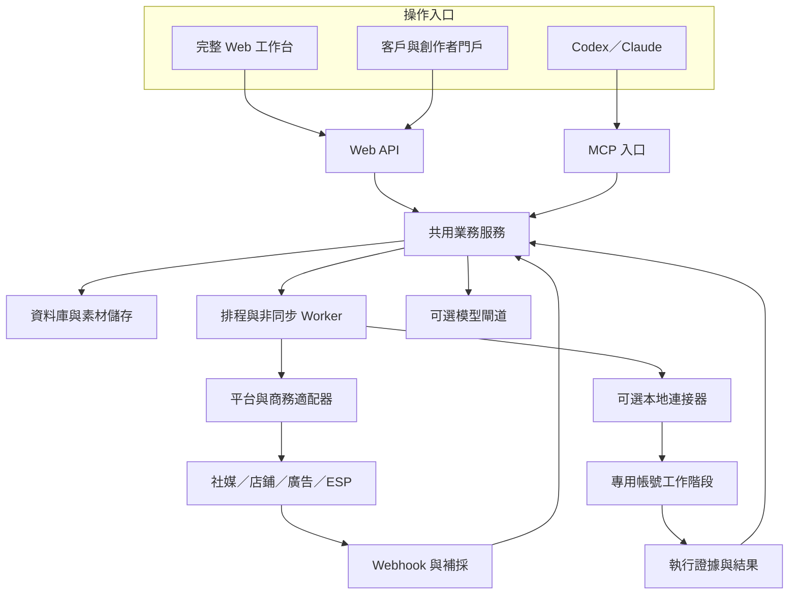
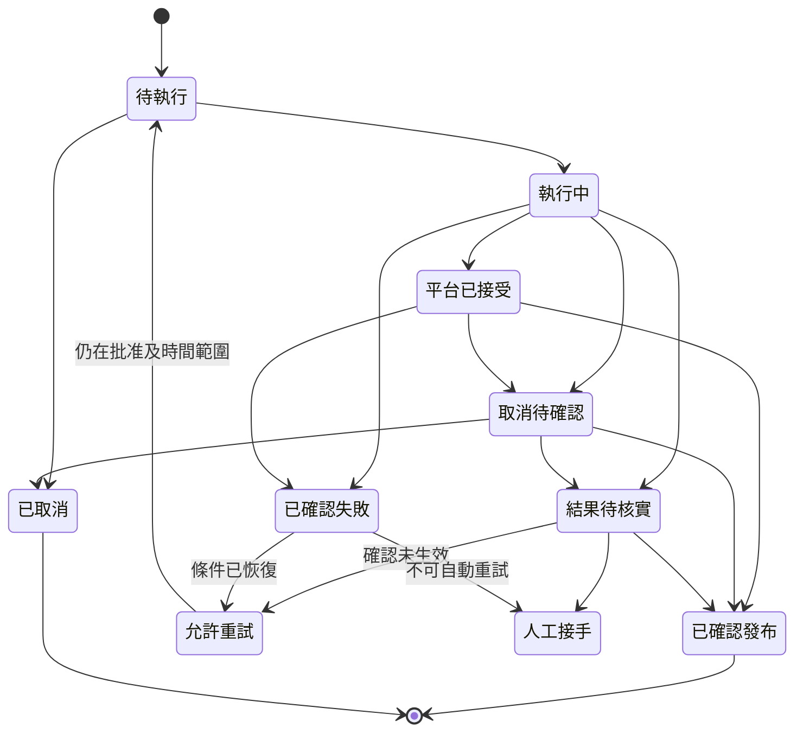

# 社媒與跨境電商營運系統：完整功能與實現方案

> **版本：V0.2｜研究日期：2026 年 11 月 19 日｜文件語言：繁體中文**
>
> 本版依最新需求重新設計為：**完整 Web 前端＋後端業務系統＋非同步執行服務＋可選本地連接器＋MCP／Agent 接入**。
>
> 本文件是產品功能與架構規格，包含 SaaS 調研、功能清單、實現原理、實現路線、依賴及驗收條件；不包含產品程式實作。表中的功能與路線均為建議設計，不表示已完成開發或已取得第三方權限。

## 閱讀導覽

- **第 1–3 章**：產品定位、SaaS 調研結果，以及哪些能力自建或整合。
- **第 4–5 章**：完整前台資訊架構與後端架構。
- **第 6 章**：19 個模組、147 項功能；逐項描述前台操作、實現原理及分階段路線。
- **第 7–10 章**：資料模型、關鍵業務規則、完整營運情境、第三方接入邊界。
- **第 11–13 章**：實施階段與驗收、舊版能力承接、官方研究來源。

## 1. 本次修訂的核心決定

### 1.1 產品定位

建議定位為：

**面向跨境品牌、電商團隊與代營運公司的社媒營運工作台，串接商品、行銷活動、內容、發布、互動、創作者合作和銷售結果，並支援私有部署及外部 Agent 操作。**

產品首先要讓一個營運團隊完成日常工作：知道要推什麼商品、向哪個市場說什麼、誰負責製作、誰核准、什麼時間發布、由誰處理評論，以及最後帶來什麼結果。

Codex／Claude 可以承接研究、策劃、撰稿、批次操作和分析。團隊也可以全程使用 Web：所有正式業務狀態都保存在本產品後端，日曆和任務不依賴某個對話視窗持續開啟。

### 1.2 與上一版的結構差異

| 面向 | 本版決定 | 對產品的具體影響 |
|---|---|---|
| Web 定位 | 提供完整營運前台 | 有內容編輯器、活動中心、日曆、收件箱、商品中心、創作者工作台與報表，不要求每個操作都經由 Agent |
| 後端定位 | 成為業務事實與狀態的共同來源 | 統一權限、版本、審批、排程、採集、執行、歸因及稽核；前台與 MCP 使用同一套規則 |
| Agent 定位 | 可以主導工作，也可以輔助操作 | Agent 的提案、批次修改及執行進度在 Web 可見；人員可以接手、修訂或停止 |
| 本地客戶端定位 | 按實際平台需要安裝的連接器 | 維護本機登入環境、裝置狀態與人工接管；官方 API 能完成的工作由後端直接執行 |
| 核心業務對象 | 從貼文擴展到活動及其相關商品 | 一次新品或促銷活動可連結多市場內容、達人、廣告、導流頁、郵件及結果 |
| 數據系統 | 採集、品質、分析分工清楚 | 同步失敗與缺失可見；原始口徑、資料來源、估算值及更新時間保留 |
| 私有部署 | 部署自己的前後端與資料層 | 明確配置對外 API、回呼、公開頁面及模型資料流向；桌面訂閱與模型 API 分開接入 |
| 功能範圍 | 自建營運協作，整合交易與專業基礎服務 | 連接店鋪、ERP、客服、ESP、廣告及資料商，避免把整個電商基礎設施一次重做 |

### 1.3 主要使用角色

| 角色 | 最常處理的問題 | 主要工作介面 |
|---|---|---|
| 品牌／行銷負責人 | 活動目標、預算、進度與成效 | 總覽、活動中心、分析報告 |
| 社媒營運 | 選題、內容、發布、互動 | 內容工作台、日曆、收件箱 |
| 設計／剪輯／文案 | 任務、素材、版本與回饋 | 製作看板、素材庫、內容編輯器 |
| 電商營運 | 商品、庫存、價格、優惠及訂單 | 商品市場中心、活動頁、轉化報表 |
| 達人經理 | 招募、合作、寄樣、交付與佣金 | 創作者工作台、合作看板 |
| 客服 | 評論私信、訂單查詢、售後協作 | 統一收件箱、客戶與工單側欄 |
| 代理商／客戶 | 多品牌、客戶審閱與報告交付 | 工作區切換、客戶門戶 |
| 系統管理員 | 整合、裝置、權限與私有部署 | 管理中心、連接器與執行監控 |
| Codex／Claude 等 Agent | 研究、生成、批次處理、分析與追蹤 | MCP；產出回到上述業務頁面 |

## 2. 現有 SaaS 調研與吸收的功能

### 2.1 調研方法與證據範圍

本次查閱代表性產品的**官方產品頁、官方幫助中心及公開 API 文件**，涵蓋社媒管理、內容協作、跨境店鋪、客服、創作者行銷、選品情報、生命週期行銷和歸因。這是公開文件調研，未登入其付費後台實測。

下表「已確認能力」描述官方公開資料；「本產品吸收的設計」是本方案的產品判斷。供應商產品裡存在某功能，不代表我們能取得相同 API、資料授權或完整地區覆蓋。方案層級、附加費、帳號類型及功能權限仍須在接入階段核實。本文不使用促銷價格或廠商宣稱的資料庫規模估算開發成本。

### 2.2 代表平台與設計轉化

| 平台／類別 | 官方資料確認的能力 | 本產品應吸收的設計 | 落入功能模組 |
|---|---|---|---|
| **Sprout Social**／社媒管理 | 統一收件箱、協作、競品及付費成效洞察、社媒客服報告；進階能力存在方案或加購區分。[R01] | 將互動處理、團隊效率及自然／付費分析納入正式工作台 | IN、LI、AN、TE |
| **Hootsuite**／社媒營運 | 內容製作與審批、素材、訊息分派、客服協作、分析報告、監測及暫停排程。[R02] | 補齊從製作到回覆的日常流程；建立危機暫停與恢復機制 | CO、AS、PL、IN、AN |
| **Later**／內容與導流 | 發布及協作功能、Link in Bio、媒體收集、投稿及 UGC；功能依方案與平台而異，收集內容須保留來源並另處理使用許可。[R03]、[R04] | 視覺內容預覽、投稿入口、導流頁、素材來源與授權狀態 | CO、AS、CR、LP |
| **Metricool**／多品牌與報表 | 內容規劃、分析、PDF／PPT 報告、團隊與客戶管理、API、白標等，分屬不同方案。[R05] | 品牌級工作區、可保存視圖、報告模板及客戶交付；API 與 MCP 接入分別驗證 | WS、AN、TE、AI |
| **Planable**／活動與審批 | Campaign 把 brief、內容、素材、待辦、日曆和表現放在同一空間；客戶審閱有明確角色與可見範圍。[R06]、[R07] | 活動成為跨模組主對象；內部草稿、客戶審閱、正式批准分開建模 | CA、CO、PL、TE |
| **SocialBee**／內容編排 | 內容分類、常青內容重用、平台版本、創意與素材工具、協作及分析。[R08] | 主題內容柱、循環佇列、有效期限、重用間隔與平台差異化編輯 | CO、AS、PL |
| **SocialEcho**／出海社媒營運 | 多平台發布、互動、監測與分析，官方逐平台列出不同能力範圍。[R09] | 在帳號及每項操作旁顯示「可執行／唯讀／需授權／需人工／不支援」，不要把支援平台等同全部功能可用 | AC、DS、IN、EX |
| **Shopify／Markets／Collabs**／跨境電商 | Markets 管理市場商品、價格、幣別、語言等；Collabs 涵蓋招募、贈品、折扣、聯盟銷售與付款。[R10]、[R21] | 商品與市場成為內容的事實來源；合作、寄樣、優惠及訂單能連回活動 | PC、CA、CR、AN |
| **Klaviyo**／生命週期行銷 | Campaigns 管一次性訊息與排期；Flows 管事件驅動流程；表現需另外讀取 Reporting API，渠道同意各自管理。[R11]、[R12]、[R13] | 共用活動日曆、受眾分群、歡迎／棄購／購後流程監控；投遞及退訂交給 ESP | EM、CA、AN |
| **Gorgias**／電商客服 | Facebook／Instagram 互動進入工單；Shopify 客戶、訂單及物流資訊可在客服側欄使用。[R14]、[R15] | 社媒評論／私信與客戶、商品、訂單連接；已有客服系統時同步工單及深層連結 | IN、PC、TE |
| **Triple Whale**／電商歸因 | 多歸因模型與窗口、跨渠道報表；ESP 互動指標與歸因收入來源不同，部分模型不可加總為營業額。[R16]、[R17] | 拆開交易事實、平台歸因與自有鏈路；保留模型、窗口、退款及未知比例 | AN、LP、AD |
| **GRIN**／創作者合作 | 合作活動、交付要求、商品、支付配置、內容權益與付費放大；內容庫可關聯使用權。[R19]、[R20] | 達人流程涵蓋 brief、寄樣、交付、發布憑據、授權與結算 | CR、AS、AD |
| **Upfluence**／達人及聯盟 | 達人發現、合作管理、電商追蹤、付款與公開 API／MCP 產品。[R18]、[R28] | 手動／匯入的合作 CRM 先行，授權資料源後續補強發現與篩選 | CR、LI、AI |
| **FastMoss**／TikTok 電商情報 | 商品、達人、店鋪、內容等情報與 REST API；另有明確資料使用及再分發限制。[R23]、[R24] | 供應商適配、查詢配額、關注列表及商用許可管理；先確認嵌入權利再接入 | LI、DS、OP |
| **Kalodata**／選品與內容研究 | 商品、店鋪、達人、影片／廣告、直播研究；官方說明資料經公開來源與模型處理，不宜用於高精度佣金結算。[R25] | 選品機會看板、創意研究與直播分析；估算情報與實際交易分開 | LI、CR、AN |
| **BigSeller**／跨境 ERP | 商品、訂單、庫存、採購、倉儲、物流及財務相關流程。[R26] | 引入營運需要的商品、庫存、成本與物流事實；完整倉儲、採購及財務流程採整合路線 | PC、CR、IN、OP |
| **HubSpot**／行銷活動與收入 | 活動歸因可從聯絡人、交易到收入觀察貢獻，資料來源及可用報告有條件限制。[R27] | 將活動目標、線索、後續成交和報告連起來；為非即時購買的品牌保留線索路徑 | CA、LP、AN |

### 2.3 研究對方案的主要影響

1. **活動應該有自己的工作空間。** 商品、brief、內容、預算、達人、廣告與結果要可從同一活動找到，無須讓營運人員自行拼接多張表。
2. **社媒互動應連接客服。** 「收到了評論」之後還有分派、翻譯、訂單查詢、回覆、升級、解決與服務效率。
3. **跨境內容需要商品事實。** 同一 SKU 在不同市場的售價、庫存、語言與優惠未必相同；內容批准後也可能改變。
4. **達人合作是一段業務流程。** 發現、談合作、寄樣、交付、內容權益和佣金都要追蹤，不能停在搜尋列表。
5. **導流與成交需要共同識別。** 貼文、短鏈、落地頁、優惠碼、訂單、退款應有可追溯關聯；沒有證據的成交保留為未歸因。
6. **進階功能應逐步接入。** 專業資料庫、ESP、廣告投放及複雜歸因有獨立成本、合約與權限，完整前台可先提供人工、匯入或深層連結流程。

## 3. 自建、整合與延後深化的邊界

「納入完整功能」不等於每一層都自行開發。建議將對使用者的完整流程與底層能力的供應方式分開規劃。

| 能力 | 建議方式 | 自己負責什麼 | 外部系統負責什麼 |
|---|---|---|---|
| 多品牌工作區、活動、內容版本、素材、日曆、審批 | 核心自建 | 統一操作、協作規則、權限及狀態 | 設計工具可以透過匯入或連結接入 |
| 採集、同步、品質、發布與執行追蹤 | 核心自建＋平台適配 | 排程、去重、重試規則、結果核實、來源追蹤 | 官方平台決定可讀／可寫內容與頻率 |
| 商品與市場事實中心 | 自建營運視圖＋店鋪／ERP 整合 | 商品引用、版本快照、發布前核查、變更影響分析 | 庫存、實際價格、交易、稅費、支付與配送主帳 |
| 社媒收件箱與輕量客戶關係 | 自建基礎工作流＋客服整合 | 社媒脈絡、分派、草稿、協作、進度 | 已有客服系統承接完整工單與售後處理 |
| 達人合作與 UGC | 自建 CRM、交付及權益管理 | 合作狀態、brief、寄樣追蹤、素材授權、對帳 | 大規模發現資料、電子簽署、支付及平台聯盟結算 |
| 短鏈、Link in Bio、輕量活動頁 | 自建 | 可追蹤的頁面與商品導流、表單、版本、活動連結 | 完整商城、結帳與支付仍在店鋪 |
| 廣告管理 | 先整合唯讀，再分階段開放寫入 | 創意關聯、預算視圖、批准、執行回執 | 廣告平台負責競價、計費、受眾及實際投放 |
| Email／SMS 等生命週期行銷 | 整合 ESP | 活動與分群協調、模板／流程引用、同意狀態、結果 | 實際投遞、渠道退訂、抑制名單、送達管理 |
| 基礎成效與歸因 | 自建事實層及可解釋模型 | UTM、內容關聯、訂單去重、退款調整、報告 | 跨裝置建模、行銷組合模型等進階能力可接專業服務 |
| 社媒／電商市場情報 | 授權資料供應商＋自有研究流程 | 關注對象、搜尋、快照、研究筆記與機會驗證 | 合約範圍內的歷史資料、覆蓋地區與估算指標 |
| AI 能力 | 外部 Agent＋可選模型閘道 | 上下文、工具、任務、權限、評估與結果落庫 | 使用者選擇的模型與推理服務 |
| 倉儲、採購、物流面單、清關、總帳 | 提供關聯與整合入口 | 顯示營運需要的摘要及異常，追蹤協作結果 | 由電商、ERP、倉配、財務系統執行專業流程 |

## 4. 完整 Web 前台應該長什麼樣

### 4.1 導航與主要頁面

以下是產品資訊架構，不要求 19 個功能模組各自占一個頂層選單。建議將常用營運頁集中，管理能力放在設定區。

| 導航 | 主要頁面／視圖 | 使用者可以完成的工作 |
|---|---|---|
| 營運總覽 | 今日待辦、活動概覽、異常、通知 | 處理待審、漏發、待回覆、低庫存及資料失聯 |
| 行銷活動 | 活動列表、活動詳情、目標／預算／里程碑 | 建立新品／促銷計畫，協調所有渠道及負責人 |
| 內容工作台 | 選題池、製作看板、編輯器、平台預覽 | 從選題到文案、拍攝、設計、多語版本及審校 |
| 發布日曆 | 月／週／列表、帳號視圖、審批中心 | 安排不同市場發布、追蹤批准及實際上線 |
| 素材中心 | 資產庫、品牌規範、UGC、授權卡 | 搜尋可用圖片／影片、確認版本及使用範圍 |
| 互動與客戶 | 收件箱、對話、客戶／訂單側欄、工單 | 回覆評論私信、分派、查訂單、升級售後 |
| 商品與市場 | 店鋪、商品／SKU、價格庫存、優惠 | 挑選推廣商品，檢查目標市場及內容事實 |
| 達人合作 | 候選池、合作 CRM、交付、寄樣、佣金 | 管理招募到合作復盤的完整流程 |
| 情報研究 | 關鍵字、競品、商品／達人／創意研究 | 找出選題及商品機會，形成可驗證的活動假設 |
| 導流與行銷 | 短鏈、Link in Bio、活動頁、表單、ESP 流程 | 將社媒注意力引導到線索、商品或訂閱 |
| 廣告 | 廣告總覽、創意庫、實驗、預算與變更審批 | 比較廣告與內容，按權限啟用投放動作 |
| 數據與報告 | 採集任務、資料品質、分析、歸因、報告 | 修復資料問題，解釋表現並交付報告 |
| AI 與自動化 | 工作流、Agent 任務、MCP 接入、用量 | 提交任務、檢查變更、接手長任務及設定規則 |
| 管理中心 | 帳號、裝置、整合、成員、稽核、部署 | 管理連接、存取、系統運行及資料保留 |

### 4.2 一致的頁面行為

所有核心列表提供品牌、帳號、平台、市場、活動、負責人及日期篩選；可保存個人或團隊視圖。批次動作先列出影響範圍，執行後逐筆顯示成功、失敗及跳過理由。

內容、活動、對話及報告詳情都保留來源、版本、狀態時間線與相關對象。從一則貼文可以回到活動、商品、素材、執行紀錄及成效；從一筆訂單歸因可以查到可用的連結、優惠碼或平台證據。

前台遇到未連接、無權限、未同步、暫不支援、數值為零時顯示不同狀態。AI 建議亦有來源與採納動作；直接編輯、直接審批與手動處理的入口始終存在。

## 5. 前後端及客戶端整體架構

### 5.1 系統架構圖

圖中的共用業務服務負責權限、業務驗證、內容版本、批准、任務狀態及稽核。MCP 只是一個入口，不能繞過這些服務直接任意改資料庫。Web 與 Agent 可以交替操作同一任務。

### 5.2 各層職責與落地方式

| 元件 | 責任 | 建議實現路線 |
|---|---|---|
| Web 前端 | 完整表單、編輯器、看板、日曆、收件箱、報表及設定 | 採成熟前端框架及共用元件；先確保核心業務可由表單與頁面完成，再加入 AI 快捷入口及即時協作 |
| Web API | 身分、資料讀寫、批次動作及長任務查詢 | 提供版本化 API；所有查詢按工作區及資源授權；大量匯出、採集、發布回傳工作 ID |
| 業務後端 | 活動、商品引用、內容、審批、合作、互動與報告 | 初期採模組化單體，按業務領域分界；各領域共用明確交易及事件契約，先避免過度拆成微服務 |
| 非同步 Worker | 採集、上傳、發布、核實、匯出、轉碼及補償任務 | 獨立於 Web 請求與桌面 Agent 運行；使用持久任務、租約、逾時與重試分類 |
| 排程器 | 找到到期工作並建立執行意圖 | 時間以 UTC 儲存並保留市場時區；透過交易發件箱或等效機制處理資料提交與入列一致性 |
| 平台適配層 | 不同平台的認證、資料格式、操作與限制 | 以能力查詢、輸入驗證、執行、結果查詢、錯誤分類等一致介面包裝；每次接入先驗證實際帳號權限 |
| 資料層 | 業務狀態、歷史快照、原始回應、素材與報表 | 關聯式資料庫保存核心對象；物件儲存保存大檔；資料量增長後再引入專用搜尋或分析儲存 |
| 本地連接器 | 裝置註冊、帳號工作階段、受限本機任務與人工接手 | 本機常駐服務主動連回後端領取任務；以專用瀏覽器設定檔或受控擴充套件配合允許的操作，不暴露任意遠端命令入口 |
| MCP 服務 | 向外部 Agent 提供業務工具、上下文及任務查詢 | 先提供一個按領域分組的 MCP 服務；工具傳遞明確工作區、對象 ID、版本及動作範圍，避免拆成大量各自維護狀態的服務 |
| 模型閘道 | 可選的 Web 內 AI 推理入口 | 支援客戶自備 API、企業閘道或私有模型；記錄資料範圍與用量，桌面 Agent 訂閱不當作可轉供後端的 API 憑據 |
| 公開頁面服務 | 導流頁、投稿、招募及客戶審閱 | 與內部管理面分開授權及發布；內網部署時另設可對外到達的公開服務或採既有外部頁面整合 |

### 5.3 私有部署與客戶端的三種運行形態

| 形態 | 部署內容 | 適合情境 | 關鍵條件 |
|---|---|---|---|
| 後端直接整合 | Web、API、Worker、資料庫及物件儲存 | 可透過官方 API 完成的帳號與店鋪 | 應用權限、OAuth、配額及需要的回呼網路可用 |
| 混合部署 | 上述元件＋指定電腦的本地連接器 | 某些流程需要本機登入工作階段或人工輔助 | 電腦及連接器在線；工作階段獨占；操作受平台規則及允許能力限制 |
| 受限內網部署 | 核心系統在內網，對外連接經核准出口 | 客戶要求控制資料與外部服務存取 | 逐項決定平台回呼、雲端 Agent、模型及公開頁面的可達性；離線環境只提供可離線的業務功能 |

Web 前端的檔案可以用靜態資源方式發布，但產品需要持續運行的後端、資料層與執行服務。**「前端可以靜態託管」與「整個產品只有靜態網站」是不同的部署層次。**

## 6. 完整功能、實現原理與實現路線

### 功能表閱讀規則

- **P0：首個可用版本。** 包含可獨立使用的 Web、核心帳號及資料接入、內容／日曆／審批／發布／核實、基礎互動與報告，以及商品和活動的最小關聯。
- **P1：營運與電商協作閉環。** 完整商品市場聯動、達人合作、客服上下文、導流及 ESP 整合、多品牌交付和更多平台。
- **P2：規模化及進階能力。** 複雜監測、付費廣告寫入、進階歸因、白標、精細自動化及高可用部署。
- 一列中的「P0 → P1」代表同一功能逐步擴充，並非第一版承諾其全部細節。即使標為 P0，第三方動作也只在首批已驗證平台及帳號範圍提供。
- 「整合」仍需有可用的前台入口、狀態、錯誤處理與回到來源系統的路徑；沒有自動化權限時，可使用人工記錄或匯入，但介面要清楚標明。
- 以下原理與路線屬於本產品設計建議；每組表前的研究來源支持其功能方向，不宣稱參考產品使用相同內部架構。

### 模組總覽

| 模組 | 功能數 | 主要責任 |
|---|---:|---|
| WS | 6 | 工作區與營運工作台 |
| AC | 7 | 帳號授權與本地裝置 |
| DS | 8 | 數據採集與品質管理 |
| PC | 7 | 店鋪商品與跨境市場 |
| CA | 6 | 活動、營運目標與預算 |
| LI | 7 | 社媒監測競品與選品 |
| CO | 9 | 選題、內容製作與本地化 |
| AS | 7 | 素材、品牌知識與使用授權 |
| PL | 9 | 發布日曆、排期與審批 |
| EX | 8 | 發布執行與異常恢復 |
| IN | 11 | 統一收件箱與客戶關係 |
| CR | 10 | 達人合作 UGC 與聯盟 |
| LP | 6 | 導流頁短鏈與線索 |
| AD | 6 | 付費廣告與創意 |
| EM | 5 | 客戶分群與生命週期行銷 |
| AN | 10 | 分析歸因與報告 |
| AI | 8 | AI 助手、MCP 與工作流 |
| TE | 7 | 團隊、代理商與客戶門戶 |
| OP | 10 | 私有部署、整合與系統管理 |
| **合計** | **147** | **19 個模組，每項均有操作、原理與路線** |

### 6.1 工作區與營運工作台（WS）

Web 與 Agent 是並列入口。使用者不開啟 AI，也能完成主要營運工作；工作台按品牌、帳號、商品與責任人組織同一份業務記錄。

研究參考：Metricool 的多品牌管理與 Planable 的活動協作。[R05]、[R06]

| 編號／功能 | 前台操作與產出 | 實現原理與依賴 | 實現路線／優先級 |
|---|---|---|---|
| **WS01 多品牌與市場工作區** | 切換品牌或客戶後，立即看到所屬社媒帳號、店鋪、商品、目標市場及協作者，並可建立個人常用工作區。 | 每項業務物件綁定工作區與品牌，市場及店鋪作為可交叉篩選的維度；Web 與 Agent 共用服務端隔離規則，避免跨品牌讀寫或錯用素材。 | P0 先建立工作區、品牌及商品關聯；依賴成員身分與基礎權限，P1 再加入多客戶切換及跨工作區授權彙總。 |
| **WS02 今日工作與異常總覽** | 首頁列出今日發布、待審核、待回覆、缺素材及裝置異常，點擊即可進入處理頁，並顯示責任人和截止時間。 | 總覽從內容、發布、會話及待辦服務讀取真實狀態，按期限和影響程度排序；每個提醒保留來源物件與更新時間，完成後同步移出待辦。 | P0 先涵蓋發布、審核與連接異常；依賴任務狀態和通知事件，P1 再納入客服、商品及活動風險。 |
| **WS03 全域搜尋與保存檢視** | 在同一搜尋框查找活動、貼文、商品、素材或客戶，組合品牌、狀態和負責人條件，保存為常用工作檢視。 | 各物件提供統一的可搜尋摘要與穩定識別碼，結果必須再次套用存取權限；保存檢視只儲存查詢條件，資料更新後自動反映最新結果。 | P0 先做核心物件搜尋與篩選；依賴物件索引和權限，P1 開放保存及共享檢視，P2 再加入跨物件語義搜尋。 |
| **WS04 個人待辦與通知中心** | 每位成員可查看指派工作、提及、審核請求與關注內容，設定提醒偏好，從通知直接開啟具體處理動作。 | 待辦保留負責人、截止時間及處理結果，通知只是投遞方式；事件去重並區分已讀與已完成，避免關閉通知被誤認為業務已處理。 | P0 建立站內待辦、提醒及關注；依賴事件與任務服務，P1 再按成員偏好投遞郵件或已連接的協作工具。 |
| **WS05 營運概覽與個人儀表板** | 選擇品牌、活動及時間後，查看內容產出、準時發布、互動與商品導流，並調整首頁卡片及比較期間。 | 儀表板使用統一指標查詢，分開展示執行效率與內容成效；數字附帶範圍、口徑、更新時間及缺失說明，避免把未採得資料當作零。 | P0 提供固定總覽與時間篩選；依賴指標字典及採集結果，P1 增加自訂卡片、歷史比較和商品轉換視圖。 |
| **WS06 首次設定與資料接入導引** | 依序設定品牌、市場、社媒帳號與店鋪，檢查歷史資料同步進度，完成測試草稿後即可開始正式工作。 | 導引由可恢復的設定步驟組成，每一步檢查連接、授權和資料狀態；未完成項目顯示影響範圍，並保存進度供其他授權成員接續。 | P0 打通一個社媒平台與商品來源的導引；依賴連接及匯入服務，P1 增加舊資料遷移、團隊邀請和設定範本。 |

### 6.2 帳號授權與本地裝置（AC）

統一管理品牌旗下的社媒帳號、平台授權與可選本地裝置，將帳號身份、實際能力及執行位置明確分開，完整 Web 可直接完成連接與維護。

研究參考：SocialEcho 的逐平台能力矩陣；各官方平台權限另見第 10 章。[R09]

| 編號／功能 | 前台操作與產出 | 實現原理與依賴 | 實現路線／優先級 |
|---|---|---|---|
| **AC01 帳號目錄與品牌歸屬** | 集中查看各品牌的社媒帳號、平台身份、負責人與連接方式，支援新增、搜尋、分組及停用帳號。 | 使用平台穩定識別碼建立帳號主檔，將品牌歸屬、授權連接與執行裝置分表關聯，避免暱稱變更或多次連接造成重複帳號。 | P0 完成帳號主檔、品牌分組及單平台連接；P1 加入多店鋪關聯與團隊交接；P2 擴充批次管理。 |
| **AC02 官方授權與撤銷處理** | 引導使用者完成平台授權，顯示權限範圍、有效狀態及重新授權入口，並可隨時撤銷連接。 | 服務端保管加密權杖並管理刷新，撤銷後停止新增操作並檢查既有任務；已提交平台的動作另行核實，不能假定同步撤回。 | P0 實作授權、刷新及撤銷後任務阻擋；P1 補充部分授權與權限異動提示；P2 加企業集中授權管理。 |
| **AC03 帳號能力與接入診斷** | 按帳號展示可讀數據、可發格式、修改刪除能力及限制原因，區分可用、待授權與尚未核實的功能。 | 根據平台、地區、帳號種類、應用獲批範圍與實際權限計算能力；操作前重新檢查，不能只憑成功登入便啟用全部功能。 | P0 建立能力表並接入發布前檢查；P1 增加店鋪與聯盟權限；P2 提供跨版本相容診斷及批次巡檢。 |
| **AC04 本地裝置註冊與在線狀態** | 查看本地連接器所屬電腦、負責人、版本與在線狀態，完成配對、停用及帳號執行位置指派。 | 裝置以獨立身份主動連線領取獲准任務並回報心跳，服務端不直接暴露或連入瀏覽器調試端口，離線狀態與帳號授權分開。 | P0 預留裝置與任務契約；P1 按首發平台需要提供輕量連接器及配對；P2 補充裝置群組與部署管理。 |
| **AC05 瀏覽器會話與身份校對** | 為本地帳號建立專用瀏覽器環境，顯示實際登入身份與綁定狀態，身份不符時提供重新登入入口。 | 每個執行環境隔離會話並保留本地憑證，提交前核對平台帳號識別碼；人工切換帳號或內容時暫停，不能只相信環境名稱。 | P0 先核對官方接口的授權身份；P1 加入本地獨立會話與提交前校對；P2 加人工操作衝突偵測。 |
| **AC06 登入維護與人工接管** | 集中處理登入過期、驗證碼及權限不足等阻塞，顯示受影響任務，允許負責人處理後繼續執行。 | 登入異常轉為明確阻塞狀態，保留原任務與內容版本；敏感憑證不送入模型，人工處理後須重新驗證身份及剩餘操作權限。 | P0 完成授權異常提示與恢復流程；P1 支援本地登入接管；P2 增加預先健康檢查及多人值班分派。 |
| **AC07 執行位置遷移與裝置回收** | 調整帳號的執行裝置或停用遺失電腦，預覽受影響的排程與進行中任務，追蹤遷移及回收結果。 | 先停止新任務派發並核對進行中操作，再解除綁定與重新驗證新環境；結果未知的發布不能直接移交重發，裝置令牌可獨立撤銷。 | P0 支援連接停用及任務影響預覽；P1 增加裝置遷移與安全回收；P2 完善批次交接及遷移演練。 |

### 6.3 數據採集與品質管理（DS）

統一處理自有帳號、授權店鋪、外部情情報表與人工匯入，保留來源和口徑，讓使用者看見數據完整程度及採集成本。

研究參考：平台能力差異、店鋪資料及資料供應商接入限制。[R09]、[R10]、[R23]、[R24]

| 編號／功能 | 前台操作與產出 | 實現原理與依賴 | 實現路線／優先級 |
|---|---|---|---|
| **DS01 數據源連接與使用範圍** | 選擇官方平台、店鋪或資料供應商，查看可取欄位、更新方式、費用及允許用途，管理連接狀態。 | 每個來源保存權限、地區、欄位覆蓋與資料使用限制，按租戶隔離憑證；購買接口不自動取得轉售、公開展示或模型處理權利。 | P0 接通自有帳號與商品資料並顯示能力；P1 加店鋪訂單及合約允許的情報源；P2 擴充供應商切換。 |
| **DS02 歷史資料回補** | 指定帳號、資料類型與歷史期間發起回補，查看進度、已覆蓋日期、缺失區間及無法取得的原因。 | 依來源可用歷史範圍分頁擷取，保存游標與完成邊界，任務中斷可續跑；超出平台保留期或授權範圍的資料不得標示為完整。 | P0 提供有限期間的歷史回補與進度；P1 增加跨來源缺口清單及續跑；P2 支援大量帳號的分批回補。 |
| **DS03 增量同步與更新頻率** | 為帳號或關注清單設定同步頻率，查看最後成功時間、下次更新與資料延遲，必要時手動更新。 | 以穩定物件識別碼和更新游標增量同步，保留重疊時間窗處理延遲回補；同步完成不代表平台原始資料已即時更新。 | P0 完成定期增量同步與手動刷新；P1 按內容發布時間調整頻率；P2 依成本、限流與熱度自動分配。 |
| **DS04 Webhook 去重與補採** | 查看平台事件接收狀態、延遲及異常，追蹤已觸發的同步任務，支援重新核對指定期間的資料。 | 驗證事件來源與簽章，按事件識別碼去重並處理亂序；事件只觸發可重入更新，另以定期查詢補採遺失事件及核對最終狀態。 | P0 建立事件接收、去重與定期核對；P1 接訂單退款及合作事件；P2 增加事件重播與來源延遲分析。 |
| **DS05 CSV／Excel 與人工資料匯入** | 上傳 CSV／Excel 報表並對應欄位，預覽重複、格式錯誤與新增記錄，確認後匯入，也可下載失敗列修正重送。 | 先暫存解析結果再驗證帳號、日期、時區、幣種和單位，採明確去重鍵合併；保留原檔與匯入批次，錯誤列不默默轉為零。 | P0 支援社媒報表與商品清單匯入；P1 加訂單、物流及佣金模板；P2 提供保存映射及大檔分批處理。 |
| **DS06 指標口徑與缺失標記** | 在圖表與表格中查看指標定義、統計期間及來源，明確區分零值、未採集、無權限與來源未提供。 | 建立原始欄位到業務指標的語義映射，保存時區、幣種、分母和歸因窗口；不同平台無法直接比較的指標不強行相加。 | P0 規範常用社媒指標及缺失狀態；P1 納入訂單退款與多幣種口徑；P2 提供自訂指標及定義版本。 |
| **DS07 原始證據與資料追溯** | 從數據、報表或 AI 結論開啟來源連結、原始快照及採集批次，查看處理過程與可用保存期限。 | 保存來源物件識別碼、時間、原始值及轉換版本，依權限保留回應或遮罩截圖；敏感欄位與授權到期資料按規則限制或清除。 | P0 建立來源連結與採集批次追溯；P1 增加權限化原始快照；P2 支援跨報表資料血緣與保留策略。 |
| **DS08 品質監控與採集預算** | 集中查看缺口、重複、異常波動、接口限流及供應商用量，調整更新計畫並追蹤修復任務。 | 分別監控同步成功率、資料新鮮度與欄位完整度，按來源設定配額與費用預算；異常先產生核對任務，不能自動改寫真實值。 | P0 提供同步健康與缺口告警；P1 加外部資料預算、快取及補採排程；P2 擴充品質規則與成本預測。 |

### 6.4 店鋪商品與跨境市場（PC）

參考 Shopify Markets 的商品目錄、地區價格與語言管理，建立社媒營運可直接引用的商品事實。Web 提供完整管理與匯入介面，Agent 使用相同服務查詢、提出修改或執行已授權操作。

研究參考：Shopify Markets；店鋪與 ERP 維持商品、庫存及交易主帳。[R10]、[R26]

| 編號／功能 | 前台操作與產出 | 實現原理與依賴 | 實現路線／優先級 |
|---|---|---|---|
| **PC01 店鋪接入與同步中心** | 在 Web 新增店鋪、選擇同步範圍，查看權限、最近同步時間與失敗原因；可手動重試、重新授權或匯入檔案。 | 每個店鋪保留獨立連線與同步進度，先建立資料快照，再接收增量事件並定期核對；缺失或過期資料明確標記，不以成功連線代表資料完整。 | P0 先支援商品檔案匯入與連線狀態；P1 接入 Shopify 授權及增量同步，再擴充其他店鋪，無可用 API 時保留匯入。 |
| **PC02 商品變體與 SKU 對照** | 商品頁可展開顏色、尺寸等變體，搜尋 SKU、維護跨店對照，並查看各變體已使用的貼文、活動與素材。 | 以店鋪及外部商品、變體識別碼建立對照，SKU 僅作業務欄位；同碼不同店不自動合併，商品合併與拆分保留操作紀錄及原始關聯。 | P0 自建商品與變體檔案，先完成手動對照和內容關聯；P1 讀取店鋪 API 自動更新，跨店合併仍由使用者確認。 |
| **PC03 市場可售與地區價格** | 以國家、語言及銷售渠道切換商品視圖，直接查看可售範圍、實際幣種價格和對應購買網址，標示未取得資料。 | 價格與可售性按店鋪、變體、目標市場及渠道保存，優先引用店鋪事實；換匯估算另作標籤，不替代結帳價格或推定當地支付可用。 | P0 先讓使用者設定目標市場與價格來源；P1 整合 Markets 目錄和地區價格，依支付商、方案與 API 權限逐項啟用。 |
| **PC04 商品事實與內容引用** | 在商品卡維護規格、賣點、適用情境及佐證連結，選取欄位插入貼文或簡報，並檢視內容引用的商品版本。 | 把商品事實、行銷描述與推測分開保存，內容引用可回溯到原始欄位及時間；素材沿用 AS 模組，避免不同渠道自行複製出互相矛盾的資料。 | P0 自建事實欄位、版本與引用關聯，先供 Web 編輯和 Agent 讀取；P1 接店鋪資料並加入事實變更後的內容檢查。 |
| **PC05 多語商品與區域版本** | 並排編輯原文、翻譯及地區用詞，預覽商品與社媒文案，標示待校對、已核准及原文更新後需要重譯的項目。 | 語言和市場各自建模，同語言可有不同地區版本；翻譯綁定來源版本，保留人工修改，禁止以新機器翻譯直接覆蓋已核准的地區內容。 | P0 先管理本產品內的多語內容；P1 接商品翻譯 API 寫回店鋪，先核對來源版本再發布，未獲寫入權限時匯出交付。 |
| **PC06 庫存價格與排程聯動** | 商品變動時列出受影響的待發貼文、促銷和廣告草稿，可批次檢查、暫停或修訂，發布前再次顯示最新狀態。 | 內容與變體、價格版本建立關聯，庫存或價格變動觸發影響分析；真正執行前重新檢查，已發布內容進入更正任務，不默默改掉核准版本。 | P0 先做發布前人工核對與過期標記；P1 接庫存價格事件並自動掃描排程，P2 加入可設定的缺貨暫停及恢復規則。 |
| **PC07 促銷活動與優惠規則** | 建立促銷時選商品、市場、優惠碼及有效期間，預覽門檻與適用條件，查看每個渠道文案是否與實際優惠一致。 | 活動描述與店鋪優惠規則分開管理並相互核對，保留外部優惠識別碼；建立草稿、規則生效與真正使用是不同狀態，避免誤報可用折扣。 | P1 先支援優惠資料匯入、有效期檢查及活動關聯；取得店鋪寫入權限後建立優惠，再讀回驗證；P2 擴充組合促銷。 |

### 6.5 活動、營運目標與預算（CA）

借鑑 Planable 的活動空間，把目標、商品、brief、內容、素材、待辦與成效集中管理；活動不只是一個貼文標籤。

研究參考：Planable 的 Campaign 與 HubSpot 的活動歸因。[R06]、[R27]

| 編號／功能 | 前台操作與產出 | 實現原理與依賴 | 實現路線／優先級 |
|---|---|---|---|
| **CA01 活動建立與目標設定** | 建立新品、節慶或促銷活動，選擇關聯商品、市場、受眾及期間，設定曝光、詢問或訂單等目標與負責人。 | 活動以獨立物件連接商品、內容、任務及指標，目標必須帶單位、基準與截止時間；不同市場可以設定子目標，同時保留共同活動歸屬。 | P0 先完成活動檔案、商品關聯和基本目標；依賴商品與品牌資料，P1 再增加分市場子目標及目標變更記錄。 |
| **CA02 活動簡報與製作里程碑** | 在活動內編寫策略簡報，列出素材需求、拍攝與審校節點，指派負責人，清楚區分製作期限和發布時間。 | 簡報保留版本與事實來源，里程碑由有前後依賴的工作項目組成；製作完成只是允許進入排期，不會直接被當成已發布或已達成目標。 | P0 提供簡報、待辦及兩種時間欄位；依賴任務和內容狀態，P1 增加前置阻塞、延誤提醒與里程碑範本。 |
| **CA03 跨渠道活動內容矩陣** | 按平台、帳號、語言和活動階段查看已規劃內容，發現缺口或重複，直接建立待製作任務或調整發布節奏。 | 矩陣彙整活動關聯的內容版本與獨立發布目標，保留計畫和實際結果；內容可以跨渠道複用，但每個目標的責任人、時間及完成狀態獨立。 | P0 先做渠道清單及活動日曆；依賴內容與發布目標，P1 再提供階段矩陣、內容缺口提示及跨市場協作。 |
| **CA04 預算分配與實際成本** | 為廣告、達人、製作和樣品分配預算，查看已承諾與實際支出、剩餘額度及超支提醒，保留費用附件。 | 預算、費用承諾和實際支出分開記帳，以原幣及指定換算日保存金額；讀取成本不等於授權花費，新增投放或付款仍走各自批准流程。 | P1 先做手動成本與預算表，依賴活動及幣別設定；再接廣告和達人費用，P2 才加入預算建議與分攤規則。 |
| **CA05 活動連結與成效追蹤設定** | 為活動生成帶追蹤參數的連結，綁定商品、優惠碼及轉換目標，預覽各渠道將如何計算成效與資料缺口。 | 活動識別碼貫穿內容、連結與可取得的網站事件，轉換採明確的去重鍵及歸因規則；優惠碼使用和來源點擊分開保存，避免重複計功。 | P0 先完成內容及連結的活動歸屬；依賴商品網址，P1 再接網站與訂單事件，P2 增加多觸點比較。 |
| **CA06 活動結案與經驗複用** | 活動結束時核對未完成內容、費用及結果，補充成敗原因，將有效簡報和工作節奏存成下一次活動範本。 | 結案保存指定時點的活動快照與未解事項，後續回補數據形成新報告版本；範本複用結構而不直接沿用過期價格、授權或發布任務。 | P1 先提供結案清單、結果快照及複盤，依賴成本與分析資料；P2 再將經驗轉為活動範本和可比較的歷史基準。 |

### 6.6 社媒監測競品與選品（LI）

結合已研究的社媒官方資料能力與 Shopify 商品市場結構，將公開內容訊號轉成可檢查的營運研究。Web 可獨立建立監測與整理證據，Agent 提供檢索、分類及分析入口。

研究參考：Sprout／Hootsuite 的監測、FastMoss／Kalodata 的電商研究；估算資料須保留來源。[R01]、[R02]、[R23]、[R25]

| 編號／功能 | 前台操作與產出 | 實現原理與依賴 | 實現路線／優先級 |
|---|---|---|---|
| **LI01 監測對象與查詢管理** | 在 Web 建立競品帳號、關鍵詞、品類與市場清單，設定更新頻率及負責人，檢視每項資料來源與可用範圍。 | 監測範圍以平台、帳號及查詢條件定義，自有授權資料和公開觀測分開；能力登錄表限制可讀欄位與頻率，不假設可搜尋所有平台內容。 | P0 先提供清單、連結收藏與人工記錄；P1 接已獲許可的官方或供應商資料，沒有可用 API 時採匯入及人工更新。 |
| **LI02 競品貼文與數據快照** | 以時間線比較競品貼文、發文頻率及公開互動，點開可查看原始連結、觀測時間和歷次快照，並篩選缺漏資料。 | 保存實際觀測值與時間，不把後續累積互動當作發布當日表現；無法取得的曝光、銷售或私密指標保留未知，不用公開按讚量推造後台數字。 | P1 先做合法資料匯入與快照比較，再依授權接入定期採集；P2 增加資料品質告警，平台限制變更時停用受影響欄位。 |
| **LI03 話題趨勢與需求整理** | 按市場、語言及時間查看話題變化，把相關貼文或留言加入研究板，標記需求、疑問和反例，轉成待討論選題。 | 趨勢由已觀測內容的增量與樣本組成推得，保留來源、樣本量及比較期間；熱門討論與購買意圖分開標記，避免把聲量直接等同市場需求。 | P1 先用收藏及允許取得的內容做分類與時間比較；P2 接授權監測服務擴大覆蓋，Agent 結論必須附可回看的證據。 |
| **LI04 內容形式與創意研究** | 比較開場、題材、長度、呈現方式及互動問題，建立創意參考板，將分析結果轉成自己的拍攝簡報與實驗方案。 | 分析內容結構和可觀測表現，保留人工標註與模型判斷的差別；參考連結不等於素材使用授權，重用實際素材須查 AS 模組授權紀錄。 | P0 先提供參考板、標籤及創意簡報；P1 由 Agent 協助結構分析並供人工修訂，P2 比較相似題材的實驗結果。 |
| **LI05 商品機會與選品評估** | 將需求證據加入候選商品卡，比較目標市場、售價區間、供應條件及現有 SKU，記錄保留、驗證或淘汰理由。 | 選品評分拆成需求證據、競爭、商品適配和供應可行性，各項保留來源與不確定性；公開熱度只是一項訊號，估算成本與實際報價分開。 | P1 自建候選清單及評分欄位，先串商品庫和人工研究；P2 接獲許可的市場資料，供應與成本仍以商家確認為準。 |
| **LI06 監測警示與研究簡報** | 設定競品異動、特定話題或新品訊號條件，在通知中心檢閱證據、合併重複提醒，指派後續研究或加入週報。 | 警示依可重現條件與資料新鮮度觸發，相同事件合併並保留處理狀態；簡報區分事實與建議，資料中斷不能被當成競品停止活動。 | P1 先做規則提醒與手動簡報匯出；P2 加入排程摘要和跨來源比對，Agent 僅根據可取得資料提出後續驗證任務。 |
| **LI07 品牌聲量、情緒與危機研判** | 比較品牌和競品在已覆蓋來源中的提及、主題與情緒，查看原文、修正分類，將異常升級為客服或品牌處理任務。 | 聲量占比只針對指定查詢與來源樣本計算；情緒及意圖保留模型版本、信心與人工修訂，諷刺、多語或樣本不足時顯示不確定。 | P1 先做人工標註與有來源的提及統計；P2 接授權監測資料、分類模型與異常規則，和品牌暫停、內部值班流程連動。 |

### 6.7 選題、內容製作與本地化（CO）

借鑑成熟社媒編輯器與製作流程，Web 可獨立完成起草、修改、預覽及交付。Agent 可協助生成與批次修改，但不能繞過版本和發布規則。

研究參考：Planable、SocialBee 的內容流程、平台版本與 RSS 匯入。[R06]、[R08]、[R36]

| 編號／功能 | 前台操作與產出 | 實現原理與依賴 | 實現路線／優先級 |
|---|---|---|---|
| **CO01 選題池與內容欄目** | 收集觀察、客戶問題、競品參考和商品賣點，按欄目與受眾整理選題，討論後直接轉成內容製作任務。 | 選題與正式內容分開儲存，來源連結、觀察時間、假設及目標可追溯；多條內容可關聯同一選題，便於檢查主題覆蓋和後續效果。 | P0 建立選題、標籤與轉任務入口；依賴品牌和商品資料，P1 加入監測及客服來源，P2 提供歷史效果輔助排序。 |
| **CO02 內容製作看板與交接** | 以選題、撰寫、設計、待素材、審校等欄位管理工作，查看負責人與製作期限，將完成內容交給排期人員。 | 製作狀態描述內容是否準備妥當，發布狀態描述外部執行結果，兩者獨立；任務保存阻塞原因、附件及交接記錄，不因拖動卡片自動發文。 | P0 提供看板、負責人與製作期限；依賴任務和內容版本，P1 增加製作依賴、工作量視圖及交接檢查清單。 |
| **CO03 多平台編輯器與發布預覽** | 按帳號編輯圖文、輪播、短影音等可用格式，設定標記、地點、首則留言或商品連結，並排查看各平台近似預覽。 | 各平台版本關聯共同主題但獨立保存，編輯器按帳號能力校驗格式與必要欄位；每次發布引用確定版本，平台實際顯示仍以回傳結果為準。 | P0 先完成主要圖文與影片流程；依賴平台能力和素材，P1 擴充不同內容格式，P2 再加入進階版面預覽。 |
| **CO04 商品與促銷事實校驗** | 從商品庫插入名稱、價格和連結，查看庫存或促銷時效提示，發布前確認內容使用的是哪一版商品資訊。 | 商品事實保留來源、適用市場及更新時間，內容引用與發布快照分開；價格或活動條件變更時標記受影響內容，不能靜默改動已批准版本。 | P0 先做商品引用與活動日期檢查；依賴店鋪商品同步，P1 加入價格和庫存變更提醒，再擴充市場差異規則。 |
| **CO05 多語言改寫與翻譯維護** | 並排查看原稿及各語言版本，套用市場語氣和術語，原稿修改後看到哪些翻譯已過期，逐項確認後重新發布。 | 每份翻譯記錄所依據的原稿版本及術語版本，來源變更即標記待重審；可保留市場特有改寫，不能把同步原稿變成覆蓋所有本地內容。 | P0 支援人工多語版本與來源關聯；依賴內容版本及品牌術語，P1 加入差異比對、過期提醒與 Agent 輔助更新。 |
| **CO06 字幕、替代文字與素材適配** | 編輯字幕與圖片替代文字，調整裁切、封面和安全區，預覽不同尺寸，查看目標平台不支援的設定。 | 原件與平台衍生版本分開保存，字幕、替代文字及裁切設定都納入內容版本；依平台實際能力提交可及性欄位，未支援項目明確提示。 | P0 先做尺寸、字幕檔及可用替代文字欄位；依賴素材處理與能力矩陣，P1 再加自動轉寫、校對和安全區範本。 |
| **CO07 版本比對與協作校稿** | 比較文案和素材的前後版本，在指定文字或畫面留下意見，區分內部討論與可交給客戶的回饋，選擇採納修改。 | 修改形成不可混淆的版本，批註關聯具體內容位置及可見範圍；同時編輯時檢查版本衝突，恢復舊稿也建立新版本並重新評估原審批。 | P0 建立版本歷史、回退與文字留言；依賴身分及版本校驗，P1 再做精確批註、建議修改與客戶可見設定。 |
| **CO08 內容複用與發布後維護** | 將有效內容複製為新草稿，更新商品和授權資訊；對已發布貼文，在平台允許範圍內申請修改、隱藏或刪除。 | 複用產生新的內容與發布目標，保留原始來源關係；外部修改和刪除作為獨立操作核實結果，平台不支援時提供原文入口及人工完成記錄。 | P1 先做複製草稿和原文管理入口；依賴發布記錄及授權校驗，再逐平台接入可核實的修改、隱藏與刪除操作。 |
| **CO09 RSS 與外部內容匯入** | 加入品牌部落格 RSS、文章連結或批次內容檔，預覽標題、摘要與來源，去重後加入選題池或指定內容欄目。 | 以來源 URL、Feed 項目 ID 與內容版本去重，保留作者及來源；匯入參考資料與取得轉載權分開，預設產生草稿並檢查素材使用範圍。 | P1 先做 RSS、連結及內容檔匯入預覽；依賴內容版本與素材來源，後續增加定期更新、過期清除及有範圍的自動入列。 |

### 6.8 素材、品牌知識與使用授權（AS）

借鑑 Hootsuite 資產庫與 Later 的來源保留方式，素材、品牌規則、可複用範本與使用授權各自管理，並連接到實際內容。

研究參考：Later 的素材收集與來源、GRIN 的內容權益，以及 SocialBee 的素材工具整合。[R04]、[R19]、[R20]、[R08]

| 編號／功能 | 前台操作與產出 | 實現原理與依賴 | 實現路線／優先級 |
|---|---|---|---|
| **AS01 素材庫與使用歷史** | 以縮圖或清單查找圖片、影片、字幕與附件，依商品、活動、語言及標籤篩選，查看已使用位置和收藏素材。 | 素材使用穩定識別碼與校驗值，檔案原件和描述欄位分開保存；內容引用形成可反查的使用關係，避免改名或移動檔案造成歷史記錄失聯。 | P0 完成上傳、搜尋、分類與內容引用；依賴檔案儲存和商品資料，P1 增加重複提示、批次整理及使用歷史。 |
| **AS02 素材版本與衍生檔管理** | 上傳原始檔後查看尺寸、時長與格式，產生指定平台尺寸，並可比較原件、裁切版、字幕版或封面版本。 | 處理任務根據原件及設定產生獨立衍生檔，保留生成參數、狀態與關係；已被審批內容引用的檔案不可直接覆蓋，失敗可重做而不改動原件。 | P0 先擷取檔案資訊、縮圖及必要轉換；依賴媒體處理任務，P1 再提供批次衍生版本、處理進度與重做入口。 |
| **AS03 品牌規則與產品知識庫** | 維護品牌定位、語氣、產品事實、禁用表達及參考案例，按市場查看生效版本，供編輯器與 Agent 共同引用。 | 知識條目保存來源、適用範圍、審核人及版本，正式規則與待採納建議分開；按工作區和任務回傳相關內容，防止其他品牌資料進入上下文。 | P0 建立可編輯知識庫與來源版本；依賴品牌權限，P1 加入文件匯入、變更提醒及對既有內容的影響檢查。 |
| **AS04 文案範本與常用內容組** | 保存常用文案、標籤組、行動呼籲和圖像範本，建立內容時按平台與市場選用，填入當次商品或活動資訊。 | 範本保存結構、可替換欄位和適用條件，使用時產生獨立內容版本；動態價格、優惠期限與授權素材需重新校驗，不能沿用舊值直接發布。 | P0 先提供文案片段與標籤組；依賴品牌及內容編輯器，P1 加入商品欄位與活動範本，P2 擴充視覺模板。 |
| **AS05 素材來源與授權有效性** | 查看作者、來源、可用平台、自然或廣告用途及到期時間，收到授權將到期提醒，對失效素材看到禁止複用提示。 | 素材持有與使用權分開建模，授權範圍、證據、期限及撤銷狀態參與發布檢查；過期授權不得建立新用途，已發布內容列入影響清單待處理。 | P0 保存來源、基本權益與不可用阻擋；P1 細化渠道、地區、期限及續約，執行到期檢查；P2 追蹤既有內容的授權影響。 |
| **AS06 外部素材收件與安全分享** | 向設計師或合作方提供指定資料夾的投稿入口，審閱後入庫；對外分享選定素材，設定收件範圍和失效日期。 | 投稿區與正式素材庫分離，提交者、原件及審閱結果留痕；分享權限綁定指定資產和有效期，下載權不自動轉化為發布或商用授權。 | P1 先做限定範圍的投稿與分享；依賴外部身分、檔案驗證及授權台帳，再增加批次驗收和合作方交付清單。 |
| **AS07 設計工具與雲端素材整合** | 從既有設計工具或雲端資料夾引入成品，保留來源編輯連結，設計更新後比較版本並選擇是否替換待審內容。 | 外部檔案 ID、匯入版本與本系統素材分開保存；只在對方提供且授權的接口範圍內讀寫，來源更新不覆蓋已批准的發布檔案。 | P0 支援成品上傳與來源連結；P1 選擇 Canva、雲端硬碟等實際可用接口做整合，P2 增加增量同步與版本變更提醒。 |

### 6.9 發布日曆、排期與審批（PL）

借鑑 Planable 的多視圖與審核流程，日曆同時呈現製作準備、計畫發布、平台處理及實際結果，並保留人工與自動執行的區別。

研究參考：Planable 的審批、Hootsuite 的排程控制及 SocialBee 的常青佇列。[R07]、[R02]、[R37]

| 編號／功能 | 前台操作與產出 | 實現原理與依賴 | 實現路線／優先級 |
|---|---|---|---|
| **PL01 發布日曆與自訂檢視** | 切換日、週、月及清單，依品牌、活動、帳號、狀態或負責人查看內容，並排核對計畫時間和實際發布結果。 | 日曆讀取發布目標與真實作品記錄，每個帳號的狀態獨立；製作期限以不同標記呈現，缺失或待核實不能被空白日期或成功圖示掩蓋。 | P0 提供日曆、清單、篩選和詳情入口；依賴發布目標及內容縮圖，P1 再增加保存檢視、跨活動疊加及共享。 |
| **PL02 時區、常用時段與週期排期** | 按帳號受眾時區安排時間，保存常用發布時段及週期性欄目，預覽未來日期，處理假期或夏令時間例外。 | 單次任務保存確定時刻，週期規則保存目標時區及當地時間；每次展開產生獨立發布目標，時區變更或不存在的時間需明確選擇處理方式。 | P0 完成明確時區及單次排期；依賴帳號時區，P1 增加時段範本和週期展開，P2 再接效果數據建議時段。 |
| **PL03 單條與批次發布計畫** | 選定內容版本、帳號和時間，預覽一週或一次活動的新增與變更清單，逐項處理錯誤後提交正式計畫。 | 計畫綁定內容、素材、可見性和帳號的確定版本，批次提交保留每個目標結果；系統明確整批提交或部分成功規則，重複請求回傳原記錄。 | P0 先做單條計畫與確定版本提交；依賴版本及權限，P1 加入批次差異預覽、部分失敗處理和大批次進度。 |
| **PL04 排期前檢查與風險提示** | 排期時查看格式、授權、素材、裝置和時間衝突提示，分辨確定阻塞與可能風險，直接開啟相應修復入口。 | 檢查綜合帳號能力、媒體要求、授權期限及執行資源，記錄驗證時間；排期預檢不代表未來必定可用，正式提交前仍需再次驗證關鍵條件。 | P0 建立必要條件校驗與阻塞說明；依賴帳號能力和素材，P1 加入資源衝突、歷史異常及提前恢復提醒。 |
| **PL05 內容審批與版本鎖定** | 設定必須審批或授權範圍內直接發布，指派審核人並查看待批清單；修改關鍵內容時提示原批准是否失效。 | 審批對應具體內容版本、帳號和發布設定，批准權由服務端檢查；多級流程按既定順序推進，不能由 Agent 自行宣告已獲授權或覆寫結果。 | P0 先做單級審批、授權策略及版本綁定；依賴角色和內容版本，P1 再增加多級、批次審批及期限提醒。 |
| **PL06 客戶審閱與內外留言** | 向客戶提交指定內容的預覽，收集回饋及批准；內部討論保持隱藏，客戶只看到選定版本與可公開的留言。 | 審閱分享、留言可見範圍與正式批准權分開管理；連結限定物件及有效期，公開可讀不代表可批准，內容更新後重新確認審閱版本。 | P1 先接客戶門戶的預覽、回饋及批准；依賴外部身分與版本，再提供限時分享連結、批次審閱與自動提醒。 |
| **PL07 原生發布與人工記錄對帳** | 自動納入直接在平台發布的作品，也可貼上人工發布連結；核對對應計畫，查看系統已驗證或人工登記標記。 | 用平台作品識別碼及帳號關係建立實際記錄，與計畫匹配保留證據；不確定匹配交由人工確認，外部作品同步不能覆寫原計畫和延誤歷史。 | P0 先支援連結登記及結果標記；依賴作品記錄，P1 增加歷史同步、候選匹配和定期對帳，按平台能力逐步擴充。 |
| **PL08 改期、取消與危機暫停** | 修改未執行時間、取消指定內容，或立即暫停品牌及活動；查看平台端排程是否撤回，以及錯過時段的處理結果。 | 暫停阻止新的提交，已送往平台的排程必須查詢或撤銷確認；取消中、已取消和不可撤銷分開，補發期限及過期策略獨立於簡單重試。 | P0 完成改期、取消與發布總開關；依賴任務狀態，P1 擴充品牌級危機暫停、平台排程撤回及批次恢復預覽。 |
| **PL09 常青內容佇列與循環發布** | 按內容欄目建立候選佇列，設定時段、最小間隔、發布次數及失效日，查看未來將使用的版本並隨時暫停。 | 每次重用產生新的發布目標，重新檢查商品、素材權益與帳號能力；已到期新聞、促銷或授權自動退出，母稿修改依批准規則重新處理。 | P1 在單次發布可靠後建立佇列、間隔及到期規則，預覽後展開計畫；P2 根據已觀測成效提出排序建議，不自行無限重發。 |

### 6.10 發布執行與異常恢復（EX）

將已批准內容可靠送到指定帳號，區分排程、提交、處理和真實發布結果，為中斷、改期、取消及人工協作保留可恢復的執行記錄。

本模組為本產品的可靠性設計；參考平台官方發布接口及各帳號實際能力，詳見第 10 章。[R30]、[R32]、[R33]、[R34]

| 編號／功能 | 前台操作與產出 | 實現原理與依賴 | 實現路線／優先級 |
|---|---|---|---|
| **EX01 發布目標與版本凍結** | 把內容計畫拆成各帳號的發布目標，預覽平台文案、素材、商品及時間，確認後形成可追蹤任務。 | 每個目標綁定帳號、內容版本、素材雜湊與批准記錄，母稿更新不自動覆蓋已排程版本；必要變更依既定規則重新確認。 | P0 完成單篇多目標、版本及批准綁定；P1 加活動批次排程；P2 擴充大量變更預覽與批次修訂。 |
| **EX02 發布前商品與內容檢查** | 在發布前查看格式、帳號、素材及商品資訊檢查結果，對價格、庫存、優惠或市場不符給出處理入口。 | 重新檢查授權身份、任務版本及目標店鋪市場，對比批准時的商品條件；影響賣點的變化需修改或復審，不能由模型私自替換。 | P0 核對帳號、格式、商品連結及人工確認的商品事實；P1 自動核查市場價格、庫存與優惠；P2 擴充活動及跨市場規則。 |
| **EX03 定時調度與遲到策略** | 設定發布時區及時間，查看執行準備狀態，並選擇錯過時間後跳過、提醒或在指定寬限期內補發。 | 服務端以統一時間保存到期任務，顯示時保留使用者時區；平台原生排程與本地到點操作分開，離線補發遵循明確策略。 | P0 提供定時、改期、時區及遲到處理；P1 加平台原生排程與本地準備；P2 支援大量時區與節假日規則。 |
| **EX04 執行路徑與提交控制** | 查看每個目標採用官方接口、本地連接器或人工完成的方式，以及所需裝置、授權和操作說明。 | 按帳號能力選擇執行器，固定步驟優先由確定性工作執行；提交前確認任務仍有效，同一目標只允許一個持有執行權的實例。 | P0 完成官方接口與人工回填路徑；P1 按需要加入本地執行器；P2 擴充可配置路由與執行器相容檢查。 |
| **EX05 發布狀態與結果核實** | 分別查看待執行、已提交、處理中、已發布、待核實及失敗狀態，開啟平台連結和執行證據。 | 按平台回執、帖子識別碼及可查結果更新狀態，提交成功不等於公開發布；失去回執先隔離為結果未知，核實後才能決定後續。 | P0 實作完整狀態機、回執與未知結果核對；P1 補充審核中及多渠道查證；P2 加長時處理與撤回監測。 |
| **EX06 重試、取消與中斷恢復** | 查看各次嘗試及失敗原因，對可安全重試任務重新執行；取消時顯示待確認與已確認的差別。 | 區分提交前失敗與可能已生效的失聯，保留穩定任務識別碼及各次嘗試；租約到期不能直接重發，取消亦需核對外部結果。 | P0 加入有限重試、持久化進度與取消確認；P1 支援本地中斷恢復；P2 完善跨執行器故障演練。 |
| **EX07 發布後修改與刪除** | 按平台能力編輯已發布內容或申請刪除，預覽變更範圍及影響；不支援時提供平台操作入口與回填。 | 修改和刪除建立獨立操作記錄並套用既定授權，保存原內容與版本；平台接受請求後仍核實結果，不能抹除原發布審計。 | P0 支援能力提示、人工處理及結果回填；P1 接入允許的修改刪除接口；P2 加批次影響預覽與追蹤。 |
| **EX08 人工接管與路徑切換** | 對阻塞任務指派負責人，開啟接管指引、提交人工完成證據，並在核對後切換可用執行方式。 | 交接保存已完成步驟與待確認副作用，先結束原執行權再領取新權限；結果未知時禁止換端重發，人工回填也需關聯原目標。 | P0 提供人工處理、證據回填與責任人；P1 支援本地接管和受控切換；P2 加值班路由與處理時限。 |

### 6.11 統一收件箱與客戶關係（IN）

借鑑 Sprout Social 與 Hootsuite 的客服工作流，收件箱覆蓋接收、分派、回覆、案件及交接。不同平台的評論、私訊和管理動作按實際權限開放。

研究參考：Sprout／Hootsuite 的社媒客服與評價管理，以及 Gorgias 的社媒和訂單上下文。[R01]、[R02]、[R14]、[R15]

| 編號／功能 | 前台操作與產出 | 實現原理與依賴 | 實現路線／優先級 |
|---|---|---|---|
| **IN01 跨平台訊息與評論收件箱** | 集中查看評論、提及、可取得的私訊及廣告留言，按品牌和渠道篩選，看到最後同步時間與目前未支援的類型。 | 保留平台訊息識別碼、會話關係、公開性及來源，增量同步並去重；各平台的讀寫範圍分別建模，授權不足或未採得不能顯示成沒有訊息。 | P0 打通一個平台的評論收件箱；依賴訊息授權與同步，P1 再加入可用私訊、廣告留言和跨渠道篩選。 |
| **IN02 分派、分類與處理佇列** | 依未分派、待回覆、等待客戶或已結案檢視對話，指派成員、標記問題類型及優先級，設定稍後處理提醒。 | 對話處理狀態與單條訊息讀取狀態分開，負責人及分類變更留痕；新訊息可按規則重開案件，已讀不等同完成，暫緩也保留截止時間。 | P0 提供人工分派、標籤與基本佇列；依賴成員權限，P1 增加暫緩、重開及規則路由，P2 再做負載分配。 |
| **IN03 對話脈絡與內部備註** | 開啟對話即可看到原貼文、歷史往來及授權範圍內的商品資訊；內部備註與真正發給客戶的內容分區顯示。 | 外部訊息、內部備註及資料引用各自保存可見範圍，發送介面只接收明確選定的回覆內容；翻譯或摘要保留原文入口，不改寫原始證據。 | P0 先整合原文與內部備註；依賴對話和權限，P1 增加商品及訂單脈絡、翻譯和摘要，逐項限制可見欄位。 |
| **IN04 同時回覆占用與人工接管** | 看到其他成員或 Agent 正在處理哪段對話，領取後再起草；需要交接時明確移交，避免多人同時發出答案。 | 服務端管理對話處理租約與版本，發送前再次檢查占用及新訊息；租約失效或回執逾時先核實外部結果，不能直接讓另一個人重複發送。 | P0 建立回覆占用與版本檢查；依賴會話狀態，P1 加入續期、交接及接管提示，涵蓋人工與 Agent 共用流程。 |
| **IN05 回覆草稿、審核與送達核實** | 選用快捷回覆或 Agent 草稿，核對語氣和事實後發送；需要審核時提交，並追蹤已提交、已送出或失敗狀態。 | 草稿版本、發送授權和平台結果分開保存，執行前檢查目標帳號、對話及平台允許條件；未知送達狀態先核實，不能把工具接受請求算作已送達。 | P0 提供人工草稿、回覆及結果核實；依賴平台發送能力，P1 增加快捷回覆、Agent 輔助和可設定審核流程。 |
| **IN06 評論管理與異常互動處理** | 標記垃圾內容、投訴或需要升級的評論；在平台允許時隱藏、刪除或限制互動，操作前查看對外影響。 | 分類判斷與外部管理動作分開，所有修改保留原始訊息、操作者及結果；不同平台的可逆性和權限不同，未支援動作只提供人工處理入口。 | P1 先做人工分類與平台原文入口；依賴評論管理權限，再接可核實的管理動作，P2 增加規則提議與批次預覽。 |
| **IN07 客戶檔案與跨渠道關聯** | 查看客戶在已授權渠道的互動、標籤及跟進紀錄，經確認後關聯店鋪客戶或 CRM，必要時拆分錯誤合併。 | 平台身分、會話參與者與商店客戶分別建模，合併需可追溯依據或人工確認；相同暱稱不作唯一匹配，客戶資料按用途和角色限制存取。 | P1 先建立渠道內客戶檔案，依賴對話與店鋪授權；再做人工關聯、合併撤銷和 CRM 同步，避免無證據自動匹配。 |
| **IN08 回應時限、升級與服務品質** | 設定營業時間及首次回覆、處理完成目標，查看即將超時對話，轉交專人並追蹤回覆效率和客戶滿意度。 | 服務時限按指定時區、營業日及等待狀態計算，首次回覆與結案分別記錄；升級不抹去原期限，團隊報告同時顯示樣本與被排除的時間。 | P1 先做時限、提醒和人工升級；依賴會話狀態與工作時間，P2 再增加技能路由、滿意度調查及服務趨勢。 |
| **IN09 案件、商機與外部交接** | 把售前詢問、退換貨或產品問題轉為案件，關聯商品或訂單，移交銷售、客服或 CRM，追蹤接收與處理結果。 | 案件引用原始對話和必要資料，保留移交原因、負責人及狀態；外部建立請求去重，對方接收和實際結案分開，禁止將普通互動自動算作商機。 | P1 先建立案件與人工交接，依賴客戶及商品關聯；再接 CRM 或客服系統，P2 加入可設定的分流與雙向狀態同步。 |
| **IN10 公開評價與品牌口碑處理** | 在取得授權的渠道查看店鋪或品牌評價，按星等、主題和處理狀態篩選，指派回覆及售後跟進並保留原始頁面。 | 評價與一般私信分開建模，保留來源、評分尺度及可修改範圍；回覆依實際渠道權限執行，不推定所有平台支援刪評或完整歷史。 | P2 根據客戶需求接入一個可用評價來源，先唯讀及人工交接，再增加回覆核實與口碑報告；未授權來源採連結或匯入。 |
| **IN11 規則回覆與互動後續流程** | 設定常見問答、非營業時間回覆及平台允許的留言後續流程，預覽觸發條件、回覆內容、頻次和人工升級方式。 | 只在已授權渠道及平台允許的訊息條件內執行，發送前檢查是否收到更新訊息，並排除人工占用、已回覆及重複觸發；索取資料不擴張為其他渠道行銷同意。 | P1 先做快捷回覆與規則產生草稿；P2 驗證平台允許後啟用限定自動回覆或留言轉私信，配置停止條件及送達核實。 |

### 6.12 達人合作 UGC 與聯盟（CR）

參考 Shopify Collabs 的合作、贈品、連結與佣金流程，補足社媒內容交付及跨團隊追蹤。Web 可完成整個合作流程，Agent 協助整理、起草及執行授權任務；UGC 授權統一使用 AS 模組。

研究參考：GRIN、Upfluence、Shopify Collabs 的合作、交付、權益及佣金流程。[R18]、[R19]、[R20]、[R21]、[R22]

| 編號／功能 | 前台操作與產出 | 實現原理與依賴 | 實現路線／優先級 |
|---|---|---|---|
| **CR01 達人檔案與帳號核實** | 建立達人與所屬社媒帳號卡，管理聯絡方式、語言、受眾市場及合作紀錄，標示資料來源和最近核實時間。 | 以平台帳號識別碼及經核實的聯絡資料建立身份，暱稱相似不自動合併；受眾比例與報價分別標記自述、授權後台、公開資料或人工紀錄。 | P1 先做檔案、連結、匯入及人工核實，再接可獲授權的創作者資料；P2 支援重複檔案審查及有證據的身份合併。 |
| **CR02 達人篩選與合作評估** | 依市場、語言、內容題材及合作預算篩選候選人，並排檢視作品與評估理由，加入活動候選名單或排除清單。 | 適配度由品牌、商品和目標市場推導，公開互動僅作參考；評分保留依據與缺失欄位，不把粉絲數、模型推測或估算銷售當成保證效果。 | P1 自建可調評分及比較介面，先使用既有檔案與人工證據；P2 接授權數據服務，Agent 推薦需可回溯並能人工調整。 |
| **CR03 邀約與合作進度管理** | 以看板追蹤待聯絡、已回覆、洽談及合作中，起草邀約、記錄下一步與負責人，可附原始郵件或對話連結。 | 邀約草稿、實際送出及收到回覆分開記錄；自動對話關聯依可驗證身份完成，避免重複聯絡，同一合作對象跨活動的歷史可供查閱。 | P1 先提供手動進度、草稿和聯絡紀錄，再整合獲授權的郵件或 CRM；發送依使用者授權執行，無接口時保留人工回填。 |
| **CR04 合作簡報與交付清單** | 為合作建立商品、腳本方向、必提資訊、交付格式、費用及截止日，逐項檢閱修改稿並確認最終交付版本。 | 合作承諾以具體交付物、版本和驗收條件保存，內容要求與費用條款分開；日期變動同步提示相關排程，避免把上傳檔案直接視為驗收完成。 | P1 自建合作簡報、任務、版本審閱及活動日曆關聯；同步提供基本創作者交付入口，P2 擴充批量合作模板與細分協作。 |
| **CR05 寄樣與物流追蹤** | 選擇寄樣 SKU、數量及寄送目的地，查看備貨、寄出、簽收與拍攝進度，建立延遲提醒並隱藏非必要地址資訊。 | 寄樣單連接合作交付和外部訂單或物流紀錄，區分樣品成本與銷售收入；物流狀態來源可追溯，簽收不能自動代表達人已同意內容或付款條件。 | P1 先支援人工寄樣單與物流連結，再接店鋪或物流 API 讀取狀態；缺少接口時用匯入，寄送及倉儲由現有系統處理。 |
| **CR06 UGC 收件審閱與授權引用** | 收集合作影片、圖片及原帖連結，逐版批註並選擇可用素材；每次安排再發布或投廣告時顯示適用授權範圍。 | 收到檔案、驗收交付與取得使用授權是不同事實；素材統一綁定 AS 模組的用途、地區、期限及撤回紀錄，合作頁只引用，不另建矛盾授權。 | P1 支援上傳、連結、審閱與 AS 授權關聯，在排程和選材時檢查權益；P2 增加批量交付及授權撤回的影響追蹤。 |
| **CR07 直播企劃與素材復用** | 建立直播主題、商品順序、主持人、優惠、流程表及預熱排程，直播後選取已授權片段轉成短影音與圖文任務。 | 本產品管理直播前後的內容與合作流程，直播間和推流沿用現有平台；直播數據按來源匯入，片段重用仍需檢查音樂、人物及素材授權。 | P1 先做直播簡報、流程表及復用任務；獲平台接口後再同步場次數據，P2 增加片段建議，不自建直播推流服務。 |
| **CR08 聯盟連結與優惠碼表現** | 為達人指派活動連結或優惠碼，查看點擊、有效訂單及退款後表現，對照平台報表並標記碼外流或異常使用。 | 追蹤連結、優惠使用與歸因結果各自保存，依店鋪訂單去重；估算營業額只能作績效參考，不能直接當佣金，更不能與外部平台歸因重複相加。 | P1 先自建連結與優惠碼對照、匯入訂單及報表；可用時整合 Collabs 等服務，未有管理 API 則人工核對，不承諾全量同步。 |
| **CR09 佣金核對與結算協作** | 依合作條款生成待核對佣金，查看退款扣回、爭議及結算批次，逐筆核准並回填付款憑證或外部結算編號。 | 佣金按核准條款及合格訂單計算，保留等待期與退款調整；以訂單、合作及外部結算識別碼去重，區分應付、已由平台結算和自行付款。 | P1 先做佣金台帳、匯入對帳及人工核准；P2 整合外部結算狀態，付款交由既有平台或財務流程，避免重複支付。 |
| **CR10 合作條款、合約與簽署追蹤** | 保存報價、合作類型、費用、交付、使用權及已簽附件，追蹤待確認、已簽署與變更，核對是否允許進入寄樣或製作。 | 條款與附件按版本關聯合作，贈品、固定費用、佣金及混合合作分開；簽署證據來自實際文件或整合服務，不把寄樣自動視為發布承諾。 | P1 先做條款表、簽署附件及變更記錄，連接交付與授權；P2 整合客戶採用的電子簽署服務，同步實際簽署狀態。 |

### 6.13 導流頁短鏈與線索（LP）

參考 Shopify 的商品與市場頁面，以及 Triple Whale 對追蹤連結和觸點的做法，建立內容到成交或留資的承接層。Web 提供完整編輯與發布入口，Agent 可產生草稿及檢查建議。

研究參考：Later 的 Link in Bio、UTM 與留資功能，以及活動到成交的關聯。[R03]、[R27]

| 編號／功能 | 前台操作與產出 | 實現原理與依賴 | 實現路線／優先級 |
|---|---|---|---|
| **LP01 活動導流頁與商品承接** | 選模板組合商品、影片、常見問題及行動按鈕，預覽手機畫面與地區版本，儲存草稿並選擇發布位置或既有頁面。 | 導流頁綁定活動、商品和市場版本，商品價格及購買入口使用指定事實來源；本產品頁面與店鋪結帳分工，避免複製出不同步的交易邏輯。 | P0 先管理既有承接網址與頁面檢查；P1 自建輕量頁面模板或寫回獲授權店鋪，P2 擴充模板，不重造支付結帳。 |
| **LP02 短連結與 UTM 管理** | 建立貼文、活動或達人專屬短連結，自動填入追蹤參數，檢查重複命名，預覽目的地並查看失效與改址紀錄。 | 連結綁定穩定內容識別碼，UTM 使用可管理命名規則；跳轉紀錄不直接等於真人獨立點擊，改址保留歷史，避免舊內容被悄悄導往不同商品。 | P0 自建追蹤參數、短連結和目的地管理，再接點擊記錄；P1 加入預覽爬蟲過濾及市場分流，明示可觀測範圍。 |
| **LP03 個人檔案連結與市場導流** | 編輯社媒首頁的多連結頁，調整商品和活動排序，設定各市場目的地及有效期間，預覽訪客可見內容與切換選項。 | 導流規則依訪客主動選擇或可靠市場訊號決定，提供可切換的備援目的地；活動到期和商品下架同步提示，避免不同語言顯示錯誤優惠。 | P1 先自建多連結頁、排程和手動市場選擇；P2 整合店鋪目錄及可用地區判斷，不強制以位置推定語言或身份。 |
| **LP04 留資表單與渠道同意** | 拖選表單欄位、問題及後續聯絡選項，預覽提交畫面，查看同意文字版本與來源活動，支援匯出及撤回處理。 | 線索紀錄保存提交來源、時間與同意版本，服務回覆和行銷訂閱分開；各聯絡渠道獨立選擇，不預先勾選或把一次詢問擴大成所有渠道訂閱。 | P1 自建表單與同意紀錄，先接線索收件箱；再串 ESP 或 CRM 並驗證欄位映射，P2 加入防重複與表單實驗。 |
| **LP05 線索收件箱與跟進協作** | 集中查看表單與已授權渠道的詢問，按商品、地區及需求分派，記錄聯絡意願、跟進日期和結果，轉交客服或 CRM。 | 線索狀態依實際互動更新，去重需要可驗證身份；待聯絡、明確同意聯絡及已成交分開，營運人員只能看到被授權的聯絡資料與歷史。 | P1 先做收件箱、指派與匯出，再接 CRM 或客服 API；無接口時提供人工交接，P2 增加自動分派與跟進提醒。 |
| **LP06 頁面檢查與轉化實驗** | 發布前檢查連結、語言、手機版、表單和優惠，查看不同頁面版本的訪問與轉化，建立有起止時間的對照實驗。 | 品質檢查與效果實驗分開記錄；測試版本保持可追溯分流與共同口徑，流量不足或追蹤缺失時標示限制，不把小幅隨機變化宣稱確定提升。 | P0 先做人工檢查清單與斷鏈偵測；P1 接同意後的轉化事件，P2 才加入穩定分流和實驗報表，保留停止與回復入口。 |

### 6.14 付費廣告與創意（AD）

參考 Triple Whale 的廣告表現分析、創意比較及受管動作，讓投放與自然社媒共用活動和素材。Web 可完整檢閱及操作，Agent 以分析、提案和已授權執行作為並列入口。

研究參考：社媒平台的付費洞察與 Triple Whale 的跨渠道分析；本產品的投放寫入另行分階段設計。[R01]、[R02]、[R16]

| 編號／功能 | 前台操作與產出 | 實現原理與依賴 | 實現路線／優先級 |
|---|---|---|---|
| **AD01 廣告帳戶接入與權限** | 連接廣告帳戶並查看所屬品牌、幣種、時區及可用權限，分別開啟數據讀取和投放操作，顯示授權失效狀態。 | 帳戶、使用者角色和操作能力分開保存，讀取報表不代表可以建立或修改廣告；每次操作重新驗證可用權限，跨帳戶資料依品牌隔離。 | P1 先整合官方唯讀報表與帳戶資訊；確認平台准入後再申請投放權限，無 API 時允許報表匯入，P2 擴充平台。 |
| **AD02 投放表現與預算進度** | 按帳戶、活動及廣告查看支出、曝光、點擊和轉化，對照預算進度與異常提醒，點開可見資料時間和指標定義。 | 報表保留平台原始口徑、幣種與時區，預算進度按可取得的最新支出計算；延遲、估算或未涵蓋資料明確標示，不把當日未回傳當作零支出。 | P1 先匯入或讀取廣告報表並建立預算提醒；P2 接更細層級數據與異常檢測，任何調整仍走獨立提案及執行流程。 |
| **AD03 廣告創意池與版本比較** | 從自然貼文或 UGC 選取素材，建立標題、文案、尺寸和行動按鈕變體，查看適用授權及各版本投放紀錄。 | 創意沿用 AS 素材版本和權利資料，區分有機使用與付費使用授權；自然互動只能作選材訊號，不能直接保證投放轉化或複用達人廣告身份。 | P1 先自建創意變體和來源關聯，接入已授權廣告數據；P2 整合平台素材上傳及創意測試，缺少權利時阻止送出。 |
| **AD04 投放方案與廣告草稿** | 用表單選目標、商品、市場、受眾、預算和素材，查看預估支出與設定差異，儲存草稿並交由有權限的人審閱。 | 把投放意圖轉成可核對的結構化設定，區分預算上限、估計與實際消耗；平台不支援的目標或格式明確停用，模型不能自行補造可用參數。 | P1 先建立本地提案與匯出清單；P2 取得投放 API 後建立外部草稿並讀回核對，再增加可重用模板和多市場適配。 |
| **AD05 廣告發布暫停與執行核查** | 檢閱最終帳戶、創意、期間及預算後執行發布、暫停或修改，追蹤平台審核與實際投放狀態，查看每次操作紀錄。 | 每個動作對應固定提案版本及外部廣告識別碼，重試前查詢結果以免重複建立；送出、審核通過和開始花費分開，不能以 API 接受就算已投放。 | P2 在唯讀與草稿流程穩定且取得寫入權限後，實現逐項批准、預算限制、發布及暫停；核實回執後再擴充批次操作。 |
| **AD06 創意實驗與調整提案** | 建立素材或受眾對照實驗，設定預算與停止條件，查看結果限制和調整建議，可採納、修改或拒絕每項提案。 | 實驗記錄分流、期間及成本，與平台一般歸因報表分開；優化建議引用已觀測資料，先檢查庫存、授權和預算，避免追逐短期雜訊自動加碼。 | P2 先提供實驗紀錄和唯讀建議，再整合平台實驗能力；僅在明確授權及限制內執行調整，沒有接口時輸出人工操作清單。 |

### 6.15 客戶分群與生命週期行銷（EM）

參考 Klaviyo 的受眾、Campaign、Flow 與報表能力，管理內容發布後的訂閱和復購。Web 能完成分群、草稿、排期及檢閱，Agent 協助起草和分析；實際投遞優先整合既有 ESP。

研究參考：Klaviyo 的 Campaigns、Flows、Reporting 與分渠道同意。[R11]、[R12]、[R13]

| 編號／功能 | 前台操作與產出 | 實現原理與依賴 | 實現路線／優先級 |
|---|---|---|---|
| **EM01 客戶檔案與獨立渠道同意** | 查看客戶的店鋪身份、語言、購買概況及各渠道訂閱狀態，檢查同意來源和時間，修正對照並處理退訂或撤回。 | 以可驗證識別碼關聯店鋪與 ESP 客戶，姓名或社媒暱稱不能作唯一依據；郵件、簡訊與站點追蹤同意分開，保留來源及衝突狀態。 | P1 先接店鋪與 ESP 的必要資料並建立同意台帳，無接口時匯入；再做身份核對與撤回同步，P2 擴充更多渠道。 |
| **EM02 動態分群與有效受眾預覽** | 以市場、語言、購買商品、最近互動及訂閱資格組合分群，預覽有效人數和排除原因，保存版本供活動使用。 | 分群條件與實際成員分開保存，受眾會隨購買、退訂和互動改變；排期時估算人數，發送前重新核對資格並保留實際執行快照。 | P1 先整合 ESP 既有分群並提供條件預覽；再開放可用 API 的分群管理，P2 加入跨活動碰撞檢查及受眾變動提醒。 |
| **EM03 單次 Campaign 活動與排期** | 選受眾、商品和模板，預覽郵件或簡訊，發送測試後設定時間；查看草稿、已排期、已送出及投遞結果。 | Campaign 是一次性面向指定受眾的活動，素材、受眾與排期保留版本；建立活動、執行發送工作及真實送達分開，指標從 ESP 報表取得。 | P1 先做草稿、受眾預覽及日曆關聯，再接 Campaign 發送與 Reporting API；需商家渠道資格和授權，無接口時匯出操作包。 |
| **EM04 事件觸發 Flow 與流程協作** | 檢視歡迎、棄購、購後及召回流程的觸發條件、等待與退出規則，修改草稿並切換人工檢閱或啟用狀態。 | Flow 按事件和客戶資格重複運行，與一次性 Campaign 分開；每步重新檢查抑制與退出條件，已購買者不再接收過期棄購提醒。 | P1 先讀取 ESP 流程並管理狀態，再用官方能力建立支援的流程草稿；P2 擴充模板，觸發執行和投遞仍由 ESP 負責。 |
| **EM05 觸達頻次與投遞健康** | 在活動日曆查看受眾碰撞、退訂、退信和近期發送情況，調整排期或暫停活動，點開原因與建議處理步驟。 | 頻次協調依已接入渠道的真實發送與抑制資訊完成，未知外部發送保留覆蓋限制；開信、點擊、轉化各按來源定義展示，不混算為實際購買。 | P1 先讀取 ESP 報表與抑制結果，提供提醒和人工調整；P2 加入跨活動頻次規則與異常建議，不自建郵件或簡訊投遞網路。 |

### 6.16 分析歸因與報告（AN）

參考 Triple Whale 的多模型歸因、Shopify 的訂單退款事實及 Klaviyo 的渠道報表，形成可核查的營運分析。Web 提供篩選、明細和匯出，Agent 可查詢同一資料並生成附依據的分析。

研究參考：Metricool 的報告交付、Triple Whale 的歸因口徑與 Shopify 的退款交易狀態。[R05]、[R16]、[R17]、[R29]

| 編號／功能 | 前台操作與產出 | 實現原理與依賴 | 實現路線／優先級 |
|---|---|---|---|
| **AN01 指標字典與資料品質** | 查看各平台指標定義、更新時間與涵蓋期間，篩選缺權限、同步失敗及資料缺漏，展開原始來源和處理紀錄。 | 統一展示不等於統一定義，保留原始指標名稱、版本、來源與新鮮度；未知、不可用與零值分開，聚合前先檢查口徑及資料覆蓋。 | P0 自建指標字典、同步狀態和缺值規則，先覆蓋社媒主鏈；P1 加入店鋪與外部報表，P2 擴充自動資料核對。 |
| **AN02 社媒內容與帳號表現** | 按帳號、平台、內容形式和活動比較發布量、互動及趨勢，點開原帖與歷次快照，選擇一致的觀察時間窗口。 | 表現綁定平台作品和採集時間，累積數據與期間增量分開；比較同齡內容及相近目標，跨平台觀看、觸及和互動率不能直接加總或當成相同指標。 | P0 先提供平台內內容報表與手動匯入；取得指標權限後自動採集，P1 加入活動維度，P2 才做有明確口徑的跨平台比較。 |
| **AN03 點擊與站內轉化事件** | 從內容連結追蹤進站、商品瀏覽、加購和訂單，查看漏斗缺口、事件延遲及同意限制，能追溯到具體活動。 | 將短鏈觀測、已允許的瀏覽器事件及服務端訂單分開保存，再用事件識別碼去重；追蹤遵守訪客選擇，未知身份不靠裝置指紋硬拼完整旅程。 | P0 先做短鏈與 UTM 點擊記錄；P1 接店鋪像素、同意訊號和訂單事件，再完成去重對帳，P2 擴充更多獲許可渠道。 |
| **AN04 基礎歸因與模型比較** | 查看內容、達人和渠道帶來的可識別訂單，切換歸因模型及窗口，並列未知來源、專屬碼和第三方報表的差異。 | 每筆歸因保存觸點證據、規則、窗口與來源，基礎直接關聯和第三方模型分開；同一訂單的多平台信用不能相加成營業額，歸因也不等於因果。 | P0 先保存 UTM 與內容對照；P1 建立可解釋的訂單關聯，P2 整合獲許可的歸因 API 或 MCP，保留各模型獨立口徑。 |
| **AN05 銷售退款與實收對帳** | 分別查看訂單金額、商品淨銷售、退款及成功收款，依店鋪、幣種和活動展開明細，辨認未完成退款與重複資料。 | 訂單、折扣、退款與付款交易分別入帳，退款申請不等於資金退回；取消和退款不能重複扣減，原始幣種與報表換算並存並公開計算口徑。 | P1 先整合店鋪訂單、退款和交易狀態，再建立每日核對及回補；歷史範圍依權限顯示，P2 擴充多店匯總與退款後群組分析。 |
| **AN06 成本與估算貢獻分析** | 輸入或匯入商品成本、運費、廣告費及佣金，查看商品和活動的估算貢獻，點開公式、缺失成本與版本變動。 | 收入、成本和費用按明示公式匹配，缺失值不默認為零；支付費、稅費及佣金按各自狀態處理，估算貢獻不是法定財務利潤或應付佣金台帳。 | P1 先提供人工成本匯入及可檢查公式；P2 接 ERP、廣告和結算資料並對帳，外部付款以結算識別碼去重，避免重算成本。 |
| **AN07 新客復購與客群追蹤** | 依首購月份、商品、市場或活動查看新客、復購及留存，選定觀察期比較群組，標示身份缺失與尚未成熟的資料。 | 以已驗證客戶和成功交易建立群組，退款與取消按固定規則調整；相同觀察期才比較，資料歷史不足時不能把既有客戶誤判為真正新客。 | P1 先從可取得的店鋪歷史建立群組報表；P2 加入多店身份對照和成本分析，缺少更早訂單權限時明示新客判定限制。 |
| **AN08 內容與營運實驗復盤** | 記錄假設、測試版本、期間及成功條件，將內容、頁面或廣告實驗放在同一看板，保留採納、停止與再次驗證決策。 | 預先保存測試設計和口徑，對照觀察資料與實驗證據，區分相關和因果；樣本不足、同期促銷或流量來源改變時附限制，不自動宣稱提升。 | P1 先自建實驗登記與人工復盤；P2 接頁面及廣告實驗結果，必要時整合專業增量測試服務，Agent 提案由數據與證據支撐。 |
| **AN09 營運報告與可追溯分析** | 在 Web 選擇活動、期間和收件範圍生成報告，檢視圖表與來源明細，可編輯結論、匯出或設定授權後的定期分享。 | 報告固定資料截點、篩選條件和指標版本，事實、估算與建議分開；Agent 使用與 Web 相同查詢結果，重要結論能回到具體圖表或原始紀錄。 | P0 先做社媒報告、匯出及 Agent 查詢；P1 合併電商閉環，P2 加入排程和已授權渠道分享，失敗或缺資料時顯示原因。 |
| **AN10 受眾洞察與發布時段建議** | 查看已取得的受眾地區、語言、活躍時段及內容偏好，對比市場目標，檢閱時段建議並套入日曆作為可調整計畫。 | 平台授權受眾資料、自有互動及第三方估計分開顯示；最佳時段以相近內容、樣本及觀察期估計，資料不足時使用人工時段且不宣稱必然提升。 | P1 先展示可取得的受眾與時段資料；P2 提供帶樣本說明的推薦、效果驗證及人工修訂，使用 PL 的時區和排期服務。 |

### 6.17 AI 助手、MCP 與工作流（AI）

讓完整 Web 與外部 Codex、Claude 成為並列操作入口，共用資料、權限及任務狀態；AI 可主導營運，但模型接入不是核心流程的必要條件。

本模組為本產品的 Agent 接入設計；資料供應商已有 API／MCP 產品，但其權限與資料用途需獨立核實。[R23]、[R24]、[R28]

| 編號／功能 | 前台操作與產出 | 實現原理與依賴 | 實現路線／優先級 |
|---|---|---|---|
| **AI01 頁面助手與完整人工操作** | 在內容、日曆與報表頁選取資料請助手提出建議，也可直接使用表單完成編輯、批准、發布及復盤。 | 助手僅讀取目前授權的業務上下文並產生可審閱變更，所有寫入走共用服務；未配置模型或模型不可用時，核心頁面仍可操作。 | P0 完成不依賴 Agent 的全部主鏈頁面；P1 加可選頁面助手與建議套用；P2 擴充跨模組連續協作。 |
| **AI02 統一 MCP 工具入口** | 提供連接 Codex、Claude 的設定指引，查看已授權工具、可操作帳號及最近調用，並可撤銷連接。 | 以一個總 MCP 服務按業務分組暴露工具，沿用 Web 的身份、權限及校驗；模型不能直接寫資料庫或繞過內容批准與審計。 | P0 開放查資料、草稿、日曆與任務工具；P1 加電商協作及可選本地工具；P2 擴充版本相容與企業治理。 |
| **AI03 品牌上下文與流程模板** | 管理品牌定位、語氣、禁用說法、商品要點及營運流程模板，預覽助手讀到的內容與更新版本。 | 將規則與資料以資源、提示模板及可查詢工具提供，保留品牌與版本邊界；宿主支援程度不同時仍有工具讀取的基本路徑。 | P0 提供品牌規則、商品上下文及基礎模板；P1 加達人和客服流程；P2 增加模板評估及跨品牌複用。 |
| **AI04 Agent 任務領取與交接** | 查看待分析任務由哪位成員或 Agent 處理，追蹤進度與租約，允許暫停、續辦或有記錄地交接。 | 任務以持久化狀態管理領取、續期與版本，交接附帶已做事項和待核實操作；租約失效不等於外部副作用消失，不能盲目接手。 | P0 建立領取、續期及完成回報；P1 加多人多 Agent 交接與衝突提示；P2 擴充任務分派及工作量管理。 |
| **AI05 MCP 長任務與恢復查詢** | 對歷史採集、批次分析等長任務顯示進度、結果位置與取消狀態，斷線後仍能從任務中心查詢。 | 工具回傳可持久查詢的任務識別碼，由工作執行器處理；連線關閉不直接等同業務取消，重新連接依原任務核對而非重建。 | P0 用任務識別碼與查詢工具支援長任務；P1 加進度通知及續接；P2 按宿主能力採用相容的任務擴充。 |
| **AI06 自動化規則與事件 Hook** | 設定定時採集、發布後追蹤、異常提醒及需 AI 判斷的規則，查看每次觸發、等待原因和執行結果。 | 確定性動作由排程執行，需要推理的工作進入 Agent 佇列或已配置 Runner；Hook 只產生事件，不能喚醒關閉的桌面 Agent。 | P0 實作固定排程、事件與待辦；P1 加可選 Agent Runner 的正式接入；P2 提供多步規則及版本測試。 |
| **AI07 自選模型與可選模型閘道** | 選擇外部 Agent、本地模型或雲端模型，管理可選閘道、用量預算及允許送出的資料範圍。 | 模型能力、憑證和計費獨立配置，閘道只路由已授權接口；不能將桌面訂閱當成可任意轉調的 API，也不默默切換外部供應商。 | P0 支援既有 Agent 接入且無模型仍可用；P1 增加使用者自選 API 與閘道；P2 加模型比較及用量治理。 |
| **AI08 AI 變更預覽與操作約束** | 查看 AI 擬修改的文案、排程與資料差異，依既定授權套用或退回，追蹤來源、工具調用及實際結果。 | 資料庫版本與服務端權限約束所有變更，網頁和評論只作資料；外部文字不能提升權限，發布刪除等副作用遵循同一批准規則。 | P0 加差異預覽、版本衝突與工具審計；P1 納入協作和對外溝通；P2 增加越權評測及異常行為分析。 |

### 6.18 團隊、代理商與客戶門戶（TE）

借鑑 Planable 的內外協作與 Metricool 的客戶交付，內部團隊、合作方及客戶擁有不同可見範圍。共享門戶和白標是不同層次的能力。

研究參考：Planable 的客戶批准、Metricool 的代理商報告與白標，以及 Hootsuite 的品牌倡議方向。[R07]、[R05]、[R02]

| 編號／功能 | 前台操作與產出 | 實現原理與依賴 | 實現路線／優先級 |
|---|---|---|---|
| **TE01 成員角色與資源權限** | 邀請成員、設定可管理品牌和帳號，分開授予編輯、審核、發布、投放及匯出權，移除成員時提示未交接工作。 | 權限同時約束業務動作和資源範圍，服務端逐次校驗 Web 與 Agent 呼叫；角色變更即影響後續存取，移除成員需撤銷憑據並保留歷史責任。 | P0 建立基本角色和帳號範圍；依賴身分服務，P1 加入外部成員、細分權限及離職交接，P2 再接企業單一登入。 |
| **TE02 團隊分工與工作量管理** | 按成員查看製作、審核、客服及異常工作量，調整負責人和期限，交接時附上已完成部分與待處理問題。 | 工作項目關聯業務物件與完成標準，製作期限、發布時間和客服時限分別保存；人工及 Agent 都是可追蹤執行者，轉派不丟失原始責任與進度。 | P0 提供指派、截止及交接記錄；依賴任務服務，P1 增加工作量與阻塞視圖，P2 再提供容量規劃和分配建議。 |
| **TE03 客戶專屬門戶與可見範圍** | 客戶登入後只看到自己的活動、待審內容、已公開素材與報告，能留下回饋或批准，不會看到團隊內部草稿。 | 客戶角色綁定工作區及被明確共享的物件，可見內容與可執行動作分別控制；報表查詢、附件下載及搜尋也套用相同範圍，避免旁路洩漏。 | P1 先完成登入客戶門戶與限定物件共享；依賴角色、審批及報告，再增加共享檢視與到期管理，保留存取記錄。 |
| **TE04 內外協作、留言與交接通知** | 在內容或活動下討論、提及成員、附檔和交接；送給客戶前預覽可見內容，內部備註不會跟著公開分享。 | 每則留言及附件保存內部或客戶可見屬性，公開操作檢查整份資料範圍；通知引用原物件並重查權限，避免轉派或角色變更後仍外送敏感摘要。 | P0 建立內部留言、提及及交接；依賴物件權限，P1 增加客戶可見回饋、分享預覽和可設定的外部通知。 |
| **TE05 交付清單與客戶報告** | 按月或活動整理應交付內容與報告，查看客戶待確認項目，設定交付提醒，記錄已產生、已發送及已確認狀態。 | 交付物引用確定的內容或報告版本，接收者及分享範圍留痕；報告產生、訊息送達和客戶確認為不同事件，後補數據不能悄悄改動歷次交付。 | P1 先做交付清單與報告分享，依賴報告版本及客戶門戶；再加入定時交付、確認提醒與服務成果比較。 |
| **TE06 代理商範本與品牌化交付** | 為新客戶套用工作區、流程和報告範本，設定標誌與顏色；需要時配置客戶入口網域，統一對外服務形象。 | 範本複製結構和預設值，不複製帳號憑據、客戶資料或有效授權；外觀與網域設定獨立於權限，品牌化入口仍必須遵循相同的客戶隔離規則。 | P1 先做可選流程與報告範本；依賴工作區及門戶，P2 再提供白標、自訂網域和代理商批次設定，逐項驗證隔離。 |
| **TE07 品牌大使與員工分享素材包** | 為自願參與的品牌大使或員工準備可分享的文案、素材和連結，追蹤領取及可觀測分享結果，提供個人修改與退出入口。 | 素材包有授權、期限和版本，分享者保留帳號控制；點擊領取不等於已分享，僅以授權接口或回填連結確認實際內容及可取得的表現。 | P2 先提供素材包、專屬連結與自願領取，使用既有內容及權益服務；後續僅對獲授權帳號提供輔助發布及可核實報告。 |

### 6.19 私有部署、整合與系統管理（OP）

以模組化單體提供完整前後端，搭配非同步工作執行器、Postgres 與物件儲存，支援私有環境管理、外部整合和可核實的恢復流程。

本模組為部署與管理設計；第三方能力及使用限制不因私有部署而擴大。[R24]、[R30]、[R31]

| 編號／功能 | 前台操作與產出 | 實現原理與依賴 | 實現路線／優先級 |
|---|---|---|---|
| **OP01 部署模式與環境設定** | 管理系統網址、工作環境及服務狀態，查看 Web、接口、背景任務、資料庫與儲存的部署健康。 | 同一業務核心提供 Web、MCP 和排程入口，非同步任務獨立執行；私有部署控制資料存放位置，不自動改變外部平台授權。 | P0 提供單套私有部署與基本維運配置；P1 支援企業測試環境及多團隊；P2 按容量拆分服務與擴充。 |
| **OP02 工作區、成員與角色** | 建立品牌工作區，邀請成員並分配帳號、內容、發布及資料權限，查看成員離職交接與待辦影響。 | 以工作區和業務資源檢查存取，Web、MCP及背景任務沿用授權身份；角色撤銷後重新判定待執行任務，避免舊權限繼續生效。 | P0 完成管理、編輯及審核角色與資源隔離；P1 加代理商協作和細分權限；P2 接企業身份及委派管理。 |
| **OP03 憑證保管與外連設定** | 集中管理平台、資料商及模型連接，查看使用範圍、到期提醒和外連目的地，支援更新與撤銷憑證。 | 服務端加密保存接口憑證並隔離租戶，工具回應不暴露秘密；本地會話留在本機，模型外發與第三方資料調用需明確配置。 | P0 實作憑證保管、遮罩及撤銷；P1 加客戶自有資料源與模型設定；P2 接企業密鑰服務及輪替策略。 |
| **OP04 背景任務與一致性控制** | 查看採集、發布、匯入及媒體處理任務的佇列、執行時間和阻塞原因，按權限暫停或恢復任務。 | 以資料庫任務記錄和可靠事件投遞銜接工作執行器，處理重複消息與進程重啟；業務識別碼、版本和鎖共同避免重複副作用。 | P0 完成可靠入隊、重複處理防護及進度；P1 加電商任務與分類限流；P2 擴充工作池及容量調度。 |
| **OP05 儲存、保留與資料匯出** | 管理素材容量、報表匯出及保存期限，查看清除影響和仍被計畫引用的內容，按權限下載所需資料。 | 資料庫保存業務關聯，物件儲存保存素材和獲准快照；清除前檢查排程依賴與授權期限，匯出受角色及供應商合約限制。 | P0 提供素材儲存、基本匯出與刪除檢查；P1 加授權期限及資料保留；P2 支援分層儲存和批次治理。 |
| **OP06 審計、告警與運維診斷** | 按帳號、任務或操作者追查變更與錯誤，查看服務告警和處理記錄，匯出遮罩後的診斷資料。 | 將人員、Agent、工具、任務和外部回執串成同一審計鏈，分離業務失敗與系統故障；日誌遮罩憑證並依權限控制證據讀取。 | P0 完成操作審計、錯誤追蹤及基本告警；P1 加協作時限與通知整合；P2 提供容量趨勢與故障演練。 |
| **OP07 備份、還原與任務對帳** | 設定備份計畫，查看可還原時間點及演練結果；還原後先檢查任務、外部發布與付款差異再恢復。 | 一致性備份資料庫、素材與必要配置，還原時暫停有副作用的任務；先對帳外部已發布、已發貨及已付款結果，防止舊任務重做。 | P0 建立備份、還原及發布對帳清單；P1 納入物流與付款核對；P2 提供定期還原演練及災難切換。 |
| **OP08 外部整合與開放接口** | 配置店鋪、物流、郵件及企業系統連接，查看資料方向、授權範圍、同步狀態與測試結果。 | 外部 API 和回調經過統一身份、版本及業務校驗，事件驗證來源並去重；新增整合需符合對方權限與合約，不能直接繞過服務。 | P0 開放核心接口與必要回調；P1 接店鋪、物流及協作工具；P2 提供企業整合模板與接口相容管理。 |
| **OP09 升級、相容與變更控制** | 查看版本更新、平台適配器相容性和受影響功能，安排維護窗口，追蹤升級檢查與回復結果。 | 資料結構和適配器變更分版本驗證，維護時控制新副作用任務；回復程式不代表外部操作可撤銷，復工前檢查任務與實際結果。 | P0 提供版本記錄與可驗證升級流程；P1 加預演環境及連接器相容檢查；P2 支援灰度更新與快速回復。 |
| **OP10 產品授權、模組開關與用量配額** | 管理客戶授權、可用模組、品牌或席位額度、素材容量與到期提醒，區分軟體授權和外部資料、模型及投放費用。 | 功能權益與資源權限分開判定，用量計數以可核對事件為依據；超額或到期依合約進入既定狀態，保留資料讀取、匯出和進行中工作處理方式。 | P1 先做客戶授權、功能開關及用量看板；P2 接訂閱或企業授權管理，私有部署支援約定的離線驗證及維護更新方式。 |

## 7. 核心資料模型與共同業務介面

### 7.1 必須分開的業務對象

| 對象 | 保存什麼 | 關係與資料主責 |
|---|---|---|
| 工作區／品牌／市場 | 租戶邊界、品牌規則、國家、語言、時區、報表幣別 | 本系統主責；同一語言可以服務多個市場，同一市場也可有多種語言 |
| 平台連接／帳號身份 | 平台穩定 ID、授權範圍、令牌狀態、可用能力 | 平台決定身份與權限，本系統保存授權及能力快照 |
| 裝置／工作階段 | 裝置身份、心跳、專用設定檔引用、鎖定狀態 | 登入工作階段由本地連接器管理；後端保存控制狀態，無須將 Cookie 提供給模型 |
| 店鋪／商品／變體 | 店鋪 ID、商品 ID、變體 ID、SKU、素材及商品事實 | 店鋪／ERP 是主帳；SKU 加上店鋪命名空間，不能只用 SKU 字串當全域唯一值 |
| 市場商品快照 | 當地售價、幣別、可售範圍、庫存、優惠與觀測時間 | 來源系統決定事實；本系統保存內容製作與發布核查用的快照 |
| 活動 Campaign | 目標、商品、市場、預算、時間、brief、責任人 | 本系統主責；社媒、達人、廣告、ESP、頁面各自保留外部活動 ID |
| 內容主題／內容版本 | 母稿、平台版本、語言版本、文字、素材及事實引用 | 本系統主責；來源稿修改產生新版本，既有排期不被靜默替換 |
| 素材／衍生素材 | 原片、成片、封面、字幕、檔案版本與來源鏈 | 素材檔與可用權益分離；裁切、字幕或混剪保留來源關聯 |
| 授權 RightsGrant | 授權方、素材、渠道、地區、期間、修改及廣告使用條件、證據 | 依合作憑據記錄；素材可見或可下載不代表可以重發或投廣告 |
| 發布目標 PublishTarget | 指定帳號、內容版本、時間、可見性、商品與連結 | 一個主題可有多個發布目標，各自批准、執行及取得結果 |
| 審批 Approval | 批准對象、版本、批准者、時間及允許變更範圍 | 後端驗證有效性；不只記錄一個可被任意覆寫的「已批准」布林值 |
| 執行任務／嘗試／結果 | 待執行意圖、執行路徑、每次嘗試、平台回執、證據 | 任務與嘗試分開；平台接受、等待審核及實際上線是不同狀態 |
| 對話／訊息／工單 | 原帖、評論／私信、渠道、責任人、服務狀態及回覆 | 同步來源 ID；回覆、內部備註和客服工單有不同可見範圍 |
| 客戶／渠道身份／同意 | 可核實的身份關聯、渠道聯絡方式、同意及退訂紀錄 | 只按可驗證資料或人工確認合併；不因暱稱相同便判定同一人 |
| 創作者／合作／交付 | 跨平台身份、合作條款、brief 版本、截止時間、提交內容 | 創作者和某次合作分開；不同合作可以有不同費用、商品及權益 |
| 寄樣／成本／物流 | 選款、數量、地址、發貨、運費、簽收及異常 | 店鋪／ERP／物流提供實際狀態；寄樣與銷售訂單在分析上分開 |
| 連結／頁面／觸點 | UTM、短鏈、頁面版本、表單、可用點擊及轉化事件 | 本系統保存活動識別與事件；只在允許的資料範圍內做關聯 |
| 訂單／退款／交易 | 來源訂單、商品金額、稅運、原幣、取消、退款及資金狀態 | 商務系統是交易主帳；取得退款物件不等於已成功退款。[R29] |
| 歸因紀錄 | 訂單、可用觸點、模型、窗口、來源、權重與計算版本 | 與訂單事實分開；不同模型的結果可以不同，不能混成同一營業額 |
| 佣金帳本 | 適用規則版本、訂單依據、觀察期、沖回、爭議及付款憑據 | 先明確由本系統或外部平台哪一方結算，避免雙重付款 |
| 指標／快照／報告 | 來源口徑、觀測時間、事件時間、估算標記、資料版本 | 原始值與正規化值並存；定稿報告固定資料快照 |
| Agent 工作／稽核事件 | 輸入範圍、領取者、租約、產出版本、人工接手及動作回執 | 由共同業務服務記錄，能回到具體內容、對話或活動 |

### 7.2 共同介面與 MCP 工具示例

以下名稱是建議的工具契約，並非已上線 API。Web、MCP、排程及整合都應呼叫共同業務服務。

| 領域 | 工具／操作示例 | 契約要求 |
|---|---|---|
| 工作上下文 | `workspace.get_context`、`tasks.list` | 只回傳該角色可讀的品牌規則、資料與工作；按任務縮小內容 |
| 商品及研究 | `catalog.search`、`market.snapshot`、`research.create_note` | 帶來源、幣別、市場、更新時間及估算標記 |
| 內容 | `content.create_draft`、`content.update_variant` | 更新指定版本；衝突回報目前版本與差異，避免靜默覆寫 |
| 發布計畫 | `publishing.preview_plan`、`publishing.schedule` | 預覽列出帳號、內容、時間、商品核查及授權；執行引用有效批准及計畫版本 |
| 結果追蹤 | `jobs.get`、`publishing.reconcile` | 長任務返回 ID、進度及失敗類型；結果未知不回報成功或直接重送 |
| 互動 | `inbox.list`、`inbox.draft_reply`、`inbox.send_reply` | 草稿和真實發送不同操作；發送前核對渠道、對話及允許時限 |
| 達人合作 | `creators.search`、`collaborations.update`、`deliverables.submit` | 資料發現權不等於聯絡或代發權；合作條款與交付版本獨立 |
| 成效分析 | `metrics.query`、`attribution.explain`、`reports.create` | 回傳指標定義、窗口、樣本／覆蓋及來源；可追溯報告結論 |
| Agent 協作 | `agent_jobs.claim`、`heartbeat`、`submit_result`、`handoff` | 有期限的領取與續期；逾時先核查工作狀態，再決定是否重新指派 |

讀取、建立草稿、更新計畫、批准和對外執行應是可區分的權限。這不要求每個動作都彈出確認框：團隊可設定長期授權及明確自動化範圍；系統在權限與批准範圍內連續執行，超出範圍才轉入相應的業務審閱。

## 8. 關鍵業務規則與可靠性

### 8.1 發布狀態必須能解釋真實進度

這張圖只描述執行狀態；內容製作及批准另有自己的狀態。已上傳、平台已接受、處理中、待審及公開可訪問，應能在任務詳情進一步區分。實際平台無法核實的結果，保留證據與「人工確認」標記。

### 8.2 必須落入後端的規則

| 情境 | 系統行為 | 實現重點 |
|---|---|---|
| 已批准內容被修改 | 依變更範圍判定需重審或允許沿用 | 批准綁定具體帳號、內容／素材版本及必要設定；母稿與子版本關係可追蹤 |
| 商品價格、庫存或優惠改變 | 找出受影響排程，發布前再次核查；需要改賣點時轉回修改／審閱 | 保存核查快照、有效時間及判斷原因，不能讓模型自行改價後直接沿用舊批准 |
| 同一內容發往多個平台 | 每個目標各有版本、批准、時間與結果 | 某平台失敗不把全部標成失敗，也不重發已成功目標 |
| 提交後斷網或逾時 | 進入結果待核實；找到已發布結果就完成，確認未執行才重試 | 內部冪等鍵不能讓第三方網頁天然具備「恰好一次」；需平台 ID、原請求及證據對帳 |
| 取消或改期與執行撞在一起 | 顯示取消／改期請求及實際結果；已上線的內容走獨立後續操作 | 已交給平台的排程需取消回執，不能只改本地資料庫便宣稱已取消 |
| 切換 API、裝置或人工路徑 | 先核查原嘗試，再建立新嘗試 | 不把重新指派當作原嘗試不存在；同帳號寫操作有內部互斥 |
| 本機被切換登入帳號 | 在提交前核對平台身份；不一致就暫停交接 | 設定檔名稱不是身份證明；人工更動及失聯留下事件記錄 |
| 桌面 Agent 或本機電腦離線 | 伺服器可執行的既定任務繼續；需要本機／推理的工作等待或轉交 | MCP 與 Hook 不被當成能喚醒已關閉桌面程式的排程器 |
| 外部平台手動發布 | 同步成實際內容，再與計畫建立或建議關聯 | 保留原平台 ID、時間與來源，分開人工登記和系統核實 |
| 多人或多個 Agent 修改 | 拒絕過期版本寫入並提供差異 | 版本檢查解決編輯衝突，工作租約解決執行權，兩者都需要 |
| 資料庫寫入成功、任務入列失敗 | 從持久事件補送；消費者可處理重複投遞 | 使用交易發件箱或等效機制，避免有排程卻永遠沒任務 |
| 備份還原後重新啟動 | 先核對已到期／已提交工作，再恢復外部寫入 | 備份裡的未完成狀態可能早已在外部執行成功，不能整批重送 |

### 8.3 數據與金額的統一口徑

以下是本系統應明確配置的分析規則，而非對所有平台資料的假定：

- **指標名稱保留原義。** 平台的播放、觀看、曝光、觸達或互動定義不同；正規化指標同時保留來源定義、分母及版本。
- **未知與零分開。** 尚未採集、無權限、不適用、同步失敗和真正為零，不使用同一個數字表示。
- **同齡內容比較。** 比較發布後相同經過時間的內容，並分開自然流量、付費流量和不同格式；標明樣本量。
- **更新延遲可見。** 同時保存事件發生時間與採集時間；歷史回補不應被解讀為今天突然暴增。
- **交易主帳去重。** 訂單主鍵包含店鋪／平台命名空間；成交、取消、退款申請及退款成功有各自狀態。[R29]
- **不同歸因結果分欄。** 平台自報、ESP 自報、自有 UTM 鏈路及外部歸因服務不直接相加。Triple Whale 官方也明確區分可對帳模型與對渠道重複給予信用的模型。[R16]、[R17]
- **原幣始終保留。** 報表換算另記幣別、匯率來源和日期；文案使用店鋪的市場實際售價，不能使用報表換算價代替結帳價。
- **收益口徑公開。** 淨銷售、廣告支出、固定合作費、佣金、寄樣及製作成本分開；計算活動貢獻時標示未取得的成本，避免不完整成本被標成完整利潤。
- **研究估算不能進結算帳。** 競品銷量或 GMV 估算可以支持選題及選品假設，佣金只能使用實際授權訂單及約定規則。[R25]
- **定稿報告可重現。** 保存資料截止時間、查詢條件、指標及歸因版本；後續回補可生成新版本而保留舊版。

## 9. 完整流程示例：一個跨境新品活動

以下是假設情境，用於檢查功能是否相互連通，不是對任何真實品牌的營運建議。

一家品牌要在美國與日本推廣一款新品，使用 Instagram、TikTok 及店鋪導流，另外與數位創作者合作。

| 步驟 | 使用者在 Web 做什麼 | 後端及整合做什麼 | Agent 可以參與什麼 |
|---|---|---|---|
| 1. 準備商品 | 連店鋪、選商品及目標市場，確認語言和價格 | 同步變體、可售範圍、庫存、優惠及落地頁 | 整理商品事實及待補資料，不補造缺失賣點 |
| 2. 建立活動 | 填目標、預算、檔期、責任人與 brief | 建立活動 ID，連接商品、渠道與成本分類 | 根據已知資料起草活動方案及驗證假設 |
| 3. 設計內容 | 在內容看板安排腳本、拍攝、設計與多語版本 | 保留版本、素材來源、品牌規則及市場引用 | 撰稿、翻譯、整理差異；產出進入可編輯草稿 |
| 4. 安排創作者 | 選候選人、確認合作類型、寄樣與交付 | 記錄條款、樣品、物流、截止時間及授權要求 | 整理候選依據、擬 brief、跟蹤缺件 |
| 5. 審閱與排期 | 在預覽中檢查各平台版本並批准 | 批准綁定版本；建立發布目標及執行路徑 | 批次準備計畫、列出不符合規則的項目 |
| 6. 發布前核查 | 查看低庫存或價格變更造成的阻擋項 | 重新檢查商品、素材權益、帳號權限及裝置 | 提出改期或修改草稿，按既有授權處理 |
| 7. 發布及核實 | 查看任務時間線，必要時人工接手 | Worker 呼叫已允許 API；本機需求走連接器；取得回執後核實上線 | 查詢進度、解釋失敗，結果未知時先查證 |
| 8. 處理互動 | 從評論／私信進入商品或訂單脈絡並分派 | 同步訊息、避免同時回覆、關聯工單與回覆狀態 | 翻譯、分類及擬回覆，依權限發送 |
| 9. 追蹤導流 | 查看短鏈、活動頁、優惠碼和訂單 | 接收可用事件、訂單及退款，保留歸因證據 | 找出資料缺口及需要驗證的解釋 |
| 10. 復盤與結算 | 比較市場、內容及創作者，匯出報告和佣金對帳 | 計入取消／退款、樣品成本及約定佣金規則 | 草擬有來源的復盤及下一輪實驗 |

流程途中若沒有某平台 API 權限，仍可在 Web 管理計畫、提供人工發布任務、收集實際連結並同步可取得的數據。前台應顯示這是人工路徑；不能把提醒已發出顯示成內容已發布。

## 10. 第三方接入與私有部署的實際邊界

### 10.1 平台接入應先驗證哪些項目

| 平台／服務 | 建議用途 | 上線前必須核實的條件 |
|---|---|---|
| Instagram／Facebook | 帳號內容、發布、互動及洞察的首批候選 | 帳號類型、應用及用戶權限、支援內容格式、指標／訊息範圍、實際回執；官方發布文件是接入起點。[R32]、[R33] |
| TikTok | 短影片發布、內容分析、合作流程 | Content Posting 的審核、使用情境及使用者控制要求；不可假定私有內部批量發片工具自然符合 Direct Post 審核。[R30] |
| TikTok Shop | 商品、合作及電商結果候選整合 | Seller／Creator／Affiliate 權限分別驗證；Affiliate 能力須依其申請及核准流程，不能把登入賣家中心當 API 授權。[R31] |
| YouTube | 影片、Shorts 相關內容管理與發布 | 上傳、隱私、排程及查詢流程分別核實；內容處理狀態與正式發布分開。[R34] |
| 抖音 | 視客戶需求選擇的國內內容渠道 | 對應開放平台能力及 `video.create.bind` 等實際授權條件；不能沿用 TikTok 適配器直接視為可用。[R35] |
| 小紅書及其他未完成驗證的內容平台 | 計畫、人工任務、來源連結與可取得資料 | 逐項驗證正式合作或開放能力；本次未核實通用創作者發布 API，不把電商接口推定為內容發布接口 |
| X、LinkedIn、Pinterest、WhatsApp 等 | 依目標客戶選擇後續渠道 | 先建立需求及實際能力驗證清單；讀取、發布、訊息和廣告分開確認，不承諾一鍵全支援 |
| Shopify／其他店鋪／ERP | 商品、市場、庫存、訂單及物流 | 商品、訂單、客戶、退款的 scope、可讀歷史與資料條件分開驗證；每個連接器標示讀寫範圍 |
| Gorgias／其他客服 | 工單及電商客服整合 | 同步範圍、歷史回補、身份、狀態主責與回覆路徑；例如 Gorgias 當前文件明確區分 FB 與 IG 歷史匯入能力。[R14] |
| Klaviyo／其他 ESP | 分群、一次性活動、流程與成效 | Campaigns、Flows、Reporting 與渠道同意分開配置，發送方明確且避免兩套自動化重複發送。[R11]、[R12]、[R13] |
| 廣告平台 | 成本、創意、投放狀態及後續寫入 | 社媒帳號授權不等於廣告帳號授權；先驗證唯讀，建立預算及批准規則後再開放寫入 |
| Upfluence／FastMoss／其他資料商 | 達人發現、選品及市場研究 | 技術 API 之外，核實快取、展示、團隊共享、匯出及向模型傳遞的合約範圍。[R23]、[R24]、[R28] |

能力登錄應至少保存：**連接 ID、操作、內容格式、帳號身份、已取得權限、地區條件、API 版本、限制、最近驗證時間與失敗原因**。產品在規劃、批准及執行前都使用此能力資訊。

### 10.2 四個容易誤判的接入前提

**第一，平台產品功能與外部 API 是兩回事。** Shopify Collabs 有合作功能，但不能由其產品頁推斷本產品可取得完整雙向管理 API；其當前創作者註冊入口也有特定限制。[R21] 沒有已核實接口時，先提供合作台帳、匯入與來源頁連結。

**第二，付費買資料不等於取得嵌入 SaaS 的授權。** FastMoss 的現行條款對第三方分享、公開展示、再分發及競爭用途有明確限制。[R24] 接入前需有符合實際用途的商業約定；客戶自帶 Key 也要核對其使用範圍。

**第三，私有部署不等於資料完全不離開內網。** 官方平台、外部資料商、雲模型及外部 Agent 都可能涉及對外傳輸。應在整合及模型設定頁直接列出資料類型與目的地，讓客戶選擇啟用範圍；不得在未配置時自動改走另一個雲模型。

**第四，本地 MCP、遠端 MCP 與常駐執行器是不同元件。** 哪個程序發起連線、能否到達內網、是否持續在線，都要獨立驗證。MCP 接入成功只證明工具可被目前宿主使用，不代表關閉 Agent 後排程仍會執行；常駐 Worker／連接器才負責可持續運行的工作。

## 11. 實施階段與驗收路線

功能完整度是長期範圍，首版則應交付一條真正可用的營運流程。建議依可驗證成果分階段，不先用未驗證的 API 假設估算精確工期。

### 11.1 階段規劃

| 階段 | 交付內容 | 主要依賴 | 完成標準 |
|---|---|---|---|
| **接入驗證階段** | 確認首類客戶、首個店鋪及首批社媒；列出操作與資料可用清單；盤點供應商許可 | 真實測試帳號、應用申請、平台文件、商務約定 | 每項首版承諾有可驗證接口或清楚的人工路徑；不把申請中的權限寫成已可用 |
| **P0：完整社媒主鏈** | Web 工作區、帳號、採集、活動、商品最小資料、內容／素材、審批日曆、發布核實、基礎收件箱與報表；MCP 同步接入 | 身分權限、資料模型、核心適配器、Worker、最小資料同步 | 不開 Codex／Claude 也能從建立活動走到發布及查看結果；Agent 建立的草稿能在相同 Web 流程接續 |
| **P1：跨境電商與團隊閉環** | 多市場商品核查、客服訂單脈絡、達人 CRM／寄樣／授權、導流頁、訂單退款分析、ESP 整合、客戶門戶；按需要加入本地連接器 | 交易資料、商品市場規則、合作業務對象、來源事件及相應權限 | 一次活動能連起商品、內容、合作、互動與訂單結果；來源與成本缺口可解釋 |
| **P2：規模與進階營運** | 授權情報資料、進階廣告寫入、細緻自動化、進階歸因／實驗、白標、高可用與大型報告交付 | 穩定主鏈、明確權限、資料量與客戶需求驗證 | 新能力不破壞版本、批准、結果核實及資料口徑；高成本能力可按客戶需求獨立啟用 |

### 11.2 優先依賴關係

- **先有帳號能力與資料同步，再承諾報表覆蓋。** 圖表不能替代缺失的採集與來源品質。
- **先有內容版本與批准，再加批次發布及 Agent 自動化。** 否則自動化只會放大人工流程中的不一致。
- **先有商品和訂單事實，再做跨境收益與佣金。** 研究估算資料與真實交易分層。
- **先有穩定的活動識別和連結，再做跨渠道歸因。** 不能假裝完整補回原本未追蹤的歷史觸點。
- **先做整合唯讀及對帳，再做花費或交易寫入。** 廣告、寄樣、退款及支付各自配置權限與回執。
- **先讓 Web 操作完整，再優化 Agent 的批量效率。** Web 與 Agent 應能交接，不各自產生一套孤立狀態。

### 11.3 代表性驗收情境

| 驗收情境 | 可接受結果 |
|---|---|
| 全程不使用 Agent 建立新品活動 | 人員可在 Web 選商品、寫內容、送審、排期、發布、回覆及查看基礎成效 |
| Agent 批次產生多平台草稿 | 草稿出現在正確工作區；各目標版本和差異可見；不覆寫人員已修改的版本 |
| 同一帳號被兩個內部任務同時操作 | 後到任務等待或拒絕，執行紀錄能說明原因；不出現兩個同時提交者 |
| 平台收到發布請求後網路中斷 | 任務進入待核實；找到已有內容後關聯成功；不直接重送 |
| 已排程商品在目標市場停售或改價 | 受影響內容顯示問題並依規則阻擋／重審，保留核查與處理紀錄 |
| 某個平台缺少一項指標 | 介面顯示未取得及原因；彙總不把未知當零，報告顯示覆蓋 |
| 創作者內容授權過期 | 新發布／新投放被阻擋或要求更新權益，已存在的內容按條款進入後續處理 |
| 同一交易被多種歸因來源認領 | 交易主帳只有一筆；各模型結果可分別查看，不能當多筆收入相加 |
| 寄樣簽收但創作者尚未交付 | 樣品為已簽收，內容仍為待交付，不自動宣稱合作完成 |
| 客戶退出某行銷渠道 | 對應渠道停止新增行銷動作；其他渠道依各自同意狀態處理 |
| 恢復備份或切換裝置 | 系統先核查已提交工作，避免重發、重發貨或重複結算 |
| 私有部署禁止某類資料進雲模型 | Web 核心工作仍可用；模型任務只取得允許資料或停在可解釋的阻擋狀態 |

### 11.4 商業化時可分層的能力

基礎產品可以包含工作區、內容、發布、資料同步與報告；電商套件、創作者套件、進階情報、廣告、代理商門戶及企業部署可獨立啟用。計價候選維度包括品牌／帳號、使用席位、儲存、採集頻率及進階整合。

模型推理、第三方資料、廣告及實際交易費用應與軟體授權分開呈現。私有部署可採授權與維護模式，客戶自備外部服務憑據；實際定價需根據首批客戶和真實用量驗證，本方案不捏造供應商或部署成本。

## 12. 舊版能力如何承接

| 舊版能力 | 新版落點 | 本次補強 |
|---|---|---|
| Agent、MCP 與 Hook | AI、OP | 與完整 Web 共用後端；補上下文邊界、任務領取、進度、交接與可選模型閘道 |
| 工作區、品牌與人員 | WS、AS、TE | 補多品牌、代理商、客戶門戶、製作責任人及品牌權益 |
| 帳號、登入與裝置 | AC、EX、OP | 保留本地工作階段、身份核對、裝置生命週期及路徑切換核實 |
| 數據採集與管理 | DS、LI、AN | 獨立數據採集中心；補來源品質、供應商許可、商品情報及估算標記 |
| 選題、內容與素材 | CO、AS、CA、PC | 補商品事實、多市場、多語維護、視覺預覽、UGC 及製作流程 |
| 日曆、計畫與審批 | PL、CA、TE | 補跨渠道活動、客戶批准、版本與商品變更聯動 |
| 發布與異常恢復 | EX、AC、OP | 保留結果未知、取消競態、過期策略、人工交接、外部發布對帳 |
| 分析、復盤與建議 | AN、LP、AD | 補導流、訂單退款、成本、歸因與定稿報告 |
| 互動營運 | IN、EM | 從擴充功能升為主要工作台；補客服、客戶身份、渠道同意及生命週期協作 |
| Web 輔助工作台 | 全部前台頁面 | 升級為可獨立完成核心業務的正式前端 |
| 私有部署與資料邊界 | OP、AC、AI | 補後端、Worker、公開頁服務、整合治理與恢復對帳 |
| 原版較少覆蓋的跨境能力 | PC、CR、LP、AD、EM | 新增商品市場、達人寄樣、內容授權、導流、付費廣告與 ESP 整合 |

本版的設計重心是：**把一次活動從商品和選題，一路連到內容、發布、互動、合作與結果；Web、後端、客戶端和 Agent 共同完成這個流程。**

## 13. 官方研究來源

以下來源於 2026 年 11 月 19 日核查。產品方案、API 權限與政策可能調整；正式接入時須重新核實。官方文件確認功能或接口的存在，不代表已驗證所有套餐、所有市場或本產品可獲得的商業權限。

| 編號 | 官方來源 | 本文主要使用範圍 |
|---|---|---|
| R01 | [Sprout Social：Pricing][R01] | 收件箱、協作、洞察、客服報告與方案區別 |
| R02 | [Hootsuite：Advanced][R02] | 製作、批准、收件箱、分析、排程暫停 |
| R03 | [Later：Plan Availability for Later Social][R03] | Link in Bio、協作及平台／方案限制 |
| R04 | [Later：Collect Features][R04] | 素材收集、投稿、來源及重發許可 |
| R05 | [Metricool：Plans, add-ons, and API access][R05] | 多品牌、報表、客戶、API 與白標 |
| R06 | [Planable：Campaigns][R06] | 活動、brief、待辦、素材、日曆及分析 |
| R07 | [Planable：Client approval][R07] | 客戶可見範圍與正式批准角色 |
| R08 | [SocialBee：Features][R08] | 內容分類、重用、平台版本與素材工具 |
| R09 | [SocialEcho：平台能力矩陣][R09] | 各社媒平台功能範圍的差異 |
| R10 | [Shopify：Market customizations][R10] | 商品目錄、價格、幣別、語言與市場 |
| R11 | [Klaviyo：Campaigns API overview][R11] | 一次性活動、排期及獨立 Reporting API |
| R12 | [Klaviyo：Flows API overview][R12] | 事件驅動流程與狀態 |
| R13 | [Klaviyo：SMS／WhatsApp consent on Shopify][R13] | 分渠道同意、退訂及重新同意 |
| R14 | [Gorgias：Facebook and Instagram][R14] | 社媒互動、帳號條件與歷史範圍 |
| R15 | [Gorgias：Shopify integration][R15] | 客戶、訂單、物流及客服上下文 |
| R16 | [Triple Whale：Attribution Models][R16] | 歸因模型、窗口及重複信用 |
| R17 | [Triple Whale：Email & SMS Attribution Table][R17] | ESP 互動資料與歸因指標的來源差異 |
| R18 | [Upfluence：Features][R18] | 達人發現、合作、電商與聯盟流程 |
| R19 | [GRIN：Creating an Activation][R19] | 合作、交付、商品、費用與內容權益 |
| R20 | [GRIN：Organizing Creator Content][R20] | 內容庫、權益及取得內容的限制 |
| R21 | [Shopify：Collabs][R21] | 招募、贈品、聯盟及當前入口限制 |
| R22 | [Shopify：Collabs payments][R22] | 佣金觀察期、退款調整與支付流程 |
| R23 | [FastMoss：REST API overview][R23] | 電商情報 API 的公開供應方式 |
| R24 | [FastMoss：服務條款][R24] | 使用、共享、展示及再分發限制 |
| R25 | [Kalodata：官方產品與 FAQ][R25] | 選品、達人、影片、直播及估算資料邊界 |
| R26 | [BigSeller：What is BigSeller?][R26] | 商品、訂單、庫存、倉儲、物流及 ERP 範圍 |
| R27 | [HubSpot：Campaign attribution reports][R27] | 活動、聯絡人、交易及收入歸因 |
| R28 | [Upfluence：Influencer API & MCP][R28] | 外部資料及 Agent 接入產品 |
| R29 | [Shopify：Refund object][R29] | 退款資料與實際資金處理狀態 |
| R30 | [TikTok：Content Sharing Guidelines][R30] | 發布接入審核、使用情境與使用者控制 |
| R31 | [TikTok Shop：Affiliate integration][R31] | 聯盟 API 的申請及權限邊界 |
| R32 | [Meta：Instagram Content Publishing][R32] | Instagram 官方發布接入 |
| R33 | [Meta：Pages API Posts][R33] | Facebook 官方貼文接入 |
| R34 | [YouTube：Videos resource][R34] | 影片、狀態、隱私及排程欄位 |
| R35 | [抖音開放平台：建立影片][R35] | 抖音內容建立及授權入口 |
| R36 | [SocialBee：RSS Feeds][R36] | RSS 匯入、草稿及期限管理 |
| R37 | [SocialBee：Content Categories][R37] | 常青內容、單次發布及循環佇列 |

[R01]: https://sproutsocial.com/pricing/
[R02]: https://www.hootsuite.com/plans/advanced
[R03]: https://help.later.com/hc/en-us/articles/40920284785687-Reference-Guide-Plan-Availability-for-Later-Social
[R04]: https://help.later.com/hc/en-us/articles/360042772654-Later-s-Collect-Features
[R05]: https://help.metricool.com/plans-add-ons-and-api-access-explained-xux1u
[R06]: https://help.planable.io/hc/en-us/articles/21715321168796-Campaigns
[R07]: https://help.planable.io/hc/en-us/articles/22581435847324-How-to-get-client-approval-for-content-in-Planable
[R08]: https://socialbee.com/features/
[R09]: https://www.socialecho.cn/helpcenter/docs/Platform-capability-matrix-SocialEcho
[R10]: https://help.shopify.com/en/manual/markets/customizations/overview
[R11]: https://developers.klaviyo.com/en/reference/campaigns_api_overview
[R12]: https://developers.klaviyo.com/en/reference/flows_api_overview
[R13]: https://help.klaviyo.com/hc/en-us/articles/35067557759771
[R14]: https://docs.gorgias.com/en-US/connect-facebook-and-instagram-to-gorgias-7996758
[R15]: https://docs.gorgias.com/en-US/connect-shopify-to-gorgias-81814
[R16]: https://kb.triplewhale.com/en/articles/5960333-understanding-and-utilizing-attribution-models
[R17]: https://kb.triplewhale.com/en/articles/14647401-email-sms-attribution-table
[R18]: https://www.upfluence.com/features/
[R19]: https://help.grin.co/article/creating-an-activation
[R20]: https://help.grin.co/article/organizing-creator-content
[R21]: https://help.shopify.com/en/manual/promoting-marketing/collabs
[R22]: https://help.shopify.com/en/manual/promoting-marketing/collabs/merchants/payments
[R23]: https://developers.fastmoss.com/api/overview
[R24]: https://developer.fastmoss.com/zh/terms
[R25]: https://www.kalodata.com/
[R26]: https://help.bigseller.com/en_US/detailPage/what-is-bigseller.4777
[R27]: https://knowledge.hubspot.com/campaigns/use-campaign-attribution-reports
[R28]: https://www.upfluence.com/influencer-marketing-api/
[R29]: https://shopify.dev/docs/api/admin-graphql/latest/objects/Refund
[R30]: https://developers.tiktok.com/docs/en/content-sharing-guidelines
[R31]: https://partner.tiktokshop.com/docv2/page/affiliate-integration
[R32]: https://developers.facebook.com/documentation/instagram-platform/content-publishing
[R33]: https://developers.facebook.com/documentation/pages-api/posts
[R34]: https://developers.google.com/youtube/data/reference/rest/v3/videos
[R35]: https://developer.open-douyin.com/docs/resource/zh-CN/dop/develop/openapi/video-management/douyin/create-video/video-create

[R36]: https://help.socialbee.com/hc/en-us/articles/29979191413783-How-Do-I-Add-RSS-Feeds-in-SocialBee
[R37]: https://help.socialbee.com/hc/en-us/articles/29979200582807-Content-Categories-What-Are-the-Preset-Categories
